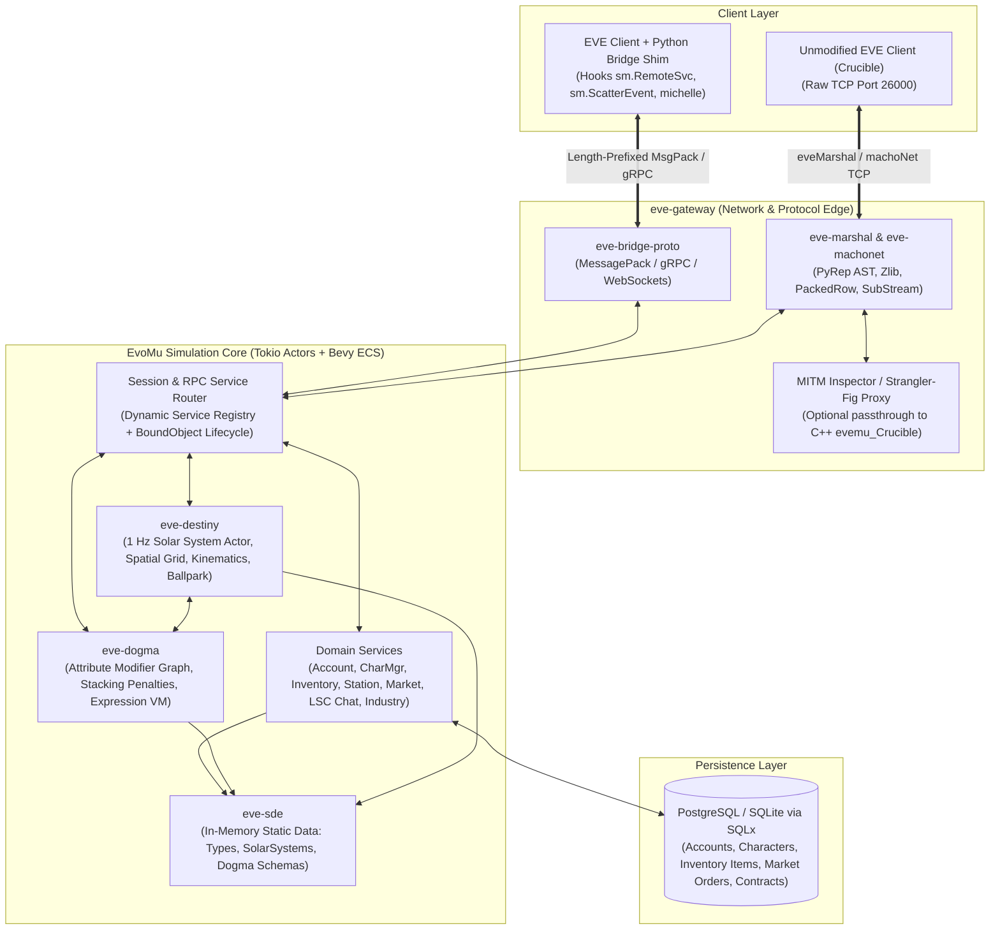

# Architectural Proposal: `EvoMu` — Next-Generation EVE Online Server Emulator in Rust

## 1. Executive Summary & Project Context

### 1.1 Objective
Design and implement **`EvoMu`**, a modern, clean-room EVE Online server emulator written in **Rust**, capable of:
1. Replacing the legacy C++ [`evemu_Crucible`](https://github.com/EvEmu-Project/evemu_Crucible) codebase (~150k+ LOC of 2006–2021 C++) with a memory-safe, concurrent, actor- and ECS-driven Rust architecture.
2. Running a **version-agnostic simulation core** powered by CCP's official **Static Data Export (SDE)** (supporting modern ship hulls, modules, Dogma attributes/effects, and solar system topologies).
3. Supporting a **Dual-Mode Client Integration Strategy**:
   - **Mode A (Modified Client / Python Service Bridge):** Replaces client-side choke-point Python modules (`machoNet` / `RemoteSvc` and `michelle` Ballroom sync) with a lightweight **MessagePack / gRPC transport shim**, eliminating legacy binary serialization bugs (`PyPackedRow` / `AddBalls`) and turning unimplemented client calls into self-documenting RPC traces.
   - **Mode B (Native `eveMarshal` + `machoNet` Compatibility):** Speaks the legacy `eveMarshal` wire protocol and `machoNet` RPC framing to allow unmodified reference clients (e.g., Crucible build 315678) and transparent MITM proxy testing against existing `evemu_Crucible` instances.

### 1.2 Why Not Simply Fork & Translate `evemu_Crucible` Line-for-Line?
A 1:1 mechanical translation of `evemu_Crucible` from C++ to Rust would carry over its deepest architectural flaws:
- **Monolithic Single-Threaded Bottlenecks:** `evemu_Crucible` couples network marshaling, SQL queries (blocking synchronous MySQL calls on the main tick thread), Dogma attribute calculation, and Destiny space physics inside tightly coupled C++ inheritance hierarchies (`Client`, `SystemEntity`, `DestinyManager`, `InventoryItem`).
- **`xmlpktgen` Technical Debt:** `evemu_Crucible` relies on custom XML packet definitions compiled into brittle C++ pointer-casting trees (`PyRep*`, `PyTuple*`, `PySafeDecRef`). In Rust, algebraic data types (`enum PyRep`) combined with a custom `serde` `Deserializer`/`Serializer` eliminate `xmlpktgen` entirely.
- **Incomplete 2011 Feature Coverage:** Even after 15+ years, `evemu_Crucible` implements only ~35–40% of the 2011 Crucible client's RPC surface and struggles with fundamental edge cases in Dogma modifier stacking, Destiny grid transitions, wormholes, POS warfare, and complex NPC AI.

---

## 2. High-Level System Architecture

The core design principle of `EvoMu` is **strict separation between the Wire/Presentation Layer and the Simulation Core**.



---

## 3. Client Integration Strategy: The "Three Chokepoints" Bridge

Because modifying the EVE client's Python layer is explicitly in scope, we do **not** need to reverse-engineer every undocumented binary quirk of the client's C++ DLLs (`blue.dll`, `Destiny.dll`) to get features working.

In EVE's client architecture, almost all 1,000+ UI windows and gameplay views communicate with the backend through **three Python chokepoints**:

### 3.1 Chokepoint 1: `MachoTransport` & `ServiceManager` (`sm.RemoteSvc` / `sm.ScatterEvent`)
Normally, UI code invokes remote server methods via:
```python
result = sm.RemoteSvc('stationSvc').GetSolarSystem(solarSystemID)
```
And listens for asynchronous server pushes via `__notifyevents__` dispatched by:
```python
sm.ScatterEvent('OnItemChange', itemRow, changeDict)
```

**Two-Tier Client Hook (`evomu_bridge.py`):**
1. **Transport-Layer Hook (`MachoTransport.Write` / `MachoTransport.Read` in `machoNetTransport.py`):**
   - For full-client integration, hooking `MachoTransport` directly below `machoNet` intercepts every `MachoPacket` (including `MachoBindObject` / `Moniker` calls, Piggybacked `SessionChangeNotification` frames that fire `OnSessionChanged`, and service scatter broadcasts) while bypassing binary `eveMarshal` / `PyPackedRow` serialization in favor of JSON/MessagePack.
2. **Service-Layer Proxy (`sm.RemoteSvc`):**
   - For standalone testing and headless harnesses, `RustRemoteServiceProxy` intercepts `proxy.MethodName(*args, **kwargs)` and `proxy.bind(object_id)` directly, capturing `(req_id, service_name, bound_id, method_name, args, kwargs, caller_trace)`.
3. **Client-Side Object Hydration:** When `EvoMu` responds with tagged structures (e.g., `{"$type": "KeyVal", ...}`, `{"$type": "Rowset", "header": [...], "rows": [...]}`), the Python shim hydrates them into genuine client-side `util.KeyVal`, `util.Rowset`, or `util.IndexRowset` instances **in pure Python**.
   - **Why this matters:** It completely eliminates `blue.DBRow` (`PyPackedRow`) RLE binary zero-compression bugs that cause instant C++ crashes in `blue.dll`.
4. **Inbound Notification Pump:** A background reader thread demultiplexes `ServerEvent` envelopes from `RpcResponse` frames (correlating responses strictly by `req_id`) and calls `sm.ScatterEvent(event_name, *hydrated_args)` directly on the client's `ServiceManager`.

### 3.2 Chokepoint 2: `michelle` & `Destiny.Ballpark` (Space Simulation Sync)
In a stock client, undocking requires the server to pack a fragile, undocumented binary buffer (`AddBalls` / `AddBalls2`) inside `DoDestinyUpdate`, which `michelle` passes directly into native C++.

**Proposed `michelle` Shim:**
- The native `Destiny.Ballpark` object exposed to Python already has high-level methods: `AddBall(...)`, `AddClientSideBall(...)`, `SetBallMass(...)`, `SetMaxSpeed(...)`, `GotoDirection(...)`, `Orbit(...)`, `FollowBall(...)`, `WarpTo(...)`, `RemoveBall(...)`.
- By shimming `michelle`'s state synchronization handler, `EvoMu` can send **strongly-typed Rust structs** (`SpawnBall`, `SetBallVelocity`, `SetBallMode`, `RemoveBall`, `SpecialFX`) serialized via MessagePack, and the Python shim invokes the corresponding `ballpark.*` methods and spawns the `Trinity` 3D visual models directly.
- **Fallback:** For unmodified Crucible clients (Mode B), `eve-destiny` also includes the binary `AddBalls` encoder (`eve-destiny::wire::add_balls`).

### 3.3 Chokepoint 3: Interactive RPC Gap Discovery ("Self-Documenting Emulator")
When a player clicks a UI button for an unimplemented feature (e.g., Planetary Interaction, Contracts, Sovereignty, or a newer expansion UI window):
1. The client bridge sends the exact RPC call + caller file/line number + expected return context to `EvoMu`.
2. If `EvoMu` does not have a registered handler for `(service, method)`:
   - `EvoMu` logs a structured **Missing RPC Specification** (JSON schema of arguments, session state, and client call stack) to `logs/unimplemented_rpcs.jsonl`.
   - Returns a configurable fallback (`None`, empty `Rowset`, or a non-fatal `UserError("FeatureNotImplemented")` toast in the EVE UI) so the client **never freezes or crashes**.

---

## 4. Cargo Workspace & Crate Breakdown

We propose a clean Cargo workspace (`evomu/`) organized into 7 focused crates (all enforcing `#![forbid(unsafe_code)]`):

```text
evomu/
├── Cargo.toml
├── crates/
│   ├── eve-proto/        # Wire protocols: MessagePack/JSON Bridge + Legacy eveMarshal/PyRep
│   ├── eve-machonet/     # machoNet packet framing, session state, BoundObject routing
│   ├── eve-sde/          # Static Data Export loader (YAML / SQLite -> in-memory indexes)
│   ├── eve-dogma/        # Ship/Module attribute modifier graph, stacking penalties, effects
│   ├── eve-destiny/      # 1 Hz space physics engine, spatial grid, kinematics, Ballpark sync
│   ├── eve-db/           # SQLx persistence layer (PostgreSQL / SQLite migrations & queries)
│   └── eve-server/       # Main binary: Tokio runtime, RPC service handlers, MITM proxy mode
└── client-bridge/
    └── evomu_bridge.py  # Drop-in Python ServiceManager & Michelle bridge for the EVE client
```

### 4.1 `eve-proto`: Dual-Protocol Serialization & `PyRep` AST
Provides a unified value representation (`PyRep`) that can serialize/deserialize seamlessly to **both**:
1. **Modern Bridge Format** (MessagePack / JSON with `$type` tags for `KeyVal`, `Rowset`, `IndexRowset`, `DBRow`, `TupleSet`, and raw byte strings vs. UTF-8 strings).
2. **Legacy `eveMarshal` Binary Format** aligned 1:1 with `EVEMarshalOpcodes.h` and `EVEUnmarshal.cpp`:
   - Exact opcode table (`0x02 = PyToken`, `0x0E = PyEmptyString`, `0x0F = PyCharString`, `0x10 = PyShortString`, `0x13 = PyLongString`, `0x19 = PySubStruct`, `0x1B = PySavedStreamElement`, `0x1C = PyChecksumedStream`, `0x2B = PySubStream`).
   - Trailing `save_count * 4` storage-index map decoding (`GetStorageIndex` pre-order read + post-order slot assignment) and `MAX_DECODED_NODES = 65_536` reference-expansion budget.

### 4.2 `eve-sde`: Version-Agnostic Static Data Engine
Instead of hardcoding SQL queries inside C++ classes like `evemu_Crucible`, `eve-sde` loads static game data into memory at startup (using `rkyv` or `bincode` cache snapshots for instant `<100ms` boot times):
- **Supported Sources:**
  - CCP's modern YAML/JSONL SDE (`types`, `groups`, `categories`, `dogmaAttributes`, `dogmaEffects`, `mapSolarSystems`, `blueprints`).
  - Legacy `evemu_Crucible` MySQL/SQLite static tables (`invTypes`, `dgmAttributeTypes`, `dgmEffects`, `mapDenormalize`).
- Exposes O(1) read-only lookups via `Arc<SdeRegistry>` shared across all `tokio` tasks.

### 4.3 `eve-dogma`: Deterministic Attribute & Effect Engine
Models EVE's complete item and ship fitting math as a standalone, 100% unit-testable crate:
- **Attribute Storage:** Sparse array / `SmallVec` per item storing `(base_value, dirty_flag, cached_effective_value)`.
- **Modifier Graph:** Directed graph of `Modifier` edges (`domain`, `func`, `modified_attribute_id`, `modifying_attribute_id`, `operator`, `skill_type_id`), with `ModifierOperator::try_from_sde_op(i32)` mapping CCP's SDE operator integers (`-1..=7`).
- **Operator Pipeline & Stacking Penalties:**
  Evaluates operators in strict EVE order:
  1. `PreAssign` (resolved deterministically via `high_is_good`)
  2. `PreMul` / `PreDiv`
  3. `ModAdd` / `ModSub`
  4. `PostMul` / `PostDiv` / `PostPercent` *(split into unpenalized and stacking-penalized buckets via `!DogmaAttributeType.stackable && modifier.stacking_penalized`; sorted by magnitude; weighted by $S(n) = e^{-(n / 2.67)^2}$ for $n = 0, 1, 2, \dots$)*
  5. `PostAssign`
- **Dynamic Simulation:**
  - Analytical & tick-based Capacitor/Shield recharge curve evaluation:
    $$C(t) = C_{\max} \left(1 + \left(\sqrt{\frac{C_0}{C_{\max}}} - 1\right) e^{-\frac{5(t - t_0)}{\tau_{\text{recharge}}}}\right)^2$$
  - Module state machine (`Offline` $\rightarrow$ `Online` $\rightarrow$ `Active` $\rightarrow$ `Overloaded` $\rightarrow$ `Deactivating` $\rightarrow$ `ReactivationDelay`).

### 4.4 `eve-destiny`: Actor-Per-System Space Physics & ECS
Each active solar system runs as an isolated **`tokio` actor** ticking at **1.0 Hz** (using `biased` `tokio::select!` and `MissedTickBehavior::Skip`):
- **Components:** `BallId`, `Transform` (`DVec3` 64-bit float coordinates in meters across astronomical AU distances), `Kinematics` (`velocity: DVec3`, `max_velocity: f64`, `inertia: f64`, `mass: f64`, `speed_fraction: f32`), `MovementMode`, `SlimItem`, `TargetLockTable`, `DamageState` (`shield`, `armor`, `hull`).
- **Movement Integrator:**
  - **Sub-warp (`GotoDirection`, `Follow`, `Orbit`):** Exponential velocity convergence with time constant $\tau = \frac{I \cdot M}{10^6}$ and velocity-plane orbit tangent selection:
    $$\vec{v}(t + \Delta t) = \vec{v}_{\text{goal}} + (\vec{v}(t) - \vec{v}_{\text{goal}}) e^{-\Delta t / \tau}$$
  - **Warp (`WarpTo`):** 4-phase analytical integrator (`Aligning` $\rightarrow$ `Accelerating` $\rightarrow$ `Cruising` $\rightarrow$ `Decelerating` $\rightarrow$ `Stop`) with symmetric short-warp peak speed $v_{\text{peak}} = \min(v_{\text{cruise}}, d_{\text{total}} / (1/k_a + 1/k_d))$, analytical acceleration displacement $\Delta x = (v_{\text{end}} - v_{\text{start}}) / k_a$, sub-warp dropout clamping, and `DestinyEvent::Stop` notification on warp exit.
- **Spatial Indexing (Grids / Bubbles):** Automatically partitions entities into dynamic spatial bubbles (~250 km–8,000 km grids) so `DoDestinyUpdate` notifications are only broadcast to clients on the same grid.

### 4.5 `eve-server`: Service Router & Domain Services
Implements an asynchronous RPC dispatcher with authenticated session and object-binding guards:
- **Bound Objects (`BoundObjectRegistry`):** Supports stateful per-client bound objects (`beyonce`, `dogmaIM`, `invbroker`, `stationSvc`) verified against character/system/station ownership on bind and cleaned up automatically on session disconnect.

---

## 5. Reordered Milestone Roadmap (Vertical-Slice Driven)

Based on architectural review feedback, the roadmap prioritizes a **durable vertical slice** before expanding surface area:

### Milestone 1: Durable Authenticated Bridge Vertical Slice
1. **Strict Session Authentication & Ownership:** Sessions start unauthenticated (`user_id: None`, `role: 0`). `auth.Login` validates credentials, derives roles from `AccountRecord`, and gates all character/inventory/space RPCs. `SelectCharacterID` and `bind_object` enforce ownership checks.
2. **Transactional Persistence & Fixed-Point Currency:** Encapsulate all state mutations behind atomic repository operations (`eve-db`) using fixed-point `IskCents(i64)` (`1 ISK = 100 cents`), optimistic concurrency `expected_version` checks, and `(character_id, idempotency_key)` scoping.
3. **Demultiplexed Client Bridge (`evomu_bridge.py`):** Dedicated reader thread correlating `RpcResponse` frames strictly by `req_id` with timeouts while routing asynchronous `ServerEvent` notifications to `sm.ScatterEvent`.

### Milestone 2: Actor-Connected Undocking, Destiny Physics & Synchronous Dogma
1. **Solar System Actor Registry (`SystemRegistry` & `SystemHandle`):** Bounded `mpsc` command channels (`SpawnBall`, `SetMovementMode`, `GetBallSnapshot`) and `broadcast` tick streams (`TickBroadcast { tick, events }`) linking atomic `stationSvc.Undock` (with `rollback_undock` compensation and SDE station 3D coordinates) and `beyonce` flight RPCs directly to the live 1 Hz `Ballpark`.
2. **Multi-Phase & Short-Warp Kinematics:** Explicit `Aligning` $\rightarrow$ `Accelerating` ($k_a$) $\rightarrow$ `Cruising` $\rightarrow$ `Decelerating` ($k_d = \min(k_a / 3, 2.0)\text{ s}^{-1}$) $\rightarrow$ `Stop` phases, symmetric short-warp $v_{\text{peak}}$ calculation, and automatic `DestinyEvent::Stop` emission on exit.
3. **Single-Owner Dogma Integration:** Keep `eve-dogma` as a synchronous domain library owned directly by the solar-system actor alongside movement and combat, combining attribute-level `DogmaAttributeType.stackable` with modifier-level stacking eligibility.

### Milestone 3: Epoch-Fenced System Handoffs & 3-Axis SDE Normalization
1. **Recoverable Stargate Jumps:** Transfer ships and contained inventory across solar-system actors under a durable handoff ID and increment `system_epoch` so stale system actors cannot commit mutations.
2. **3-Axis SDE Architecture:** Separate **Data Revision** (supporting CCP's JSONL/YAML SDE schemas), **Simulation Ruleset Profile** (e.g., Crucible vs. post-Rubicon warp acceleration profiles), and **Client Compatibility Profile** (projecting client-specific rowsets at the edge).

### Milestone 4: Captured-Packet Native Wire Suite & Byte-Passthrough MITM Proxy
1. **Hardened `eveMarshal` Codec:** Enforce `MAX_FRAME_SIZE`, `MAX_COLLECTION_LEN`, `MAX_RECURSION_DEPTH`, `MAX_DECODED_NODES`, and zero trailing bytes; match `EVEMarshalOpcodes.h` and trailing `save_count` reference tables.
2. **Byte-Passthrough MITM Proxy:** Forward raw original bytes untouched between a reference client and `evemu_Crucible` while decoding a cloned buffer asynchronously for packet fixture capture and regression testing.

---

## 6. Resolved Architectural Decisions (Reviews #1 & #2)

| Area | Architectural Decision | Status in Codebase |
| :--- | :--- | :---: |
| **1. Authentication & Object-Bind Authorization** | Unauthenticated session defaults (`user_id: None`, `role: 0`), `auth.Login` required, strict `user_id`/location ownership checks in `SelectCharacterID`, `bind_object`, and `MoveItem`, plus disconnect cleanup. | **Implemented & Tested** |
| **2. Multi-Phase & Short-Warp Kinematics** | 4-phase warp integrator (`Aligning`, `Accelerating`, `Cruising`, `Decelerating`) with symmetric short-warp $v_{\text{peak}}$, analytical $\Delta x = \Delta v / k_a$, sub-warp exit clamping, and `DestinyEvent::Stop` emission. | **Implemented & Tested** |
| **3. Network & Reference-Bomb Bounds** | Pre-allocation `MAX_FRAME_SIZE` (4 MiB), `MAX_COLLECTION_LEN` (32,768), `MAX_RECURSION_DEPTH` (64), `MAX_DECODED_NODES` (65,536), read/write timeouts, and connection semaphore. | **Implemented & Tested** |
| **4. Authoritative `EVEMarshalOpcodes.h` & Save Map** | Exact opcode alignment (`0x02 = PyToken`, `0x0E..0x13` byte strings, `0x19 = PySubStruct`, `0x1B = PySavedStreamElement`, `0x1C = PyChecksumedStream`, `0x2B = PySubStream`), `PyRep::Bytes` vs `String`, and trailing `save_count * 4` index table decoding. | **Implemented & Tested** |
| **5. Atomic Undock & Solar System Actor** | Pre-validated `undock_character` (`DbError::NotDocked` prevents double-undock), `rollback_undock` on actor failure, duplicate `BallId` rejection, SDE station 3D coordinates, and `biased` 1 Hz ticker. | **Implemented & Tested** |
| **6. Client Bridge Event Demultiplexing** | Background reader loop in `evomu_bridge.py` separating `ServerEvent` from `RpcResponse` with per-`req_id` correlation, `.bind(object_id)`, and timeouts. | **Implemented & Tested** |
| **7. Dogma Stacking, Operators & Tie-Breaking** | Central check combining `!DogmaAttributeType.stackable && modifier.stacking_penalized`, `ModifierOperator::try_from_sde_op(-1..=7)`, and `high_is_good` `PreAssign`/`PostAssign` tie-breaking. | **Implemented & Tested** |
| **8. Transactional Repository & Inventory Flags** | Private `RwLock` state, fixed-point `IskCents(i64)`, `InventoryFlag::Capsule = 56` / `Pilot = 57`, `(character_id, idempotency_key)` scoping, and `expected_version` optimistic concurrency. | **Implemented & Tested** |


