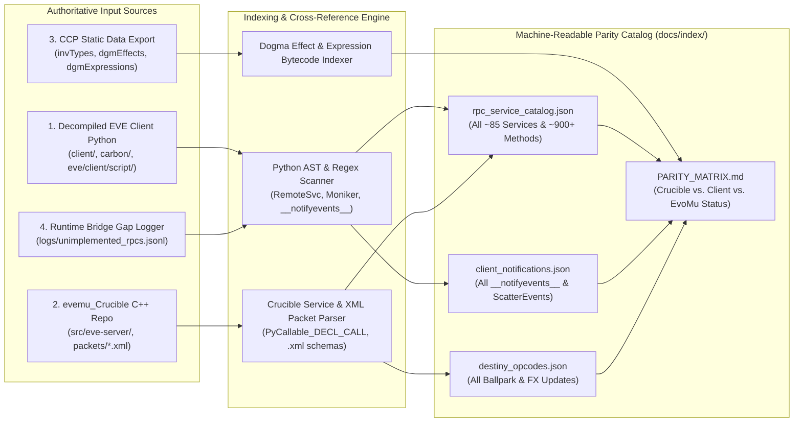

# `EvoMu` Master Execution Plan & Server Logic Indexing Blueprint

## 1. Objective

Achieve **complete, verifiable server feature parity** for `EvoMu` by:
1. **Systematically indexing 100% of required EVE Online server logic** across three authoritative sources:
   - **Decompiled EVE Client Python Codebase** (the ground truth of every remote call the client can ever make and every notification it expects).
   - **Reference [`evemu_Crucible`](https://github.com/EvEmu-Project/evemu_Crucible) C++ Codebase** (~150k LOC of partial 2011 implementation, XML packet definitions, and SQL schemas).
   - **CCP Official Static Data Export (SDE)** (all item types, Dogma attributes, effects, expression bytecode, solar systems, stations, skills, and blueprints).
2. **Implementing each domain subsystem in clean, modular, `#![forbid(unsafe_code)]` Rust** on top of the existing 7-crate `EvoMu` workspace (`eve-proto`, `eve-machonet`, `eve-sde`, `eve-dogma`, `eve-destiny`, `eve-db`, `eve-server`).

---

## 2. Current Foundation Status (Completed & Verified)

The foundational vertical slice and security invariants are already implemented and tested (`18/18` unit tests passing, zero Clippy warnings):
- **`eve-proto`:** Dual JSON/MessagePack Bridge + authoritative `EVEMarshalOpcodes.h` binary codec, `PyRep::Bytes` vs `String` vs `Token`, trailing `save_count * 4` reference table decoding (`EVEUnmarshal.cpp` `LoadRep`), `zlib` streams, and `MAX_DECODED_NODES` reference-bomb protection.
- **`eve-machonet`:** `MachoPacket`, `MachoAddress`, `VersionExchange` (`build 360229`), and unauthenticated-by-default `SessionState`.
- **`eve-sde`:** In-memory `SdeRegistry` with canonical attribute, ship, and solar-system definitions.
- **`eve-dogma`:** 5-stage operator pipeline (`PreAssign` $\rightarrow$ `PreMul`/`PreDiv` $\rightarrow$ `ModAdd`/`ModSub` $\rightarrow$ `PostMul`/`PostDiv`/`PostPercent` $\rightarrow$ `PostAssign`), SDE operator mapping (`-1..=7`), `!stackable` Gaussian stacking penalty ($S(n) = e^{-(n/2.67)^2}$), and analytical capacitor/shield recharge curves.
- **`eve-destiny`:** 1 Hz `Ballpark` with exponential sub-warp kinematics ($\tau = \frac{I \cdot M}{10^6}$), velocity-plane orbit tangents, and a 4-phase analytical warp integrator (`Aligning`, `Accelerating`, `Cruising`, `Decelerating`, `Stop`) with symmetric short-warp $v_{\text{peak}}$ and sub-warp dropout clamping.
- **`eve-db`:** Transactional repository with fixed-point `IskCents`, `InventoryFlag`, optimistic concurrency (`expected_version`), `(character_id, idempotency_key)` scoping, and atomic pre-validated `undock_character` + `rollback_undock`.
- **`eve-server` & `client-bridge`:** Dual TCP listeners (`26001` Bridge + `26000` `machoNet`), per-system 1 Hz actor tasks (`system_actor.rs`), bound-object ownership verification (`beyonce`, `dogmaIM`, `invbroker`, `stationSvc`), and a multithreaded Python client bridge (`evomu_bridge.py`).

---

## 3. Phase 1: Exhaustive Server Logic Indexing Pipeline

Before writing additional domain services by hand, the next engineering phase must build an **automated static analysis & indexing pipeline** (`tools/eve-indexer/` or `docs/index/`) that produces a complete, machine-readable specification of every server contract.

### 3.1 Four-Source Extraction Methodology

### 3.2 What Must Be Indexed & How

1. **Client Outbound RPC Calls (`docs/index/rpc_service_catalog.json`):**
   - Scan decompiled client Python AST for:
     - `sm.RemoteSvc('<service>').<Method>(...)`
     - `sm.ProxySvc('<service>').<Method>(...)`
     - `session.ConnectToRemoteService('<service>').<Method>(...)`
     - `Moniker('<service>', <bindParams>).<Method>(...)` and `util.Moniker` subclasses (`GetStationInventory`, `GetShipAccess`, `GetPlanet`, `GetCorpRegistry`, etc.).
   - For each call site, extract:
     - `service_name`, `is_bound_moniker`, `bind_param_schema`
     - `method_name`, positional `args`, keyword `kwargs`
     - **Return value destructuring pattern** in the caller (e.g., `rowset = svc.GetOrders(...)`; `for row in rowset: row.price, row.volRemaining` — this automatically reveals the exact column names and types required in returned `KeyVal`/`Rowset`/`IndexRowset`/`DBRow` payloads!).
2. **Server-to-Client Asynchronous Notifications (`docs/index/client_notifications.json`):**
   - Scan all client Python classes for `__notifyevents__ = [...]` and `def On<EventName>(self, *args):`.
   - Extract exact parameter signatures for every `On*` handler (`OnSessionChanged`, `OnItemChange`, `OnModuleAttributeChange`, `OnDamageStateChange`, `OnSpecialFX`, `OnLSC`, `OnSkillTrained`, `OnAccountChange`, `OnMarketOrderChanged`, etc.).
3. **`evemu_Crucible` Reference Cross-Check (`docs/index/crucible_comparison.json`):**
   - Parse every `PyCallable_DECL_CALL(<Method>)` and `PyCallable_REG_CALL(<Service>, <Method>)` across `evemu_Crucible/src/eve-server/`.
   - Classify each method into one of four states:
     - `ImplementedInCrucible` (working C++ logic available as reference)
     - `StubbedInCrucible` (returns empty `PyNone` / dummy `Rowset` in C++)
     - `BrokenInCrucible` (known bugs, crashes, or `TODO` comments in C++)
     - `MissingInCrucible` (called by client Python code, completely absent from `evemu_Crucible`)
4. **Dogma Effects & Expression VM Bytecode (`docs/index/dogma_effects.json`):**
   - Index all rows in `dgmEffects` and `dgmExpressions` (`preExpression`, `postExpression`, `operandID` opcodes `1..75` in CCP's Dogma expression tree) and map them to `eve-dogma` `Modifier` edges or active effect handlers.
5. **Destiny `DoDestinyUpdate` & `AddBalls` Schema (`docs/index/destiny_opcodes.json`):**
   - Catalog every `DoDestinyUpdate` method invoked on `michelle`'s `Ballpark` (`AddBalls`, `AddBalls2`, `RemoveBalls`, `SetState`, `GotoDirection`, `GotoPoint`, `Orbit`, `FollowBall`, `WarpTo`, `SetBallMass`, `SetMaxSpeed`, `SetSpeedFraction`, `SetBallInteractive`, `SetBallFree`, `SetBallGlobal`, `SetBallTroll`, `SetBallHarmonic`, `OnSpecialFX`, `OnDamageStateChange`, `TerminalPlayDestructionEffect`).

---

## 4. Complete EVE Server Subsystem & Service Taxonomy

The following 14 domain categories encompass the complete server surface area to be indexed and implemented:

### Domain 1: Core Session, Authentication & Bootstrap
| Service Name | Type | Core Responsibilities & Methods |
| :--- | :--- | :--- |
| `machoNet` | Core | `GetInitVals`, cluster service node resolution (`ResolveReq`), `MachoBindObject`, session state synchronization (`SessionInitialStateNotification`, `SessionChangeNotification`). |
| `authentication` / `auth` | Unbound | `Login`, `Ping`, VIP key & queue checks, account role bitmask assignment (`ROLE_LOGIN`, `ROLE_PLAYER`, `ROLE_GML`, `ROLE_ADMIN`). |
| `account` | Unbound | `GetCashBalance`, `GetEntryTypes`, `GetJournal`, `GetKeyMap`, `GiveCash`, `GiveCashFromCorpAccount`, AUR/PLEX transactions. |
| `alert` / `clientStatsMgr` | Unbound | `BeanCount`, `SendClientStackTraceAlert`, `LogClientStats` (client error telemetry — must acknowledge cleanly and log). |
| `config` | Unbound | `GetMultiOwnersEx`, `GetMultiLocationsEx`, `GetMultiAllianceShortNamesEx`, `GetMultiCorpTickerNamesEx`, `GetMap`, `GetMapOffices`, `GetStationSolarSystemsByOwner`. |
| `objectCaching` | Unbound | `GetCachableObject` — serves versioned cached `PySubStream` objects (`config.BulkData.*`, station services, market groups). |

### Domain 2: Character Creation, Selection, Skills & Clones
| Service Name | Type | Core Responsibilities & Methods |
| :--- | :--- | :--- |
| `charUnboundMgr` | Unbound | `GetCharacterToSelect`, `GetCharactersToSelect`, `GetCharacterInfo`, `SelectCharacterID`, `ValidateNameEx`, `CreateCharacterWithDoll`, `DeleteCharacter`, `PrepareCharacterForDelete`. |
| `charMgr` | Unbound | `GetPublicInfo`, `GetPublicInfo3`, `GetPrivateInfo`, `GetTopBounties`, `AddToBounty`, `GetCloneTypeID`, `GetHomeStation`, `SetCharacterDescription`, `GetNote`, `SetNote`. |
| `paperDollServer` | Unbound | `GetPaperDollData`, `UpdateExistingCharacterFull`, `GetMyPaperDollData` (3D character portrait/body sculpt data). |
| `skillMgr` | Bound | `GetSkillQueueAndFreePoints`, `SaveSkillQueue`, `CharStartTrainingSkillByTypeID`, `CharStopTrainingSkill`, `GetRespecInfo`, `RespecCharacter`, `InjectSkillIntoBrain`. |
| `certificateMgr` | Unbound | `GetMyCertificates`, `GetCertificateCategories`, `GrantCertificate`, `UpdateCertificateFlags`, `BatchCertificateGrant`. |
| `jumpCloneSvc` | Bound | `GetCloneState`, `InstallCloneInStation`, `GetPriceForClone`, `DestroyInstalledClone`, `CloneJump`. |

### Domain 3: Inventory, Ship Fitting & Dogma Instance Manager
| Service Name | Type | Core Responsibilities & Methods |
| :--- | :--- | :--- |
| `invbroker` | Bound (Location) | `GetInventoryFromId`, `GetInventory` (`flagHangar`, `flagCargo`, `flagDroneBay`, `flagCorpSAG1..7`), `List`, `Add`, `MultiAdd`, `Merge`, `StackAll`, `Split`, `SetLabel`, `TrashItems`, `AssembleCargoContainer`. |
| `dogmaIM` / `dogma` | Bound (Location) | `GetAllInfo` (`charInfo`, `shipInfo`, `shipModifiedCharAttribs`, `shipState`), `GetLocationInfo`, `GetCharacterBaseAttributes`, `Activate`, `Deactivate`, `Overload`, `StopOverload`, `RepairModule`, `ChangeAmmo`, `FitItem`, `UnfitItem`, `SetModuleOnline`. |
| `ship` | Bound (System/Station) | `Board`, `BoardStoredShip`, `LeaveShip`, `Eject`, `AssembleShip`, `RepackageShip`, `Jettison`, `Scoop`, `ScoopDrone`. |
| `insuranceSvc` | Bound (Station) | `GetContracts`, `GetInsurancePrice`, `InsureShip`, `UnInsureShip`. |
| `repairSvc` | Bound (Station) | `GetDamageReports`, `DamageModules`, `RepairItems`, `RepairAll`. |
| `reprocessingSvc` | Bound (Station) | `GetReprocessingInfo`, `GetQuotes`, `Reprocess`. |

### Domain 4: Station Services, Docking & Medical
| Service Name | Type | Core Responsibilities & Methods |
| :--- | :--- | :--- |
| `stationSvc` | Unbound | `GetStation`, `GetSolarSystem`, `GetStationItemBits`, `Undock`. |
| `station` | Bound (Station) | `GetGuests`, `GetTechTree`. |
| `medical` / `cloneMgr` | Bound (Station) | `GetMedical`, `SetHomeStation`, `UpgradeClone`, `ActivateClone` (pod death respawn flow). |
| `corpStationMgr` | Bound (Station) | `GetCorporateStationInfo`, `GetNumberOfUnrentedOffices`, `GetQuoteForRentingAnOffice`, `RentOffice`, `MoveCorpHQHere`, `SetCloneTypeID`. |

### Domain 5: Solar System Simulation, Destiny Physics & Navigation
| Service Name | Type | Core Responsibilities & Methods |
| :--- | :--- | :--- |
| `beyonce` | Bound (SolarSystem) | `GetFormations`, `GotoDirection`, `GotoPoint`, `AlignTo`, `WarpToStuff`, `WarpToStuffAutopilot`, `Orbit`, `CmdFollowBall`, `Stop`, `SetSpeedFraction`, `Dock`, `StargateJump`, `UpdateStateRequest`. |
| `map` | Unbound | `GetSolarSystemPseudoSecurities`, `GetStationCount`, `GetHistory`, `GetDynamicSystemInfo`, `GetStuckSystems`, `GetBeaconCount`. |
| `bookmarkSvc` | Unbound | `GetBookmarks`, `BookmarkLocation`, `DeleteBookmarks`, `UpdateBookmark`, `CopyBookmarks`. |
| `wormholeMgr` | Bound (System) | `WormholeJump`, dynamic wormhole mass exhaustion & collapse lifecycle. |
| `jumpbeaconsvc` | Unbound | Cynosural field & capital jump drive endpoints (`JumpToBeacon`, `GetFleetBeacons`). |

### Domain 6: Combat, Targeting, Weapons, Drones & EWAR
| Service Name | Type | Core Responsibilities & Methods |
| :--- | :--- | :--- |
| `target` / `dogmaIM` | Bound (System) | `AddTarget`, `RemoveTarget`, `ClearTargets`, `CancelAddTarget`, lock time calculation ($t_{\text{lock}} = \frac{40000}{\text{scanRes} \cdot \text{arsinh}^2(\text{sigRadius})}$), max locked targets. |
| `combat` (Internal Actor) | System Actor | Turret tracking & hit-quality math ($\text{ChanceToHit} = 0.5^{\left(\frac{\omega_{\text{trans}} \cdot 40000}{\text{tracking} \cdot \text{sigRadius}}\right)^2 + \left(\frac{\max(0, d - \text{optimal})}{\text{falloff}}\right)^2}$), missile flight & explosion velocity/radius damage formula, shield/armor/hull resistance application, pod ejection on hull breach, wreck & `entity_loot` generation. |
| `entity` (Drone Control) | Bound (System) | `CmdLaunchDrones`, `CmdEngage`, `CmdReturnBay`, `CmdReturnAndOrbit`, `CmdAbandonDrone`, `CmdAssist`, `CmdGuard`, `CmdMine`, `CmdSalvage`. |

### Domain 7: Market, Wallet & Contracts
| Service Name | Type | Core Responsibilities & Methods |
| :--- | :--- | :--- |
| `marketProxy` | Unbound | `GetMarketGroups`, `GetStationAsks`, `GetSystemAsks`, `GetRegionBest`, `GetOrders`, `GetOldPriceHistory`, `GetNewPriceHistory`, `PlaceCharOrder`, `ModifyCharOrder`, `CancelCharOrder`, `GetCharOrders`, `GetCorporationOrders`, `GetMarketESCROW`. |
| `contractMgr` / `contractProxy` | Unbound | `GetContractListForOwner`, `GetItemsInContainer`, `CreateContract`, `AcceptContract`, `DeleteContract`, `SplitStack`, `FinishAuction`, `PlaceBid`, `CollectMyPageInfo`, `SearchContracts`. |

### Domain 8: Corporations, Alliances, Standings & Faction Warfare
| Service Name | Type | Core Responsibilities & Methods |
| :--- | :--- | :--- |
| `corporationSvc` / `corpmgr` | Unbound / Bound | `GetCorporation`, `GetCorporations`, `CreateAlliance`, `UpdateCorporationAbilities`, `GetMember`, `GetMembers`, `UpdateMember`, `ExecuteActions`, `GetRoleGrouping`, `GetTitles`, `UpdateTitle`, `CanLeaveCurrentCorporation`, `ApplyForMembership`. |
| `allianceRegistry` | Bound | `GetAlliance`, `GetAllianceMembers`, `DeclareWarAgainst`, `ChangeMutualWarFlag`, `GetWars`, `GetRelationship`. |
| `standing2` | Unbound | `GetMyKillRights`, `GetNPCStandings`, `GetCharStandings`, `GetCorpStandings`, `GetStandingTransactions`, `SetPlayerStanding`, `SetCorpStanding`. |
| `facWarMgr` | Unbound | `GetFactionalWarStatus`, `GetWarFactions`, `GetSystemStatus`, `JoinFactionAsCharacter`, `LeaveFactionAsCharacter`, `GetCharacterRankInfo`. |

### Domain 9: Chat (`LSC`), Mail & Notifications
| Service Name | Type | Core Responsibilities & Methods |
| :--- | :--- | :--- |
| `LSC` (Large Scale Chat) | Unbound | `GetChannels`, `JoinChannels`, `LeaveChannels`, `SendMessage`, `CreateChannel`, `Configure`, `DestroyChannel`, `Invite`, `AccessControl` (Local solar-system channel auto-join on system change, Corp/Alliance channels). |
| `mailMgr` | Unbound | `MoveToTrash`, `MoveFromTrash`, `MarkAsRead`, `MarkAsUnread`, `DeleteMail`, `GetMailHeaders`, `GetBody`, `SendMail`, `SyncMail`, `GetLabels`, `CreateLabel`. |
| `notificationMgr` | Unbound | `GetByGroupID`, `GetAllNotifications`, `GetAllFormattedNotifications`, `MarkAsRead`. |

### Domain 10: Agents, Missions, LP Store & NPC AI
| Service Name | Type | Core Responsibilities & Methods |
| :--- | :--- | :--- |
| `agentMgr` | Bound (Agent) | `GetAgents`, `GetAgentByID`, `GetInfoServiceDetails`, `DoAction`, `GetEntryPoint`, `GetMissionBriefingInfo`, `GetMissionKeywords`, `GetMyJournalDetails`, `GetMyEpicJournalDetails`. |
| `lpstore` | Unbound | `GetLPForCharacterCorp`, `GetAvailableOffers`, `TakeOffer`. |
| `dungeon` / `spawnMgr` | System Actor | Belt rat spawning, deadspace complexes, acceleration gates, mission room triggers, NPC aggro/orbit/weapon AI ticks. |

### Domain 11: Industry, Science, Manufacturing & Planetary Interaction
| Service Name | Type | Core Responsibilities & Methods |
| :--- | :--- | :--- |
| `ramProxy` | Unbound | `GetJobs2`, `GetRelevantCharSkills`, `InstallJob`, `CompleteJob`, `AbortJob`, `GetAssemblyLines`, `GetAssemblyLinesSelect` (Manufacturing, ME/TE Research, Copying, Invention). |
| `planetMgr` / `planetBase` | Bound (Planet) | `GetPlanetsForChar`, `GetPlanetInfo`, `GetColonyForCharacter`, `UserNetworkCommand` (Extractors, Processors, Launchpads, Customs Office `planetOrbitalRegistryBroker`). |

### Domain 12: Fleet, Watchlist & Broadcasts
| Service Name | Type | Core Responsibilities & Methods |
| :--- | :--- | :--- |
| `fleetObjectHandler` / `fleetMgr` | Bound (Fleet) | `CreateFleet`, `Init`, `Invite`, `AcceptInvite`, `LeaveFleet`, `KickMember`, `MoveMember`, `CreateWing`, `DeleteWing`, `CreateSquad`, `DeleteSquad`, `SetBooster`, `SendBroadcast`, `AddToWatchlist`, `GetFleetAds`, `RegisterForDamageUpdates`. |

### Domain 13: Exploration, Scanning & Cosmic Anomalies
| Service Name | Type | Core Responsibilities & Methods |
| :--- | :--- | :--- |
| `scanSvc` | Bound (System) | `GetSystemAnomalies`, `RequestScans`, `ConeScan` (Directional Scanner / D-Scan), Probe Launcher tri-lateration math, Hacking/Archaeology/Salvaging mini-game triggers. |

### Domain 14: Starbases (POS) & Sovereignty
| Service Name | Type | Core Responsibilities & Methods |
| :--- | :--- | :--- |
| `posMgr` | Bound (System) | `AnchorOrbital`, `UnanchorOrbital`, `GetControlTowerFuelRequirements`, `SetTowerPassword`, force-field harmonic state (`SetBallHarmonic`), strontium reinforcement timers. |
| `sovMgr` | Unbound | `GetSystemSovereigntyInfo`, `GetContestedState`, Territorial Claim Units (TCU), Infrastructure Hubs (IHub), Station Services outposts. |

---

## 5. Step-by-Step Execution Plan for the Next Agent

### Step 1: Build the Automated Indexer (`tools/eve-indexer`)
1. Clone or point at local reference repositories:
   - `evemu_Crucible` (reference C++ server & XML packet specs).
   - Extracted/decompiled EVE client Python scripts (if present locally, or fetch reference client service interfaces).
2. Create a Rust binary crate `crates/eve-indexer` (or Python script `tools/index_server_logic.py`) that scans all service definitions, XML packets, and client `RemoteSvc` / `Moniker` / `__notifyevents__` signatures and writes:
   - `docs/index/services_index.json`
   - `docs/index/packets_and_rowsets.json`
   - `docs/index/PARITY_MATRIX.md`

### Step 2: SQLx Durable Persistence & Full SDE Importer (`eve-db`, `eve-sde`)
1. Add SQLite / PostgreSQL migrations (`crates/eve-db/migrations/`) backing `accounts`, `characters`, `character_skills`, `skill_queue`, `inventory_items`, `item_attributes`, `market_orders`, `wallet_journal`, `corporations`, `mails`, and `bookmarks`.
2. Expand `eve-sde` to load the full SDE (`invTypes`, `dgmAttributeTypes`, `dgmEffects`, `dgmTypeAttributes`, `dgmTypeEffects`, `mapSolarSystems`, `mapSolarSystemJumps`, `staStations`) with an `rkyv`/`bincode` pre-compiled cache for `<100ms` server startup.

### Step 3: Modularize `eve-server` into Domain Service Modules
Refactor `crates/eve-server/src/router.rs` into trait-based domain modules under `crates/eve-server/src/services/`:
- `services/auth.rs` (`authentication`, `machoNet`, `objectCaching`, `config`, `alert`)
- `services/character.rs` (`charUnboundMgr`, `charMgr`, `paperDollServer`, `skillMgr`, `certificateMgr`, `jumpCloneSvc`)
- `services/inventory.rs` (`invbroker`, `dogmaIM`, `ship`, `insuranceSvc`, `repairSvc`, `reprocessingSvc`)
- `services/station.rs` (`stationSvc`, `station`, `medical`, `corpStationMgr`)
- `services/space.rs` (`beyonce`, `map`, `bookmarkSvc`, `scanSvc`, `wormholeMgr`)
- `services/market.rs` (`marketProxy`, `account`, `contractMgr`)
- `services/social.rs` (`LSC`, `mailMgr`, `notificationMgr`, `corporationSvc`, `standing2`, `fleetMgr`)
- `services/pve_industry.rs` (`agentMgr`, `lpstore`, `ramProxy`, `planetMgr`, `posMgr`, `sovMgr`)

### Step 4: Complete Space Simulation & Combat Loop (`eve-destiny`, `eve-dogma`)
1. Add dynamic spatial grid partitioning (`Bubble` / `Grid` management, 250 km–8,000 km radius) to `eve-destiny`.
2. Implement `StargateJump` with epoch-fenced cross-system actor handoffs and `Dock` with 2,500m docking perimeter verification.
3. Implement target locking (`AddTarget`), weapon module activation cycles in `eve-dogma`, turret/missile damage calculation, shield/armor/hull damage state propagation (`OnDamageStateChange`), ship destruction (`TerminalPlayDestructionEffect`), pod spawning, and wreck/loot creation.

### Step 5: Native Client Wire Adapters & MITM Proxy (`eve-proto`, `eve-machonet`)
1. Implement `PyPackedRow` (`0x2A`) RLE zero-compressed byte packing using `DBRowDescriptor` schemas and binary `AddBalls` packing (`DestinyBinDump`) for unmodified Mode B clients.
2. Add the `--mitm-proxy <upstream_addr>` mode to `eve-server` on port `26000` for live packet fixture capture and automated regression testing.
