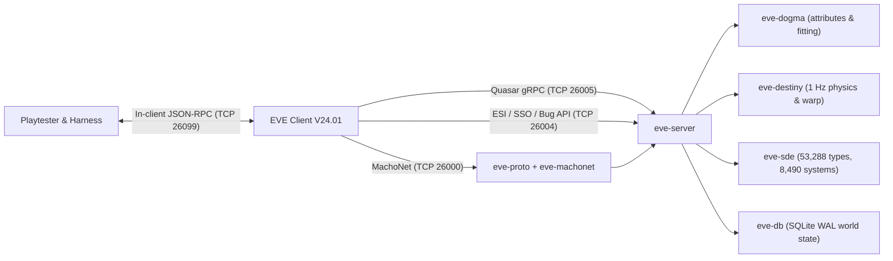

# EvoMu

**An open-source EVE Online server written from scratch in Rust for the unmodified V24.01 client (build 3619879 / macOS & Windows).**

[](https://www.rust-lang.org/)
[](#architecture)
[](./docs/ACTION_PLAN_STATUS.md)
[](./docs/wiki/README.md)
[](./LICENSE)

EvoMu implements classic MachoNet game services (`TCP 26000`), the HTTP/2 gRPC "Quasar" public gateway (`TCP 26005`), and the ESI OpenAPI + OAuth2/PKCE SSO web surface (`TCP 26004`) against the stock V24.01 client.

> [!IMPORTANT]
> **Work in progress (`0 / 29` `journey:*` rows closed in the parity ledger).** Core server systems and unit/integration suites are in place and the live V24.01 client is under continuous automated playtesting, but `plan:T-6`, `plan:Z-6`, and the `29` `journey:*` ledger rows remain **OPEN** until full end-to-end client journey attestation passes `final_gate.py`. See [`docs/ACTION_PLAN_STATUS.md`](./docs/ACTION_PLAN_STATUS.md) and [`docs/BLOCKERS.md`](./docs/BLOCKERS.md).

---

## Status

Progress is tracked mechanically in a **parity ledger** generated from V24.01 client bytecode and public specs ([`docs/ACTION_PLAN_STATUS.md`](./docs/ACTION_PLAN_STATUS.md)):

| Surface | Closed | Notes |
|---|---:|---|
| **Overall parity ledger** | **6,216 / 6,320 (98.35%)** | 3,814 done, 2,402 N/A (with client bytecode evidence), 104 open |
| **ESI, SDE, Destiny, Dogma effects** | **100%** | 197/197 ESI routes, 213 SDE resources, 52 Destiny modes/opcodes |
| **Client notifications (`notify`)** | **99.8%** | 1,309 / 1,311 closed (2 open) |
| **Gameplay features (`feat`)** | **98.7%** | 1,583 / 1,604 closed across 46 domains (38 domains at 100%) |
| **MachoNet RPCs (`rpc`) & Quasar (`quasar`)** | **97.3%** | 0 stubbed handlers across 1,613 `(service, method)` pairs |
| **Real-client journeys (`journey`)** | **0%** | 0 / 29 attested in ledger (14 / 29 passing in headless bridge mode) |

---

## Architecture



- **Safe Rust (`#![forbid(unsafe_code)]`)**, fixed-point ISK accounting, and transactional SQLite WAL persistence.
- **Game Systems & Technical Wiki:** See [`docs/wiki/README.md`](./docs/wiki/README.md) for documentation across all 16 domains ([Upwell Structures](./docs/wiki/upwell_and_structures/), [Living World & NPCs](./docs/wiki/npcs_and_living_world/), [Missions](./docs/wiki/missions_and_agents/), [Mining](./docs/wiki/mining_and_harvesting/), [Corporations](./docs/wiki/corporations_and_governance/), [Navigation](./docs/wiki/universe_and_navigation/), [Ballpark & Destiny](./docs/wiki/ballpark_and_physics/), [Dogma & Fitting](./docs/wiki/dogma_and_fitting/), [Combat & Crimewatch](./docs/wiki/combat_and_crimewatch/), [Industry](./docs/wiki/industry_and_manufacturing/), [Planetary Industry](./docs/wiki/planetary_industry/), [Markets & Contracts](./docs/wiki/economy_and_markets/), [Sovereignty & FW](./docs/wiki/sovereignty_and_faction_warfare/), [Character Progression](./docs/wiki/character_and_progression/), and [Protocol](./docs/wiki/protocol_and_infrastructure/)).

---

## Quick Start

### Prerequisites

- **Rust (`1.75+`)** and **Python (`3.9+`)**.
- **EVE Online V24.01 client (build 3619879):** Installed locally with a populated `SharedCache` (`tq/` + `ResFiles/`).

### Import Static Data

Extract `data/evomu_sde.sqlite` (53,288 item types, 8,490 solar systems, 5,210 stations, 2,892 missions) from your local EVE `SharedCache`:

```bash
# macOS (Apple Silicon runs under Rosetta x86_64 for EVE.app's embedded libpython2.7.dylib):
arch -x86_64 /usr/bin/python3 tools/sde-import/import_sde.py

# Windows PowerShell:
python tools/sde-import/import_sde.py --shared-cache "C:/Games/EVE"
```

### Configure & Run the Server

`eve-server` reads [`evomu.toml`](./evomu.toml) on startup (or `EVOMU_CONFIG_PATH`). On first boot it initializes `data/evomu_world.sqlite`, seeds **12,035** item types (**17,352** market orders) across Jita, Amarr, Dodixie, and Rens, and starts the 1 Hz solar system cluster loop:

```bash
cargo run --release -p eve-server
```

Key environment overrides: `EVOMU_CONFIG_PATH`, `EVOMU_SDE_PATH`, `EVOMU_DB_PATH`, `EVOMU_SHARED_CACHE`, `EVOMU_ACCOUNTS` (`user:pass,...`), `EVOMU_GM_ACCOUNT`, and `RUST_LOG`. For PLEX Vault and `$0.00` sandbox Fast Checkout configuration (`free_fast_checkout_plex`), see [PLEX Vault, Fast Checkout & New Eden Store](./docs/wiki/economy_and_markets/plex_and_new_eden_store.md).

To connect a manual client session, point `EVE_PUBLIC_GATEWAY_ADDRESS` at `127.0.0.1:26005` and pass `/server:127.0.0.1` to `exefile` (see [`docs/BLOCKERS.md`](./docs/BLOCKERS.md)).

---

## Testing Strategy

EvoMu uses a five-layer verification pipeline combining fast deterministic Rust tests, protocol gates, scripted E2E journeys, and continuous live-client AI playtesting:

### Unit & Crate Tests

Per-crate unit suites across `eve-proto`, `eve-machonet`, `eve-sde`, `eve-db`, `eve-destiny`, `eve-dogma`, and `eve-server` validate PyRep/MachoNet serialization, SDE queries, 1 Hz Destiny physics and multi-tick warp kinematics, Dogma modifier stacking, and SQLite transaction rollback:

```bash
cargo test --workspace --lib
```

### Integration Tests (`it`) & Shadow Client

The unified integration binary (`crates/eve-server/tests/it/`) and `ShadowClient` harness exercise multi-session MachoNet RPCs, Quasar HTTP/2 gRPC handlers, ESI endpoints, session-change handoffs, and client notification contracts against an in-process server and real SDE:

```bash
cargo test -p eve-server --test it
```

### Pre-Flight & Adversarial Review Gate

Every branch must pass [`preflight.py`](./.agents/skills/evomu-adversarial-review/scripts/preflight.py) and [`run_review.py`](./.agents/skills/evomu-adversarial-review/scripts/run_review.py) before landing on `main`. These gates enforce:
- **Client symbol authenticity:** Zero RPC or notification names missing from the V24.01 client, zero stubbed handlers (`stubs.py`), and zero wide shared match arms (`padding.py`).
- **Falling ratchets:** Monotonic migration ratchets for typed notifications (`TypedNotification`) and descriptor-checked protobuf builders.
- **Independent review:** A clean-worktree workspace test run (`~6,980+` tests) plus an independent adversarial code and claim audit.

### End-to-End Client Journeys

[`tools/client-harness/run_journeys`](./tools/client-harness/run_journeys) executes the 29 scripted gameplay journeys defined in [`client_journeys.json`](./.agents/skills/evomu-adversarial-review/references/parity/client_journeys.json) in either headless bridge mode or inside the real V24.01 client:

```bash
# Fast headless two-client bridge suite
python3 tools/client-harness/run_journeys \
  --out /tmp/evomu_bridge_journeys \
  --journeys .agents/skills/evomu-adversarial-review/references/parity/client_journeys.json \
  --bridge-harness-test

# Full real-client journey suite inside EVE.app
python3 tools/client-harness/run_journeys \
  --out /tmp/evomu_real_journeys \
  --journeys .agents/skills/evomu-adversarial-review/references/parity/client_journeys.json \
  --launch-real-client
```

### Live-Client AI Playtester & Telemetry

[`tools/client-harness/playtester.py`](./tools/client-harness/playtester.py) runs a continuous hybrid Planner/Executor AI agent against a live V24.01 `EVE.app` client (requires Xcode Command Line Tools on macOS, `xcode-select --install`, to compile its CoreGraphics window-capture helper):
- **In-Client CarbonUI Bridge (`127.0.0.1:26099`):** [`evomu_playtester_hook.py`](./tools/client-harness/evomu_playtester_hook.py) introspects live `uicore` windows/modals/widgets, dispatches non-blocking UI clicks, slash commands, and `uicore.cmd` actions, and records `sm.RemoteSvc` calls and client exceptions.
- **Background Retina Capture:** Captures `EVE.app` by `CGWindowID` across macOS Spaces without stealing focus.
- **In-Band Crash & `F12` Bug Reporting:** Unhandled client tracebacks (`alert.SendClientStackTraceAlert`) and in-game **`F12` -> Report a Bug** submissions (`/bugs/api` on `:26004`) are enriched with a 20-call MachoNet flight recorder, server log slices, and spatial/fitting snapshots, staged in `.evomu-bugs/queue/`, and deduplicated onto GitHub issues via [`tools/sync_bugs_to_github.py`](./tools/sync_bugs_to_github.py).

```bash
# Run offline playtester self-tests
python3 tools/client-harness/playtester.py --self-test

# Launch continuous hybrid live-client playtester
python3 tools/client-harness/playtester.py --hybrid --continuous

# Sync staged client/playtester bug reports to GitHub issues
python3 tools/sync_bugs_to_github.py --repo saverchenkov/EvoMu
```

See [`AGENTS.md`](./AGENTS.md) and [`docs/SUPERVISOR_CODER_ARCHITECTURE.md`](./docs/SUPERVISOR_CODER_ARCHITECTURE.md) for the multi-agent orchestration rules.

---

## Legal

EvoMu is an independent, non-commercial project, not affiliated with or endorsed by CCP Games. EVE Online and related marks are trademarks of CCP hf. The repository contains no client code and no redistributed client data. Licensed under the [MIT License](./LICENSE).
