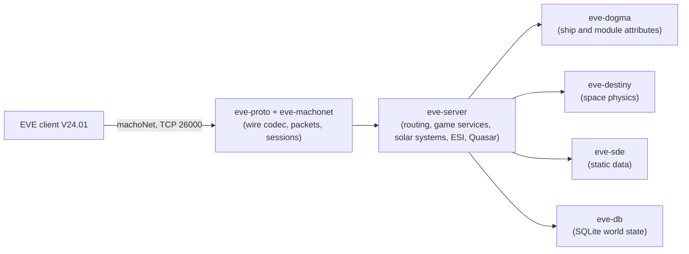

# EvoMu

**An open-source EVE Online server written from scratch in Rust, for the current client (V24.01, build 3619879).**

[](https://www.rust-lang.org/)
[](#architecture)
[](./docs/ACTION_PLAN_STATUS.md)
[](#at-a-glance)
[](./docs/wiki/README.md)
[](./LICENSE)

The goal: run your own server, point the **unmodified** EVE Online client at it, and play everything the official server offers. That includes the classic game services, the newer "Quasar" backend and the public ESI web API.

> [!IMPORTANT]
> **Not playable yet.** Most of the server exists and passes its own tests, but almost none of it is proven through the real game client yet. In manual runs, a locally reconfigured client logs in, selects a character, loads the station and undocks. None of the 29 scripted real-client journeys passes in the automated harness. The project counts as done only when all of them do.

*All numbers below come from a pre-flight run on `main` at `e647bcea` (2026-10-29). Live metrics: [`docs/ACTION_PLAN_STATUS.md`](./docs/ACTION_PLAN_STATUS.md) & [Game Systems Wiki](./docs/wiki/README.md).*

---

## At a glance

| | |
|---|---|
| **Parity ledger** | **5,780 of 6,351 rows closed (91.01%)**: 3,335 done, 2,445 not applicable, 571 open |
| **Automated tests** | 1,291 passing, 0 failing (100% green across workspace) |
| **Technical Wiki** | [Comprehensive Game Systems & Technical Wiki](./docs/wiki/README.md) (16 domains) |
| **Real-client journeys** | 0 of 29 passing |
| **Action-plan tasks** | 83 of 117 done |
| **Static data** | Full game database built from the client: 53,288 item types, 8,490 solar systems, 5,210 stations, 2,892 missions |

### What the ledger is
"Feature parity" is easy to claim and hard to check. EvoMu measures it with a **parity ledger**: one row for every small, testable thing the official server does. The rows are generated mechanically from the client and from public specs. Each row is in one of three states:

- **Done:** a passing test exercises real server logic for it.
- **Not applicable (N/A):** documented with evidence as something a server doesn't need to do. Example: protobuf messages the client never sends.
- **Open:** still to do.

A large share of the closed rows are N/A, so the headline percentage overstates how much has been built. The tables below separate the two.

---

## Game Systems & Technical Wiki

EvoMu includes an exhaustive, dual-perspective **[Technical & Game Systems Wiki](./docs/wiki/README.md)** documenting both canonical EVE Online (V24.01) mechanics and their clean-room Rust implementation architecture:

* 🏛️ **[Upwell Structures & Starbases](./docs/wiki/upwell_and_structures/)**: Citadels, complexes, anchoring constraints (1,000 km rule, Keepstar/Palatine limits), 15m/30m reinforcement timers, power states, Quantum Cores, ACLs, asset safety, and Pochven restrictions.
* 🛸 **[Living World & NPC AI Systems](./docs/wiki/npcs_and_living_world/)**: 3-tier LOD simulation, 1 Hz combat AI state machine (Idle $\rightarrow$ Chase $\rightarrow$ Orbit $\rightarrow$ Attack), regional belt rats, CONCORD response, Faction Police, and autonomous hauler convoys.
* 📋 **[Missions & Agent Divisions](./docs/wiki/missions_and_agents/)**: Security, Mining, and Distribution agents; mission lifecycle; decline penalties; 16-mission storyline tally; LP stores; standing math.
* ⛏️ **[Mining & Resource Harvesting](./docs/wiki/mining_and_harvesting/)**: Mining laser cycle engine, yield formulas, crystal volatility, waste/residue probabilities, specialized holds, ice/gas harvesting, moon chunk fracturing, and compression.
* 🏢 **[Corporations & Governance](./docs/wiki/corporations_and_governance/)**: Corp creation, 24-hour role grant delay security invariant, 7 hangars/wallets, shareholder voting, projects, and war declarations.
* 🌌 **[Universe & Navigation](./docs/wiki/universe_and_navigation/)**: Space topology, stargate jumps, align time math, cynosural navigation, filaments, wormholes, and Pochven rules.
* ⚙️ **[Ballpark Simulation & Destiny Physics](./docs/wiki/ballpark_and_physics/)**: Deterministic 1 Hz physics tick, sub-warp kinematics, collision, and interdiction bubble drag geometry.
* 🛠️ **[Dogma Attribute Engine & Fitting](./docs/wiki/dogma_and_fitting/)**: Modifier graphs, operator stacking, slot layouts, capacitor simulation, Nosferatu relative %, and module overheating.
* ⚔️ **[Combat Resolution & Crimewatch](./docs/wiki/combat_and_crimewatch/)**: Turret tracking equations, missile kinematics, damage resistance profiles, death pipeline, and engagement timers.
* 🏭 **[Industry, Manufacturing & PI](./docs/wiki/industry_and_manufacturing/)**: Blueprints (BPO/BPC), ME/TE math, reactions, System Cost Index (SCI), and [Planetary Industry](./docs/wiki/planetary_industry/).
* 💰 **[Economy, Markets & Contracts](./docs/wiki/economy_and_markets/)**: Regional order matching, escrow locks, broker fees, item exchange, and courier contracts.
* 🚩 **[Sovereignty & Faction Warfare](./docs/wiki/sovereignty_and_faction_warfare/)**: FW warzones, insurgencies, sov hubs, Equinox orbital Skyhooks, and Encounter Surveillance System (ESS).
* 🧬 **[Character Progression & Clones](./docs/wiki/character_and_progression/)**: Skill training rates ($SP/\text{min}$), medical clone respawn, jump clones, attribute implants, and combat boosters.
* 🔌 **[Protocol & Infrastructure](./docs/wiki/protocol_and_infrastructure/)**: MachoNet wire codec, PyRep marshal, Quasar protobuf gateway, and ESI OpenAPI routes.

## Progress by surface

| Surface | What a row is | Rows | Done | N/A | Open | Closed |
|---|---|---:|---:|---:|---:|---:|
| ESI web API | one public API operation | 197 | 195 | 0 | 2 | 99.0% |
| Static data | one data file the client ships | 213 | 156 | 57 | 0 | 100% |
| Quasar backend | one protobuf message | 1,455 | 104 | 1,328 | 23 | 98.4% |
| Space physics ("Destiny") | one movement mode or update type | 52 | 43 | 9 | 0 | 100% |
| Server calls (RPC) | one method the client calls | 1,373 | 1,200 | 113 | 60 | 95.6% |
| Gameplay features | one curated game behaviour | 1,603 | 1,285 | 94 | 224 | 86.0% |
| Client notifications | one event the client listens for | 1,311 | 268 | 833 | 210 | 84.0% |
| Action-plan tasks | one task in the [plan](./.agents/skills/evomu-adversarial-review/references/action_plan.md) | 117 | 83 | 0 | 34 | 70.9% |
| Real-client journeys | one scripted session in the real client | 29 | 0 | 0 | 29 | 0% |

*The table omits one dogma-effects sweep row (done).*

**How to read this:**
- **Quasar** is closed mostly by N/A: 1,328 of its 1,455 messages are ones the client never imports or never sends, found by a static analysis of the client's code.
- **Server calls and gameplay features** are where the real building happened: 2,485 rows done.
- **Plan tasks** close only when every one of a task's acceptance criteria is met. Many are waiting on the last few feature rows in their area, or on a real-client journey.

---

## Gameplay feature coverage

Every row in these domains is closed by server-level tests. That doesn't yet mean they work through the real client (see the gaps below).

> **Complete (0 open):** contracts (14 rows), wallet (16), loyalty points (6), standings (9), ESI (138).

| Domain | Open rows | Domain | Open rows |
|---|---:|---|---:|
| Session & space lifecycle | 68 of 68 | Sovereignty | 20 of 26 |
| PvE | 56 of 114 | Skills | 13 of 27 |
| Upwell structures | 51 of 74 | In-game UI services | 13 of 20 |
| Navigation | 47 of 89 | Characters | 12 of 29 |
| Faction warfare | 29 of 33 | Accounts | 10 of 24 |
| Quasar features | 23 of 126 | Social | 10 of 36 |
| Corporations | 22 of 51 | Clones, cosmetics, drones, fleets | 9 each |
| Combat | 21 of 43 | Crimewatch, NPCs, ships | 7 each |
| Modules | 21 of 137 | Others (abyssal, alliances, PI, invariants, scanning, server ops, wormholes, admin, attributes, dogma, exploration, inventory, mining, bookmarks, fitting, industry, market, war…) | 1–6 each |

---

## Action plan

The canonical plan has 114 tasks in 14 phases. Status by phase:

| Phase | Tasks done | What's left |
|---|---:|---|
| 0 Stabilize | 9 / 11 | reprocessing & remote-mutation feature rows (S-1, S-7) |
| 1 Data and persistence | 4 / 6 | durable world DB feature rows (D-3); no gameplay state outside DB (D-6) |
| 2 Wire protocol | 6 / 7 | notification feature rows (P-5) |
| T Test infrastructure | 4 / 10 | static-data sweeps (T-2); golden wire (T-4); real-client harness (T-6); invariant play (T-8); crash/restart harness (T-9); client oracle (T-10) |
| 3 Space | 4 / 6 | stargate jump polish (SP-4); logoff/disconnect/login in space (SP-6) |
| 4 Dogma and fitting | 3 / 6 | modifier engine (DG-1); module cycle engine (DG-4); ammo and weapon grouping (DG-6) |
| 5 Combat and PvE | 1 / 8 | damage notifications, death pipeline, NPC spawns and AI, salvage/tractor/drones, CrimeWatch/CONCORD |
| 5M Mining | 0 / 18 | all mining tasks (60 of 63 mining feature rows are done; the task-level criteria aren't all met) |
| 6 Characters and GM | 1 / 5 | skill queue engine and semantics (CH-1, CH-2); character info (CH-4); GM command dispatcher (CH-5) |
| 7 Economy and missions | 1 / 6 | market lifecycle, contracts, industry, missions, planetary interaction |
| 8 Social and exploration | 0 / 7 | mail, fleets, corporations, bookmarks, exploration, wormholes, chat |
| Q Quasar services | 1 / 9 | protobuf codegen (Q-1); identity, progression, social, economy, space, sovereignty, cosmetics families |
| ESI and SSO | 3 / 7 | SSO login through the real launcher; three route groups |
| Z Final acceptance | 0 / 8 | close every ledger row; 90% coverage, 85% mutation score; all journeys |

---

## The big gaps

### Gap 1: the real client, end to end
Nothing yet proves that whole gameplay loops work in the real client. The 29 [journeys](./.agents/skills/evomu-adversarial-review/references/parity/) run sessions with the real client: log in, create a character, fit a ship, undock, mine, fight, trade, run missions, form a fleet, anchor a structure, survive a downtime, and more. All 29 are still open.

One hurdle is outside the code: the stock client encrypts its login handshake with a key only CCP's servers hold. Manual runs use a local copy of the client configured for unencrypted handshakes. Whether the test harness may build that copy automatically is an [open decision](./docs/BLOCKERS.md).

### Gap 2: notifications
468 of the client's 1,311 notifications are still open. These are the events the server pushes so the client's screens update: damage taken, skill trained, order filled, structure attacked and so on. Without them the client shows stale state even when the server is right.

### Gap 3: the remaining server calls and features
- **423 RPC methods** have no real implementation yet. Unhandled calls return a proper "unimplemented" error, never a fake answer.
- **531 feature rows** are open, concentrated in session/space lifecycle, PvE, Upwell structures, navigation, faction warfare, Quasar features, corporations, combat, modules and sovereignty.

### Gap 4: quality gates
The final gate requires **≥ 90% line coverage** and **≥ 85% mutation score** across the workspace. Tooling exists, but the targets haven't been reached.

### Gap 5: known correctness debts
The independent reviewer tracks these as open findings ([list](./.agents/skills/evomu-adversarial-review/references/open_findings.md)). The most important ones:
- **Game state outside the database:** about 25 systems (wars, corp governance, insurgencies, bounty pools, structure access…) keep state in process memory, so it's lost on restart.
- **Hidden missing data:** about 95 places fall back to Jita or Jita 4-4 when a lookup fails, instead of reporting the error.
- **Simplified world simulation:** belt rats ignore system security and faction, and systems nobody is watching freeze, which stops NPCs and in-flight warps.
- **Leftovers:** the 2011-era combat call (`FireWeapon`) still works alongside the modern module path. Some service handlers share one body across unrelated methods, and a few return fixed values.
- **Shortcuts:** structure docking access uses a hard-coded list instead of real access profiles.

---

## How progress is kept honest

EvoMu is written mostly by AI coding agents, under a mechanical process designed to stop inflated claims:

1. **Tests decide.** A pre-flight script runs the whole suite and computes which ledger rows are closed. Numbers in docs and commits are copied from its output.
2. **Independent review.** Every change merged into `main` must pass an adversarial review by a separate AI model, which checks the claims against the code, the tests and the client's own catalogs. Periodic gap audits look for rows marked done that aren't really done.
3. **Supervisor and coder.** A supervisor agent owns the review gate and the ledger and sets priorities. A coding agent works several tracks in parallel, each in its own git worktree.

Rules: [`AGENTS.md`](./AGENTS.md). Process: [`docs/SUPERVISOR_CODER_ARCHITECTURE.md`](./docs/SUPERVISOR_CODER_ARCHITECTURE.md). Original design: [`PLAN.md`](./PLAN.md), [`docs/spec/`](./docs/spec/).

---

## Server Setup & Static Data (`evedb` / SDE) Import Guide

### Prerequisites

- **Rust toolchain:** Stable Rust (`1.75+`) with `cargo`.
- **Python 3:** Python `3.9+` (used by the SDE importer and client journey harness).
- **C compiler (macOS / Linux):** Xcode Command Line Tools (`xcode-select --install`) on macOS so `import_sde.py` can compile [`tools/sde-import/cfsd_runner.c`](./tools/sde-import/cfsd_runner.c) against the client's `libpython2.7.dylib`. On Windows, `import_sde.py` loads `python27.dll` directly via `ctypes` without requiring a C compiler.
- **EVE Online Client (V24.01, build 3619879):** Installed with a populated `SharedCache` (`tq` client build + `ResFiles` resource cache). Because CCP's client static data cannot be redistributed in git, EvoMu extracts the static database (`data/evomu_sde.sqlite`) directly from your local EVE installation.

---

### 1. Import the EVE Static Data Database (`data/evomu_sde.sqlite`)

EvoMu's SDE importer ([`tools/sde-import/import_sde.py`](./tools/sde-import/import_sde.py)) reads the 213 binary FSD resources (`*Loader.so` / `*.pyd` and `fsd.schemas.binaryLoader` inside `code.ccp`), solar system & station geometry (`mapObjects.db`), and English localization pickles (`res:/localizationfsd/localization_fsd_en-us.pickle`) directly from your EVE client's `SharedCache`, verifies MD5 checksums and record counts against [`docs/index/staticdata_catalog.json`](./docs/index/staticdata_catalog.json), and builds:

- **`data/evomu_sde.sqlite`** *(gitignored)* — Complete runtime static database containing **53,288 item types**, **8,490 solar systems**, **5,210 stations**, **2,892 missions**, dogma attributes/effects/modifiers, blueprints, reprocessing materials, wormhole classes, and NPC spawn tables.
- **`data/sde_import_manifest.json`** *(gitignored)* — Audit manifest of every imported table row count and verified client resource checksum.

#### Run the importer

**macOS** *(default `SharedCache`: `~/Library/Application Support/EVE Online/SharedCache`)*:
```bash
# On Apple Silicon (M1/M2/M3/M4), run under arch -x86_64 because EVE.app's embedded
# libpython2.7.dylib and *Loader.so FSD extractors are x86_64 binaries:
arch -x86_64 /usr/bin/python3 tools/sde-import/import_sde.py
```

**Windows** *(default `SharedCache`: `C:/Games/EVE`, or pass `--shared-cache`)*:
```powershell
python tools/sde-import/import_sde.py --shared-cache "C:/Games/EVE"
```

#### Importer CLI options
| Flag | Default | Description |
|---|---|---|
| `--shared-cache <PATH>` | `~/Library/Application Support/EVE Online/SharedCache` (macOS) or `C:/Games/EVE` (Windows) | Path to the EVE Online `SharedCache` directory containing `tq/` and `ResFiles/`. |
| `--out <PATH>` | `data/evomu_sde.sqlite` | Destination SQLite static database path. |
| `--manifest <PATH>` | `data/sde_import_manifest.json` | Destination JSON manifest path. |
| `--force-extract` | `false` | Forces re-extraction of cached FSD binary JSON in `/tmp/evomu_sde_cfsd` before building SQLite. |

---

### 2. Configure the Server ([`evomu.toml`](./evomu.toml))

On startup, `eve-server` loads [`evomu.toml`](./evomu.toml) from the working directory (or the path in `EVOMU_CONFIG_PATH`).

```toml
bind_address = "127.0.0.1"
macho_port = 26000   # Native V24.01 eveMarshal / machoNet GPSTransport TCP port (EVE client)
bridge_port = 26002  # JSON / MessagePack Client Bridge TCP port (dev harness & evomu_bridge.py)
esi_port = 26004     # ESI OpenAPI + OAuth2 / PKCE (S256) SSO HTTP port

sde_path = "data/evomu_sde.sqlite"
world_db_path = "data/evomu_world.sqlite"

[feature_flags]
enable_quasar_gateway = true
enable_esi_http = true
enable_living_world = true
seed_demo = false

# Optional: provision an admin / GM account at startup (passwords hashed at rest with Argon2id)
[[admin_accounts]]
username = "gm_admin"
password_token = "replace-with-strong-secret"
character_id = 90000003
character_name = "ISD Polaris"

# Optional: provision player accounts and auto-create a starter character on first boot
[[player_accounts]]
username = "pilot1"
password_token = "replace-with-strong-secret"

[player_accounts.starter_character]
name = "Capsuleer One"
bloodline_id = 1          # 1 = Deteis (Caldari)
gender = 1                # 1 = Male, 0 = Female
ancestry_id = 11          # 11 = Scientists
school_id = 17            # 17 = State War Academy
solar_system_id = 30000142 # Jita
station_id = 60003760      # Jita IV - Moon 4 - Caldari Navy Assembly Plant
initial_balance_isk = 100000000
```

#### Environment variable overrides
All settings can be overridden via environment variables without editing `evomu.toml`:

| Variable | Description |
|---|---|
| `EVOMU_CONFIG_PATH` | Path to a custom `.toml` configuration file (defaults to `./evomu.toml`). |
| `EVOMU_SDE_PATH` | Override `sde_path` (`data/evomu_sde.sqlite`). |
| `EVOMU_DB_PATH` / `EVOMU_SNAPSHOT_PATH` | Override `world_db_path` (`data/evomu_world.sqlite`). |
| `EVOMU_ACCOUNTS` | Comma-separated `user:password` list to provision player accounts on startup (e.g. `pilot1:pass1,pilot2:pass2`). |
| `EVOMU_GM_ACCOUNT` | `user:password` spec for a GM account (provisions character `90000003`, `"ISD Polaris"`). |
| `EVOMU_ADMIN_TOKEN` | Provisions GM account `"admin"` with the given password token. |
| `RUST_LOG` | Tracing filter (defaults to `eve_server=info,eve_destiny=info`). |

---

### 3. Build, Run & Seed the World Database

```bash
# 1. Build and run the server (release mode recommended for gameplay / client sessions)
cargo run --release -p eve-server
```

On first boot, `eve-server` automatically:
1. Opens `data/evomu_sde.sqlite` and validates the static data registry (`53,288` types, `8,490` solar systems).
2. Creates and initializes the persistent relational world database at `data/evomu_world.sqlite` (with WAL journaling and incremental row-fingerprint sync).
3. **Seeds the regional markets ([`world_seeder.rs`](./crates/eve-server/src/world_seeder.rs))**: Populates **12,035** published gameplay item types (**17,352** market orders) across **Jita 4-4** (`60003760`), **Amarr VIII** (`60008494`), **Dodixie IX** (`60011866`), and **Rens VI** (`60004588`) — covering ships, T1/T2/T3/Meta modules, rigs, ammo/charges, blueprints, skillbooks, drones, fighters, implants, boosters, materials, ores, planetary commodities, and Upwell structures.
4. Provisions any configured `[[player_accounts]]`, `starter_character` entries, and `[[admin_accounts]]`.
5. Pre-spawns the Jita (`30000142`) solar system physics actor and starts the 1 Hz cluster tick loop.

#### Running tests & the end-to-end client journey harness
```bash
# Run unit and integration test suites across the workspace
cargo test --workspace

# Run the 12 scripted client-bridge journeys end-to-end against a fresh eve-server instance
python3 tools/client-harness/run_journeys --out /tmp/evomu_harness --bridge-harness-test
```

To point the real V24.01 EVE client at your local server, see [`docs/BLOCKERS.md`](./docs/BLOCKERS.md) §3.

---

## Architecture



Safe Rust only (`#![forbid(unsafe_code)]`), fixed-point money, game rules driven by the static data, and only RPC and notification names that exist in the real client.

---

## Legal

EvoMu is an independent, non-commercial project, not affiliated with or endorsed by CCP Games. EVE Online and related marks are trademarks of CCP hf. The repository contains no client code and no data taken from the client. Licensed under the [MIT License](./LICENSE).
