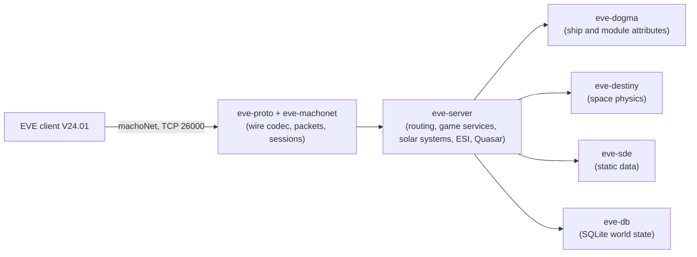

# EvoMu

**An open-source EVE Online server written from scratch in Rust, for the current client (V24.01, build 3619879).**

[](https://www.rust-lang.org/)
[](#architecture)
[](./docs/ACTION_PLAN_STATUS.md)
[](#gap-1-the-real-client-end-to-end)
[](./LICENSE)

The goal: run your own server, point the **unmodified** EVE Online client at it, and play everything the official server offers. That includes the classic game services, the newer "Quasar" backend and the public ESI web API.

> [!IMPORTANT]
> **Not playable yet.** Most of the server exists and passes its own tests, but almost none of it is proven through the real game client yet. In manual runs, a locally reconfigured client logs in, selects a character, loads the station and undocks. None of the 29 scripted real-client journeys passes in the automated harness. The project counts as done only when all of them do.

*All numbers below come from a pre-flight run on `main` at `75fcf0ed` (2026-10-22). Live numbers: [`docs/ACTION_PLAN_STATUS.md`](./docs/ACTION_PLAN_STATUS.md).*

---

## At a glance

| | |
|---|---|
| **Parity ledger** | **4,742 of 6,348 rows closed (74.7%)**: 2,493 done, 2,249 not applicable, 1,606 open |
| **Automated tests** | 784 passing, 0 failing |
| **Real-client journeys** | 0 of 29 passing |
| **Action-plan tasks** | 37 of 114 done |
| **Static data** | Full game database built from the client: 53,288 item types, 8,490 solar systems, 5,210 stations, 2,892 missions |

### What the ledger is
"Feature parity" is easy to claim and hard to check. EvoMu measures it with a **parity ledger**: one row for every small, testable thing the official server does. The rows are generated mechanically from the client and from public specs. Each row is in one of three states:

- **Done:** a passing test exercises real server logic for it.
- **Not applicable (N/A):** documented with evidence as something a server doesn't need to do. Example: protobuf messages the client never sends.
- **Open:** still to do.

A large share of the closed rows are N/A, so the headline percentage overstates how much has been built. The tables below separate the two.

---

## Progress by surface

| Surface | What a row is | Rows | Done | N/A | Open | Closed |
|---|---|---:|---:|---:|---:|---:|
| ESI web API | one public API operation | 197 | 197 | 0 | 0 | 100% |
| Static data | one data file the client ships | 213 | 153 | 57 | 3 | 98.6% |
| Quasar backend | one protobuf message | 1,455 | 67 | 1,328 | 60 | 95.9% |
| Space physics ("Destiny") | one movement mode or update type | 52 | 28 | 9 | 15 | 71.2% |
| Server calls (RPC) | one method the client calls | 1,373 | 839 | 111 | 423 | 69.2% |
| Gameplay features | one curated game behaviour | 1,603 | 978 | 94 | 531 | 66.9% |
| Client notifications | one event the client listens for | 1,311 | 193 | 650 | 468 | 64.3% |
| Action-plan tasks | one task in the [plan](./.agents/skills/evomu-adversarial-review/references/action_plan.md) | 114 | 37 | 0 | 77 | 32.5% |
| Real-client journeys | one scripted session in the real client | 29 | 0 | 0 | 29 | 0% |

*The table omits one dogma-effects sweep row (done).*

**How to read this:**
- **Quasar** is closed mostly by N/A: 1,328 of its 1,455 messages are ones the client never imports or never sends, found by a static analysis of the client's code.
- **Server calls and gameplay features** are where the real building happened: 1,817 rows done.
- **Plan tasks** close only when every one of a task's acceptance criteria is met. Many are waiting on the last few feature rows in their area, or on a real-client journey.

---

## Gameplay feature coverage

Every row in these domains is closed by server-level tests. That doesn't yet mean they work through the real client (see the gaps below).

> **Complete (0 open):** contracts (14 rows), wallet (16), loyalty points (6), standings (9), ESI (138).

| Domain | Open rows | Domain | Open rows |
|---|---:|---|---:|
| Session & space lifecycle | 68 of 68 | Sovereignty | 20 of 26 |
| PvE | 56 of 114 | Skills | 13 of 27 |
| Upwell structures | 51 of 74 | In-game UI services | 13 of 20 |
| Navigation | 47 of 89 | Characters | 12 of 29 |
| Faction warfare | 29 of 33 | Accounts | 10 of 24 |
| Quasar features | 23 of 126 | Social | 10 of 36 |
| Corporations | 22 of 51 | Clones, cosmetics, drones, fleets | 9 each |
| Combat | 21 of 43 | Crimewatch, NPCs, ships | 7 each |
| Modules | 21 of 137 | Others (abyssal, alliances, PI, invariants, scanning, server ops, wormholes, admin, attributes, dogma, exploration, inventory, mining, bookmarks, fitting, industry, market, war…) | 1–6 each |

---

## Action plan

The canonical plan has 114 tasks in 14 phases. Status by phase:

| Phase | Tasks done | What's left |
|---|---:|---|
| 0 Stabilize | 9 / 11 | reprocessing & remote-mutation feature rows (S-1, S-7) |
| 1 Data and persistence | 4 / 6 | durable world DB feature rows (D-3); no gameplay state outside DB (D-6) |
| 2 Wire protocol | 6 / 7 | notification feature rows (P-5) |
| T Test infrastructure | 4 / 10 | static-data sweeps (T-2); golden wire (T-4); real-client harness (T-6); invariant play (T-8); crash/restart harness (T-9); client oracle (T-10) |
| 3 Space | 4 / 6 | stargate jump polish (SP-4); logoff/disconnect/login in space (SP-6) |
| 4 Dogma and fitting | 3 / 6 | modifier engine (DG-1); module cycle engine (DG-4); ammo and weapon grouping (DG-6) |
| 5 Combat and PvE | 1 / 8 | damage notifications, death pipeline, NPC spawns and AI, salvage/tractor/drones, CrimeWatch/CONCORD |
| 5M Mining | 0 / 18 | all mining tasks (60 of 63 mining feature rows are done; the task-level criteria aren't all met) |
| 6 Characters and GM | 1 / 5 | skill queue engine and semantics (CH-1, CH-2); character info (CH-4); GM command dispatcher (CH-5) |
| 7 Economy and missions | 1 / 6 | market lifecycle, contracts, industry, missions, planetary interaction |
| 8 Social and exploration | 0 / 7 | mail, fleets, corporations, bookmarks, exploration, wormholes, chat |
| Q Quasar services | 1 / 9 | protobuf codegen (Q-1); identity, progression, social, economy, space, sovereignty, cosmetics families |
| ESI and SSO | 3 / 7 | SSO login through the real launcher; three route groups |
| Z Final acceptance | 0 / 8 | close every ledger row; 90% coverage, 85% mutation score; all journeys |

---

## The big gaps

### Gap 1: the real client, end to end
Nothing yet proves that whole gameplay loops work in the real client. The 29 [journeys](./.agents/skills/evomu-adversarial-review/references/parity/) run sessions with the real client: log in, create a character, fit a ship, undock, mine, fight, trade, run missions, form a fleet, anchor a structure, survive a downtime, and more. All 29 are still open.

One hurdle is outside the code: the stock client encrypts its login handshake with a key only CCP's servers hold. Manual runs use a local copy of the client configured for unencrypted handshakes. Whether the test harness may build that copy automatically is an [open decision](./docs/BLOCKERS.md).

### Gap 2: notifications
468 of the client's 1,311 notifications are still open. These are the events the server pushes so the client's screens update: damage taken, skill trained, order filled, structure attacked and so on. Without them the client shows stale state even when the server is right.

### Gap 3: the remaining server calls and features
- **423 RPC methods** have no real implementation yet. Unhandled calls return a proper "unimplemented" error, never a fake answer.
- **531 feature rows** are open, concentrated in session/space lifecycle, PvE, Upwell structures, navigation, faction warfare, Quasar features, corporations, combat, modules and sovereignty.

### Gap 4: quality gates
The final gate requires **≥ 90% line coverage** and **≥ 85% mutation score** across the workspace. Tooling exists, but the targets haven't been reached.

### Gap 5: known correctness debts
The independent reviewer tracks these as open findings ([list](./.agents/skills/evomu-adversarial-review/references/open_findings.md)). The most important ones:
- **Game state outside the database:** about 25 systems (wars, corp governance, insurgencies, bounty pools, structure access…) keep state in process memory, so it's lost on restart.
- **Hidden missing data:** about 95 places fall back to Jita or Jita 4-4 when a lookup fails, instead of reporting the error.
- **Simplified world simulation:** belt rats ignore system security and faction, and systems nobody is watching freeze, which stops NPCs and in-flight warps.
- **Leftovers:** the 2011-era combat call (`FireWeapon`) still works alongside the modern module path. Some service handlers share one body across unrelated methods, and a few return fixed values.
- **Shortcuts:** structure docking access uses a hard-coded list instead of real access profiles.

---

## How progress is kept honest

EvoMu is written mostly by AI coding agents, under a mechanical process designed to stop inflated claims:

1. **Tests decide.** A pre-flight script runs the whole suite and computes which ledger rows are closed. Numbers in docs and commits are copied from its output.
2. **Independent review.** Every change merged into `main` must pass an adversarial review by a separate AI model, which checks the claims against the code, the tests and the client's own catalogs. Periodic gap audits look for rows marked done that aren't really done.
3. **Supervisor and coder.** A supervisor agent owns the review gate and the ledger and sets priorities. A coding agent works several tracks in parallel, each in its own git worktree.

Rules: [`AGENTS.md`](./AGENTS.md). Process: [`docs/SUPERVISOR_CODER_ARCHITECTURE.md`](./docs/SUPERVISOR_CODER_ARCHITECTURE.md). Original design: [`PLAN.md`](./PLAN.md), [`docs/spec/`](./docs/spec/).

---

## Getting started

**You need:** a stable Rust toolchain, Python 3, and an installed EVE Online client (V24.01). The game's static data can't be redistributed, so you build it from your own client install, and it stays out of git.

```bash
git clone https://github.com/saverchenkov/EvoMu.git
cd EvoMu

# 1. Build the static-data database from your client (writes data/evomu_sde.sqlite; macOS client paths today)
/usr/bin/python3 tools/sde-import/import_sde.py

# 2. Build and run the tests (integration tests are one binary: crates/eve-server/tests/it/)
cargo build --workspace
cargo test --workspace

# 3. Run the server (26000 = client protocol, 26001 = dev bridge; settings in evomu.toml)
cargo run -p eve-server
```

To point the real client at your server, see [`docs/BLOCKERS.md`](./docs/BLOCKERS.md) §3.

---

## Architecture



Safe Rust only (`#![forbid(unsafe_code)]`), fixed-point money, game rules driven by the static data, and only RPC and notification names that exist in the real client.

---

## Legal

EvoMu is an independent, non-commercial project, not affiliated with or endorsed by CCP Games. EVE Online and related marks are trademarks of CCP hf. The repository contains no client code and no data taken from the client. Licensed under the [MIT License](./LICENSE).
