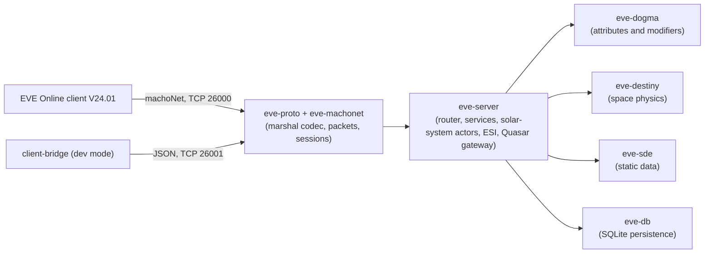

# EvoMu

**A clean-room EVE Online server emulator in Rust, built for the current client (V24.01, build 3619879).**

[](https://www.rust-lang.org/)
[](#design-principles)
[-blue.svg)](./docs/index/PARITY_MATRIX.md)
[](./LICENSE)

EvoMu aims to let the unmodified, current EVE Online client log in and play against a self-hosted server: character creation, skills, fitting, flight, combat, mining, industry, market, missions, corporations, sovereignty and the modern backend ("Quasar") services. It succeeds the C++ [evemu_Crucible](https://github.com/EvEmu-Project/evemu_Crucible) project, which targets the 2011 client. EvoMu re-implements that logic from scratch and doesn't copy it.

> **Status: work in progress, not playable yet.** The real client logs in, selects a character and reaches the station hangar on a development branch. Undocking and in-space play through the real client are next.

---

## Status at a glance

Progress is measured against a **parity ledger** of 6,128 testable rows, generated from the client's own service, notification and protobuf catalogs, the static data, the ESI spec, a feature taxonomy and the action plan. A row counts as closed only when a passing test exercises real server logic for it (`DONE`), or when it is documented as not applicable to a server, for example client-internal (`NA`).

*Snapshot: pre-flight on `f22fe66`, 2026-10-21 17:32 PDT. Tests: **604 passed, 0 failed**.*

| Area | Rows | Done | N/A | Open | Closed |
|---|---:|---:|---:|---:|---:|
| ESI (public REST API) | 197 | 197 | 0 | 0 | 100% |
| Dogma effects (SDE sweep) | 1 | 1 | 0 | 0 | 100% |
| Quasar backend messages | 1,455 | 77 | 1,328 | 50 | 96.6% |
| Static data resources | 213 | 134 | 60 | 19 | 91.1% |
| Destiny (space physics) | 52 | 37 | 10 | 5 | 90.4% |
| Gameplay features | 1,531 | 890 | 94 | 547 | 64.3% |
| Client notifications | 1,311 | 46 | 603 | 662 | 49.5% |
| Classic RPC methods | 1,230 | 352 | 111 | 767 | 37.6% |
| Action-plan tasks | 109 | 41 | 0 | 68 | 37.6% |
| Real-client journeys | 29 | 0 | 0 | 29 | 0% |
| **Total** | **6,128** | **1,775** | **2,206** | **2,147** | **64.96%** |

The live, per-task view is [`docs/ACTION_PLAN_STATUS.md`](./docs/ACTION_PLAN_STATUS.md), regenerated by pre-flight. Known environment constraints are listed in [`docs/BLOCKERS.md`](./docs/BLOCKERS.md).

### What works today
- **Wire protocol:** the binary `eveMarshal` codec and machoNet packets, sessions and session-change diffs, plus a JSON bridge mode for development.
- **Static data:** the full SDE (types, dogma, universe, NPCs, blueprints and more) loaded from a locally built SQLite database.
- **Accounts and characters:** login, character creation and selection, skills and skill queue, clones, implants.
- **Ships and dogma:** fitting validation, the attribute/modifier engine with stacking penalties, capacitor, heat, module activation.
- **Space:** a 1 Hz solar-system simulation with alignment, warp, stargates, docking and undocking, and binary Destiny state updates.
- **Economy and activities:** market, contracts, industry, PI, mining (SDE-driven cycle engine), missions, corporations, fleets, sovereignty and faction warfare, at varying depth.
- **ESI:** every route in the public ESI spec, served from server state.

### What's next
1. **Real-client journeys** (`plan:T-6`): undock and fly with the real client, then the remaining 29 scripted journeys.
2. **Notifications:** emit the remaining client notifications from real server state changes, one family at a time.
3. **Classic RPCs:** close the remaining method rows with real behaviour (no constant or echo handlers).
4. **Quality gates:** reach ≥ 90% line coverage and ≥ 85% mutation score, required by the final gate.

---

## Architecture



| Crate | Role |
|---|---|
| [`eve-proto`](./crates/eve-proto) | `eveMarshal` encoder and decoder, the PyRep value model, the bridge wire format |
| [`eve-machonet`](./crates/eve-machonet) | machoNet packets, addresses, session state and diffs |
| [`eve-sde`](./crates/eve-sde) | Static Data Export registry and loaders |
| [`eve-dogma`](./crates/eve-dogma) | Dogma attribute and modifier pipeline, stacking penalties, capacitor and heat |
| [`eve-destiny`](./crates/eve-destiny) | Ballpark kinematics, warp, bubbles, Destiny updates |
| [`eve-db`](./crates/eve-db) | Durable SQLite world state, fixed-point ISK, transactional updates |
| [`eve-server`](./crates/eve-server) | TCP listeners, RPC router, game services, ESI and Quasar endpoints |
| [`eve-testkit`](./crates/eve-testkit) | Parity attestation helpers for tests |

### Design principles
- `#![forbid(unsafe_code)]` across the workspace. Money is fixed-point, never floats.
- **Data-driven:** game rules come from the SDE (dogma attributes and effects), not hardcoded IDs.
- **Client-verified names:** every RPC and notification name must exist in the real client.
- **Honest progress:** a row is closed only by a passing test against real logic, and every change to `main` passes an independent adversarial review (see [Development process](#development-process)).

---

## Getting started

**Requirements:** a Rust stable toolchain and Python 3. Running the test suite needs the **local static data**, which is built from your own EVE client install and can't be distributed: `data/*.sqlite*` is gitignored.

```bash
git clone https://github.com/saverchenkov/EvoMu.git && cd EvoMu

# Build the local SDE database from your own V24.01 client install (macOS client paths today)
/usr/bin/python3 tools/sde-import/import_sde.py      # writes data/evomu_sde.sqlite

cargo build --workspace
cargo test --workspace          # integration tests live in a single binary: crates/eve-server/tests/it/

# Run the server (ports 26000 machoNet / 26001 bridge; settings in evomu.toml)
cargo run -p eve-server
```

Pointing the real client at a local server, and the client's crypto requirements, are covered in [`docs/BLOCKERS.md`](./docs/BLOCKERS.md) §3.

---

## Repository layout

```text
crates/            Rust workspace (see the crate table above)
client-bridge/     Python bridge for development mode
tools/             SDE and Quasar importers, server-logic indexer, real-client harness
docs/              Plan status, blockers, specs, generated catalogs (docs/index/), parity notes
fuzz/              cargo-fuzz targets for the decoders
.agents/           Review gate, parity ledger and agent skills (maintained by the supervisor agent)
AGENTS.md          Rules for coding agents working on this repository
```

---

## Development process

EvoMu is built mostly by AI coding agents under a strict, mechanical process:

- **Parity ledger and pre-flight:** `preflight.py` runs the whole test suite and computes ledger closure from test attestations. Every number in claims and docs is copied from its output.
- **Independent review gate:** every change merged into `main` gets a non-FAIL verdict from an adversarial reviewer model that checks the claims against the code, the tests and the client catalogs. Work branches can be committed freely; reviews run on a committed snapshot.
- **Supervisor and coder:** a supervisor agent owns the gate and the ledger and steers priorities; a coding agent runs several parallel tracks in separate git worktrees.

Details are in [`AGENTS.md`](./AGENTS.md) and [`docs/SUPERVISOR_CODER_ARCHITECTURE.md`](./docs/SUPERVISOR_CODER_ARCHITECTURE.md). The original plan and specifications are in [`PLAN.md`](./PLAN.md) and [`docs/spec/`](./docs/spec/).

### Routing statistics (vertical-slice handler coverage)
Across all `216` cataloged `machoNet` services (`1,230` cataloged client candidate methods total; `1092` client candidate methods across the `156` explicit services), `144/216` cataloged services handle `854/1092` V24.01 client candidate methods by exact name. `12` additional cataloged services are handled via custom/bridge/Crucible method names (`156/216` cataloged services with explicit handlers; `60/216` services return `UnimplementedRPC`). `1290` `(service, method)` handlers across `874` match arms (`635` single-method + `239` multi-method arms) are routed in `services/*.rs`. Handler routing is vertical-slice coverage only; authoritative per-row parity closure is the ledger above and [`docs/ACTION_PLAN_STATUS.md`](./docs/ACTION_PLAN_STATUS.md).

---

## Legal

EvoMu is an independent, non-commercial project, not affiliated with or endorsed by CCP Games. EVE Online and related marks are trademarks of CCP hf. The repository contains no client code or client-derived data: you build the static data locally from your own client install. Licensed under the [MIT License](./LICENSE).
