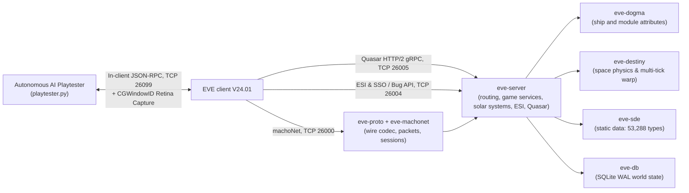

# EvoMu

**An open-source EVE Online server written from scratch in Rust, for the current client (V24.01, build 3619879 / macOS & Windows).**

[](https://www.rust-lang.org/)
[](#architecture)
[](./docs/ACTION_PLAN_STATUS.md)
[](#at-a-glance)
[](./docs/wiki/README.md)
[](./LICENSE)

The goal: run your own server, point the **unmodified** EVE Online V24.01 client at it, and play everything the official server offers — including classic MachoNet game services (`TCP 26000`), the HTTP/2 gRPC "Quasar" public gateway (`TCP 26005`), and the ESI OpenAPI + OAuth2/PKCE SSO web surface (`TCP 26004`).

> [!IMPORTANT]
> **Not certified playable yet (`0 / 29` `journey:*` rows closed in the parity ledger).** Most server systems exist and pass workspace tests, and the real-client harness ([`tools/client-harness/run_journeys`](./tools/client-harness/run_journeys)) + autonomous multimodal AI playtester ([`tools/client-harness/playtester.py`](./tools/client-harness/playtester.py)) are actively exercising `EVE.app`, but `plan:T-6`, `plan:Z-6`, and all `29` `journey:*` rows remain **OPEN** (`journeys[<id>]["passed"]` stays `False` in the ledger until `final_gate.py` and the review gate verify clean end-to-end execution logs). See [`docs/BLOCKERS.md`](./docs/BLOCKERS.md).

*All numbers below come from the latest pre-flight and adversarial review run on `main` (2026-11-08). Live metrics: [`docs/ACTION_PLAN_STATUS.md`](./docs/ACTION_PLAN_STATUS.md) & [Game Systems Wiki](./docs/wiki/README.md).*

---

## At a glance

| | |
|---|---|
| **Parity ledger** | **6,216 of 6,353 rows closed (97.84%)**: 3,814 done, 2,402 not applicable, 137 open |
| **Automated tests** | **4,885 passing tests** across the parity ledger (`4,923` workspace test executions, `0` failing) |
| **Real-client E2E journeys** | **0 of 29 closed in parity ledger** (`plan:T-6` open pending clean [`run_journeys --launch-real-client`](./tools/client-harness/run_journeys) gate + `final_gate.py`; **14 of 29** in headless bridge mode `--bridge-harness-test`) |
| **Autonomous live playtester** | Continuous LLM-driven V24.01 client playtester ([`tools/client-harness/playtester.py`](./tools/client-harness/playtester.py)) with in-client CarbonUI introspection, multi-space Retina screenshot capture, MachoNet flight recorder, and semantic bug filing |
| **Action-plan tasks** | **109 of 118 done (92.4%)** across 14 phases (8 phases 100% complete) |
| **Technical Wiki** | [Comprehensive Game Systems & Technical Wiki](./docs/wiki/README.md) (16 domains) |
| **Static data** | Full game database extracted from the V24.01 client: 53,288 item types, 8,490 solar systems, 5,210 stations, 2,892 missions |

### What the ledger is
"Feature parity" is easy to claim and hard to check. EvoMu measures it with a **parity ledger**: one row for every small, testable thing the official server does. The rows are generated mechanically from the client and from public specs. Each row is in one of three states:

- **Done:** a passing test exercises real server logic for it (and passes independent adversarial gap audits).
- **Not applicable (N/A):** documented with client bytecode evidence as something a server doesn't need to do (for example, client-local `sm.ScatterEvent` notifications or protobuf messages the V24.01 client never imports or sends).
- **Open:** still to do (or flagged by the adversarial gap auditor for deeper validation).

---

## Game Systems & Technical Wiki

EvoMu includes an exhaustive, dual-perspective **[Technical & Game Systems Wiki](./docs/wiki/README.md)** documenting both canonical EVE Online (V24.01) mechanics and their clean-room Rust implementation architecture:

* 🏛️ **[Upwell Structures & Starbases](./docs/wiki/upwell_and_structures/)**: Citadels, complexes, anchoring constraints (1,000 km rule, Keepstar/Palatine limits), 15m/30m reinforcement timers, power states, Quantum Cores, ACLs, asset safety, and Pochven restrictions.
* 🛸 **[Living World & NPC AI Systems](./docs/wiki/npcs_and_living_world/)**: 3-tier LOD simulation, 1 Hz combat AI state machine (Idle $\rightarrow$ Chase $\rightarrow$ Orbit $\rightarrow$ Attack), regional belt rats, CONCORD response, Faction Police, and autonomous hauler convoys.
* 📋 **[Missions & Agent Divisions](./docs/wiki/missions_and_agents/)**: Security, Mining, and Distribution agents; mission lifecycle; decline penalties; 16-mission storyline tally; LP stores; standing math.
* ⛏️ **[Mining & Resource Harvesting](./docs/wiki/mining_and_harvesting/)**: Mining laser cycle engine, yield formulas, crystal volatility, waste/residue probabilities, specialized holds, ice/gas harvesting, moon chunk fracturing, and compression.
* 🏢 **[Corporations & Governance](./docs/wiki/corporations_and_governance/)**: Corp creation, 24-hour role grant delay security invariant, 7 hangars/wallets, shareholder voting, projects, and war declarations.
* 🌌 **[Universe & Navigation](./docs/wiki/universe_and_navigation/)**: Space topology, stargate jumps, align time math, cynosural navigation, filaments, wormholes, and Pochven rules.
* ⚙️ **[Ballpark Simulation & Destiny Physics](./docs/wiki/ballpark_and_physics/)**: Deterministic 1 Hz physics tick, sub-warp kinematics, multi-tick warp state machine (`WARP_Struct` / `_destiny.so` parity), collision, and interdiction bubble drag geometry.
* 🛠️ **[Dogma Attribute Engine & Fitting](./docs/wiki/dogma_and_fitting/)**: Modifier graphs, operator stacking, slot layouts, capacitor simulation, Nosferatu relative %, and module overheating.
* ⚔️ **[Combat Resolution & Crimewatch](./docs/wiki/combat_and_crimewatch/)**: Turret tracking equations, missile kinematics, damage resistance profiles, death pipeline, and engagement timers.
* 🏭 **[Industry, Manufacturing & PI](./docs/wiki/industry_and_manufacturing/)**: Blueprints (BPO/BPC), ME/TE math, reactions, System Cost Index (SCI), and [Planetary Industry](./docs/wiki/planetary_industry/).
* 💰 **[Economy, Markets & Contracts](./docs/wiki/economy_and_markets/)**: Regional order matching, escrow locks, broker fees, item exchange, courier contracts, and [PLEX / Fast Checkout / New Eden Store](./docs/wiki/economy_and_markets/plex_and_new_eden_store.md).
* 🚩 **[Sovereignty & Faction Warfare](./docs/wiki/sovereignty_and_faction_warfare/)**: FW warzones, insurgencies, sov hubs, Equinox orbital Skyhooks, and Encounter Surveillance System (ESS).
* 🧬 **[Character Progression & Clones](./docs/wiki/character_and_progression/)**: Skill training rates ($SP/\text{min}$), medical clone respawn, jump clones, attribute implants, and combat boosters.
* 🔌 **[Protocol & Infrastructure](./docs/wiki/protocol_and_infrastructure/)**: MachoNet wire codec, PyRep marshal, Quasar protobuf gateway, and ESI OpenAPI routes.

---

## Progress by surface

| Surface | What a row is | Rows | Done | N/A | Open | Closed |
|---|---|---:|---:|---:|---:|---:|
| ESI web API | one public API operation | 197 | 197 | 0 | 0 | **100%** |
| Static data (`sde`) | one data file the client ships | 213 | 169 | 44 | 0 | **100%** |
| Space physics (`destiny`) | one movement mode or update type | 52 | 44 | 8 | 0 | **100%** |
| Dogma effects sweep (`effect`) | full client dogma effects sweep | 1 | 1 | 0 | 0 | **100%** |
| Client notifications (`notify`) | one event the client listens for | 1,311 | 490 | 819 | 2 | **99.8%** |
| Gameplay features (`feat`) | one curated game behaviour | 1,604 | 1,489 | 94 | 21 | **98.7%** |
| Server calls (`rpc`) | one method the client calls | 1,373 | 1,227 | 109 | 37 | **97.3%** |
| Quasar backend (`quasar`) | one protobuf message | 1,455 | 88 | 1,328 | 39 | **97.3%** |
| Action-plan tasks (`plan`) | one task in the [plan](./.agents/skills/evomu-adversarial-review/references/action_plan.md) | 118 | 109 | 0 | 9 | **92.4%** |
| Real-client journeys (`journey`) | one scripted session in the real client | 29 | 0 | 0 | 29 | **0%** |

**Key mechanical quality metrics:**
- **Zero stubbed RPC handlers:** `metrics/stubs.py` reports **`0` stubbed `(service, method)` pairs** across `1,613` handled pairs.
- **Zero wide shared match arms:** `metrics/padding.py` reports **`0` match arms serving $\ge 4$ methods** (`1,136` single-method arms, `180` 2-method arms, `39` 3-method arms across `1,355` total match arms).
- **Server calls and gameplay features:** **2,716 rows done** across `rpc:*` (`1,227`) and `feat:*` (`1,489`), plus **490** real server-to-client notifications (`notify:*`) and **197/197** ESI routes (`esi:*`).

---

## Gameplay feature coverage

**38 of 46 gameplay domains are 100% closed (0 open rows):**

> **100% Complete (`0` open rows across `1,302` rows in 38 domains):**
> `esi` (138), `modules` (137), `structures` (74), `lifecycle` (68), `corporation` (51), `combat` (43), `crimewatch` (40), `industry` (39), `social` (36), `drones` (35), `fw` (33), `market` (31), `character` (29), `ships` (29), `fleet` (27), `npc` (27), `pi` (27), `account` (24), `admin` (22), `dogma` (21), `fitting` (20), `ui` (20), `inventory` (18), `scanning` (18), `serverops` (18), `clones` (15), `contracts` (14), `attributes` (12), `alliance` (10), `war` (10), `standings` (9), `bookmarks` (8), `abyssal` (6), `lp` (6), `invariant` (4), `removed` (4), `wormholes` (4), `exploration` (3).

Only **21 open feature rows** remain across the entire 1,604-row feature catalog (all 21 are already implemented and currently going through adversarial gap-audit clearance):

| Domain | Open rows | Domain | Open rows |
|---|---:|---|---:|
| PvE (`pve`) | 5 of 115 | Mining (`mining`) | 2 of 63 |
| Cosmetics / SKINR (`cosmetics`) | 4 of 12 | Navigation (`navigation`) | 1 of 89 |
| Quasar features (`quasar`) | 4 of 126 | Skills (`skills`) | 1 of 27 |
| Wallet / NES (`wallet`) | 3 of 16 | Sovereignty (`sovereignty`) | 1 of 26 |

---

## Action plan

The canonical plan has **118 tasks in 14 phases**, with **109 tasks (92.4%) complete** and **8 phases at 100%**:

| Phase | Tasks done | Status / What's left |
|---|---:|---|
| 0 Stabilize (`S`) | **11 / 11** | **100% complete** |
| 1 Data and persistence (`D`) | **6 / 6** | **100% complete** (real SDE importer, SQLite WAL world DB, Argon2id/PKCE auth, zero transient state outside DB) |
| 2 Wire protocol (`P`) | **7 / 7** | **100% complete** (MachoNet codec, PyRep marshal, object caching, monikers, notifications) |
| T Test infrastructure (`T`) | **11 / 12** | Only `T-6` (`journey:*` offline attestation wiring) remains open |
| 3 Space (`SP`) | **7 / 7** | **100% complete** (1 Hz ballpark actor, multi-tick warp kinematics, stargates, docking/tethering, safe logoff & crash recovery) |
| 4 Dogma and fitting (`DG`) | **6 / 6** | **100% complete** (modifier graph, stacking penalties, capacitor simulation, module cycle engine, weapon grouping, charges) |
| 5 Combat and PvE (`C`) | **8 / 8** | **100% complete** (turret/missile math, death/podding pipeline, NPC AI & spawns, drones/fighters, salvage/loot, Crimewatch/CONCORD) |
| 5M Mining (`MN`) | **17 / 18** | 61 of 63 mining feature rows done; only `MN-02` (`belts-as-balls` / `belt-ore-distribution` gap-audit clearance) remains |
| 6 Characters and GM (`CH`) | **5 / 5** | **100% complete** (real-time skill queue engine, attributes/implants/clones, character creation, GM slash command dispatcher) |
| 7 Economy and missions (`E`) | **6 / 7** | Market, contracts, industry, and PI complete; only `E-5` (`pve.mission-complete` gap-audit clearance) remains |
| 8 Social and exploration (`SO`) | **7 / 7** | **100% complete** (mail, chat, fleets, corporations/alliances, ACL bookmarks, probe scanning, wormholes) |
| Q Quasar services (`Q`) | **7 / 9** | Only `Q-6` / `Q-9` (SKINR/career/achievement gap-audit clearance) remain |
| ESI and SSO (`ESI`) | **5 / 7** | All 197/197 `esi:*` routes done; `ESI-1`/`ESI-7` blocked only on remaining feature-row clearances |
| Z Final acceptance (`Z`) | **6 / 8** | Only `Z-7` / `Z-8` (100% ledger closure + journey attestation) remain |

---

## What remains before 100% final gate closure

1. **Adversarial Gap-Audit Clearance (`108` flagged rows across `quasar`, `rpc`, `feat`, `notify`):** The independent gap auditor flags any test or handler that appears to use simplified shortcuts. Coding subagents are clearing the remaining flagged rows in small (`<= 20`-commit) reviewed slices.
2. **Real-Client Journey Attestation (`plan:T-6` & `plan:Z-6`):** All `29` `journey:*` rows stay open in the parity ledger until [`tools/client-harness/run_journeys --launch-real-client`](./tools/client-harness/run_journeys) passes cleanly with zero client/server log errors and `final_gate.py` validates the recorded attestation.
3. **Round 9 Architectural Consolidation (`[Arch-01..13]`, `#583`–`#595`):** Merging the 13 architectural epics (`InventoryMutationBatch`, unified `DamageTarget` & combat modifier pipeline, `FinancialLedger` + `EscrowVault`, `SessionAuthority` + `EntityAclEngine`, `SolarSystemClock`, typed `SqliteDatabase` tables, typed `RpcArgs`, and synchronous snapshot transaction guards eliminating async `.await` TOCTOU windows).
4. **Workspace Line Coverage (`>= 90%` via `cargo-llvm-cov`):** All 7 foundation crates (`eve-proto`, `eve-machonet`, `eve-sde`, `eve-db`, `eve-destiny`, `eve-dogma`, `eve-testkit`) exceed `92%–95%` line coverage; unit test expansion across `eve-server` services is actively bringing total workspace coverage above `90%`.

---

## How progress is kept honest

EvoMu is developed by coordinated AI agents under a strict mechanical and adversarial verification pipeline designed to prevent inflated claims or stubbed code:

1. **Mechanical Pre-Flight & Zero-Stub Gates (`preflight.py`):** Every change is checked by [`preflight.py`](./.agents/skills/evomu-adversarial-review/scripts/preflight.py), which enforces `0` `NOT_IN_CLIENT` RPCs/notifications, `0` stubbed handler pairs (`stubs.py`), `0` wide shared match arms (`padding.py`), file-size caps, and full workspace test execution (`cargo test --workspace --no-fail-fast`).
2. **Per-Slice Adversarial Review (`run_review.py`) & Gap Audits:** Every merge into `main` (capped at $\le 20$ commits per slice) must pass an independent LLM code review (`run_review.py`) plus post-review workspace tests in a clean snapshot worktree. Periodic gap audits inspect `DONE` rows for shallow tests or missing edge cases and downgrade any suspect row to `FLAGGED_FAKE` until remediated.
3. **Multi-Round Top-Down Independent Audits (`R1`–`R10`):** A separate, read-only Independent Reviewer agent conducts 6-track adversarial security, exploit, wire-protocol, persistence, and V24.01 `code.ccp` / `_destiny.so` binary parity audits against `origin/main` and files structured GitHub issues.
4. **Live V24.01 `EVE.app` Playtester & Supervisor Loop:** A dedicated Playtester Maintainer agent runs [`tools/client-harness/playtester.py`](./tools/client-harness/playtester.py) continuously against a live V24.01 client while a Supervisor agent runs 30-minute orchestration checks and hourly E2E playability + GitHub bug sync checks.

Rules: [`AGENTS.md`](./AGENTS.md). Process: [`docs/SUPERVISOR_CODER_ARCHITECTURE.md`](./docs/SUPERVISOR_CODER_ARCHITECTURE.md). Original design: [`PLAN.md`](./PLAN.md), [`docs/spec/`](./docs/spec/).

---

## Server Setup & Static Data (`evedb` / SDE) Import Guide

### Prerequisites

- **Rust toolchain:** Stable Rust (`1.75+`) with `cargo`.
- **Python 3:** Python `3.9+` (used by the SDE importer, client journey harness, and autonomous playtester).
- **C compiler (macOS / Linux):** Xcode Command Line Tools (`xcode-select --install`) on macOS so `import_sde.py` can compile [`tools/sde-import/cfsd_runner.c`](./tools/sde-import/cfsd_runner.c) against the client's `libpython2.7.dylib` (and `playtester.py` can compile its CoreGraphics window-discovery helper). On Windows, `import_sde.py` loads `python27.dll` directly via `ctypes`.
- **EVE Online Client (V24.01, build 3619879):** Installed with a populated `SharedCache` (`tq` client build + `ResFiles` resource cache). Because CCP's client static data cannot be redistributed in git, EvoMu extracts the static database (`data/evomu_sde.sqlite`) directly from your local EVE installation.

---

### 1. Import the EVE Static Data Database (`data/evomu_sde.sqlite`)

EvoMu's SDE importer ([`tools/sde-import/import_sde.py`](./tools/sde-import/import_sde.py)) reads the 213 binary FSD resources (`*Loader.so` / `*.pyd` and `fsd.schemas.binaryLoader` inside `code.ccp`), solar system & station geometry (`mapObjects.db`), and English localization pickles (`res:/localizationfsd/localization_fsd_en-us.pickle`) directly from your EVE client's `SharedCache`, verifies MD5 checksums and record counts against [`docs/index/staticdata_catalog.json`](./docs/index/staticdata_catalog.json), and builds:

- **`data/evomu_sde.sqlite`** *(gitignored)* — Complete runtime static database containing **53,288 item types**, **8,490 solar systems**, **5,210 stations**, **2,892 missions**, dogma attributes/effects/modifiers, blueprints, reprocessing materials, wormhole classes, and NPC spawn tables.
- **`data/sde_import_manifest.json`** *(gitignored)* — Audit manifest of every imported table row count and verified client resource checksum.

#### Run the importer

**macOS** *(default `SharedCache`: `~/Library/Application Support/EVE Online/SharedCache`)*:
```bash
# On Apple Silicon (M1/M2/M3/M4), run under arch -x86_64 because EVE.app's embedded
# libpython2.7.dylib and *Loader.so FSD extractors are x86_64 binaries:
arch -x86_64 /usr/bin/python3 tools/sde-import/import_sde.py
```

**Windows** *(default `SharedCache`: `C:/Games/EVE`, or pass `--shared-cache`)*:
```powershell
python tools/sde-import/import_sde.py --shared-cache "C:/Games/EVE"
```

#### Importer CLI options
| Flag | Default | Description |
|---|---|---|
| `--shared-cache <PATH>` | `~/Library/Application Support/EVE Online/SharedCache` (macOS) or `C:/Games/EVE` (Windows) | Path to the EVE Online `SharedCache` directory containing `tq/` and `ResFiles/`. |
| `--out <PATH>` | `data/evomu_sde.sqlite` | Destination SQLite static database path. |
| `--manifest <PATH>` | `data/sde_import_manifest.json` | Destination JSON manifest path. |
| `--force-extract` | `false` | Forces re-extraction of cached FSD binary JSON in `/tmp/evomu_sde_cfsd` before building SQLite. |

---

### 2. Configure the Server ([`evomu.toml`](./evomu.toml))

On startup, `eve-server` loads [`evomu.toml`](./evomu.toml) from the working directory (or the path in `EVOMU_CONFIG_PATH`).

```toml
bind_address = "127.0.0.1"
macho_port = 26000        # Native V24.01 eveMarshal / machoNet GPSTransport TCP port (EVE client)
bridge_port = 26002       # JSON / MessagePack Client Bridge TCP port (dev harness & evomu_bridge.py)
esi_port = 26004          # ESI OpenAPI + OAuth2 / PKCE (S256) SSO HTTP port
quasar_grpc_port = 26005  # Native V24.01 Quasar Public Gateway HTTP/2 (h2c) gRPC port

sde_path = "data/evomu_sde.sqlite"
world_db_path = "data/evomu_world.sqlite"

[feature_flags]
enable_quasar_gateway = true
enable_esi_http = true
enable_living_world = true
seed_demo = false
free_fast_checkout_plex = true # $0.00 1-click FastCheckout PLEX packs (100/250/500/1100 PLEX)
starter_plex_balance = 50000   # Default PLEX vault grant on character creation

# Optional: provision an admin / GM account at startup (passwords hashed at rest with Argon2id)
[[admin_accounts]]
username = "gm_admin"
password_token = "replace-with-strong-secret"
character_id = 90000003
character_name = "ISD Polaris"

# Optional: provision player accounts and auto-create a starter character on first boot
[[player_accounts]]
username = "pilot1"
password_token = "replace-with-strong-secret"

[player_accounts.starter_character]
name = "Capsuleer One"
bloodline_id = 1          # 1 = Deteis (Caldari)
gender = 1                # 1 = Male, 0 = Female
ancestry_id = 11          # 11 = Scientists
school_id = 17            # 17 = State War Academy
solar_system_id = 30000142 # Jita
station_id = 60003760      # Jita IV - Moon 4 - Caldari Navy Assembly Plant
initial_balance_isk = 100000000
initial_balance_plex = 50000
```

> **Fast-Checkout (`$0.00` Sandbox vs Strict Economy Mode) & New Eden Store (NES):**
> - **Strict economy default (`free_fast_checkout_plex = false` in `FeatureFlagsConfig`):** `FastCheckoutService` stays disabled unless opted in (`fastCheckoutEnabled`), displays real USD catalog prices, requires Argon2id password re-entry plus an active unconsumed QuickPay payment token (`payment_tokens`, `is_quick_pay && !consumed`), and records USD `PaymentReceiptRecord` entries (`"status": "CONFIRMED"`). Quasar `eve_public.payment.purchase.api.TokenRequest` enforces single-use QuickPay token replay protection (`consumed = true` after first use).
> - **Self-hosted `$0.00` sandbox mode (`free_fast_checkout_plex = true` in [`evomu.toml`](./evomu.toml)):** Newly created characters receive `starter_plex_balance` (`50,000` PLEX, `"Starter PLEX Grant"`) in their account PLEX Vault and can claim `$0.00` (`amount_in_cents = 0`) 1-click PLEX Vault packs (`100`, `250`, `500`, `1100` PLEX) via `FastCheckoutService.BuyOffer` without a QuickPay token or password prompt (`"status": "COMPLETED"`). Catalog Omega (`category_id = 1` -> `clone_grade = 2`) and service offers (`MPTC`, `Skill Extractor`) also waive their USD `price_usd` charge while preserving any `price_plex` PLEX cost.
> - **Orthogonal NES & Quasar Vault pricing:** In-game `storeManager.buy_offer` (`"PLX"`) and Quasar `eve_public.plex.vault.*` / `eve_public.store.*` remain strictly PLEX-denominated (`price_plex > 0`) in both modes. See [PLEX Vault, Fast Checkout & New Eden Store](./docs/wiki/economy_and_markets/plex_and_new_eden_store.md) for full details.

#### Environment variable overrides
All settings can be overridden via environment variables without editing `evomu.toml`:

| Variable | Description |
|---|---|
| `EVOMU_CONFIG_PATH` | Path to a custom `.toml` configuration file (defaults to `./evomu.toml`). |
| `EVOMU_SDE_PATH` | Override `sde_path` (`data/evomu_sde.sqlite`). |
| `EVOMU_RESFILES_DIR` / `EVOMU_SHARED_CACHE` | Override the EVE client `SharedCache/ResFiles` directory (auto-discovered on macOS and via `HKCU\Software\CCP\EVEONLINE\CACHEFOLDER` on Windows). |
| `EVOMU_DB_PATH` / `EVOMU_SNAPSHOT_PATH` | Override `world_db_path` (`data/evomu_world.sqlite`). |
| `EVOMU_QUASAR_GRPC_PORT` | Override `quasar_grpc_port` (defaults to `26005`). |
| `EVOMU_ACCOUNTS` | Comma-separated `user:password` list to provision player accounts on startup (e.g. `pilot1:pass1,pilot2:pass2`). |
| `EVOMU_GM_ACCOUNT` | `user:password` spec for a GM account (provisions character `90000003`, `"ISD Polaris"`). |
| `EVOMU_ADMIN_TOKEN` | Provisions GM account `"admin"` with the given password token. |
| `RUST_LOG` | Tracing filter (defaults to `eve_server=info,eve_destiny=info`). |

---

### 3. Build, Run & Seed the World Database

```bash
# 1. Build and run the server (release mode recommended for gameplay / client sessions)
cargo run --release -p eve-server
```

On first boot, `eve-server` automatically:
1. Opens `data/evomu_sde.sqlite` and validates the static data registry (`53,288` types, `8,490` solar systems).
2. Creates and initializes the persistent relational world database at `data/evomu_world.sqlite` (with WAL journaling and incremental row-fingerprint sync).
3. **Seeds the regional markets ([`world_seeder.rs`](./crates/eve-server/src/world_seeder.rs))**: Populates **12,035** published gameplay item types (**17,352** market orders) across **Jita 4-4** (`60003760`), **Amarr VIII** (`60008494`), **Dodixie IX** (`60011866`), and **Rens VI** (`60004588`) — covering ships, T1/T2/T3/Meta modules, rigs, ammo/charges, blueprints, skillbooks, drones, fighters, implants, boosters, materials, ores, planetary commodities, and Upwell structures.
4. Provisions any configured `[[player_accounts]]`, `starter_character` entries, and `[[admin_accounts]]`.
5. Pre-spawns the Jita (`30000142`) solar system physics actor and starts the 1 Hz cluster tick loop.

To point the real V24.01 EVE client at your local server manually, see [`docs/BLOCKERS.md`](./docs/BLOCKERS.md) §3, and export `EVE_PUBLIC_GATEWAY_ADDRESS=127.0.0.1:26005` (or `<server-lan-ip>:26005`) in the client's environment before launching `exefile` / `exefile.exe` so `_grpc_public_gateway` connects to `eve-server`'s local HTTP/2 Quasar gateway instead of `tq-public-gateway.evetech.net`:

```powershell
# Windows PowerShell client launch example:
$env:EVE_PUBLIC_GATEWAY_ADDRESS = "127.0.0.1:26005"
Start-Process "C:\EVE\SharedCache\tq\bin64\exefile.exe" -ArgumentList "/server:127.0.0.1"
```

---

### 4. Client Exception Telemetry & In-Game `F12` Bug Reporting

Both automatic crash collection and the native in-game **`F12` -> Report a Bug** window are **enabled by default** with **zero client modification**:

* **Automatic In-Band Exception Capture (`alert.SendClientStackTraceAlert`)**: The stock V24.01 EVE client hooks `sys.excepthook` via `carbon/common/script/sys/alert.pyj` and automatically transmits unhandled Python tracebacks to `eve-server` over MachoNet RPC (`TCP 26000`).
* **Native In-Game `F12 -> Report a Bug` (`bugreporter` HTTP API)**: During the MachoNet handshake (`config_vals`), `eve-server` sets `bugReporting_ShowButton = "1"` and points `bugReporting_BugReportServer` at `http://<connected-server-ip>:26004/bugs/api` (overridable via `EVOMU_BUG_SERVER_URL`). Pressing **`F12` -> Report a Bug** opens the native EVE bug reporting window with annotated screenshot capture, reproduction steps, category selection, and automatic `igbr.zip` upload (`fitting.txt` active EFT ship fit + `logs.txt` client log tail).
* **Rich Server-Side Diagnostic Context**: Every automatic crash and manual `F12` bug report is enriched with:
  1. **MachoNet RPC Flight Recorder**: Rolling ring buffer of the last 20 RPC calls made by that session (service, method, arguments with credential masking, latency, and return status).
  2. **Server Log Slice (Before & After)**: Circular buffer of server logs prior to the report, plus a non-blocking trailing window (`+1.5s`) to capture cascade events or disconnects.
  3. **Spatial & Vessel Snapshot**: Character name, corporation/alliance, solar system security status, docked station/citadel ID or in-space coordinates $(x, y, z)$, and active ship hull/fitting.
* **Local File Staging**: Reports and `F12` attachments (`attachments/EBR-.../`) are staged locally in `.evomu-bugs/queue/` (configurable via `EVOMU_BUG_QUEUE_DIR`).
* **LAN Playtesting (e.g. Windows Client -> Mac Server)**: Set `bind_address = "0.0.0.0"` under `[network]` in `evomu.toml` so your Windows PC can reach both MachoNet (`26000`) and the HTTP `/bugs/api` listener (`26004`); `eve-server` automatically advertises the exact LAN IP your client connected to.

#### Batch Syncing Bugs to GitHub Issues

Use [`tools/sync_bugs_to_github.py`](./tools/sync_bugs_to_github.py) (requires [GitHub CLI `gh`](https://cli.github.com/) authenticated via `gh auth login`) to batch upload staged crash, `F12`, and playtester reports to GitHub with automated deduplication by signature hash:

```bash
# Preview pending bug reports without modifying GitHub or local files
python3 tools/sync_bugs_to_github.py --dry-run

# Upload reports to GitHub issues on saverchenkov/EvoMu (archives JSON + attachments to .evomu-bugs/uploaded/)
python3 tools/sync_bugs_to_github.py --repo saverchenkov/EvoMu

# Upload and permanently delete local queue files and attachments
python3 tools/sync_bugs_to_github.py --delete
```

If an issue for the same error signature already exists on GitHub, `sync_bugs_to_github.py` appends a comment with the new occurrence and context rather than creating duplicate issues.

---

### 5. Autonomous Live Client Playtester & Real-Client E2E Harness

EvoMu includes two complementary client-verification harnesses under [`tools/client-harness/`](./tools/client-harness/):

#### A. Scripted Real-Client & Two-Client Bridge Journeys ([`tools/client-harness/run_journeys`](./tools/client-harness/run_journeys))

`run_journeys` executes the 29 canonical end-to-end gameplay journeys defined in [`.agents/skills/evomu-adversarial-review/references/parity/client_journeys.json`](./.agents/skills/evomu-adversarial-review/references/parity/client_journeys.json):

```bash
# 1. Run all 29 end-to-end journeys inside the real V24.01 EVE.app client (macOS / Windows)
python3 tools/client-harness/run_journeys \
  --out /tmp/evomu_real_journeys \
  --journeys .agents/skills/evomu-adversarial-review/references/parity/client_journeys.json \
  --launch-real-client

# 2. Run the fast headless two-client bridge journey suite (CI / regression check)
python3 tools/client-harness/run_journeys \
  --out /tmp/evomu_bridge_journeys \
  --journeys .agents/skills/evomu-adversarial-review/references/parity/client_journeys.json \
  --bridge-harness-test
```

#### B. Autonomous Multimodal AI Playtester ([`tools/client-harness/playtester.py`](./tools/client-harness/playtester.py))

While `run_journeys` verifies fixed regression paths, **`playtester.py`** is an autonomous, stateful, multimodal LLM agent that plays the live V24.01 `EVE.app` client continuously like a curious human QA engineer — exploring UI flows, fitting ships, training skills, trading on the market, undocking, warping, mining, engaging NPCs, and filing bugs whenever the client UI or server state violates canonical EVE Online behavior.

##### Architecture & Key Capabilities
1. **In-Client V24.01 Python 2.7 Hook ([`evomu_playtester_hook.py`](./tools/client-harness/evomu_playtester_hook.py), [`evomu_site.py`](./tools/client-harness/evomu_site.py), [`evomu_inclient_helpers.py`](./tools/client-harness/evomu_inclient_helpers.py)):**
   - Exposes a non-blocking `uthread` JSON-RPC bridge inside `EVE.app` on `127.0.0.1:26099`.
   - Introspects the live CarbonUI hierarchy (`from carbonui.uicore import uicore`, walking `uicore.layer.*` with `UI_NORMAL=0` / `UI_PICKCHILDREN=3` visibility and `node.HasEventHandler("OnClick")` filtering) to report open windows, modal dialogs, and clickable widgets with exact screen bounding boxes.
   - Executes UI and game actions inside child `uthread` tasklets so modal `MessageBox.Execute()` prompts never block the RPC bridge, with direct support for V24.01 `uicore.cmd` command map actions (`OpenInventory`, `OpenMarket`, `OpenFitting`, `OpenCharacterSheet`, `OpenAgency`, `OpenMap`, `OpenAssets`, `OpenWallet`, `OpenContracts`, `OpenCorporationPanel`, `OpenFleet`, `OpenMail`, `OpenDirectionalScanner`, `OpenProbeScanner`, etc.), UI clicks, context menus, and GM slash commands.
   - Maintains an in-client **Flight Recorder** hooking `sm.RemoteSvc` (MachoNet calls, arguments, return values, and exceptions), `eve.Message` / `uicore.Message` (modal notifications and `UserError` popups), and unhandled Python tracebacks.
2. **Multi-Space / Off-Screen Retina Screenshot Capture:**
   - Compiles a native macOS CoreGraphics helper (`~/.cache/evomu/evomu_window_info`) to locate `EVE.app`'s main 3D game window (`CGWindowID`, `layer 0..30`, `"EVE - <Pilot>"`) across all macOS Mission Control Desktop Spaces and captures full Retina screenshots via `screencapture -x -o -l <window_id>`.
   - You can move `EVE.app` to a **separate macOS Desktop Space** and run `playtester.py` in the background without stealing mouse/keyboard focus or covering your main screen.
3. **Semantic Game-Mechanics Assertions & Persistent Memory ([`playtester_personas.json`](./tools/client-harness/playtester_personas.json), [`playtester_action_schema.json`](./tools/client-harness/playtester_action_schema.json)):**
   - At each step (`observe -> reason -> act -> verify`), the multimodal Gemini model receives the before/after Retina screenshots, CarbonUI widget tree, session/ballpark snapshot, flight recorder events, and persistent playtester memory (`.playtester/MEMORY.md` and `.playtester/memory.json`).
   - Asserts both crash-free execution **and** semantic UI/state invariants (e.g., whether a requested window actually opened, whether wallet ISK / inventory items / skill queue / fitted modules updated after an RPC, or whether ship speed and warp phases progressed in space).
   - Automatically writes deduplicated bug reports (with screenshots, CarbonUI dumps, flight-recorder traces, and server log slices) to `.evomu-bugs/queue/` and syncs them to GitHub issues via [`tools/sync_bugs_to_github.py`](./tools/sync_bugs_to_github.py).

##### Running the Playtester

```bash
# 1. Run offline self-tests (verifies hook syntax, window discovery, and prompt schema)
python3 tools/client-harness/playtester.py --self-test

# 2. Run a bounded 30-step autonomous playtest session (auto-starts eve-server & EVE.app)
python3 tools/client-harness/playtester.py \
  --steps 30 \
  --persona all_rounder \
  --model gemini-3-flash-preview

# 3. Run continuously as a 24/7 autonomous playtesting daemon across rotating personas
python3 tools/client-harness/playtester.py \
  --continuous \
  --steps 40 \
  --model gemini-3-flash-preview
```

| Flag | Default | Description |
|---|---|---|
| `--steps <N>` | `30` | Number of `observe -> reason -> act -> verify` steps per episode. |
| `--continuous` | `false` | Loop episodes indefinitely, rotating personas (`all_rounder`, `combat_pve`, `industrialist_trader`, `explorer_social`, `Chaos_QA`) and persisting memory in `.playtester/`. |
| `--persona <NAME>` | `all_rounder` | Playtest persona controlling domain focus and checklist selection. |
| `--goal <TEXT>` | *(persona default)* | Optional custom objective (e.g. `"Test market buy orders, ship fitting, and undock warp in Jita"`). |
| `--model <MODEL>` | `gemini-3-flash-preview` | Multimodal Gemini model used for visual + UI-state reasoning. |
| `--reuse-existing` | `true` | Attach to an already-running `eve-server` (`:26000`) and `EVE.app` (`:26099`) if present. |
| `--no-github-sync` | `false` | Stage bug reports in `.evomu-bugs/queue/` without automatically invoking `sync_bugs_to_github.py`. |

Per-step artifacts (`screen.png`, `ui_state.json`, `decision.json`, `exec_result.json`, `client.log`, `server.log`) are saved under `.playtester/runs/<run_id>/steps/step_NNNN/`.

---

## Architecture



Safe Rust only (`#![forbid(unsafe_code)]`), fixed-point money, game rules driven by the V24.01 static data, and only RPC and notification names that exist in the real client.

---

## Legal

EvoMu is an independent, non-commercial project, not affiliated with or endorsed by CCP Games. EVE Online and related marks are trademarks of CCP hf. The repository contains no client code and no data taken from the client. Licensed under the [MIT License](./LICENSE).
