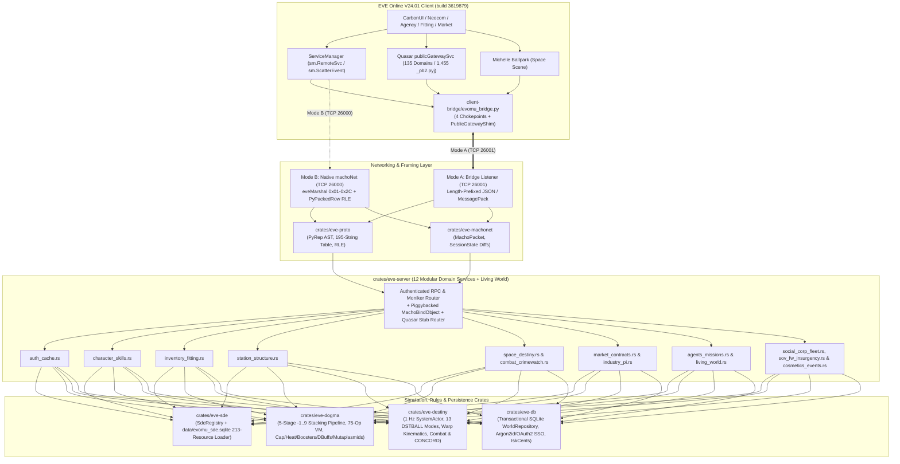
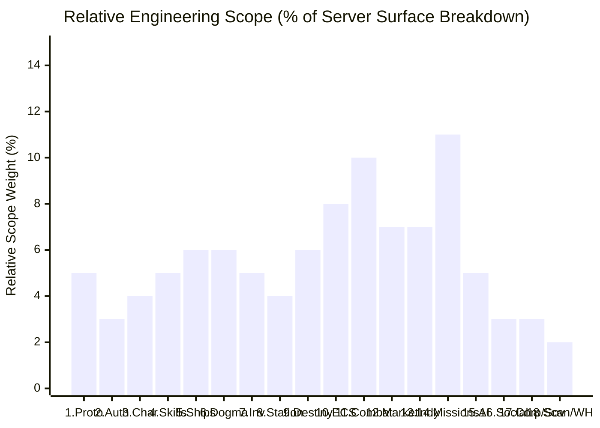
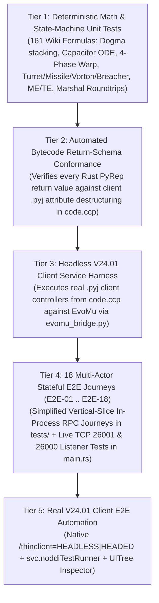

# EvoMu — Next-Generation EVE Online Server Emulator in Rust

[](https://www.rust-lang.org/)
[](#security--safety-invariants)
[-blue.svg)](./docs/index/PARITY_MATRIX.md)
[%20%7C%20135_Quasar_Domains%20%7C%204102_Wiki_Articles-purple.svg)](./docs/index/)
[](./LICENSE)

**EvoMu** is an independent, memory-safe EVE Online server emulator written in **Rust** (`#![forbid(unsafe_code)]`), engineered to bridge the 15-year gap between legacy C++ [`evemu_Crucible`](https://github.com/EvEmu-Project/evemu_Crucible) (2011) and the modern **EVE Online V24.01 Tranquility Client (`build 3619879`)** via a dual-bus (`machoNet` + Quasar `publicGatewaySvc`) actor and ECS architecture.

---

## 1. Visual Project Map & Relative Subsystem Size

To visualize the entire server surface area (**216 cataloged `machoNet` services** [`193` active V24.01 + `23` Crucible legacy-only], **1,311 client notifications**, **135 Quasar Protobuf domains** [`69` `eve_public.*` + `66` `eve.*` internal across `1,455` `_pb2.pyj` schemas], **213 static data archives**, **98 space component classes** [`spacecomponents/common/componentConst.pyj`], and **4,102 EVE University Wiki articles / 161 mathematical formulas**), the proportional block map below shows each subsystem's **relative engineering size** (box area & weight percentage) and **current implementation status** (tracked in [`docs/ACTION_PLAN_STATUS.md`](./docs/ACTION_PLAN_STATUS.md); vertical-slice routing in `services/*.rs` dispatches `102/600` V24.01 client candidate methods across the `71` explicit cataloged services [`46/216` cataloged services with `>=1` exact V24.01 client candidate method plus `25` additional cataloged services handled via custom/bridge/Crucible method names = `71/216` cataloged services with explicit arms, `145/216` returning `UnimplementedRPC`, `293` `(service, method)` handlers across `198` match arms: `136` single-method + `62` two-method arms; handler presence is vertical-slice routing only while authoritative per-row parity closure across the `1,230` cataloged RPC methods is governed by `docs/parity/` and preflight reports], verified via `cargo test --workspace`, `evomu_bridge.py --self-test`, and `verify_plan_mapping.py --check`).

### 1.1 Proportional Visual Block Diagram (Relative Size & Progress Treemap)

```text
+======================================================================================================================+
|                                     EVOMU SERVER ARCHITECTURE & SUBSYSTEM MAP                                        |
|    Total Surface: 216 machoNet Services (102/600 Client Methods; 71 Explicit / 145 UnimplementedRPC) | 135 Quasar    |
+======================================================================================================================+
|                                                          |                                                           |
|  [CORE ENGINE]                                           |  [SPACE, DESTINY & COMBAT]                                |
|  +----------------------------------------------------+  |  +-----------------------------------------------------+  |
|  | 1. Wire Protocol & Dual-Bus (eve-proto/machonet)   |  |  | 9. Destiny 1 Hz Kinematics & Bubbles (eve-destiny)  |  |
|  |    Status: In progress                             |  |  |    Status: In progress                              |  |
|  |    - eveMarshal 0x01-0x2C, 195-str table, RLE      |  |  |    - Sub-warp align, 4-phase warp, 250km bubbles    |  |
|  |    - Session diffs, MachoPacket, PublicGatewayShim |  |  |    - Binary AddBalls, SystemActor 1 Hz tick         |  |
|  +----------------------------------------------------+  |  +-----------------------------------------------------+  |
|  | 2. Auth, Bootstrap, Cache & Slash GM               |  |  | 11. Combat, Weapons, Drones, Fighters & CrimeWatch  |  |
|  |    Status: In progress                             |  |  |    Status: In progress                              |  |
|  |    - Login, GetInitVals, MachoBindObject (+piggy)  |  |  |    - Turret/Missile/Spool/Vorton/Breacher Pod math  |  |
|  |    - objectCaching, role-gated /slash GM commands  |  |  |    - Shield/Armor/Hull, Wrecks, Pods, CrimeWatch    |  |
|  +----------------------------------------------------+  |  +-----------------------------------------------------+  |
|  | 6. Dogma Attribute & Effect VM (eve-dogma)         |  |  | 10. Space Components ECS (98 Component Classes)     |  |
|  |    Status: In progress                             |  |  |    Status: In progress                              |  |
|  |    - 5-stage (-1..9) stacking pipeline, Cap/Shield |  |  |    - Deploy, Scoop, MTU, Mobile Depot, ESS, Skyhook |  |
|  |    - dgmExpressions VM, Boosters, 3-Rack Heat      |  |  |    - Cataloged 98 classes + vertical-slice handlers |  |
|  +----------------------------------------------------+  |  +-----------------------------------------------------+  |
|                                                          |                                                           |
+----------------------------------------------------------+-----------------------------------------------------------+
|                                                          |                                                           |
|  [CHARACTER, SKILLS, SHIPS & INVENTORY: 20% of Scope]    |  [PVE, MISSIONS, DUNGEONS & AI: 16% of Total Scope]       |
|  +----------------------------------------------------+  |  +-----------------------------------------------------+  |
|  | 3. Races, Bloodlines, Schools & Char Creation      |  |  | 14. Agents, Missions, Dungeons, Incursions & Arcs   |  |
|  |    Status: In progress                             |  |  |    Status: In progress                              |  |
|  |    - Char select, CreateCharacterWithDoll          |  |  |    - 17-Mission Seed, 16th-Mission Storyline, Gates |  |
|  |    - 4 Empires, 12 Bloodlines, 36 Ancestries, 12 Sc|  |  |    - NPE NodeGraph 473, Career Goals, Tale/Homefront|  |
|  +----------------------------------------------------+  |  +-----------------------------------------------------+  |
|  | 4. Skills, Clone Grades (Alpha/Omega) & Masteries  |  |  | 15. NPC AI, Behavior Trees & Dynamic Bounties       |  |
|  |    Status: In progress                             |  |  |    Status: In progress                              |  |
|  |    - SP Rank curve, Queue, clonegrades Alpha cap   |  |  |    - 3-Tier LOD Ecology, Hauler Convoys, DBS/ESS    |  |
|  |    - Free SP, Injectors, Jump Clones (19-24h/1-5)  |  |  +-----------------------------------------------------+  |
|  +----------------------------------------------------+  |                                                           |
|  | 5. Ships, Fitting, Subsystems, Capitals & SKINR    |  +-----------------------------------------------------------+
|  |    Status: In progress                             |  |                                                           |
|  |    - CPU/PG/Calibration, Saved Fittings, Insurance |  |  [ECONOMY, MARKETS & INDUSTRY: 14% of Total Scope]        |
|  |    - T3 Stances, Mutaplasmids, SKINR licensing     |  |  +-----------------------------------------------------+  |
|  +----------------------------------------------------+  |  | 12. Markets, Wallet, Contracts, Trade & Raffles     |  |
|  | 7. Inventory, Hangars, Repackage & Asset Safety    |  |  |    Status: In progress                              |  |
|  |    Status: In progress                              |  |  |    - IskCents fixed-point, Regional order book     |  |
|  |    - List, Transactional MoveItem/Add, Stack/Split |  |  |    - Broker/Relist/Tax, Contracts, Direct Trade, LP |  |
|  +----------------------------------------------------+  |  +-----------------------------------------------------+  |
|                                                          |  | 13. Industry, Blueprints, Reactions, Reprocess & PI |  |
+----------------------------------------------------------+  |    Status: In progress                              |  |
|  [WORLD, STRUCTURES, SOCIAL & SOV: 12% of Total Scope]   |  |    - Manufacturing (EIV/SCI/ME/TE), Invention (Wolf)|  |
|  +-------------------------+--------------------------+  |  |    - Ore Reprocessing, Compression, PI (1h flush)   |  |
|  | 8. Stations, Upwell     | 16-18. Social, LSC,      |  |  +-----------------------------------------------------+  |
|  |    Structures & Zarzakh |    Corps, Sov, Insurgency|  |                                                           |
|  |    Status: In progress  |    Scanning & Wormholes  |  |  [STATIC DATA & INDEXING PIPELINE: In Progress]           |
|  |                         |    Status: In progress   |  |  +-----------------------------------------------------+  |
|  |    - Station Undock/Dock|                          |  |  | tools/eve-indexer & docs/index/                     |  |
|  |    - Upwell 3-Stage Rein|    - LSC, Fleets, Corps  |  |  |    Status: In progress                              |  |
|  |    - Asset Safety       |    - FW/Sov, WH/Scan     |  |  |    - 216 Services (193 V24), 1311 Events, 135 Quasar|  |
|  +-------------------------+--------------------------+  |  |    - 213 SDE Archives, 4102 Wiki Articles, 161 Math |  |
+======================================================================================================================+
```

---

### 1.2 Architecture & Crate Dataflow Diagram



---

### 1.3 Relative Engineering Scope Breakdown by Domain



---

## 2. Granular Subsystem Progress Tracker

> **Note on Verification Status:** Python tooling (`evomu_bridge.py --self-test` and `verify_plan_mapping.py --check`) and all 8 Rust workspace crates (`cargo test --workspace`) compile and pass all tests with `0` errors and `0` warnings. Across all `216` cataloged `machoNet` services (`1,230` cataloged client candidate methods total; `600` client candidate methods across the `71` explicit services), `46/216` cataloged services handle `102/600` V24.01 client candidate methods by exact name, `25` additional cataloged services are handled via custom/bridge/Crucible method names (`71/216` cataloged services with explicit handlers; `145/216` services return `UnimplementedRPC`), and `293` `(service, method)` handlers across `198` match arms (`136` single-method + `62` two-method arms) are routed in `services/*.rs`, plus a `publicGatewaySvc` handler validating character authentication and the `135` cataloged Quasar domain namespaces before returning `UnimplementedRPC`. Note that handler routing in `services/*.rs` is vertical-slice coverage only; authoritative per-row parity closure across the `1,230` cataloged RPC methods and task-level status are governed by [`docs/ACTION_PLAN_STATUS.md`](./docs/ACTION_PLAN_STATUS.md) and `docs/parity/`.

| # | Subsystem / Domain | Crate / Module | Relative Size | Progress | Status & Key Deliverables |
|---|---|---|---|---|---|
| **0** | **Server Logic & Wiki Mechanics Indexer** | [`tools/eve-indexer`](./tools/eve-indexer/index_server_logic.py), [`docs/index/`](./docs/index/PARITY_MATRIX.md) | **Tooling** | `Generated` | Indexed 216 services (`193` V24.01 + `23` legacy-only), 1,311 `__notifyevents__`, 135 Quasar domains (`69` `eve_public.*` + `66` `eve.*` internal across `1,455` `_pb2.pyj` files), 213 staticdata files, 2,854 Crucible Dogma effects (`1,343` attr & `305` effect constants), 39 Destiny XMLP packets (`13` `DSTBALL_*` modes, `39` V24.01 actions), 4,102 wiki articles, 161 formulas |
| **1** | **Wire Protocol & Dual-Bus Transport** | [`crates/eve-proto`](./crates/eve-proto/src/lib.rs), [`crates/eve-machonet`](./crates/eve-machonet/src/lib.rs), [`evomu_bridge.py`](./client-bridge/evomu_bridge.py) | **5%** (~1,200 LOC) | `In progress` (`M0`) | `eveMarshal` `0x01`–`0x2C`, 195-string table, `PyPackedRow` RLE, `IndexRowset`, `TupleSet`, `DBRow`, `SessionState::compute_diff`, `PublicGatewayShim`, live dual TCP listeners (`26000`/`26001`) |
| **2** | **Auth, Bootstrap, Caching & Slash GM** | [`services/auth_cache.rs`](./crates/eve-server/src/services/auth_cache.rs), [`config.rs`](./crates/eve-server/src/config.rs) | **3%** (~800 LOC) | `In progress` (`M1`) | `authentication.Login` (Argon2id + OAuth2/PKCE SSO JWT + ban enforcement, `D-4`), `multiLoginBlocker.Login`, `GetInitVals`, piggybacked `MachoBindObject`, `evomu.toml` config (`D-5`), role-gated `/slash` GM commands (`/giveisk`, `/ban`, `/unban`, `/kick`), Quasar `publicGatewaySvc` domain validation returning `UnimplementedRPC` |
| **3** | **Races, Bloodlines, Schools & Char Creation** | [`crates/eve-sde`](./crates/eve-sde/src/lib.rs), [`services/character_skills.rs`](./crates/eve-server/src/services/character_skills.rs) | **4%** (~1,000 LOC) | `In progress` (`M1`) | Full 213-resource SDE SQLite loader (`data/evomu_sde.sqlite`, `D-1`, `D-2`), `GetCharactersToSelect`, `SelectCharacterID`, `CreateCharacterWithDoll`, all 4 Empires + `18` SDE bloodlines (`12` playable), `43` ancestries, `23` SDE schools (`12` starter), starter Corvettes |
| **4** | **Skills, Clone Grades (Alpha/Omega) & Masteries** | [`services/character_skills.rs`](./crates/eve-server/src/services/character_skills.rs) | **5%** (~1,200 LOC) | `In progress` (`M2`) | SP Rank curve, `AddToEndOfSkillQueue`, `SaveSkillQueue`, `ApplyFreeSkillPoints`, `clonegrades.static` (`5M` SP Alpha cap), Skill Injectors, Jump Clones (`jumpCloneSvc` `Infomorph Synchronizing` 19h–24h cooldown, body swap & `Infomorph Psychology` `1..5` clone cap) |
| **5** | **Ships, Fitting, Subsystems, Capitals & SKINR** | [`services/inventory_fitting.rs`](./crates/eve-server/src/services/inventory_fitting.rs) | **6%** (~1,500 LOC) | `In progress` (`M2`) | `ShipFittingEngine` (CPU/Powergrid/Calibration), Saved Fittings (`charFittingMgr`), Ship Insurance (`insuranceSvc`), Abyssal Mutaplasmids (`dynamicItemService`) |
| **6** | **Dogma Attribute & Effect VM** | [`crates/eve-dogma`](./crates/eve-dogma/src/lib.rs), [`formulas.rs`](./crates/eve-server/src/formulas.rs) | **6%** (~1,500 LOC) | `In progress` (`M0`/`M2`) | 5-stage (`-1..=9`) stacking pipeline, 75-opcode `DogmaVmOpcode` VM, Cap/Shield ODEs, 3-Rack Thermodynamics, Combat Boosters, Command Burst `dbuff`s |
| **7** | **Inventory, Hangars, Repackage & Asset Safety** | [`crates/eve-db`](./crates/eve-db/src/lib.rs), [`services/inventory_fitting.rs`](./crates/eve-server/src/services/inventory_fitting.rs) | **5%** (~1,200 LOC) | `In progress` (`M1`/`M3`) | `List`/`ListItems`, transactional `MoveItem`/`Add` with optimistic concurrency & idempotency, durable relational SQLite persistence (`D-3`, `31` domain tables + `schema_migrations`, `PRAGMA journal_mode = WAL`, `PRAGMA foreign_keys = ON`) |
| **8** | **Stations, Upwell Structures, Zarzakh & Topology** | [`services/station_structure.rs`](./crates/eve-server/src/services/station_structure.rs) | **4%** (~1,000 LOC) | `In progress` (`M1`/`M6`) | `GetSolarSystem`, `GetStation`, atomic `Undock` + rollback, `Dock`, `Anchor`, `FuelStructure`, 3-stage `Shield -> Armor -> Hull -> Destroyed` Upwell state machine & Quantum Core drop |
| **9** | **Destiny 1 Hz Kinematics & Grid Bubbles** | [`crates/eve-destiny`](./crates/eve-destiny/src/lib.rs), [`services/space_destiny.rs`](./crates/eve-server/src/services/space_destiny.rs) | **6%** (~1,500 LOC) | `In progress` (`M1`/`M7`) | 1 Hz `SystemActor`, all 13 `DSTBALL_*` modes (`0..=12`), sub-warp align, 4-phase warp, `CmdStargateJump`, binary `encode_add_balls` |
| **10** | **Space Components ECS (98 Component Classes)** | [`crates/eve-sde`](./crates/eve-sde/src/lib.rs), [`services/station_structure.rs`](./crates/eve-server/src/services/station_structure.rs) | **8%** (~2,000 LOC) | `In progress` (`M2`/`M6`) | 98 component classes cataloged (`componentConst.pyj`) with handlers for `deploy`, `scoop`, `autoTractorBeam`, `autoLooter`, `fitting`, `reinforce`, `essLink`, `orbitalSkyhook` |
| **11** | **Combat, Weapons, Drones, Fighters & CrimeWatch** | [`crates/eve-destiny`](./crates/eve-destiny/src/lib.rs), [`services/combat_crimewatch.rs`](./crates/eve-server/src/services/combat_crimewatch.rs) | **10%** (~2,500 LOC) | `In progress` (`M2`/`M7`) | SDE-attribute-derived Turret/Missile/Entropic/Vorton/Breacher math, per-tick cycle rate limiting, `fighterMgr` (`GetFightersForShip`), `crimewatch` CONCORD & `killRightMgr` (`ActivateKillRight` / `BuyKillRight`) |
| **12** | **Markets, Living Economy, Contracts, Trade & Raffles** | [`services/market_contracts.rs`](./crates/eve-server/src/services/market_contracts.rs), [`world_seeder.rs`](./crates/eve-server/src/world_seeder.rs) | **7%** (~1,800 LOC) | `In progress` (`M3`/`M8`) | `IskCents` fixed-point wallet, Regional bid/ask order matching, Broker Fee & Sales Tax, Dual-Anchor Market Seeder, Item Exchange & Courier Contracts (`contractProxy`) |
| **13** | **Industry, Blueprints, Reactions, Phased Fields & PI** | [`services/industry_pi.rs`](./crates/eve-server/src/services/industry_pi.rs) | **7%** (~1,800 LOC) | `In progress` (`M3`) | `blueprints.static` Manufacturing (`InstallJob`/`CompleteJob`) reading blueprint `ME/TE` and character skills, Invention (`activity_id = 8` consuming BPC + `20424` + `20172` datacores and rolling for `Wolf Blueprint` `11372`), SDE `type_materials` Reprocessing, `CompressItemInStructure` & PI (`planetMgr` 1h cooldown) |
| **14** | **Agents, Missions, NPE, Dungeons, Incursions & Arcs** | [`services/agents_missions.rs`](./crates/eve-server/src/services/agents_missions.rs) | **11%** (~2,800 LOC) | `In progress` (`M4`) | `agentMgr` (`RequestMission`/`AcceptMission`/`CompleteMission`/`RemoveOfferFromJournal` across `2,892` SDE missions with instanced pocket NPCs), 16th-mission Storyline trigger, `keeper` gate activation, `air_npe` node graph `473` & `milestoneMgr` |
| **15** | **Dual-Tier NPC AI (`NPCAI` + `behaviors/`) & Bounties** | [`living_world.rs`](./crates/eve-server/src/living_world.rs), [`services/sov_fw_insurgency.rs`](./crates/eve-server/src/services/sov_fw_insurgency.rs) | **5%** (~1,200 LOC) | `In progress` (`M7`/`M8`) | 3-Tier LOD Living World Ecology (`LOD0`/`LOD1`/`LOD2`), NPC Hauler Convoy interdiction & market price spikes, K-space null-sec DBS/ESS bounty splits & `essMgr.AttemptLinkToMainBank` |
| **16** | **Social, Chat (`LSC`), Mail, Bookmarks & Fleets** | [`services/social_corp_fleet.rs`](./crates/eve-server/src/services/social_corp_fleet.rs) | **3%** (~800 LOC) | `In progress` (`M5`) | `LSC`, `mailMgr` (`SendMail`/`GetMailHeaders`), `bookmark` (`BookmarkLocation`/`GetBookmarks`), `fleetMgr` (`CreateFleet`) & Command Bursts |
| **17** | **Corporations, Projects, Standings, Insurgency & Sov** | [`services/social_corp_fleet.rs`](./crates/eve-server/src/services/social_corp_fleet.rs), [`services/sov_fw_insurgency.rs`](./crates/eve-server/src/services/sov_fw_insurgency.rs) | **3%** (~800 LOC) | `In progress` (`M5`/`M6`) | Player corps (`CreateCorporation`), Alliances (`CreateAlliance`), Wars (`DeclareWarAgainst`), Corp Projects (`CreateProject`/`ContributeToProject`), Derived Standings, FW Enlistment & low-sec `CaptureComplex`, Pirate Insurgencies & null-sec `AcquireSkyhooks` |
| **18** | **Exploration, Filaments, WH, Abyssal & SKINR** | [`services/space_destiny.rs`](./crates/eve-server/src/services/space_destiny.rs), [`services/cosmetics_events.rs`](./crates/eve-server/src/services/cosmetics_events.rs) | **2%** (~600 LOC) | `In progress` (`M7`/`M8`) | Directional scan (`scanMgr.ConeScan`), Wormhole mass jump (`wormholeMgr.WormholeJump`), Abyssal filaments (`abyssalMgr.ActivateFilament`), licensed SKINR (`ActivateSkinLicense`/`ApplySkinToShip`) |

---

## 3. Five-Tier Verification & Integration Testing Strategy

How do we **provably verify** that `EvoMu` behaves identically to what the EVE Online client expects across hundreds of services and thousands of items? We use a **5-Tier Verification Pyramid**:



1. **Tier 1 — Deterministic Formula & Wire Unit Tests (`cargo test --workspace`):**
   - Verifies exact mathematical invariants across all **161 extracted `~/ai/eve-wiki` formulas** ([`docs/index/wiki_mechanics_catalog.json`](./docs/index/wiki_mechanics_catalog.json)): `eveMarshal` opcodes (`0x01`–`0x2C`), `PyPackedRow` zero-RLE, `SessionState::compute_diff`, Dogma 5-stage (`-1..=9`) stacking penalties ($e^{-(i/2.67)^2}$), nonlinear capacitor/shield differential equations, sub-warp align time ($\tau = I\cdot M/10^6$), 4-phase short/long warp trajectories, turret tracking hit-chance & wrecking shots, missile/fighter/Vorton DRF, Breacher Pod raw-HP DoT, 3-rack overheating burnout, and manufacturing EIV/SCI/$ME/TE$ rounding.
2. **Tier 2 — Automated Client Bytecode Contract Verifier (`tools/eve-indexer`):**
   - Statically extracts every attribute (`LOAD_ATTR`) and key (`BINARY_SUBSCR`) the V24.01 client reads on the return value of each `RemoteSvc` call in `code.ccp` and asserts that every `EvoMu` RPC handler returns a `KeyVal` / `Rowset` / `IndexRowset` containing those exact columns.
3. **Tier 3 — Headless Client `.pyj` Controller Harness (`client-bridge/`):**
   - Runs real client service/controller logic from `code.ccp` (with mocked `blue`/`trinity` rendering layers and `evomu_bridge.py` hooked into `sm.RemoteSvc` and `publicGatewaySvc`) directly against `eve-server`.
4. **Tier 4 — 18 Mandatory End-to-End Stateful Player Journeys (`E2E-01` .. `E2E-18`, detailed in [`PLAN.md §5.1`](./PLAN.md#51-target-specification-for-the-18-end-to-end-e2e-stateful-journey-tests-crateseve-servertests--client-bridge)):**
   - Every milestone is gated by focused subsystem unit/contract tests plus simplified vertical-slice subsets of the 18 multi-step stateful journeys (executed in-process via `ServerContext::dispatch_rpc` in `tests/`, alongside live TCP `26001` JSON-Bridge and `26000` `MachoNet` wire listener tests in `main.rs`; full target features such as Auction contracts, HyperNet raffles, Loot Fairy, insurance payouts, drones/MTU, and 39-trigger dungeons remain open):
     - **`E2E-01`:** Account Bootstrap, Character Creation (all 4 Empires) & Racial Seeding
     - **`E2E-02`:** Skill Training Queue, Alpha/Omega Clone Grades (`clonegrades.static`), Injectors & Remap
     - **`E2E-03`:** Hangar Inventory, Ship Boarding, Fitting, CPU/PG, T3 Subsystems/Modes & Mutaplasmids
     - **`E2E-04`:** Undock, Sub-Warp Flight, 4-Phase Warp, Stargate Jump (Cross-Actor Handoff) & Docking
     - **`E2E-05`:** 1 Hz Space Combat, Capacitor/Heat, EWAR, Wrecks (`wrecks.static`), Podding, Kill Rights (`killRightMgr`) & CrimeWatch CONCORD
     - **`E2E-06`:** Drones, Carrier Fighter Squadrons (`fighterabilities.static`) & Space Components (MTU / Mobile Depot)
     - **`E2E-07`:** Direct Station Trade (`trademgr`), Regional Market Order Book, Contracts (`contractProxy`) & HyperNet Raffles (`raffleMgr`)
     - **`E2E-08`:** Mining, In-Space Compression, Reprocessing, Blueprints (`ME/TE`), Invention, Reactions & PI
     - **`E2E-09`:** NPE Storyline Tutorial, Exordium, Career Agents, Multi-Room Dungeons (`39` Triggers) & 9 Epic Arcs
     - **`E2E-10`:** Social, `LSC` Chat, Mail, Fleets, Command Bursts (`dbuffcollections.static`), Corporations & Mutual Wars
     - **`E2E-11`:** Upwell Structures, Tethering, Reinforcement Timers, Asset Safety, Equinox Sov Hubs & Skyhooks
     - **`E2E-12`:** Exploration, D-Scan (`scanMgr`), 8-Probe Trilateration, Relic/Data Hacking, Wormhole Collapse & Abyssal Deadspace
     - **`E2E-13`:** Special Weapons (Disintegrator Spool, Vorton 10-Target Arc, Breacher Pod Raw-HP DoT), Combat Boosters & Overheating Burnout
     - **`E2E-14`:** Advanced PvE (Storyline 16th-Mission, Anomic Burners, COSMOS, DED Escalations, Sansha Incursions & Homefronts)
     - **`E2E-15`:** Pirate Insurgencies (Corruption/Suppression 1–5), Zarzakh Emanation Lock, Ghost Sites, Sleeper Caches, ESS & Skyhook Raiding
     - **`E2E-16`:** Universe Downtime Seeding, Dual-Anchor Living Market Maker AI, Dynamic `SCI`/`BRM` & Physical NPC Hauler Convoys
     - **`E2E-17`:** Dual-Tier NPC AI (`NPCAI` + `behaviors/`), Diamond (`♦`) Mining/FOB Response Fleets, Drifters (`Overshield` + `750k` Doomsday + Corpse Harvest), Clone Soldiers & CONCORD (`6s–19s`)
     - **`E2E-18`:** *Catalyst* Phased Asteroid Fields (`Prismaticite` & `Mobile Phase Anchor`), `CRAB` Beacons, Filaments, Titan Doomsdays, Abandoned Structures & Quantum Cores, Freelance Corp Projects & SKINR
5. **Tier 5 — Real V24.01 Client Automated E2E Execution (`PLAN.md §5.2`):**
   - Uses two official first-party automation hooks built into the V24.01 client (`code.ccp`):
     - **`/thinclient=HEADLESS` & `/thinclient=HEADED` (`autoexec_client_core.pyj` line 33):** Imports `thinclients.clientsetup` (`patch_all`, `install_commands`) at client startup before `ServiceManager` initializes, allowing `evomu_bridge.py` + an E2E assertion channel to run inside the real EVE client (headlessly in CI or headed with full 3D rendering).
     - **`svc.noddiTestRunner` (`eve/client/script/environment/nodditestrunner.pyj`):** Supports `/select_character=<charID>`, `/noddi_test=<nodeGraphID>`, `/test_report_folder=<dir>`, and `/noddi_close_at_completion` to automatically enter the game, execute client test node graphs, and write structured pass/fail reports.

---

## 4. Workspace Structure & Quick Start

```text
evomu/
├── Cargo.toml
├── LICENSE                                # MIT License + Third-Party Reference Provenance Notices
├── README.md                              # Project overview, visual progress map & test strategy
├── ARCHITECTURE_PROPOSAL.md               # Deep-dive system architecture & design decisions
├── PLAN.md                                # Concise Master Execution Plan, Milestones M0-M8 & §3.12 Table
├── docs/
│   ├── AGENT_HANDOFF.md                   # Context brief for autonomous engineering handoff
│   ├── spec/                              # Modular Deep-Dive Technical Specifications (§3.1–§3.11)
│   │   ├── 01_session_world_inventory.md  # Races, Char Creation, Skills, Ships, Fitting & 18 Domains
│   │   ├── 02_dogma_destiny_combat.md     # Canonical Mathematical Formulas (38 Domains, 161 Equations)
│   │   ├── 03_economy_industry_social.md  # PvE/Structure Taxonomy & V24.01 Modern Feature Parity
│   │   ├── 04_pve_narrative_dungeons.md   # NPE Acts 1-2, Exordium, Career Agents, Dungeons & 9 Epic Arcs
│   │   └── 05_living_world_and_ai.md      # Downtime Seeding, Dual-Anchor Living Economy & Dual-Tier AI
│   └── index/                             # Generated Server Logic Catalogs (9 Artifacts)
│       ├── PARITY_MATRIX.md               # V24.01 Client vs. evemu_Crucible vs. EvoMu Matrix
│       ├── rpc_service_catalog.json       # All 216 machoNet Services (193 V24.01 + 23 Legacy-Only)
│       ├── crucible_comparison.json       # 64 Shared, 129 V24.01-Only & 23 Crucible Legacy-Only Services
│       ├── client_notifications.json      # All 1,311 Client __notifyevents__
│       ├── quasar_protobuf_catalog.json   # All 135 Quasar Domains (69 eve_public + 66 eve internal / 1,455 _pb2.pyj)
│       ├── staticdata_catalog.json        # All 213 V24.01 res:/staticdata/ Archives
│       ├── dogma_effects.json             # 2,854 Crucible Effects, 75 VM Operands & 1,343 Attr / 305 Effect Constants
│       ├── destiny_opcodes.json           # 39 Destiny.xmlp Packets, 13 DSTBALL_* Modes & 39 V24.01 Actions
│       └── wiki_mechanics_catalog.json    # All 4,102 EVE Wiki Articles & 161 Extracted Formulas
├── tools/
│   └── eve-indexer/
│       ├── index_server_logic.py          # Automated indexer for Crucible, code.ccp, resfileindex & eve-wiki
│       └── verify_plan_mapping.py         # CI verifier for §3.12 bijection, prose tokens, counts & links
├── crates/
│   ├── eve-proto/                         # Dual wire codec: Bridge JSON/MsgPack + binary eveMarshal
│   ├── eve-machonet/                      # machoNet packets, MachoAddress, SessionState & diffs
│   ├── eve-sde/                           # Static Data Export (SDE) registry & loader
│   ├── eve-dogma/                         # Dogma 5-stage (-1..9) modifier pipeline, stacking & recharge curves
│   ├── eve-destiny/                       # 1 Hz Ballpark kinematics, 4-phase warp, grid bubbles & AddBalls
│   ├── eve-db/                            # Transactional repository, IskCents, optimistic concurrency
│   ├── eve-server/                        # Async TCP server (26000 & 26001), router & 1 Hz SystemActors
│   └── eve-testkit/                       # Parity attestation framework & test verification utilities
└── client-bridge/
    └── evomu_bridge.py                    # Client-side ServiceManager & Quasar PublicGateway bridge
```

### Running Self-Tests & Indexer
```bash
# 1. Run the Python Client Bridge offline unit test suite (hydrators, demuxer, Quasar gateway shim)
/usr/bin/python3 client-bridge/evomu_bridge.py --self-test

# 2. Re-generate the exhaustive server logic catalogs in docs/index/ and verify PLAN.md + docs/spec/*.md
/usr/bin/python3 tools/eve-indexer/index_server_logic.py --evomu-root .
/usr/bin/python3 tools/eve-indexer/verify_plan_mapping.py --check

# 3. Build and test all Rust crates (required to close Milestone M0 once Rust toolchain is active)
cargo build --workspace
cargo test --workspace
cargo clippy --workspace --all-targets -- -D warnings
```
