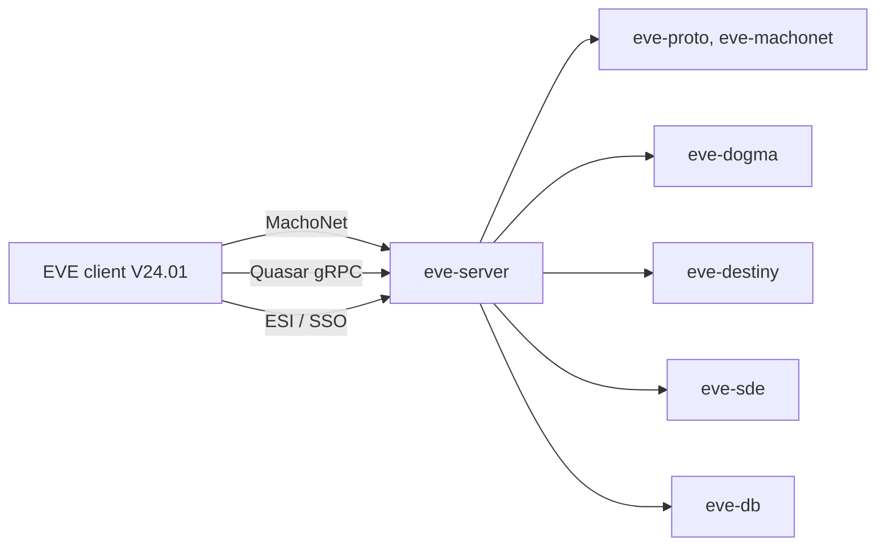

# EvoMu

An open-source EVE Online server, written from scratch in Rust, for the unmodified V24.01 client (build 3619879) on macOS and Windows.

EvoMu implements the three protocols the client talks: the classic MachoNet game services, the "Quasar" gRPC gateway, and the ESI web API with single sign-on. The repository contains no client code and no client data. You bring your own client.

## What EvoMu supports

EvoMu aims to support 100% of the live game's functionality for the V24.01 client. Progress so far, counted as game features with passing server tests:

| Area | Includes | [Progress](./docs/ACTION_PLAN_STATUS.md#feature-progress-by-area) |
| :--- | :--- | :--- |
| [Flying and navigation](./docs/wiki/README.md#1-universe-space--celestial-navigation) | [Ship physics and warp](./docs/wiki/ballpark_and_physics/destiny_simulation_loop.md), [stargates and jump drives](./docs/wiki/universe_and_navigation/stargate_jumping_and_cynosural_navigation.md), [wormholes](./docs/wiki/universe_and_navigation/wormholes_and_wormhole_space.md), [Pochven](./docs/wiki/universe_and_navigation/pochven_navigation_and_anchoring.md), [scanning](./docs/wiki/exploration_and_hacking/hacking_minigame_and_sites.md), [bookmarks](./docs/wiki/universe_and_navigation/bookmarks_and_shared_folders.md) | 121 of 122 (99%) |
| [Ships, fitting and modules](./docs/wiki/README.md#8-dogma-attribute-engine-fitting--module-cycles) | [Attributes and fitting](./docs/wiki/dogma_and_fitting/dogma_attribute_engine.md), [module activation](./docs/wiki/dogma_and_fitting/module_activation_and_cycles.md), [drones and fighters](./docs/wiki/dogma_and_fitting/drones_and_fighters.md), [ship skins](./docs/wiki/dogma_and_fitting/ship_skins_and_skinr.md) | 262 of 266 (98%) |
| [Combat](./docs/wiki/README.md#9-combat-resolution-damage--crimewatch) | [Turrets and missiles](./docs/wiki/combat_and_crimewatch/gunnery_tracking_and_missile_kinematics.md), [crimewatch](./docs/wiki/combat_and_crimewatch/crimewatch_and_engagement_timers.md), [NPC combat AI](./docs/wiki/npcs_and_living_world/npc_combat_ai_and_ecology.md), [wars](./docs/wiki/corporations_and_governance/alliances_and_formal_wars.md) | 120 of 120 (100%) |
| [Accounts, characters and skills](./docs/wiki/README.md#15-character-progression-skills--medical-clones) | [Skill training and clones](./docs/wiki/character_and_progression/skill_training_and_medical_clones.md), [standings](./docs/wiki/character_and_progression/standings.md), [accounts and login](./docs/wiki/protocol_and_infrastructure/sessions_login_and_logoff.md) | 103 of 104 (99%) |
| [Inventory, markets and contracts](./docs/wiki/README.md#12-player-economy-markets--contracts) | [Inventory](./docs/wiki/economy_and_markets/inventory_and_containers.md), [regional markets](./docs/wiki/economy_and_markets/regional_market_order_matching.md), [wallets](./docs/wiki/economy_and_markets/wallets_and_isk_ledger.md), [contracts](./docs/wiki/economy_and_markets/contracts.md), [loyalty points](./docs/wiki/missions_and_agents/agent_dialogue_and_missions.md), [PLEX and the New Eden Store](./docs/wiki/economy_and_markets/plex_and_new_eden_store.md) | 82 of 85 (96%) |
| [Industry and resources](./docs/wiki/README.md#10-industry-manufacturing-science--reactions) | [Mining](./docs/wiki/mining_and_harvesting/mining_cycles_and_residue.md), [manufacturing and reactions](./docs/wiki/industry_and_manufacturing/blueprints_manufacturing_and_reactions.md), [planetary industry](./docs/wiki/planetary_industry/colony_pin_networks_and_pi.md) | 127 of 129 (98%) |
| [PvE](./docs/wiki/README.md#5-missions-agent-divisions--pve-encounters) | [Agents and missions](./docs/wiki/missions_and_agents/agent_dialogue_and_missions.md), [exploration and hacking](./docs/wiki/exploration_and_hacking/hacking_minigame_and_sites.md), [Abyssal Deadspace](./docs/wiki/missions_and_agents/abyssal_deadspace.md) | 116 of 121 (96%) |
| [Corporations, alliances and fleets](./docs/wiki/README.md#13-corporations-alliances--social-governance) | [Roles and governance](./docs/wiki/corporations_and_governance/corporation_roles_and_governance.md), [alliances](./docs/wiki/corporations_and_governance/alliances_and_formal_wars.md), [fleets](./docs/wiki/corporations_and_governance/fleets.md), [mail and chat](./docs/wiki/corporations_and_governance/mail_and_chat.md) | 124 of 124 (100%) |
| [Structures and territory](./docs/wiki/README.md#3-upwell-structures-starbases--orbital-deployment) | [Upwell structures](./docs/wiki/upwell_and_structures/upwell_structures_overview.md), [sovereignty](./docs/wiki/sovereignty_and_faction_warfare/sovereignty_hubs_and_equinox_skyhooks.md), [faction warfare](./docs/wiki/sovereignty_and_faction_warfare/faction_warfare_and_insurgencies.md) | 132 of 133 (99%) |
| [ESI web API](./docs/wiki/README.md#16-protocol-architecture-machonet-quasar--sde) | [API routes and single sign-on](./docs/wiki/protocol_and_infrastructure/esi_api_and_sso.md) | 138 of 138 (100%) |
| [Quasar gateway services](./docs/wiki/README.md#16-protocol-architecture-machonet-quasar--sde) | [gRPC gateway services used by the client](./docs/wiki/protocol_and_infrastructure/machonet_wire_and_quasar_gateway.md) | 28 of 32 (88%) |
| [Game-master mode and commands](./docs/wiki/README.md#17-game-master-tools--server-operations) | [GM accounts and roles](./docs/wiki/protocol_and_infrastructure/game_master_tools_and_server_operations.md#accounts-and-gm-accounts), [slash commands](./docs/wiki/protocol_and_infrastructure/game_master_tools_and_server_operations.md#slash-commands) | 22 of 22 (100%) |
| [Sessions and server operations](./docs/wiki/README.md#16-protocol-architecture-machonet-quasar--sde) | [Login and logoff](./docs/wiki/protocol_and_infrastructure/sessions_login_and_logoff.md), [downtime, clock and storage](./docs/wiki/protocol_and_infrastructure/game_master_tools_and_server_operations.md#daily-downtime) | 114 of 114 (100%) |
| **All areas** | | **1,489 of 1,510 (99%)** |

The numbers are generated from the test results; the per-feature list is in the [progress report](./docs/ACTION_PLAN_STATUS.md#feature-progress-by-area).

The real V24.01 client plays against the server every day in automated sessions: logging in, docking and undocking, flying and warping, jumping through stargates, fitting ships, mining, trading on the market and fighting.

## Status

EvoMu is under active development. With the real client, some of the features above still hit errors or gaps, so the game is not yet playable from start to finish.

| | |
| :--- | :--- |
| Scripted play sessions passing on the real client | 0 of 29 |
| Detailed progress by task | [docs/ACTION_PLAN_STATUS.md](./docs/ACTION_PLAN_STATUS.md) |
| Known bugs | [GitHub issues](https://github.com/saverchenkov/EvoMu/issues) |

## Getting started

### Prerequisites

- Rust 1.85 or newer
- Python 3.9 or newer
- An installed EVE Online V24.01 client, build 3619879

### Import static data

The server needs the game's static data: item types, solar systems, stations, missions. The importer reads it from your client and writes `data/evomu_sde.sqlite`.

```bash
git clone https://github.com/saverchenkov/EvoMu.git
cd EvoMu

# macOS (on Apple Silicon the importer runs under Rosetta)
arch -x86_64 /usr/bin/python3 tools/sde-import/import_sde.py

# Windows PowerShell
python tools/sde-import/import_sde.py --shared-cache "C:/Games/EVE"
```

### Create an account

```bash
export EVOMU_ACCOUNTS="pilot1:choose-a-password"
```

Separate several accounts with commas. Accounts with a starting character and wallet can also be defined in [`evomu.toml`](./evomu.toml).

### Run the server

```bash
cargo run --release -p eve-server
```

The first start creates the world database `data/evomu_world.sqlite` and stocks the NPC markets. The server listens on `127.0.0.1`:

| Port | Purpose |
| :--- | :--- |
| 26000 | Game client (MachoNet) |
| 26004 | ESI, single sign-on, in-game bug reports |
| 26005 | Quasar gRPC gateway |
| 5222 | Chat |

Ports and paths are set in [`evomu.toml`](./evomu.toml).

### Connect the client

```bash
python3 tools/launch_client.py --login pilot1:choose-a-password
```

The installed client can only log in to CCP's servers. The launcher makes a private copy of your client under `~/.evomu/client`, switches that copy to the login mode EvoMu supports, and starts it against your server. Your installed client is not modified.

On Windows, add `--client` with the folder that contains `bin64`. Run the script with `--help` for the other options.

### Game-master mode and commands

To log in as a game master, start the server with `EVOMU_GM_ACCOUNT="gm:choose-a-password"` (or add `[[admin_accounts]]` in [`evomu.toml`](./evomu.toml)) and pass `--gm` to the launcher so the client loads its GM menus and slash commands:

```bash
python3 tools/launch_client.py --login gm:choose-a-password --gm
```

The server provisions a GM character (`ISD Polaris`, docked in Jita 4-4 with 1,000,000,000 ISK and 50,000,000 skill points). In the game, use the GM right-click menus or type slash commands in chat:

| Command | Effect |
| :--- | :--- |
| `/giveisk <amount>` | Add ISK to your wallet |
| `/createitem <type_id> [quantity]` | Create ships, modules or items in your hangar |
| `/fit me <type_id>` | Create and fit a module to your active ship |
| `/giveskill <skill_id> <level>` | Set a skill to level 1–5 (`/completeskills` finishes queued skills) |
| `/tr me <location_id>` | Teleport to a solar system, station, structure or stargate |
| `/spawn <type_id> [quantity]` | Spawn ships or objects in space (`/spawnnpc <type_id>` for NPCs) |
| `/heal` | Restore shield, armor, hull and capacitor and clear module heat |
| `/advancetime [seconds]` | Advance the server clock (default 3,600 s) |
| `/cleartimers` | Clear session-change, combat and crimewatch timers |

All commands and role masks are listed in [Game-Master Tools & Server Operations](./docs/wiki/protocol_and_infrastructure/game_master_tools_and_server_operations.md#slash-commands).

## Testing strategy

Tests run at four levels against the imported static data (`data/evomu_sde.sqlite`):

- **Unit tests (`--lib`):** Per-crate tests for wire encoding (`eve-proto`, `eve-machonet`), static-data queries (`eve-sde`), space physics and warp (`eve-destiny`), ship attributes and fitting (`eve-dogma`), world storage (`eve-db`), and server logic (`eve-server`).
- **Integration tests (`--test it`):** Multi-client tests against an in-process server covering MachoNet RPCs, Quasar gRPC services, ESI routes, and client notifications.
- **End-to-end client journeys:** [`tools/client-harness/run_journeys`](./tools/client-harness/run_journeys) runs the 29 scripted gameplay sessions from [`client_journeys.json`](./.agents/skills/evomu-adversarial-review/references/parity/client_journeys.json) either in headless bridge mode or inside the real V24.01 client.
- **Live-client playtester:** [`tools/client-harness/playtester.py`](./tools/client-harness/playtester.py) drives a live V24.01 client through an in-client UI bridge (`127.0.0.1:26099`), background window capture (requires Xcode Command Line Tools on macOS, `xcode-select --install`), and automatic crash/bug reporting.

```bash
cargo test --workspace --lib                                      # unit tests
cargo test -p eve-server --test it                                # integration tests
python3 tools/client-harness/run_journeys \
  --out /tmp/evomu_journeys \
  --journeys .agents/skills/evomu-adversarial-review/references/parity/client_journeys.json \
  --bridge-harness-test                                           # headless E2E journeys
python3 tools/client-harness/playtester.py --hybrid --continuous  # live-client playtester
```

## Reporting a bug

Open a [GitHub issue](https://github.com/saverchenkov/EvoMu/issues/new) and include:

- what you did and what happened;
- the error from the client log, if there was one;
- the server version (`git rev-parse --short HEAD`).

You can also press `F12` in the game and choose *Report a Bug*; the server saves the report together with its own logs.

## Contributing

Pull requests are welcome. Open one against `main` and describe what it changes.

You don't need to learn the project's conventions first. If something needs adjusting, we will take care of it and adapt the code to the project's style and requirements.

Please don't include files or data taken from the EVE client, or code copied from other server emulators.

## Repository layout



| Path | Purpose |
| :--- | :--- |
| `crates/eve-server` | The server: network listeners, game services, per-system simulation |
| `crates/eve-proto`, `crates/eve-machonet` | Wire formats |
| `crates/eve-dogma` | Ship attributes and fitting |
| `crates/eve-destiny` | Space physics and warp |
| `crates/eve-sde` | Access to the imported static data |
| `crates/eve-db` | World state and its SQLite storage |
| `crates/eve-testkit` | Test helpers |
| `tools/` | Static-data importer, client launcher, automated play-testing |
| `docs/` | Documentation |

## Documentation

| Document | Purpose |
| :--- | :--- |
| [Game systems wiki](./docs/wiki/README.md) | How each game system is implemented |
| [Specifications](./docs/spec/) | Technical specifications by area |
| [Status](./docs/ACTION_PLAN_STATUS.md) | Detailed progress by task |
| [Plan](./PLAN.md) | The overall plan and its sources |
| [Code style](./CODE_STYLE.md) | Code conventions |

## Legal

EvoMu is an independent, non-commercial project. It is not affiliated with or endorsed by CCP Games. EVE Online and related marks are trademarks of CCP hf.

Licensed under the [MIT License](./LICENSE).
