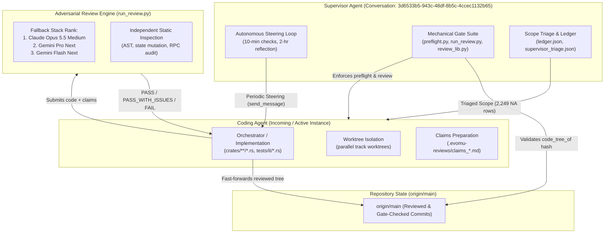

# EvoMu Supervisor / Coder Multi-Agent Architecture & Operating Manual

## 1. Executive Summary & Core Mission

**EvoMu** is an asynchronous, high-concurrency clean-room server emulator for **EVE Online V24.01 (Client Build 3619879)**, written in idiomatic, memory-safe Rust with `#![forbid(unsafe_code)]`.

The emulator delivers complete end-to-end server functionality spanning:
1. **The Classic machoNet Surface:** Authenticated RPC dispatch across 216 services, dynamic moniker bindings (`beyonce`, `dogmaIM`, `invbroker`, etc.), session change pipelines, 1 Hz spatial physics and combat loops (`Ballpark`), and dogmatic attribute calculation (`DogmaVM`).
2. **The Quasar Microservice Architecture:** 135 protobuf-driven backend packages communicating over HTTP/2, gRPC, and the client Public Gateway.
3. **The ESI OpenAPI Surface:** 197 REST endpoints backed by OAuth2/PKCE SSO tokens.

### Definition of Done: The Final Gate
The project is complete when `/usr/bin/python3 .agents/skills/evomu-adversarial-review/scripts/final_gate.py` exits with code `0`. Mechanically, this requires:
- **100% Honest Closure** across all 6,348 rows in `.agents/skills/evomu-adversarial-review/references/parity/ledger.json` and `auditor_rows.json` (either `DONE` backed by real, passing tests or `NA` backed by client-bytecode evidence in `supervisor_triage.json` / `docs/parity/triage.json`).
- An authoritative **`PASS` Review Verdict** from an independent LLM judge (`run_review.py`) and a **`CLEAN` Gap Audit**.
- **Workspace Line Coverage $\ge 90\%$** and **Mutation Score $\ge 85\%$** (`cargo mutants`).
- All 29 real-client journey benchmarks (`plan:T-6`) passing against the real V24.01 client via `tools/client-harness` and `evomu-visual-check`.

---

## 2. Multi-Agent Architecture & Operating Model

To achieve honest parity without human micromanagement, development operates under an autonomous **Dual-Agent Governance Topology**:



### Division of Responsibilities

| Dimension | Supervisor Agent (`3d6533b5-...`) | Coding Agent (Incoming Agent) |
|---|---|---|
| **Primary Mandate** | Quality assurance, gate enforcement, scope governance, and high-level steering. | Feature implementation, test authoring, claims generation, adversarial review, and merges. |
| **Owned Paths** | `.agents/**`, gate scripts (`preflight.py`, `review_lib.py`, `run_review.py`, `final_gate.py`), `references/parity/*`, `AGENTS.md`. | `crates/**/*.rs`, `crates/eve-server/tests/it/*.rs`, `client-bridge/**`, `tools/**`, feature branches (`wip/*`). |
| **Safe-Edit Protocol** | Uses isolated worktree / temporary `GIT_INDEX_FILE` commits to `refs/heads/main` to push gate/doc updates without altering active working trees. | Works exclusively on dedicated `wip/*` branches in isolated worktrees. Merges to `main` only after non-FAIL review. |
| **Communication** | Sends actionable, evidence-based steering messages every 10 minutes (`[Supervisor check HH:MM ...]`). | Reads steering, folds priorities into plan, and replies via `send_message` with technical evidence if blocked or disputing a finding. |

*(See [`AGENTS.md`](../AGENTS.md) for the authoritative rules and invariants governing both agents.)*

---

## 3. Git Worktree Isolation & Topology

To prevent context contamination, lock contention, and accidental invalidation of code tree hashes, each functional track operates in an **isolated git worktree**:

1. **Single-Agent Invariant:** Exactly one agent writes to a given worktree at any time (concurrent writes corrupt git index state). Reviews run in a temporary snapshot worktree of the reviewed commit, overlaid with `main`'s current `.agents/`, so the coder keeps working while a review runs.
2. **Local SDE:** `data/evomu_sde.sqlite` is client-derived and never committed (raw or compressed). Build it with `tools/sde-import` from your own V24.01 client install, or copy it from another machine you control. Worktrees share the canonical SDE path:
   ```bash
   export EVOMU_SDE_PATH=/Users/sergeya/ai/EvoMu/data/evomu_sde.sqlite
   ```
3. **Consolidated Test Binary Invariant:** All integration tests across all worktrees **must** reside under `crates/eve-server/tests/it/*.rs` and be registered in `crates/eve-server/tests/it/main.rs`. Creating standalone test binaries directly under `crates/eve-server/tests/` violates the `NEW_STANDALONE_TEST_BINARY` gate and adds 5–10s of linker overhead per binary.

---

## 4. The Three Defense Rings (Gating System)

The codebase is protected by three consecutive rings of automated verification before any commit can reach `origin/main`:

```
[ Incoming Code ]
       |
       v
+-----------------------------------------------------------+
| Ring 1: Early Static Sanity Gate (< 1s execution)         |
|   • NOT_IN_CLIENT_RPC: rejects invented RPC names         |
|   • MERGE_CONFLICT_MARKER: rejects conflict markers       |
|   • UNTESTED_RPC_TAG: requires RPC call in test file      |
|   • TOO_MANY_ROWS_PER_TEST: max 15 feature rows per test  |
|   • SHAPE_ONLY_TEST & THIN_ASSERTIONS: asserts values     |
|   • CONSTANT_RPC_HANDLER: blocks hollow match arms        |
|   • NEW_STANDALONE_TEST_BINARY: enforces tests/it/main.rs |
+-----------------------------------------------------------+
       |
       v
+-----------------------------------------------------------+
| Ring 2: Full Preflight Verification                       |
|   • Runs: cargo test --workspace --no-fail-fast           |
|   • Verifies exact parity ledger closure numbers          |
|   • Generates authoritative claims_template.md            |
+-----------------------------------------------------------+
       |
       v
+-----------------------------------------------------------+
| Ring 3: Adversarial Review Engine (run_review.py)         |
|   • Independent LLM judge analyzes diff + AST + claims    |
|   • Stack: Claude Opus 5.5 -> Gemini Pro -> Flash Next    |
|   • Verdicts: PASS / PASS_WITH_ISSUES / FAIL / UNAVAILABLE|
+-----------------------------------------------------------+
       |
       v
[ origin/main ]
```

### Code Tree Fingerprinting (`review_lib.code_tree_of`)
To ensure that supervisor gate updates or untracked local data files do not invalidate existing reviews, `review_lib.py` hashes the git tree with `.agents/**`, `AGENTS.md`, and local client data files excluded. When `code_tree_of(tree_A) == code_tree_of(tree_B)`, a valid review of `tree_A` automatically covers `tree_B`.

---

## 5. Parity Tracking & Scope Triage

Parity is tracked row-by-row in `.agents/skills/evomu-adversarial-review/references/parity/ledger.json` and `auditor_rows.json` across **6,348 discrete rows**:

| Category | Total Rows | Purpose & Scope |
|---|---|---|
| `esi` | 197 | EVE Swagger Interface OpenAPI operations. |
| `effect` | 1 | Real SDE sweep over all Dogma effects. |
| `quasar` | 1,455 | Quasar protobuf services and messages. |
| `sde` | 213 | Static Data Export tables and resource files. |
| `destiny` | 52 | Destiny physics states, commands, and ball updates. |
| `notify` | 1,311 | Asynchronous client notifications (`On*`). |
| `feat` | 1,603 | Granular, user-observable gameplay mechanics and invariants. |
| `plan` | 114 | Canonical action plan tasks (`S-*`, `D-*`, `P-*`, `SP-*`, etc.). |
| `rpc` | 1,373 | Classic machoNet client-callable RPC methods. |
| `journey` | 29 | Real-client automated e2e test journeys (`plan:T-6`). |

Live per-category closure counts are maintained in [`README.md`](../README.md) and [`docs/ACTION_PLAN_STATUS.md`](./ACTION_PLAN_STATUS.md).
