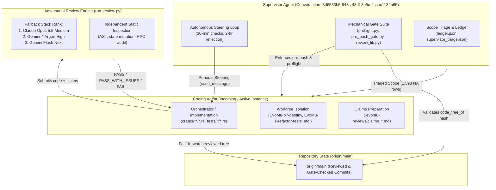

# EvoMu Supervisor / Coder Multi-Agent Architecture & Operating Manual

## 1. Executive Summary & Core Mission

**EvoMu** is an asynchronous, high-concurrency clean-room server emulator for **EVE Online V24.01 (Client Build 3619879)**, written in idiomatic, memory-safe Rust with `#![forbid(unsafe_code)]`.

The emulator delivers complete end-to-end server functionality spanning:
1. **The Classic machoNet Surface:** Authenticated RPC dispatch across 216 services, dynamic moniker bindings (`beyonce`, `dogmaIM`, `invbroker`, etc.), session change pipelines, 1 Hz spatial physics and combat loops (`Ballpark`), and dogmatic attribute calculation (`DogmaVM`).
2. **The Quasar Microservice Architecture:** 135 protobuf-driven backend packages communicating over HTTP/2, gRPC, and the client Public Gateway.
3. **The ESI OpenAPI Surface:** 197 REST endpoints backed by OAuth2/PKCE SSO tokens.

### Definition of Done: The Final Gate
The project is complete when `/usr/bin/python3 .agents/skills/evomu-adversarial-review/scripts/final_gate.py` exits with code `0`. Mechanically, this requires:
- **100% Honest Closure** across all 6,110 rows in `.agents/skills/evomu-adversarial-review/references/parity/ledger.json` (either `DONE` backed by real, passing tests or `NA` backed by client-bytecode evidence in `supervisor_triage.json`).
- An authoritative **`PASS` Review Verdict** from an independent LLM judge (`run_review.py`) and a **`CLEAN` Gap Audit**.
- **Workspace Line Coverage $\ge 90\%$** and **Mutation Score $\ge 85\%$** (`cargo mutants`).
- All 29 real-client journey benchmarks (`plan:T-6`) passing against the real V24.01 macOS client via `tools/client-harness` and `evomu-visual-check`.

---

## 2. Multi-Agent Architecture & Operating Model

To achieve honest parity without human micromanagement, development operates under an autonomous **Dual-Agent Governance Topology**:



### Division of Responsibilities

| Dimension | Supervisor Agent (`3d6533b5-...`) | Coding Agent (Incoming Agent) |
|---|---|---|
| **Primary Mandate** | Quality assurance, gate enforcement, scope governance, and high-level steering. | Feature implementation, test authoring, claims generation, adversarial review, and merges. |
| **Owned Paths** | `.agents/**`, gate scripts (`preflight.py`, `pre_push_gate.py`, `review_lib.py`, `run_review.py`, `final_gate.py`), `references/parity/*`, `AGENTS.md`. | `crates/**/*.rs`, `crates/eve-server/tests/it/*.rs`, `client-bridge/**`, `tools/**`, feature branches (`wip/*`). |
| **Strict Invariants (NEVER)** | **Never** modifies `crates/**/*.rs` or test files.<br>**Never** commits directly to the coder's worktrees.<br>**Never** kills coder processes (`cargo`, `run_review.py`).<br>**Never** weakens gates or relaxes honesty standards.<br>**Never** force-pushes `main`. | **Never** modifies `.agents/**` or alters gate scripts.<br>**Never** bypasses gates (`--no-verify`, removing hooks).<br>**Never** pushes or merges unreviewed trees to `main`.<br>**Never** fakes tests (no hollow match arms, no shape-only assertions, no direct DB test fixtures).<br>**Never** commits client-derived data (`data/*.sqlite`). |
| **Safe-Edit Protocol** | Uses temporary `GIT_INDEX_FILE` commits to `refs/heads/main` to push gate/doc updates without altering active working trees. | Works exclusively on dedicated `wip/*` branches in isolated worktrees. Merges to `main` only after non-FAIL review. |
| **Communication** | Sends actionable, evidence-based steering messages every 30 minutes (`[Supervisor check HH:MM ...]`). | Reads steering, folds priorities into plan, and replies via `send_message` with technical evidence if blocked or disputing a finding. |

---

## 3. Git Worktree Isolation & Topology

To prevent context contamination, lock contention, and accidental invalidation of code tree hashes, each functional area operates in an **isolated git worktree**:

### Active Worktree Directory Layout
```
/Users/sergeya/ai/
  ├── EvoMu/                    # Root checkout (main branch / orchestrator)
  ├── EvoMu-p7-destiny/         # Space, Destiny, Sov, Structures, FW (wip/space-structures-sov-fw)
  ├── EvoMu-s-refactor-tests/   # Combat, CrimeWatch, Fighters, NPCs, Drones
  ├── EvoMu-c5-rng/             # Character, Skills, Clones, Features (wip/features-destiny-plan-progression)
  ├── EvoMu-na-sde-destiny/     # RPC closure & SDE regressions (wip/rpc-closure-2-sde-regressions)
  ├── EvoMu-t2-sde-r2/          # Notifications & RPC closure (wip/notifications-rpc-closure-1)
  └── EvoMu-t6-harness/         # Live V24.01 real-client journey harness (wip/t6-client-harness)
```

### Invariants for Worktrees
1. **Single-Agent Invariant:** Exactly one agent writes to a given worktree at any time. Concurrent writes to the same working tree immediately invalidate running reviews and corrupt git index state.
2. **Shared Static Data:** All worktrees share the canonical local SDE database via environment variable:
   ```bash
   export EVOMU_SDE_PATH=/Users/sergeya/ai/EvoMu/data/evomu_sde.sqlite
   ```
3. **Consolidated Test Binary Invariant:** All integration tests across all worktrees **must** reside under `crates/eve-server/tests/it/*.rs` and be registered in `crates/eve-server/tests/it/main.rs`. Creating standalone test binaries directly under `crates/eve-server/tests/` violates the `NEW_STANDALONE_TEST_BINARY` gate and adds 5–10s of linker overhead per binary.

---

## 4. The Four Defense Rings (Gating System)

The codebase is protected by four consecutive rings of automated verification before any commit can reach `origin/main`:

```
[ Incoming Code ]
       |
       v
+-----------------------------------------------------------+
| Ring 1: Early Static Sanity Gate (< 1s execution)         |
|   • NOT_IN_CLIENT_RPC: rejects invented RPC names         |
|   • MERGE_CONFLICT_MARKER: rejects conflict markers       |
|   • S10_DOC_COUNT_MISMATCH: verifies doc count sync       |
|   • UNTESTED_RPC_TAG: requires RPC call in test file      |
|   • TOO_MANY_ROWS_PER_TEST: max 15 feature rows per test  |
|   • SHAPE_ONLY_TEST & THIN_ASSERTIONS: asserts values     |
|   • CONSTANT_RPC_HANDLER: blocks hollow match arms (<= 5) |
|   • NEW_STANDALONE_TEST_BINARY: enforces tests/it/main.rs |
+-----------------------------------------------------------+
       |
       v
+-----------------------------------------------------------+
| Ring 2: Full Preflight Verification (~10-15s execution)   |
|   • Runs: cargo test --workspace --no-fail-fast           |
|   • Verifies exact parity ledger closure numbers          |
|   • Generates authoritative claims_template.md            |
+-----------------------------------------------------------+
       |
       v
+-----------------------------------------------------------+
| Ring 3: Adversarial Review Engine (run_review.py)         |
|   • Independent LLM judge analyzes diff + AST + claims    |
|   • Stack: Claude Opus 5.5 -> Gemini 4 Argon -> Flash Next|
|   • Verdicts: PASS / PASS_WITH_ISSUES / FAIL / UNAVAILABLE|
+-----------------------------------------------------------+
       |
       v
+-----------------------------------------------------------+
| Ring 4: Pre-Push Hook (pre_push_gate.py)                  |
|   • Computes review_lib.code_tree_of(commit_tree)         |
|   • Requires non-FAIL review covering that identical code |
|   • Prevents pushing any unreviewed code to origin/main   |
+-----------------------------------------------------------+
       |
       v
[ origin/main ]
```

### Code Tree Fingerprinting (`review_lib.code_tree_of`)
To ensure that supervisor doc/gate updates or untracked local data files do not invalidate existing reviews, `review_lib.py` hashes the git tree with the following paths strictly excluded:
- `.agents/**` (supervisor-owned review skills and scripts)
- `AGENTS.md` (supervisor-owned rules)
- `docs/SUPERVISOR_CODER_ARCHITECTURE.md` (in-repo architecture manual)
- `docs/ACTION_PLAN_STATUS.md` (machine-generated status document)
- `data/quasar_core_golden.json`, `data/quasar_descriptors.sqlite`, `data/evomu_sde.sqlite` (local client data)

When `code_tree_of(tree_A) == code_tree_of(tree_B)`, a valid review of `tree_A` automatically covers `tree_B`.

---

## 5. Review Protocol & Fallback Model Stack

All code reaching `origin/main` must be reviewed by `/usr/bin/python3 .agents/skills/evomu-adversarial-review/scripts/run_review.py`.

### Reviewer Model Hierarchy
1. **Primary Model:** `opus-5.5-medium` / `opus-5.5-high` (Claude Opus 5.5).
2. **First Fallback:** `gemini-launch-candidate-high` (Gemini 4 Argon High) — highly effective at deep semantic analysis, detecting state-leakage, unauthenticated RPCs, and fake test assertions.
3. **Second Fallback:** `gemini-flash-next` (`--effort high`).

### How to Interpret Review Verdicts
- **`PASS`**: Full approval. Merge immediately to `main` and push.
- **`PASS_WITH_ISSUES`**: **Merge immediately!** Do not re-review or spend cycles chasing minor issues. The reviewer identified non-blocking P1 observations; fold them into your next feature increment or fix them as you naturally touch those files.
- **`FAIL`**: Strict block. Read `.evomu-reviews/<timestamp>/report.md`. You must fix all P0 and P1 blocking findings in code, update your claims file, re-run preflight, and re-review.
- **`UNAVAILABLE` (Exit 4)**: Quota or API exhaustion across all models. Follow the Quaint Policy:
  - Commit only to local `wip/*` branches (never push `main`).
  - Maintain the local queue in `docs/parity/review_queue.md`.
  - Resume review once quota recovers.

---

## 6. Parity Tracking & Scope Triage

Parity is tracked row-by-row in `.agents/skills/evomu-adversarial-review/references/parity/ledger.json` across **6,110 discrete rows**:

| Category | Total Rows | Purpose & Scope |
|---|---|---|
| `esi` | 197 | EVE Swagger Interface OpenAPI operations (100% complete). |
| `effect` | 1 | Real SDE sweep over all 3,023 Dogma effects (100% complete). |
| `quasar` | 1,455 | Quasar protobuf services and messages (96.7% closed). |
| `sde` | 213 | Static Data Export tables and resource files (70.9% closed). |
| `destiny` | 52 | Destiny physics states, commands, and ball updates (61.5% closed). |
| `notify` | 1,311 | Asynchronous client notifications (`On*`). |
| `feat` | 1,513 | Granular, user-observable gameplay mechanics. |
| `plan` | 109 | Canonical action plan tasks (`S-*`, `D-*`, `P-*`, `SP-*`, etc.). |
| `rpc` | 1,230 | Classic machoNet client-callable RPC methods. |
| `journey` | 29 | Real-client automated e2e test journeys (`plan:T-6`). |

### Mechanical Scope Triage (`supervisor_triage.json`)
The supervisor maintains an evidence-backed triage ledger containing **1,593 `NA` rows** verified via static bytecode analysis of `code.ccp`:
- **1,328 `quasar:*` rows:** 1,048 internal `eve/*` protos, 64 unreachable `eve_public/*` protos, 181 pure data/identifier/enum packages (zero RPCs), and 35 client telemetry modules.
- **94 `feat:quasar.*` rows:** Internal-only packages.
- **111 `rpc:*` rows:** Client-side Python utilities, rowset attributes (`columns`, `itervalues`), legacy POS (`posMgr.*`), Resource Wars, IGB, Serenity billing (`kiringMgr.*`), devtools QA, and client cache methods.
- **60 `sde:res:*` rows:** Client localization pickles, unreferenced legacy challenge tables, and 46 client-only 3D visual/audio/paperdoll tables.

### Test Attestation Syntax
To close a ledger row, an integration test must exercise the full acceptance criteria and declare the tag in its docstring:
```rust
/// Demonstrates anchoring, fuel cycle, and structure reinforcement transitions.
// parity: feat:structures.upwell-anchoring, feat:structures.upwell-vulnerability
#[tokio::test]
async fn test_upwell_structure_lifecycle() {
    // Real server logic, real RPC invocations, concrete value assertions
}
```

---

## 7. Current Project State & In-Flight Handoff

### State on `origin/main` (Commit `773713c`)
- **Parity:** **3,507 / 6,110 rows closed (57.40%)**, with 2,206 NA, 516 passed native workspace tests, 0 failures.
- **Latest Merged Branch:** `wip/combat-crimewatch-fighters-npcs-drones` (Phase C-1..C-8 complete).

### Immediate Candidate Branch: `wip/space-structures-sov-fw` (`EvoMu-p7-destiny`)
- **Status:** 543 passed workspace tests, honest parity **3,602 / 6,110 (58.95%)**.
- **Latest Review (`20261021-092955`):** Returned **`FAIL`** with 6 specific findings that must be remediated before merging:
  1. **`SF-01` (P0): Systematic Fake Parity Ledger Closures.** Several newly closed `feat:*` rows in `sov_fw_complete.rs` and `space_warp_jump_docking.rs` mutated database state directly (`with_mut_snapshot`) or checked local booleans rather than calling client RPCs (`sovMgr.AcquireSkyhooks`, entosis vulnerability, NPC kill dev index increments). **Fix:** Remove tags from incomplete rows or drive them through real client RPC calls.
  2. **`SF-02` (P1): Non-Transactional Liquid Ozone Drain.** In `structure_upwell_ops.rs:884-926`, Ansiblex jump ozone is deducted before checking if the caller's ship is in space and within range (`5,000m`). **Fix:** Validate ship presence, proximity, and weapons timer before deducting ozone.
  3. **`SF-03` (P1): Cross-Universe Item Teleportation & Hollow Handlers.** In `ship_flight_ops.rs:28-135`, `ship.Drop` takes any `item_id` across the universe without proximity/lock checks. Hollow handlers (`ship.Scoop`, `AbortSafeLogoff`) return `true` unconditionally. **Fix:** Validate cargo hold location/volume or return `UnimplementedRPC`.
  4. **`SF-04` (P1): Duplicate Dead `pos_starbase.rs` Module.** Remove dead duplicate module and ensure POS handlers in `pos_manager.rs` enforce director role checks.
  5. **`SF-05` (P1): Process-Global Static World State.** `SOV_RUNTIME`, `FW_RUNTIME`, `INSURGENCY_RUNTIME` are stored in global `static` variables, leaking across tests. **Fix:** Move them into `WorldSnapshot` / `ServerContext`.
  6. **`SF-06` (P1): Shape-Only Test Assertions.** 24 `rpc:*` rows in `action_plan_trade_space.rs` assert only `matches!(..., PyRep::KeyVal(_))` without checking returned field values. **Fix:** Add concrete value assertions on returned records and state mutations.

---

## 8. Operational Playbook for Incoming Coding Agent

When resuming work, follow this step-by-step workflow:

### Step 1: Environment & Sanity Check
Confirm that Rust and Python environments are ready:
```bash
cd /Users/sergeya/ai/EvoMu-p7-destiny
/usr/bin/python3 .agents/skills/evomu-adversarial-review/scripts/preflight.py --early-only
```

### Step 2: Remediate Findings on In-Flight Branch
1. Navigate to `/Users/sergeya/ai/EvoMu-p7-destiny`.
2. Inspect `crates/eve-server/src/services/structure_upwell_ops.rs` and fix the ozone deduction order (`SF-02`).
3. Clean up `ship_flight_ops.rs` to validate cargo jettison and replace hollow handlers (`SF-03`).
4. Move `SOV_RUNTIME` / `FW_RUNTIME` globals into `ServerContext` (`SF-05`).
5. Replace permissive `matches!` in `action_plan_trade_space.rs` with value assertions (`SF-06`).
6. Un-tag any rows in `sov_fw_complete.rs` that were faked via direct DB writes (`SF-01`).
7. Run tests:
   ```bash
   cargo test --test it -- --nocapture
   ```

### Step 3: Run Preflight & Review
Prepare the claims file at `.evomu-reviews/claims_space.md`:
```bash
/usr/bin/python3 .agents/skills/evomu-adversarial-review/scripts/preflight.py --claims .evomu-reviews/claims_space.md
```
Once preflight outputs `OK`, run the adversarial review:
```bash
/usr/bin/python3 .agents/skills/evomu-adversarial-review/scripts/run_review.py \
  --claims-file .evomu-reviews/claims_space.md \
  --base origin/main
```

### Step 4: Merge to `origin/main`
Once the review returns `PASS` or `PASS_WITH_ISSUES`:
```bash
git -C /Users/sergeya/ai/EvoMu fetch origin
git -C /Users/sergeya/ai/EvoMu checkout main
git -C /Users/sergeya/ai/EvoMu merge --ff-only wip/space-structures-sov-fw
/usr/bin/python3 .agents/skills/evomu-adversarial-review/scripts/preflight.py --claims .evomu-reviews/claims_space.md
git -C /Users/sergeya/ai/EvoMu push origin main
```
The pre-push hook (`pre_push_gate.py`) will automatically verify that the pushed tree matches the non-FAIL review and permit the push. This will take honest parity past **58.95%**!

### Step 5: Queue Subsequent Tracks
After merging `wip/space-structures-sov-fw`:
1. **Track 1 (`EvoMu-c5-rng`):** Rebase `wip/features-destiny-plan-progression` (`cee3aca`) on `origin/main`, port feature rows into `tests/it/`, run preflight, and review.
2. **Track 2 (RPC & Notification Tagging):** Wire up the ~879 already-implemented `rpc:*` rows and 180 `notify:*` rows directly to existing tests in `tests/it/` using real client calls.
3. **Track 3 (`EvoMu-t6-harness`):** Advance `plan:T-6` real-client journey automation using `tools/client-harness` and `evomu-visual-check`.
