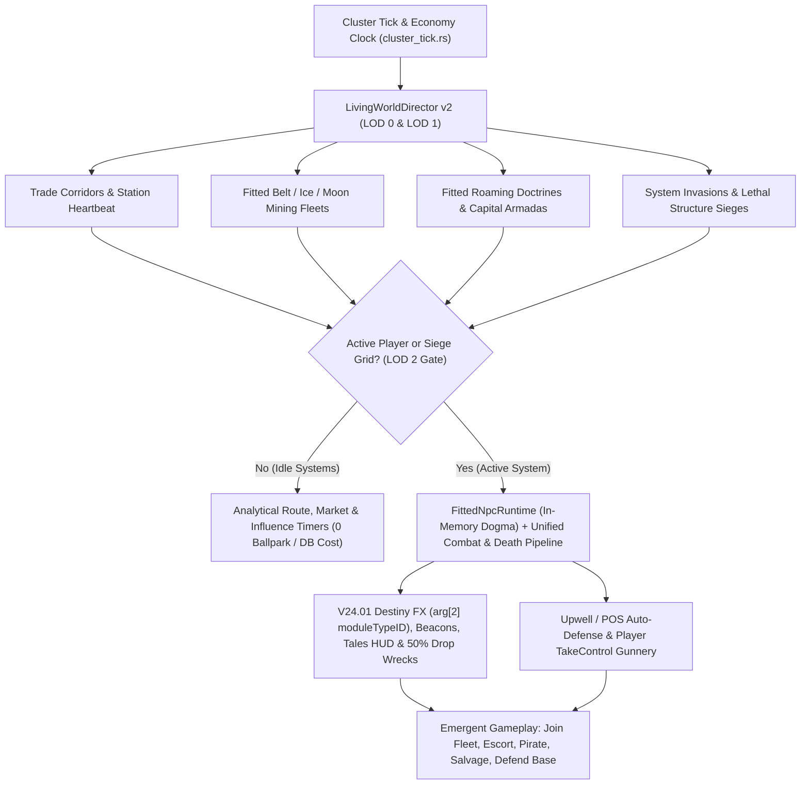
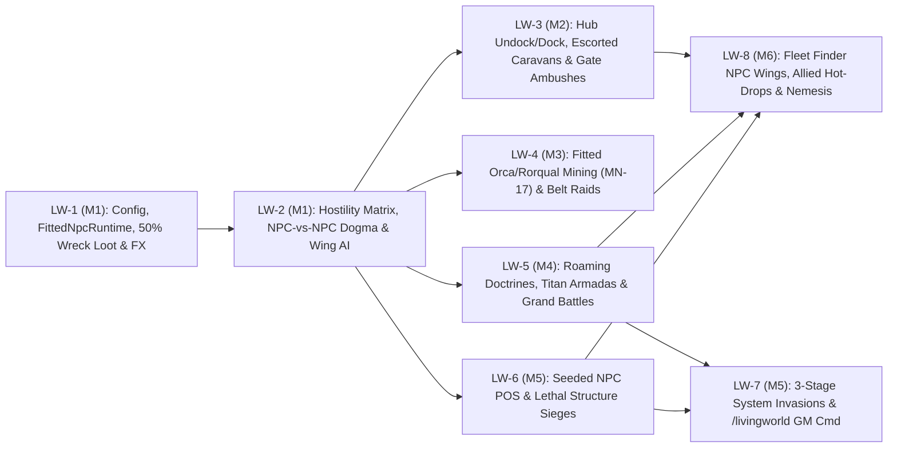

# EvoMu Deep-Dive Spec 06: Living Universe v2 PRD — Fitted NPC Doctrines, Caravans, Armadas, Invasions & Structure Sieges (`Phase LW`: `LW-1`–`LW-8`)

> Part of the [`PLAN.md`](../../PLAN.md) Master Specification. Scheduled for execution **after current parity and remediation workstreams (`Phase 0`–`Phase Z`) complete**, tracked in [`docs/ACTION_PLAN_STATUS.md`](../ACTION_PLAN_STATUS.md) as `LW-1` through `LW-8`.

---

## 1. Problem Statement & Vision

On Tranquility, concurrent human capsuleers supply the trade-corridor traffic, asteroid-belt drama, roaming doctrines, capital jump flashes, and structure sieges that make New Eden feel alive. On a solo or small-group `EvoMu` cluster (`1–50` human players), solar systems feel quiet unless the universe actively lives, trades, mines, patrols, and wages war using the **exact same ship hulls, module fittings, physics, and combat rules as players**.

### Root-Cause Audit of Current `EvoMu` Behavior
1. **Singleton System Caps:** [`crates/eve-server/src/living_world.rs`](../../crates/eve-server/src/living_world.rs) currently caps each active system to **1** solo industrial hauler, **1** Venture miner (`+1` companion hauler, `+1` destroyer escort), and **2** stationary Empire Navy patrol hulls.
2. **Stat-Blob NPCs & No NPC-vs-NPC Combat:** [`crates/eve-server/src/combat/npc_ai.rs`](../../crates/eve-server/src/combat/npc_ai.rs) restricts target candidates strictly to player categories (`6 | 18 | 65`), strips `rt.npc_entities`, and uses flat synthetic DPS/HP approximations instead of real module fittings. Pirates never attack NPC miners or haulers, escorts never fire on belt rats, and rival factions ignore each other.
3. **Silent Grid Transitions & Mining:** Stargate jumps in [`crates/eve-server/src/living_world_haulers.rs`](../../crates/eve-server/src/living_world_haulers.rs) call `remove_ball` / `spawn_ball_with_combat` without emitting stargate jump flashes, and NPC mining cycles in [`crates/eve-server/src/living_world.rs`](../../crates/eve-server/src/living_world.rs) drain asteroid units mathematically instead of running fitted mining lasers (`MN-17`).
4. **Player-Only Structure Auto-Defense:** [`crates/eve-server/src/services/structure_control_ops.rs`](../../crates/eve-server/src/services/structure_control_ops.rs) resolves hostile targets only via player `pilot_id`, so Upwell Citadels and POS Starbases never exchange fire with NPC siege fleets.

### Core Design Principles
1. **100% Mechanical Parity with Player Ships:** Living-World NPC ships (`category_id == 6`) carry real SDE module, rig, charge, and drone loadouts (`ShipFitting` in `eve-dogma`) and resolve weapons, EWAR, capacitor drain, active/remote repairs, mining, and `50%` wreck loot drops through the **exact same combat and Dogma pipelines as human players**—with zero artificial damage scalars.
2. **Systemic Macro, Stagecraft Micro:** Across empty systems, fleets, caravans, and invasions advance as lightweight `LOD 1` state machines (`0` physics cost). Full `LOD 2` ballpark entities, in-memory `FittedNpcRuntime` Dogma cycles, and space FX materialize **only in systems with active players** (or active structure siege grids), keeping active systems within `< 0.5 ms/tick` ([`docs/spec/05_living_world_and_ai.md`](./05_living_world_and_ai.md)) with **no artificial per-system ball cap**.

### Target Experience Benchmarks (Under Default Interval Config)
| Experience Metric | Baseline | v2 Target (Default Intervals) |
| :--- | :--- | :--- |
| **Time to see moving traffic after hub undock** | Often `> 120s` (or static 2 ships) | **`< 15s`** (`station_undock_interval_secs = 25`) |
| **Stargate transit sightings (active corridors)** | `1` silent hauler | **Every `30–90s`** with visible gate-ring flash & cloak drop |
| **Asteroid belt industrial scenes** | `1` silent Venture | **`7–10` hull fitted Orca/Barge op** + pirate raids (`belt_pirate_raid_interval_secs = 720`) |
| **Roaming fleets & Capital Armadas** | `0` | Subcap doctrine every **`10m`** (`600s`); Titan/Carrier armada every **`25m`** (`1500s`); Grand Battle every **`30m`** (`1800s`) |
| **Active-system CPU tick time (full Grand Battle + traffic)** | `< 0.2 ms` | **`< 0.5 ms/tick`** via `FittedNpcRuntime` + Wing-Anchor kinematics (`1` AI brain per `8–12` hulls) |

---

## 2. System Architecture Overview



---

## 3. Core Feature Pillars

### Pillar 1: Module-Fitted NPC Parity, Faction Hostility & Full Audiovisual FX

#### 1.1 Canonical Faction Hostility Matrix (Including EVE's Post-Human / AI / Abyssal Factions)

> **Lore & SDE Note — Post-Human, AI & Abyssal Threats:**  
> Canonically, New Eden has no extraterrestrial non-human species—all factions descend from ancient human colonists stranded when the EVE Gate collapsed. However, **five SDE factions** evolved into post-human, hive-mind AI, or Abyssal civilizations that look, fly, and fight as **alien / eldritch threats**:
> * **Rogue Drones (`500025`):** Self-replicating biomechanical AI insectoid swarms (`Alvus` / Hive Queens) infesting belts, wrecks, and null-sec regions.
> * **Sleepers (`500021` / `500005` Jove):** Ancient cryogenically-linked AI sentinels guarding Wormhole (`Anoikis`) ruins.
> * **Drifters (`500024` — `Vigilant Tyrannos`):** Post-Jove cybernetic bio-harvesters emerging from wormholes with blue overshields and `750,000` omni Doomsdays (`Apollo` / `Artemis Tyrannos`).
> * **Triglavian Collective (`500026`):** Enigmatic civilization forged inside isolated **Abyssal Deadspace**, flying Singularity-powered Precursor hulls (`Leshak` `47271`, `Zirnitra` `52907`, `World Ark` `52361`) to harvest stars.
> * **Sansha's Nation (`500019`):** Cybernetic hive mind ("True Slaves") launching constellation-wide Incursions from `Revenant` (`3514`) Supercarriers.

All NPC wings evaluate grid hostility dynamically via `faction_id` (verified against `sde_factions` in local `data/evomu_sde.sqlite`):

| Faction Group (`faction_id`) | Hostile Toward (Auto-Engages on Grid) | Allied / Assists |
| :--- | :--- | :--- |
| **Empire Navies** (`500001` Caldari, `500002` Minmatar, `500003` Amarr, `500004` Gallente, `500007` Ammatar, `500008` Khanid) | Pirate Cartels (`500010..=500020`, `500029`), Rogue Drones (`500025`), Drifters (`500024`), Triglavians (`500026`); rival FW Militia in Low-Sec (`500001 ↔ 500004`, `500002 ↔ 500003`) | Local Empire Industrial/Mining Corps, CONCORD (`500006`), EDENCOM (`500027`), positive-standing players |
| **Pirate Cartels** (`500010` Guristas, `500011` Angel, `500012` Blood Raiders, `500019` Sansha, `500020` Serpentis, `500029` Deathless) | Empire Navies, EDENCOM (`500027`), ORE (`500014`) & NPC Mining/Hauler fleets, Rival Cartels in contested space | Cartel-aligned players (`standing >= +5.0`) |
| **Triglavian Collective (`500026`) vs EDENCOM (`500027`)** | Mutual shoot-on-sight; Triglavians also fight Drifters (`500024`), Rogue Drones (`500025`), and Sleepers (`500021`) | Respective invasion-aligned players |
| **Drifters (`500024`) & Rogue Drones (`500025`)** | Hostile to all Empire, Pirate, Triglavian, Industrial, and player hulls/structures on siege/infestation grids | None |

#### 1.2 Two-Tier Module-Fitted NPC Engine & Unified Player Combat Rules (Zero Damage Scalars, Zero SQLite Churn)
All Living-World ships (`category_id == 6`) use **real Doctrine Fittings** evaluated through `eve-dogma` ([`crates/eve-dogma/src/combat_eval.rs`](../../crates/eve-dogma/src/combat_eval.rs), [`crates/eve-dogma/src/fitting.rs`](../../crates/eve-dogma/src/fitting.rs), [`crates/eve-dogma/src/evaluation.rs`](../../crates/eve-dogma/src/evaluation.rs)) and `eve-server`'s player combat engine, using a **two-tier state architecture** so large fleet battles generate **zero SQLite WAL churn** while alive:
* **Tier 1 — Alive on Grid (`OnceLock<DoctrineTemplate>` + In-Memory `FittedNpcRuntime`):**
  * `OnceLock<HashMap<DoctrineId, Arc<DoctrineTemplate>>>` pre-evaluates each doctrine's `eve-dogma` `ShipFitting`, base `DogmaItemState`, slot layout (`HiSlot`, `MedSlot`, `LoSlot`, `RigSlot`), and loaded module/charge/drone `TypeId`s once.
  * Each spawned `LOD 2` ship holds a lightweight in-memory `FittedNpcRuntime` (`capacitor`, `shield/armor/hull`, per-slot cycle/cooldown timers, remaining ammo/charges, active EWAR/Command Burst modifiers)—never writing live NPC modules to SQLite `snap.items` on spawn or `LOD 2 -> LOD 1` despawn.
  * *Example — Imperial Navy `Zealot`:* Heavy Pulse Laser IIs (`Conflagration`/`Scorch` crystals), `10MN Afterburner II`, `Warp Disruptor II`, `1600mm Steel Plates II`, `Multispectrum Energized Membrane II`s, `Heat Sink II`s, and `Medium Trimark Armor Pump II` rigs.
  * *Example — Logistics (`Guardian` / `Basilisk` / `Apostle` `37604`):* Large Remote Armor Repairers / Shield Transporters + Remote Capacitor Transmitters running real cap-chain and repair cycles.
* **Tier 2 — On Destruction (`death_pipeline.rs` 50% Materialization):**
  * When a fitted NPC ship is destroyed (by a player or another NPC), [`crates/eve-server/src/combat/death_pipeline.rs`](../../crates/eve-server/src/combat/death_pipeline.rs) emits `TerminalPlayDestructionEffect`, spawns the canonical wreck ball + `InventoryItemRecord`, and **materializes the surviving `50%`-rolled fitted module, charge, drone, and cargo `InventoryItemRecord` rows directly into `snap.items` (`location_id = wreck_id`)** alongside a `KillmailRecord`.
* **Identical Combat & Physics Math:**
  * Turrets resolve angular velocity, sig radius, optimal/falloff, and wrecking shots via `formulas::compute_turret_hit` ([`crates/eve-server/src/formulas.rs`](../../crates/eve-server/src/formulas.rs)); missiles resolve target velocity vs explosion velocity/radius identically to player launchers.
  * Capacitor drain, Energy Neutralizers, Stasis Webs, Warp Scramblers (shutting off fitted MWDs in [`crates/eve-dogma/src/combat_eval.rs`](../../crates/eve-dogma/src/combat_eval.rs)), ECM, Tracking Disruption, and Command Bursts affect NPC and player ships identically.
  * **Natural Fleet Battle Pacing (`8–15m`):** Real buffer plates/extenders, `70%–85%` resist hardeners, and active Logistics/FAX wings naturally sustain `25v25` fleet battles for `8–15 minutes`—broken the authentic EVE way by focus-firing primaries or neuting/jamming enemy Logistics.
  * *(Classic SDE `category_id == 11` non-slot entities like `World Ark` `52361` or `Rogue Drone` hive entities execute at `1.0x` unscaled player damage/resist/tracking math using their native SDE dogma attributes.)*
* **V24.01 `SlimItemMeta` & Bound `dogmaIM` Wire Invariants:**
  * Every `category_id == 6` NPC ship **must** set `char_id = None` (omitted from `SlimItem` so V24.01 client bracket/overview code does not call `charMgr.GetPublicInfo`) and set both `owner_id` and `corp_id` to a **real SDE NPC corporation ID** (`1_000_001..1_000_300` in `sde.npc_corporations`, e.g., `1000084` Amarr Navy, `1000035` Caldari Navy, `1000134` ORE, `1000127` Guristas, `1000298` Triglavian Collective) so `cfg.eveowners.Get(ownerID)` resolves cleanly.
  * Bound `dogmaIM` item-info queries (`#1032`) resolve `FittedNpcRuntime` ship balls cleanly when locked by players or piloted structures.

#### 1.3 Verified V24.01 Space FX Table (`DestinyEvent::OnSpecialFX`)
All GUIDs are verified against `sde_dogma_effects` and [`crates/eve-server/src/router/binding_effects.rs`](../../crates/eve-server/src/router/binding_effects.rs). In V24.01's 14-positional-arg `OnSpecialFX` tuple (`shipID, moduleID, moduleTypeID, targetID, otherTypeID, guid, ...` in [`crates/eve-server/src/router/client_compat.rs`](../../crates/eve-server/src/router/client_compat.rs)), **`arg[2]` (`moduleTypeID`) must carry the actual fitted module `TypeId`** (e.g., `Heavy Pulse Laser II`, `Strip Miner II`, `Judgment` `24550`) so `turretSet.pyj` mounts and animates 3D weapon/mining turrets on `category_id == 6` hulls:

| Grid Action | Effect ID / Source | V24.01 `OnSpecialFX` GUID | Client Visual & Audio Result |
| :--- | :--- | :--- | :--- |
| **Turret Volley** | Fitted turret (`arg[2] = module_tid`) | `effects.Laser`, `effects.ProjectileFired`, `effects.HybridFired` | 3D turret tracking + beam tracers, muzzle flashes, hull sparks |
| **Missile Salvo** | Groups `506..=511` (`arg[2] = launcher_tid`) | `effects.MissileDeployment` | Physical missile trails arcing to target |
| **Mining & Gas Harvesting** | Fitted Strip/Mining Laser (`17`, `67`, `2726`) | `effects.Mining`, `effects.Laser`, `effects.CloudMining` | Continuous mining beams on asteroid/cloud ball (`MN-17`) |
| **Command Bursts** | Command Burst module (`12586`+) | `effects.WarfareLinkMining` (+ shield/armor/skirmish links) | Expanding spherical AoE buff ring from Orca / Command Ship |
| **Active & Remote Reps** | Groups `40`, `62`, `41`, `325` | `effects.ShieldBoosting`, `effects.ArmorRepair`, remote rep beams | Shield ripple / armor nanite glow + logistics tether beams |
| **Stargate Transit** | Gate jump hook | `effects.JumpOut` / gate flash + `effects.Cloak` → `effects.Uncloak` | Stargate ring spin, jump tunnel flash, gate-cloak shimmer |
| **Cynosural Beacon & Portal** | Fitted Cyno / Titan Portal (`2152`) | `effects.CynosuralGeneration`, `effects.JumpPortal` | System-wide beacon + blazing cyno sphere & Titan bridge vortex |
| **Titan Doomsday Volley** | Fitted Doomsday (`4489..=4492`) | `effects.SuperWeaponAmarr` / `Caldari` / `Gallente` / `Minmatar` | Full-grid capital superweapon charge-up, lance/beam, audio boom |

---

### Pillar 2: Bustling Trade Corridors, Station Undocks & Escorted Caravans

#### 2.1 Trade-Hub Undock/Dock Heartbeat (`station_undock_interval_secs = 25`)
At major trade hubs (*Jita 4-4*, *Amarr VIII*, *Dodixie IX-20*, *Rens VI-8*, *Hek VIII-12*) and regional market stations with an active player on grid:
* Every `25s` (configurable), fitted civilian/industrial hulls undock along the station's undock vector, burn out with active `Afterburner`/`MWD` plumes, align using real hull mass/inertia (`tau = inertia * mass / 1e6`), and warp to connected stargates, while inbound haulers land on the docking perimeter and dock.
* **Verified SDE Hull Roster:**
  * *Freighters & Bowheads:* `Providence` (`20183`), `Charon` (`20185`), `Obelisk` (`20187`), `Fenrir` (`20189`), `Bowhead` (`34328`) — fitted with Reinforced Bulkheads / Expanded Cargoholds.
  * *Deep Space Transports & Blockade Runners:* `Bustard` (`12731`), `Occator` (`12745`), `Mastodon` (`12747`), `Impel` (`12753`) — fitted with Warp Core Stabilizers, Shield Extenders / Plates, and MWDs/Cloaks.
  * *T1 Industrials & Shuttles:* Racial haulers (`648`, `649`, `651`, `653`) carrying real SDE NPC corporation owners.

#### 2.2 Multi-Ship Escorted Trade Caravans (`caravan_spawn_interval_secs = 180`)
Upgrade [`crates/eve-server/src/living_world_haulers.rs`](../../crates/eve-server/src/living_world_haulers.rs) into multi-ship escorted formations (`caravan_escort_min_ships = 3`, `caravan_escort_max_ships = 6`):
* **Composition:** `1` Freighter flagship + `2` Deep Space Transports + `3–6` fitted Corp Security / Empire Navy Cruiser & Frigate escorts (with Tackle, Webs, and Logistics).
* **Formation Transit:** Escorts anchor on the Freighter (`DSTBALL_FORMATION` / wing offsets), warp gate-to-gate together, jump stargates in staggered `0.8s` flashes, hold gate cloak briefly, decloak (`effects.Uncloak`), and align to the next hop.
* **Low/Null Jump-Freighter Cyno Logistics (`jump_freighter_cyno_interval_secs = 420`):** Fitted Jump Freighters (`Rhea` `28844`, `Nomad` `28846`, `Anshar` `28848`, `Ark` `28850`) jump onto cyno vigils outside Low/Null NPC stations and player trade structures.
* **Pirate Gate Ambushes (`gate_ambush_interval_secs = 900`):** Along `0.5` border pipes and Low-Sec corridors, fitted Pirate Interdiction gangs ambush passing caravans—players jumping the gate enter a live firefight where they can rescue the freighter or scoop dropped cargo.

---

### Pillar 3: Living Asteroid Belts, Ice Fields & Pirate Raids

#### 3.1 Fitted Multi-Ship Mining Operations (`mining_fleet_min_barges = 3`, `mining_fleet_max_barges = 5`)
Upgrade [`crates/eve-server/src/living_world.rs`](../../crates/eve-server/src/living_world.rs) to run real fitted Strip Miners / Ice Harvesters through [`crates/eve-server/src/services/mining_cycle.rs`](../../crates/eve-server/src/services/mining_cycle.rs) (`MN-17`):
* **High-Sec Belt / Ice Op (`7–10` fitted ships):**
  * `1` `Orca` (`28606`) fitted with Mining Foreman Burst IIs (`effects.WarfareLinkMining`), Large Industrial Core, Shield Extenders, and combat/mining drones.
  * `3–5` Barges / Exhumers (`Procurer` `17480`, `Retriever` `17478`, `Mackinaw` `22548`) fitted with Strip Miner IIs / Mining Laser Upgrades, firing real `effects.Mining` beams onto asteroid balls.
  * `1–2` Industrials warping ore loads to the local refinery station.
  * `2–3` fitted Corp Security Cruisers/Destroyers orbiting at `15 km`.
* **Low-Sec Op (`5–8` ships):** `Porpoise` (`42244`) + `Skiff` (`22546`) wing + Battlecruiser escorts.
* **Null-Sec Capital Op (`8–12` ships):** `Rorqual` (`28352`) with Industrial Core + `Hulk` (`22544`) wing + heavy standing response fleet.

#### 3.2 Dynamic Pirate Belt Raids (`belt_pirate_raid_interval_secs = 720`)
* Every `12 minutes` (configurable) in an active mining system, a fitted Pirate Raiding Wing (`5–8` frigates/cruisers/battlecruisers, or Rogue Drone swarm `500025`) warps into the belt at `35 km` and engages the mining fleet.
* Barges recall drones and align out (unless warp-scrambled by pirate tacklers!) while defense escorts engage. If the `Orca`/`Rorqual` drops below `75%` shield, it lights an **`Industrial Distress Beacon`** on the Overview and summons an Empire/Mercenary response squad `60s` later.

---

### Pillar 4: Roaming Doctrines, Capital Move Ops & Titan Armadas

#### 4.1 Roaming Subcap Fleet Doctrines (`roaming_fleet_interval_secs = 600`, `roaming_fleet_min_ships = 12`, `roaming_fleet_max_ships = 24`)
* Every `10 minutes` (configurable), spawn cohesive fitted subcap doctrines traversing `4–8` system patrol loops through player corridors:
  * *Doctrines:* Amarr `Zealot`/`Guardian`/`Devoter` ArmorHACs, Caldari `Ferox Navy`/`Basilisk` Railgun Line, Minmatar `Muninn`/`Scimitar` Wolfpack, Gallente `Ishtar`/`Oneiros` Patrol, Guristas `Gila` Raiders, Mordu's `Orthrus`/`Barghest` Wing, Triglavian `Leshak` (`47271`) + `Zarmazd` Conduit Pack, EDENCOM `Thunderchild` (`54733`) Vorton Wing, or Rogue Drone Hive Swarms.
* Whenever two hostile roaming fleets cross on the same stargate or belt grid, they **immediately lock, anchor on their FCs, broadcast primaries, and fight a real Dogma fleet battle**.

#### 4.2 Titan, Supercarrier & Carrier Armadas (`capital_armada_interval_secs = 1500`)
* Every `25 minutes` (configurable; `capital_armada_escort_min_ships = 12`, `capital_armada_escort_max_ships = 22`), stage a capital move-op or flagship transit across High-Sec (Empire Navy Flagships), Low-Sec, or Null-Sec (Empire & Pirate Faction Capitals):
  1. **Cyno Scout (`T+0s`):** A fitted Recon / Force Recon ship decloaks `45 km` off a stargate or station undock and activates a Cynosural Field (`effects.CynosuralGeneration`), creating a system-wide `Naval Cynosural Beacon`.
  2. **Capital Jump-In (`T+12s..T+25s`):** Staggered jump-drive spheres materialize the fitted armada:
     * **1 Fitted Titan:** `Avatar` (`11567`), `Leviathan` (`3764`), `Erebus` (`671`), `Ragnarok` (`23773`) — or Null-Sec Faction Titan (`Komodo` `45649`, `Molok` `42241`, `Vanquisher` `42126`, `Azariel` `78576`) fitted with Capital Trimarks/Extenders, Capital Plates/Shields, Phenomenal Generator, Jump Portal Generator, and racial Doomsday (`24550`/`24552`/`24554`/`23674`).
     * **2–3 Supercarriers / Carriers:** `Aeon` (`23919`), `Wyvern` (`23917`), `Nyx` (`23913`), `Hel` (`22852`) + `Archon` (`23757`), `Chimera` (`23915`), `Thanatos` (`23911`), `Nidhoggur` (`24483`) launching Space Superiority & Heavy Fighter squadrons.
     * **2–4 Dreadnoughts & FAXes:** `Revelation` (`19720`), `Phoenix` (`19726`), `Moros` (`19724`), `Naglfar` (`19722`), `Zirnitra` (`52907`), `Caiman` (`45647`), `Chemosh` (`42243`), `Vehement` (`42124`) + `Apostle` (`37604`), `Minokawa` (`37605`), `Ninazu` (`37607`), `Lif` (`37606`).
     * **8–14 Fitted Subcap Escorts:** Battleships, Heavy Interdictors, and Logistics cruisers.
  3. **Titan Bridge / Transit (`T+30s..T+300s`):** The Titan activates `effects.JumpPortal` to bridge an allied subcap strike fleet, holds grid perimeter (`capital_armada_grid_hold_secs = 270`), and jumps out to its next cyno hop (or engages if a hostile capital fleet contests the grid!).

---

### Pillar 5: Grand Faction Battles, System-Wide Invasions & Lethal Starbase/Upwell Sieges

#### 5.1 Discoverable Grand Faction Set-Piece Battles (`grand_battle_interval_secs = 1800`, `grand_battle_ships_per_side = 25`)
* Every `30 minutes` (configurable), spawn a full-scale **Faction Warzone** (`20–30` fitted ships per side + reinforcement cynos) surfaced via a warpable system beacon (`Fleet Battle: <Side A> vs <Side B>`):
  * Dreadnoughts cycle Siege modules, Carriers launch Fighters, FAXes run Triage remote repairs, subcaps brawl under Command Bursts, and Titans fire fitted Doomsday modules (`4489..=4492`) once capacitor and `5-minute` superweapon cooldowns permit.
  * Players can jump in on either side, apply EWAR/DPS/reps under identical player combat rules, earn LP/bounties/killmails, and loot `50%`-drop capital and T2/faction module wrecks.

#### 5.2 3-Stage System-Wide Invasions (`invasion_spawn_interval_secs = 3600`, `max_concurrent_invasions = 3`)
Built on `EvoMu`'s native `OnTaleData` (`taleMgr` in [`crates/eve-server/src/services/pve_incursion_lifecycle.rs`](../../crates/eve-server/src/services/pve_incursion_lifecycle.rs)) and `OnInsurgencyCampaignUpdatedForLocation` (`insurgencySolarsystem` in [`crates/eve-server/src/services/insurgency_services.rs`](../../crates/eve-server/src/services/insurgency_services.rs)) client HUD banners across **5 Invader Archetypes** (*Triglavian Collective*, *Drifter Crisis*, *Sansha Incursion*, *Pirate Cartel Offensive*, and *Rogue Drone Hive Overrun*):

| Stage | Default Duration | System Activity & Escalation |
| :--- | :--- | :--- |
| **1. Reconnaissance** | `1800s` (`30m`) | Invader scout wings raid mining belts and camp stargates; Empire Navy deploys counter-patrols; native HUD Influence bar opens. |
| **2. Starbase & Structure Siege** | `3600s` (`60m`) | Invader Dreadnought/Carrier siege fleets warp to **NPC Moon Starbases, Orbital Skyhooks (`81080`), Customs Offices, and Player POS / Upwell Structures**. Empire Navy relief wings warp in to contest active sieges. |
| **3. Flagship Climax** | `1800s` (`30m`) | HQ beacon spawns the Invader Flagship — **`World Ark (Xordazh-class)` (`52361`)**, **`The Kundalini Manifest` (`2192`) / `Revenant` (`3514`)**, or **Drifter `Tyrannos` Armada** — opposed by an Empire Navy **Titan + Capital Taskforce**. |

#### 5.3 Seeded NPC Moon Starbases (`POS`) & Forward Citadels (`seed_npc_moon_starbases = true` by default)
Enabled **by default (`true`)** at server bootstrap (`step_living_world_cluster` / bootstrap entrypoint, preserving `S-5` empty `WorldRepository::new_in_memory()` isolation for unit tests):
* Deterministically seed **NPC Faction Moon Starbases** (`Amarr` `12235`, `Gallente` `12236`, `Caldari` `16213`, `Minmatar` `16214` Control Towers with active forcefields, Moon Harvesters, Silos, and fitted Turret/Missile/EWAR batteries) and **NPC Forward `Astrahus` (`35832`) / `Fortizar` (`35833`) Citadels** across moons and strategic borders.
* Gives invading fleets and roaming capitals real structures to besiege on Day 1—and gives players hostile Pirate/Drifter POSes to siege alongside allied NPC capitals for Moon-mineral & Silo loot.

#### 5.4 Lethal Sieges on *Player* POS Starbases & Upwell Structures (`player_structure_siege_mode = "lethal"` by default)
Player-owned POS Control Towers (`group_id == 365`, `posMgr`) and Upwell Structures (`Astrahus` `35832`, `Fortizar` `35833`, `Keepstar` `35834`, `Raitaru` `35825`, `Azbel` `35826`, `Sotiyo` `35827`, `Athanor` `35835`, `Tatara` `35836`) participate in the living warzone under **full lethal EVE structure rules by default**:
* **Unified Structure Auto-Defense & Player Gunnery:** Generalize `HostileTargetInfo.pilot_id` to `Option<i64>` (`+ faction_id: Option<u32>`) in [`crates/eve-server/src/services/structure_control_ops.rs`](../../crates/eve-server/src/services/structure_control_ops.rs) so fitted Standup Launchers, Point Defense Batteries, Electronic Warfare, and POS Sentry Batteries automatically lock and fire on attacking NPC siege ships—while players can call `structureControl.TakeControl` to personally pilot Standup Fighters, Guided Bombs, and Keepstar/Fortizar Standup Superweapons.
* **Standard EVE Reinforcement Timers as Natural Defense Window:** Because NPC siege ships deal real fitted weapon DPS against canonical Upwell damage caps and reinforcement state transitions in [`crates/eve-server/src/services/structure_lifecycle.rs`](../../crates/eve-server/src/services/structure_lifecycle.rs) (`ShieldVulnerable → ArmorReinforced → ArmorVulnerable → HullReinforced → HullVulnerable → Destroyed`), structure owners receive notification `184` (`StructureUnderAttack`) and have the full multi-hour/day EVE `ArmorReinforced` and `HullReinforced` timers to form up, fit defenses, summon allies, or destroy the attacker's staging FOB.
* **Counterplay — Destroy the In-System Siege Anchor:** Every NPC structure siege stages from a warpable **Invader Forward Operating Base / Siege Command Ship** in-system. Destroying that FOB cuts off reinforcement waves to your structure's next vulnerability timer and drops high-value Quantum Cores, Faction BPCs, and Overseer loot.
* **Lethal Outcome (`player_structure_siege_mode = "lethal"` default):** If a besieged player POS or Upwell structure is left undefended through its final `HullVulnerable` timer, the NPC armada **destroys it outright**—dropping its Quantum Core / `50%` fitted Standup modules and routing player hangars into `EvoMu`'s canonical K-space `structureAssetSafety` wrap ([`crates/eve-server/src/services/structure_lifecycle.rs`](../../crates/eve-server/src/services/structure_lifecycle.rs)) or full loot drop in Wormhole/Abandoned states, identically to player-vs-player sieges.

---

## 4. Expanded World Interactions ("Living MMO Sandbox")

All 7 interaction systems operate through 100% native V24.01 client UI windows:

1. **Joinable NPC "Open Fleets" (Native Fleet Finder + Real Command Bursts):**
   * Active Empire Navy roaming doctrines, Invasion Defense Taskforces, and ORE Mining Ops post public adverts in the **Fleet Finder** (`fleetProxy.GetAvailableFleetAds` / `fleetProxy.ApplyToJoinFleet`), using a real **SDE Agent `character_id`** (`3_008_416..3_019_999` from `sde.agents`) as `ad.leader.charID` so V24.01 `fleetfinder.pyj`'s `cfg.eveowners.Get()` resolves natively. Solo players click **Join Fleet** to enter a real squad under the NPC FC (`fleetObjectHandler`), receive **`OnFleetBroadcast` (`Target`)** callouts, benefit from fitted **Command Burst links**, fleet-warp in formation, and share LP/bounties.
2. **Allied Capital Cyno Hot-Drop (`allied_cyno_cooldown_secs = 2700`):**
   * Players with `>= +5.0` faction standing who light a Cynosural Field during an Invasion, Grand Battle, or Structure Defense timer trigger an allied **Carrier / Dreadnought + 6-ship Black Ops / Cruiser relief wing** to hot-drop directly onto their cyno beacon within `15s`.
3. **Post-Battle Capital Wreckage Fields & Competitive `Noctis` Salvage Crews:**
   * Completed Grand Battles leave a warpable **`Battlefield Wreckage Field`** (`battlefield_wreck_persistence_secs = 1800`) containing real `50%`-rolled T2/Faction/Capital module drops and T2/Capital salvage—contested within `3 minutes` by fitted NPC **`Noctis` Salvage Crews** (tractor beams + salvagers + escorts) and opportunistic **Pirate Scavengers**.
4. **Bounded Tactical Radio Comms (`local_comms_min_interval_secs = 90`):**
   * Event-driven naval/industrial brevity messages in `LSC` Local / Fleet Chat strictly on major grid transitions (Titan cyno-in, Mining Orca distress, Structure Siege alert, or thanking a player **by character name** after saving a caravan/starbase).
5. **Live Escort, Blockade-Runner & Siege-Relief Contracts (`contractProxy`):**
   * NPC corporations publish time-limited **Armed Escort** contracts tied to physical Freighter Caravans (`3–5` jumps) and **Siege Relief** mercenary contracts tied to besieged NPC/Player Starbases, while Pirate stations post **Privateer Interdiction** bounties on high-value Empire Treasure Convoys.
6. **Dynamic Vendetta & Bounty-Hunter Nemesis System:**
   * Repeatedly pirating an NPC corporation's fitted caravans or mining fleets accumulates **Vendetta Heat**: the corp upgrades escort doctrines on your pipes and dispatches named fitted **Mordu's Legion / Mercenary Hunter Squads** (`Orthrus`, `Lachesis`, `Barghest`) to hunt you in Low/Null-Sec (while rival Pirate Cartels offer you lucrative smuggling standing).
7. **Closed-Loop Economic Impact & On-Grid Ore Buyback:**
   * Caravan deliveries replenish trade-hub order depth; destroyed caravans tighten supply and widen profitable hauling spreads within [`docs/spec/05_living_world_and_ai.md`](./05_living_world_and_ai.md) bounds. Friendly players (`standing >= +2.0`) mining alongside an NPC `Orca`/`Rorqual` receive its fitted Mining Foreman bursts and can sell raw ore directly on-grid to its companion hauler.

---

## 5. Performance Architecture, Lock-Rank Discipline & Explicit Config (`evomu.toml`)

### 5.1 Keeping Active Systems Under `< 0.5 ms/tick` (With Zero Artificial Ball Cap)
1. **In-Memory `DoctrineTemplate` + `FittedNpcRuntime`:** Base Dogma fits evaluate once via `OnceLock`; live NPC hulls mutate capacitor/HP/charges/heat purely in memory (`0` SQLite WAL writes until a hull actually dies and drops `50%` wreck items).
2. **Wing-Anchor Kinematics (`1` AI Brain per `8–12` Hulls):** Wing commanders run pathing/target broadcasting once per `1 Hz` tick while wingmates follow deterministic 3D formation offsets and fire their fitted weapon modules on staggered cycle phases.
3. **Strict 3-Phase Lock-Rank Discipline (`lock_rank.rs`):** Because `SystemActor` (`ballpark`) is Rank 3 while `WorldRepository` (`ctx.db`) is Rank 1/2, every Living-World / AI step executes strictly as:
   * *Phase 1:* Gather `(balls, combat_states, slim_meta)` under `ballpark.read()` and drop guard.
   * *Phase 2:* Read required world snapshot fields under `ctx.db.with_snapshot` and drop guard.
   * *Phase 3:* Execute pure Dogma/kinematics/hostility math in-memory, then apply all ballpark mutations & `OnSpecialFX` in a single batched `SystemActor` step.
4. **GM / Playtester Deterministic Trigger Command (`/livingworld`):** Expose `/livingworld [spawn_caravan | spawn_armada | start_battle | start_invasion | siege_structure]` via `slash` / `/localdevtools` so live playtesting and E2E harnesses can trigger any world spectacle on demand without waiting wall-clock intervals.

### 5.2 `evomu.toml` `[living_world]` Configuration Schema (Explicit Numeric Controls)
All behavior is driven directly by concrete, self-explanatory spawn timers, hull counts, and mode settings—with no preset flags or artificial ball caps:

```toml
[living_world]
enabled = true

# 1. Trade Hubs & Escorted Caravans
station_undock_interval_secs = 25              # How often ambient ships undock/dock at active trade hubs
caravan_spawn_interval_secs = 180              # How often escorted Freighter/DST caravans launch on trade pipes
caravan_escort_min_ships = 3                   # Minimum fitted escort hulls per freighter caravan
caravan_escort_max_ships = 6                   # Maximum fitted escort hulls per freighter caravan
jump_freighter_cyno_interval_secs = 420        # How often Jump Freighters cyno in/out of Low/Null stations
gate_ambush_interval_secs = 900                # How often pirate interdiction gangs stage gate ambushes

# 2. Living Asteroid Belts & Pirate Raids
mining_fleet_min_barges = 3                    # Minimum fitted barges/exhumers per Orca/Porpoise/Rorqual op
mining_fleet_max_barges = 5                    # Maximum fitted barges/exhumers per mining op
belt_pirate_raid_interval_secs = 720           # How often pirate/drone wings raid active NPC mining belts

# 3. Roaming Doctrines, Capital Armadas & Grand Battles
roaming_fleet_interval_secs = 600              # How often a roaming subcap doctrine transits near players (10m)
roaming_fleet_min_ships = 12                   # Minimum fitted ships in a roaming subcap fleet
roaming_fleet_max_ships = 24                   # Maximum fitted ships in a roaming subcap fleet
capital_armada_interval_secs = 1500            # How often a Titan + Carrier/Dread armada cynos through (25m)
capital_armada_escort_min_ships = 12           # Minimum capital + subcap hulls escorting a Titan flagship
capital_armada_escort_max_ships = 22           # Maximum capital + subcap hulls escorting a Titan flagship
capital_armada_grid_hold_secs = 270            # How long a capital armada holds grid / bridges before jumping out
grand_battle_interval_secs = 1800              # How often a 2-sided Grand Faction Battle spawns (30m)
grand_battle_ships_per_side = 25               # Fitted ships per faction side in a Grand Battle
battlefield_wreck_persistence_secs = 1800      # How long post-battle capital wreckage fields persist for salvaging

# 4. System-Wide Invasions & Starbase / Upwell Structure Sieges
invasion_spawn_interval_secs = 3600            # How often a new 3-stage system invasion launches (60m)
max_concurrent_invasions = 3                   # Active multi-system invasions maintained across New Eden
seed_npc_moon_starbases = true                 # Seed fitted NPC POS Control Towers & Forward Citadels (true by default)
player_structure_siege_mode = "lethal"         # "lethal" (default: full destruction + AssetSafety) | "reinforce" | "harass" | "off"
structure_siege_interval_secs = 2400           # How often active invaders/FOBs launch siege waves at structures (40m)

# 5. Emergent MMO Interactions
enable_npc_open_fleets = true                  # Advertise joinable NPC fleets in the native Fleet Finder
allied_cyno_cooldown_secs = 2700               # Cooldown for high-standing (>= +5.0) Allied Capital Cyno Hot-Drop (45m)
local_comms_min_interval_secs = 90             # Minimum seconds between tactical Local/Fleet radio callouts (0 = disabled)
```

---

## 6. Action Plan Tasks (`LW-1` – `LW-8`) & Milestone Delivery Plan (`M1` – `M6`)

Scheduled **after current parity and remediation workstreams (`Phase 0`–`Phase Z`) complete**, the 6 playable Milestones map 1-to-1 onto **8 canonical Action Plan tasks (`LW-1`..`LW-8`)** (`< 60` files / `< 8,000` changed lines each per `AGENTS.md`). Once `LW-1` and `LW-2` (`M1`) land on `main`, **5 coding worktrees (`LW-3`, `LW-4`, `LW-5`, `LW-6`, `LW-8`) can execute in parallel**.



| Task ID | Milestone | Branch / Track | Deliverable & Acceptance Gate |
| :--- | :--- | :--- | :--- |
| **`LW-1`** | `M1` | `living-world/v2-config-and-fitted-npc-engine` | `[living_world]` numeric config (`config.rs`, `evomu.toml`), `OnceLock<DoctrineTemplate>` + in-memory `FittedNpcRuntime`, bound `dogmaIM` info support, `death_pipeline.rs` `50%` module/charge/cargo wreck materialization, and 14-arg `OnSpecialFX` (`arg[2]` `moduleTypeID` + gate/cyno/mining FX). |
| **`LW-2`** | `M1` | `living-world/v2-hostility-and-npc-vs-npc-combat` | Canonical Faction Hostility Matrix (Empires, Pirates, Triglavians `500026`, EDENCOM `500027`, Drifters `500024`, Rogue Drones `500025`, Sleepers `500021`), `SlimItemMeta` (`char_id = None` + real SDE NPC corp IDs), 3-phase lock-rank `npc_ai.rs` `1.0x` turret/missile/EWAR/rep evaluation, and `WingGroup` formation kinematics (`< 0.3 ms/tick` 12v12 test). |
| **`LW-3`** | `M2` | `living-world/v2-trade-hubs-and-caravans` | `25s` trade-hub undock/dock choreography (`cluster_tick.rs`), escorted multi-ship Freighter/DST caravans (`living_world_haulers.rs`), `420s` Jump-Freighter cyno runs, `900s` pirate gate ambushes, closed-loop market depth feedback & Escort Contracts. |
| **`LW-4`** | `M3` | `living-world/v2-mining-fleets-and-belt-raids` | Fitted `Orca`/`Porpoise`/`Rorqual` + multi-barge ops via `mining_cycle::resolve_cycle` (`MN-17`), `720s` pirate/Rogue Drone belt raids, `Industrial Distress Beacon` + Navy relief spawn, shared Foreman bursts & on-grid ore buyback (`standing >= +2.0`). |
| **`LW-5`** | `M4` | `living-world/v2-roaming-doctrines-and-armadas` | `600s` roaming subcap doctrines, `1500s` cyno-in fitted Titan/Supercarrier/Carrier/Dread/FAX armadas + `JumpPortal` bridging, `1800s` `25v25` Grand Faction Battles with fitted Doomsdays (`4489..=4492`), `1800s` capital wreckage fields & `Noctis` tractor/salvage crews (`< 0.5 ms/tick`). |
| **`LW-6`** | `M5` | `living-world/v2-npc-pos-and-structure-sieges` | `seed_npc_moon_starbases = true` server-bootstrap seeder (`S-5` preserved), generalized `HostileTargetInfo` (`pilot_id: Option<i64>`) in `structure_control_ops.rs` for NPC auto-defense + `structureControl.TakeControl` gunnery, and `player_structure_siege_mode = "lethal"` full reinforcement/destruction + FOB Siege Anchor counterplay. |
| **`LW-7`** | `M5` | `living-world/v2-system-invasions` | `3600s` 3-stage System-Wide Invasions (`Reconnaissance → Starbase & Structure Siege → Flagship Climax` with `World Ark` `52361`, `Revenant` `3514`, Drifter `Tyrannos` vs Empire Navy Titan taskforce) wired to `OnTaleData` / `OnInsurgencyCampaignUpdatedForLocation` HUD + `/livingworld` GM slash commands. |
| **`LW-8`** | `M6` | `living-world/v2-emergent-mmo-interactions` | Joinable NPC Open Fleets in Fleet Finder (`fleetProxy.GetAvailableFleetAds` / `fleetProxy.ApplyToJoinFleet` using real SDE Agent `character_id`s `3_008_416..3_019_999`), `>= +5.0` standing Allied Capital Cyno Hot-Drop, `90s`-gated Local/Fleet tactical callouts, and NPC Corp Vendetta / Bounty Hunter squads. |
