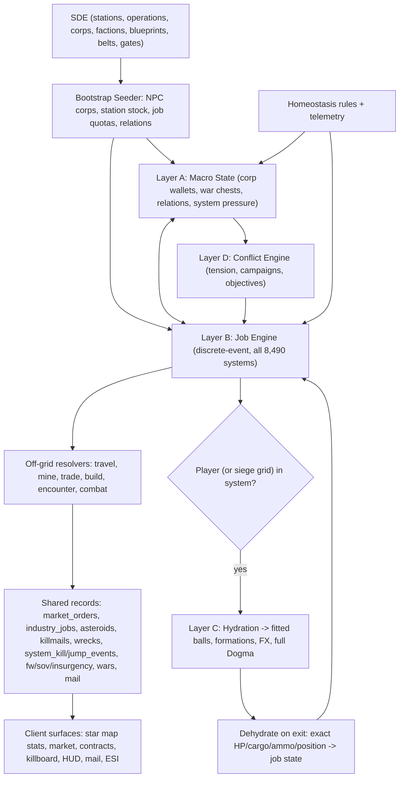

# PRD v3.2: EvoMu Living Universe — A Persistent, Economy-Driven NPC Civilization

**Status:** Draft v3.2 — **PARKED** pending further design iteration (`LW-1`..`LW-8` held and not scheduled for implementation until explicitly unparked; replaces `docs/spec/06_living_world_v2_prd.md`)

---

## 0. Why v2.3 is being thrown out

v2.3 described *spectacles* (armadas every 25 min, battles every 30 min, invasions every 60 min). That design has four structural problems, confirmed by the code audit of `main` (`88dd0c164`):

| v2.3 assumption | Reality / problem |
| :--- | :--- |
| Activity is scheduled by `*_interval_secs` knobs | Nothing in EVE happens on a timer; players would feel the clockwork within an hour. 20+ absolute-interval knobs with no feedback loops need a balancing pass before the world feels right; v3 keeps configuration but makes the untouched defaults good (§10). |
| Empty systems are "LOD 1 timers, 0 cost" and essentially inert | The cluster tick already runs markets, PI, moon drills, sov, FW, insurgencies, incursions and structure fuel/timers for every system (`crates/eve-server/src/sp6_lifecycle/cluster_tick.rs`). What is missing is *ships*: convoy creation is player-gated (`crates/eve-server/src/sp6_lifecycle/cluster_tick.rs`) and NPCs never fight NPCs (`crates/eve-server/src/combat/npc_ai.rs`, `crates/eve-server/src/services/combat_npc_ai.rs`). |
| Living-world ships can be cheap balls | Any non-static ball keeps a system at full 1 Hz physics + AI (`crates/eve-server/src/system_actor/celestials_helpers.rs`). Universe-wide activity therefore cannot be balls; it must be an abstract layer that becomes balls only under attention. |
| NPC factions are décor | NPC corporations have no `CorporationRecord`, so no wallets, no wars, no killmail attribution (`crates/eve-server/src/services/social_wars.rs` returns `NpcCorporationCannotDeclareWar`). Nothing can *want* anything. |

v3 keeps v2.3's two non-negotiables — **100 % player-rule parity for fitted NPC ships** and **lethal consequences for structures** — and rebuilds everything else around one idea:

> **New Eden runs whether or not anyone is watching. Players step into an ongoing story; they do not trigger it.**

---

## 1. Simulation principles

1. **Persistent and causal.** Every ship, cargo, kill and price change exists in `WorldStateSnapshot` and is explainable by a prior event. No "spectacle generator".
2. **Great out of the box; configurable, never tuning-dependent.** Defaults for fleet counts, route choices, raid locations and war cadence are computed from SDE data (5,210 stations, 185 station-owning NPC corps, 69 station operations, 5,100 blueprints, 40,928 belts, 13,978 stargates) and from live state, so a fresh install with an untouched config is lively and balanced. Operators may configure: every derived quantity accepts an optional override or multiplier (§10). What is ruled out is a design that only works after a separate balancing pass: the shipped defaults are a release gate, verified by a soak test on the default config (§10.2).
3. **Jobs and quotas.** Every NPC hull exists because a corporation's job slot wants it; quotas come from what that corporation owns. Hulls that die are rebuilt at real shipyards from real minerals in real blueprint time — losses are the economy's sink, and a faction that stops losing ships stops buying.
4. **Same rules as players, everywhere.** On grid: fitted hulls, `eve-dogma`, turret/missile formulas, capacitor, `death_pipeline`, 50 % loot (§7). Off grid: the *same evaluated fit statistics* drive a statistical resolver (§3.4). Off-grid kills write the same killmails, wrecks, map statistics, bounties, standings and war stats that player kills write.
5. **Feedback, not timers.** Every flow has a counter-flow (losses → demand; expansion → thin defence; pirate success → navy response; war → exhaustion). Cadence emerges.
6. **Attention is a rendering decision.** Player presence changes fidelity, never outcomes-in-expectation.
7. **Reach, not teleport.** A faction can only attack what lies within gate or jump range of something it holds.
8. **Predators follow prey.** Pirate pressure rises where haulers and miners work and falls where patrols are dense.
9. **Non-market antagonists.** Rogue Drones, Drifters, Triglavians and Sleepers do not use ISK; each has its own harvest logic (§6.6).
10. **Homeostasis.** A small rule set regresses the universe toward SDE-derived baselines so it can be devastated locally but never collapse or explode globally (§8).

---

## 2. Architecture



### 2.1 Layer A — Macro state (new persisted fields)
* `npc_corp_state: HashMap<corp_id, NpcCorpState { wallet: IskCents, war_chest: IskCents, hull_pool: HashMap<TypeId,u32>, loss_log: Ring<KillRef>, grievance: HashMap<corp_id,f64> }>` — one per SDE NPC corporation (283), materialised as `CorporationRecord`s so wars, killmails and wallets work unchanged.
* `faction_relations: HashMap<(faction_a, faction_b), f64>` — seeded from `SYNTHESIZED_NPC_FACTION_STANDINGS` (`crates/eve-server/src/services/agents_standings_arcs.rs`), **now mutable**; served by `standingMgr.GetNPCNPCStandings`.
* `system_pressure` extends the existing `SystemDynamicState` (`military_index`, `industrial_index`, `dbs_multiplier`, `fw_contested_pct`, insurgency stages) with `piracy_pressure`, `patrol_density`, `trade_throughput_24h`, `shortage_index[tier]`.
* `campaigns: HashMap<campaign_id, Campaign>` (§6).

### 2.2 Layer B — Job Engine
A **job** is a persistent NPC unit (a single hull or a wing) with a role, owner corp, doctrine, pilot skill profile, cargo/ammo manifest, location and `next_event_at`. Jobs live in a timer wheel; the cluster tick pops due events. Nothing is per-tick per-job.

```text
Job { id, owner_corp, faction, role, doctrine_id, pilot_profile,
      hulls: Vec<HullState{type_id, hp:[sh,ar,hu], cap, heat, ammo:{slot->qty}, cargo, drones_out}>,
      loc: Location, next_event_at, plan: VecDeque<Order>, home_station, veterancy, hydrated: Option<SystemId> }
Location = Docked(station) | AtGate(gate) | AtBelt(belt) | AtStructure(id) | AtBeacon(id) | Safe(sys)
         | InWarp{sys, from, to, depart_at, arrive_at} | InJump{from_sys, to_sys, arrive_at}
Order    = Travel(sys) | Mine(belt, ware) | Haul(buy@station -> sell@station) | Patrol(route) | Camp(gate, dur)
         | Hunt(target_kind, area) | Siege(structure) | Escort(job) | Build(shipyard, type) | Salvage(wreckfield)
         | RunPlex(fw_complex) | Harvest(moon|planet) | Resupply(ammo, station) | Return
```

Movement reuses existing math: warp time from `formulas::compute_warp_duration_seconds` (`crates/eve-server/src/living_world.rs`), gate hops over `sde.stargates()`, jump drives via `plan_jump_drive`/`distance_ly` (`crates/eve-server/src/services/space_nav_travel.rs`). Each hop calls `record_system_jump` so **the star map's "jumps in last hour" shows NPC traffic**.

Budget: ~6,000–9,000 jobs at bootstrap (§4.2) with mean inter-event time 2–4 min → **30–75 events/s**, microseconds each. `/livingworld status` prints events/s and p99 event cost.

### 2.3 Layer C — Attention & hydration
* **High-attention** when a player ship is in space in the system, a player is docked and a siege is running on grid, or a GM pins it.
* **Hydration** turns every job in that system into fitted balls (§7) at interpolated positions: `InWarp` → along the warp vector at `now`; `AtBelt` → orbiting the asteroid being mined with partial cargo; mid-`CombatRound` → both sides on grid with exact HP/cap/ammo/heat from the resolver. Earlier off-grid wrecks are already `snap.items` and reload through `get_or_spawn` (`crates/eve-server/src/system_actor.rs`).
* **Dehydration** on last player exit (after the existing 60-tick idle window) writes HP/cap/ammo/cargo/position back to the job and removes balls.
* **Hydration governor**: no fixed ball cap. Per-system step time is measured against the budget in [05_living_world_and_ai.md](05_living_world_and_ai.md) (`< 0.5 ms/tick`); jobs farthest from any player grid stay abstract and hydrate when a player warps to their location.

### 2.4 Off-grid combat resolver (statistical, same inputs as on grid)
Per doctrine × pilot profile, cache once from the real `eve-dogma` evaluation (§7.6): applied DPS by damage type, optimal/falloff/tracking (or explosion radius/velocity), signature, speed, EHP profile with resists, local/remote rep HP/s, cap stability, align/lock times, EWAR strengths. Per 10 s round:
1. Application factor per attacker→target pair from `formulas::compute_turret_hit` / missile formula (`crates/eve-server/src/formulas.rs`) at the pair's representative angular velocity and signature — the same functions the on-grid engine uses.
2. Focus fire via the target evaluators in [05_living_world_and_ai.md](05_living_world_and_ai.md).
3. Reps before damage, capped by capacitor; neuts reduce cap; ammo is consumed per volley from the hull's manifest (an empty manifest means no damage — resupply matters).
4. Disengagement: a hull warps off if `align_s < min(lock_s of scramming enemies)` or it has warp strength vs. points; haulers/miners try immediately, military at 30 % hull or FC call.
5. Writes `KillmailRecord` (NPC corp ids), `record_system_kill(npc_kills)`, wreck + 50 % loot, BRM via `step_dynamic_bounty_multiplier`, grievance, war stats.
6. Deterministic: `ChaCha8Rng::seed_from_u64(universe_seed ^ encounter_id)`.

### 2.5 Encounters
Jobs are at **locations**; hostile jobs at the same location in the same window meet with probability 1 (gate camp vs. transit, patrol sweep vs. belt raid). Otherwise hunters find prey per hour with `p = 1 − exp(−k · prey_density · search_skill)`. Patrols *react*: a `KillmailRecord` raises `response_demand` and the nearest navy response job gets `Travel + Hunt`. This one rule yields gate camps, belt rescues, pursuit and counter-camps without schedules.

---

## 3. The actors: NPC corporations become real

### 3.1 Who exists
From SDE: 283 NPC corporations, 185 owning stations (e.g. `Kaalakiota Corporation` 92, `Quafe Company` 92, `CONCORD` 91, `Caldari Navy` 74, `Federation Navy` 63, `Republic Fleet` 61, `Minmatar Mining Corporation` 61, `Astral Mining Inc.` 61). Each gets a `CorporationRecord` (id = SDE id, CEO = SDE `ceo_id`, HQ = SDE `station_id`, alliance = a synthetic faction alliance), a wallet and job quotas. Pirate corporations with stations in their home regions are first-class — they trade, build and raid.

### 3.2 Role from station operation (derived quotas)
Each of the 69 `sde_station_operations` maps to an economic role and a job template; quotas are summed over a corp's stations.

| Station operation (SDE `activity_id` / examples) | Role | Jobs per station |
| :--- | :--- | :--- |
| Mining Outpost (7), Refinery (8), Mineral Reserve (9) | Raw producer | 1 mining op (command ship + 3 barges + 1 escort) if belts; 1 ice op if ice; 1 ore hauler |
| Plantation (1), Food Packaging (2), Biotech Production (17), Chemical Refinery (11) | Consumables | 1 hauler; trade goods / boosters |
| Foundry (4), Production Plant (5), Reprocessing (10) | Refined producer | 1 hauler; ore→minerals |
| Factory (20/38), Assembly Plant (14), Shipyard (24) | Hulls & modules | 2 build slots; 1 hauler; replacement source for its faction |
| Trading Post (30), Retail Center (28), Trade Center (123), Warehouses, Storage (26) | Trade | 2 traders (regional arbitrage), 1 courier |
| Logistic Support (15), Anchorage (118) | Logistics | 2 freighter convoys with escorts |
| Research/Testing/School/Academy | Services | 1 courier; consumes consumables |
| Bureau/Treasury/Tribunal/Accounting/Law | Administration | 0 ships; income to war chest |
| Navy/Security corps, militias, `CONCORD`, `Spacelane Patrol`, `Republic Security Services` | Military | 1 patrol wing per sovereign system with a station; 1 response wing per constellation; gate guards at borders |

Bootstrap size: ~2,400 haulers/traders, ~900 mining ops, ~1,100 patrol/response wings, ~300 pirate raiding wings, ~200 convoys — **≈ 6–7 k jobs**; `economy_scale` (§10) multiplies all quotas.

### 3.3 Replacement, not respawn
A destroyed hull drops its corp's `hull_pool`; below quota the corp queues an `IndustryJobRecord` at the nearest faction shipyard/factory station (`activity_id = 1`, `blueprint_type_id` from `sde_blueprints`, duration = SDE `manufacturing_time_sec / tempo`), buying materials from its own stock then the best regional ask. This is the player industry record, so `map.GetIndustryJobsOverLast24Hours` and the SCI recompute (`crates/eve-server/src/esi/economy_industry_routes.rs`) reflect NPC war production, and a player supplying minerals to a shipyard system during a war earns real ISK. Canonical build times (frigate ~1 h, cruiser ~3–4 h, battleship ~1 d, capital ~1–3 weeks) give wars their rhythm.

---

## 4. The economy that makes everything move

### 4.1 Wares and tiers
| Tier | EVE wares | Produced by | Consumed by |
| :--- | :--- | :--- | :--- |
| T0 raw | Ores (`belt_ores_for_system`), ice, gas, PI P0, moon ore | Mining ops, PI colonies, moon drills | Refineries, Reprocessing, Chemical |
| T1 refined | Minerals, fuel blocks, PI P1–P2, moon materials | Foundry / Refinery / Chemical | Factories, Shipyards, structures (fuel) |
| T2 components | Capital/T2 components, PI P3–P4, **ammo & charges**, crystals, scripts | Production Plant / Factory | Shipyards, fleets |
| T3 finished | Hulls, modules, drones, fighters, boosters, trade goods | Shipyard / Assembly / Biotech / Plantation | Corp `hull_pool`, fleets, stations, players |

### 4.2 Station stock and pricing
Each NPC station keeps `stock[ware]` with capacity by station size. Posting rule, inside the dual-anchor clamp `[0.50, 2.50] × P_ref` from [05_living_world_and_ai.md](05_living_world_and_ai.md):
```text
fill = stock / capacity
ask_price = P_ref * clamp(1.6 - 1.2*fill, 0.5, 2.5)      # scarce -> expensive
bid_price = P_ref * clamp(1.4 - 1.2*fill, 0.5, 2.5)      # full   -> pays little
post asks when fill > 0.6, bids when fill < 0.4
```
Orders are real `MarketOrderRecord`s owned by the corp, inserted through a new `market::place_order_in_snap` extracted from the RPC arm (audit gap #4). Fills go through `journal_market_fill` and the daily OHLCV rollup — **market history charts show the NPC economy breathing**.

### 4.3 Production and consumption
Per station per hour: `produce(recipe(operation)) if inputs present else stall`. Consumables act as workforce: below 20 % stock a station produces at 50 %. NPC structures burn fuel blocks through the existing `burn_fuel` (`crates/eve-server/src/services/structure_lifecycle.rs`). **Fleets consume ammo, crystals, charges, cap boosters, nanite paste and drones** from their manifests (§7.5) and `Resupply` at the nearest friendly station with stock; a navy whose ammo factories are starved stops winning.

### 4.4 Who moves what
* **Haulers/traders** evaluate `(sell_bid − buy_ask) × volume − risk(route)` within 6 jumps; `risk` = recent kill density (`system_kill_events`). High-sec haulers prefer safe routes; profit-chasing traders run Low-sec pipes and die to camps — which makes camps worth running.
* **Mining ops** deplete real `snap.asteroids` through `mine_asteroid_with_db_sync` (already used today), ledger with corp ids, respawn at downtime. A player who strips a belt starves the local op; it relocates (tie-break toward player systems).
* **PI/POCO:** corps own `PlanetaryColonyRecord`s; output lifts through POCOs with the existing tax resolver; P4 feeds factories.

### 4.5 Money
* Faucets: station services/market tax (NPC and player), POCO tax, insurance premiums; credited to the owner corp; `war_chest = Σ member corp wallets × 0.3`.
* Sinks: replacement BOM, ammo, fuel, structure anchoring, war fees (`WAR_DECLARATION_FEE_ISK`), ransom payouts, FOB construction.
* Invariant: ISK is conserved between NPC corps and players except through faucets/sinks that already exist for players.

### 4.6 Piracy pressure
```text
piracy_pressure(sys) += 0.02 * (haulers+miners active) - 0.05 * patrol_density - 0.1 * pirate_losses_24h
```
Pirate corps relocate raiding jobs to high-pressure systems within reach of their stations/FOBs; loot and ransoms fund their shipyards. Navy response jobs follow `response_demand` from kills. A mined-out, patrolled pocket goes quiet; a rich, unpatrolled pipe becomes Rancer.

---

## 5. The conflict engine (replaces every `*_interval_secs`)

### 5.1 Relations and tension
`faction_relations` seeds from the canonical matrix. For each hostile pair `(A,B)`:
```text
tension[A,B] += kills_of_A_by_B_24h * 1.0 + trade_lane_contests * 0.2 + player_actions_for_B_against_A * 0.5
tension[A,B] -= 0.1 per hour
```
Players move tension: killing Guristas haulers for Caldari Navy LP raises `tension[Guristas, Caldari]`; running Guristas missions lowers it.

### 5.2 War chest, aggression, exhaustion
A faction launches a **campaign** against B when all hold:
1. `tension[A,B] > 20 / aggression_A` (lore defaults: Sansha 1.4, Guristas 1.2, Angel 1.1, Blood 1.0, Serpentis 0.9, Drifters 1.5, Triglavians 1.3, Caldari 0.8, Amarr 0.8, Gallente 0.7, Minmatar 1.0, EDENCOM 1.1, CONCORD 0.3).
2. `war_chest_A ≥ campaign_cost` (doctrine BOM + ammo + 20 % reserve).
3. Idle military jobs ≥ doctrine size.
4. A valid objective is within reach (§5.3).
It ends when the objective completes, losses exceed `0.4 × aggression`, or `war_chest < reserve`. Then tension resets and the rebuild loop governs the next affordable campaign. **No interval exists.**

### 5.3 Objectives, reach and escalation ladder
Reach: within 5 gate jumps of a held staging point (station, FOB, POS, sov hub) or one capital jump. Ladders by space (each rung is a job plan; next rung requires the previous to hold 2 h):

| Space | Ladder |
| :--- | :--- |
| High-sec (pirates → empire) | gate camps on border pipes → belt raids on NPC mining ops → Pirate FOB (`spawn_pirate_fob`) → insurgency corruption (`add_system_corruption`) → siege of NPC/player Upwell within reach (lethal) |
| High-sec (empire → pirates) | navy sweeps (`Hunt`) → FOB siege (`destroy_pirate_fob_and_payout`) → suppression (`add_system_suppression`) |
| Low-sec FW | militia wings `RunPlex` → `add_victory_points` → `capture_warzone_system` → battlefield set-pieces (`spawn_battlefield_site`) where navies commit capitals |
| Null-sec | roaming → ESS theft → skyhook raids (`apply_skyhook_weapon_damage_typed`) → sov hub siege → `claim_system_sovereignty` |
| Empire ↔ empire | incidents only; escalates through FW/battlefields, never High-sec sieges |

Grand battles are what happens when a defender's response fleet meets an attacker's siege fleet. A defender that cannot afford a response loses the structure; lethal sieges of player structures stand, with notification `184` and the canonical reinforcement timers from `crates/eve-server/src/services/structure_lifecycle.rs`; the staging FOB is killable.

### 5.4 Worked example: Lonetrek, a Tuesday
* 02:10 — Guristas (Venal stations) are back at quota; `tension[Guristas,Caldari]` = 27 after Caldari Navy patrols killed 14 Guristas booster haulers over the week. Threshold `20/1.2 = 16.7` → campaign vs. Caldari State. Objective: the Caldari Navy Assembly Plant system 4 jumps from the Low-sec border.
* 02:15 — 6 raiding wings (Gila/Caracal doctrine, §7.4) get `Travel + Camp(border gate)`; 3 haulers with a FOB kit follow with escorts. Map jump counts light up on the pipe.
* 02:40–05:00 — camps kill 9 NPC haulers (killmails, wrecks on those gates). The Assembly Plant's mineral bids rise; a player hauler can profit. Two Navy response wings arrive; one loses 3 of 6 Caracals, one wins — all visible as kills on the map.
* 05:30 — FOB anchors; corruption ticks; HUD shows the campaign via existing `Insurgency` notifications.
* 07:00 — A player logs in nearby: Agency lists the FOB, the map shows 23 NPC kills/h in two systems, a Caldari Navy mail (NPC CEO) requests assistance, Fleet Finder shows a Navy response wing advert. The player warps to the camp gate → system hydrates: 5 Gilas with exact HP/ammo, 3 wrecks, a hauler aligning out. Full Dogma fight.
* 09:00 — If the FOB stands 2 h, the siege wing moves on the *player-owned* Raitaru next door (lethal); if the player or Navy kills the FOB, the campaign ends and the next affordable one is days away (cruiser rebuild ~4 h × 18 hulls across 2 shipyards).

### 5.5 Structures as objectives
Bootstrap seeds NPC-owned POS Control Towers at faction moons and Forward Citadels at borders as `UpwellStructureRecord`/starbase records so `sync_all_structures` runs their fuel and timers. Structures are the reason campaigns exist; losing one costs income and reach.

### 5.6 Non-market factions
| Faction | Economy | Trigger & target selection | Canon hook |
| :--- | :--- | :--- | :--- |
| Rogue Drones (500025) | Feed on wrecks/asteroids | Infest systems with high wreck density or unmined rich belts in drone regions; spread when "biomass" > threshold | Drone regions |
| Drifters (500024) | Harvest structures & corpses | Arrive through wormholes into K-space systems with a **Jove Observatory** celestial; escalate to sieges when empire/EDENCOM presence is low | 2019 Drifter Crisis |
| Triglavian Collective (500026) | Harvest stars | Prefer systems by `sde_stars.spectral_class`/`luminosity`; liminality via existing minor-victory/fortress state | Invasion chapters |
| Sansha's Nation (500019) | Harvest population | Incursions choose constellations by station count (existing `eligible_incursion_constellations`); influence also decremented by Navy response jobs | Incursions |
| Sleepers (500021) | None | Static in W-space; respond to intrusion | Anoikis |

---

## 6. Every mechanic NPCs now use against each other

| # | Mechanic | NPC use | Entry point (existing unless **new**) | Player sees it in |
| :--- | :--- | :--- | :--- | :--- |
| 1 | Market orders | Station stock posts real bids/asks; traders arbitrage | **new** `place_order_in_snap`, `journal_market_fill` | Market window, price history |
| 2 | Industry jobs | Replacement hulls/ammo; SCI rises in war-production systems | `IndustryJobRecord` insert; SCI recompute | Industry cost index, `map.GetIndustryJobsOverLast24Hours` |
| 3 | Asteroid depletion & regen | Mining ops strip belts | `mine_asteroid_with_db_sync`, downtime refill | Belts, survey scanner |
| 4 | Ice & moon mining | Ice ops → fuel; NPC Athanors run `moon_extractions` | `tick_all_moon_extractions` | Moon belts, fuel prices |
| 5 | PI & POCOs | Corp colonies, POCO tax; null alliances reinforce rivals' POCOs | `PlanetaryColonyRecord`, `corp_customs_offices` | Planet view, POCO timers |
| 6 | Contracts | Courier contracts for uncovered manifests; pirate tag bounties | `ContractRecord`, `AcceptContract` | Contracts window |
| 7 | Wallets & war chest | Income/sinks; broke factions can't fight | `CorporationRecord` wallets | Indirect |
| 8 | Bounties & BRM | NPC ratting depresses BRM; ESS banks fill | `step_dynamic_bounty_multiplier`, `record_ess_main_bank_contribution` | ESS window, DBS % |
| 9 | ESS theft | Pirate jobs rob main banks | ESS theft records | `GetMainBankTheftsForClientSolarSystem` |
| 10 | NPC↔NPC standings | Mutable relations drive hostility | **new** persisted table | `GetNPCNPCStandings` |
| 11 | Character standings | Helping a side moves player standing and faction tension | `apply_faction_standing_with_derived` | Standings tab |
| 12 | Wars | NPC↔NPC and NPC↔player-corp wars | `WarRecord` insert (`social_wars.rs:262-280`), `sync_wars` | War reports |
| 13 | Killmails & war stats | Every kill attributed to corps | `record_killmail`, `record_system_kill` | `warStatisticMgr.GetKills`, star map, ESI |
| 14 | Wrecks, loot, salvage | Wreck fields; Noctis salvage jobs compete | contents resolver, 2 h decay | Overview, d-scan |
| 15 | Jump statistics | NPC traffic on the map | `record_system_jump` | Star map jumps |
| 16 | FW victory points | Militia wings run plexes, flip systems | `add_victory_points`, `capture_warzone_system` | FW map |
| 17 | FW battlefields | Set-piece when both militias commit | `spawn_battlefield_site` | Agency |
| 18 | Insurgencies | Pirate corruption; navy suppression | `init_insurgency_campaign`, `add_system_corruption/suppression` | Insurgency HUD |
| 19 | Pirate FOBs | Campaign rung; killable staging | `spawn_pirate_fob`, `trigger_fob_defense_response` | Agency |
| 20 | Incursions | Sansha targeting; Navy jobs reduce influence | `advance_incursion_lifecycles` | Incursion HUD |
| 21 | Sovereignty | Null alliances claim/lose systems | `claim_system_sovereignty`, index hooks | Sov map, `GetRecentSovActivity` |
| 22 | Skyhooks & dens | Raids on rival skyhooks | `apply_skyhook_weapon_damage_typed` | Structure browser |
| 23 | Upwell/POS lifecycle | NPC structures burn fuel, reinforce, die; player structures sieged | `sync_all_structures`, **new** NPC branch in `HostileTargetInfo` | Structure notifications |
| 24 | Structure gunnery | Player `TakeControl` vs NPC siege | `structureControl.TakeControl` | Structure HUD |
| 25 | Cynos & jump drives | Capital moves between staging systems | `plan_jump_drive`, `distance_ly` | Cyno beacon, jumps |
| 26 | Wormholes | Drifter ingress; Sleeper responses | `expire_and_respawn_wormholes_in_cluster` | Probe scanner |
| 27 | Agents & missions | **Dynamic offers** tied to live jobs | **new** synthetic `ActiveMissionRecord{Offered}` | Agent, Agency |
| 28 | Fleet Finder | NPC wings advertise (leader = SDE agent char id) | `fleet_adverts` + **new** lifecycle exemption | Fleet Finder |
| 29 | Mail & notifications | NPC CEOs mail war decs, losses, ransoms; daily CONCORD digest | `send_mail`, `emit_ccp_notification` | Mail |
| 30 | Tales HUD | Campaign climaxes | `register_world_event_tale` | HUD banner |
| 31 | Ammo & consumables | Fleets buy ammo/crystals/charges/paste/drones; shortages blunt fleets | market records + manifests | Ammo prices, war outcomes |
| 32 | Crimewatch/CONCORD | NPC pirates are navy targets only (canon); player aggression unchanged | existing | — |

---

## 7. NPC fittings and combat parity

### 7.1 Rule
**Every NPC hull of `category_id == 6` flies a real fitting from the Doctrine Library, validated by the player fitting validator, evaluated by `eve-dogma` under a declared pilot skill profile, and consuming the same capacitor, ammunition, charges, drones and heat as a player would.** There are no NPC-only damage, resist, range or capacitor multipliers. Classic SDE entities (`category_id == 11`: Sleepers, Drifter battleships, `World Ark`, rats from `npc_spawn_groups`) keep their native SDE dogma attributes, evaluated by the same formulas at `1.0×`.

### 7.2 Doctrine file format and validation gate
Doctrines live in the repo as data (`data/doctrines/<faction>/<role>.toml`, EFT-compatible text block + metadata), never as hard-coded module lists:

```toml
[doctrine]
id = "amarr_navy.armor_hac.zealot"
faction_ids = [500003, 500008]        # Amarr Empire, Khanid
role = "line_dps"                     # tackle | line_dps | logistics | command | interdictor | hic | brawler | sniper | escort | miner | foreman | hauler | freighter | salvager | siege | triage | carrier | titan
pilot_profiles = ["line", "veteran"]  # see §7.3
ammo_plan = { primary = "Scorch M", secondary = "Conflagration M", reserve_volleys = 400 }
drone_plan = { light = "Acolyte II", qty = 5 }
cargo = ["Nanite Repair Paste x50"]
eft = """
[Zealot, Amarr Navy Armor HAC]
Heat Sink II
Heat Sink II
1600mm Steel Plates II
Multispectrum Energized Membrane II
Multispectrum Energized Membrane II
Reactive Armor Hardener
Damage Control II

10MN Afterburner II
Large Cap Battery II
Tracking Computer II

Heavy Pulse Laser II
Heavy Pulse Laser II
Heavy Pulse Laser II
Heavy Pulse Laser II
Heavy Pulse Laser II

Medium Ancillary Current Router I
Medium Trimark Armor Pump I
"""
```
A workspace test loads every doctrine, resolves each line to an SDE `type_id`, and runs the real validator (`eve-dogma` `ShipFittingEngine`: slots, hardpoints, CPU, powergrid, calibration, required skills, charge size/group) under each declared pilot profile. A doctrine that does not fit **fails the build**. The evaluated stats (§7.6) are cached per `(doctrine, profile)` for the off-grid resolver.

### 7.3 Pilot skill profiles
NPC pilots have skill sets, not multipliers. Profiles are skill maps evaluated by the same Dogma pipeline as player characters:

| Profile | Skills | Who |
| :--- | :--- | :--- |
| `rookie` | Core fitting III, racial hull III, weapon spec II, no T2 modules | Fresh replacements in rebuilt wings, Low-sec pirate frigates |
| `line` | Core fitting IV, hull IV, weapon spec IV, T2 weapons/tank | Default navy/militia/corp security |
| `veteran` | All relevant V, overheats primaries, uses faction ammo | Response wings, named commanders, mining escorts of core worlds |
| `elite` | All V + pirate-faction implants (if present in SDE), deadspace/officer modules | Officers (`feat:npc.officer-npc`), campaign flagships |
| `industrial` | Mining Barge/Exhumer IV–V, Mining Foreman V, hauler skills IV | Mining ops, haulers, freighters |

Veterancy is earned: a wing that survives three encounters is promoted one profile; losses reset new hulls to `rookie`. Elite wrecks drop their modules through the normal 50 % roll, consistent with existing officer/commander loot (`resolve_officer_or_commander_sde_drop`).

### 7.4 Doctrine library (SDE-verified)
All hull slot layouts (`hi/med/low/rig`, turret/launcher hardpoints, drone bandwidth/bay) and every module, charge and drone below were checked against the V24.01 SDE in `data/evomu_sde.sqlite`; type IDs are given once per item. Fits follow published community/E-UNI fitting doctrine for each role. Where the V24.01 hull differs from older guides (notably the **Muninn, now 1 turret / 5 launcher hardpoints**), the fit follows the SDE.

#### 7.4.1 Frigates — tackle & scouts (patrol vanguard, pirate skirmishers)
* **Rifter** (`587`, 3/3/4/3, 3 turrets, 2 launchers) — Minmatar militia / Angel scout
  * Hi: 3× `200mm AutoCannon II` (`2889`) with `Republic Fleet EMP S` (`21898`) / `Barrage S` (`12625`); Mid: `5MN Microwarpdrive II` (`440`), `Warp Scrambler II` (`448`), `Stasis Webifier II` (`527`); Low: `Damage Control II` (`2048`), `Gyrostabilizer II` (`519`), `200mm Steel Plates II` (`20347`), `Nanofiber Internal Structure II` (`2605`); Rigs: 3× `Small Ancillary Current Router I` (`31358`) as needed.
* **Merlin** (`603`, 3/4/3/3, 3 turrets) — Caldari Navy tackle
  * Hi: 3× `Light Neutron Blaster II` (`3178`) with `Antimatter Charge S` (`222`); Mid: `5MN Microwarpdrive II`, `Warp Scrambler II`, `Stasis Webifier II`, `Medium Shield Extender II` (`3831`); Low: `Damage Control II`, `Magnetic Field Stabilizer II` (`10190`), `Co-Processor II` (`3888`); Rigs: 2× `Small Core Defense Field Extender I` (`31788`).
* **Punisher** (`597`, 4/2/5/3) — Amarr Navy; 3× `Small Focused Pulse Laser II` (`3041`) + utility neut, `1MN Afterburner II` (`438`), `Warp Scrambler II`, `400mm Steel Plates II` (`20349`), `Multispectrum Energized Membrane II` (`11269`), `Heat Sink II` (`2364`), `Damage Control II`, `Small Armor Repairer II` (`1183`).
* **Incursus** (`594`, 3/3/4/3, 5 bw) — Federation Navy; 3× `Light Neutron Blaster II`, `1MN Afterburner II`, `Warp Scrambler II`, `Stasis Webifier II`, `Small Armor Repairer II`, `Magnetic Field Stabilizer II`, `Damage Control II`, `Multispectrum Coating II` (`1306`); 1× `Hobgoblin II` (`2456`).

#### 7.4.2 Destroyers — gate guards and anti-frigate screens
* **Thrasher** (`16242`, 8/3/2/3, 7 turrets) — Republic gate guard: 7× `200mm AutoCannon II`, `5MN Microwarpdrive II`, `Warp Disruptor II` (`3244`), `Medium Shield Extender II`; `Gyrostabilizer II`, `Tracking Enhancer II` (`1999`).
* **Catalyst** (`16240`, 8/2/3/3) — Federation gate guard: 8× `Light Neutron Blaster II`, `5MN Microwarpdrive II`, `Warp Scrambler II`; `Magnetic Field Stabilizer II` ×2, `Damage Control II`.
* **Coercer** (`16236`, 8/2/3/3) — 8× `Small Focused Pulse Laser II` with `Scorch S`; **Cormorant** (`16238`, 8/3/2/3) — 7× `125mm Railgun II`-class long range for Caldari border gates.

#### 7.4.3 Interdictors & heavy interdictors (null/low pirate camps, navy blockades)
* **Sabre** (`22456`, 8/4/2/2) — Hi: 6× `200mm AutoCannon II` + `Interdiction Sphere Launcher I` (`22782`) with `Warp Disrupt Probe` (`22778`) ×6 in cargo; Mid: `5MN Microwarpdrive II`, `Medium Shield Extender II`, `Multispectrum Shield Hardener II` (`2281`), `Warp Scrambler II`; Low: `Damage Control II`, `Nanofiber Internal Structure II`; Rigs: 2× `Small Core Defense Field Extender I`.
* **Heretic** (`22452`, 8/3/3/2, 7 launchers) — 6× `Light Missile Launcher II` (`2404`) + `Interdiction Sphere Launcher I`; `5MN Microwarpdrive II`, `Warp Scrambler II`, `Medium Shield Extender II`; `Ballistic Control System II` (`22291`), `Damage Control II`, `Nanofiber Internal Structure II`.
* **Devoter** (`12017`, 6/3/7/2) — `Warp Disruption Field Generator II` (`4248`) + 5× `Focused Medium Pulse Laser II` (`3512`); `10MN Afterburner II` (`12058`), `Large Cap Battery II` (`3504`), `Sensor Booster II` (`1952`); `1600mm Steel Plates II` (`20353`) ×2, `Multispectrum Energized Membrane II` ×2, `Damage Control II`, `Reactive Armor Hardener` (`4403`), `Heat Sink II`; 2× `Medium Trimark Armor Pump II` (`31059`).
* **Onyx** (`11995`, 6/6/4/2) — `Warp Disruption Field Generator II` + 5× `Heavy Missile Launcher II` (`2410`); `Large Shield Extender II` (`3841`) ×3, `Multispectrum Shield Hardener II` ×2, `10MN Afterburner II`; `Ballistic Control System II` ×2, `Damage Control II`, `Power Diagnostic System II` (`1541`).

#### 7.4.4 Cruisers — line DPS (navy patrols, pirate wings)
* **Caracal** (`621`, 5/5/4/3, 5 launchers) — Caldari Navy line / Guristas line
  * Hi: 5× `Heavy Missile Launcher II` with `Scourge Heavy Missile` (`209`), veterans `Caldari Navy Scourge Heavy Missile` (`27441`), `Scourge Fury Heavy Missile` (`2629`) vs battleships; Mid: `10MN Afterburner II`, `Large Shield Extender II` ×2, `Multispectrum Shield Hardener II` ×2; Low: `Ballistic Control System II` ×3, `Damage Control II`; Rigs: 2× `Medium Core Defense Field Extender II` (`31796`), `Medium Ancillary Current Router I` (`31360`); drones 2× `Hornet II` (`2466`).
* **Vexor** (`626`, 4/4/5/3, 75 bw/125 bay) — Federation Navy: 4× `Heavy Neutron Blaster II` (`3146`) with `Federation Navy Antimatter Charge M` (`22977`), `Null M` (`12785`) for range; `10MN Afterburner II`, `Warp Disruptor II`, `Stasis Webifier II`, `Medium Cap Battery II` (`3496`); `Drone Damage Amplifier II` (`4405`) ×2, `800mm Steel Plates II` (`20351`), `Multispectrum Energized Membrane II`, `Damage Control II`; 5× `Hammerhead II` (`2185`) + 5× `Hobgoblin II`.
* **Osprey** (`620`, 5/5/3/3) — T1 shield logistics for rookie wings: 3× `Medium Remote Shield Booster II` (`3598`) + 2× `Large Remote Capacitor Transmitter II` (`12102`)-class cap support; `10MN Afterburner II`, `Large Shield Extender II` ×2, `Multispectrum Shield Hardener II` ×2; `Capacitor Power Relay II` (`1447`) ×2, `Damage Control II`.

#### 7.4.5 Heavy assault cruisers — veteran line
* **Zealot** (`12003`, 5/3/7/2, 5 turrets, 25 bw) — Amarr Navy Armor HAC (full fit in §7.2). Ammo: `Scorch M` (`12818`) at 20–40 km, `Conflagration M` (`12814`) under 12 km, `Imperial Navy Multifrequency M` (`23089`) for veterans; 5× `Acolyte II` (`2205`).
* **Muninn** (`12015`, 5/4/6/2, **5 launchers**, 25 bw) — Republic Fleet HAC: Hi: 5× `Heavy Missile Launcher II` with `Mjolnir Heavy Missile` (`207`) / `Scourge Heavy Missile`; Mid: `50MN Microwarpdrive II` (`12076`), `Large Shield Extender II` ×2, `Multispectrum Shield Hardener II`; Low: `Assault Damage Control II` (`47257`), `Ballistic Control System II` ×2, `Missile Guidance Enhancer II` (`35771`), `Power Diagnostic System II`, `Nanofiber Internal Structure II`; Rigs: 2× `Medium Core Defense Field Extender II`; 5× `Warrior II` (`2488`).

#### 7.4.6 Logistics cruisers (every wing of ≥ 8 carries 2)
* **Guardian** (`11987`, 6/2/5/2, 3 turret hardpoints unused) — Hi: 4× `Large Remote Armor Repairer II` (`26914`), 2× `Large Remote Capacitor Transmitter II` (cap chain, one-up/one-down between the two Guardians); Mid: `10MN Afterburner II`, `Sensor Booster II`; Low: `1600mm Steel Plates II`, `Multispectrum Energized Membrane II` ×2, `Reactive Armor Hardener`, `Damage Control II`; Rigs: 2× `Medium Ancillary Current Router II` (`31366`); 5× `Warrior II`.
* **Scimitar** (`11978`, 4/5/4/2, 45 bw) — Hi: 4× `Medium Remote Shield Booster II`; Mid: `50MN Microwarpdrive II`, `Large Shield Extender II` ×2, `Multispectrum Shield Hardener II` ×2; Low: `Damage Control II`, `Capacitor Power Relay II` ×3; Rigs: 2× `Medium Core Defense Field Extender II`; 5× `Light Shield Maintenance Bot II` (`28203`) or `Hornet EC-300` (`23707`).
* **Basilisk** (`11985`, 6/5/2/2) — Hi: 4× `Large Remote Shield Booster II` (`3608`), 2× `Large Remote Capacitor Transmitter II` (cap chain); Mid: `10MN Afterburner II`, `Large Shield Extender II` ×2, `Multispectrum Shield Hardener II` ×2; Low: `Damage Control II`, `Power Diagnostic System II`; Rigs: 2× `Medium Ancillary Current Router II`.

#### 7.4.7 Battlecruisers & command ships (wing anchors, bursts)
* **Ferox** (`16227`, 7/6/4/3, 6 turrets) — Caldari line: 6× `250mm Railgun II` (`3082`) with `Spike`-class long range / `Caldari Navy Antimatter Charge M`; `50MN Microwarpdrive II`, `Large Shield Extender II` ×3, `Multispectrum Shield Hardener II` ×2; `Magnetic Field Stabilizer II` ×2, `Damage Control II`, `Power Diagnostic System II`; 3× `Medium Core Defense Field Extender II`.
* **Drake** (`24698`, 7/6/4/3, 6 launchers) — 6× `Heavy Missile Launcher II`, `10MN Afterburner II`, `Large Shield Extender II` ×3, `Multispectrum Shield Hardener II` ×2; `Ballistic Control System II` ×3, `Damage Control II`; 3× `Medium Core Defense Field Extender II`.
* **Damnation** (`22474`, 7/4/6/2) — Amarr FC: 3× `Armor Command Burst II` (`43552`) with `Armor Reinforcement Charge` (`42834`) / `Rapid Repair Charge` (`42833`), `Skirmish Command Burst II` (`43556`) with `Evasive Maneuvers Charge` (`42838`), 3× `Heavy Assault Missile Launcher II` (`25715`); `10MN Afterburner II`, `Large Cap Battery II`, `Sensor Booster II`, `Stasis Webifier II`; `1600mm Steel Plates II` ×2, `Multispectrum Energized Membrane II` ×2, `Damage Control II`, `Ballistic Control System II`; 2× `Medium Trimark Armor Pump II`; 5× `Hammerhead II`.
* **Vulture** (`22446`, 7/6/4/2) — Caldari FC: 3× `Shield Command Burst II` (`43555`) with `Shield Harmonizing Charge` (`42695`) / `Shield Extension Charge` (`42696`), `Skirmish Command Burst II`, 3× `250mm Railgun II`; `50MN Microwarpdrive II`, `Large Shield Extender II` ×3, `Multispectrum Shield Hardener II` ×2; `Damage Control II`, `Power Diagnostic System II` ×2, `Magnetic Field Stabilizer II`; 2× `Medium Core Defense Field Extender II`.

#### 7.4.8 Battleships — response fleets and campaign mainlines
* **Megathron** (`641`, 7/4/8/3, 7 turrets) — Federation Navy: 7× `Neutron Blaster Cannon II` (`3186`) with `Void M`-class short range / `Null`; `100MN Afterburner II` (`12068`), `Stasis Webifier II` ×2, `Large Cap Battery II`; `1600mm Steel Plates II` ×2, `Multispectrum Energized Membrane II` ×2, `Magnetic Field Stabilizer II` ×3, `Damage Control II`; 2× `Large Trimark Armor Pump II` (`31063`), `Large Capacitor Control Circuit II`; 5× `Ogre II` (`2446`).
* **Apocalypse** (`642`, 8/4/7/3) — Imperial Navy: 8× `Mega Pulse Laser II` (`3057`) with `Scorch L` (`12820`) / `Multifrequency L` (`262`); `100MN Afterburner II`, `Tracking Computer II` ×2, `Large Cap Battery II`; `1600mm Steel Plates II` ×2, `Multispectrum Energized Membrane II` ×2, `Heat Sink II` ×2, `Damage Control II`.
* **Raven** (`638`, 7/7/5/3, 6 launchers) — Caldari Navy / Guristas: 6× `Cruise Missile Launcher II` (`19739`); `100MN Afterburner II`, `Large Shield Extender II` ×2, `Multispectrum Shield Hardener II` ×2, `Target Painter II` (`19806`) ×2; `Ballistic Control System II` ×3, `Damage Control II`, `Power Diagnostic System II`.
* **Dominix** (`645`, 6/5/7/3, 125 bw/375 bay) — drone battleship: 4× `425mm Railgun II` (`3090`) + 2× `Drone Link Augmentor II` (`24427`); `100MN Afterburner II`, `Omnidirectional Tracking Link II` (`24438`) ×2, `Large Cap Battery II`, `Sensor Booster II`; `Drone Damage Amplifier II` ×3, `1600mm Steel Plates II`, `Multispectrum Energized Membrane II` ×2, `Damage Control II`; 5× `Ogre II`, 5× `Hammerhead II`, 5× `Hobgoblin II`.
* **Tempest** (`639`, 8/5/6/3, 6 turrets) — Republic Fleet: 6× `1400mm Howitzer Artillery II` (`2961`) with `EMP L`-class / `Tremor`; `100MN Afterburner II`, `Large Shield Extender II` ×2, `Multispectrum Shield Hardener II` ×2; `Gyrostabilizer II` ×3, `Tracking Enhancer II` ×2, `Damage Control II`.

#### 7.4.9 Pirate faction hulls (raiding wings; veterans/elites)
* **Gila** (`17715`, 5/6/3/3, 4 launchers, 20 bw/100 bay) — Guristas: 4× `Rapid Light Missile Launcher II` (`1877`) with `Caldari Navy Inferno Light Missile` (`27371`) + `Drone Link Augmentor II`; `10MN Afterburner II`, `Large Shield Extender II` ×3, `Multispectrum Shield Hardener II` ×2; `Drone Damage Amplifier II` ×3; 3× `Medium Core Defense Field Purger II` (`31802`); 2× `Caldari Navy Vespa` (`31874`) + 2× `Federation Navy Hammerhead` (`31882`) in rotation.
* **Orthrus** (`33818`, 6/5/4/3) — Mordu's Legion: 5× `Rapid Light Missile Launcher II` + `Drone Link Augmentor II`; `50MN Microwarpdrive II`, `Warp Disruptor II` (long point), `Large Shield Extender II` ×2, `Multispectrum Shield Hardener II`; `Ballistic Control System II` ×2, `Nanofiber Internal Structure II`, `Damage Control II`; 5× `Warrior II`.
* **Barghest** (`33820`, 8/6/6/3, 6 launchers) — Mordu's battleship: 6× `Cruise Missile Launcher II`, `Warp Disruptor II`, `Large Shield Extender II` ×3, `Multispectrum Shield Hardener II` ×2, `100MN Afterburner II`; `Ballistic Control System II` ×3, `Damage Control II`, `Missile Guidance Enhancer II` ×2.
* **Vigilant** (`17722`) Serpentis blaster/web; **Cynabal** (`17720`) Angel autocannon kiter; **Ashimmu** (`17922`) Blood Raider neut/laser; **Rattlesnake** (`17918`) Guristas campaign battleship — same construction pattern: racial T2 weapons, racial tank, faction-appropriate EWAR (webs/damps/neuts/ECM/painters per the faction table in [05_living_world_and_ai.md](05_living_world_and_ai.md)).

#### 7.4.10 Industrial hulls (mining ops)
* **Procurer** (`17480`, 2/3/3/3, 50 bw/100 bay) — line barge: 2× `Strip Miner I` (`17482`) (veterans `Modulated Strip Miner II` `17912` with ore crystals); `Multispectrum Shield Hardener II` ×2, `Medium Shield Extender II`; `Damage Control II`, `Mining Laser Upgrade II` (`28576`), `Drone Damage Amplifier II`; 3× `Medium Core Defense Field Extender I` (`31790`); 5× `Hobgoblin II` out when raided, 5× `Mining Drone II` (`10250`) otherwise.
* **Retriever** (`17478`, 2/2/3/3) — high-sec yield barge: 2× `Strip Miner I`, `Medium Shield Extender II` ×2, `Mining Laser Upgrade II` ×2, `Damage Control II`.
* **Mackinaw** (`22548`, 2/4/3/2) / **Hulk** (`22544`, 2/4/3/2) / **Skiff** (`22546`, 2/5/3/2) — exhumers for core worlds / null ops: 2× `Modulated Strip Miner II`, shield extenders + `Multispectrum Shield Hardener II`, `Mining Laser Upgrade II` ×2, `Damage Control II`, 2× `Medium Core Defense Field Extender II`; ice ops swap `Ice Harvester II` (`22229`) + `Ice Harvester Upgrade II` (`28578`) + `Ice Harvesting Drone II` (`43700`).
* **Venture** (`32880`, 3/3/1/3) — pirate/low-sec gas & ore skimmers: 2× `Miner II` (`482`), `1MN Afterburner II`, `Warp Core Stabilizer II` (`11640`) ×1 is illegal in a low (1 low: `Mining Laser Upgrade II`); mids `Survey Scanner`-class + `Medium Shield Extender II`.
* **Orca** (`28606`, 6/5/2/3, 50 bw/200 bay) — foreman: 2× `Mining Foreman Burst II` (`43551`) with `Mining Laser Optimization Charge` (`42830`) / `Mining Laser Field Enhancement Charge` (`42829`), `Shield Command Burst II` with `Shield Harmonizing Charge`, `Improved Cloaking Device II` (`11577`), `Large Industrial Core II` (`58950`); `500MN Microwarpdrive II` (`12084`), `Multispectrum Shield Hardener II` ×3, `Large Shield Extender II`; `Damage Control II`, `Reinforced Bulkheads II` (`1335`); `Large Drone Mining Augmentor II` (`32017`) ×2 + `Large Transverse Bulkhead II` (`33900`); 10× `Mining Drone II`, 5× `Hammerhead II`.
* **Porpoise** (`42244`, 4/4/2/3) — low-sec foreman (same pattern, medium modules); **Rorqual** (`28352`, 8/7/4/3, 125 bw/8,800 bay) — null capital foreman: `Industrial Core`-class (`Large Industrial Core II`), 3× `Mining Foreman Burst II`, `Shield Command Burst II`, `Cynosural Field Generator I` (`21096`), `Capital Shield Booster II` (`41507`), `Capital Shield Extender II` (`40357`) ×2, `Multispectrum Shield Hardener II` ×3, `Capital Energy Neutralizer II` (`40662`); `Damage Control II`, `Reinforced Bulkheads II` ×2, `Co-Processor II`; excavator-class mining drones per SDE availability.

#### 7.4.11 Haulers, freighters, couriers
* **Badger** (`648`, 2/6/4/3) — high-sec hauler: `Improved Cloaking Device II`; `50MN Microwarpdrive II`, `Large Shield Extender II` ×2, `Multispectrum Shield Hardener II`, `EM Shield Hardener II` (`2301`); `Damage Control II`, `Inertial Stabilizers II` (`1405`) ×2, `Expanded Cargohold II` (`1319`); 3× `Medium Cargohold Optimization I` (`31117`). Behaviour: align-cloak-warp on gates.
* **Bustard** (`12731`, 2/6/3/2) / **Occator** (`12745`, 2/3/6/2) — Deep Space Transports for Low/Null manifests: `Improved Cloaking Device II` + `Interdiction Nullifier`-class if present; `50MN Microwarpdrive II`, `Large Shield Extender II` ×2, `Multispectrum Shield Hardener II` ×2 (Occator: `1600mm Steel Plates II`, membranes); `Damage Control II`, `Warp Core Stabilizer II`, `Inertial Stabilizers II`; 2× `Medium Core Defense Field Purger II`. Cargo in fleet hangar (scan-proof).
* **Charon** (`20185`) / **Rhea** (`28844`) — 3 lows only: `Reinforced Bulkheads II` ×2 + `Inertial Stabilizers II`; always escorted (2 DST + 3–6 escorts from §7.4.1–7.4.4); Rhea carries `Nitrogen Isotopes` (`17888`) for jumps.
* **Noctis** (`2998`, 8/2/3/3) — salvage crews: 4× `Salvager II` (`30836`) + 4× `Small Tractor Beam II` (`4250`); `10MN Afterburner II`, `Medium Shield Extender II`; `Expanded Cargohold II` ×2, `Damage Control II`; 3× `Medium Salvage Tackle II` (`31091`); 5× `Salvage Drone II` (`55760`).

#### 7.4.12 Capitals (campaign objectives and relief)
* **Revelation** (`19720`, 5/4/8/3, 3 turrets) — siege dread: 3× `Dual Giga Pulse Laser II` (`37298`), `Siege Module II` (`4292`), utility neut; `Capital Capacitor Booster II` (`41493`), `Tracking Computer II`, `Sensor Booster II`, `Stasis Webifier II`; `Capital Armor Plates`-class buffer, `Multispectrum Energized Membrane II` ×2, `Heat Sink II` ×3, `Damage Control II`, `Reactive Armor Hardener`; cargo: `Strontium Clathrates` (`16275`) for siege, `Multifrequency XL`/`Scorch XL`-class crystals.
* **Apostle** (`37604`, 6/4/7/3, 125 bw) — triage FAX: `Triage Module II` (`4294`), 3× `Capital Remote Armor Repairer II` (`41466`), 2× `Capital Remote Capacitor Transmitter`-class; `Capital Capacitor Booster II`, `Sensor Booster II` ×2, `Cap Recharger II` (`2032`); `Capital Armor Repairer II` (`41500`), membranes ×3, `Damage Control II`, `Reactive Armor Hardener`; `Nanite Repair Paste` (`28668`).
* **Archon** (`23757`, 5/4/7/3) — carrier: fighter squadrons `Templar II` (`40556`) ×2 squadrons light, `Equite II` (`40552`) support, `Ametat II` (`40560`) heavy; `Capital Armor Repairer II`, membranes, `Damage Control II`; hull-specific fighter bay per SDE. Caldari/Gallente/Minmatar carriers use `Dragonfly II` (`40557`), `Firbolg II` (`40558`), `Einherji II` (`40559`), heavies `Cyclops II` (`40563`).
* **Avatar** (`11567`, 8/5/8/3, 6 turrets) — flagship: `'Judgment' Electromagnetic Doomsday` (`24550`), `Jump Portal Generator I` (`23953`), 6× `Dual Giga Pulse Laser II`-class; `Capital Capacitor Booster II`, `Sensor Booster II`, `Large Cap Battery II`-class capital variants; capital plates/membranes/`Damage Control II`; racial doomsdays `'Oblivion' Kinetic` (`24552`, Leviathan), `'Aurora Ominae' Thermal` (`24554`, Erebus), `'Gjallarhorn' Explosive` (`23674`, Ragnarok). Doomsday use obeys the real superweapon cycle, capacitor and target-lock rules in `superWeaponMgr`; a Titan never fires more often than a player could.
* Siege dreads `Quad 3500mm Siege Artillery II` (`37307`) for Naglfar; Phoenix/Moros equivalents per SDE XL weapons.

#### 7.4.13 Precursor and EDENCOM hulls (invasion factions)
* **Leshak** (`47271`, 5/4/8/3, 1 turret, 100 bw) — Triglavian: 1× Supratidal Entropic Disintegrator-class (SDE), 2× `Medium Remote Armor Repairer II` (`26913`) for mutual reps (spider tank), `Heavy Energy Neutralizer II` (`12271`); `100MN Afterburner II`, `Large Cap Battery II`, `Stasis Webifier II`, `Tracking Computer II`; plates/membranes/`Damage Control II`, entropic radiation sinks per SDE; spool-up damage handled by the existing disintegrator spooling rules.
* **Thunderchild** (`54733`, 2/7/5/3) — EDENCOM: Vorton Projector per SDE (arcs to up to 10 targets within 10 km, existing `attributeLightningWeaponTargetAmount = 2104` rules), `Large Shield Extender II` ×3, `Multispectrum Shield Hardener II` ×2, `50MN Microwarpdrive II`; `Damage Control II`, vorton tuning per SDE.

#### 7.4.14 Structures and starbases
* NPC **Astrahus** (`35832`) / **Fortizar** (`35833`): `Standup Multirole Missile Launcher I` (`35922`) ×2, `Standup Point Defense Battery I` (`35926`), `Standup Anticapital Missile Launcher I` (`35921`) on Fortizar, `Standup Guided Bomb Launcher I` (`35923`), `Standup Heavy Energy Neutralizer I` (`35925`), `Standup Stasis Webifier I` (`35943`), fighters `Standup Einherji I` (`47140`) / `Standup Templar I` (`47035`); services `Standup Market Hub I` (`35892`), `Standup Reprocessing Facility I` (`35899`), `Standup Cloning Center I` (`35894`); fuel blocks `Nitrogen/Helium/Oxygen/Hydrogen Fuel Block` (`4051/4247/4312/4246`) by race.
* NPC **POS** (`12235/12236/16213/16214`): `Medium Pulse Laser Battery` (`17407`) ×4, `Large Pulse Laser Battery` (`17406`) ×2 (Amarr; racial equivalents `Cruise Missile Battery` `16696`, `Torpedo Battery` `16697`, `XL Torpedo Battery` `17773`), `Warp Scrambling Battery` (`17182`), `Stasis Webification Battery` (`17178`), `Energy Neutralizing Battery` (`27672`), `Sensor Dampening Battery` (`17180`) / `Ion Field Projection Battery` (`17174`), `Moon Harvesting Array` (`16221`), `Silo` (`14343`), `Corporate Hangar Array` (`17621`), `Ship Maintenance Array` (`12237`); fuel per `load_control_tower_resources`.

### 7.5 Ammunition, capacitor, heat and drones — behaviour rules
* **Manifests are real items.** Each hull's `ammo` and `cargo` are quantities bought from the market (§4) and stored in `HullState`. A volley consumes charges exactly as `fitting_module_cycles` does for players (crystals degrade; missiles/projectiles/hybrids deplete). Empty → the module cannot cycle → the job files `Resupply` at the nearest friendly station with stock. Ammo depots are therefore a campaign weakness.
* **Ammo selection** follows the doctrine's `ammo_plan`: long-range charge beyond 60 % optimal+falloff, short-range inside; missile wings switch to precision/fury by target signature class; reload/swap uses the real 10 s reload (crystals instant) and is disabled mid-cycle.
* **Capacitor** is simulated by the same recharge equation as players; wings follow a cap policy: stop propulsion mod below 25 % cap, keep guns; Guardians/Basilisks run the cap chain (`Large Remote Capacitor Transmitter II`); cap booster charges (`Cap Booster 800`-class, SDE) are consumed by dreads/FAX.
* **Overheating**: `veteran`/`elite` profiles overheat weapons on primaries under 30 % shield/armor and propulsion when tackled, taking real heat damage and burning `Nanite Repair Paste` to repair between engagements; `rookie`/`line` do not overheat.
* **Drones**: launched per `drone_plan`, use the existing drone engagement/bandwidth rules, are recalled when the wing aligns out, and are *lost* if the wing warps without recall (replaced from stock).
* **EWAR** uses fitted modules only (webs, points, neuts, painters, damps, ECM) with the normal chance/strength formulas — no SDE "entity" EWAR on `category_id == 6` hulls.
* **Capital rules**: siege/triage cycles and stront, jump fuel (`Nitrogen Isotopes` etc.), fatigue (`apply_jump_fatigue`), doomsday cooldown/cap — all through the existing player paths.

### 7.6 One source of truth for both layers
`DoctrineStats = evaluate(doctrine, pilot_profile)` is produced once by `eve-dogma` and used by **both** the on-grid `FittedNpcRuntime` (as its base attributes) and the off-grid resolver (§2.4). A property test asserts that for 100 seeded 6v6 engagements the off-grid resolver's loss order and time-to-kill are within 15 % of the on-grid outcome; divergence beyond that is a bug in the resolver, never a tuning knob.

### 7.7 Who uses which doctrine (derived)
| Faction family | Default line | Logistics | FC / bursts | Heavy | Special |
| :--- | :--- | :--- | :--- | :--- | :--- |
| Caldari State / Navy | Merlin, Caracal, Ferox, Raven | Osprey, Basilisk | Vulture | Phoenix, Chimera, Leviathan | ECM wing (`Multispectral ECM II` `2567`) |
| Amarr Empire / Khanid | Punisher, Zealot, Apocalypse | Guardian | Damnation | Revelation, Apostle, Archon, Avatar | Devoter HIC |
| Gallente Federation | Incursus, Vexor, Megathron, Dominix | Oneiros-class / Guardian | Eos-class | Moros, Thanatos, Erebus | damps (`Remote Sensor Dampener II` `1969`) |
| Minmatar Republic / Thukker | Rifter, Thrasher, Muninn, Tempest | Scimitar | Claymore-class | Naglfar, Nidhoggur, Ragnarok | Sabre, painters |
| Guristas | Caracal, Gila, Raven, Rattlesnake | Basilisk | — | Caiman-class per SDE | ECM |
| Angel Cartel | Rifter, Cynabal, Tempest | Scimitar | — | — | painters, webs |
| Blood Raiders | Punisher, Ashimmu, Apocalypse | Guardian | — | Chemosh-class | neuts |
| Sansha's Nation | Zealot-class, Apocalypse | Guardian | — | Revenant (`3514`, SDE entity) | tracking disruptors |
| Serpentis | Vexor, Vigilant, Megathron | Oneiros-class | — | Vehement-class | damps, webs |
| Mordu's Legion | Orthrus, Barghest | Basilisk | — | — | long points |
| ORE / mining corps | Procurer, Mackinaw, Hulk, Skiff | — | Orca, Porpoise, Rorqual | — | escorts from host faction |
| Triglavian / EDENCOM | Leshak, Thunderchild | self-rep | — | Zirnitra (`52907`) | spool / vorton |

---

## 8. Homeostasis and telemetry

Evaluated hourly by the Director — all derived:
1. **Baseline regression:** `baseline_activity(system) = f(stations, operations, security, belts)`; quotas drift back toward it after disruptions.
2. **Collapse brake:** a faction below 30 % of military quota for 24 h gets priority materials from faction reserves (no free ships).
3. **Stagnation breaker:** a faction with no losses for 48 h gets `aggression × 1.5` until it fights.
4. **Hub protection:** school/career-agent systems never host hostile camps or sieges; trade hubs cap camp duration at 20 min before guaranteed navy response.
5. **Price sanity:** clamps from spec 05 remain; a ware pinned at a clamp for 24 h flags a supply-chain break.
6. **Attention fairness:** tie-breaking toward player systems ≤ 30 % of routing decisions.

Telemetry (`/livingworld status`): jobs by role/faction, events/s, p99 event cost, hydrated systems and tick cost, active campaigns with stage and war chest, top kill systems, top shortages, ISK conservation check, ammo starvation warnings. `/livingworld replay <from> <to>` under the virtual clock.

---

## 9. Player integration

* **See it:** star map kills/jumps, market history, Agency, Insurgency/Incursion HUD, war reports and corp killboards, NPC-NPC standings, sov activity, mail digests, ESI.
* **Profit from it:** shortages where campaigns bite (minerals, ammo, fuel), salvage wreck fields before Noctis crews, NPC courier/escort contracts, ransoms.
* **Fight in it:** join advertised wings, camp the same pipes, break sieges from your Citadel's gunner seat, hot-drop allied capitals at +5.0 standing, or side with pirates and receive navy vendetta wars (real `WarRecord`).
* **Change it:** kills move tension; feeding a shipyard shortens rebuilds; stripping a belt starves a mining corp; killing a FOB ends a campaign; capturing plexes with the militia flips systems the NPC militia then garrisons.

---

## 10. Configuration: good defaults, optional overrides

**Goal:** the out-of-the-box experience is great with an empty `[living_world]` section. Configuration exists for operators who want a different flavour, not because the defaults need fixing.

### 10.1 Layers

```toml
[living_world]
enabled = true

# Layer 1: global dials (the only ones most operators touch)
tempo = 1.0                 # time multiplier on industry/rebuild durations and tension decay; 1.0 = canonical cadences
economy_scale = 1.0         # multiplies all derived job quotas
hydration_budget_ms = 0.5   # per-system physics step budget the hydration governor targets

# Layer 2: optional per-activity multipliers around the derived baseline (all default 1.0)
[living_world.activity]
hauling = 1.0               # caravan frequency (baseline: trade margins)
mining = 1.0                # mining fleet size (baseline: station operation)
piracy = 1.0                # raid frequency (baseline: piracy pressure)
patrols = 1.0               # navy/police response density
warfare = 1.0               # campaign and invasion cadence (baseline: tension × war chest × rebuild time)
structure_sieges = 1.0      # attacks on player structures; 0 disables

# Layer 3: optional per-faction overrides (lore defaults in code)
[living_world.aggression]
500019 = 1.4
500010 = 1.2
```

Rules for every setting:
* **Dimensionless multipliers on derived baselines**, never absolute intervals or counts. A value stays meaningful when the SDE or the live economy changes, and `1.0` always means "as designed".
* **Independent and safe across its whole range.** Homeostasis (§8) holds for any value in the documented range; no setting needs a compensating change to another. Setting an activity to `0` cleanly disables it.
* **Hot-reloadable** and shown with its derived baseline by `/livingworld config`, so an operator sees "piracy raids: baseline 14/h × 1.0" rather than a bare number.
* **New settings are allowed** when an operator-visible behaviour has no dial, provided they follow the rules above and ship with a default that passes §10.2.

### 10.2 No tuning cycle: the default-config release gate

The defaults are verified, not hand-balanced after the fact:
* A headless soak on the **default config** runs the simulation for a fixed span of simulated days and asserts the liveliness and stability bands of §8 (activity present in every region class, no faction wiped out or snowballing, wallets and hull counts within band, cluster-tick budget of §11 met).
* The same soak runs at the low and high end of each Layer 1 and Layer 2 dial to prove the bands hold across the documented range.
* A change to a derivation formula or default that breaks the soak fails review. A "tune the constants" follow-up track is never an acceptable way to land a living-world feature.

Everything v2.3 configured as a fixed interval now has a derived default: caravan frequency from trade margins; mining fleet size from station operation; raid frequency from piracy pressure; armada arrival from campaign capital objectives; battle size from available hulls; invasion cadence from tension × war chest × rebuild time.

---

## 11. Performance & safety

* Discrete events; no per-job per-tick work; target ≤ 1 ms of cluster-tick time per second at `economy_scale = 1.0`.
* Three-phase lock discipline (ballpark read → snapshot read → batched apply); off-grid resolvers never touch a ballpark.
* Hydrate→dehydrate→hydrate is identity on job state (property test).
* All randomness from `ChaCha8Rng` seeded by `(universe_seed, id, event_index)`.
* `S-5` kept: `new_in_memory` has 0 jobs; bootstrap runs from the server entrypoint.

---

## 12. Re-scoped tracks (`LW-1`..`LW-8`, IDs unchanged)

| Task | Scope | Done when |
| :--- | :--- | :--- |
| **LW-1 Actors, doctrines & config** | NPC corps as `CorporationRecord`s + wallets; mutable `faction_relations`; Doctrine Library files + fitting-validation test gate + `DoctrineStats` cache; pilot profiles; layered config (§10.1) + default-config soak gate (§10.2); `/livingworld` GM; telemetry | Every doctrine fits under its profiles; NPC corp wars/killmails/standings resolve in client windows; `S-5` intact |
| **LW-2 Job Engine & attention** | Timer-wheel jobs, locations, travel/jump/dock events, `record_system_jump`; hydration/dehydration (replaces `LivingWorldConvoy`); governor | 6 k jobs run in an empty universe at ≤ 1 ms/s; hydrate/dehydrate identity; map shows NPC jumps |
| **LW-3 Economy** | Station stock/recipes; `place_order_in_snap`; traders/haulers/mining/ice/PI jobs; ammo/consumable manifests & `Resupply`; replacement via `IndustryJobRecord` | 24 h soak: ISK conserved, belts deplete/regen, NPC orders fill by players, fleets resupply |
| **LW-4 Off-grid conflict & piracy** | Encounter model, statistical resolver from `DoctrineStats`, killmails/wrecks/loot/BRM, piracy pressure, navy response | Off-grid fight → killmail + wreck field a player can warp to; resolver within 15 % of on-grid over 100 seeded fights |
| **LW-5 On-grid parity & FX** | `FittedNpcRuntime` from `DoctrineStats`, NPC-vs-NPC Dogma, ammo/heat/cap/drone behaviour rules, `SlimItemMeta`, `OnSpecialFX arg[2]`, formations | 12v12 fitted battle with reload/overheat/cap chain, 50 % loot, < 0.3 ms/tick |
| **LW-6 Conflict engine & structures** | Tension/war chest/ladders; FW plexing, sov flips, insurgency/FOB rungs; NPC POS/Citadel seeding; lethal sieges incl. player structures; `HostileTargetInfo` NPC branch | Lonetrek scenario reproduces under replay; player Raitaru siege runs canonical timers |
| **LW-7 Non-market factions & capitals** | Drifter wormhole ingress at Jove Observatories, Rogue Drone infestation, Triglavian stellar targeting, Sansha targeting; capital staging/cyno/doomsday rules | Each faction's campaign appears without any schedule; capital battle hydrates correctly |
| **LW-8 Player hooks** | Dynamic agent offers, NPC contracts, Fleet Finder wings, allied hot-drop, NPC mail/digest, vendetta wars, ransom | A new player can discover, join, profit from and alter a live campaign in one session |

Order: LW-1 → LW-2 → (LW-3 ∥ LW-4 ∥ LW-5) → LW-6 → (LW-7 ∥ LW-8). Still scheduled after current `Phase 0`–`Z` workstreams.

---

## 13. Open questions

1. **Tempo default.** 1.0 (canon, multi-day wars) or 2–3 (more per evening session)?
2. **Player-corp wars from NPCs.** Real `WarRecord`s (High-sec legal aggression, structures eligible) or hostile-NPC-only?
3. **NPC mail volume.** Daily digest only, or digest + event mails/ransoms?
4. **Doctrine breadth at launch.** The library above is the minimum (≈ 45 fits). Ship it as-is for `LW-1`, or expand to full racial coverage (every T1/T2 hull class per faction, ≈ 120 fits) before `LW-5`?
5. **Presentation type IDs (App. A.4).** Show fitted NPC hulls under their canonical entity names ("State Navy Cerberus") or under the player hull name ("Cerberus")?

---

## Appendix A. Architectural invariants & design checklist

Summary of cross-cutting simulation, fidelity, and operational invariants folded into §§2–11 above.

| # | Invariant / mechanism | Where it lands in this PRD | Implementation contract |
| :--- | :--- | :--- | :--- |
| A.1 | **NPCs drive the player module/lock/missile pipeline through a pseudo-session actor** (weapon cycling, lock management, and mining activation share the player module pipeline) | §7.1, §7.5, LW-5 | `FittedNpcRuntime` implements the same `SessionLike` trait the RPC handlers use for `activate_module`/`add_target`/`launch_missile`; review gate forbids any NPC-only damage path. |
| A.2 | **Earliest-deadline scene wake-ups** (tick a system only when a session is present or its next deadline — think, respawn, gate transition, crimewatch — is due; report `sleep_reason`) | §2.2, §2.3, §11 | Our Job Engine is already event-driven cluster-wide; add a per-`SystemActor` `BinaryHeap<Deadline>` so hydrated-but-idle systems also sleep, and expose `sleep_reason` in `/livingworld status`. |
| A.3 | **Warp-destination pre-hydration** (materialise the NPCs around a grid when a player *starts* warping toward it, so they are present on landing) | §2.3 | Hook `CmdWarpToStuff`: hydrate jobs located at the destination cluster during the warp; dehydrate after the idle window. Removes the "pop-in on landing" failure mode. |
| A.4 | **Presentation vs simulation type split** (simulate a fitted player hull, advertise the canonical NPC entity type/name and NPC-corp owner in the SlimItem) | §7.2 doctrine schema (`presentation_type_id`), §7.4 | Lets the Overview show "Imperial Navy Zealot"/"Dread Guristas" names and icons while Dogma runs on the real fitted hull. Open question §13.5. |
| A.5 | **Declarative baseline presence rules** (per-system startup rules keyed on anchors: stargate/station/belt, `mode`, distance from surface, spread, formation spacing, groups-per-anchor by security) | §3.2 | Our quotas come from station operations; the *placement* of patrol/gate-guard jobs adopts the anchor-selector form as data, not code. Opt-in from bootstrap to keep `S-5`. |
| A.6 | **Belt-raid security bands and special-spawn rarity with home-region constraints** (per-band group size/class mix; hauler/commander/officer/capital rarities; officers only near their faction's home regions) | §4.6, §5.6 | Keep as data tables validated against SDE regions; raid *frequency* still comes from piracy pressure, not a fixed per-belt roll. |
| A.7 | **Mining-fleet state machine with standing-based response wings** (`mining → hauling → return`, `aggressed → retreat + response wing sized by the aggressor's standing toward the NPC corp`, cooldowns/memory) | §3.2 mining op jobs, §4.4, §6 row 11 | Response wing composition comes from the corp's real `hull_pool` and doctrine, not a spawn pool; standing toward the player decides friendly/neutral/hostile response exactly as in live EVE. |
| A.8 | **CONCORD as fitted responders that warp in** (security-banded delay, squad size, 2–3 AU warp origin, arrival ring, fast retask) | §2.4, §6 row 32 | Reuse EvoMu's existing CONCORD timing table (spec 01) but spawn CONCORD as fitted LW NPCs that participate in the hostility matrix and leave real wrecks. |
| A.9 | **Capital doctrine ranges derived from the fitted weapons** (preferred range from median/longest weapon range; settle before fire; retarget stickiness; superweapon rearm) | §7.4.12, §7.5 | `DoctrineStats.preferred_range` is computed once from `eve-dogma` optimal+falloff; superweapon cadence is the real module cycle, never a tuned timer. |
| A.10 | **Scenario-automation GM jobs** (upwell/sov/death-test/mining aggression jobs with fast-forward) | §8 `/livingworld` | `spawn_caravan | spawn_armada | start_battle | start_invasion | siege_structure | status | stop <job>` with deterministic seeds and virtual-clock fast-forward. |
| A.11 | **Packet-level observability** (per-session outbound ledger of sent/dropped packets, slow-handler log, trace-replay scripts for destiny parity) | §8 telemetry, §11 | Extend the existing flight recorder with a per-session ring buffer and a destiny-stamp replay harness used by LW-5's hydration tests. |
| A.12 | **Release-hygiene gate** (CI check forbidding client binaries, SDE dumps, keys, patch payloads) | §11 | `tools/release_guard.py` wired into pre-flight; complements `AGENTS.md`'s client-data rule. |
| A.13 | **Universe-wide persistent site seeding with slot rotation** (deterministic per-family band profiles, 24 h lifetimes, rotate to a new system on expiry) | §5.6 non-market factions, LW-7 | Fold into the existing `ensure_system_pve_sites_seeded` as a cluster-wide `SiteDirector` keyed `(family, system, slot)` so anomalies exist before a player scans, consistent with spec 05 §1.3. |

**Explicit non-goals / rejected shortcuts:** hand-tabled mission rewards or CONCORD delays where SDE/static data exists; uniform-random junk loot; empty-success Quasar stubs for unimplemented features (EvoMu returns `UnimplementedRPC`); opt-in NPC-vs-NPC flags instead of a faction hostility matrix; frozen off-grid NPCs with no background job progression; sprawling empirically tuned `*_MS` interval tables.
