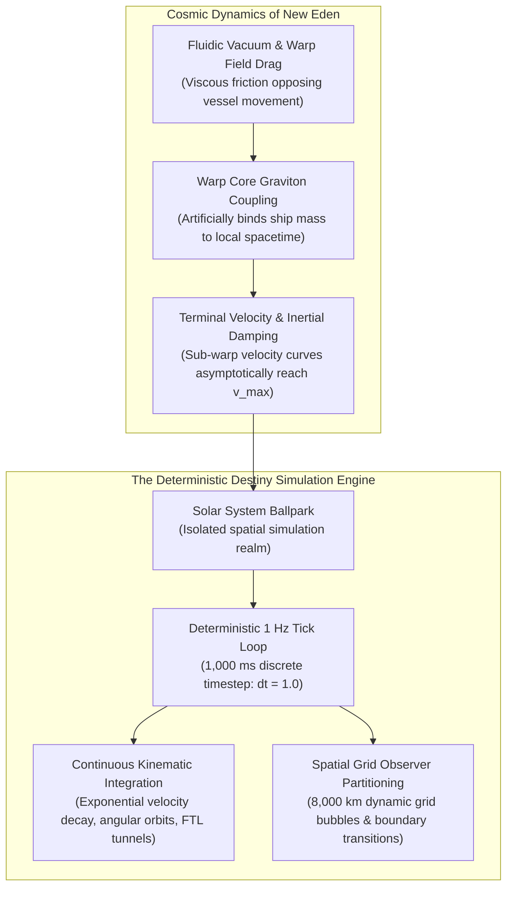
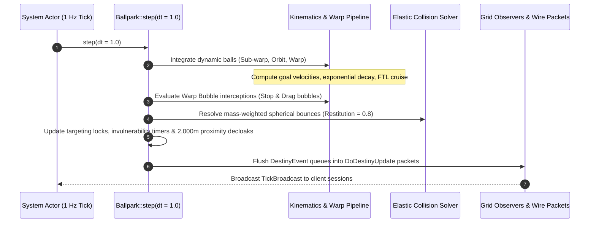
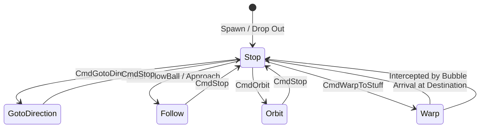
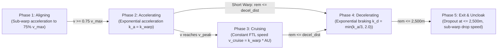
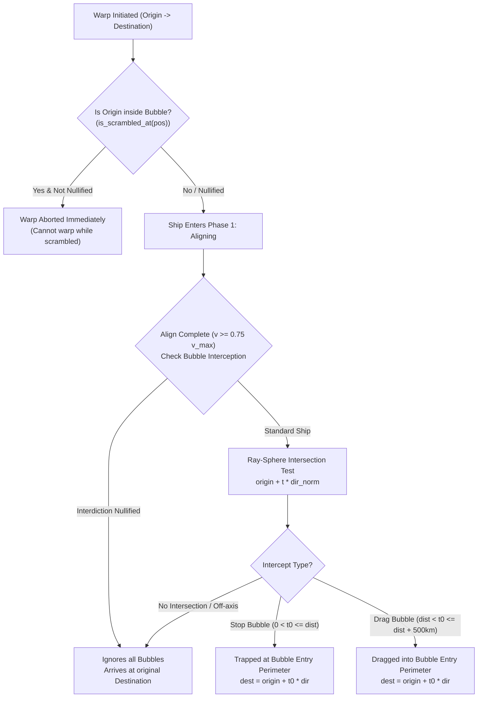
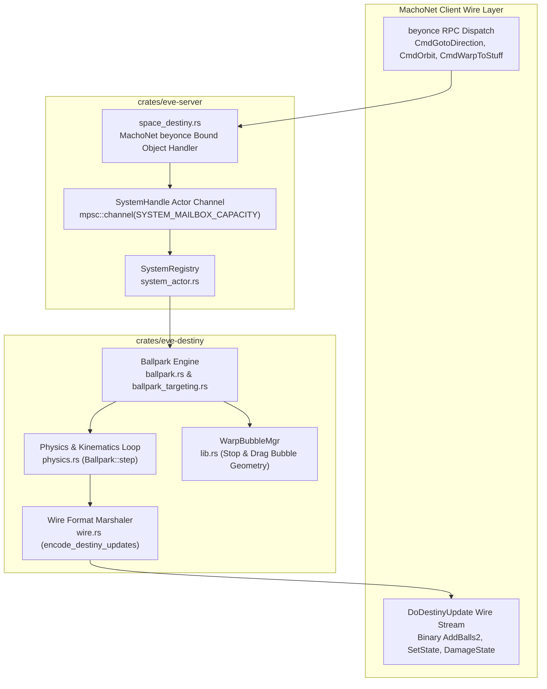
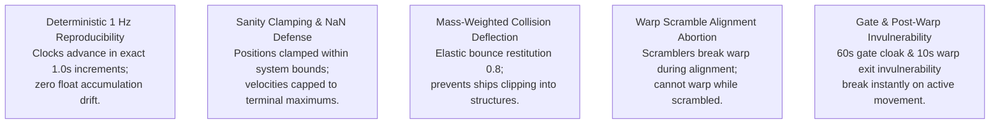

# Destiny Physics Simulation Loop & Kinematics

> **Navigation**: [EvoMu Technical Wiki](../README.md) • [Related Systems](#related-systems--cross-references)
>
> [← Back to Wiki Table of Contents](../README.md)

---

## Overview & Lore Context

In the universe of New Eden, celestial navigation and vessel kinematics are governed by the **Destiny Physics Engine**. Unlike conventional Newtonian orbital mechanics—where an object in vacuum accelerates indefinitely under constant thrust and preserves momentum without dissipation—space dynamics in EVE Online operate under an artificial, lore-grounded framework often colloquially termed **"submarine physics in space."**

### The Lore of "Submarine Physics"
In New Eden lore, a starship does not travel through empty Newtonian spacetime. The activation of a ship's warp drive and sub-light propulsion systems couples its hull to the local metric through artificial graviton manifolds. This interaction generates an intense reactive drag against the quantum foam—a macroscopic friction effect acting like a viscous fluid. Consequently:
1. **Terminal Velocity ($v_{\max}$):** Continuous engine thrust does not produce unbounded acceleration; the ship approaches a finite maximum speed where engine output matches fluidic metric drag.
2. **Inertial Decay ($\tau$):** When propulsion is deactivated, the ship does not drift forever. Spacetime friction rapidly dissipates kinetic energy, bringing the vessel to a dead stop along an exponential decay curve.
3. **Align Time ($t_{\text{align}}$):** To enter the faster-than-light (FTL) warp tunnel, a ship must align its spatial orientation to within $5^\circ$ of its destination vector and achieve at least $75\%$ of its terminal sub-warp velocity. The time required depends on hull mass and the hull agility factor.

### The Spatial Role of Ballparks
To simulate hundreds of thousands of celestial objects, starbases, stations, and active vessels without incurring global $O(N^2)$ collision and targeting overhead, New Eden partitions space into discrete, authoritative simulation domains known as **Ballparks** ([`Ballpark`](../../../crates/eve-destiny/src/lib.rs#L943)). Each solar system runs an independent Ballpark instance that advances on a strict $1\text{ Hz}$ server tick. Within a Ballpark, space is further partitioned into dynamic **Grid Bubbles** (typically with an $8\,000\text{ km}$ radius) that isolate network update broadcasts, ensuring client viewports receive high-fidelity state synchronizations only for relevant on-grid observers.

---

## Canonical Mechanics & Precise Formulas

### 1. The Deterministic 1 Hz Tick Loop

The Destiny simulation advances in discrete $1\,000\text{ ms}$ ($1\text{ s}$) timesteps ($dt = 1.0$). Every second, the system actor steps the Ballpark, integrating kinematic states, resolving collisions, checking warp bubble traps, and emitting network state updates:

#### Kinematic State Vector
Every physical entity within a Ballpark is modeled as a spherical rigid body termed a **Ball** ([`Ball`](../../../crates/eve-destiny/src/lib.rs#L508)), possessing the following state attributes:
- Position vector: $\vec{P} = (x, y, z) \in \mathbb{R}^3$ (meters).
- Velocity vector: $\vec{V} = (v_x, v_y, v_z) \in \mathbb{R}^3$ (meters per second).
- Maximum terminal speed: $v_{\max} \in \mathbb{R}^+$ ($\text{m/s}$).
- Inertia modifier (Agility): $A \in \mathbb{R}^+$ (dimensionless).
- Physical mass: $m \in \mathbb{R}^+$ ($\text{kg}$).
- Collision radius: $r \in \mathbb{R}^+$ (meters).
- Speed fraction throttle: $S_f \in [0.0, 1.0]$.
- Movement mode: $\text{Mode} \in \text{MovementMode}$.

---

### 2. Sub-Warp Acceleration & Inertial Mathematics

Sub-warp acceleration and deceleration follow an exponential approach governed by a physical time constant $\tau$.

#### The Inertial Time Constant ($\tau$)
The agility factor $A$ and mass $m$ combine into the characteristic time constant $\tau$ (seconds):

$$\tau = \frac{m \cdot A}{10^6}$$

In canonical EVE University formulations where align time incorporates the half-life factor $\ln(2)$, $\tau$ represents the characteristic velocity relaxation time:

$$\tau_{\text{relax}} = \frac{m \cdot A}{10^6}$$

#### Sub-Warp Velocity Curve
From a stationary rest state ($\vec{V}(0) = \vec{0}$), a ship accelerating toward maximum forward speed $v_{\max}$ along a target heading vector $\hat{D}$ follows the continuous velocity curve:

$$v(t) = v_{\max} \cdot S_f \cdot \left(1 - e^{-t / \tau}\right)$$

Under continuous numerical simulation with arbitrary goal velocity $\vec{V}_{\text{goal}}$ over a timestep $\Delta t$, the velocity and position integrate analytically as:

$$\Delta \vec{V} = \vec{V}(t) - \vec{V}_{\text{goal}}$$

$$\vec{V}(t + \Delta t) = \vec{V}_{\text{goal}} + \Delta \vec{V} \cdot e^{-\Delta t / \tau}$$

$$\vec{P}(t + \Delta t) = \vec{P}(t) + \vec{V}_{\text{goal}} \cdot \Delta t + \Delta \vec{V} \cdot \tau \cdot \left(1 - e^{-\Delta t / \tau}\right)$$

#### Warp Alignment Time ($t_{\text{align}}$)
To enter warp, a vessel must reach at least $75\%$ ($0.75$) of its maximum terminal velocity oriented within $5^\circ$ of the warp destination vector:

$$v(t_{\text{align}}) = 0.75 \cdot v_{\max} \implies v_{\max} \cdot \left(1 - e^{-t_{\text{align}} / \tau}\right) = 0.75 \cdot v_{\max}$$

$$e^{-t_{\text{align}} / \tau} = 0.25 \implies -\frac{t_{\text{align}}}{\tau} = \ln(0.25) = -2\ln(2)$$

$$t_{\text{align}} = 2\ln(2) \cdot \tau = \frac{2\ln(2) \cdot m \cdot A}{10^6} \approx \frac{1.38629436 \cdot m \cdot A}{10^6}\text{ seconds}$$

#### Discrete Server Tick Quantization
Because the Destiny engine steps in discrete $1\text{ s}$ ticks, the actual effective align time observed by a pilot is rounded up to the nearest integer ceiling:

$$T_{\text{ticks}} = \left\lceil t_{\text{align}} \right\rceil = \left\lceil \frac{1.38629436 \cdot m \cdot A}{10^6} \right\rceil \text{ ticks}$$

*(A ship with $t_{\text{align}} = 2.01\text{ s}$ requires $3$ server ticks to enter warp, identical to a ship with $t_{\text{align}} = 2.99\text{ s}$).*

---

### 3. Canonical Kinematic Movement Modes

EvoMu implements all 13 canonical Destiny movement modes (`DSTBALL_*` modes $0 \dots 12$):

#### Detailed Breakdown of Operational Modes

| Wire Code | Canonical Enum | Constant Name | Description & Kinematic Behavior |
| :---: | :--- | :--- | :--- |
| `0` | `GotoDirection` | `DSTBALL_GOTO` | Steers toward a fixed unit direction vector $\hat{D} \in \mathbb{R}^3$ at speed $v_{\max} \cdot S_f$. |
| `1` | `Follow` | `DSTBALL_FOLLOW` | Steers toward target ball $\vec{P}_{\text{target}}$, matching velocity when arriving at offset range $R$. |
| `2` | `Stop` | `DSTBALL_STOP` | Sets goal velocity to zero; vessel decelerates to complete rest via exponential damping. |
| `3` | `Warp` | `DSTBALL_WARP` | High-order FTL state machine (Aligning, Accelerating, Cruising, Decelerating). |
| `4` | `Orbit` | `DSTBALL_ORBIT` | Orbits target at radius $R$ by synthesizing tangential and centripetal steering vectors. |
| `5` | `Missile` | `DSTBALL_MISSILE` | Relentless target pursuit at constant speed without inertial damping; re-aims heading every tick. |
| `6` | `Mushroom` | `DSTBALL_MUSHROOM` | Stationary expanding shockwave ball: radius expands via $R(t) = R_{\max} \cdot (t / T)^{0.25}$. |
| `7` | `Boid` | `DSTBALL_BOID` | Free sub-warp ball integrating velocity under exponential drag without conversion to static. |
| `8` | `Troll` | `DSTBALL_TROLL` | Free coasting ball with zero goal velocity that freezes into `Rigid` at a specific tick stamp. |
| `9` | `Miniball` | `DSTBALL_MINIBALL` | Attached sub-sphere tracking a parent ball with a constant relative position offset. |
| `10` | `Field` | `DSTBALL_FIELD` | Intangible spatial volume (warp interdiction bubble or environmental cloud); non-colliding. |
| `11` | `Rigid` | `DSTBALL_RIGID` | Completely static immovable structure (stargates, stations, planets, celestial stars). |
| `12` | `Formation` | `DSTBALL_FORMATION` | Follows leader ball's local orthonormal basis $(right, up, forward)$ with quadratic arrival damping. |

#### The Orbit Algorithm & Centripetal Steering
When orbiting a target at distance $R_{\text{orbit}} = r_{\text{ship}} + r_{\text{target}} + \text{range}$, the ship maintains high tangential velocity while counteracting inertia to avoid drifting outward. EvoMu computes the steering vector dynamically:
1. Radial vector: $\hat{r} = \frac{\vec{P}_{\text{target}} - \vec{P}_{\text{ship}}}{\|\vec{P}_{\text{target}} - \vec{P}_{\text{ship}}\|}$.
2. Perpendicular velocity: $\vec{V}_{\perp} = \vec{V} - \hat{r} (\vec{V} \cdot \hat{r})$.
3. Tangential vector $\hat{t} = \frac{\vec{V}_{\perp}}{\|\vec{V}_{\perp}\|}$ (falls back to a reference plane cross-product if stationary).
4. Centripetal lead compensation:
   $$C_{\text{lead}} = \frac{\|\vec{V}\| \cdot (\tau + 0.5)}{R_{\text{orbit}}}$$
5. Radial distance error: $E_r = \text{clamp}\left(\frac{\text{dist} - R_{\text{orbit}}}{250.0}, -3.0, 3.0\right)$.
6. Composite goal velocity:
   $$\vec{V}_{\text{goal}} = \text{normalize}\left(\hat{t} + \hat{r} \cdot (E_r + C_{\text{lead}})\right) \cdot v_{\max} \cdot S_f$$

---

### 4. The 5-Phase Warp Pipeline

Warp travel is a multi-phase faster-than-light transit state machine executed by [`step_warp_ball`](../../../crates/eve-destiny/src/physics.rs#L1211-L1342):

#### Detailed Phase Breakdown
- **Minimum Warp Distance:** A vessel cannot enter warp to any object closer than **$150\text{ km}$ ($150\,000\text{ m}$)**. Attempts to warp within this distance are rejected with `DestinationTooClose`.
- **Phase 1 — Sub-Warp Alignment (`WarpPhase::Aligning`):**
  - Vessel accelerates along the warp heading vector $\hat{W} = \text{normalize}(\vec{P}_{\text{dest}} - \vec{P}_{\text{origin}})$.
  - Checks for warp scrambler disruption. If scrambled ($W_{\text{scramble}} \ge W_{\text{core}}$), warp is aborted immediately.
- **Phase 2 — Warp Acceleration (`WarpPhase::Accelerating`):**
  - Acceleration coefficient: $k_a = k_{\text{warp}}$ (in $\text{s}^{-1}$, numerically equal to warp speed in $\text{AU/s}$).
  - Exponential velocity growth: $v(t) = v_{\text{init}} \cdot e^{k_a \cdot t}$.
  - Peak velocity: $v_{\text{peak}} = \min\left(v_{\text{cruise}}, \frac{D_{\text{total}}}{(1/k_a) + (1/k_d)}\right)$, where $v_{\text{cruise}} = k_a \cdot \text{AU}$.
- **Phase 3 — FTL Cruise (`WarpPhase::Cruising`):**
  - Traversed only on long warps where distance is sufficient to reach $v_{\text{cruise}}$. Ship cruises at constant velocity $v_{\text{peak}}$.
- **Phase 4 — Warp Deceleration (`WarpPhase::Decelerating`):**
  - Deceleration coefficient: $k_d = \text{clamp}(k_a / 3.0, 0.1, 2.0)\text{ s}^{-1}$.
  - Remaining distance decays exponentially: $d_{\text{rem}}(t + \Delta t) = d_{\text{rem}}(t) \cdot e^{-k_d \cdot \Delta t}$.
  - Velocity during braking: $v(t) = \max\left(d_{\text{rem}} \cdot k_d, v_{\text{drop}}\right)$.
- **Phase 5 — Grid Exit & Dropout:**
  - When $d_{\text{rem}} \le 2\,500\text{ m}$, the ship drops out of warp.
  - Position is clamped within $2\,500\text{ m}$ of the destination point.
  - Speed drops to sub-warp exit velocity ($v_{\text{drop}} \approx 0.5 \cdot v_{\max}$). Mode resets to `MovementMode::Stop`.
  - Ship gains **10 seconds of post-warp exit invulnerability** (`warp_exit_invulnerable_remaining_ticks = 10`), breaking immediately if the pilot initiates an active movement or combat action.

---

### 5. Interdiction Bubbles & Drag Geometry

Warp interdiction fields prevent ships from warping and manipulate FTL arrival trajectories:

#### The Ray-Sphere Interception Algorithm
Every active warp bubble in [`WarpBubbleMgr`](../../../crates/eve-destiny/src/lib.rs#L891) is tested against the linear warp vector between $\vec{P}_{\text{origin}}$ and $\vec{P}_{\text{dest}}$:
1. Direction vector: $\vec{D} = \vec{P}_{\text{dest}} - \vec{P}_{\text{origin}}$, unit direction $\hat{D} = \frac{\vec{D}}{\|\vec{D}\|}$, total distance $d = \|\vec{D}\|$.
2. Vector to bubble center: $\vec{C}_{\text{rel}} = \vec{P}_{\text{bubble}} - \vec{P}_{\text{origin}}$.
3. Projection distance along ray: $t_{\text{proj}} = \vec{C}_{\text{rel}} \cdot \hat{D}$.
4. Perpendicular distance squared: $d_{\perp}^2 = \|\vec{C}_{\text{rel}}\|^2 - t_{\text{proj}}^2$.
5. If $d_{\perp}^2 > R_{\text{bubble}}^2$, the ray misses the bubble entirely.
6. If $d_{\perp}^2 \le R_{\text{bubble}}^2$, the ray penetrates the sphere:
   $$\Delta t = \sqrt{R_{\text{bubble}}^2 - d_{\perp}^2}$$
   $$t_0 = t_{\text{proj}} - \Delta t \quad (\text{Sphere Entry Point})$$
   $$t_1 = t_{\text{proj}} + \Delta t \quad (\text{Sphere Exit Point})$$

#### Stop Bubbles vs. Drag Bubbles
- **Stop Bubble ($0 < t_0 \le d$):** The bubble intersects the warp path in front of the destination. The warp vector terminates prematurely at the entry perimeter:
  $$\vec{P}_{\text{intercept}} = \vec{P}_{\text{origin}} + \hat{D} \cdot t_0$$
- **Drag Bubble ($d < t_0 \le d + 500\,000\text{ m}$):** The bubble is positioned behind the destination point directly along the warp vector line within **$500\text{ km}$ ($500\,000\text{ m}$)**. The FTL drive overshoots the intended destination and pulls the ship into the bubble's front perimeter at $t_0$.
- **Off-Axis Immunity:** If a bubble is positioned $> 500\text{ km}$ behind the destination, or if $d_{\perp} > R_{\text{bubble}}$, the warp is unaffected.

#### The Mid-Flight Tunnel Invariant
A critical parity invariant enforced by EvoMu: **Warp bubble interception is evaluated strictly at the moment of warp entry (transition from `Aligning` to `Accelerating`).** Once a ship is inside the FTL warp tunnel (`Accelerating`, `Cruising`, or `Decelerating`), newly anchored bubbles deployed while the ship is in transit **cannot yank the ship out of warp mid-flight**.

---

## EvoMu Implementation Architecture

### Source Code Mappings & Primary Types

1. [`crates/eve-destiny/src/lib.rs`](../../../crates/eve-destiny/src/lib.rs):
   - [`Ball`](../../../crates/eve-destiny/src/lib.rs#L508-L534): Core kinematic entity struct storing position, velocity, mass, agility, radius, and movement mode. Includes helper functions `time_constant()` and `align_time_seconds()`.
   - [`Ballpark`](../../../crates/eve-destiny/src/lib.rs#L943-L980): The solar system simulation world containing `balls`, `combat_states`, `grids`, and `target_locks`.
   - [`MovementMode`](../../../crates/eve-destiny/src/lib.rs#L56-L101): Complete enum covering all 13 canonical motion modes.
   - [`WarpPhase`](../../../crates/eve-destiny/src/lib.rs#L42-L52): State machine enum for `Aligning`, `Accelerating`, `Cruising`, and `Decelerating`.
   - [`CombatState`](../../../crates/eve-destiny/src/lib.rs#L182-L324): Shield/Armor/Structure HP pools, resonances, signature radius, warp scramble strengths, gate cloak, and post-warp invulnerability.
   - [`WarpBubbleMgr`](../../../crates/eve-destiny/src/lib.rs#L891-L931): Maintains active mobile warp disruptors and interdiction spheres, evaluating scramble presence and ray-sphere warp intercepts.
   - [`DestinyEvent`](../../../crates/eve-destiny/src/lib.rs#L537-L612): High-level state synchronization event enum emitted per tick.

2. [`crates/eve-destiny/src/physics.rs`](../../../crates/eve-destiny/src/physics.rs):
   - [`Ballpark::step`](../../../crates/eve-destiny/src/physics.rs#L13-L895): Advances the solar system simulation by $dt$ seconds. Steps sub-warp motions, warp trajectories, collision bounces, proximity decloaking, tether healing, and target lock progressions.
   - [`integrate_subwarp`](../../../crates/eve-destiny/src/physics.rs#L1198-L1209): Analytical exponential decay integrator updating position and velocity.
   - [`step_warp_ball`](../../../crates/eve-destiny/src/physics.rs#L1211-L1342): Continuous 5-phase FTL warp pipeline implementation.
   - [`compute_subwarp_goal_velocity`](../../../crates/eve-destiny/src/physics.rs#L1057-L1139): Evaluates directional steering, approach deceleration envelopes, and centripetal orbit trajectories.
   - [`combat`](../../../crates/eve-destiny/src/physics.rs#L898-L1055): Mathematical implementations for lock time (`compute_lock_time_seconds`), angular velocity (`compute_angular_velocity`), turret chance-to-hit (`compute_turret_chance_to_hit`), and passive capacitor/shield recharge curves (`compute_passive_recharge`).

3. [`crates/eve-destiny/src/ballpark.rs`](../../../crates/eve-destiny/src/ballpark.rs):
   - [`find_or_create_grid_for_position`](../../../crates/eve-destiny/src/ballpark.rs#L140-L190): Manages spatial grid bubble boundaries, enforcing non-overlapping clamped grid walls.
   - [`add_static_ball`](../../../crates/eve-destiny/src/ballpark.rs#L55-L68): Inserts system-wide immobile celestial objects without triggering dynamic `AddBall` network notifications.

4. [`crates/eve-destiny/src/wire.rs`](../../../crates/eve-destiny/src/wire.rs):
   - [`encode_add_balls`](../../../crates/eve-destiny/src/wire.rs#L78-L100): Serializes balls into canonical binary `AddBalls` / `SetState` state buffers.
   - [`decode_add_balls`](../../../crates/eve-destiny/src/wire.rs#L309-L450): Binary decoder unpacking `MassSector` and `FreeSector` ball attributes.
   - [`encode_destiny_updates`](../../../crates/eve-destiny/src/wire.rs#L990-L1050): Marshals queued `DestinyEvent` records into `DoDestinyUpdate` tuples matching the Python client bytecode layout.

5. [`crates/eve-server/src/services/space_destiny.rs`](../../../crates/eve-server/src/services/space_destiny.rs):
   - Intercepts MachoNet calls targeting the `beyonce` service (`CmdGotoDirection`, `CmdOrbit`, `CmdFollowBall`, `CmdStop`, `CmdWarpToStuff`), translating client commands into actor commands.

6. [`crates/eve-server/src/system_actor.rs`](../../../crates/eve-server/src/system_actor.rs):
   - Coordinates the per-system actor mailbox loop, dispatches `SystemCommand::StepManual`, executes module cycle progressions, and broadcasts tick updates to connected client sessions.

---

## Invariants, Security & Edge Cases

### 1. Deterministic Reproducibility
- The Destiny tick loop rejects non-positive or non-finite time steps ($\Delta t \le 0.0$ or $\Delta t = \text{NaN}$).
- State integration uses double-precision floats (`glam::DVec3` / `f64`), ensuring identical trajectory outputs across simulated and recorded runs.

### 2. Sanity Clamping & Coordinate Protection
- Velocity integration clamps speeds to $[0.0, v_{\max} \cdot S_f]$. If external modules or micro jump drives apply impulse, velocity decays exponentially back to terminal limits.
- If position coordinates exceed solar system bounding limits, coordinates are safely clamped to prevent client camera detachment or floating-point overflow.

### 3. Collision Deflection Physics (Restitution $e = 0.8$)
- When two physical balls overlap ($d < r_A + r_B$):
  - Overlap vector: $\vec{N} = \frac{\vec{P}_A - \vec{P}_B}{\|\vec{P}_A - \vec{P}_B\|}$, overlap depth $\delta = (r_A + r_B) - d$.
  - Relative velocity: $v_{\text{rel}} = (\vec{V}_A - \vec{V}_B) \cdot \vec{N}$.
  - If closing in ($v_{\text{rel}} < 0$):
    $$J = -\frac{(1 + e) \cdot v_{\text{rel}}}{\frac{1}{m_A} + \frac{1}{m_B}}$$
    $$\vec{V}_A \leftarrow \vec{V}_A + \frac{J}{m_A} \hat{N}, \quad \vec{V}_B \leftarrow \vec{V}_B - \frac{J}{m_B} \hat{N}$$
  - Position resolution: Positions are separated along $\hat{N}$ inversely proportional to mass, completely preventing ships from clipping inside stations or asteroids.
  - **Immunity Invariant:** Ships under **gate cloak** or regular **cloaking** are exempted from collision bounces (`feat:navigation.jump-cloak-immunities`).

### 4. Warp Cancellation vs. Mid-Flight Immunity
- **Alignment Phase:** If an active warp scrambler hits a ship while aligning, or if the ship enters a warp disruption bubble, alignment is aborted, velocity drops to zero, and the ship reverts to `MovementMode::Stop`.
- **In-Flight Phase:** Once a ship transitions into `WarpPhase::Accelerating`, its FTL tunnel coordinates are locked. Interdiction bubbles anchored after this transition cannot yank the ship out of warp.

### 5. Proximity Decloaking ($2\,000\text{ m}$)
- Every tick, cloaked vessels evaluate surface-to-surface distances to all physical balls on grid:
  $$d_{\text{surface}} = \|\vec{P}_A - \vec{P}_B\| - r_A - r_B$$
- If $d_{\text{surface}} \le 2\,000.0\text{ m}$, cloaking collapses immediately (`is_cloaked = false`), triggering a sensor recalibration delay (`decloak_targeting_delay_remaining_s`).
- **Field Bubble Invariant:** Intangible field bubbles (`MovementMode::Field`) have zero mass and do not trigger proximity decloaks.

---

## Verification, Tests & Parity References

The Destiny physics engine is backed by comprehensive unit and integration test suites:

### Primary Test Suites

1. [`crates/eve-destiny/src/tests.rs`](../../../crates/eve-destiny/src/tests.rs):
   - `test_rifter_align_time_and_exponential_acceleration`: Validates Rifter align time formula ($5.103\text{ s}$ against canonical attributes: mass $1\,067\,000\text{ kg}$, inertia $3.45$, max velocity $365\text{ m/s}$), reaching $> 75\%$ velocity in 6 ticks.
   - `test_short_and_long_warp_exit_without_overshoot`: Validates short warp trajectory without overshooting the $2\,500\text{ m}$ arrival bubble.
   - `test_turret_wrecking_shot_missile_and_proximity_decloak`: Tests $2\,000\text{ m}$ surface proximity decloaking and $3.0\times$ wrecking shots.
   - `test_spatial_bubbles_10000km_isolation_and_warp_transitions`: Verifies grid bubble isolation at $10\,000\text{ km}$, observer update filtering, and non-overlapping grid wall expansion.
   - `test_destiny_collision_bounce_physics_and_gate_cloak`: Verifies mass-weighted elastic bump physics (restitution $0.8$) against static asteroids and confirms gate cloak bump immunity.
   - `test_interdiction_bubbles_trapping_nullifier_and_micro_jump`: Validates mobile warp disruptor bubbles, heavy interdiction spheres, drag/stop bubble perimeter trapping, and Interdiction Nullifier bypasses.
   - `test_issue_69_no_aligning_teleport_or_mid_flight_yank_on_late_bubble`: Confirms that ships in warp cruise cannot be yanked mid-flight by late bubbles.

2. [`crates/eve-server/tests/it/destiny_events_emission.rs`](../../../crates/eve-server/tests/it/destiny_events_emission.rs):
   - `test_set_state_emitted_on_update_state_request`: Verifies `SetState` binary stream generation, ego identification, and marshal round-trip consistency.
   - `test_warp_to_and_warp_special_fx_emitted_on_warp`: Verifies `WarpTo` coordinate encoding, `effects.Warping` `OnSpecialFX` emission, and landing termination.
   - `test_goto_point_emitted_by_cmd_goto_point`: Validates `CmdGotoPoint` translation and network update dispatch.

3. [`crates/eve-server/tests/it/destiny_binary_stream.rs`](../../../crates/eve-server/tests/it/destiny_binary_stream.rs):
   - Full binary serialization and deserialization round-trip tests for all 13 `DSTBALL_*` modes, ensuring 100% wire parity with canonical client packet parsers.

### Parity Audit Tag Matrix

| Parity / Feature Tag | Target System | Authoritative Implementation |
| :--- | :--- | :--- |
| `feat:navigation.destiny-updates` | Network Destiny Updates | [`wire.rs`](../../../crates/eve-destiny/src/wire.rs#L990-L1050) |
| `feat:navigation.bubbles-grid` | 8,000 km Spatial Grids | [`ballpark.rs`](../../../crates/eve-destiny/src/ballpark.rs#L140-L190) |
| `feat:navigation.celestials-balls` | Immobile Static Celestials | [`ballpark.rs`](../../../crates/eve-destiny/src/ballpark.rs#L55-L68) |
| `feat:navigation.warp-pipeline` | 5-Phase FTL Warp Engine | [`physics.rs`](../../../crates/eve-destiny/src/physics.rs#L1211-L1342) |
| `feat:navigation.warp-bubbles` | Interdiction Drag & Stop Geometry | [`lib.rs`](../../../crates/eve-destiny/src/lib.rs#L833-L887) |
| `feat:navigation.collision-bounce` | Elastic Collision Deflection | [`physics.rs`](../../../crates/eve-destiny/src/physics.rs#L217-L352) |
| `feat:navigation.proximity-decloak`| 2,000m Proximity Decloak | [`physics.rs`](../../../crates/eve-destiny/src/physics.rs#L503-L532) |
| `feat:navigation.orbit` | Centripetal Orbit Kinematics | [`physics.rs`](../../../crates/eve-destiny/src/physics.rs#L1097-L1126) |
| `feat:navigation.approach` | Deceleration Envelope Approach | [`physics.rs`](../../../crates/eve-destiny/src/physics.rs#L1066-L1096) |
| `feat:navigation.stop-ship` | Inertial Velocity Damping | [`physics.rs`](../../../crates/eve-destiny/src/physics.rs#L1198-L1209) |
| `destiny:SetState` | Full Viewport State Sync | [`wire.rs`](../../../crates/eve-destiny/src/wire.rs#L680-L770) |
| `destiny:AddBalls2` | Dynamic Entity Grid Entry | [`wire.rs`](../../../crates/eve-destiny/src/wire.rs#L849-L863) |
| `destiny:WarpTo` | FTL Vector Broadcast | [`wire.rs`](../../../crates/eve-destiny/src/wire.rs#L942-L956) |

---

## Related Systems & Cross-References

- [**Gunnery Tracking & Missile Kinematics**](../combat_and_crimewatch/gunnery_tracking_and_missile_kinematics.md): Angular velocity, transversal calculations, and missile kinematic propagation across 1 Hz ticks.
- [**Stargate Jumps & Cynosural Navigation**](../universe_and_navigation/stargate_jumping_and_cynosural_navigation.md): Sub-warp kinematics, warp bubble entrapment, and gate transition pipelines.
- [**NPC Combat AI & Living World Ecology**](../npcs_and_living_world/npc_combat_ai_and_ecology.md): Living world entity movement, dynamic orbit paths, and LOD physics tiering.
- [**Upwell Structures Overview & Lifecycle**](../upwell_and_structures/upwell_structures_overview.md): 1,000 km spatial exclusion grids, docking bays, and tethering range verification.

---

[← Back to Wiki Table of Contents](../README.md)
