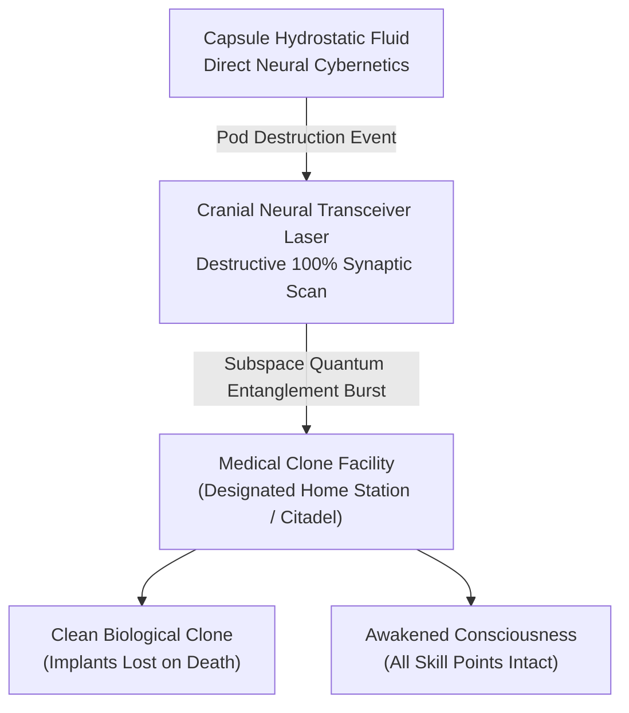
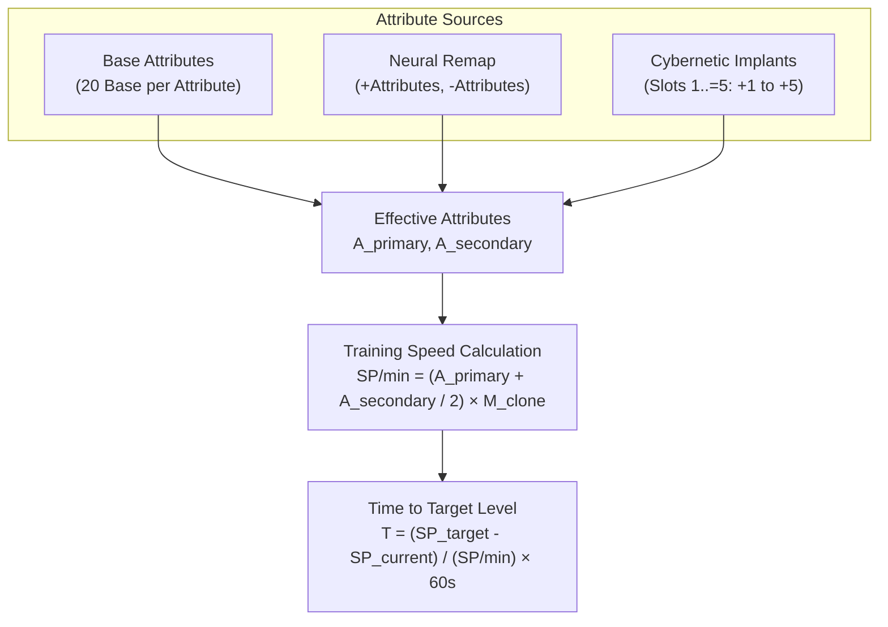
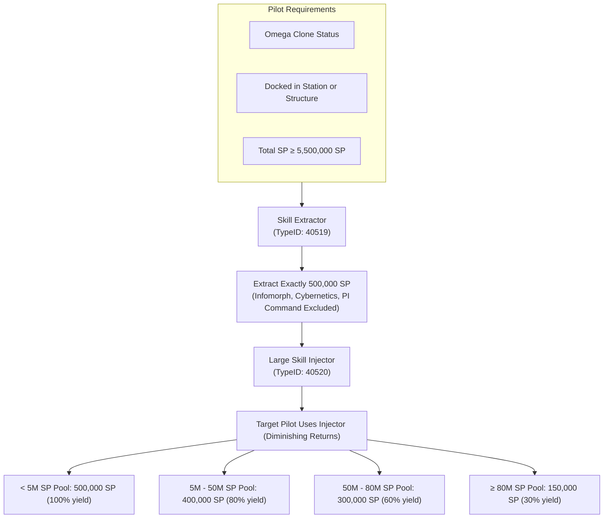
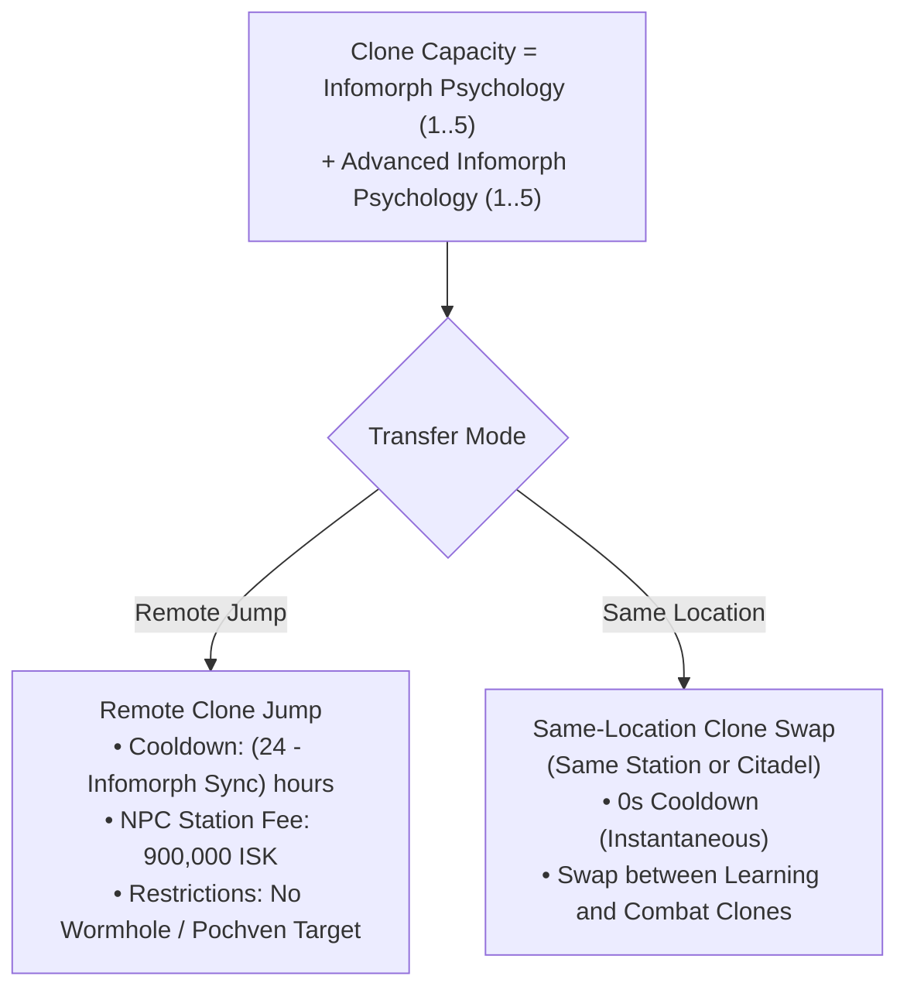
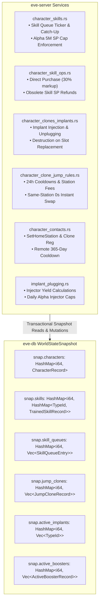

# Character Progression, Skill Training & Medical Clones

> **Navigation**: [EvoMu Technical Wiki](../README.md) • [Related Systems](#related-systems--cross-references)
>
> [← Back to Wiki Table of Contents](../README.md)

---

## Overview & Lore Context

In the lore of New Eden, the **Capsuleer** represents the pinnacle of transhuman evolution—an immortal demigod commanding starships of unfathomable power through a direct neural interface. While ordinary baseline humans age, weaken, and die, a capsuleer's consciousness transcends physical biology through Jovian neuro-mapping technology, high-bandwidth brain scanning, and quantum clone synthesis.



When a capsuleer's protective capsule is breached in space, survival protocols trigger an instantaneous cranial laser scan. In a fraction of a millisecond, the pilot's complete synaptic connectome is mapped and transmitted via faster-than-light subspace transceiver to their designated **Medical Clone** facility, where a blank biological body is imprinted with their memories, skills, and consciousness.

Alongside this medical resurrection pipeline, capsuleers master new capabilities through **Neural Skill Injections**. Rather than spending decades in traditional academies, capsuleers download encoded procedural knowledge and technical reflexes directly into their cerebral cortex. This skill acquisition rate is governed by five cognitive attributes (Intelligence, Perception, Charisma, Willpower, Memory) and enhanced via cybernetic implants. Furthermore, capsuleers utilize **Jump Clones** to project their minds across the cluster, stepping into specialized physical bodies outfitted for combat, hauling, or cognitive research.

In [`EvoMu`](../../../), the skill training and cloning infrastructure is implemented across [`eve-server`](../../../crates/eve-server), [`eve-db`](../../../crates/eve-db), and [`eve-sde`](../../../crates/eve-sde). The architecture faithfully replicates the non-linear skill point curves, unallocated free SP mechanics, 500,000 SP extraction chunks, diminishing return injector curves, 24-hour jump clone cooldown timers, and the medical clone respawn pipeline.

---

## Canonical Mechanics & Precise Formulas

### 1. Cognitive Attributes & Skill Training Rates

A capsuleer's cognitive profile is defined by five foundational attributes:
* **Perception ($A_{\text{perc}}$):** Governs combat gunnery, missile operation, and spaceship command.
* **Memory ($A_{\text{mem}}$):** Governs starship industry, production science, and drone interfacing.
* **Willpower ($A_{\text{will}}$):** Governs capital ship command, advanced weapon upgrades, and electronic warfare.
* **Intelligence ($A_{\text{int}}$):** Governs engineering, electronics, navigational physics, and science.
* **Charisma ($A_{\text{char}}$):** Governs corporation management, fleet leadership, and trade negotiation.

#### The Skill Training Speed Formula
Every skill in New Eden possesses a **Primary Attribute** and a **Secondary Attribute** defined in the Static Data Export (SDE). The training speed in Skill Points (SP) per minute is:

$$\text{SP / min} = \left( A_{\text{primary}} + \frac{A_{\text{secondary}}}{2} \right) \cdot M_{\text{clone}}$$

Where:
* $A_{\text{primary}}$ is the effective primary attribute (base + neural remap + active implant).
* $A_{\text{secondary}}$ is the effective secondary attribute (base + neural remap + active implant).
* $M_{\text{clone}}$ is the account subscription tier multiplier:
  $$M_{\text{clone}} = \begin{cases} 1.0, & \text{Omega Clone Subscription} \\ 0.5, & \text{Alpha Clone (Free-to-Play)} \end{cases}$$

#### Total Training Time
The time $T$ (in seconds) required to train from $SP_{\text{current}}$ to $SP_{\text{target}}$ is:

$$T = \frac{SP_{\text{target}} - SP_{\text{current}}}{\text{SP / min}} \times 60$$



#### Skill Level Point Requirements & Rank Multipliers
Every skill has a **Rank Multiplier** ($R \in [1, 16]$) reflecting its computational complexity. The cumulative skill points required to attain Level $L \in \{1, 2, 3, 4, 5\}$ are:

$$SP(L, R) = 250 \cdot R \cdot (\sqrt{32})^{L - 1} = 250 \cdot R \cdot 2^{2.5(L - 1)}$$

| Skill Level ($L$) | Mathematical Multiplier | Formula Ratio | Cumulative SP (Rank 1) | Cumulative SP (Rank 8) | Cumulative SP (Rank 16) |
| :---: | :---: | :---: | :---: | :---: | :---: |
| **Level 0** | $0$ | $0$ | $0$ | $0$ | $0$ |
| **Level 1** | $2^{0} = 1$ | $250 \times 1$ | $250\text{ SP}$ | $2,000\text{ SP}$ | $4,000\text{ SP}$ |
| **Level 2** | $2^{2.5} \approx 5.6568$ | $250 \times \sqrt{32}$ | $1,414\text{ SP}$ | $11,314\text{ SP}$ | $22,627\text{ SP}$ |
| **Level 3** | $2^{5} = 32$ | $250 \times 32$ | $8,000\text{ SP}$ | $64,000\text{ SP}$ | $128,000\text{ SP}$ |
| **Level 4** | $2^{7.5} \approx 181.019$ | $250 \times 32\sqrt{32}$ | $45,255\text{ SP}$ | $362,039\text{ SP}$ | $724,077\text{ SP}$ |
| **Level 5** | $2^{10} = 1,024$ | $250 \times 1024$ | **$256,000\text{ SP}$** | **$2,048,000\text{ SP}$** | **$4,096,000\text{ SP}$** |

$$\text{Delta SP for Level 5} = SP(5, R) - SP(4, R) = 210,745 \cdot R \text{ SP}$$
Attaining Level 5 represents approximately **$82.3\%$** of the total time invested in training the entire skill from Level 0 to 5.

#### Neural Remapping
Characters begin with a baseline of 20 points across all attributes and a budget of custom remap points:
* **Annual Remap:** One standard attribute remap allowed every 365 days (1 year cooldown).
* **Bonus Remaps:** Characters receive bonus remaps during character creation or special events, which can be expended without triggering the 1-year cooldown.

---

### 2. Skill Queues, Account Tiers & In-Sheet Purchasing

#### Uncapped Skill Queue
Capsuleers can queue an unlimited number of skills into their active queue, scheduling training plans months or years into the future. Players can reorder queue entries via drag-and-drop or pause/resume the queue at will.

#### Alpha Clone vs. Omega Clone Rules
* **Omega Clone:** Unrestricted access to all skills, ships, and modules; full $1.0\times$ training rate; unlimited queued training time.
* **Alpha Clone:**
  * Training rate reduced to $50\%$ ($M_{\text{clone}} = 0.5$).
  * **5,000,000 SP Free Training Cap:** Once an Alpha character accumulates $5,000,000\text{ SP}$ across trained and unallocated pools, standard passive training pauses automatically.
  * **20,000,000 SP Hard Cap:** Alphas can inject up to $20,000,000\text{ SP}$ utilizing **Daily Alpha Injectors** (`typeID: 47414`, $+50,000\text{ SP}$ per day with a 24-hour cooldown).
  * **Lapse Handling:** If an Omega subscription expires, skills trained beyond Alpha-eligible limits remain trained in the database, but enter an inactive state until Omega status is renewed.

#### In-Sheet Direct Skill Purchase
Players can inject unlearned skill books directly from the Character Sheet interface without traveling to an NPC trade hub:
$$\text{Cost}_{\text{direct}} = \left\lceil \text{Price}_{\text{NPC Market Seed}} \times 1.30 \right\rceil$$
The server validates published status, deducts the statutory cost including the $30\%$ convenience markup, and injects the skill at Level 0.

---

### 3. Skill Trading: Extractors & Injectors

Skill trading permits capsuleers to reconfigure their neural development by extracting trained skill points into portable trade goods:



#### Skill Extraction Requirements
1. **Omega Clone Account:** Only active Omega accounts can extract skills.
2. **5.5M SP Minimum Baseline:** A character must retain at least $5,000,000\text{ SP}$ after extraction, requiring a minimum of $5,500,000\text{ SP}$ prior to extraction.
3. **Chunk Size:** Extractions must total exactly **$500,000\text{ SP}$** per **Skill Extractor** ([`typeID: 40519`](../../../crates/eve-sde/)).
4. **Non-Extractable Skills:** Exactly five fundamental skills cannot be extracted to prevent character bricking:
   * *Infomorph Psychology* (`typeID: 24242`)
   * *Advanced Infomorph Psychology* (`typeID: 33407`)
   * *Cybernetics* (`typeID: 3411`)
   * *Command Center Upgrades* (`typeID: 2505`)
   * *Interplanetary Consolidation* (`typeID: 2495`)

#### Injector Diminishing Returns
When applying a **Large Skill Injector** ([`typeID: 40520`](../../../crates/eve-sde/)) or **Small Skill Injector** ([`typeID: 45635`](../../../crates/eve-sde/)), diminishing returns apply based on the recipient's total skill points $SP_{\text{total}}$:

$$SP_{\text{total}} = SP_{\text{trained}} + SP_{\text{unallocated}}$$


| Character Total SP Pool | Large Injector Yield ($Y_{\text{large}}$) | Small Injector Yield (20% of Large) | Effective Efficiency |
| :--- | :---: | :---: | :---: |
| **$< 5,000,000\text{ SP}$** | **$500,000\text{ SP}$** | $100,000\text{ SP}$ | $100\%$ |
| **$5,000,000 - 50,000,000\text{ SP}$** | **$400,000\text{ SP}$** | $80,000\text{ SP}$ | $80\%$ |
| **$50,000,000 - 80,000,000\text{ SP}$** | **$300,000\text{ SP}$** | $60,000\text{ SP}$ | $60\%$ |
| **$\ge 80,000,000\text{ SP}$** | **$150,000\text{ SP}$** | $30,000\text{ SP}$ | $30\%$ |

---

### 4. Medical Clones & The Respawn Pipeline

#### Pod Destruction in Space
When a capsuleer's pod structure drops to $0\text{ HP}$, an immediate death sequence initiates:
1. **Consciousness Upload:** The cranial neural transceiver destroys brain tissue to capture a $100\%$ fidelity neural map.
2. **Implant Destruction:** All cybernetic implants fitted in the active clone (Slots 1–10) are permanently destroyed and erased.
3. **Medical Transfer:** The session instantly teleports the capsuleer to their designated **Home Station** (`home_station_id`).
4. **Corvette Provisioning:** The character wakes up inside a fresh biological clone. If no ship is available at the destination, an Empire Rookie Corvette is automatically provisioned in their hangar.

#### Setting the Medical Clone Destination
* **Local Selection:** Docked capsuleers can set their medical clone at any NPC station or Upwell structure with an active **Standup Cloning Center** service module (`typeID: 35894`).
* **Remote Home Station Selection:**
  * Permitted only to the character's **Starter School Station** or **Corporation Headquarters Station**.
  * Governed by a strict **365-day cooldown** timer.
* **Pochven Restriction:** Medical clones cannot be anchored within the Pochven region (`CannotSetMedicalCloneInPochven`).

---

### 5. Jump Clones & Clone Vats

Jump Clones allow capsuleers to maintain multiple specialized physical bodies across the universe and switch between them remotely:



#### Cooldown Mathematics
Remote clone jumps trigger a cluster-wide neural synchronization cooldown:

$$\text{Cooldown}_{\text{seconds}} = \left(24 - \min(5, L_{\text{InfomorphSync}})\right) \times 3,600$$

* Level 0: $24\text{ hours}$ ($86,400\text{ s}$)
* Level I: $23\text{ hours}$ ($82,800\text{ s}$)
* Level V: **$19\text{ hours}$** ($68,400\text{ s}$)

#### Zero-Cooldown Same-Location Clone Swapping
When a capsuleer swaps between two clones located in the **same station or citadel**, the 24-hour cooldown is waived entirely ($0\text{ seconds}$ delay). This allows pilots to swap out high-value pirate implant clones for expendable clones prior to hazardous combat operations.

#### Spatial Restrictions
* **Wormhole Space (J-Space):** Capsuleers cannot jump into a clone located in wormhole systems (`feat:clones.wormhole-clone-jump-ban`).
* **Pochven:** Jump clones cannot be targeted inside Pochven.
* **Mobile Clone Vats:** Rorquals and Titans equipped with a **Clone Vat Bay** module allow fleet members to install and jump to clones directly in deep space.

---

### 6. Cybernetic Implants & Combat Boosters

#### Implant Slot Taxonomy (Slots 1–10)
Implants permanently modify a specific clone body until destroyed or unplugged:

| Slot Range | Classification | Functionality | Examples |
| :---: | :---: | :---: | :---: |
| **Slots 1–5** | **Attribute Enhancers** | Directly boost primary cognitive attributes (+1 to +5). | Ocular Filter, Memory Augmentation, Neural Boost. |
| **Slot 6** | **Skill Hardwiring** | Warp speed, capacitor capacity, missile flight time. | Warp Speed Optimizer, High-Grade Snake Alpha. |
| **Slot 7** | **Skill Hardwiring** | Agility, turret tracking, drone tracking. | Evasive Maneuvering, Ogdin's Eye Coordination. |
| **Slot 8** | **Skill Hardwiring** | Capacitor recharge rate, shield capacity. | Zainou 'Gnome' Shield Management. |
| **Slot 9** | **Skill Hardwiring** | Armor hit points, missile damage, energy turret rate of fire. | Inherent Implants 'Noble' Hull Upgrades. |
| **Slot 10** | **Skill Hardwiring** | Maximum ship velocity, hybrid turret damage, projectile damage. | Black Market 'Vales' Accelerators. |

#### Pirate Implant Sets & Set Multipliers
Pirate implants occupy Slots 1–6 (Low-Grade, Mid-Grade, High-Grade). Each implant provides a base attribute bonus, while Slot 6 (**Omega**) provides a compounding set multiplier that scales secondary bonuses:

$$\text{Total Set Bonus} = \prod_{k=1}^{6} (1 + \text{Bonus}_k)$$

* **High-Grade Snake Set:** Vastly boosts sub-warp maximum velocity.
* **High-Grade Slave / Amulet Set:** Drastically increases ship armor hit points.
* **High-Grade Crystal Set:** Amplifies active shield booster repair amounts.
* **High-Grade Ascendancy Set:** Drastically accelerates warp velocity.
* **High-Grade Halo Set:** Compresses ship signature radius.

#### Combat Boosters & Neurotoxin Skills
Combat boosters are ingestible performance-enhancing compounds:
* **Duration:** Governed by attribute `330` (`boosterDuration`). The skill **Biology** extends booster duration by $+20\%$ per level:
  $$D_{\text{effective}} = D_{\text{base}} \times (1.0 + 0.20 \cdot L_{\text{Biology}})$$
* **Neurotoxin Side Effects:** Boosters have up to five potential side effects with independent trigger probabilities:
  $$P_{\text{side effect}} = P_{\text{base}} \times (1.0 - 0.05 \cdot L_{\text{NeurotoxinRecovery}})$$
  $$\text{Severity}_{\text{penalty}} = \text{Severity}_{\text{base}} \times (1.0 - 0.05 \cdot L_{\text{NeurotoxinControl}})$$
* **Cerebral Accelerators:** Educational boosters designed for new pilots. They feature the Dogma attribute `1916` (`followsJumpClones = 1.0`), allowing their stat enhancements to persist across clone jumps.

---

## EvoMu Implementation Architecture

EvoMu implements character progression and cloning across asynchronous Rust services, transactional snapshot state stores, and mathematical formula libraries:



### 1. Crates Involved

* [`eve-server`](../../../crates/eve-server): Houses the skill queue ticker, clone jump dispatchers, MachoNet service endpoints (`skillMgr2`, `jumpCloneSvc`, `dogmaIM`), and client notification broadcasting.
* [`eve-db`](../../../crates/eve-db): Manages transactional world state snapshots (`WorldStateSnapshot`), persistence schemas, and SQLite database storage.
* [`eve-sde`](../../../crates/eve-sde): Parses static type data, attribute mappings, prerequisite skill trees, and booster duration parameters.

---

### 2. Primary Handlers & Services

#### Skill Training & Queue Management: [`crates/eve-server/src/services/character_skills.rs`](../../../crates/eve-server/src/services/character_skills.rs)
* [`catch_up_skill_queue`](../../../crates/eve-server/src/services/character_skills.rs#L39): Evaluates elapsed time since `started_at_unix`. Computes points gained using [`effective_character_attributes`](../../../crates/eve-server/src/services/jump_clone_names.rs#L833), completes finished skill levels in sequence, enforces Alpha clone 5M SP caps, and emits `OnSkillQueueRefreshed` and `OnSkillTrained`.
* [`handle_skills`](../../../crates/eve-server/src/services/character_skills.rs#L450): Dispatches MachoNet RPC calls:
  * `"skillMgr2.SaveSkillQueue"`: Validates skill prerequisites, computes training durations via [`skill_training_time_seconds`](../../../crates/eve-server/src/formulas.rs#L36), and saves the queue.
  * `"skillMgr2.ApplyFreeSkillPoints"`: Transfers unallocated SP into a specified skill via [`apply_skill_points`](../../../crates/eve-server/src/services/character_skills.rs#L686), immediately upgrading levels if thresholds are crossed.

#### Skill Trading & Obsolete Cleanup: [`crates/eve-server/src/services/character_skill_ops.rs`](../../../crates/eve-server/src/services/character_skill_ops.rs)
* [`migrate_obsolete_skills_for_character`](../../../crates/eve-server/src/services/character_skill_ops.rs#L16): Scans for deprecated skills, removes them, and refunds $100\%$ of SP into `free_skill_points`.
* [`purchase_skills_direct_for_char`](../../../crates/eve-server/src/services/character_skill_ops.rs#L127): Injects skills with the $30\%$ convenience markup.

#### Clone Jumps & Precondition Enforcement: [`crates/eve-server/src/services/character_clone_jump_rules.rs`](../../../crates/eve-server/src/services/character_clone_jump_rules.rs)
* [`handle_clone_jump`](../../../crates/eve-server/src/services/character_clone_jump_rules.rs#L99): Validates caller location, verifies target clone existence, waives cooldowns on same-location swaps, enforces Wormhole and Pochven restrictions, charges station/citadel fees, swaps active and stored implant sets, and updates `last_clone_jump_unix`.

#### Medical Clone Selection: [`crates/eve-server/src/services/character_contacts.rs`](../../../crates/eve-server/src/services/character_contacts.rs)
* [`SetHomeStation`](../../../crates/eve-server/src/services/character_contacts.rs#L1210): Enforces docking validation, Citadel clone bay online verification, remote 365-day cooldown checks, and Pochven exclusions.

#### Implants & Boosters: [`crates/eve-server/src/services/implant_plugging.rs`](../../../crates/eve-server/src/services/implant_plugging.rs)
* [`handle_inject_implant`](../../../crates/eve-server/src/services/implant_plugging.rs#L180): Installs an implant into Slots 1–10. If a slot is occupied, the previous implant is permanently destroyed.
* [`handle_use_booster`](../../../crates/eve-server/src/services/implant_plugging.rs#L420): Applies booster effects, calculates Biology duration scaling, and rolls side effects.
* [`handle_consume_skill_injector`](../../../crates/eve-server/src/services/implant_plugging.rs#L960): Enforces diminishing returns curves via [`skill_injector_sp_yield`](../../../crates/eve-server/src/formulas.rs#L48).

---

### 3. Core Database Schemas: [`crates/eve-db/src/types.rs`](../../../crates/eve-db/src/types.rs)

The core data structures underlying progression and cloning are defined in [`crates/eve-db/src/types.rs`](../../../crates/eve-db/src/types.rs):

* [`TrainedSkillRecord`](../../../crates/eve-db/src/types.rs#L574): Stores a character's trained skill type, level ($0$ to $5$), and accumulated skill points.
* [`SkillQueueEntry`](../../../crates/eve-db/src/types.rs#L581): Defines an in-flight training task with target level, start/end SP thresholds, duration, and start timestamp.
* [`JumpCloneRecord`](../../../crates/eve-db/src/types.rs#L592): Represents an installed jump clone body located at a specific station or citadel, retaining its fitted implant set.
* [`NeuralAttributes`](../../../crates/eve-db/src/types.rs#L467): Represents cognitive attributes (Charisma, Intelligence, Memory, Perception, Willpower) and annual/bonus remap cooldowns.
* [`CharacterRecord`](../../../crates/eve-db/src/types.rs#L509): Central character record tracking clone grade (Alpha/Omega), medical home station, total trained SP, unallocated free SP, and jump cooldown timestamps.

```rust
// Defined in crates/eve-db/src/types.rs
pub struct TrainedSkillRecord {
    pub type_id: TypeId,
    pub level: u8,
    pub skill_points: f64,
}

pub struct SkillQueueEntry {
    pub type_id: TypeId,
    pub target_level: u8,
    pub start_sp: f64,
    pub end_sp: f64,
    pub duration_seconds: f64,
    pub started_at_unix: Option<u64>,
}

pub struct JumpCloneRecord {
    pub jump_clone_id: i64,
    pub character_id: i64,
    pub location_id: i64,
    pub implants: Vec<TypeId>,
}

pub struct NeuralAttributes {
    pub charisma: u32,
    pub intelligence: u32,
    pub memory: u32,
    pub perception: u32,
    pub willpower: u32,
    pub bonus_remaps: u32,
    pub last_remap_unix: Option<u64>,
    pub remap_cooldown_until_unix: Option<u64>,
}

pub struct CharacterRecord {
    pub character_id: i64,
    pub clone_grade: u32,            // 1 = Alpha, 2 = Omega
    pub home_station_id: i64,         // Medical clone destination
    pub neural: NeuralAttributes,
    pub skill_points: f64,            // Total trained SP
    pub free_skill_points: f64,       // Unallocated free SP
    pub last_clone_jump_unix: u64,
    pub station_id: Option<i64>,
    pub structure_id: Option<i64>,
}
```

---

## Invariants, Security & Edge Cases

### 1. Invariant: Monotonic Skill Point Progression
* **Vulnerability:** Packet injection or floating-point truncation causing negative SP gains, skill level regressions, or integer overflow.
* **Mitigation:** In [`catch_up_skill_queue`](../../../crates/eve-server/src/services/character_skills.rs#L39) and [`apply_skill_points`](../../../crates/eve-server/src/services/character_skills.rs#L686), SP additions use saturating addition. SP increments are verified against the SDE rank maximum ($256,000 \cdot R$), and skill levels are locked between $0$ and $5$.

### 2. Invariant: Atomic Clone Swapping (Zero Duplication / Zero Loss)
* **Vulnerability:** A race condition during jump clone activation could duplicate high-grade implant sets or erase left-behind bodies.
* **Mitigation:** In [`handle_clone_jump`](../../../crates/eve-server/src/services/character_clone_jump_rules.rs#L99), the clone swap is executed inside an atomic snapshot transaction (`try_with_mut_snapshot`). The active implant list is moved into a newly created `JumpCloneRecord` at the departure station, while the target clone's implant list is atomically loaded into `snap.active_implants`.

### 3. Invariant: Jump Clone Cooldown Durability Across Restarts
* **Vulnerability:** Server restarts clearing in-memory timers, allowing pilots to jump clones repeatedly without cooldown.
* **Mitigation:** The cooldown timestamp is stored as an absolute UNIX timestamp (`last_clone_jump_unix`) on the `CharacterRecord`. When jumping, the server compares elapsed time $\Delta t$ against the required cooldown:
  $$\Delta t \ge \text{Cooldown}(L_{\text{InfomorphSync}})$$

### 4. Edge Case: Upwell Citadel Destruction with Installed Clones
* **Problem:** If a player citadel is destroyed or unanchored, installed jump clones and medical clone anchors could be orphaned.
* **Mitigation:** In [`structure_upwell_ops.rs`](../../../crates/eve-server/src/services/structure_upwell_ops.rs#L237), structure decommissioning scans `snap.characters`. Any character with `home_station_id == structure_id` is automatically failed over to their racial starter school station, and installed jump clones are destroyed in accordance with canonical structure mechanics.

---

## Verification, Tests & Parity References

EvoMu's skill progression, cloning, and implant systems are validated by targeted integration test suites:

### Parity Ledger Tags
* `feat:skills.skill-training-speed` — Accurate SP/min calculation based on primary/secondary attributes.
* `feat:skills.alpha-skill-caps` — Enforces 5M SP free training limit and Omega lapse handling.
* `feat:skills.direct-purchase-inject` — In-sheet direct skill purchasing with 30% markup.
* `feat:clones.clone-jump-preconditions-and-fees` — 24h jump cooldown and NPC station fees.
* `feat:clones.same-location-clone-swap` — Zero-cooldown swapping within the same facility.
* `feat:clones.wormhole-clone-jump-ban` — Rejection of remote jumps into J-space.
* `feat:attributes.implant-plug` — Insertion of implants and destruction of displaced items.
* `feat:attributes.booster-consume` — Combat booster consumption, Biology scaling, and side effects.

### Concrete Integration Tests

| Test & Source Location | Validated Behaviors |
| :--- | :--- |
| [`test_ch1_skill_training_engine_and_caps`](../../../crates/eve-server/tests/it/character_skills_clones.rs#L19)<br/>📁 [`character_skills_clones.rs`](../../../crates/eve-server/tests/it/character_skills_clones.rs) | Verifies skill queue training rate, rank math, and 5M SP Alpha training caps. |
| [`test_clone_jump_preconditions_fees_and_same_location_swap`](../../../crates/eve-server/tests/it/clone_jump_features_complete.rs#L80)<br/>📁 [`clone_jump_features_complete.rs`](../../../crates/eve-server/tests/it/clone_jump_features_complete.rs) | Tests 24h jump clone cooldown, Infomorph Sync reductions, and 0s same-station swaps. |
| [`test_clone_jump_space_restrictions_and_alpha_access`](../../../crates/eve-server/tests/it/clone_jump_features_complete.rs#L222)<br/>📁 [`clone_jump_features_complete.rs`](../../../crates/eve-server/tests/it/clone_jump_features_complete.rs) | Confirms ban on jumping into Wormholes/Pochven and Alpha installation restrictions. |
| [`test_implant_plug_and_remove_destroys_implant`](../../../crates/eve-server/tests/it/character_clones_skills_complete.rs#L401)<br/>📁 [`character_clones_skills_complete.rs`](../../../crates/eve-server/tests/it/character_clones_skills_complete.rs) | Tests implant injection, attribute boost application, and destruction on removal. |
| [`test_booster_consume_and_side_effects_neurotoxin_skills`](../../../crates/eve-server/tests/it/character_clones_skills_complete.rs#L521)<br/>📁 [`character_clones_skills_complete.rs`](../../../crates/eve-server/tests/it/character_clones_skills_complete.rs) | Tests combat booster stat bonuses, Biology duration scaling, and side-effect rolls. |
| [`test_skills_nondiminishing_injector`](../../../crates/eve-server/tests/it/character_skill_features_t12.rs#L289)<br/>📁 [`character_skill_features_t12.rs`](../../../crates/eve-server/tests/it/character_skill_features_t12.rs) | Validates non-diminishing injectors (Daily Alpha Injector) and 24h cooldown tracking. |

---

## Related Systems & Cross-References

- [**Dogma Attribute Engine**](../dogma_and_fitting/dogma_attribute_engine.md): Skill level multipliers injecting attribute modifiers into active ship, module, and drone stats.
- [**Crimewatch & Engagement Timers**](../combat_and_crimewatch/crimewatch_and_engagement_timers.md): Capsule destruction, pod killing rules, and medical clone resurrection mechanics.
- [**Regional Market Order Matching**](../economy_and_markets/regional_market_order_matching.md): Trade skill effects on broker fees, sales taxes, and remote market order operations.
- [**Agent Dialogue & Missions**](../missions_and_agents/agent_dialogue_and_missions.md): Social skills modifying agent quality, faction standings, and LP store conversion rates.

---

[← Back to Wiki Table of Contents](../README.md)
