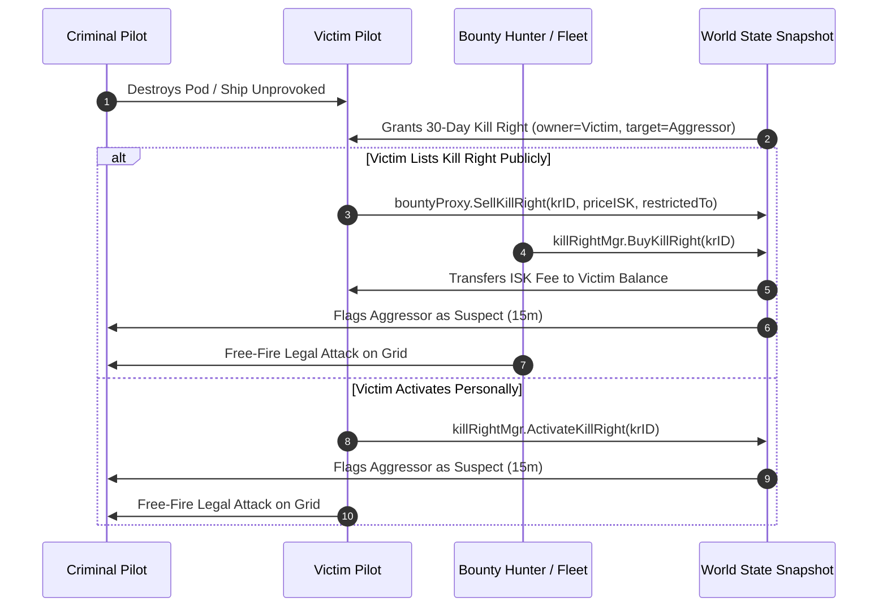
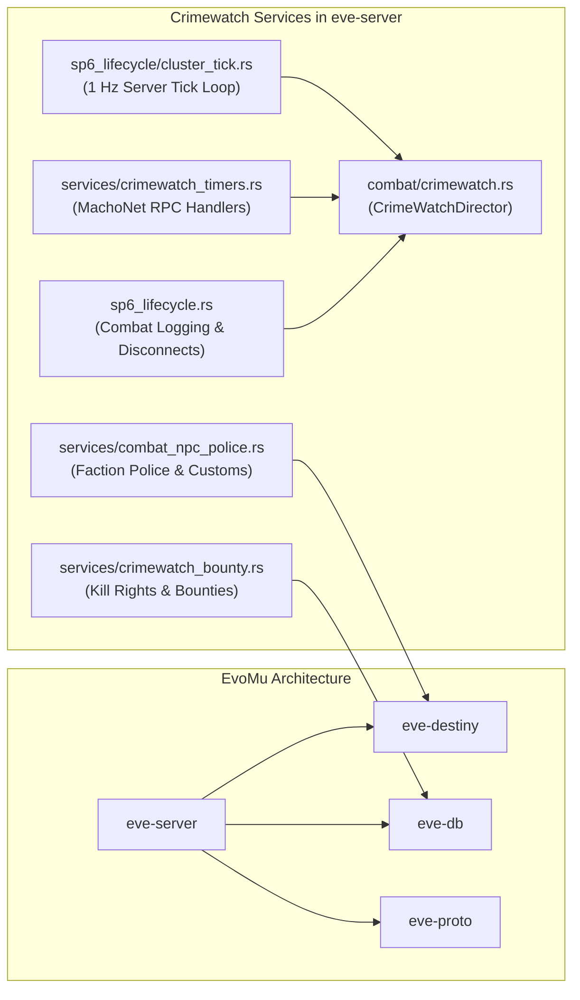

# Crimewatch, Aggression Rules & Engagement Timers

## Overview & Lore Context

In the anarchic frontier of space, where immortal capsuleers command devastating weapons capable of vaporizing entire cities, civilization requires strict, mathematically unambiguous rules of engagement. In YC114, following decades of escalating asymmetric conflict, suicide ganking cartels, and confusing territorial edicts, the **Consolidated Cooperation and Relations Command (CONCORD)** enacted the landmark **Crimewatch 2.0** treaty (introduced in the *Retribution* expansion).

Crimewatch 2.0 dismantled legacy global flag systems (such as the old Global Criminal Countdown, or GCC) and replaced them with a transparent, unified engagement framework governing every capsuleer in New Eden. The system establishes distinct legal jurisdictions across the cluster:

1. **High-Security Space ($0.5$ to $1.0$):**
   The heart of the four core empires (*Amarr Empire*, *Caldari State*, *Gallente Federation*, *Minmatar Republic*). Here, CONCORD acts as an unyielding, omnipotent executioner. Unauthorized aggression against compliant vessels triggers instant or rapid CONCORD deployment, while national Faction Police and Customs authorities patrol stargates and stations to hunt outlaws and confiscate illicit contraband.
2. **Low-Security Space ($0.1$ to $0.4$):**
   The lawless borderlands. CONCORD does not intervene in low-sec; capsuleer ships may engage one another, incurring only temporary Suspect flags. However, the four empires maintain automated **Sentry Guns** at celestial stargates and station perimeters to punish unprovoked violence. Furthermore, destroying a capsuleer's biological pod (capsule) in low-sec is recognized as a crime against humanity, instantly branding the attacker a **Criminal**.
3. **Null-Security ($0.0$ and below) & Wormhole Space (J-Space):**
   Beyond the reach of empire treaties. CONCORD, Faction Police, and Sentry Guns do not exist in sovereign null-sec or uncharted wormhole systems. Capsuleers possess complete freedom of engagement without acquiring weapons flags, suspect timers, criminal tags, or character security status penalties.

Crimewatch balances capsuleer freedom with predictable consequences. It allows lawful duels, corporate warfare, and faction insurgencies while offering capsuleers granular client-side **Safety Settings** to prevent accidental criminal acts.

The **EvoMu Crimewatch Engine** is a clean-room, deterministic Rust implementation of the full YC114 Crimewatch specification. It tracks character timers, evaluates legality across complex fleet scenarios, enforces safety setting interlocks, drives CONCORD execution pipelines, and handles combat disconnect persistence with total fidelity to canonical EVE Online.

---

## Canonical Mechanics & Precise Formulas

### 1. The 5 Core Timers

Crimewatch governs player behavior through five distinct temporal states, visualized below:

```mermaid
flowchart TD
    subgraph Timers["The 5 Core Crimewatch Timers"]
        WT["Weapons Timer<br/>(60 seconds)"]
        PT["PvP Log-Off Timer<br/>(15 minutes / 900s)"]
        ST["Suspect Flag<br/>(15 minutes / 900s)"]
        CT["Criminal Flag<br/>(15 minutes / 900s)"]
        NT["NPC Aggression Timer<br/>(5 minutes / 300s)"]
    end

    Act_Off["Activate Offensive Module<br/>(Turret, Missile, Smartbomb, EWAR)"] --> WT
    Act_PvP["Aggress Another Capsuleer<br/>(Direct Weapon or Drone)"] --> PT
    Act_PvP --> WT
    
    Loot_Yellow["Loot Yellow Can / Container"] --> ST
    Aggro_LS_Ship["Unprovoked Ship Attack in Low-Sec"] --> ST
    Act_KR["Activate Kill Right on Target"] --> ST
    Filament_T4["Activate T4-T6 Filament in 0.5-0.75"] --> ST
    
    Aggro_HS["Unprovoked Attack in High-Sec"] --> CT
    Pod_LS["Unprovoked Podding in Low-Sec"] --> CT
    Assist_Crim["Remote Assist a Criminal Pilot"] --> CT
    
    Act_NPC["Engage / Aggress Space NPCs"] --> NT
    Act_NPC --> WT
```



#### Detailed Timer Specifications:

| Timer | Duration | Triggers | Canonical Restrictions & Consequences |
| :--- | :---: | :--- | :--- |
| **Weapons Timer** | $60\text{ s}$ | Activating offensive modules (turrets, missiles, smartbombs, scrams, webs, damps, target painters, ECM) or remote assistance modules on any target (NPC or PC). | **Blocks:** Stargate jumps, station docking, Upwell citadel docking/tethering, ejecting from ship, refitting in space, switching ships, storing ship in maintenance bays, activating filaments.<br/>**Exemption:** Jumping through cosmic wormholes is *allowed* under a weapons timer! |
| **PvP Log-Off Timer** | $15\text{ m}$ ($900\text{ s}$) | Aggressing or being aggressed by another capsuleer (including drones, smartbombs, and fleet assistance). | **Blocks:** Safe logoff (30s timer aborted), filament activation.<br/>**Combat Logging Prevention:** If a pilot disconnects, their ship remains physical, warpable, and vulnerable in space for the full 15 minutes. Refreshes on taking damage. |
| **Suspect Flag** | $15\text{ m}$ ($900\text{ s}$) | 1. Unprovoked attack on a player ship in low-sec ($0.0 < \text{SS} < 0.45$).<br/>2. Stealing items from non-fleet/non-corp cargo containers (yellow cans or wrecks).<br/>3. Remote-assisting a suspect or an outlaw ($\text{SS} \le -5.0$) in high-sec.<br/>4. Activating a Kill Right.<br/>5. Activating high-tier (T4–T6) Abyssal filaments in $0.5$–$0.75$ high-sec systems. | **Universal Free-Fire:** Any player in New Eden may attack the suspect without CONCORD intervention, without sentry gun reaction, and without gaining suspect/criminal flags.<br/>Does *not* summon CONCORD or Sentry Guns. |
| **Criminal Flag** | $15\text{ m}$ ($900\text{ s}$) | 1. Unprovoked attack on a compliant ship or capsule in high-sec ($\text{SS} \ge 0.45$).<br/>2. Unprovoked destruction of a capsule (pod) in low-sec.<br/>3. Remote-assisting a criminal pilot in any empire system.<br/>4. Remote-assisting in a war/limited engagement in high-sec without being an authorized combatant. | **Guaranteed Destruction:** Summons invulnerable CONCORD Police in high-sec.<br/>**Universal Free-Fire:** Legal target for all players cluster-wide.<br/>**Sentry Engagement:** Gate and station sentry guns engage continuously.<br/>**Mobility Sanction:** High-sec criminal ships are completely barred from initiating warp (capsules exempted). Docking refused in empire stations. |
| **NPC Aggression Timer** | $5\text{ m}$ ($300\text{ s}$) | Engaging or being engaged by non-player entities (pirate rats, Sleepers, Triglavians, sentry guns). | Extends disconnect presence in space to 5 minutes if disconnected while under PvE aggression, preventing instant escape from rats. |

---

### 2. Safety Settings Engine

To protect capsuleers from accidental criminal acts or rogue module activations, every capsuleer ship is equipped with a hardware-integrated **Safety Setting** interlock (`safetyLevel`):


- **Green (Safety Enabled — Wire Value `2`):**
  - Completely blocks any activation that would trigger either a **Suspect** or a **Criminal** flag.
  - Prevents targeting neutral capsuleers with offensive weapons or EWAR in high-sec and low-sec.
  - Blocks activating Area-of-Effect (AoE) weapons (Smartbombs, ECM Burst Jammers) in high-sec if neutral ships or pods are within blast radius.
  - Blocks remote repairs or capacitor transfers on suspect or criminal pilots.
  - Blocks opening or looting yellow cargo containers/wrecks.
  - *Error Code:* `SafetyLevelRestricted` ("UserError: CantDoInCurrentSafetyLevel - Ship safety is set to Green; illegal suspect/criminal aggression is prevented").
- **Yellow (Partial Safety — Wire Value `1`):**
  - Allows actions that trigger a **Suspect** flag, but strictly blocks any action that would trigger a **Criminal** flag.
  - Allows looting yellow containers and wrecks in any security zone.
  - Allows attacking player ships in low-security space ($0.1$ to $0.4$).
  - Allows remote assistance on suspect pilots.
  - **Blocks:** Attacking neutral ships or pods in high-sec, and destroying capsules in low-sec.
  - *Error Code:* `SafetyLevelRestricted` ("UserError: CantDoInCurrentSafetyLevel - Ship safety is set to Yellow; criminal aggression is prevented").
- **Red (Safety Disabled — Wire Value `0`):**
  - Complete operational freedom. All safety interlocks are overridden.
  - Permits unprovoked high-sec ganking, smartbombing gates, pod-killing in low-sec, and illegal logistics.
  - The pilot accepts immediate criminal flagging and guaranteed CONCORD destruction.

---

### 3. Security Status Mathematics

Every character possesses a persistent **Security Status** rating ranging continuously from $-10.0$ to $+10.0$:

#### A. Security Status Gain (PvE Ratting):
Destroying pirate NPC vessels in asteroid belts, combat anomalies, and deadspace complexes increases character security status up to a maximum ceiling of $+5.0$:

$$\Delta \text{SS} = \text{clamp}\left( (5.0 - \text{SS}_{\text{curr}}) \times 0.01 \times \text{clamp}\left(\frac{\text{Bounty}}{500\,000.0}, 0.01, 0.10\right), 0.001, 0.50 \right)$$

If $\text{SS}_{\text{curr}} \ge 5.0$ or $\text{Bounty} \le 0$, no gain is awarded. Security status above $+5.0$ can only be acquired via Storyline missions, Empire faction events, or special LP trade ins.

#### B. Security Status Loss (Unprovoked Aggression):
Committing criminal acts reduces character security status based on the system's security rating $\text{SS}_{\text{sys}}$ and whether a capsule was destroyed:

$$\text{Loss} = \max\left( \text{BasePenalty} + (\text{SS}_{\text{curr}} - (-10.0)) \times 0.02 \times \left(\frac{\max(\text{SS}_{\text{sys}}, 0.0) + 1.0}{2.0}\right), \text{BasePenalty} \right)$$

Where:
$$\text{BasePenalty} = \begin{cases} 2.0 & \text{for pod destruction (capsule)} \\ 0.5 & \text{for unprovoked ship attack} \end{cases}$$

If $\text{SS}_{\text{curr}} \le -10.0$, no further loss is recorded.

#### C. Outlaw Status & Faction Police Thresholds:
A pilot whose security status drops to $\le -5.0$ (or below specific high-sec thresholds) is designated an **Outlaw**:
- Flashes bright red in all player overviews cluster-wide.
- Can be legally attacked and destroyed anywhere in New Eden without timers or CONCORD interference.
- **Faction Police Interdiction:** Faction Police actively hunt outlaws in high-sec based on the system security band:

$$\text{Threshold}(\text{SS}_{\text{sys}}) = 1.0 - 2.0 \times \text{SS}_{\text{sys}}$$

$$\begin{aligned}
\text{SS}_{\text{sys}} \ge 1.0 &\implies \text{Engages if } \text{SS}_{\text{char}} \le -2.0 \\
\text{SS}_{\text{sys}} \ge 0.9 &\implies \text{Engages if } \text{SS}_{\text{char}} \le -2.5 \\
\text{SS}_{\text{sys}} \ge 0.8 &\implies \text{Engages if } \text{SS}_{\text{char}} \le -3.0 \\
\text{SS}_{\text{sys}} \ge 0.7 &\implies \text{Engages if } \text{SS}_{\text{char}} \le -3.5 \\
\text{SS}_{\text{sys}} \ge 0.6 &\implies \text{Engages if } \text{SS}_{\text{char}} \le -4.0 \\
\text{SS}_{\text{sys}} \ge 0.5 &\implies \text{Engages if } \text{SS}_{\text{char}} \le -4.5
\end{aligned}$$

- **High-Sec Docking Sanction:** Outlaw ships are refused docking permissions at all high-sec NPC stations.
- **Capsule Exemption:** Outlaw capsules (`type_id: 670`) are *never* attacked by Faction Police and are permitted to dock in all stations.

#### D. Security Tag Redemption (Clone Soldier Tags):
Pilots with negative security status can redeem Clone Soldier Tags (SDE group `1206`) at CONCORD Security Offices in empire stations:

$$\text{SS}_{\text{new}} = \min\left( \text{SS}_{\text{curr}} + 0.50 \times \text{Quantity}, \text{Band}_{\max}, 0.0 \right)$$

Redemption is gated strictly by four security status tiers:

| Tag Type | Type ID | Valid Security Band | Max Security Achievable | ISK Fee per Tag |
| :--- | :---: | :---: | :---: | :---: |
| **Clone Soldier Trainer Tag** | `35661` | $[-10.0, -8.0)$ | $-8.0$ | $500\,000\text{ ISK}$ |
| **Clone Soldier Recruiter Tag** | `35662` | $[-8.0, -5.0)$ | $-5.0$ | $1\,500\,000\text{ ISK}$ |
| **Clone Soldier Transporter Tag** | `35663` | $[-5.0, -2.0)$ | $-2.0$ | $4\,500\,000\text{ ISK}$ |
| **Clone Soldier Negotiator Tag** | `35664` | $[-2.0, 0.0)$ | $0.0$ | $10\,000\,000\text{ ISK}$ |

---

### 4. Kill Rights & Player Bounties

When an unprovoked ship or capsule destruction occurs in empire space ($> 0.0$), a **Kill Right** is automatically generated in favor of the victim against the aggressor.



#### Kill Right Rules & Invariants:
1. **Lifetime:** Strictly 30 days ($2\,592\,000\text{ s}$). If unused upon expiry, the record is expunged.
2. **Sale & Restriction:** The owner may make the Kill Right available to the public for a custom ISK fee, or restrict access to a specific character, corporation, or alliance (`restrictedTo`).
3. **Activation:** Activating or purchasing a Kill Right requires both the activator and target to be undocked in space within the same solar system.
4. **Target Suspect Flag:** Activating a Kill Right flags the target with a $15\text{-minute}$ **Suspect** timer, allowing the activator (and anyone else on grid) to engage without CONCORD interference.
5. **Single-Use Consumption:** A Kill Right is single-use; upon successful activation, `is_active_suspect` is locked, preventing duplicate sales or reuse.

---

### 5. Limited Engagements & Duels

When two pilots engage in legal combat that would otherwise be subject to high-sec interference, a $15\text{-minute}$ **Limited Engagement** is established between them:

1. **Duel Challenges:**
   - A pilot issues a duel via `crimewatch.StartDuelChallenge(targetCharID)`.
   - The challenge expires after $60\text{ seconds}$.
   - If accepted via `crimewatch.RespondToDuelChallenge(challengerID, true)`, a mutual $15\text{-minute}$ Limited Engagement is established between the two pilots.
2. **Mutual Free-Fire:**
   - Both participants can legally fire upon each other in high-sec without CONCORD intervention, without sentry gun aggression, and without incurring security status penalties.
3. **No Third-Party Interference:**
   - A Limited Engagement is strictly private between the two participants. Any third party who remote-assists either participant in high-sec commits an illegal act, acquiring an immediate **Criminal** flag and summoning CONCORD.

---

### 6. CONCORD Response Mechanics & Delay Scaling

In high-security space, criminal acts provoke a response from CONCORD. CONCORD does not prevent crime; it guarantees retribution. The arrival delay depends strictly on solar system security status:

$$T_{\text{delay}}(\text{SS}_{\text{sys}}) = \begin{cases} 
6.0\text{ s} & \text{for } \text{SS}_{\text{sys}} \in [0.9, 1.0] \\
7.0\text{ s} & \text{for } \text{SS}_{\text{sys}} = 0.8 \\
10.0\text{ s} & \text{for } \text{SS}_{\text{sys}} = 0.7 \\
14.0\text{ s} & \text{for } \text{SS}_{\text{sys}} = 0.6 \\
19.0\text{ s} & \text{for } \text{SS}_{\text{sys}} = 0.5 \\
\infty & \text{for } \text{SS}_{\text{sys}} < 0.45 \text{ (Low/Null/W-Space)}
\end{cases}$$

Upon arrival, CONCORD executes the canonical destruction pipeline:
- Spawns an invulnerable *CONCORD Police Commander* (`type_id: 11957`) with damage resonance values set to `[0.0, 0.0, 0.0, 0.0]`.
- Enforces an unbreakable $100\%$ stasis webifier (`speed_fraction = 0.0`).
- Sets warp scramble strength to $100$.
- Drains the ship capacitor to $0.0\text{ GJ}$.
- Applies an ECM jam and forces all locks to clear.
- Destroys the criminal ship via `execute_death_pipeline`, ejecting the pilot's capsule, generating a public killmail attributed to CONCORD (`owner_id: 1000125`), and granting a 30-day Kill Right to the victim.

---

## EvoMu Implementation Architecture

The Crimewatch system is architected across four core crates:



### 1. Crates Involved
- [`eve-server`](file:///Users/sergeya/ai/EvoMu/crates/eve-server): Master gameplay coordinator, MachoNet RPC dispatchers, Crimewatch director, and death pipelines.
- [`eve-destiny`](file:///Users/sergeya/ai/EvoMu/crates/eve-destiny): 1 Hz spatial physics engine, movement modes, warp scrambling tracking, and ballpark damage application.
- [`eve-db`](file:///Users/sergeya/ai/EvoMu/crates/eve-db): Transactional WAL snapshot store (`WorldStateSnapshot`) holding persisted crimewatch states, aggression records, and kill rights.
- [`eve-proto`](file:///Users/sergeya/ai/EvoMu/crates/eve-proto): Binary marshal/unmarshal codec and PyRep wire representations for MachoNet notifications.

---

### 2. Primary Handlers & Services

#### Crimewatch Director & Core Logic:
- [`crates/eve-server/src/combat/crimewatch.rs`](file:///Users/sergeya/ai/EvoMu/crates/eve-server/src/combat/crimewatch.rs)
  - [`CrimeWatchDirector`](file:///Users/sergeya/ai/EvoMu/crates/eve-server/src/combat/crimewatch.rs#L78-L83): System-wide director holding active character timer states and aggression records.
  - [`CrimeWatchLock`](file:///Users/sergeya/ai/EvoMu/crates/eve-server/src/combat/crimewatch.rs#L85-L190): Transactional, thread-safe wrapper ensuring mutations persist atomically into `WorldStateSnapshot`.
  - [`CrimeWatchDirector::handle_combat_aggression`](file:///Users/sergeya/ai/EvoMu/crates/eve-server/src/combat/crimewatch.rs#L267-L320): Evaluates attack legality, assigns Weapons/PvP/Suspect/Criminal timers, and schedules CONCORD arrival.
  - [`CrimeWatchDirector::step_concord`](file:///Users/sergeya/ai/EvoMu/crates/eve-server/src/combat/crimewatch.rs#L328-L430): 1 Hz background check executing due CONCORD responses, spawning invulnerable police battleships, applying tackle, and running the canonical death pipeline.
  - [`compute_sec_status_loss`](file:///Users/sergeya/ai/EvoMu/crates/eve-server/src/combat/crimewatch.rs#L17-L25): Implements the exact canonical security status loss formula.

#### Crimewatch Timers & Action Interlocks:
- [`crates/eve-server/src/services/crimewatch_timers.rs`](file:///Users/sergeya/ai/EvoMu/crates/eve-server/src/services/crimewatch_timers.rs)
  - [`check_crimewatch_action_restriction`](file:///Users/sergeya/ai/EvoMu/crates/eve-server/src/services/crimewatch_timers.rs#L193-L301): Evaluates whether active Weapons, PvP, or Criminal timers prohibit actions (docking, jumping, tethering, refitting, ejecting, warping, or activating filaments).
  - [`evaluate_remote_assistance_legality`](file:///Users/sergeya/ai/EvoMu/crates/eve-server/src/services/crimewatch_timers.rs#L76-L144): Determines legality of remote shield, armor, and capacitor repair, enforcing logi flag inheritance.
  - [`emit_crimewatch_timer_notifications`](file:///Users/sergeya/ai/EvoMu/crates/eve-server/src/services/crimewatch_timers.rs#L148-L186): Pushes client notifications (`OnWeaponsTimerUpdate`, `OnPvpTimerUpdate`, `OnNpcTimerUpdate`, `OnCriminalTimerUpdate`) with Windows FILETIME timestamps.
  - [`step_sentry_gun_grid_aggression`](file:///Users/sergeya/ai/EvoMu/crates/eve-server/src/services/crimewatch_timers.rs#L306-L383): Drives gate and station sentry gun aggression, applying omni damage within 500 km optimal range.
  - [`handle_crimewatch`](file:///Users/sergeya/ai/EvoMu/crates/eve-server/src/services/crimewatch_timers.rs#L417-L1059): MachoNet RPC dispatcher handling `SetSafetyLevel`, `GetClientStates`, `StartDuelChallenge`, `RespondToDuelChallenge`, `ApplyTagsForSecStatus`, and `killRightMgr` activations.

#### Kill Rights & Bounties:
- [`crates/eve-server/src/services/crimewatch_bounty.rs`](file:///Users/sergeya/ai/EvoMu/crates/eve-server/src/services/crimewatch_bounty.rs)
  - [`handle_bounty_proxy`](file:///Users/sergeya/ai/EvoMu/crates/eve-server/src/services/crimewatch_bounty.rs#L16-L200): Dispatches MachoNet RPCs for `bountyProxy.SellKillRight`, `CancelSellKillRight`, `GetMyKillRights`, and `GetKillRightsOnCharacters`.

#### Faction Police & Customs:
- [`crates/eve-server/src/services/combat_npc_police.rs`](file:///Users/sergeya/ai/EvoMu/crates/eve-server/src/services/combat_npc_police.rs)
  - [`check_and_spawn_faction_police`](file:///Users/sergeya/ai/EvoMu/crates/eve-server/src/services/combat_npc_police.rs#L61-L196): Spawns authentic empire police battleships on grid targeting outlaws.
  - [`is_outlaw_ship_docking_refused`](file:///Users/sergeya/ai/EvoMu/crates/eve-server/src/services/combat_npc_police.rs#L31-L58): Enforces high-sec station docking refusal for outlaw ships while allowing capsule docking.
  - [`scan_and_enforce_highsec_contraband`](file:///Users/sergeya/ai/EvoMu/crates/eve-server/src/services/combat_npc_police.rs#L205-L372): Performs customs cargo inspections, confiscating contraband and assessing standing penalties and fines.

#### Combat Disconnect & Safe Logoff:
- [`crates/eve-server/src/sp6_lifecycle.rs`](file:///Users/sergeya/ai/EvoMu/crates/eve-server/src/sp6_lifecycle.rs)
  - [`handle_character_logoff_or_disconnect`](file:///Users/sergeya/ai/EvoMu/crates/eve-server/src/sp6_lifecycle.rs#L701-L840): Preserves disconnected capsuleer ships in space for 15 minutes during PvP combat, calculates emergency warp vectors (~1,000,000 km), and blocks emergency warp if tackled.

---

### 3. State Store & Database Schemas

#### Persisted Character Crimewatch State:
```rust
// Defined in eve-db/src/lib.rs
pub struct PersistedCrimeWatchState {
    pub character_id: i64,
    pub weapon_timer_until_unix: u64,
    pub pvp_timer_until_unix: u64,
    pub suspect_flag_until_unix: u64,
    pub criminal_flag_until_unix: u64,
    pub pending_concord_arrival: Option<(u32, u64, i64, i64)>, // (sys_id, arrival_unix, ship_id, victim_id)
}
```

#### Persisted Aggression Record:
```rust
// Defined in eve-db/src/lib.rs
pub struct PersistedAggressionRecord {
    pub aggressor_char_id: i64,
    pub victim_char_id: i64,
    pub system_id: u32,
    pub started_unix: u64,
    pub expires_unix: u64,
    pub is_legal: bool,
    pub is_pod: bool,
}
```

#### Kill Right Record:
```rust
// Defined in eve-db/src/lib.rs
pub struct KillRightRecord {
    pub kill_right_id: i64,
    pub owner_id: i64,
    pub target_id: i64,
    pub activation_fee: IskCents,
    pub is_active_suspect: bool,
}
```

---

## Invariants, Security & Edge Cases

1. **Remote-Assistance Laundering Mitigation:**
   In older EVE expansions, outlaw pilots utilized neutral logistics alts to repair their ships without the healer acquiring a criminal status. Crimewatch 2.0 and EvoMu strictly eliminate this exploit via the **Logi Flag Inheritance Invariant**:
   - Repairing a **Suspect** flags the healer as a **Suspect**.
   - Repairing an **Outlaw** ($\text{SS} \le -5.0$) in high-sec flags the healer as a **Suspect**.
   - Repairing a **Criminal** in high-sec or low-sec instantly marks the healer as a **Criminal**, summoning CONCORD in high-sec.
   - Repairing a pilot involved in a **Limited Engagement** or **War** in high-sec flags the third-party healer as a **Criminal**.
2. **Session Change & Docking Invariant:**
   - Active **Weapons Timers** ($60\text{ s}$) unconditionally reject station docking, Upwell citadel docking, stargate jumps, and ejecting.
   - Active **Criminal Timers** in high-sec unconditionally reject initiating warp in a ship. This prevents suicide gankers from warping to a safe spot while CONCORD is en route.
3. **Capsule Exception Invariant:**
   - CONCORD and Faction Police exist to protect capsuleer lives and maintain civil order. Therefore, law enforcement entities *never* shoot biological capsules (pods), even if the capsuleer inside is a notorious $-10.0$ criminal.
   - Outlaw capsules are permitted to dock at any station in New Eden, ensuring pilots are never trapped in an unwinnable, inescapable destruction loop.
4. **Wormhole Aggression Exemption:**
   - Unlike stargates, cosmic wormholes are unstable gravitational anomalies outside empire jurisdiction. An active Weapons Timer or PvP Timer **does not block jumping through a wormhole**, permitting strategic tactical escapes in J-space.
   - However, a high-sec Criminal with a pending CONCORD response is barred from entering a wormhole by CONCORD interference technology.
5. **Anti-Combat Logging Disconnect Invariant:**
   - If a pilot disconnects or closes their client during active combat:
     - If under **PvP aggression**, the ship remains physically in the ballpark for the full $15\text{ minutes}$ ($900\text{ s}$).
     - Emergency warp (~$1\,000\,000\text{ km}$) is executed *only* if the ship is not warp-scrambled, not in an Abyssal pocket, not under a weapons timer, and not a high-sec criminal.
     - Any incoming weapon hit resets the 15-minute log-off timer back to $900\text{ seconds}$.
   - **Safe Logoff Protection:** Safe logoff requires a motionless 30-second countdown without targeting, module cycles, incoming aggression, or directional commands. Any disturbance instantly cancels the safe logoff attempt.
6. **Safety Interlock Prevention Invariant:**
   - Green safety settings are validated at the RPC handler level before module activation packets reach the ballpark. An exploit attempt sending raw network packets to fire upon a neutral capsuleer with Safety Green is blocked with `SafetyLevelRestricted`, preventing unauthorized client modification exploits.

---

## Verification, Tests & Parity References

### Pinned Parity Ledger Rows
The Crimewatch implementation validates the following canonical tags from the parity audit ledger:
- `feat:crimewatch.safety-settings`: Three-tier safety setting interlocks.
- `feat:crimewatch.safety-setting-action-block`: Hardware module activation blocks on Green/Yellow.
- `feat:crimewatch.weapon-timer-scope`: 60s weapons timer restrictions across stations, gates, and bays.
- `feat:crimewatch.weapon-timer-tether-filament-block`: Weapons timer blocking citadel tethering and filaments.
- `feat:crimewatch.pvp-logoff-timer-renewal`: 15m PvP timer extension and disconnect persistence.
- `feat:crimewatch.concord-response-scaling`: Security-status-dependent CONCORD arrival delays.
- `feat:crimewatch.lowsec-suspect-vs-criminal`: Suspect ship combat vs. Criminal capsule podding.
- `feat:crimewatch.limited-engagement`: Mutual combat timers on aggression retaliation.
- `feat:crimewatch.limited-engagement-duel`: Private 15m duel challenges.
- `feat:crimewatch.pod-timer`: Instant Criminal flag on low-sec pod destruction.
- `feat:crimewatch.logi-timers`: Remote-repair flag inheritance and third-party assistance legality.
- `feat:crimewatch.outlaw-status`: $-5.0$ outlaw flagging, high-sec docking refusal, and pod exemption.
- `feat:crimewatch.faction-police`: National empire police response in high-security space.
- `feat:crimewatch.faction-police-thresholds`: Escalating police intervention thresholds by system sec.
- `feat:crimewatch.sec-status-loss`: Mathematical character security status reductions.
- `feat:crimewatch.sec-status-gain`: Security rating recovery from ratting up to $+5.0$.
- `feat:crimewatch.sec-tag-tier-bands`: Clone Soldier Tag tier validation and turn-in math.
- `feat:combat.player-bounties`: Kill Right creation, sale, purchase, and suspect activation.
- `feat:npc.sentry-guns`: Automated station and stargate sentry guns.
- `feat:npc.sentry-gun-grid-aggression`: 500 km sentry tracking and off-grid de-aggression.

---

### Concrete Integration Tests

The mechanics and mathematical equations in this article are verified by automated end-to-end integration tests in the EvoMu test suite:

1. **[`crates/eve-server/tests/it/combat_npc_crimewatch.rs`](file:///Users/sergeya/ai/EvoMu/crates/eve-server/tests/it/combat_npc_crimewatch.rs):**
   - [`test_c8_crimewatch_safety_timers_restrictions_and_lowsec_pod`](file:///Users/sergeya/ai/EvoMu/crates/eve-server/tests/it/combat_npc_crimewatch.rs#L349-L480): Tests Safety Green blocking low-sec ship attack (`SafetyLevelRestricted`); tests Safety Yellow permitting low-sec ship attack (Suspect `302`); verifies 60s weapons timer blocking docking/jumping/tethering/filaments; verifies wormhole jump exemption; verifies Safety Red low-sec pod attack triggering Criminal flag (`301`); verifies high-sec criminal warp restriction.
   - [`test_c8_crimewatch_npc_timers_duels_logi_assistance_and_outlaw`](file:///Users/sergeya/ai/EvoMu/crates/eve-server/tests/it/combat_npc_crimewatch.rs#L483-L594): Tests 5-minute NPC aggression timers; tests mutual duel creation and acceptance; verifies third-party remote assistance laundering (repairing a criminal flags the logi as criminal; repairing in high-sec limited engagement flags logi as criminal; repairing an outlaw in high-sec flags logi as suspect).
2. **[`crates/eve-server/tests/it/d6_persistence_corp_crimewatch_warfare.rs`](file:///Users/sergeya/ai/EvoMu/crates/eve-server/tests/it/d6_persistence_corp_crimewatch_warfare.rs):**
   - [`test_d6_crimewatch_timers_and_combat_crimewatch_persist_lazy_expire_and_rollback`](file:///Users/sergeya/ai/EvoMu/crates/eve-server/tests/it/d6_persistence_corp_crimewatch_warfare.rs#L85-L210): Verifies transactional database persistence of character crimewatch states, aggression records, and Kill Rights across server reboots.
3. **[`crates/eve-server/tests/it/crimewatch_drones_closure.rs`](file:///Users/sergeya/ai/EvoMu/crates/eve-server/tests/it/crimewatch_drones_closure.rs):**
   - [`test_crimewatch_concord_response_scaling_and_invulnerable_enforcement`](file:///Users/sergeya/ai/EvoMu/crates/eve-server/tests/it/crimewatch_drones_closure.rs#L124-L188): Validates CONCORD response arrival delay scaling across security ratings ($6.0\text{s}$ in $1.0$ down to $19.0\text{s}$ in $0.5$); confirms Police Commander invulnerability (`[0.0; 4]` resonances); verifies 100% web, 100 scram, full capacitor wipe, and canonical death pipeline execution.
   - [`test_crimewatch_safety_setting_block_duel_and_suspect_looting_ess`](file:///Users/sergeya/ai/EvoMu/crates/eve-server/tests/it/crimewatch_drones_closure.rs#L191-L260): Validates Safety Green blocking stealing from ESS banks and yellow cans; verifies suspect flag issuance upon yellow container access.
4. **[`crates/eve-server/tests/it/sp6_logoff_and_server_tick.rs`](file:///Users/sergeya/ai/EvoMu/crates/eve-server/tests/it/sp6_logoff_and_server_tick.rs):**
   - [`test_sp6_safe_logoff_refusals_aborts_and_30s_completion`](file:///Users/sergeya/ai/EvoMu/crates/eve-server/tests/it/sp6_logoff_and_server_tick.rs#L102-L330): Tests safe logoff 30s countdown, aborts on movement/target lock, clean ship despawning on completion, and 15-minute persistent space ball retention on PvP combat disconnect.
