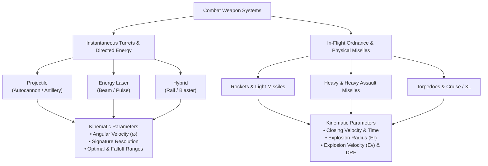
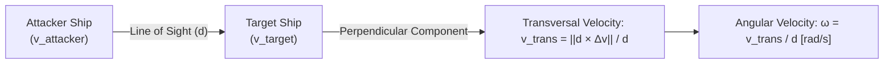
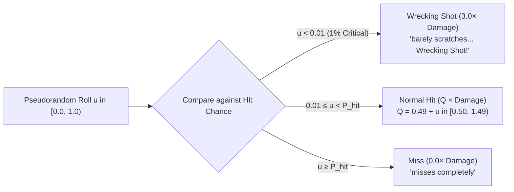
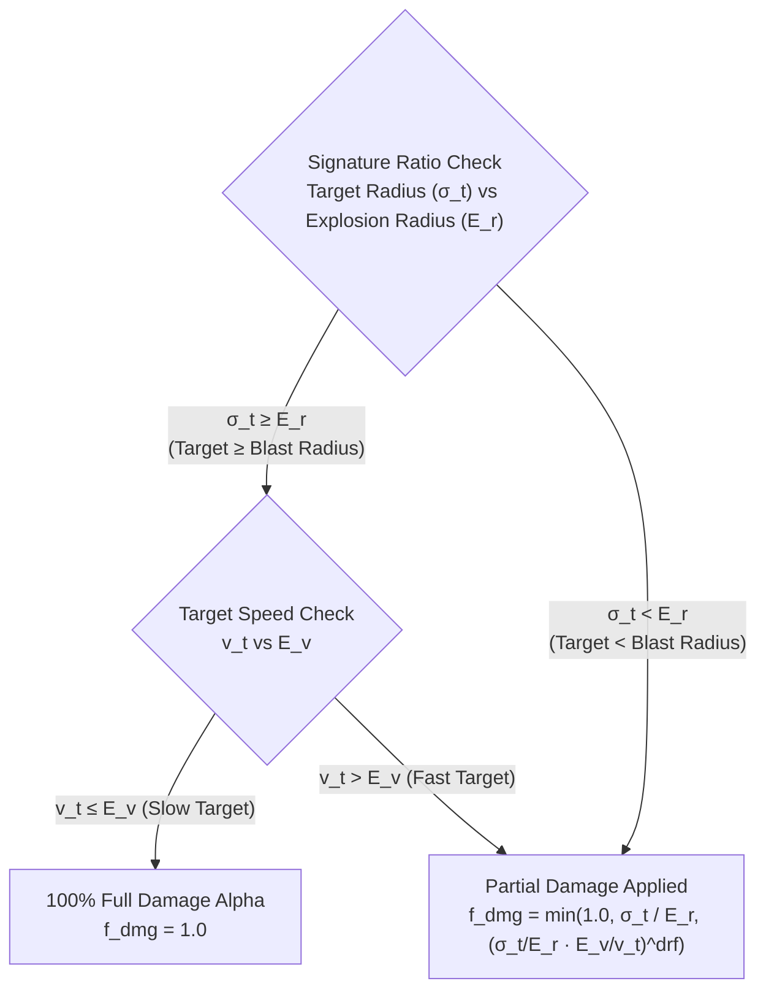
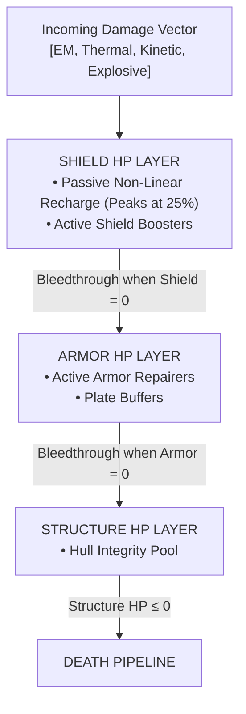
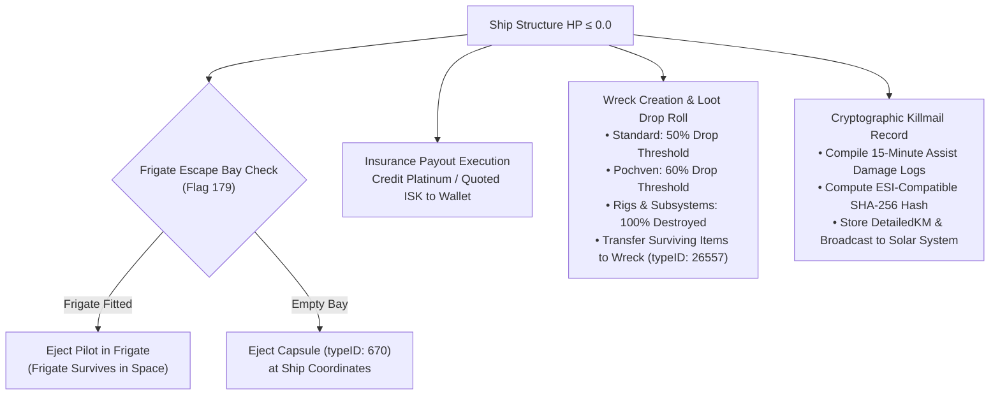
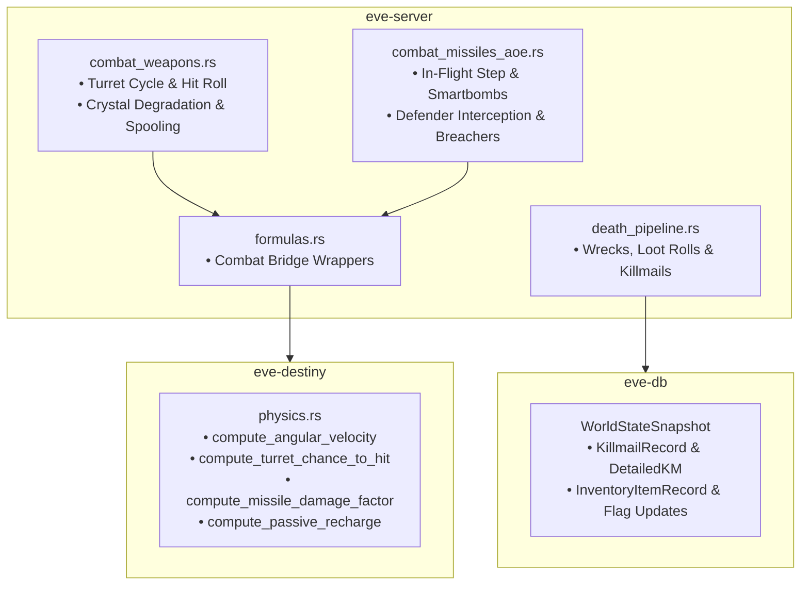
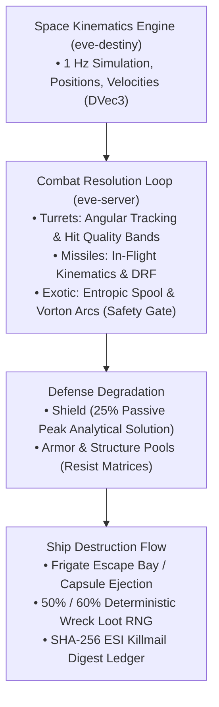

# Gunnery Tracking, Missile Kinematics & Damage Application

> **Navigation**: [EvoMu Technical Wiki](../README.md) • [Related Systems](#related-systems--cross-references)
>
> [← Back to Wiki Table of Contents](../README.md)

---

The space combat model of New Eden is defined by two fundamentally opposing ballistic paradigms: **instantaneous directional ordnance** (turrets and directed energy weapons) and **sub-warp physical projectiles** (missiles, torpedoes, and breacher pods). While turrets resolve line-of-sight kinematics instantaneously based on angular velocity, optical falloff, and signature resolution, missiles exist as physical entities in space governed by ballistic propulsion curves, closing velocities, and hydrodynamic hydrodynamic-equivalent explosion blastfronts.

In EvoMu, combat resolution is simulated with absolute fidelity to the canonical Crucible and Retribution combat updates. The simulation spans three cooperative engines: [`eve-destiny`](../../../crates/eve-destiny) for 1 Hz spatial kinematics, angular velocity, and in-flight missile integration; [`eve-dogma`](../../../crates/eve-dogma) for dynamic attribute stacking and resistance matrices; and [`eve-server`](../../../crates/eve-server) for cycle coordination, exotic weapon mechanics (Triglavian spooling and EDENCOM arc chaining), the ship destruction pipeline, and ESI-compatible cryptographic killmail generation.

---

## 1. Overview & Lore Context

In the lore of EVE Online, starship weaponry represents the pinnacle of empire, pirate, and precursor military engineering. Each weapon family embodies a distinct combat philosophy:



* **Energy Turrets (Amarr Empire):** Beam and Pulse lasers focus coherent gamma-ray and microwave beams through synthetic crystals. They consume heavy capacitor reserves but fire instantaneously without loading physical ammunition, utilizing infinite-durability T1 frequency crystals or volatile Advanced T2 crystals.
* **Projectile Weapons (Minmatar Republic):** Autocannons and Artillery Cannons fire hypervelocity depleted uranium, EMP, or explosive shells. They require no ship capacitor and feature high alpha damage and wide falloff envelopes.
* **Hybrid Turrets (Gallente Federation & Caldari State):** Railguns and Blasters accelerate superconductive plasma-jacketed slugs via linear magnetic rails, balancing capacitor draw with physical ammunition consumption.
* **Missile Systems (Caldari State & Minmatar Republic):** Self-guided ballistic ordnance spanning Rockets, Light Missiles, Heavy Assault Missiles, Heavy Missiles, Torpedoes, Cruise Missiles, and XL Torpedoes. Missiles travel as physical spatial entities, guaranteeing contact if flight range permits, with damage determined by the ratio of target velocity and radius to the explosion blastfront.
* **Precursor Entropic Disintegrators (Triglavian Collective):** Continuous meson-particle streams that spool damage consecutively up to $+150\%$ over prolonged target lock, delivering devastating single-target thermal and explosive yields.
* **Vorton Projectors (EDENCOM):** High-voltage arc projectors that discharge an initial lightning cascade against the primary target, jumping across up to 9 secondary targets within 10,000 meters.

Every ship hull is defended by three concentric defensive layers: **Shields**, **Armor**, and **Structure**. When incoming damage exhausts the final structural integrity of a hull, the ship explodes, triggering the **Death Pipeline**, spawning a salvageable wreck, executing deterministic loot drop rolls, and transmitting a cryptographically verifiable killmail to the cluster.

---

## 2. Canonical Mechanics & Precise Formulas

### 2.1 Target Locking & Scan Resolution

Before any targeted weapon can discharge, the attacking ship must acquire a targeting solution via its sensor suite. Canonical lock time is an inverse function of the ship's scan resolution and the target's signature radius:

$$t_{\text{lock}} = \frac{40\,000}{R_{\text{scan}} \cdot \text{arsinh}^2(\sigma_{\text{target}})}$$

Where:
* $R_{\text{scan}}$ is the attacker's Scan Resolution in millimeters (attribute `564`).
* $\sigma_{\text{target}}$ is the target's effective Signature Radius in meters (attribute `552`).
* In EvoMu, $t_{\text{lock}}$ is clamped to a minimum of $0.25\text{ s}$ via [`compute_lock_time_seconds`](../../../crates/eve-destiny/src/physics.rs#L902-L907).

---

### 2.2 Gunnery Tracking & Chance-to-Hit Geometry

Turrets traverse along motorized azimuth and elevation gimbals. If a target moves across the attacker's viewport faster than the turret can track, or if the target sits outside the turret's optical focusing array, shots will glance or miss entirely.



#### Relative Spatial Kinematics
Given attacker position $\vec{x}_a$, attacker velocity $\vec{v}_a$, target position $\vec{x}_t$, and target velocity $\vec{v}_t$:

$$\vec{d} = \vec{x}_t - \vec{x}_a, \quad d = \|\vec{d}\|$$

$$\Delta\vec{v} = \vec{v}_t - \vec{v}_a$$

Transversal velocity $v_{\text{trans}}$ is the component of $\Delta\vec{v}$ perpendicular to the line-of-sight vector $\vec{d}$:

$$v_{\text{trans}} = \frac{\|\vec{d} \times \Delta\vec{v}\|}{d}$$

Angular velocity $\omega$ (in radians per second) is:

$$\omega = \frac{\|\vec{d} \times \Delta\vec{v}\|}{d^2} = \frac{v_{\text{trans}}}{d}$$

If $d^2 < 1.0\text{ m}^2$, EvoMu returns $\omega = 0.0$ to prevent floating-point singularity and division-by-zero errors.

#### The Canonical Chance-to-Hit Equation
The probability $P_{\text{hit}}$ of a turret shot landing on target is:

$$P_{\text{hit}} = 0.5^{\left(\frac{\omega \cdot S_{\text{res}}}{\omega_{\text{track}} \cdot \sigma_{\text{target}}}\right)^2 + \left(\frac{\max(0, d - R_{\text{opt}})}{R_{\text{falloff}}}\right)^2}$$

Where:
* $\omega$ is the relative angular velocity $[\text{rad/s}]$.
* $S_{\text{res}}$ is the turret's Signature Resolution (attribute `620`, default $40\,000\text{ mm} = 40\text{ m}$ in Destiny units).
* $\omega_{\text{track}}$ is the turret's Tracking Speed (attribute `160`).
* $\sigma_{\text{target}}$ is the target's effective Signature Radius $[\text{m}]$, modified by active Shield Extenders, Microwarpdrives ($+500\%$), and Target Painters.
* $d$ is the distance between attacker and target $[\text{m}]$.
* $R_{\text{opt}}$ is the turret's Optimal Range (attribute `54`) $[\text{m}]$. At or within optimal range, the range penalty term is zero.
* $R_{\text{falloff}}$ is the turret's Falloff Range (attribute `158`) $[\text{m}]$. At $d = R_{\text{opt}} + R_{\text{falloff}}$ with zero angular velocity, $P_{\text{hit}} = 0.5^1 = 0.50$ (50% hit chance). At $d = R_{\text{opt}} + 2 \cdot R_{\text{falloff}}$, $P_{\text{hit}} = 0.5^4 = 0.0625$ (6.25%).

---

### 2.3 Turret Shot Resolution & Damage Quality Bands

When a turret cycle completes, the server draws a deterministic uniform pseudorandom float $u \in [0.0, 1.0)$ using the solar system RNG generator [`next_invention_roll`](../../../crates/eve-server/src/services/combat_weapons.rs#L903-L906). The shot is resolved through the canonical EVE damage quality bands:



1. **Miss ($u \ge P_{\text{hit}}$):** The shot fails to connect. Applied damage is $0.0\times$.
2. **Wrecking Shot ($u < 0.01$):** If the roll falls strictly below $0.01$ (a flat 1% chance, provided $P_{\text{hit}} > 0.01$), the shot scores a critical hit. Applied damage is scaled by exactly $3.0\times$ base damage:
   $$\vec{D}_{\text{wrecking}} = 3.0 \cdot \vec{D}_{\text{base}}$$
3. **Normal Hit ($0.01 \le u < P_{\text{hit}}$):** The shot hits with damage quality factor $Q$:
   $$Q = 0.49 + u \in [0.50, 1.49)$$
   $$\vec{D}_{\text{hit}} = Q \cdot \vec{D}_{\text{base}}$$

The quality factor $Q$ maps directly to the combat log messages displayed in the client:

| Roll Window $u$ | Quality $Q$ | Combat Log Notification | Damage Multiplier |
| :--- | :--- | :--- | :--- |
| $u \ge P_{\text{hit}}$ | $0.00$ | *"misses completely"* | $0.00\times$ |
| $0.00 \le u < 0.01$ | $3.00$ | *"barely scratches... Wrecking Shot!"* | $3.00\times$ (Critical) |
| $0.01 \le u < 0.20$ | $[0.50, 0.69)$ | *"glances off"* | $0.50\times - 0.69\times$ |
| $0.20 \le u < 0.40$ | $[0.69, 0.89)$ | *"grazes"* | $0.69\times - 0.89\times$ |
| $0.40 \le u < 0.60$ | $[0.89, 1.09)$ | *"hits"* | $0.89\times - 1.09\times$ |
| $0.60 \le u < 0.80$ | $[1.09, 1.29)$ | *"well-aimed hit"* | $1.09\times - 1.29\times$ |
| $0.80 \le u < P_{\text{hit}}$ | $[1.29, 1.49)$ | *"strikes with great force"* | $1.29\times - 1.49\times$ |

---

### 2.4 Missile Kinematics & Damage Reduction Factor (DRF)

Unlike turrets, missiles do not evaluate angular velocity or line-of-sight tracking. Instead, missiles are physical dynamic bodies subject to flight kinematics followed by hydrodynamic blast propagation.

#### 1. In-Flight Kinematics
Once launched, a missile ball travels toward the target ball:

$$\vec{x}_{\text{missile}}(t + \Delta t) = \vec{x}_{\text{missile}}(t) + \hat{d} \cdot v_{\text{missile}} \cdot \Delta t$$

Where the unit direction vector $\hat{d}$ is:

$$\hat{d} = \frac{\vec{x}_{\text{target}} - \vec{x}_{\text{missile}}}{\|\vec{x}_{\text{target}} - \vec{x}_{\text{missile}}\|}$$

Relative closing velocity accounts for target evasion:

$$v_{\text{closing}} = \max\left(0, \; v_{\text{missile}} - \max(0, \vec{v}_{\text{target}} \cdot \hat{d})\right)$$

The maximum theoretical flight range of the missile is:

$$R_{\max} = v_{\text{missile}} \cdot t_{\text{flight}}$$

If the target's distance exceeds the missile's remaining distance before its flight timer expires ($t_{\text{flight}} \le 0$), the missile runs out of fuel and detonates harmlessly in the vacuum of space, dealing $0$ damage.

#### 2. Detonation Blastfront Application (The Canonical DRF Formula)
When a missile impacts the target's hull, the applied damage factor $f_{\text{dmg}} \in [0.0, 1.0]$ is governed by the target's signature radius $\sigma_t$, target velocity $v_t$, the warhead's Explosion Radius $E_r$ (attribute `654`), Explosion Velocity $E_v$ (attribute `653`), and Damage Reduction Factor ($\text{DRF}$, attribute `1353`):

$$f_{\text{dmg}} = \min\left(1.0, \; \frac{\sigma_t}{E_r}, \; \left(\frac{\sigma_t}{E_r} \cdot \frac{E_v}{v_t}\right)^{\text{drf}}\right)$$

Where the exponent $\text{drf}$ is calculated from SDE attributes:

$$\text{drf} = \begin{cases} \text{DRF} & \text{if } \text{DRF} \le 1.0 \\ \frac{\ln(\text{DRF})}{\ln(5.5)} & \text{if } \text{DRF} > 1.0 \end{cases}$$

$$\vec{D}_{\text{applied}} = f_{\text{dmg}} \cdot \vec{D}_{\text{base}}$$



* **Large, Stationary Targets:** When $\sigma_t \ge E_r$ and $v_t \le E_v$, full damage applies:
  $$f_{\text{dmg}} = 1.0$$
  (100% full alpha applied).
* **Small, Fast Targets:** When $\sigma_t \ll E_r$ and $v_t \gg E_v$, damage is heavily mitigated by both geometric blast mismatch and kinetic wavefront dispersion.

---

### 2.5 Exotic Weapons: Spooling & Arc Chaining

#### Triglavian Entropic Disintegrators
Entropic Disintegrators deliver sustained meson-beam bombardment. On each consecutive cycle against the identical target ball, the weapon spools up:

$$M_{\text{spool}} = 1.0 + \min(N_{\text{cycles}}, N_{\max}) \cdot \beta_{\text{step}}$$

Where:
* $N_{\text{cycles}}$ is the number of consecutive completed cycles.
* $\beta_{\text{step}}$ is the per-cycle spool bonus (canonical $+5\%$ or $+10\%$, attribute `2044`).
* Maximum spool reaches up to $+150\%$ ($2.50\times$ multiplier).
* **Spool Reset Invariant:** If the attacker unlocks the target, switches targets, misses due to tracking/range, or deactivates the module, $N_{\text{cycles}}$ instantly resets to $0$.

#### EDENCOM Vorton Projectors
Vorton Projectors discharge a high-voltage primary arc that branches across space:
1. Primary target takes instantaneous damage.
2. The weapon queries the ballpark for candidate combatant balls within $R_{\text{arc}} = 10\,000\text{ m}$ of the primary target.
3. Arcs chain to up to $K \le 9$ secondary targets sorted strictly by distance to the primary target.
4. Each secondary hit applies missile damage application scaling using $E_r = 43\text{ m}$, $E_v = 190\text{ m/s}$, and $\text{drf} = 0.40$.
5. **Crimewatch Safety Interlock:** Before branching to an unflagged pilot in high-sec or low-sec, the router verifies the attacker's Crimewatch Safety Level (`Green` or `Yellow`). If an arc branch would trigger an illegal suspect or criminal flag, that specific branch is aborted.

---

### 2.6 Defense Layers, Resistances & Passive Shield Recharge

Damage is resolved sequentially across three defensive layers: **Shield $\rightarrow$ Armor $\rightarrow$ Structure**.



#### Layer Damage Calculation
For each layer, damage across the four canonical types (Electromagnetic, Thermal, Kinetic, Explosive) is reduced by the layer's resistance:

$$D_{\text{applied}} = \sum_{k \in \{\text{EM, Therm, Kin, Exp}\}} D_k \cdot (1 - \text{Resist}_k^{\text{layer}})$$

#### Passive Shield & Capacitor Recharge Curve
Passive shield and capacitor regeneration in EVE is non-linear and governed by a differential recharge equation:

$$\frac{dC}{dt} = \frac{10 \cdot C_{\max}}{\tau_{\text{recharge}}} \left(\sqrt{\frac{C(t)}{C_{\max}}} - \frac{C(t)}{C_{\max}}\right)$$

The exact closed-form analytical solution integrated over step $\Delta t$ in [`compute_passive_recharge`](../../../crates/eve-destiny/src/physics.rs#L928-L941) is:

$$C(t + \Delta t) = C_{\max} \left(1 + \left(\sqrt{\frac{C(t)}{C_{\max}}} - 1\right) e^{-\frac{5 \Delta t}{\tau_{\text{recharge}}}}\right)^2$$

* **Recharge Peak:** Taking the derivative $\frac{d}{dC}\left(\frac{dC}{dt}\right) = 0$ yields maximum regeneration at exactly **$25\%$ capacity** ($C = 0.25 \cdot C_{\max}$):
  $$\left.\frac{dC}{dt}\right|_{\text{peak}} = \frac{2.5 \cdot C_{\max}}{\tau_{\text{recharge}}}$$
* Below $25\%$, recharge falls off sharply towards $0$ as the capacitor or shield collapses.
* Above $25\%$, recharge gradually tapers off to $0$ as capacity reaches $100\%$.

---

### 2.7 Ship Destruction, Loot Drop Rolls & Killmails

When a ship's Structure HP drops to $\le 0.0$, the server invokes the **Death Pipeline** ([`execute_death_pipeline_sync_inner`](../../../crates/eve-server/src/combat/death_pipeline.rs#L48-L588)) inside an atomic database snapshot:



#### Deterministic Loot Drop Roll
For every fitted module and cargo item $i$, a pseudorandom roll is evaluated:

$$\text{roll} = \frac{\left((\text{seed}_{\text{rng}} \oplus \text{id}_{\text{item}}) \cdot 6364136223846793005\right) \gg 32}{2^{32}}$$

* **Standard Systems:** Item drops into wreck if $\text{roll} < 0.50$ (50% drop rate); destroyed if $\ge 0.50$.
* **Pochven Systems (Region `10000070`):** Item drops into wreck if $\text{roll} < 0.60$ (60% drop rate).
* **Rigs and Subsystems:** Permanently destroyed ($0\%$ drop rate).
* **Frigate Escape Bay:** If a frigate is docked in slot `179`, it bypasses the loot roll entirely, survives, and ejects the pilot into space.

#### Cryptographic Killmail Hash
Killmails are authenticated using a SHA-256 hash digest conforming to the ESI standard:

$$\text{Hash} = \text{SHA-256}\left(\text{victim-id} \,\|\, \text{attacker-id} \,\|\, \text{ship-type-id} \,\|\, \text{kill-time-unix}\right)$$

---

## 3. EvoMu Implementation Architecture

EvoMu decouples spatial physics from high-level game logic across four dedicated crates:



### 3.1 Crate & Module Breakdown

| Crate & Source File | Role & Core Responsibilities | Key Functions & Types |
| :--- | :--- | :--- |
| [`crates/eve-destiny/src/physics.rs`](../../../crates/eve-destiny/src/physics.rs) | Pure deterministic 1 Hz physics, angular velocity, turret chance-to-hit, missile DRF, and analytical passive recharge. | [`compute_angular_velocity`](../../../crates/eve-destiny/src/physics.rs#L910-L923), [`compute_turret_chance_to_hit_with_res`](../../../crates/eve-destiny/src/physics.rs#L945-L966), [`resolve_turret_shot`](../../../crates/eve-destiny/src/physics.rs#L993-L1006), [`compute_missile_damage_factor`](../../../crates/eve-destiny/src/physics.rs#L1011-L1027), [`compute_passive_recharge`](../../../crates/eve-destiny/src/physics.rs#L928-L941), [`step_missile_ball`](../../../crates/eve-destiny/src/physics.rs#L1184-L1194). |
| [`crates/eve-server/src/formulas.rs`](../../../crates/eve-server/src/formulas.rs) | Bridge wrappers exposing verified combat formulas to server RPC services. | [`turret_angular_velocity`](../../../crates/eve-server/src/formulas.rs#L300-L307), [`turret_chance_to_hit`](../../../crates/eve-server/src/formulas.rs#L309-L318), [`turret_shot_damage`](../../../crates/eve-server/src/formulas.rs#L340-L346), [`missile_damage_factor`](../../../crates/eve-server/src/formulas.rs#L349-L363), [`vorton_chain_targets`](../../../crates/eve-server/src/formulas.rs#L371-L378), [`compute_ecm_jam_chance`](../../../crates/eve-server/src/formulas.rs#L415-L430). |
| [`crates/eve-server/src/services/combat_weapons.rs`](../../../crates/eve-server/src/services/combat_weapons.rs) | Module activation handlers for turrets, ammunition consumption, crystal degradation, entropic spooling, and vorton branching. | [`handle_weapons`](../../../crates/eve-server/src/services/combat_weapons.rs#L7), [`combat_weapons_spool`](../../../crates/eve-server/src/services/combat_weapons_spool.rs), [`turret_shot_damage`](../../../crates/eve-server/src/formulas.rs#L340). |
| [`crates/eve-server/src/services/combat_missiles_aoe.rs`](../../../crates/eve-server/src/services/combat_missiles_aoe.rs) | In-flight missile state machine, closing distance integration, smartbomb EMP waves, defender missile interception, and Breacher Pod DoT. | [`step_missiles_and_breachers`](../../../crates/eve-server/src/services/combat_missiles_aoe.rs#L152-L343), [`step_combat_system`](../../../crates/eve-server/src/services/combat_missiles_aoe.rs#L143-L150), [`ActiveBreacherDot`](../../../crates/eve-server/src/services/combat_missiles_aoe.rs#L40), [`InFlightMissileState`](../../../crates/eve-server/src/services/combat_crimewatch.rs#L248). |
| [`crates/eve-server/src/combat/death_pipeline.rs`](../../../crates/eve-server/src/combat/death_pipeline.rs) | Atomic hull destruction pipeline: insurance liquidation, wreck container generation, 50%/60% loot drop rolls, and killmail generation. | [`execute_death_pipeline_sync_inner`](../../../crates/eve-server/src/combat/death_pipeline.rs#L48-L588), [`DeathPipelineResult`](../../../crates/eve-server/src/combat/death_pipeline.rs#L20). |

---

### 3.2 Key Data Structures

#### Damage Vector (`DamageVector`)
Defined in [`crates/eve-destiny/src/lib.rs`](../../../crates/eve-destiny/src/lib.rs):
```rust
#[derive(Debug, Clone, Copy, PartialEq, Default, Serialize, Deserialize)]
pub struct DamageVector {
    pub em: f64,
    pub thermal: f64,
    pub kinetic: f64,
    pub explosive: f64,
}

impl DamageVector {
    pub fn total(&self) -> f64 {
        self.em + self.thermal + self.kinetic + self.explosive
    }

    pub fn scaled(&self, factor: f64) -> Self {
        Self {
            em: self.em * factor,
            thermal: self.thermal * factor,
            kinetic: self.kinetic * factor,
            explosive: self.explosive * factor,
        }
    }
}
```

#### In-Flight Missile State (`InFlightMissileState`)
Maintained inside [`CombatRuntime`](../../../crates/eve-server/src/services/combat_crimewatch.rs):
```rust
#[derive(Debug, Clone)]
pub struct InFlightMissileState {
    pub missile_ball_id: i64,
    pub attacker_char_id: i64,
    pub attacker_ship_id: i64,
    pub target_ball_id: i64,
    pub solar_system_id: u32,
    pub missile_type_id: u32,
    pub launcher_type_id: u32,
    pub base_damage: DamageVector,
    pub max_velocity: f64,
    pub flight_time_s: f64,
    pub remaining_flight_s: f64,
    pub explosion_radius: f64,
    pub explosion_velocity: f64,
    pub drf: f64,
    pub hp: f64,
    pub destroyed: bool,
    pub expired: bool,
    pub impacted: bool,
    pub applied_damage: f64,
    pub is_breacher_pod: bool,
    pub breacher_flat_cap: f64,
    pub breacher_pct_cap: f64,
    pub breacher_dot_duration_s: f64,
}
```

---

## 4. Invariants, Security & Edge Cases

1. **Singularity Guard in Angular Velocity:** If an attacker and target occupy the identical spatial coordinates ($d^2 < 1.0\text{ m}^2$), the cross-product division by $d^2$ would produce IEEE 754 `NaN` or `+Infinity`. [`compute_angular_velocity`](../../../crates/eve-destiny/src/physics.rs#L918-L920) explicitly branches on `dist_sq < 1.0` and returns `0.0`, ensuring flawless zero-transversal head-on tracking.
2. **Target Signature Clamping:** If an un-configured entity has zero signature radius, the denominator of the tracking term angular term $\omega_{\text{track}} \cdot \sigma_t$ would collapse. EvoMu clamps signature radius to $\max(\sigma_t, 1.0)$ in all formula paths.
3. **Physical Missile Interception & Smartbomb Timing:** In-flight missiles are not abstract timers; they exist as balls registered in the solar system Ballpark. A pilot activating a Smartbomb ([`group_id == 72`](../../../crates/eve-server/src/services/combat_missiles_aoe.rs#L573-L640)) or Defender Launcher ([`group_id == 512`](../../../crates/eve-server/src/services/combat_missiles_aoe.rs#L1093-L1156)) deals physical damage to all in-flight missile balls within range. If missile $\text{HP} \le 0$, the missile is marked `destroyed = true`, removed from the ballpark, and its applied damage is zeroed before it can impact the target.
4. **Frigate Escape Bay Atomicity:** Battleships equipped with a Frigate Escape Bay (`attribute 3020 > 0.0`) must transfer the pilot directly into the docked frigate without generating an intermediate capsule ball. In [`execute_death_pipeline_sync_inner`](../../../crates/eve-server/src/combat/death_pipeline.rs#L446-L460), the escape frigate is detached from the victim ship, re-parented to the solar system, set as the character's `active_ship_id`, and marked on the killmail as survived (`qty_dropped: 0, qty_destroyed: 0, flag: 179`).
5. **Item Conservation in Wrecks:** Every item in the victim ship's inventory must be strictly accounted for during destruction. For every child item:
   $$\text{Dropped} \cup \text{Destroyed} = \text{Total Fitted and Cargo}$$
   No item may be duplicated or silently lost. Destroyed items are deleted from `snap.items` and logged to the killmail's `destroyed_items` list; dropped items are transferred to the newly spawned wreck container (`wreck_id`) with flag `InventoryFlag::Cargo`.
6. **Crimewatch Arc Safety Interlocks:** Vorton Projector arc chaining cannot be exploited to circumvent high-sec safety interlocks. When evaluating candidate secondary targets in [`combat_weapons.rs`](../../../crates/eve-server/src/services/combat_weapons.rs#L972-L1016), the engine checks whether hitting the secondary pilot would generate a suspect or criminal flag. If the attacker's safety is set to `Green` or `Yellow`, the arc skips that target and continues chaining to legitimate combatants.

---

## 5. Verification, Tests & Parity References

EvoMu's combat implementation is validated across a rigorous suite of unit, property, and end-to-end integration tests:

### 5.1 Parity Feature Attestations
* `feat:modules.turret-hybrid`, `feat:modules.turret-projectile`, `feat:modules.turret-laser`, `feat:modules.turret-hit-chance`: Turret family mechanics and hit chance formulas.
* `feat:modules.turret-precursor`: Entropic Disintegrator spooling up to $+150\%$ damage.
* `feat:modules.vorton-projector`: EDENCOM Vorton Projector secondary arc chaining.
* `feat:modules.missile-launchers`, `feat:modules.missile-application`, `feat:modules.missile-defender`: Missile flight physics and damage reduction factor equations.
* `feat:combat.smartbomb-aoe-damage`: Spherical smartbomb EMP waves and missile interception.
* `feat:combat.passive-shield-recharge-peak`: Closed-form passive shield and capacitor recharge curve peaking at $25\%$.
* `feat:combat.ship-destruction`, `feat:combat.wreck-loot`, `feat:combat.killmail-esi-hash`, `feat:ships.frigate-escape-bay`: Death pipeline, deterministic loot drop rolls, and cryptographic killmails.

### 5.2 Test Implementations

| Test Function | Source File | Focus & Assertions |
| :--- | :--- | :--- |
| [`test_turret_wrecking_shot_missile_and_proximity_decloak`](../../../crates/eve-destiny/src/tests.rs#L77-L110) | [`tests.rs`](../../../crates/eve-destiny/src/tests.rs) | Asserts $P_{\text{hit}} = 1.0$ at zero transversal within optimal range; asserts roll $u = 0.005$ triggers Wrecking Shot ($3.0\times$ multiplier). |
| [`test_c1_turret_families_hit_formula_wrecking_shots_and_crystal_degradation`](../../../crates/eve-server/tests/it/combat_weapons_wrecks.rs#L19-L250) | [`combat_weapons_wrecks.rs`](../../../crates/eve-server/tests/it/combat_weapons_wrecks.rs) | Validates Hybrid, Projectile, and Laser turret firing cycles, tracking speed against high-speed targets, and crystal wear. |
| [`test_c2_missiles_drf_smartbombs_bombs_breacher_pods_damage_layers_and_shield_recharge`](../../../crates/eve-server/tests/it/combat_weapons_wrecks.rs#L252-L564) | [`combat_weapons_wrecks.rs`](../../../crates/eve-server/tests/it/combat_weapons_wrecks.rs) | Evaluates missile DRF damage mitigation against fast frigates vs battleships, smartbomb interception of in-flight missiles, and Breacher Pod DoT. |
| [`test_c1_triglavian_entropic_spool_and_edencom_vorton_arc_and_sig_radius`](../../../crates/eve-server/tests/it/combat_weapons_wrecks_part2.rs#L141-L260) | [`combat_weapons_wrecks_part2.rs`](../../../crates/eve-server/tests/it/combat_weapons_wrecks_part2.rs) | Validates Entropic Disintegrator consecutive cycle spooling and Vorton Projector arc branching up to 9 secondary targets. |
| [`test_combat_repairs_ancillary_smartbomb_and_salvage_legality_closure`](../../../crates/eve-server/tests/it/combat_repairs_smartbomb_closure.rs#L76-L185) | [`combat_repairs_smartbomb_closure.rs`](../../../crates/eve-server/tests/it/combat_repairs_smartbomb_closure.rs) | Verifies the analytical passive shield recharge peak at exactly $25\%$ capacity ($2.5 \cdot C_{\max} / \tau$). |
| [`test_c3_death_pipeline_ship_and_pod_destruction_medical_respawn_and_implants_lost`](../../../crates/eve-server/tests/it/combat_death_crimewatch.rs#L27-L220) | [`combat_death_crimewatch.rs`](../../../crates/eve-server/tests/it/combat_death_crimewatch.rs) | Tests complete ship destruction, 50% loot drop roll, wreck creation, capsule ejection, pod death, implant loss, and killmail recording. |

---

## 6. Summary & Cross-System Synergy

Gunnery tracking, missile kinematics, and the death pipeline bind together New Eden's tactical spacetime:



The resulting implementation delivers an uncompromisingly faithful, high-performance simulation of EVE Online fleet combat, pairing mathematical rigor with the memory safety and concurrency of clean-room Rust.

---

## Related Systems & Cross-References

- [**Crimewatch & Engagement Timers**](./crimewatch_and_engagement_timers.md): Combat flag triggers, criminal status transitions, and killmail emission pipelines.
- [**Destiny Simulation Loop**](../ballpark_and_physics/destiny_simulation_loop.md): 3D spatial coordinates, angular velocity, transversal vectors, and missile flight paths.
- [**Dogma Attribute Engine**](../dogma_and_fitting/dogma_attribute_engine.md): Weapon tracking speeds, optimal and falloff curves, damage resistance profiles, and stacking penalties.
- [**NPC Combat AI & Living World Ecology**](../npcs_and_living_world/npc_combat_ai_and_ecology.md): NPC target selection, threat priority scoring, and tactical orbit maintenance.

---

[← Back to Wiki Table of Contents](../README.md)
