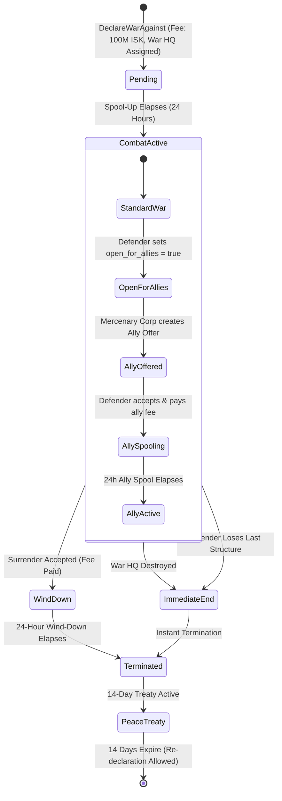

# Alliances, War Declarations & War HQ Mechanics

> **Navigation**: [EvoMu Technical Wiki](../README.md) • [Related Systems](#related-systems--cross-references)
>
> [← Back to Wiki Table of Contents](../README.md)

---

## Overview & Lore Context

In the complex geopolitical tapestry of New Eden, corporate competition frequently breaches the boundaries of market competition and covert operations, erupting into open military conflict. To maintain commercial stability across the core empires (Amarr Empire, Caldari State, Gallente Federation, and Minmatar Republic), the **Consolidated Cooperation and Relations Command (CONCORD)** enforces the **Yulai Convention**. Under interstellar law, unsanctioned aggression in High-Security space ($0.5$ to $1.0$) is met with swift, lethal intervention by CONCORD's automated police fleet.

However, CONCORD recognizes the sovereign right of corporations to resolve existential disputes through armed conflict. Under the modern **War Declaration Framework**, CONCORD sanctions legalized interstellar warfare between consenting or conflicting capsuleer entities. Within the boundaries of an officially declared war:
* CONCORD suspends its intervention protocols between the belligerents.
* Capsuleers belonging to the opposing factions may engage in lethal ship-to-ship combat anywhere in High-Security space without triggering criminal flags or security status penalties.
* Sentry guns, gate turrets, and automated orbital defenses stand down, treating belligerents as legal combatants.

```
       CONCORD High-Sec Aggression Rules
                    │
         Is Combat Sanctioned?
          ┌─────────┴─────────┐
         YES                  NO
          │                    │
   [Formal War Active]   [Criminal Aggression]
          │                    │
   CONCORD Stands Down   CONCORD Response Fleet
   Legal High-Sec PvP     Lethal Neutralization
```

### The War HQ Paradigm
Historically, corporate warfare in High-Sec was plagued by asymmetrical harassment: nomadic mercenary corporations with zero physical assets declared war on industrial organizations, blockading trade hubs and extorting ransoms with zero strategic vulnerability. 

To restore strategic equilibrium and impose physical stakes, CONCORD ratified the **War HQ Amendment**. Under this modern doctrine:
1. **Physical Anchoring Requirement:** An attacking entity can declare formal war only if it designates a specific, fully anchored and operational Upwell structure (Citadel or Engineering Complex) in High-Security space as its official **War HQ**.
2. **Defensive Victory Condition:** If the defender or its allies locate, assault, and destroy the designated War HQ (or force it into terminal unanchoring), the war **terminates immediately and unconditionally**, liberating the defenders and imposing a mandatory 14-day Peace Treaty.
3. **Structureless Immunity:** Small industrial corporations and starter entities without anchored Upwell structures in High-Sec are **war-immune** (`war_eligible = false`). High-Sec wars can only be fought between entities that maintain a physical footprint in sovereign empire space.

### Alliances: Coalitions of Sovereignty
When corporate interests scale beyond individual charters, corporations unite into **Alliances**. An Alliance represents a federated coalition of member corporations bound by a unified executive command, a mutual defense pact, shared standings, and shared sovereignty eligibility in Null-Security space. In the theater of formal warfare, all member corporations of an alliance share the alliance's state of war: an attack on the alliance or any member corporation is legally an attack on the entire coalition.

In the **EvoMu** server architecture, alliances, formal wars, War HQ enforcement, mercenary defender allies, and peace treaties are modeled with transactional integrity across the [`eve-server`](../../../crates/eve-server) and [`eve-db`](../../../crates/eve-db) crates, preserving complete parity with the EVE Online Tranquility network.

---

## Canonical Mechanics & Precise Formulas

Formal warfare and alliance governance follow strict rules, timer progressions, and fee schedules overseen by CONCORD and the corporate registry.

### 1. Alliance Formation & Governance Mechanics

#### Founding Prerequisites & Costs
To register a new alliance, the founding corporation CEO must satisfy technical and economic barriers:
* **Skill Requirement:** The founder must have trained **Empire Control** (Skill Type `3363`) to at least Level 1.
* **Corporate Independence:** The founding corporation cannot already be a member of another alliance (`corp.alliance_id.is_none()`).
* **Statutory Registration Fee:** A non-refundable registration fee of $1\,000\,000\,000\text{ ISK}$ (one billion ISK) must be debited directly from Division 1 (the Master Wallet) of the founding corporation:
  $$\text{Balance}_{\text{new}} = \text{Balance}_{\text{initial}} - 1\,000\,000\,000\text{ ISK}$$
* **Nomenclature:** The alliance name (up to 50 characters) and short ticker (3 to 5 alphanumeric characters) must be globally unique across all active and historical entities in New Eden.

```
       [ Founding CEO ]
              │ (Pays 1,000,000,000 ISK & Validates Empire Control)
              ▼
    ┌───────────────────┐
    │  Alliance Entity  │ ◄─── Global Entity ID Allocated
    └─────────┬─────────┘
              │
    ┌─────────┴─────────┐
    │ Executor Corp     │ ◄─── Founding Corp Becomes First Executor
    └───────────────────┘
```

#### The Executor Corporation & Governance
The **Executor Corporation** holds administrative sovereignty over the alliance:
* **Alliance Applications:** Corporations submit membership applications via `corpRegistry.ApplyToJoinAlliance`. Only the CEO or Directors of the Executor Corporation can approve or reject these applications (`allianceRegistry.UpdateApplication`).
* **Maturation Delay:** Upon acceptance, a joining corporation undergoes a mandatory $24\text{-hour}$ ($86\,400\text{ seconds}$) integration delay before officially joining the alliance:
  $$T_{\text{join\_effective}} = T_{\text{acceptance}} + 86\,400\text{ s}$$
* **Executive Election:** Member corporations hold democratic oversight. Any member corporation CEO/Director can cast a vote supporting a candidate member corporation for executor (`allianceRegistry.DeclareExecutorSupport`). An election succeeds when a candidate achieves an absolute majority of member corporate votes:
  $$\text{Votes}_{\text{required}} = \left\lfloor \frac{N_{\text{member\_corps}}}{2} \right\rfloor + 1$$
* **Expulsion & Withdrawal:** 
  * The Executor Corporation can kick any member corporation immediately (`allianceRegistry.KickMember`).
  * A member corporation can voluntarily withdraw (`allianceRegistry.DeleteMember`), subject to a $24\text{-hour}$ spool-off timer ($T_{\text{effective}} = T_{\text{request}} + 86\,400\text{ s}$).
  * **The War Lock Invariant:** A corporation **cannot leave or be kicked from an alliance while an active war exists** involving either the alliance or the corporation.

#### Alliance Standings & Shared Bulletins
The Executor Corporation controls global alliance contact standings (ranging from $-10.0$ Terrible Standing to $+10.0$ Excellent Standing) and alliance Message of the Day (MOTD) bulletins. These standings automatically propagate to all member pilots' overview and bracket displays in space.

---

### 2. The War Eligibility Invariant

A corporation or alliance is classified as **war-eligible** if and only if it owns at least one non-destroyed Upwell structure anchored in High-Security space:

$$\text{Eligible}(E) \iff \exists s \in \text{Structures}(E) \text{ such that } s.\text{sec\_level} \ge 0.5 \land s.\text{state} \neq \text{"Destroyed"}$$

* **Immunity Rule:** If corporation $D$ anchors zero structures in High-Sec, any war declaration targeting $D$ is rejected by CONCORD with error `DefenderNotWarEligible`.
* **Dynamic Loss of Eligibility:** If the defender loses its last anchored High-Sec structure during an ongoing war (via destruction or unanchoring), the war terminates automatically during the next synchronization tick.

---

### 3. War Declarations, Billing & The War HQ Requirement

#### Declaration Preconditions
To declare a formal war against a target entity ($D$):
1. **Player Entity Validation:** The attacking corporation ($A$) and defending entity ($D$) must both be player-run corporations or alliances. NPC entities cannot declare or receive war declarations (`NpcCorporationCannotDeclareWar`).
2. **Mutual Peace Verification:** No active Peace Treaty can exist between $A$ and $D$ (`PeaceTreatyActive`).
3. **Existing Conflict Check:** $A$ and $D$ cannot already be engaged in an active war (`AlreadyAtWar`).
4. **War HQ Designation:** The attacking entity must designate an anchored Upwell Citadel (Astrahus, Fortizar, Keepstar) or Engineering Complex (Raitaru, Azbel, Sotiyo) owned by the attacker in High-Security space as the **War HQ**.
5. **CONCORD War Fee:** A flat fee of $100\,000\,000\text{ ISK}$ (one hundred million ISK) is debited from the attacking corporation's master wallet:
   $$\text{Fee}_{\text{declaration}} = 100\,000\,000\text{ ISK}$$

```
              War Declaration Pipeline
                         │
      [Attacker Master Wallet >= 100M ISK?]
                         │ YES
      [Defender Has Anchored High-Sec Structure?]
                         │ YES
      [Attacker Owns Anchored High-Sec War HQ?]
                         │ YES
      [Active 14-Day Peace Treaty in Place?]
                         │ NO
                         ▼
        War Declared: Status = "Pending"
         Spool-Up Timer: T_start = Now + 24h
```

#### Timers & Spool-Up Progression
Once validated, the war enters the **Pending** spool-up state:

$$T_{\text{declared}} = t_0$$
$$T_{\text{combat\_start}} = t_0 + T_{\text{spool}} = t_0 + 86\,400\text{ seconds (24 Hours)}$$

During the 24-hour spool-up window:
* Belligerents receive broadcast notifications (`OnWarChanged`).
* Combat is **not yet legal** in High-Sec (`combatActive = false`). Aggression during this phase triggers standard CONCORD response.
* Both parties mobilize fleets, install implants, stage logistics, and negotiate with mercenary defender allies.

#### War HQ Vulnerability & War Termination
The designated War HQ represents the attacker's vital center of gravity:
* **The Termination Clause:** If the designated War HQ structure is destroyed ($s.\text{state} = \text{"Destroyed"}$), transitions into terminal unanchoring, or is unanchored, the war **terminates immediately and unconditionally**.
* **Immediate De-escalation:** The war's active flag is toggled to `false`, and High-Sec combat legality is instantly revoked.

---

### 4. High-Sec Combat Legality & Crimewatch Integration

When an active war passes its 24-hour spool-up timer ($t \ge T_{\text{start}}$), the combat legality engine in [`combat_crimewatch.rs`](../../../crates/eve-server/src/services/combat_crimewatch.rs#L797) authorizes direct lethal engagements between opposing pilots:

$$\text{LegalCombat}(P_{\text{att}}, P_{\text{vic}}) \iff \exists w \in \text{ActiveWars} \text{ such that } \begin{cases} t \ge w.\text{started} + 86\,400 \lor w.\text{mutual} \\ t < w.\text{finished} \\ \text{OppositeSides}(P_{\text{att}}, P_{\text{vic}}, w) \end{cases}$$

Where $\text{OppositeSides}$ evaluates whether:
1. $P_{\text{att}}$ belongs to the aggressor corporation/alliance, and $P_{\text{vic}}$ belongs to the defender corporation/alliance (or an accepted defender ally).
2. Or vice versa ($P_{\text{att}}$ is defender/ally, $P_{\text{vic}}$ is aggressor).

When `LegalCombat` is `true`:
* Weapons fire, warp scrams, and target painters do not produce a Suspect or Criminal flag.
* CONCORD police ships do not warp in or fire upon the attacker.
* Gate sentry guns do not fire on belligerents.
* Capsuleer Safety systems set to "Green" or "Yellow" permit firing upon war targets.

---

### 5. Surrenders, Treaties & Defender Allies



#### Surrender Negotiations
At any point during an active war, either the aggressor or the defender can initiate surrender talks via `warsInfoMgr.CreateSurrenderNegotiation`:
* **Surrender Terms:** The negotiating party specifies a surrender tribute fee in ISK and an optional textual message.
* **Counterparty Acceptance:** If the receiving corporation accepts the terms via `warsInfoMgr.AcceptSurrender`:
  1. The offered ISK amount is atomically transferred from the offering party's master wallet to the accepting party's master wallet:
     $$\Delta \text{Balance}_{\text{offerer}} = -\text{Tribute}_{\text{ISK}}, \quad \Delta \text{Balance}_{\text{acceptor}} = +\text{Tribute}_{\text{ISK}}$$
  2. The war enters a $24\text{-hour}$ wind-down phase ($T_{\text{end}} = t_{\text{accept}} + 86\,400\text{ s}$).
  3. A mandatory **14-day Peace Treaty** is created:
     $$T_{\text{peace\_expiry}} = T_{\text{finish}} + (14 \times 86\,400\text{ s}) = t_{\text{accept}} + 1\,296\,000\text{ seconds}$$

#### The 14-Day Peace Treaty
During the 14-day Peace Treaty window, the CONCORD War Registry refuses any war declaration between the two corporate/alliance entities:
$$\text{DeclarationAllowed}(A, D) = \begin{cases} \text{false} & \text{if } \exists \tau \in \text{Treaties} \mid \tau.\text{expiry} > t \land (A, D) \subseteq \tau.\text{parties} \\ \text{true} & \text{otherwise} \end{cases}$$

#### Defender Allies (Mercenaries)
A defending corporation or alliance under attack can seek outside military assistance:
1. **Open for Allies:** The defender toggles `open_for_allies = true` (`warsInfoMgr.SetOpenForAllies`).
2. **Ally Offer:** Third-party mercenary corporations/alliances submit ally offers (`warsInfoMgr.CreateWarAllyOffer`), detailing their contract fee in ISK.
3. **Diplomatic Relations Skill Discount:** The base cost of hiring allies is defined in the SDE by attribute 1820 ($10\,000\,000\text{ ISK}$ base). Training **Diplomatic Relations** (Skill Type `3368`) reduces this cost by $5\%$ per skill level:
   $$\text{AllyBaseCost} = 10\,000\,000 \times \left(1.0 - 0.05 \times L_{\text{DiplomaticRelations}}\right)\text{ ISK}$$
4. **Acceptance & Joining Delay:** Upon acceptance by the defender, the mercenary fee is transferred, and the ally enters a $24\text{-hour}$ spool-up period. Once $24\text{ hours}$ elapse, the ally is legally added to the defender's side of the war.

#### Mutual Wars
Two corporations or alliances can engage in honorable combat without CONCORD war declaration fees or War HQ prerequisites:
* **Invitation Protocol:** A CEO/Director sends an invitation via `mutualWarInviteMgr.SendInviteByPlayer`.
* **Exemptions:** Mutual wars require **no War HQ structure** and incur **zero ISK declaration or maintenance fees**. Combat begins immediately upon acceptance.
* **Retraction:** Either party may unilaterally retract a mutual war via `warsInfoMgr.RetractMutualWar`, triggering a standard $24\text{-hour}$ wind-down timer before the war terminates.
* **Invite Blocking:** Corporations can toggle `mutualWarInviteMgr.SetInvitesBlockedByPlayer` to suppress unsolicited war spam.

---

## EvoMu Implementation Architecture

EvoMu coordinates warfare and alliance systems through an event-driven, transactional architecture split cleanly across the database engine, MachoNet RPC services, and RESTful ESI routes.

```
                    ┌─────────────────────────┐
                    │      Client / ESI       │
                    └────────────┬────────────┘
                                 │
           ┌─────────────────────┼─────────────────────┐
           │                     │                     │
           ▼                     ▼                     ▼
┌────────────────────┐ ┌────────────────────┐ ┌────────────────────┐
│    social_wars     │ │ social_corp_fleet  │ │ combat_crimewatch  │
│  War Registry & HQ │ │ Alliance Lifecycle │ │ Legality & Sentry  │
└──────────┬─────────┘ └─────────┬──────────┘ └─────────┬──────────┘
           │                     │                     │
           └─────────────────────┼─────────────────────┘
                                 │
                                 ▼
                    ┌─────────────────────────┐
                    │   WorldStateSnapshot    │
                    │   (Atomic Transactions) │
                    └─────────────────────────┘
```

### 1. Crates & Responsibilities

* [`eve-server`](../../../crates/eve-server): Houses the MachoNet service dispatchers, lazy war synchronization tick, notification triggers, and combat legality evaluators.
* [`eve-db`](../../../crates/eve-db): Houses persistent relational schemas, snapshot structures, transactional mutate primitives (`try_with_mut_snapshot`), and wallet arithmetic.
* [`eve-sde`](../../../crates/eve-sde): Provides static Dogma attributes (e.g. `baseDefenderAllyCost` `1820`, `diplomaticRelationsAllyCostBonus` `1821`, and skill type definitions).

### 2. Primary Handlers & Dispatch Services

#### War Services: [`social_wars.rs`](../../../crates/eve-server/src/services/social_wars.rs)
War management is unified under [`handle_wars`](../../../crates/eve-server/src/services/social_wars.rs#L270), dispatching the following MachoNet services:
* `corpRegistry.DeclareWarAgainst` / `warRegistry.DeclareWarAgainst`: Validates eligibility, War HQ ownership, peace treaties, debits the 100M ISK fee, and schedules the 24-hour spool-up.
* `warsInfoMgr`:
  * `GetWarsByOwnerID`, `GetWarsByOwners`, `GetTop50`, `GetPublicWarInfo`, `GetWarsForStructure`.
  * `CreateSurrenderNegotiation`, `AcceptSurrender`, `DeclineSurrender`.
  * `SetOpenForAllies`, `CreateWarAllyOffer`, `AcceptAllyNegotiation`, `GetAllyRowsByWarID`.
  * `RetractMutualWar`.
* `peaceTreatyMgr.GetPeaceTreatiesForSession`: Enumerates active peace treaties for the session's corporation.
* `mutualWarInviteMgr`: Manages peer-to-peer mutual war invites, acceptances, and invite blocking.
* `warStatisticMgr`: Aggregates kill counts, ship loss breakdowns by group ID, and ISK value destroyed between warring factions.

#### Lazy War Synchronization: `sync_wars`
War finish timers, War HQ structural status, and defender eligibility are evaluated dynamically via [`sync_wars`](../../../crates/eve-server/src/services/social_wars.rs#L58) at the invocation of every war RPC:

```rust
// File: crates/eve-server/src/services/social_wars.rs
fn sync_wars(ctx: &ServerContext) {
    let now = ctx.now_unix();
    let needs_end = ctx.db.with_snapshot(|snap| {
        snap.wars.values().filter(|w| w.active).any(|w| {
            let meta = snap.war_state.wars.get(&w.war_id).cloned().unwrap_or_default();
            let finished = meta.finish_at_unix.is_some_and(|f| now >= f);
            let hq_lost = meta
                .war_hq_id
                .is_some_and(|hq| snap.structures.get(&hq).is_none_or(|s| s.state == "Destroyed"));
            let defender_ineligible = !w.mutual && !war_eligible(snap, w.defender_corp_id);
            finished || hq_lost || defender_ineligible
        })
    });
    if !needs_end {
        return;
    }
    // Atomically transition active flags and emit OnWarChanged broadcasts
    // ...
}
```

#### Alliance Services: [`social_corp_fleet.rs`](../../../crates/eve-server/src/services/social_corp_fleet.rs)
Alliance administration is handled within [`social_corp_fleet.rs`](../../../crates/eve-server/src/services/social_corp_fleet.rs#L310):
* `corpRegistry.CreateAlliance`: Checks unique name/ticker, validates `Empire Control` skill, debits $1\,000\,000\,000\text{ ISK}$, creates `AllianceRecord`, assigns executor, and notifies pilots.
* `corpRegistry.ApplyToJoinAlliance` & `allianceRegistry.UpdateApplication`: Manages corporation application lifecycle and 24-hour spool-up.
* `allianceRegistry.DeclareExecutorSupport`: Tallies votes and automatically transfers the executor role upon achieving an absolute majority.
* `allianceRegistry.DeleteMember` & `allianceRegistry.KickMember`: Handles voluntary departure or executive expulsion, with strict enforcement of the active war lock.

#### ESI REST Routes: [`corp_alliance_routes.rs`](../../../crates/eve-server/src/esi/corp_alliance_routes.rs) & [`sample_routes.rs`](../../../crates/eve-server/src/esi/sample_routes.rs)
* `GET /alliances/{alliance_id}/corporations`: Returns list of member corporation IDs.
* `GET /alliances/{alliance_id}/icons`: CDN URLs for alliance logos.
* `GET /wars`: Paginated list of all public war IDs.
* `GET /wars/{war_id}`: Comprehensive JSON war record including aggressor, defender, War HQ structure ID, ally listings, and kill/loss totals.
* `GET /wars/{war_id}/killmails`: Paginated killmails generated within the active war window.

---

### 3. State Storage Schemas

Persistent warfare and alliance records reside in [`eve-db`](../../../crates/eve-db/src/types.rs):

```rust
// File: crates/eve-db/src/types.rs
#[derive(Debug, Clone, PartialEq, Serialize, Deserialize)]
pub struct WarRecord {
    pub war_id: i64,
    pub aggressor_corp_id: i64,
    pub defender_corp_id: i64,
    pub mutual: bool,
    pub started_unix: u64,
    pub active: bool,
}

#[derive(Debug, Clone, PartialEq, Serialize, Deserialize)]
pub struct AllianceRecord {
    pub alliance_id: i64,
    pub name: String,
    pub short_name: String,
    pub executor_corp_id: i64,
    pub member_corp_ids: HashSet<i64>,
}
```

Extended lifecycle state and negotiations are tracked in `snap.war_state` and [`snapshot_ext.rs`](../../../crates/eve-db/src/snapshot_ext.rs):

```rust
// File: crates/eve-db/src/snapshot_ext.rs
#[derive(Debug, Clone, Default, PartialEq, Eq, Serialize, Deserialize)]
pub struct WarLifecycleMeta {
    pub declared_unix: Option<u64>,
    pub started_unix: Option<u64>,
    pub retracted_unix: Option<u64>,
    pub finished_unix: Option<u64>,
    pub open_for_allies: Option<bool>,
    pub allies: Vec<WarAllyRecord>,
}

pub struct PersistedWarMeta {
    pub war_hq_id: Option<i64>,
    pub finish_at_unix: Option<u64>,
    pub open_for_allies: bool,
}

pub struct PersistedPeaceTreaty {
    pub war_id: i64,
    pub corp_a: i64,
    pub corp_b: i64,
    pub expiry_unix: u64,
}

pub struct PersistedWarNegotiation {
    pub id: i64,
    pub war_id: i64,
    pub kind: PersistedNegKind, // Surrender or Ally
    pub from_corp: i64,
    pub isk: IskCents,
    pub message: String,
    pub status: String,        // "Offered", "Accepted", "Declined", "Retracted"
    pub effective_unix: Option<u64>,
}
```

---

## Invariants, Security & Edge Cases

### 1. Invariant: Atomic War HQ Destruction & Immediate Combat De-escalation
* **The Vulnerability:** If a War HQ is destroyed, a race condition could allow an aggressor fleet to continue destroying defender ships legally in High-Sec before the war record is updated, resulting in catastrophic loss of ships without legal recourse.
* **The Mitigation:** In [`combat_crimewatch.rs`](../../../crates/eve-server/src/services/combat_crimewatch.rs#L797), every incoming weapon activation checks whether the war is still active, whether the finish timer has elapsed, and whether the War HQ still exists. If the structure state transitions to `"Destroyed"`, `sync_wars` immediately sets `w.active = false` and writes `finish_at_unix = now`. Any subsequent shot fired in High-Sec triggers instant CONCORD intervention against the aggressor.

### 2. Invariant: Solvency Isolation & Atomic Wallet Debiting
* **The Vulnerability:** An attacking entity attempts to declare war with insufficient funds or exploits floating-point rounding to evade the 100M ISK declaration fee.
* **The Mitigation:** Wallet deductions in [`debit_corp`](../../../crates/eve-server/src/services/social_wars.rs#L34) utilize integer-based `IskCents` with checked subtraction (`checked_sub`). If Division 1 cannot cover the exact fee, the entire snapshot mutation aborts with `InsufficientFunds`, preventing partial state persistence.

### 3. Invariant: Active War Corporate Lock-In (`CannotLeaveAllianceDuringWar`)
* **The Vulnerability:** A corporation under heavy war pressure attempts to drop out of its alliance to escape fleet engagements, or an executor attempts to kick a targeted corporation to avoid losing coalition structures.
* **The Mitigation:** In [`social_corp_fleet.rs`](../../../crates/eve-server/src/services/social_corp_fleet.rs#L765), both `KickMember` and `DeleteMember` inspect `snap.wars`:
  ```rust
  if has_active_war {
      return Some(Err(BridgeRpcError {
          code: "CannotLeaveAllianceDuringWar".into(),
          message: "Member corporations cannot leave an alliance during an active war".into(),
      }));
  }
  ```
  Corporations remain locked into their military commitments until all active formal wars terminate.

### 4. Invariant: 14-Day Peace Treaty Enforcement
* **The Vulnerability:** An aggressor accepts a multi-billion ISK surrender tribute and immediately re-declares war against the victim on the following tick.
* **The Mitigation:** `DeclareWarAgainst` checks `snap.war_state.peace_treaties`. If any treaty matches `(my_corp, defender)` with `expiry_unix > now`, the RPC is immediately rejected with `PeaceTreatyActive`. The 14-day timer is immutable and cannot be bypassed.

### 5. Edge Case: Upwell Citadel Destruction During Active War
* **The Problem:** The defender owns only a single Astrahus in High-Sec. During the war, the Astrahus is destroyed.
* **The Mitigation:** On the next RPC invocation, `sync_wars` evaluates `!w.mutual && !war_eligible(snap, w.defender_corp_id)`. Finding zero active structures for the defender, the server automatically concludes the war, setting `active = false` and issuing `OnWarChanged` notifications to both corporations.

---

## Verification, Tests & Parity References

EvoMu's alliance and warfare systems are validated by extensive end-to-end integration test suites that emulate full multi-client MachoNet sessions.

### Parity Ledger Tags
* `feat:war.declare-war` — Declaration validation, fee debit, War HQ assignment, and 24h spool-up.
* `feat:war.war-hq` — Enforcement of War HQ structure existence and unconditional termination upon its destruction.
* `feat:war.war-eligibility-change` — Automatic termination when defender loses its last High-Sec structure.
* `feat:war.war-list` — Retrieval of active wars by owner ID, structure ID, and top 50 rankings.
* `feat:war.mutual-war` — Peer-to-peer invitation, zero-fee structureless combat, and unilateral retraction.
* `feat:war.peace-treaty` — Surrender terms acceptance, ISK transfer, 24h wind-down, and 14-day re-declaration ban.
* `feat:war.allies` — Defender ally opening, mercenary offers, Diplomatic Relations discounts, and 24h ally spool-up.
* `feat:war.war-stats` — Live tracking of killmail counts, destroyed group IDs, and total ISK destruction.
* `feat:alliance.create-alliance` — 1B ISK fee, unique ticker validation, and initial executor assignment.
* `feat:alliance.apply-alliance` — Application submission, executor approval, and 24h join delay.
* `feat:alliance.leave-alliance` — 24h voluntary leave delay, immediate executor kick, and active war lock enforcement.
* `feat:alliance.alliance-executor` — Democratic voting threshold ($\lfloor N/2 \rfloor + 1$) and executor migration.

### Concrete Integration Tests

| Test Function | Source File | Validated Behaviors |
| :--- | :--- | :--- |
| [`test_wars_declaration_hq_eligibility_mutual_peace_allies_and_stats`](../../../crates/eve-server/tests/it/social_alliances_wars_complete.rs#L272) | [`social_alliances_wars_complete.rs`](../../../crates/eve-server/tests/it/social_alliances_wars_complete.rs) | Comprehensive validation of the entire war lifecycle: War HQ requirement, defender eligibility checks, 100M fee, 24h spool-up, mercenary allies with Diplomatic Relations discounts, killmail stats tracking, surrender negotiations, 14-day peace treaty, and War HQ destruction termination. |
| [`test_alliances_lifecycle_governance_contacts_bulletins_and_rankings`](../../../crates/eve-server/tests/it/social_alliances_wars_complete.rs#L10) | [`social_alliances_wars_complete.rs`](../../../crates/eve-server/tests/it/social_alliances_wars_complete.rs) | Alliance creation with 1B fee, ticker uniqueness, membership application maturation, executor democratic elections, shared contacts/bulletins, and active war departure lock (`CannotLeaveAllianceDuringWar`). |
| [`test_d6_warfare_fw_sov_and_insurgency_persist_and_rollback`](../../../crates/eve-server/tests/it/d6_persistence_corp_crimewatch_warfare.rs#L507) | [`d6_persistence_corp_crimewatch_warfare.rs`](../../../crates/eve-server/tests/it/d6_persistence_corp_crimewatch_warfare.rs) | Verifies persistence of war records across SQLite storage transactions, lazy timer evaluation, and rollback durability. |
| [`rpc_declare_war_against_pipeline`](../../../crates/eve-server/tests/it/rpc_corp_registry_gov_alliances.rs#L543) | [`rpc_corp_registry_gov_alliances.rs`](../../../crates/eve-server/tests/it/rpc_corp_registry_gov_alliances.rs) | Tests MachoNet RPC dispatch for `corpRegistry.DeclareWarAgainst` and role enforcement (CEO/Director). |
| [`rpc_war_registry_bills_and_invites`](../../../crates/eve-server/tests/it/rpc_wars_bills_invites.rs#L208) | [`rpc_wars_bills_invites.rs`](../../../crates/eve-server/tests/it/rpc_wars_bills_invites.rs) | Tests `warRegistry.DeclareWarAgainst`, mutual war invitations, and corporate wallet journal accounting. |

---

## Related Systems & Cross-References

- [**Corporation Roles & Governance**](./corporation_roles_and_governance.md): Corporate governance, executive corporation role delegation, and shareholder voting.
- [**Upwell Structures Overview & Lifecycle**](../upwell_and_structures/upwell_structures_overview.md): High-sec War HQ physical structure vulnerability, reinforcement cycles, and destruction war termination.
- [**Crimewatch & Engagement Timers**](../combat_and_crimewatch/crimewatch_and_engagement_timers.md): Legal wartime aggression without CONCORD intervention or security status penalties.
- [**Sovereignty Hubs & Equinox Skyhooks**](../sovereignty_and_faction_warfare/sovereignty_hubs_and_equinox_skyhooks.md): Alliance sovereignty claims and ADM defensive multipliers in null-sec.

---

[← Back to Wiki Table of Contents](../README.md)
