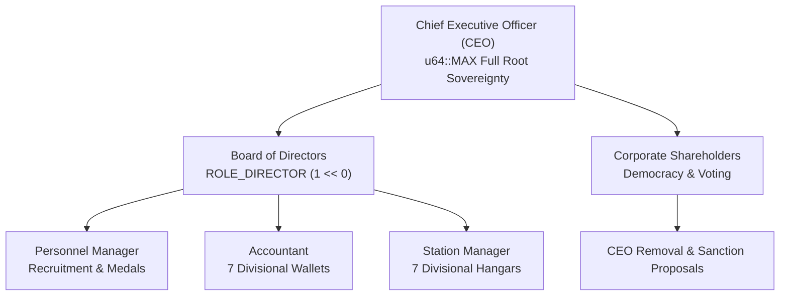
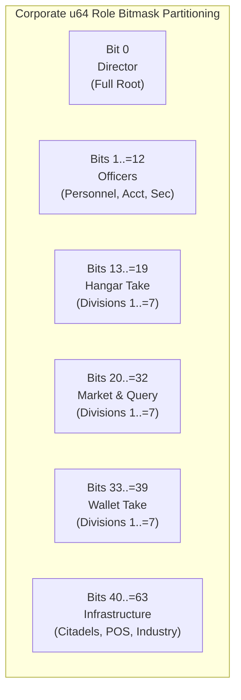
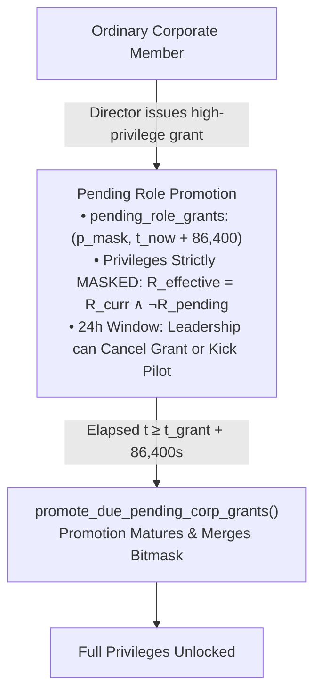
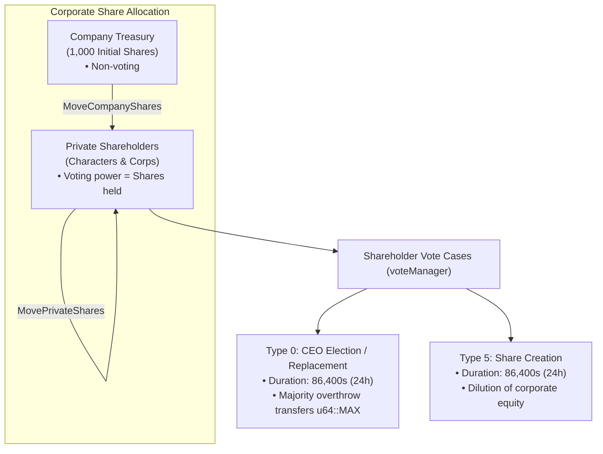
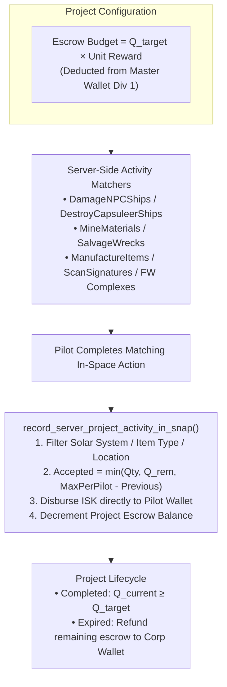
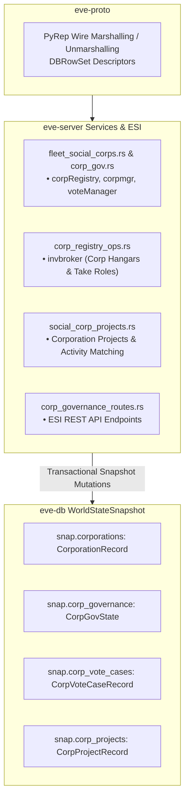

# Corporation Roles, Governance & Asset Management

> **Navigation**: [EvoMu Technical Wiki](../README.md) • [Related Systems](#related-systems--cross-references)
>
> [← Back to Wiki Table of Contents](../README.md)

---

## Overview & Lore Context

In the sprawling expanse of New Eden, the **Corporation** serves as the foundational collective and legal entity governing capsuleer life. While lone capsuleers possess godlike authority over their personal vessels, the grand endeavors of New Eden—such as claiming territorial sovereignty, anchoring planetary-scale Upwell citadels, fueling industrial assembly lines, and waging interstellar fleet campaigns—require collective organization, shared capital, and hierarchical authority.

From the state-sanctioned megacorporations of the Caldari Megacorporate Council to the fiercely independent capsuleer syndicates of null-security space, corporations operate as chartered sovereign institutions. A corporation possesses an autonomous legal identity, sovereign assets, divisional accounting vaults, automated manufacturing arrays, and collective military standings.



However, corporate power within New Eden is perpetually contested. Betrayal, corporate espionage, and unauthorized asset liquidation represent existential threats to any capsuleer organization. To maintain order, the corporate governance framework balances centralized executive dictatorship with shareholder democracy, protected by hard real-time cryptographic delays on high-privilege access promotions.

In [`EvoMu`](../../../), the corporation system is implemented with clean-room precision across the [`eve-server`](../../../crates/eve-server), [`eve-db`](../../../crates/eve-db), and [`eve-proto`](../../../crates/eve-proto) crates. The architecture accurately simulates the entire lifecycle of corporate existence: dynamic genesis fees, 64-bit permission role bitmasks, 7-division inventory and wallet compartmentalization, shareholder voting and CEO replacement protocols, automated player project bounties, and diplomatic alliance standings.

---

## Canonical Mechanics & Formulas

### 1. Corporation Genesis & Charter Creation

Founding a capsuleer corporation requires statutory capital, formal charter credentials, and certified executive training recognized by the Empires:

* **Charter Registration Fee:** Founding a corporation requires an upfront cash payment deducted directly from the founder's personal wallet balance:
  $$\text{Fee}_{\text{genesis}} = 1,599,800 \text{ ISK} \quad (\approx 1.6\text{M ISK})$$
* **Skill Prerequisites:** The founder must have trained the skill **Corporation Management** ([`typeID: 3363`](../../../crates/eve-sde/)) to at least Level 1.
* **Corporate Identity Validation:**
  * **Corporation Name:** Must be unique across all existing NPC and player corporations (case-insensitive string match), between 4 and 50 characters, and pass sanitization against reserved faction keywords.
  * **Corporate Ticker:** A unique 3 to 5 alphanumeric character abbreviation (e.g., `[EVOMU]`). Once registered, no other corporate entity may adopt the same ticker.
* **Session Change Guard:** The founder cannot be undergoing an active session transition (docking, undocking, jumping, or ship switching). A 10-second session-change timer (`"corp_change"`) is enforced during registration.
* **Initial Capital & Share Allocations:**
  * Initial Master Wallet Balance: $0.00\text{ ISK}$.
  * Initial Share Capital: $1,000\text{ shares}$ are minted and assigned to the corporate treasury (`company_shares`).
  * Corporate Divisions: 7 corporate hangars and 7 corporate wallet divisions are provisioned by default.
  * Communications: An encrypted corporate chat channel `corpid:{corporationID}` is automatically instantiated, granting operator permissions to the founder.

### 2. Member Caps & Executive Leadership Capacities

A corporation's maximum allowable headcount is strictly constrained by the CEO's leadership training. The member limit formula aggregates the bonuses from the Static Data Export (SDE) dogma attribute `191` (`maxCorporationMembersBonus`):

$$\text{Capacity}_{\text{corp}} = \sum_{s \in \text{LeadershipSkills}} \left( \text{Bonus}_{191}(s) \times \text{Level}(s) \right)$$

| Skill Name | Type ID | Dogma Attribute 191 Bonus | Max Skill Level | Cumulative Maximum Members |
| :--- | :--- | :--- | :--- | :--- |
| **Corporation Management** | `3363` | $+20\text{ members / level}$ | Level V | $100\text{ members}$ |
| **Megacorp Management** | `3368` | $+100\text{ members / level}$ | Level V | $500\text{ members}$ |
| **Empire Control** | `3364` | $+400\text{ members / level}$ | Level V | $2,000\text{ members}$ |

$$\text{Total Headcount Limit} = 20 \cdot L_{\text{CorpMgmt}} + 100 \cdot L_{\text{Megacorp}} + 400 \cdot L_{\text{EmpireControl}}$$

When a corporation reaches its member limit, incoming recruit applications cannot be accepted, and new invitation dispatches are rejected with `CorpMemberLimitReached`.

### 3. Corporate Taxation

Corporations enforce an automated tax rate on bounties and mission cash rewards earned by members:
$$\text{Tax Rate} \in [0.00, 1.00] \quad (0\% \text{ to } 100\%)$$

Whenever a pilot receives an NPC pirate bounty tick or agent mission payment:
$$\text{Tax Amount} = \left\lfloor \text{Gross ISK} \times \text{Tax Rate} \right\rfloor$$
$$\text{Net Pilot ISK} = \text{Gross ISK} - \text{Tax Amount}$$

The deducted `Tax Amount` is immediately transferred to the corporation's **Master Wallet (Division 1)** with a corresponding journal ledger entry of type `"CorporationTax"`.

### 4. Role Hierarchy & Permission Bitmasks

Authority within a corporation is encoded via a 64-bit unsigned bitmask (`u64`). Roles are checked using bitwise operations:

$$\text{Authorized}(R_{\text{member}}, R_{\text{required}}) \iff (R_{\text{member}} = 2^{64}-1) \lor (R_{\text{member}} \land R_{\text{DIRECTOR}} \neq 0) \lor (R_{\text{member}} \land R_{\text{required}} = R_{\text{required}})$$



The canonical role bit definitions are mapped as follows:

| Role Name | Bit Position | Hexadecimal Mask | Functional Scope |
| :--- | :--- | :--- | :--- |
| **Director** | `1 << 0` | `0x0000000000000001` | Omnipotent root permissions; acts as surrogate CEO except for share dilution and CEO resignation. |
| **Project Manager** | `1 << 6` | `0x0000000000000040` | Create, edit, and fund Corporation Projects and Freelance Goals. |
| **Personnel Manager** | `1 << 7` | `0x0000000000000080` | Review applications, invite recruits, kick members, issue corporate medals. |
| **Accountant** | `1 << 8` | `0x0000000000000100` | Full view of all wallet division balances, transaction history, and dividend dispatch. |
| **Security Officer** | `1 << 9` | `0x0000000000000200` | Starbase POS defensive structures, password configurations, and combat logging. |
| **Factory Manager** | `1 << 10` | `0x0000000000000400` | Industry jobs, blueprint locking, corporate manufacturing installations. |
| **Station Manager** | `1 << 11` | `0x0000000000000800` | Upwell structure anchoring, unanchoring, service module fitting, profile ACLs. |
| **Auditor** | `1 << 12` | `0x0000000000001000` | Inspect station container logs, locked items, and historical employment records. |
| **Hangar Query 1..7**| `1 << (13..=19)` | `0x00000000000FE000` | View items located in Corporate Hangar Divisions 1 through 7. |
| **Hangar Take 1..7** | `1 << (20..=26)` | `0x0000000007F00000` | Withdraw items located in Corporate Hangar Divisions 1 through 7. |
| **Wallet Take 1..7** | `1 << (27..=33)` | `0x00000003F8000000` | Withdraw or transfer ISK from Corporate Wallet Divisions 1 through 7. |
| **Diplomat** | `1 << 34` | `0x0000000400000000` | Manage corp/alliance contact standings, diplomatic treaties, and surrender offers. |
| **Starbase Operator**| `1 << 40` | `0x0000010000000000` | Online, offline, and anchor legacy control towers and starbase modules. |
| **Config Equipment** | `1 << 41` | `0x0000020000000000` | Configure industrial facilities and laboratory installations. |
| **Rent Office** | `1 << 49` | `0x0002000000000000` | Rent or unrent corporate offices at NPC stations and Upwell structures. |
| **Junior Accountant**| `1 << 52` | `0x0010000000000000` | View wallet balances without transfer or payout capabilities. |
| **Starbase Config** | `1 << 53` | `0x0020000000000000` | Modify starbase defense matrix, friendly fire settings, and tower forcefields. |
| **Contract Manager** | `1 << 56` | `0x0100000000000000` | Create and accept formal corporate contracts (auctions, couriers, exchanges). |

#### Scoped Roles & Titles
Roles can be granted globally, or scoped to specific operating locations:
* **Roles at HQ (`roles_at_hq`):** Applicable only while stationed at the designated corporate headquarters.
* **Roles at Base (`roles_at_base`):** Applicable while stationed at the pilot's assigned Base of Operations.
* **Roles at Other (`roles_at_other`):** Applicable across all other secondary offices and outposts.
* **Corporate Titles:** Up to 16 named corporate titles (`title_id: 1..=16`) can bundle role bitmasks. Assigning a title to a character automatically confers the corresponding role set.

---

### 5. The 24-Hour Role Grant Delay Invariant

> [!IMPORTANT]
> To mitigate corporate infiltration and malicious asset stripping ("corp theft"), EVE Online enforces a **mandatory 24-hour delay** on high-privilege role assignments.

When the CEO or a Director grants high-privilege roles—specifically **Director**, **Accountant**, **Station Manager**, or **Division Query/Take** rights (`HANGAR_DIV_MASK`):

$$t_{\text{effective}} = t_{\text{grant}} + 86,400\text{ seconds} \quad (24\text{ hours})$$



1. **Pending Holding State:** The role bitmask is appended to `pending_role_grants` (or `pending_scoped_role_grants`), recording the exact maturation timestamp $t_{\text{effective}}$.
2. **Masked Effective Privilege:** During the 24-hour interval, server-side permission evaluations strictly mask out pending bits:
   $$R_{\text{effective}} = R_{\text{current}} \land \neg R_{\text{pending}}$$
3. **Audit Window:** The corporation's leadership has 24 hours to observe the pending promotion in corporate audit logs. If an unauthorized promotion was initiated by a compromised account, the CEO can revoke the pending grant or expel the member before the roles mature.
4. **Immediate Revocation Invariant:** Role **removals** take effect **instantaneously** ($0\text{ seconds}$ delay) and log a timestamp to prevent race conditions.
5. **Friendly Fire Toggle:** Changing a corporation's Friendly Fire legal policy also requires an identical 24-hour delay before the legal flag flips.

---

### 6. Divisional Asset Management (Hangars & Wallets)

#### Corporate Hangars (Flags 116–122)
Corporate assets stored at an office are segmented into 7 discrete hangar divisions mapped to canonical inventory flags:

| Division Index | Canonical Flag Name | Inventory Flag ID | Default Division Name |
| :---: | :---: | :---: | :---: |
| Division 1 | `CorpSAG1` | `116` | `"1st Division"` |
| Division 2 | `CorpSAG2` | `117` | `"2nd Division"` |
| Division 3 | `CorpSAG3` | `118` | `"3rd Division"` |
| Division 4 | `CorpSAG4` | `119` | `"4th Division"` |
| Division 5 | `CorpSAG5` | `120` | `"5th Division"` |
| Division 6 | `CorpSAG6` | `121` | `"6th Division"` |
| Division 7 | `CorpSAG7` | `122` | `"7th Division"` |

* **Division Renaming:** The CEO or any Director can assign custom strings to any division.
* **Blueprint Locking:** High-value Blueprint Originals (BPOs) can be set to `InventoryFlag::Locked`. Locked blueprints can be used in manufacturing jobs directly from the hangar, but cannot be physically moved or repackaged without unlocking authorization.
* **Container Auditing:** Station containers placed inside corporate hangars record access logs, tracking pilot character IDs, timestamps, item types, quantities, and password changes.

#### Corporate Wallets (Divisions 1–7)
Corporate liquid capital is segregated across 7 wallet accounts:
* **Division 1 (Master Wallet):** The primary operating account. Receives tax revenue, bounty payouts, and contract disbursements, and funds corporation project escrows.
* **Divisions 2–7 (Secondary Wallets):** Operational partitions typically allocated for Ship Replacement Programs (SRP), fuel logistics, industrial purchases, or capital ship procurement.
* **Inter-Division Transfers:** Transfers between divisions require `ROLE_DIRECTOR`, `ROLE_ACCOUNTANT`, or `ROLE_ACCOUNT_CAN_TAKE` for the originating division. The operation executes transactionally, rejecting any balance reduction that would result in an overdraft:
  $$\text{Balance}_{\text{src}}' = \text{Balance}_{\text{src}} - \text{Amount} \ge 0$$
  $$\text{Balance}_{\text{dst}}' = \text{Balance}_{\text{dst}} + \text{Amount}$$

---

### 7. Shareholding, Governance & Voting Mechanisms

Corporations in New Eden are joint-stock entities. Governance, leadership succession, and capital restructuring are executed through shareholder democracy:



#### Share Structure & Transfers
* **Corporate Treasury:** Shares held by the corporate entity itself cannot cast votes in shareholder elections.
* **`MoveCompanyShares`:** Executive transfer of shares from corporate treasury to a designated shareholder. Requires CEO or Director authority.
* **`MovePrivateShares`:** Peer-to-peer transfer of private shares between characters or corporations.

#### Dividend Payouts
The CEO or Director can disburse funds from any corporate wallet division to shareholders or general members:
* **Per-Share Dividend Distribution:**
  $$\text{Payout}(p) = \left\lfloor \frac{\text{Total ISK} \times S_p}{S_{\text{total private}}} \right\rfloor$$
  Where $S_p$ is the share count held by pilot $p$, and $S_{\text{total private}}$ excludes treasury shares.
* **Per-Member Equal Distribution:**
  $$\text{Payout}(m) = \left\lfloor \frac{\text{Total ISK}}{N_{\text{members}}} \right\rfloor$$

#### Sanctioned Voting Cases (`voteManager`)
Any shareholder holding corporate shares may initiate a formal corporate proposal:

| Vote Type ID | Canonical Vote Subject | Parameter Scope | Execution Effect |
| :---: | :---: | :---: | :---: |
| `0` | **CEO Election / Replacement** | `candidate_id` | Overthrows current CEO, transfers root `u64::MAX` roles to the elected candidate. |
| `1` | **War Declaration** | `target_id` | Declares formal corporation war against an entity. |
| `2` | **Corporation Name Change**| `new_name_string` | Alters the registered legal name of the entity. |
| `5` | **Sanctioned Share Creation** | `share_count` | Mints new corporate shares into company treasury (diluting existing stock). |
| `6` | **General Sanctioned Action**| `action_id` | Executes general corporate charters or structure transfers. |

#### Voting Lifecycle & Quorum Evaluation
1. **Proposal Initiation:** Recorded with `start_ts = t_{\text{now}}` and `end_ts = t_{\text{now}} + 86,400` (canonical 24-hour voting window).
2. **Ballot Weighting:** When a ballot is submitted via `InsertVote`, the ballot weight is locked to the voter's exact shareholding balance at the moment of voting:
   $$W_{\text{ballot}}(p) = S_p$$
3. **Winner Determination (`eval_vote_case_winner`):**
   * For binary votes (Yes / No):
     $$\text{Passed} \iff \sum W_{\text{yes}} > \sum W_{\text{no}} \quad \text{and} \quad \sum W_{\text{yes}} > 0$$
   * For multi-option elections (CEO succession):
     $$\text{Winner} = \arg\max_{o \in \text{Options}} \sum W_o \quad \text{subject to} \quad W_{\text{winner}} > W_{\text{runner-up}}$$
4. **Action Activation (`ActivateSanctionedAction`):** Once $t \ge \text{end-ts}$, any Director can activate the passed proposal. For CEO elections, activation transfers the CEO mantle immediately, stripping the deposed CEO of root permissions.

---

### 8. Corporation Projects (V24.01 Goal Framework)

Corporation Projects allow leadership to configure decentralized, automated incentives for pilots. Leadership funds a dedicated project escrow, and the server tracks pilot activities, disbursing rewards upon completion of milestone objectives:

$$\text{Escrow Budget} = Q_{\text{target}} \times \text{Payout}_{\text{unit}}$$



* **13 Tracked Contribution Archetypes:**
  `DamageNPCShips`, `DestroyNPCShips`, `DestroyCapsuleerShips`, `MineMaterials`, `ManufactureItems`, `CaptureFWComplexes`, `DefendFWComplexes`, `DamageShips`, `RemoteRepairShield`, `RemoteRepairArmor`, `ScanSignatures`, `SalvageWrecks`, `EarnLoyaltyPoints`.
* **Automated ISK Escrow & Instant Payouts:** Funds are deducted from the corporate wallet division at creation. When a pilot fulfills a matcher, the server transfers ISK directly to the pilot's wallet via a `corporation_project_reward` journal entry.
* **Expiry & Escrow Sweeping:** Unfinished projects that exceed their expiration date are swept by the background loop (`sweep_expired_corp_projects`). The remaining escrow is returned to the corporate wallet division via a `CorporationProjectRefund` journal entry.

---

### 9. Diplomatic Standings & Alliances

#### Alliances
Corporations can coalesce into an **Alliance**—the highest level of capsuleer political sovereignty:
* **Creation Requirements:** Founding an alliance requires $100,000,000\text{ ISK}$ ($100\text{M ISK}$) registration fee and a minimum of 2 participating corporations.
* **Executor Corporation:** One member corporation is designated as the Alliance Executor, possessing sole authority to accept new member corporations, declare alliance-level wars, and manage alliance sovereignty hubs.

#### Contact Standings
Entities maintain diplomatic standing lists toward other pilots, corporations, and alliances:
$$\text{Standing} \in [-10.0, +10.0]$$

| Range | Visual Indicator | Status Meaning |
| :---: | :---: | :---: |
| $+10.0$ | Light Blue | **Excellent Standing** (Full Alliance / Coalition Ally) |
| $+5.0$ | Dark Blue | **Good Standing** (Friendly Non-Aggression Pact) |
| $0.0$ | Neutral Grey | **Neutral Standing** (Unknown / Non-Aligned) |
| $-5.0$ | Orange | **Bad Standing** (Hostile / Competitor) |
| $-10.0$ | Red | **Terrible Standing** (Primary Enemy / Shoot on Sight) |

When resolving diplomatic relations between two capsuleers on grid, standing evaluations follow a strict **precedence cascade**:
$$\text{Effective Standing} = \text{FirstNonNull}\big(\text{Personal Standing}, \; \text{Corporation Standing}, \; \text{Alliance Standing}, \; 0.0\big)$$

---

## EvoMu Implementation Architecture

EvoMu implements corporate governance via a clean-room Rust architecture spanning domain crates, MachoNet RPC dispatchers, transactional snapshots, and ESI OpenAPI endpoints.



### 1. Crates Involved

* [`eve-server`](../../../crates/eve-server): Houses the service routers, RPC dispatchers, role verification engines, in-space project trackers, and ESI HTTP endpoints.
* [`eve-db`](../../../crates/eve-db): Defines durable database entities, transactional snapshot state (`WorldStateSnapshot`), wallet journals, and SQLite storage routines.
* [`eve-proto`](../../../crates/eve-proto): Provides binary marshal and unmarshal codecs for Python representations (`PyRep`), rowset encodings, and MachoNet RPC transport envelopes.
* [`eve-sde`](../../../crates/eve-sde): Static Data Export parser supplying dogma attribute definitions (attribute `191` member bonuses) and default NPC corporation profiles.

---

### 2. Primary Handlers & Services

#### Core Services Dispatch: [`fleet_social_corps.rs`](../../../crates/eve-server/src/services/fleet_social_corps.rs)
Intercepts MachoNet RPC calls addressed to corporate services:
* [`handle_corps`](../../../crates/eve-server/src/services/fleet_social_corps.rs#L251): Routes methods for `corpRegistry`, `corpmgr`, `corporationSvc`, `corpStationMgr`, `allianceRegistry`, and `voteManager`.
* [`promote_due_pending_corp_grants`](../../../crates/eve-server/src/services/fleet_social_corps.rs#L24): Invoked on corporate state access. Scans `pending_role_grants` and `pending_scoped_role_grants`. If `ctx.now_unix() >= eff`, it removes the pending record, merges the bitmask into `corp.member_roles` and `corp_role_assignments`, decodes roles into human-readable strings, and stores them in `snap.char_scoped_roles`.
* [`compute_corp_member_limit`](../../../crates/eve-server/src/services/fleet_social_corps.rs#L106): Evaluates CEO skill levels against SDE attribute `191` to enforce recruitment limits.

#### Governance & Shares: [`fleet_social_corp_gov.rs`](../../../crates/eve-server/src/services/fleet_social_corp_gov.rs)
* [`handle_add_corporation`](../../../crates/eve-server/src/services/fleet_social_corp_gov.rs#L64): Executes corporation founding. Validates name/ticker uniqueness, deducts the $1,599,800\text{ ISK}$ registration fee, creates 7 wallet divisions, mints 1,000 initial shares, instantiates the corporate chat channel, and emits `OnCorporationChanged`.
* [`handle_corp_gov`](../../../crates/eve-server/src/services/fleet_social_corp_gov.rs#L305):
  * `"MoveCompanyShares"` & `"MovePrivateShares"`: Validates transfer quantity and share ownership, executes share balance deltas, and dispatches `OnShareChange` notifications.
  * `"PayoutDividend"`: Computes pro-rata share distributions or equal member splits, verifies division balance sufficiency, and generates `WalletJournalEntry` audit records.
  * `"UpdateTitle"` & `"DeleteTitle"`: Configures 1-based corporate titles and drops roles instantaneously upon deletion.
  * `"ResignFromCEO"`: Replaces CEO and assigns $2^{64}-1$ (`u64::MAX`) roles to the designated successor.
  * `"ActivateSanctionedAction"`: Evaluates voting outcomes via `eval_vote_case_winner` and applies passed proposals.

#### Hangar Access Interceptor: [`corp_registry_ops.rs`](../../../crates/eve-server/src/services/corp_registry_ops.rs)
* [`handle_corp_hangar_invbroker`](../../../crates/eve-server/src/services/corp_registry_ops.rs#L48): Intercepts `invbroker.List` and `invbroker.Add` targeting flags `116..=122`. Enforces division query and take roles, respecting 24-hour maturation delays.

#### Voting Cases & Options: [`fleet_social_corp_tail.rs`](../../../crates/eve-server/src/services/fleet_social_corp_tail.rs)
* [`handle_insert_vote_case`](../../../crates/eve-server/src/services/fleet_social_corp_tail.rs#L941): Validates proposal parameters, verifies member or shareholder standing, constructs ballot options, and inserts `CorpVoteCaseRecord` with `end_ts = now + 86_400`.

#### Corporation Projects Engine: [`social_corp_projects.rs`](../../../crates/eve-server/src/services/social_corp_projects.rs)
* [`effective_corp_member_roles`](../../../crates/eve-server/src/services/social_corp_projects.rs#L27): Core role resolution function. Merges direct roles, assignments, and titles, while masking out unmatured grants matching `HANGAR_DIV_MASK`.
* [`record_server_project_activity_in_snap`](../../../crates/eve-server/src/services/social_corp_projects.rs#L178): Invoked across combat, mining, manufacturing, and exploration events. Increments project progress, transfers reward ISK to the pilot, decrements escrow, and marks completed goals.
* [`sweep_expired_corp_projects`](../../../crates/eve-server/src/services/social_corp_projects.rs#L163): Identifies expired projects, returns escrow to the originating division, and emits `OnGoalDeleted`.

#### Medals & Bulletins: [`corp_medals_bulletins.rs`](../../../crates/eve-server/src/services/corp_medals_bulletins.rs)
* [`handle_corp_medals`](../../../crates/eve-server/src/services/corp_medals_bulletins.rs#L10): Handles `CreateMedal` (deducting the $5,000,000\text{ ISK}$ medal creation fee) and `GiveMedalToCharacters`.

#### ESI REST API: [`corp_governance_routes.rs`](../../../crates/eve-server/src/esi/corp_governance_routes.rs)
* [`dispatch_corp_governance_route`](../../../crates/eve-server/src/esi/corp_governance_routes.rs#L54): Implements OpenAPI endpoints:
  * `GET /corporations/{corporation_id}/divisions`: Returns 7 hangar and wallet division names.
  * `GET /corporations/{corporation_id}/members/limit`: Computes member limits via dogma attribute 191.
  * `GET /corporations/{corporation_id}/roles`: Returns member role assignments decoded via [`decode_corp_roles`](../../../crates/eve-server/src/esi/corp_governance_routes.rs#L24).
  * `GET /corporations/{corporation_id}/roles/history`: Historical audit log of role assignments and revocations.
  * `GET /corporations/{corporation_id}/shareholders`: Shareholder balances and entity classifications.
  * `GET /corporations/{corporation_id}/projects`: Live projects, progress counters, and contributors.

---

### 3. Database Schemas & Snapshot Data Structures

All persistent corporate state is managed inside [`eve_db::WorldStateSnapshot`](../../../crates/eve-db/src/snapshot_ext.rs):

```rust
// Defined in crates/eve-db/src/types.rs
pub struct CorporationRecord {
    pub corporation_id: i64,
    pub name: String,
    pub ticker: String,
    pub ceo_id: i64,
    pub alliance_id: Option<i64>,
    pub tax_rate: f64,
    pub master_wallet: IskCents,
    pub members: HashSet<i64>,
    pub member_roles: HashMap<i64, u64>,
    pub applications: HashMap<i64, CorpApplicationRecord>,
    pub wallet_divisions: Vec<CorpWalletDivisionRecord>,
    pub description: String,
    pub url: String,
    pub hq_station_id: Option<i64>,
}

// Defined in crates/eve-db/src/d6_types.rs
pub struct CorpGovState {
    pub role_audit_log: Vec<(i64, i64, u64, u64, u64)>,
    pub pending_role_grants: HashMap<i64, (u64, u64)>,          // (pilot_id -> (role_mask, effective_unix))
    pub pending_scoped_role_grants: HashMap<i64, (u64, u64, u64, u64)>, // (pilot_id -> (hq, base, other, eff))
    pub pending_auto_kicks: HashMap<i64, u64>,
    pub titles: HashMap<i64, (String, u64)>,                    // (title_id -> (name, roles_mask))
    pub member_titles: HashMap<i64, u64>,                       // (pilot_id -> title_bitmask)
    pub shares: HashMap<i64, i64>,                              // (shareholder_id -> share_count)
    pub company_shares: i64,
    pub friendly_fire_legal: bool,
    pub pending_friendly_fire: Option<(bool, u64)>,
    pub medals: Vec<(i64, String, String, i64, u64)>,
    pub recruitment_ads: Vec<(i64, String, String, u64, i64)>,
    pub contacts: HashMap<i64, (f64, u64)>,                     // (contact_id -> (standing, label_mask))
}

// Defined in crates/eve-db/src/snapshot_ext.rs
pub struct CorpVoteCaseRecord {
    pub case_id: i64,
    pub corporation_id: i64,
    pub vote_type: i64,
    pub text: String,
    pub description: String,
    pub parameter: i64,
    pub start_ts: u64,
    pub end_ts: u64,
    pub executed: bool,
    pub options: Vec<(i64, String, i64)>,
}

pub struct CorpVoteBallotRecord {
    pub case_id: i64,
    pub voter_id: i64,
    pub option_id: i64,
    pub weight: i64,
    pub voted_at_unix: u64,
}

pub struct CorpProjectRecord {
    pub project_id: i64,
    pub corporation_id: i64,
    pub name: String,
    pub target_quantity: u64,
    pub current_quantity: u64,
    pub isk_per_unit: IskCents,
    pub escrow_remaining: IskCents,
}
```

---

## Invariants, Security & Edge Cases

### 1. Invariant: 24-Hour Role Delay Persistence Across Restarts
* **Vulnerability:** If role grant delays are tracked solely in ephemeral timers, an attacker could trigger a server restart or exploit node handoffs to cause pending roles to mature prematurely.
* **Mitigation:** EvoMu persists `pending_role_grants` with explicit UNIX timestamps directly into `CorpGovState` in the durable world state snapshot. When the server restarts or a player logs in, `promote_due_pending_corp_grants` evaluates `current_time >= effective_time`. If the timer has not elapsed, the grant remains strictly inert and masked.

### 2. Invariant: Divisional Wallet Overdraft Prevention
* **Vulnerability:** Concurrently issuing multiple dividend payouts, market orders, or inter-division transfers could result in negative wallet balances.
* **Mitigation:** All wallet operations utilize `IskCents` checked arithmetic (`checked_sub`). All division modifications occur inside atomic snapshot transactions (`try_with_mut_snapshot`). If a division has insufficient funds for a transfer or payout, the entire transaction rolls back with `InsufficientDivisionFunds`.

### 3. Invariant: Cross-Corporation Isolation & Boundary Enforcement
* **Vulnerability:** Crafting spoofed RPC arguments to access another corporation's hangar divisions, vote cases, or internal shareholder registries.
* **Mitigation:** Handlers verify that the caller's session `corporation_id` matches the target entity's `corporation_id`. Non-members attempting to vote on foreign ballots receive `CorpAccessDenied`.

### 4. Edge Case: CEO Resignation in Multi-Member Corps
* **Problem:** A CEO attempting to resign without naming a successor could leave a multi-member corporation leaderless.
* **Mitigation:** In [`ResignFromCEO`](../../../crates/eve-server/src/services/fleet_social_corp_gov.rs#L748), if `corp.members.len() > 1` and the designated successor is 0 or not a member, the RPC returns `InvalidNewCEO`. A CEO may only resign without a successor if they are the sole remaining member of the corporation.

### 5. Edge Case: Blueprint Locking & Job Cancellation
* **Mitigation:** Blueprints marked with `InventoryFlag::Locked` inside corporate hangars are protected against standard repackaging, trashing, or moving. While an industry job can consume the blueprint for manufacturing runs, canceling or completing the job returns the item to its locked state in its original divisional flag (`116..=122`).

---

## Verification, Tests & Parity References

EvoMu's corporate governance and role mechanics are verified through integration tests covering end-to-end flows:

### Pinned Parity Ledger Rows
* `feat:corporation.genesis-registration-fee` — 1.6M ISK founding fee, unique ticker and name validation.
* `feat:corporation.24h-role-grant-delay` — Pending grant deferral and role masking.
* `feat:corporation.hangar-divisions` — 7 hangar division isolation and take permissions.
* `feat:corporation.wallet-divisions` — 7 wallet accounts and inter-division transfers.
* `feat:corporation.shareholder-governance` — Share transfers, CEO election cases, and weighted voting.
* `feat:corporation.projects-escrow` — Automated goal progression and instant escrow reward payouts.
* `feat:corporation.alliance-contacts` — Standings scale from $-10.0$ to $+10.0$ and war declarations.

### Concrete Integration Tests

| Test & Source Location | Validated Behaviors |
| :--- | :--- |
| [`test_corp_lifecycle_kick_join_invite_quit`](../../../crates/eve-server/tests/it/corp_lifecycle_governance_closure.rs#L83)<br/>📁 [`corp_lifecycle_governance_closure.rs`](../../../crates/eve-server/tests/it/corp_lifecycle_governance_closure.rs) | Member application approval, invitations, leave/join transitions, and member limits. |
| [`test_corp_governance_divisions_ceo_placement_tax`](../../../crates/eve-server/tests/it/corp_lifecycle_governance_closure.rs#L347)<br/>📁 [`corp_lifecycle_governance_closure.rs`](../../../crates/eve-server/tests/it/corp_lifecycle_governance_closure.rs) | Division naming, CEO resignation, NPC tax rates, and office rental. |
| [`test_corp_shares_dividends_and_ceo_transition`](../../../crates/eve-server/tests/it/rpc_corp_registry_gov.rs#L84)<br/>📁 [`rpc_corp_registry_gov.rs`](../../../crates/eve-server/tests/it/rpc_corp_registry_gov.rs) | `MoveCompanyShares`, `PayoutDividend`, share dilution, and CEO replacement proposals. |
| [`test_corp_titles_and_bulletins`](../../../crates/eve-server/tests/it/rpc_corp_registry_gov.rs#L346)<br/>📁 [`rpc_corp_registry_gov.rs`](../../../crates/eve-server/tests/it/rpc_corp_registry_gov.rs) | Corporate title creation, role bundle assignment, immediate title deletion role drops. |
| [`test_corp_projects_goals_freelance_and_plan_closure`](../../../crates/eve-server/tests/it/corp_projects_welcome_alliance_closure.rs#L343)<br/>📁 [`corp_projects_welcome_alliance_closure.rs`](../../../crates/eve-server/tests/it/corp_projects_welcome_alliance_closure.rs) | Escrow reservation, in-space progress matching, reward disbursement, and expiry refunds. |
| [`test_corp_registry_monikers_introspection_and_actions`](../../../crates/eve-server/tests/it/rpc_corp_registry_ops.rs#L71)<br/>📁 [`rpc_corp_registry_ops.rs`](../../../crates/eve-server/tests/it/rpc_corp_registry_ops.rs) | 24-hour role grant delay enforcement in `ExecuteActions` and pending grant clearance upon maturity. |
| [`test_d6_corp_governance_and_employment_history_persist_and_rollback`](../../../crates/eve-server/tests/it/d6_persistence_corp_crimewatch_warfare.rs#L89)<br/>📁 [`d6_persistence_corp_crimewatch_warfare.rs`](../../../crates/eve-server/tests/it/d6_persistence_corp_crimewatch_warfare.rs) | Durability of `CorpGovState`, SQLite serialization, and transactional rollback. |
| [`test_esi5_alliance_info_history_divisions_and_shareholders`](../../../crates/eve-server/tests/it/esi_corp_governance.rs#L135)<br/>📁 [`esi_corp_governance.rs`](../../../crates/eve-server/tests/it/esi_corp_governance.rs) | ESI OpenAPI response validation for division names, alliance history, and shareholders. |
| [`test_esi5_corporation_medals_container_logs_and_projects`](../../../crates/eve-server/tests/it/esi_corp_governance.rs#L396)<br/>📁 [`esi_corp_governance.rs`](../../../crates/eve-server/tests/it/esi_corp_governance.rs) | ESI route verification for corporate medals, container access logs, and live projects. |
| [`test_esi4_contacts_corp_and_alliance`](../../../crates/eve-server/tests/it/character_esi_social_mail.rs#L1003)<br/>📁 [`character_esi_social_mail.rs`](../../../crates/eve-server/tests/it/character_esi_social_mail.rs) | Diplomatic standings CRUD, contact labels, and alliance contact propagation. |
| [`test_alliance_and_war_notifications`](../../../crates/eve-server/tests/it/notify_corp_emission_alliances.rs#L50)<br/>📁 [`notify_corp_emission_alliances.rs`](../../../crates/eve-server/tests/it/notify_corp_emission_alliances.rs) | Real-time MachoNet client broadcasts (`OnCorporationChanged`, `OnShareChange`, `OnVoteCaseChanged`). |

---

## Related Systems & Cross-References

- [**Alliances, War Declarations & War HQ Mechanics**](./alliances_and_formal_wars.md): Alliance charters, war declarations, mutual defense treaties, and shared structure access.
- [**Upwell Structures Overview & Lifecycle**](../upwell_and_structures/upwell_structures_overview.md): Corporate structure ownership, Access Control Lists (ACLs), and 24-hour role grant delay security invariant.
- [**Regional Market Order Matching**](../economy_and_markets/regional_market_order_matching.md): Corporate divisions (7 hangars, 7 wallets), accountant withdrawal limits, and broker fee discounts.
- [**Sovereignty Hubs & Equinox Skyhooks**](../sovereignty_and_faction_warfare/sovereignty_hubs_and_equinox_skyhooks.md): Claiming territorial sovereignty and installing infrastructure upgrades as a corporation/alliance.

---

[← Back to Wiki Table of Contents](../README.md)
