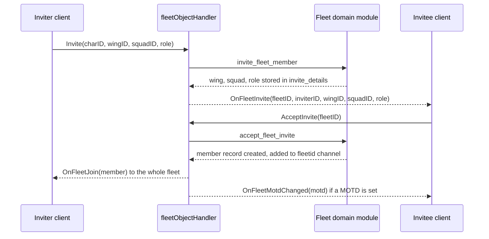

# Fleets

> **Navigation**: [EvoMu Technical Wiki](../README.md) • [Related Systems](#related-systems--cross-references)
>
> [← Back to Wiki Table of Contents](../README.md)

---

## Overview

A **fleet** is a temporary group of characters with a three-level command structure: one fleet, a set of wings, and squads inside each wing. EvoMu implements fleet formation, invitations, the wing/squad hierarchy, member moves, fleet finder adverts with join requests, broadcasts, fleet warp with formations, regroup, a watchlist, target tags, saved fleet setups, and logoff cleanup.

The rules live in one protocol-agnostic module, [`domain/fleets.rs`](../../../crates/eve-server/src/domain/fleets.rs). Two front ends call it: the MachoNet services `fleetMgr`, `fleetObjectHandler` and `fleetProxy` used by the game client, and the ESI routes under `/fleets/*`. Both read and write the same `FleetRecord` in the world snapshot.

---

## Canonical Mechanics

All rules below are the ones the code enforces at the pinned commit.

### Forming a fleet

`CreateFleet` (on `fleetMgr` or `fleetObjectHandler`) fails with `AlreadyInFleet` if the caller is in any fleet. Otherwise it allocates a fleet ID from `next_entity_id` and creates:

- one wing named "Wing 1" and one squad named "Squad 1" (IDs 1 and 1, or fresh entity IDs when `fleetObjectHandler.CreateFleet` is called with no arguments);
- a member record for the creator with role Fleet Commander, no wing, no squad, and `job = 2` (the boss bit, `FLEET_JOB_CREATOR`);
- a private chat channel `fleetid:<fleetID>` owned and operated by the boss (`ensure_fleet_channel_member`);
- runtime defaults: maximum size 256 and the first squad as the auto-join squad.

The creator's `CharacterRecord.fleet_id` and `session.fleet_id` are set and `OnFleetJoin` is emitted.

### Roles and hierarchy

| Role (`FleetRole`) | Wire value | ESI string |
|---|---|---|
| Fleet Commander | 1 | `fleet_commander` |
| Wing Commander | 2 | `wing_commander` |
| Squad Commander | 3 | `squad_commander` |
| Squad Member | 4 | `squad_member` |

The **boss** is `FleetRecord.boss_id`. It is separate from the Fleet Commander role: the boss can act on anyone, and only the boss can disband, change options, set the maximum size, set the auto-join squad, or remove the finder advert.

Authority for moving or kicking another member is decided by `can_act_on_member`:

| Caller | May act on | May move the target to |
|---|---|---|
| Boss | anyone | any position |
| Fleet Commander | anyone who is not a Fleet Commander (and self) | any role except Fleet Commander |
| Wing Commander | squad commanders and squad members of the caller's wing | squad commander or squad member in the same wing |
| Squad Commander | squad members of the caller's squad | squad member in the same squad |
| Squad Member | nobody | — |

Nobody except the boss may act on the boss. `can_invite_member` applies the same shape to invitations. A member may move itself to a squad-member slot without any authority when the fleet has **free move** enabled.

Command slots are exclusive: a move or invite into Fleet Commander, a wing's Wing Commander, or a squad's Squad Commander fails with `PositionOccupied` if another member holds it.

Structure limits and rules:

| Rule | Value | Where |
|---|---|---|
| Wings per fleet (MachoNet path) | 5 (`MaxWingsReached`) | `create_fleet_wing` |
| Squads per wing (MachoNet path) | 5 (`MaxSquadsReached`) | `create_fleet_squad` |
| Fleet size | 1–256, default 256 | `SetFleetMaxSize`, `invite_fleet_member`, `accept_fleet_invite` |
| Wing / squad name length (ESI path) | 1–10 characters | `rename_fleet_wing`, `rename_fleet_squad` |
| Deleting a wing or squad | refused while members are assigned (`WingNotEmpty`, `SquadNotEmpty`) | `delete_fleet_wing`, `delete_fleet_squad` |

Creating or deleting a wing needs the boss or a Fleet Commander. Creating a squad or renaming a wing needs authority over that wing (`can_manage_wing`); renaming or deleting a squad needs authority over that squad (`can_manage_squad`).

### Invitations

`Invite(charID, wingID, squadID, role)` goes through `invite_fleet_member`. On the MachoNet path it checks, in order: caller authority, the invitee exists, the fleet is not full (`FleetFull`), the invitee is online (`CharacterOffline`), the invitee is not in a fleet (`AlreadyInFleet`), the invitee has no other pending invite (`InviteAlreadyPending`), and the requested command slot is free. The invite is recorded in `FleetRecord.invites` and, with wing, squad, role, inviter and timestamp, in the runtime `FleetExtrasState`. The invitee receives `OnFleetInvite`.

- `AcceptInvite` (`accept_fleet_invite`) refuses when the character is already in a fleet, when no invite exists (`InviteExpired`), or while the character's session-change timer is active. On success it creates the member record with `takes_fleet_warp`, `accepts_regroup` and `accepts_conduit_jumps` all true, adds the character to the fleet channel, starts a session-change timer labelled `fleet_change`, and emits `OnFleetJoin` to the fleet.
- `RejectInvite` removes the invite and sends `OnFleetJoinReject` to the inviter, with reason code 2 when the client reports the invitee was already in a fleet.
- Invites expire after `FLEET_INVITE_EXPIRY_SECS` = 120 seconds (`tick_fleet_lifecycle`).

### Leaving, kicking, boss handover, disbanding

- `LeaveFleet` removes the caller. `KickMember` removes another member if `can_act_on_member` allows it; the boss cannot be kicked (`CannotKickBoss`). The kicked character receives `OnFleetLeave` and an `OnSessionChanged` that clears `fleetid` and `fleetrole`.
- All removal goes through `remove_character_from_fleet_domain`. It clears the member record, any wing/squad commander slot, the fleet channel membership, watchlist entries and pending invites, and invalidates the character's bound objects with reason `fleet_change`.
- If the removed character was the boss, the successor is the remaining member that sorts first by: connected before disconnected, then lowest role value, wing ID, squad ID, join time, character ID. The successor gets the boss bit in `job`; the fleet receives `OnFleetMemberChanged` and `OnChangeFleetBoss`.
- If no members remain, the fleet, its channel, its advert and its runtime settings are deleted.
- `MakeLeader(charID)` lets the boss hand the boss position to another member. It refuses a member recorded as disconnected (`TargetMemberOffline`).
- `DisbandFleet` is boss-only. Every former member receives `OnFleetLeave` and `OnFleetDisbanded`.

### Fleet options and member preferences

| Setting | RPC | Who | Stored in |
|---|---|---|---|
| Message of the day | `SetMotd`, `SetMotdEx`, `GetMotd` | boss or Fleet Commander | `FleetRecord.motd` |
| Free move, registered, voice, loot logging | `SetOptions` | boss | `FleetRecord.free_move`, `is_registered`; `FleetExtrasState.voice_enabled`, `loot_logging` |
| Auto-join squad | `SetAutoJoinSquadID` | boss | `FleetExtrasState.auto_join_squads` |
| Maximum size | `SetFleetMaxSize`, `GetFleetMaxSize` | boss | `FleetExtrasState.max_sizes` |
| Takes fleet warp | `SetTakesFleetWarp` | each member, for itself | `FleetMemberRecord.takes_fleet_warp` |
| Accepts regroup | `SetAcceptsRegroupValue` | each member | `FleetMemberRecord.accepts_regroup` |
| Accepts conduit jumps | `SetAcceptsConduitJumpsValue` | each member | `FleetMemberRecord.accepts_conduit_jumps` |

Option changes emit `OnFleetOptionsChanged`; preference changes emit `OnFleetMemberChanged`.

### Fleet finder adverts and join requests

The boss (or the current advert leader) registers an advert with `fleetProxy.AddFleetFinderAdvert`. An advert (`FleetAdvertState`) holds a name, description, solar system, invite scope, auto-join flag, minimum standing, minimum security status and an allowed-entities set. Registering sets `FleetRecord.is_registered` and emits `OnFleetOptionsChanged` and `OnFleetFinderAdvertChanged`.

`GetAvailableFleetAds` / `GetFleetAdsForChar` return only adverts the caller passes. `ApplyToJoinFleet` applies the same four filters and rejects with `FleetJoinDenied`:

1. caller security status is at least `min_security`;
2. if the allowed-entities set is non-empty, it contains the caller, the caller's corporation, or the caller's alliance;
3. if `min_standing` is above −10, the leader's corporation contact standing toward the caller (or the caller's corporation) is at least `min_standing`; a missing contact counts as 0;
4. invite scope 1 requires the same corporation as the leader, scope 2 the same corporation or alliance, any other value is open.

If the advert has auto-join, the applicant becomes a squad member immediately in the auto-join squad. Otherwise the application is stored as a join request and the boss receives `OnFleetJoinRequest`. `AcceptJoinRequest` needs the boss, or a commander whose role outranks the role being granted; `RejectJoinRequest` and `GetJoinRequests` complete the flow. `UpdateAdvertInfo`, `UpdateAdvertAllowedEntities`, `UpdateFleetAdvertWithNewLeader`, `GetMyFleetFinderAdvert` and `RemoveFleetFinderAdvert` manage an existing advert.

### Broadcasts

`SendBroadcast`, `BroadcastToSystem` and `BroadcastToBubble` share `handle_send_broadcast`. Arguments are `(name, broadcastScope, itemID, typeID)`.

- **Who may send.** The boss and any commander may send any broadcast. A squad member may send only `NeedArmor`, `NeedShield`, `NeedCapacitor`, `NeedBackup`, `InPosition`, `HoldPosition`, `NeedRepairs`, `Location` and `Travel`; anything else fails with `CannotBroadcastInFleet`.
- **Command-chain scope** (`broadcast_group_allows`). Scope 1 (down) reaches members below the sender in the sender's subtree, scope 2 (up) reaches the sender's superiors, any other value reaches the whole fleet. The sender always receives its own broadcast.
- **Location scope.** `SendBroadcast` has no location limit. `BroadcastToSystem` reaches members in the sender's solar system. `BroadcastToBubble` reaches members in the same system within 250 km of the sender's ship.
- **Filters.** A member can mute a broadcast name with `SetBroadcastFilter(name, enabled)`; muted names are skipped for that member.
- **Rate limit.** An identical broadcast (same name, scope, location and item) from the same sender within 2 seconds fails with `BroadcastSpamCooldown`.
- Each recipient gets `OnFleetBroadcast(name, scope, charID, solarSystemID, itemID, typeID)`. `GetBroadcastHistory` returns the fleet's stored history.

`LockFromBroadcast` / `TargetFromBroadcast` emit `OnTarget("add", shipID)` to the caller if the target is in the caller's solar system and in space.

### Fleet warp, warp to member, regroup

**Fleet warp** (`handle_fleet_warp`) is reached from `FleetWarp` / `WarpFleet` on the fleet services and from `beyonce.CmdWarpToStuff` (not the autopilot variant) when the call carries a truthy `fleet` keyword or a `formationID` and the session is in a fleet.

1. The caller must be the boss or hold a commander role, and must not be controlling a structure.
2. Scope: a Fleet Commander warps the whole fleet, a Wing Commander the caller's wing, a Squad Commander the caller's squad.
3. Members who turned off `takes_fleet_warp` are skipped; the caller gets `OnFleetMoveFailed` for each.
4. A member is warped only if it is in the caller's solar system, in space, not a structure, able to move, not navigation-locked, not warp scrambled, not inside an ESS warp disruption bubble, within 8,000 km of the caller, and at least 150 km (`WARP_MIN_DISTANCE_M`) from the destination.
5. The destination is an explicit position, a ball, a bookmark the caller owns or may use through its folder access level, or a station. The warp-in range is clamped to 0–100 km.
6. Each warped ship lands at `destination − direction × range + formation offset`. Warping breaks a gate cloak or undock invulnerability.

Fleet warp is refused in solar systems 32,000,000–32,999,999 (`CannotWarpInAbyssalSpace`).

Formation offsets come from `compute_oriented_formation_offset`, oriented along the warp direction. Slot 0 (the commander) always has zero offset.

| ID | Name | Layout | Default spacing |
|---|---|---|---|
| 0 | Point | everyone on the anchor | — |
| 1 | Plane / Wall | 2D lattice perpendicular to the warp direction | 5 km |
| 2 | Sphere | golden-angle shell, radius clamped to 3–22 km | 10 km |
| 3 | Arrow | V-wedge trailing behind the commander | 5 km |
| 4 | Diamond | octahedron vertices in rings | 5 km |
| 5 | Relative | each ship keeps its offset from the commander, capped at 24 km | — |

Spacing is clamped to 2.5–20 km and offsets (other than Sphere) are capped at 24 km. A commander's preferred formation is stored with `SetFleetFormationSettings` and used when the warp call does not name one.

**Warp to member** (`WarpToMember`) warps only the caller to another member in the same solar system. It applies the same navigation-lock, scramble, 150 km minimum and Abyssal checks, and accepts a range of 0–100 km.

**Regroup** (`Regroup`, and `beyonce.CmdFleetRegroup`) is issued by the boss or a commander. In-scope members who accept regroup, are in space in the same system, and are within 500 km of the commander are set to follow the commander's ship at 1 km.

### Watchlist, target tags, composition, setups

- **Watchlist.** `AddToWatchlist` / `RemoveFromWatchlist` keep a per-character set of up to 15 fleet members (`MAX_WATCHLIST_SIZE`). `GetWatchlist` returns shield, armor and hull ratios. Damage to a watched ship is pushed by `stream_fleet_watchlist_damage`, called from the combat damage path.
- **Target tags.** `beyonce.CmdFleetTagTarget(itemID, tag)` is for the boss and commanders. A tag is one character, A–Z or 1–9. The target must be within 8,000 km and locked by the caller. A tag is unique within the fleet; an empty tag clears it. The fleet receives `OnFleetStateChange`. Tags on a destroyed target are cleared by `clear_destroyed_target_tag`.
- **Composition.** `GetFleetComposition` is for the boss and commanders (`FleetRoleDenied` otherwise).
- **Setups.** `StoreFleetSetup`, `GetFleetSetups` and `DeleteFleetSetup` manage named setups per character. `LoadFleetSetup` applies a stored setup's MOTD, free-move flag and maximum size to the current fleet; it needs the boss or a Fleet Commander.

### Fleet boosts

There are no fleet booster slots. The code comment in `handle_get_init_state` states that V24 uses command bursts instead. `GetInitState` reports each member's levels in Leadership (3348), Wing Command (11574) and Fleet Command (24764).

Command burst modules (group 1770) are handled by `activate_command_burst` in [`tactical_modules.rs`](../../../crates/eve-server/src/services/tactical_modules.rs). Fleet membership decides who can receive a burst: the booster's own ship always does, and other fleet members are candidates only when `is_in_fleet_boost_scope` passes (a Fleet Commander reaches the whole fleet, a Wing Commander the same wing, a Squad Commander the same squad, a squad member nobody else). Candidates must then be in the same system, in space, and inside the burst's area range.

The ledger row `feat:fleet.fleet-boost-scope` states the acceptance as "regardless of fleet position". The code above filters by fleet position, so the two differ.

### Logoff and disconnect

Two code paths exist and they behave differently.

1. **Transport cleanup (the live path).** When a client socket closes, `ServerContext::cleanup_disconnected_client_session` calls `logoff_character_sync` if that session held the account's online lock. `logoff_character_sync` calls `on_character_logout`, which removes the character from every fleet and every chat channel at once (with boss handover or disband as described above), and only then calls `handle_character_disconnect`. By that point the character is in no fleet, so no grace entry is recorded. The same order is used for `/kick`, `authentication.Logout`, `userSvc.UserLogOffCharacter`, safe logoff and daily downtime.
2. **Grace window.** `handle_character_disconnect`, when called on its own (through `handle_fleet_member_disconnect`), keeps the member in the fleet, records the time in `FleetExtrasState.disconnected_members`, and immediately passes the boss position to the best-ranked connected member if the disconnected character was boss. `tick_fleet_lifecycle` removes the member after `FLEET_DISCONNECT_GRACE_SECS` = 120 seconds. If the character selects in again within the window, `on_character_select` restores `session.fleet_id` and the fleet channel membership. At the pinned commit `handle_fleet_member_disconnect` is called only from tests.

Other lifecycle rules:

- `on_character_select` removes a stale fleet membership when the character was neither within grace nor already online.
- `sync_session_fleet` runs before each RPC dispatch and clears `session.fleet_id` if the character is no longer in that fleet.
- `prune_offline_fleets_and_channels` runs at startup hydration and at downtime. It drops all offline members, pending invites and empty fleets, and reassigns the boss of any fleet whose boss is offline.

### Not implemented / known gaps

- **Disconnect grace is not reached from the socket-close path.** The live cleanup path removes the member immediately (see above). The ledger row `feat:lifecycle.fleet-disconnect-grace` describes the grace behaviour; only the test-facing entry point provides it.
- **Burst scope follows fleet position**, which differs from the acceptance text of `feat:fleet.fleet-boost-scope`.
- **Runtime-only state.** Invite details, disconnect timestamps, broadcast filters and history, maximum sizes and target tags live in `FleetExtrasState`, which is saved as part of the server runtime blob rather than transactionally. Open issue #875 covers this for all runtime maps, including "fleet/social extras".
- `beyonce.GetFormations` returns a fixed two-entry list (Diamond and Arrow) that is unrelated to the six formation IDs used by fleet warp.
- `fleetObjectHandler.FinishMove` with fewer than two arguments only checks membership and returns `None`.
- Voice and loot-logging flags are stored and returned but nothing in the files read for this article acts on them.
- The ESI invite path skips the online, capacity and pending-invite checks that the MachoNet path enforces (`enforce_online_and_capacity_checks: false`), and the ESI wing/squad create paths skip the 5-wing and 5-squad limits.
- Fleet jump bridges and conduit jumps are covered in the navigation article, not here.

---

## EvoMu Implementation Architecture

### Crates involved

- [`eve-server`](../../../crates/eve-server): services, domain logic, ESI routes, notifications.
- [`eve-db`](../../../crates/eve-db): `FleetRecord`, `FleetMemberRecord`, `FleetWingRecord`, `FleetSquadRecord`, `FleetRole` in [`types.rs`](../../../crates/eve-db/src/types.rs); `FleetAndSocialOpsStore` in [`quasar_and_social.rs`](../../../crates/eve-db/src/service_domains/quasar_and_social.rs).
- [`eve-destiny`](../../../crates/eve-destiny): `MovementMode::new_warp` and `MovementMode::Follow` used by fleet warp and regroup.

### Primary handlers and dispatch

`fleet_social::handle_with_bound` in [`fleet_social.rs`](../../../crates/eve-server/src/services/fleet_social.rs) handles `MakeLeader`, `MassMoveMembers` and `beyonce.GetFormations` itself, then passes fleet calls down a chain: `handle_fleets` → `handle_fleet_ops` → `handle_finder_and_tactical`.

| File | Contents |
|---|---|
| [`domain/fleets.rs`](../../../crates/eve-server/src/domain/fleets.rs) | Permission predicates and the mutating operations shared by MachoNet and ESI |
| [`fleet_social_fleets.rs`](../../../crates/eve-server/src/services/fleet_social_fleets.rs) | `Init`, `CreateFleet`, wings and squads, `Invite`, `AcceptInvite`, `RejectInvite`, `KickMember`, `LeaveFleet`, `DisbandFleet`, `MoveMember`; `FleetExtrasState` |
| [`fleet_social_fleet_ops.rs`](../../../crates/eve-server/src/services/fleet_social_fleet_ops.rs) | Broadcasts, `WarpToMember`, fleet warp, formations, MOTD, options, member preferences, `Regroup` |
| [`fleet_social_finder_tactical.rs`](../../../crates/eve-server/src/services/fleet_social_finder_tactical.rs) | Finder adverts, join requests, setups, formation settings, watchlist, `Reconnect`, `GetFleetID` |
| [`fleet_social_notify.rs`](../../../crates/eve-server/src/services/fleet_social_notify.rs) | Notification emitters, logout/disconnect handling, `tick_fleet_lifecycle`, startup pruning |
| [`space_entity_ops.rs`](../../../crates/eve-server/src/services/space_entity_ops.rs) | `beyonce.CmdFleetRegroup`, `beyonce.CmdFleetTagTarget` |
| [`space_warp_jump.rs`](../../../crates/eve-server/src/services/space_warp_jump.rs) | `handle_cmd_warp_to_stuff` forwarding to fleet warp |
| [`esi/fleet_routes.rs`](../../../crates/eve-server/src/esi/fleet_routes.rs) | ESI routes |

ESI routes (`dispatch_fleet_routes`), each calling the same domain function as its MachoNet counterpart with the token's character as caller:

| Method and path | Domain function |
|---|---|
| `GET /characters/{character_id}/fleet` | `get_character_fleet` |
| `GET` / `PUT /fleets/{fleet_id}` | `get_fleet_settings` / `update_fleet_settings` |
| `GET` / `POST /fleets/{fleet_id}/members` | `list_fleet_members` / `invite_fleet_member` |
| `PUT` / `DELETE /fleets/{fleet_id}/members/{member_id}` | `move_fleet_member` / `kick_or_remove_fleet_member` |
| `GET` / `POST /fleets/{fleet_id}/wings` | `list_fleet_wings` / `create_fleet_wing` |
| `PUT` / `DELETE /fleets/{fleet_id}/wings/{wing_id}` | `rename_fleet_wing` / `delete_fleet_wing` |
| `POST /fleets/{fleet_id}/wings/{wing_id}/squads` | `create_fleet_squad` |
| `PUT` / `DELETE /fleets/{fleet_id}/squads/{squad_id}` | `rename_fleet_squad` / `delete_fleet_squad` |

The ESI move path uses strict wing/squad validation (`validate_wing_and_squad`) and does not apply the session-change timer; the ESI kick path never removes the boss.

Notifications emitted by these files: `OnFleetInvite`, `OnFleetJoin`, `OnFleetLeave`, `OnFleetJoinReject`, `OnFleetJoinRequest`, `OnFleetMemberChanged`, `OnFleetMove`, `OnFleetMoveFailed`, `OnChangeFleetBoss`, `OnFleetDisbanded`, `OnMemberlessFleetUnregistered`, `OnFleetOptionsChanged`, `OnFleetMotdChanged`, `OnFleetWingAdded`, `OnFleetWingDeleted`, `OnFleetWingNameChanged`, `OnFleetSquadAdded`, `OnFleetSquadDeleted`, `OnFleetSquadNameChanged`, `OnFleetBroadcast`, `OnFleetFinderAdvertChanged`, `OnFleetStateChange`.

### State

| Location | Fields | Notes |
|---|---|---|
| `WorldStateSnapshot.fleets` (`FleetRecord`) | `boss_id`, `members`, `wings`, `squads`, `wing_details`, `squad_details`, `member_details`, `invites`, `free_move`, `is_registered`, `motd` | Authoritative membership and hierarchy |
| `FleetMemberRecord` | `role`, `wing_id`, `squad_id`, `takes_fleet_warp`, `accepts_regroup`, `accepts_conduit_jumps`, `job`, `role_name`, `join_time_unix` | One per member |
| `CharacterRecord.fleet_id`, `SessionState.fleet_id` | — | Kept in step with the fleet record |
| `WorldStateSnapshot.chat_channels["fleetid:<id>"]` | members, operators | Fleet chat channel |
| `WorldStateSnapshot.fleet_and_social_ops` | `fleet_adverts`, `fleet_join_requests`, `fleet_watchlist`, `fleet_saved_setups`, `fleet_stored_formations`, `fleet_voice_enabled`, `fleet_loot_logging` | Written by the `sync_fleet_*_to_db` helpers |
| `ServerContext.fleet_extras` (`FleetExtrasState`) | `max_sizes`, `auto_join_squads`, `invite_details`, `invite_timestamps`, `disconnected_members`, `adverts`, `watchlist`, `target_tags`, `join_requests`, `broadcast_filters`, `last_broadcast`, `broadcast_history`, and others | In memory; saved and restored by [`context_runtime_persistence.rs`](../../../crates/eve-server/src/router/context_runtime_persistence.rs) |

### Tick integration

`tick_fleet_lifecycle` expires invites and disconnect-grace entries. It is called from the server's clock-advance pipeline in [`router/context.rs`](../../../crates/eve-server/src/router/context.rs) (listed in the per-tick pipeline comment in [`cluster_tick.rs`](../../../crates/eve-server/src/sp6_lifecycle/cluster_tick.rs)), and also on demand from `Invite`, `AcceptInvite`, `RejectInvite`, `character_active_fleet_id`, `on_character_select` and `sync_session_fleet`. Fleet warp and regroup act through the solar system's Destiny handle (`set_movement_mode`); they have no tick of their own.

---

## Invariants, Security & Edge Cases

- A character is in at most one fleet. `CreateFleet`, `AcceptInvite` and `ApplyToJoinFleet` all refuse a character that already has a membership.
- Every fleet RPC resolves the fleet from `session.fleet_id`, not from a client-supplied fleet ID, except `AcceptInvite`, `RejectInvite` and `ApplyToJoinFleet`, which validate against a stored invite or advert.
- Handlers clear `session.fleet_id` when the domain reports `NotInFleet` or `FleetNotFound`, so a stale session cannot keep acting.
- Accepting an invite and moving oneself both start a `fleet_change` session-change timer; both are refused while a timer is already running.
- Removal invalidates the character's bound `fleetObjectHandler` objects, and clears the fleet ID on the character's Quasar subscribers.
- Fleet warp never moves a ship that is docked, a structure, immobile, scrambled, or under a navigation lock; such members are skipped without an error. If nobody warps and at least one member was blocked by an ESS bubble, the call fails with `EssIntrusionBubbleWarpBlocked`.
- ESI read routes require the token's character to be a fleet member (`NotInFleet` otherwise).

---

## Verification, Tests & Parity References

Ledger rows (`ledger.json`): `feat:fleet.create-fleet`, `feat:fleet.invite-accept`, `feat:fleet.leave-kick`, `feat:fleet.wings-squads`, `feat:fleet.roles-positions`, `feat:fleet.fleet-motd`, `feat:fleet.fleet-broadcasts`, `feat:fleet.fleet-warp-cmd`, `feat:fleet.fleet-composition`, `feat:fleet.fleet-watchlist`, `feat:fleet.fleet-advert`, `feat:fleet.fleet-free-move`, `feat:fleet.fleet-formations`, `feat:fleet.fleet-disband`, `feat:fleet.fleet-max-size`, `feat:fleet.fleet-boost-scope`, `feat:fleet.fleet-registration`, `feat:navigation.fleet-warp`, `feat:esi.fleets.char-fleet`, `feat:esi.fleets.fleet`, `feat:esi.fleets.members`, `feat:esi.fleets.member-move-kick`, `feat:esi.fleets.wings-squads`, RPC rows such as `rpc:fleetObjectHandler.CreateFleet`, `rpc:fleetObjectHandler.AcceptInvite`, `rpc:fleetObjectHandler.MoveMember`, `rpc:fleetObjectHandler.MakeLeader`, `rpc:fleetProxy.AddFleetFinderAdvert`, `rpc:fleetProxy.ApplyToJoinFleet`, and `notify:OnFleetInvite`, `notify:OnFleetJoin`, `notify:OnFleetLeave`, `notify:OnFleetMemberChanged`, `notify:OnFleetBroadcast`, `notify:OnChangeFleetBoss`.

Auditor rows (`auditor_rows.json`): `feat:fleet.boss-handover`, `feat:fleet.broadcast-scope-and-filter`, `feat:fleet.fleet-setups`, `feat:fleet.join-requests`, `feat:fleet.member-movement-optins`, `feat:fleet.stored-formations-and-warp-shapes`, `feat:fleet.takes-fleet-warp-toggle`, `feat:fleet.target-tagging`, `feat:fleet.watchlist-broadcast-tracking`, `feat:lifecycle.fleet-disconnect-grace`, `feat:lifecycle.fleet-invite-offline`, `feat:lifecycle.fleet-kick-session`, `feat:lifecycle.fleet-login-consistency`, `feat:lifecycle.fleet-logout`, `feat:lifecycle.fleet-server-restart`.

Integration tests in [`crates/eve-server/tests/it/`](../../../crates/eve-server/tests/it/): `fleet_and_wings_management.rs`, `fleet_object_handler_lifecycle.rs`, `fleet_operations_and_broadcasts.rs`, `fleet_boss_formations_corp_projects_live.rs`, `fleet_chat_biomass_lifecycle.rs`, `fleet_tagging_crab_storms_live.rs`, `features_fleet_broadcast_rpcs.rs`, `rpc_fleet_object_hierarchy.rs`, `rpc_fleet_object_ops.rs`, `rpc_corprec_fleet_proxy.rs`, `notify_fleet_emission.rs`, `social_fleets.rs`, `social_fleets_complete.rs`, `esi_fleets.rs`.

Unit tests next to the sources: `fleet_social_fleets_tests.rs`, `fleet_social_fleet_ops_tests.rs`, `fleet_social_finder_tactical_tests.rs`, `fleet_social_notify_tests.rs` in [`crates/eve-server/src/services/`](../../../crates/eve-server/src/services/), and `fleet_routes_unit_tests.rs` in [`crates/eve-server/src/esi/`](../../../crates/eve-server/src/esi/).

---

## Related Systems & Cross-References

- [**Corporation Roles & Governance**](corporation_roles_and_governance.md): corporation contacts used by the advert standing filter.
- [**Mail & Chat**](mail_and_chat.md): the `fleetid:*` chat channel and channel membership cleanup on logout.
- [**Stargate Jumps, Cynosural Navigation & Jump Fatigue**](../universe_and_navigation/stargate_jumping_and_cynosural_navigation.md): warp, jump bridges and conduit jumps.
- [**Destiny Simulation Loop**](../ballpark_and_physics/destiny_simulation_loop.md): the movement modes fleet warp and regroup set.
- [**MachoNet Wire & Quasar Gateway**](../protocol_and_infrastructure/machonet_wire_and_quasar_gateway.md): service dispatch, bound objects and session changes.
- [**EvoMu Technical Wiki Table of Contents**](../README.md): master index and domain directory.

---

[← Back to Wiki Table of Contents](../README.md)
