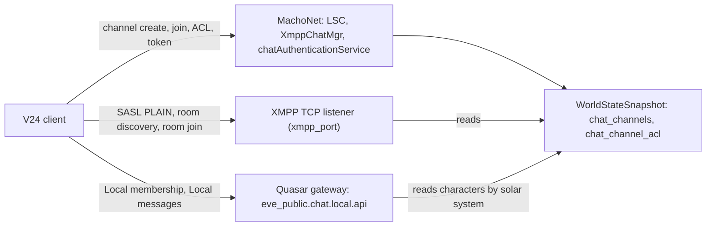

# EVE Mail & Chat

> **Navigation**: [EvoMu Technical Wiki](../README.md) • [Related Systems](#related-systems--cross-references)
>
> [← Back to Wiki Table of Contents](../README.md)

---

## Overview

This article covers the two player messaging systems.

**EVE mail** is stored, asynchronous messaging between characters, corporations, alliances and mailing lists. EvoMu implements sending, the CSPA charge, read and trash state, labels, mailing lists with access control and welcome mails, and the client notifications that keep an open mail window in step. The same domain function serves the game client (`mailMgr`) and ESI.

**Chat** is split across three transports in the V24 client, and EvoMu has a piece on each:

Channel records, ownership and access lists are complete and persisted. Message delivery is not: only Local chat messages sent through the Quasar handler reach other players. See [Not implemented / known gaps](#not-implemented--known-gaps).

---

## Canonical Mechanics

### Mail: sending

`mailMgr.SendMail` takes `(toCharacterIDs, toListID, toCorpOrAllianceID, title, body, ...)` and calls `domain::mail::send_mail`. ESI `POST /characters/{character_id}/mail` calls the same function with different limits.

| Rule | MachoNet (`mailMgr.SendMail`) | ESI |
|---|---|---|
| Subject length | 1–150 characters (`InvalidMailSubject`) | 1–1,000 |
| Body length | up to 8,000 characters (`MailBodyTooLong`) | up to 10,000 |
| CSPA exemption: same corporation | no | yes |
| CSPA exemption: contact standing above | 0.0 | −10.0 |
| CSPA wallet journal entry (`cspa`) | not written | written |
| `approved_cost` check (`ApprovedCostExceeded`) | not applied | applied |

Checks performed by `send_mail`, in order:

1. **Mailing list.** If a list is targeted, the sender must be the owner, or be a member whose resolved access level is above 0 (`MailingListAccessDenied`) and whose member role is not 0 (`MutedInMailingList`). Access resolves in the order character → corporation → alliance → the list's `default_access`. A list posting cost (clamped to 0–1,000,000,000 ISK) is transferred from the sender to the list owner.
2. **Blocks.** Delivery fails with `ContactBlocked` when a character recipient has the sender as a blocked contact, or when `is_blocked_by` reports a block and the recipient does not also hold the sender as a contact with standing above 0.
3. **Corporation mail.** The sender must belong to the corporation (`CorpMailAccessDenied`; NPC corporations are refused), and pass `can_send_corp_mail` (`CorpMailRestricted` when the corporation restricts mail to leadership).
4. **Alliance mail.** The sender must be in the alliance (`AllianceMailAccessDenied`). If the executor corporation or the sender's corporation has `restrict_corp_mails`, the sender must be CEO or hold one of `ALLOWED_CORP_MAIL_ROLES`.
5. **At least one recipient** (`InvalidRecipient`).
6. **Mailbox quota.** For mail with more than one stored recipient, any recipient already holding 1,000 non-deleted mails fails the send with `MailQuotaExceeded`.
7. **CSPA.** For each character recipient that is not exempt, the recipient's own CSPA charge (`character_cspa_charges`) is added; a recipient with no configured charge costs 0. The total plus any list cost is debited from the sender (`InsufficientFundsForCSPA`).

On success one `MailRecord` per stored recipient is written under a single new mail ID, the sender's copy is labelled Sent (2) and marked read, and each recipient's copy gets its delivery label: Inbox (1), Corp (4) or Alliance (8). Recipients other than the sender receive `OnMailSent`; the comment in `mail_notify.rs` notes that the client raises its own `OnNewMailReceived` from that.

**CSPA** ("CONCORD Spam Protection Act" in the journal reason). A character sets its charge with `charMgr.LogSettings` (clamped to 0–1,000,000 ISK). `charMgr.CSPAChargedAction` and `CSPAChargedActionForMany` charge for non-mail contact (`charge_cspa_action`): the default is 2,950 ISK per target, with same-corporation, same-alliance and positive-standing contacts exempt. Inviting a character to a private chat also charges the recipient's CSPA fee.

### Mail: reading, labels, trash

| Operation | RPCs | Effect |
|---|---|---|
| Headers | `GetMailHeaders`, `SyncMail` | `handle_mail_headers` |
| Body | `GetBody` | returns the body and marks the mail read for an authorised reader |
| Read state | `MarkAsRead`, `MarkAsUnread`, `MarkAsReadByLabel`, `MarkAsUnreadByLabel`, `MarkAsReadByList`, `MarkAsUnreadByList`, `MarkAllAsRead`, `MarkAllAsUnread` | updates `read_mails` |
| Trash | `MoveToTrash`, `MoveAllToTrash`, `MoveToTrashByLabel`, `MoveToTrashByList`, `MoveFromTrash`, `MoveAllFromTrash` | updates `trashed_mails` |
| Delete | `DeleteMail`, `EmptyTrash` | updates `deleted_mails` |
| Labels | `GetLabels`, `CreateLabel`, `EditLabel`, `DeleteLabel`, `AssignLabels`, `ReplaceLabels`, `RemoveLabels` | updates `mail_labels`, `mail_assigned_labels` |

- A character may act on a mail only if `is_mail_authorized` passes: it is the sender, a stored recipient, a recorded to-character, a member of the mailing list the mail went to, has a label assignment for it, or belongs to the corporation or alliance it was addressed to. Otherwise the call fails with `AccessDenied`.
- Label IDs are bit values. The four built-in labels are Inbox 1, Sent 2, Corp 4 and Alliance 8. Custom labels take the first free value of `64 << k` for k in 0–23. Built-in labels (ID below 64) cannot be deleted (`CannotDeleteSystemLabel`). Deleting a label removes it from the owner's assignments.
- `mailMgr.PokePlayerAboutChatMsgGm` is GM-only; it sends `OnCharacterPokedByGM` and a mail with the fixed subject "GM Chat Notification".

Changes made through ESI are pushed to an online client with `OnMailDeleted`, `OnMailUpdatedByExternal` and `OnLabelsCreatedByExternal`.

### Mailing lists

`mailingListsMgr` is handled in `mailing_lists_ops.rs`.

| Member role value | Meaning |
|---|---|
| 3 | owner (set on `Create`) |
| 2 | operator (`SetMembersOperator`) |
| 1 | member (`SetMembersClear`) |
| 0 | muted (`SetMembersMuted`) |

- `Create` makes the caller the owner. `Join` resolves the caller's access level (character, then corporation, then alliance, then `default_access`), charges the list's join cost if set (`NotEnoughISK`), adds the member with the list's default role, and delivers the list's welcome mail if one is saved.
- Administrative calls require the owner or a role of 2 or higher (`caller_has_operator_or_owner_role`): `SetDefaultAccess`, `SetEntitiesAccess`, `ClearEntityAccess`, `SetMembersOperator`, `SetMembersMuted`, `SetMembersClear`, `KickMembers`, `SaveWelcomeMail`, `SendWelcomeMail`, `ClearWelcomeMail`. `Delete` is owner-only.
- `GetInfo`, `GetJoinedLists`, `GetMembers`, `GetSettings`, `GetWelcomeMail` and `Leave` complete the service.
- Affected members receive `OnMailingListSetOperator`, `OnMailingListSetMuted`, `OnMailingListSetClear`, `OnMailingListDeleted` or `OnMailingListLeave`.

### Chat: channel types

A channel is a `ChatChannelRecord` keyed by a string ID. The prefix decides its type.

| Channel ID | Type | Who may join (`validate_channel_join_auth`) | Owner / operators |
|---|---|---|---|
| `solarsystemid2:<id>` | Local | character is in that solar system | none |
| `constellationid:<id>`, `regionid:<id>` | constellation, region | character's system is in that constellation or region | none |
| `resourcewars:<id>` | Resource Wars | character is in that solar system | none |
| `factionid:<id>` | militia | session `war_faction_id` matches | none |
| `help_*`, `rookie_help`, `global`, `local`, `incursion:<id>` | system | no restriction | none |
| `corpid:<id>` | corporation | character's corporation matches | CEO, Director, or corp role bit `1 << 38` (`CORP_ROLE_CHAT_MANAGER`); never for NPC corporations |
| `allianceid:<id>` | alliance | character's alliance matches | same roles, in the executor corporation |
| `fleetid:<id>` | fleet | character is in that fleet | fleet boss, Fleet Commander, Wing Commander |
| `channel:<slug>` | player-owned | not blocked, password if set | stored owner and operator set |
| `private:*` (or `is_private`) | private conversation | already a member, invited by owner/operator, or on the allow list | stored owner and operator set |

System and organisation channels never store an owner, operators or a password; operator rights on organisation channels are computed from current roles each time (`has_dynamic_org_operator_role`). A session with a GM role passes every check.

`XmppChatMgr.GetRookieChannel` returns `rookie_help` for characters created within the last 30 days.

### Chat: player-owned channels and access lists

- `XmppChatMgr.CreatePlayerOwnedChannel(name, password, motd)` creates `channel:<lowercased name with spaces as underscores>` with the caller as owner, operator and first member. A second channel with the same key fails with `ChannelAlreadyExists`. The reply reaches the client as the string `player_<slug>` (rewritten in [`client_compat.rs`](../../../crates/eve-server/src/router/client_compat.rs)).
- `JoinChannel` / `CreateOrJoinChannel` create a missing channel on first join. For an existing channel they enforce the join rule above, the block and deny lists, and the password (owner, operators and allow-listed characters skip the password).
- `XmppChatMgr.CreatePrivateChannel` and `LSC.Invite` invite one character; the invite is refused if the recipient blocks the caller (`SenderBlockedByRecipient`) and charges the recipient's CSPA fee.
- `XmppChatMgr.GrantChannelOwnership` and `AccessControl` mode 3 transfer ownership (owner or GM only; never on system or organisation channels).
- `RenameChannel`, `SetChannelPassword` (not on system or organisation channels), `SetChannelMOTD`, `XmppChatMgr.SetMotd` and `DestroyChannel` manage a channel; MOTD needs operator rights.

`AccessControl(channelID, targetID, mode)` edits the channel's `ChatChannelAclRecord` (`allow_list`, `deny_list`, `muted_until`):

| Mode | Effect | Who |
|---|---|---|
| 3 | transfer ownership; target becomes operator and member, restrictions cleared | owner or GM |
| 2 | grant operator; add to allow list | owner or GM; not on system or organisation channels |
| 1 | add to allow list, remove from deny list, unmute | operator |
| −1 | mute for 3,600 seconds | operator; the owner can be muted only by a GM |
| −2 | ban: remove operator, add to deny list | operator; the owner cannot be banned; banning an operator needs the owner or a GM |
| other | clear allow, deny and mute entries | operator; the owner's entries can be changed only by a GM; an operator's entries only by the owner or a GM |

`XmppChatMgr.GMMute` and `GMUnmute` need operator rights or a GM role. A mute on the channel key `global` applies in every channel.

### Chat: sending over MachoNet

`LSC.SendMessage(channelID, text)` checks, in order: Local is not disabled for an Abyssal system, text length is 1–2,000 characters (`InvalidChatMessageLength`), the banned-word filter, a Quasar chat mute (`CharacterChatBanned`), a channel or global mute (`MutedInChannel`), scope membership for system and organisation channels, that the channel exists and the sender is a member and not blocked (`ChannelAccessDenied`), and a rate limit of 20 messages per character per second (`ChatRateLimitExceeded`).

It then emits `OnClientEventChatMessageSent` with no arguments to the channel's audience (solar system, corporation, alliance, fleet, or each member). The message text is returned to the sender in the RPC reply but is not included in the notification.

### Chat: the XMPP listener

[`main.rs`](../../../crates/eve-server/src/main.rs) binds a plain TCP listener on `xmpp_port` (config field, `EVOMU_XMPP_PORT`, or the CLI override). The code comment describes it as an XMPP client sink that stops the client's `XmppChatService.Login` from failing with a refused connection.

| Constant | Value |
|---|---|
| `XMPP_IDLE_READ_TIMEOUT` | 300 s |
| `XMPP_STANZA_TIMEOUT` (partial stanza) | 15 s |
| `XMPP_WRITE_TIMEOUT` | 30 s |
| `MAX_XMPP_STANZA_BYTES` | 64 KiB |

Each connection is handled by `handle_xmpp_stream_with_timeouts`, which frames stanzas and answers four kinds:

- `<stream:stream>`: the first reply advertises SASL `PLAIN`; after authentication it advertises resource bind and session.
- `<auth>`: `xmpp_authenticate_sasl_plain`. If the authentication ID parses as a character ID, the password must equal that character's chat token (compared in constant time). Otherwise the ID is treated as an account name and checked with the account password; the character is taken from the authorisation ID if the account owns it, else from the account's current session, else the account's lowest character ID. Restricted accounts are refused.
- `<iq>`: `xmpp_iq_reply_with_auth_mut`. `<bind>` assigns the JID `char_<characterID>@chat.evomu.local/<resource>`. All other queries need an authenticated, bound stream. `disco#items` lists player-owned channels as `player_<slug>@conference.chat.evomu.local`; the node `forme` lists channels the caller owns, operates, is a member of or is allow-listed in (owned ones carry `node='owner'`), `byname/<name>` searches by name, and no node lists channels the caller belongs to plus channels that are public and have no password. `disco#info` returns a conference identity or `item-not-found`. `muc#admin` needs operator rights and `muc#owner` needs ownership. Any other query gets an empty result.
- `<presence to='room'>`: `xmpp_can_join_room` applies the scope rules above. On success the reply is the caller's own occupant presence (status code 110); on failure a presence error with code 403.

The chat token comes from `chatAuthenticationService.GetAuthenticationToken`: 32 random bytes in hex, stored per character under `Ns::XmppAuthToken`, and removed by `revoke_xmpp_auth_token` at logoff. `XmppChatMgr.Hostname` returns the stored host name or `chat.evomu.local`.

Room names map to channel keys: `local_<id>` → `solarsystemid2:<id>`, `corp_<id>` → `corpid:<id>`, `alliance_<id>`, `fleet_<id>`, `faction_<id>`, `constellation_<id>`, `region_<id>` likewise, and `player_<slug>` → `channel:<slug>`.

### Chat: Local membership and messages over Quasar

[`quasar_social_chat.rs`](../../../crates/eve-server/src/services/quasar_social_chat.rs) registers the `eve_public.chat.local.api` handlers.

- **Membership.** `GetMembershipListRequest` returns every character whose record is in the caller's solar system and who is online (has a session or a gateway subscriber). When a character's solar system changes, `ServerContext::sync_character_local_chat` calls `on_character_leave_local_chat` for the old system and `on_character_enter_local_chat` for the new one. These publish `LeaveNotice` and `JoinNotice` to the solar system and a `MembershipListNotice` to the character.
- **Messages.** `BroadcastMessageRequest` requires an active character that is not muted and is a member of Local in its system, then publishes `MessageBroadcastNotice` (author, solar system, text) to the solar system scope.
- **Delayed Local.** In wormhole-range systems (31,000,000–31,999,999) and system 30,100,000 a character appears in the member list only after it speaks; speaking publishes a `JoinNotice`. The MachoNet side keeps a matching rule (`is_delayed_local_channel`) and does not emit join or leave notifications for those channels.
- **Abyssal systems** (32,000,000–32,999,999): Local is refused on both paths.
- **Moderation.** `eve_public.chat.local.api.admin.MuteRequest` (admin role) mutes a character for a duration; the mute is saved and also blocks `LSC.SendMessage`.
- Corporation membership handlers call `on_character_local_chat_membership_refreshed`, which publishes `MembershipRefreshedNotice`.

### Chat: leaving

`LeaveChannel` removes the caller. On logoff or disconnect, `remove_character_from_chat_channels` removes the character from every channel and sends `OnChannelLeft` to the remaining members (not for delayed Local). The fleet channel is included on a full logout. See [Fleets](fleets.md) for the order in which the two cleanup functions run.

### Not implemented / known gaps

- **Chat text is relayed only on Local, through Quasar.** `LSC.SendMessage` validates and rate-limits but its notification, `OnClientEventChatMessageSent`, carries no text. The XMPP listener has no handler for `<message>` stanzas (any stanza other than stream, auth, presence and iq is ignored) and has no path from one connection to another. Corporation, alliance, fleet, private and player-owned channels therefore have membership and access control but no message delivery in the code read for this article.
- **XMPP room presence is self-only.** Joining a room returns the caller's own presence; other occupants are not listed and are not told.
- **XMPP is outside the client contract work.** Open issue #900 (RFC-3) lists "XMPP stanzas are outside this contract" as a known gap with no design proposed.
- **Earlier `XmppChatMgr` bug reports are fixed at this commit.** #939 (reply type of `CreatePlayerOwnedChannel`), #940 (player-owned channel discovery), #973 (missing `id` on presence replies) and #974 (`player_` prefix and presence error code) are closed and their fixes are ancestors of the pinned commit. A GitHub search for open issues mentioning `XmppChatMgr` returns only the planning issue #901.
- **No chat history.** `ChatMessageRecord` exists in `eve-db`, but the send paths above do not store messages.
- **Mail and chat state is split.** Trashed mails, mailing lists, channel mutes and blocks exist both in the snapshot and in the in-memory `SocialExtrasState`; handlers read both. Open issue #875 covers runtime state that is only saved as a side effect of other calls.
- **Mailbox quota** is checked only for mail with more than one stored recipient.
- The XMPP listener is plain TCP; no TLS negotiation is offered.

---

## EvoMu Implementation Architecture

### Crates involved

- [`eve-server`](../../../crates/eve-server): all handlers, the XMPP listener, ESI routes.
- [`eve-db`](../../../crates/eve-db): `MailRecord`, `ChatChannelRecord` and the snapshot fields listed below.
- [`eve-proto`](../../../crates/eve-proto): Quasar message encoding used by the Local chat notices.

### Primary handlers and dispatch

| File | Contents |
|---|---|
| [`domain/mail.rs`](../../../crates/eve-server/src/domain/mail.rs) | `send_mail`, `calculate_cspa_fee`, `charge_cspa_action` |
| [`fleet_social_mail.rs`](../../../crates/eve-server/src/services/fleet_social_mail.rs) | `mailMgr` dispatch (`handle_mail_and_calendar`), labels, trash, read state |
| [`mailing_lists_ops.rs`](../../../crates/eve-server/src/services/mailing_lists_ops.rs) | `mailingListsMgr`, trash-by-label/list, read-by-list |
| [`mail_notify.rs`](../../../crates/eve-server/src/services/mail_notify.rs) | mail notifications, `handle_mail_headers`, `is_mail_authorized` |
| [`fleet_social_chat.rs`](../../../crates/eve-server/src/services/fleet_social_chat.rs) | `LSC`, `XmppChatMgr`, `chatAuthenticationService`; XMPP SASL and IQ logic |
| [`fleet_social_chat_auth_ops.rs`](../../../crates/eve-server/src/services/fleet_social_chat_auth_ops.rs) | channel classification, join and operator authorisation, mute lookup, `charMgr` CSPA and notes |
| [`fleet_social_chat_acl_helpers.rs`](../../../crates/eve-server/src/services/fleet_social_chat_acl_helpers.rs) | `validate_system_channel_resync`, `validate_and_apply_channel_invite`, `authorize_and_fetch_channel_members` |
| [`quasar_social_chat.rs`](../../../crates/eve-server/src/services/quasar_social_chat.rs) | Local membership, Local messages, mutes, presence |
| [`main.rs`](../../../crates/eve-server/src/main.rs) | XMPP listener, stanza framing, `xmpp_stanza_reply_with_ctx_and_auth` |
| [`character_mail_routes.rs`](../../../crates/eve-server/src/esi/character_mail_routes.rs), [`char_social_mail_routes.rs`](../../../crates/eve-server/src/esi/char_social_mail_routes.rs) | ESI mail routes |

`handle_chat_and_social` accepts the service names `LSC`, `XmppChatMgr` and `chatAuthenticationService` (and the aliases `lscservice`, `chat`, `chatmgr`). The shared `LSC` methods are `GetChannels`, `GetMyMessages`, `JoinChannel`, `JoinChannels`, `CreateOrJoinChannel`, `LeaveChannel`, `LeaveChannels`, `SendMessage`, `Invite`, `GetMembers`, `AccessControl`, `RenameChannel`, `SetChannelMOTD`, `SetChannelPassword`, `SetChannelLanguageRestriction` and `DestroyChannel`.

ESI mail routes: `GET` and `POST /characters/{character_id}/mail`; `GET`, `PUT` and `DELETE /characters/{character_id}/mail/{mail_id}`; `GET` and `POST /characters/{character_id}/mail/labels`; `DELETE /characters/{character_id}/mail/labels/{label_id}`; `GET /characters/{character_id}/mail/lists`.

### State

| Location | Field | Contents |
|---|---|---|
| `WorldStateSnapshot` | `mails` | one `MailRecord` per (mail ID, stored recipient) |
| | `mail_timestamps` | send time per mail ID |
| | `read_mails`, `deleted_mails`, `trashed_mails` | sets of (character ID, mail ID) |
| | `mail_labels`, `mail_assigned_labels` | custom labels per character; label IDs per (character, mail) |
| | `mailing_lists` | `MailingListRecord` per list |
| | `character_cspa_charges` | CSPA charge per character |
| | `chat_channels` | `ChatChannelRecord`: name, MOTD, owner, members, operators, password, flags |
| | `chat_channel_acl` | `ChatChannelAclRecord`: `allow_list`, `deny_list`, `muted_until` |
| | key-value namespace `Ns::XmppAuthToken`, `Ns::XmppHostname` | chat token per character; XMPP host name |
| `ServerContext.social_extras` (`SocialExtrasState`) | `mailing_lists`, `trashed_mails`, `mail_headers_meta`, `cspa_charges`, `muted_in_channel`, `blocked_in_channel`, `delayed_local_speakers`, `chat_rate_window` | in-memory working state, synchronised by [`fleet_social_persistence.rs`](../../../crates/eve-server/src/services/fleet_social_persistence.rs) |
| `PublicGatewayRouter.chat_moderation` (`ChatModerationState`) | `mutes`, `wormhole_speakers` | Quasar chat mutes and revealed delayed-Local speakers; loaded from and saved to the database |

### Tick integration

Neither system has a periodic tick. Mutes and tokens are checked against the server clock when used. Channel membership is cleaned up by the logoff path and by `prune_offline_fleets_and_channels` at startup and downtime. Local membership follows session solar-system changes.

---

## Invariants, Security & Edge Cases

- Mail operations are authorised per mail by `is_mail_authorized`; a character cannot read, label, trash or delete another character's mail.
- Wallet debits for CSPA and list costs happen inside the same snapshot mutation that stores the mail, so a failed send does not charge.
- The first character to join a system or organisation channel does not become its owner; `JoinChannel` clears owner, operators and password on those channels every time.
- Join authorisation for another character (`AddCharacterToChannel`) uses that character's stored location and organisation, not the caller's session.
- XMPP queries fail closed: without SASL authentication and a bound JID every IQ other than bind returns `not-authorized`, so channel inventories and owner flags are not exposed.
- XMPP input is bounded: a connection is closed when a stanza exceeds 64 KiB, when a partial stanza is not completed within 15 seconds, or after 300 seconds idle. Listener connections are capped by a semaphore.
- The chat token is removed at logoff, so a captured token does not outlive the session.
- A channel owner cannot be banned, and can be muted only by a GM.

---

## Verification, Tests & Parity References

Ledger rows (`ledger.json`): `feat:social.mail-send`, `feat:social.mail-headers`, `feat:social.mail-body`, `feat:social.mail-read-state`, `feat:social.mail-labels`, `feat:social.mail-trash`, `feat:social.mail-corp-alliance`, `feat:social.mailing-lists`, `feat:social.mailing-list-admin`, `feat:social.mailing-list-welcome`, `feat:social.cspa`, `feat:social.chat-xmpp-auth`, `feat:social.chat-local`, `feat:social.chat-corp-alliance-fleet`, `feat:social.chat-player-channels`, `feat:social.chat-private`, `feat:social.chat-help-rookie`, `feat:social.chat-gm-mute`, `feat:social.chat-motd`, `feat:esi.mail.list`, `feat:esi.mail.send`, `feat:esi.mail.read-update-delete`, `feat:esi.mail.labels`, `feat:esi.mail.lists`, `feat:quasar.chat`; RPC rows such as `rpc:mailMgr.GetBody`, `rpc:mailMgr.MoveToTrash`, `rpc:mailingListsMgr.Join`, `rpc:XmppChatMgr.CreatePlayerOwnedChannel`, `rpc:XmppChatMgr.GrantChannelOwnership`, `rpc:chatAuthenticationService.GetAuthenticationToken`; notifications `notify:OnMailSent`, `notify:OnMailDeleted`, `notify:OnMailUpdatedByExternal`, `notify:OnMailingListLeave`, `notify:OnChannelJoined`, `notify:OnChannelLeft`.

Auditor rows (`auditor_rows.json`): `feat:corporation.corp-mail-restriction`, `feat:lifecycle.chat-channels-persist`, `feat:lifecycle.chat-local-logout`, `feat:lifecycle.mail-state-persist`, `feat:lifecycle.mail-no-global-cap`, `feat:social.mail-mailbox-limits`, `feat:social.wormhole-local-chat-delayed`, `feat:social.chat-item-fitting-hyperlinks`.

Integration tests in [`crates/eve-server/tests/it/`](../../../crates/eve-server/tests/it/): `mail_and_mailing_lists_suite.rs`, `rpc_mail_mgr_complete.rs`, `rpc_mailing_lists_complete.rs`, `notify_mail_emission.rs`, `character_esi_social_mail.rs`, `features_social_chat_rpcs.rs`, `social_chat_mail_and_presence.rs`, `rpc_chat_macho_facility.rs`, `xmpp_social_tourney_edge_coverage.rs`, `fleet_chat_biomass_lifecycle.rs`.

Unit tests next to the sources: `fleet_social_chat_tests.rs`, `fleet_social_chat_channels_tests.rs`, `fleet_social_chat_moderation_unit_tests.rs`, `quasar_social_chat_tests.rs`, `mail_notify_tests.rs` and `mailing_lists_ops_tests.rs` in [`crates/eve-server/src/services/`](../../../crates/eve-server/src/services/); the XMPP stanza tests are in the `tests` module of [`main.rs`](../../../crates/eve-server/src/main.rs).

---

## Related Systems & Cross-References

- [**Fleets**](fleets.md): the `fleetid:*` channel and logoff cleanup order.
- [**Corporation Roles & Governance**](corporation_roles_and_governance.md): corporation roles used for mail restriction and chat operator rights.
- [**Alliances & Formal Wars**](alliances_and_formal_wars.md): alliance membership and executor corporation.
- [**Standings**](../character_and_progression/standings.md): contact standings used for the CSPA exemption.
- [**MachoNet Wire & Quasar Gateway**](../protocol_and_infrastructure/machonet_wire_and_quasar_gateway.md): service dispatch and Quasar notices.
- [**EvoMu Technical Wiki Table of Contents**](../README.md): master index and domain directory.

---

[← Back to Wiki Table of Contents](../README.md)
