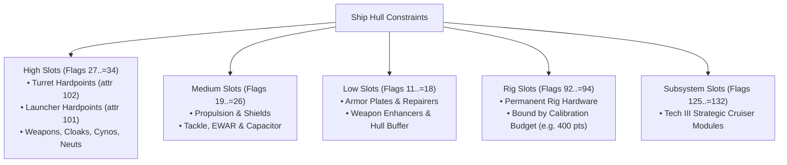
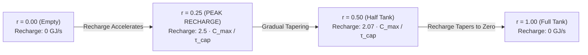
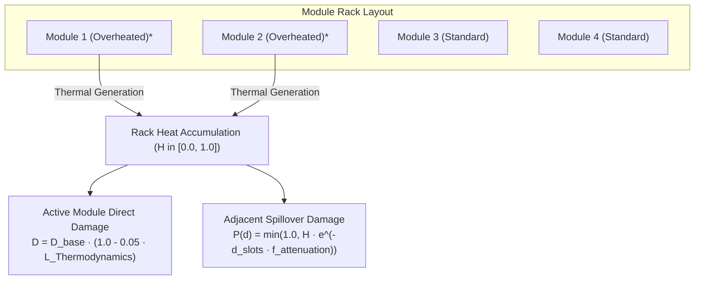
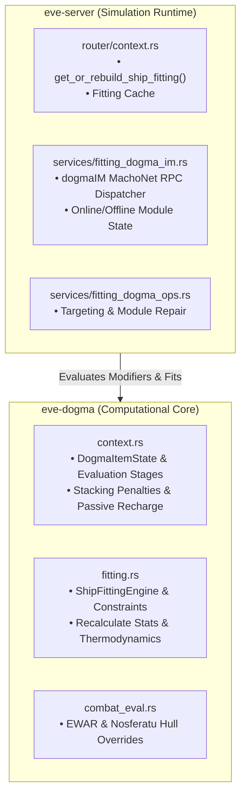

# Dogma Attribute Engine, Modifier Graphs & Fitting

> **Navigation**: [EvoMu Technical Wiki](../README.md) • [Related Systems](#related-systems--cross-references)
>
> [← Back to Wiki Table of Contents](../README.md)

---

## Overview & Lore Context

In the architecture of EVE Online, **Dogma** is the fundamental mathematical simulation engine governing all physical interactions, starship performance, module behaviors, and character progression. While the Static Data Export (SDE) defines the immutable base templates for types, items, and attributes, no ship in New Eden flies on static data alone. Every aspect of a vessel—from its maximum velocity and effective hit points to its capacitor recharge rate, weapon tracking, and sensor resolution—is the dynamic output of an interconnected **Attribute Modifier Graph**.

```mermaid
flowchart TD
    subgraph Char["Pilot Modifiers"]
        Skills["Character Skills<br/>(e.g., Gunnery V)"]
        Implants["Cybernetic Implants<br/>(e.g., +5% Med. Hybrid)"]
        Boosters["Combat Boosters<br/>(e.g., Drop Booster)"]
    end

    Skills & Implants & Boosters --> CharAttr["Character Attributes"]
    CharAttr -->|LocationRequiredSkillModifier| Hull["Ship Hull Dogma<br/>(Base PG, CPU, Agility, Tank)"]
    Hull -->|LocationGroupModifier<br/>(Ship Bonus per Level)| Modules["Fitted Active/Passive Modules & Rigs"]
    Modules -->|ItemModifier<br/>(Damage, Resist Modifiers)| Hull
    Modules --> Execution["Tactical Execution<br/>(Damage, Tracking, Range, Capacitor, Heat, Kinematics)"]
```

Within the lore of New Eden, Dogma represents the standard operating firmware mandated by CONCORD and the Empires. When a capsuleer plugs into the Capsule interface via cranial cybernetics, their neural impulses bridge with the starship's central mainframe. The Dogma engine runs as a deterministic virtual machine aboard the vessel, calculating energy distribution, quantum magnetic fields, and thermodynamics thousands of times per minute.

In [`EvoMu`](../../), the Dogma engine is implemented in the clean-room, memory-safe crate [`eve-dogma`](../../../crates/eve-dogma), supported by [`eve-sde`](../../../crates/eve-sde) for static schemas and [`eve-server`](../../../crates/eve-server) for live space simulation and client synchronization via the MachoNet `dogmaIM` service. The system implements the 4-operator calculation tree, 9 evaluation stages, analytical passive recharge differential curves, non-linear stacking penalty decay, hard fitting budgets (Powergrid, CPU, Calibration), and thermodynamics with rack heat propagation.

---

## Canonical Mechanics & Precise Formulas

### 1. The Dogma Modifier Calculation Tree

Every entity in Dogma (character, ship, module, drone, charge, structure) possesses a set of base attributes. When skills are trained, implants installed, boosters consumed, or modules brought online, they register **Attribute Modifiers** targeted at specific attributes across the graph.

#### The 9 Evaluation Stages & Operator Precedence
EVE Dogma evaluates modifiers in a strict ascending order of precedence. The operator precedence sequence is defined as follows:

| Evaluation Stage | SDE Opcode | Operator Type | Semantic Behavior |
| :---: | :---: | :--- | :--- |
| **Stage 0** | `-1` | `PreAssign` | Hard pre-assignment override |
| **Stage 1** | `0` | `PreMul` | Direct base multiplier |
| **Stage 2** | `1` | `PreDiv` | Direct base divisor |
| **Stage 3** | `2` | `ModAdd` | Flat scalar addition |
| **Stage 4** | `3` | `ModSub` | Flat scalar subtraction |
| **Stage 5** | `4 / 5` | `PostMul / PostDiv` | Multiplicative scaling after additions |
| **Stage 6** | `6` | `PostPercent` | Percentage modifier (subject to stacking penalties) |
| **Stage 7** | `8` | `PostPercentUnNerfed` | Percentage modifier (exempt from stacking penalties) |
| **Stage 8** | `7` | `PostAssign` | Final hard post-assignment clamp |

Mathematically, the effective value $V_{\text{final}}$ of an attribute with base value $V_0$ is resolved across these stages:

1. **Pre-Assignment:**
   $$V_1 = \begin{cases} A_{\text{pre}}, & \text{if PreAssign modifier exists} \\ V_0, & \text{otherwise} \end{cases}$$
2. **Pre-Multiplication & Pre-Division:**
   $$V_2 = \frac{V_1 \times \prod M_{\text{pre}}}{\prod D_{\text{pre}}}$$
3. **Flat Additions & Subtractions:**
   $$V_3 = V_2 + \sum A_{\text{mod}} - \sum S_{\text{mod}}$$
4. **Post-Multipliers, Post-Divisors & Percentage Modifiers:**
   Unpenalized and stacking-penalized percentage deltas $\delta = \frac{\text{Percent}}{100}$ are accumulated:
   $$V_4 = V_3 \times \prod (1 + \delta_{\text{unpenalized}}) \times \prod_{i=0}^{N-1} (1 + \delta_{\text{penalized}, i} \cdot S(i))$$
5. **Post-Assignment:**
   $$V_{\text{final}} = \begin{cases} A_{\text{post}}, & \text{if PostAssign modifier exists} \\ V_4, & \text{otherwise} \end{cases}$$

#### SDE Modifier Functions
Modifiers in the Static Data Export attach operators across hierarchical domains:

| SDE Function | Domain | Description | Example |
| :--- | :--- | :--- | :--- |
| `ItemModifier` | `shipID` / `itemID` | Modifies the target item directly. | Magnetic Field Stabilizer increasing hybrid damage. |
| `LocationModifier` | `shipID` | Modifies an attribute of the containing location (the ship hull). | Nanofiber Internal Structure increasing ship agility. |
| `LocationGroupModifier` | `shipID` | Modifies all items in the ship belonging to a specific group ID. | Medium Projectile Turret skill increasing tracking of medium autocannons. |
| `LocationRequiredSkillModifier` | `shipID` | Modifies items requiring a specific skill. | Hull Upgrades skill boosting armor HP across all fitted armor modules. |
| `OwnerRequiredSkillModifier` | `charID` | Modifies all ships owned by the pilot requiring a specific skill. | Caldari Cruiser skill adding +5% kinetic missile damage per level. |
| `ItemModifierWithFalloff` | `targetID` | Modifies target item attenuated by spatial distance. | Electronic Warfare (Tracking Disruptor, Sensor Dampener). |

---

### 2. Stacking Penalties

When multiple modules or rigs modify the same attribute on the same item, applying full bonuses multiplicatively would lead to game-breaking extremes (e.g. untouchable speeds or near-invulnerable damage resistances). EVE Online enforces an exponential **Stacking Penalty Curve** that diminishes returns on successive modules.

#### The Canonical Stacking Formula
For the $i$-th modifier affecting an attribute (1-indexed, sorted in descending order of effectiveness such that the strongest modifier is evaluated first):

$$S(i) = e^{-\left(\frac{i-1}{2.67}\right)^2} = e^{-\frac{(i-1)^2}{7.1289}}$$

In 0-indexed form ($n = i - 1$):
$$S(n) = e^{-\frac{n^2}{7.1289}}$$


#### Exact Numerical Decay Table

| Modifier Order ($i$) | Exponent $(i-1)^2 / 7.1289$ | Stacking Multiplier $S(i)$ | Effective Bonus Percentage |
| :---: | :---: | :---: | :---: |
| **1st Module** ($i=1$) | $0.0000$ | $1.000000$ | **$100.00\%$** |
| **2nd Module** ($i=2$) | $0.140274$ | $0.869118$ | **$86.91\%$** |
| **3rd Module** ($i=3$) | $0.561096$ | $0.570583$ | **$57.10\%$** |
| **4th Module** ($i=4$) | $1.262467$ | $0.282955$ | **$28.29\%$** |
| **5th Module** ($i=5$) | $2.244385$ | $0.105986$ | **$10.60\%$** |
| **6th Module** ($i=6$) | $3.506852$ | $0.029991$ | **$2.99\%$** |
| **7th Module** ($i=7$) | $5.049874$ | $0.006410$ | **$0.64\%$** |
| **8th Module** ($i=8$) | $6.873431$ | $0.001035$ | **$0.10\%$** |

#### Stacking-Penalized Attributes vs. Exemptions
Stacking penalties are strictly determined by the attribute's schema definition (`stackable: false`) and the modifier operator:

* **Penalized Attributes:**
  * Weapon damage modifiers (`damageMultiplier`)
  * Weapon rate of fire (`speed` / `rofMultiplier`)
  * Armor and Shield resistances (`armorEmResonance`, `shieldExplosiveResonance`, etc.)
  * Maximum velocity (`maxVelocity`)
  * Ship agility (`agility` / `inertiaModifier`)
  * Target Painter signature bloom (`signatureRadiusBonus`)
  * Stasis Webifier speed reduction (`speedFactor`)
  * Sensor Dampener range and scan resolution reductions
* **Stacking-Exempt Attributes & Sources:**
  * **Powergrid and CPU Upgrades:** Reactor Control Units, Micro Auxiliary Power Cores, and Co-Processors are stacking-exempt (`stackable: true`).
  * **Cargo Expanders:** Expanded Cargohold modules provide unpenalized capacity expansion (though their structural HP drawbacks are penalized).
  * **Character Skills:** All skill-derived percentage bonuses apply as `PostPercentUnNerfed` (SDE operator `8`).
  * **Cybernetic Implants:** Hardwirings and attribute implants do not suffer stacking penalties with modules.
  * **Command Bursts:** Fleet leadership buffs (`dbuff`) apply unpenalized.

---

### 3. Ship Fitting & Hard Budgets

Ship fitting is the discipline of equipping hardware into restricted physical and electrical constraints on the hull:



#### Slot Layouts & Hardpoints
* **High Slots (`hiPower`, flag `27..=34`):** Governed by `attr_ids::HI_SLOTS`. Hardpoints constrain offensive armaments:
  $$N_{\text{fitted turrets}} \le \text{TurretSlotsLeft} \quad (\text{Effect ID } 42)$$
  $$N_{\text{fitted launchers}} \le \text{LauncherSlotsLeft} \quad (\text{Effect ID } 40)$$
* **Medium Slots (`medPower`, flag `19..=26`):** Governed by `attr_ids::MED_SLOTS`. Primary location for active propulsion, shield defense, capacitor batteries, and electronic warfare.
* **Low Slots (`loPower`, flag `11..=18`):** Governed by `attr_ids::LOW_SLOTS`. Location for armor plates, repairers, hull reinforcements, and weapon enhancers.
* **Rig Slots (`rigSlot`, flag `92..=94`):** Typically 3 slots (2 on T2/T3 hulls). Rig fitting does not require CPU or PG, but is bound by the **Calibration Budget** (usually 400 points):
  $$\sum_{\text{fitted rigs}} \text{UpgradeCost} \le \text{UpgradeCapacity}$$
  Furthermore, the rig's `rigSize` (`1547`) must match the hull's size class (1 = Small, 2 = Medium, 3 = Large, 4 = Capital).
* **Subsystem Slots (`subSystem`, flag `125..=132`):** Unique to Tech III Cruisers (4 slots) and Tech III Destroyers (tactical mode switches). Subsystems alter the hull's underlying slot layout, base attributes, and Dogma bonuses.

#### Hard Powergrid & CPU Budgets
Every module fitted and brought online consumes resources from the ship's generators:

$$\text{CPU Load} = \sum_{m \in \text{OnlineModules}} \text{CpuLoad}(m) \le \text{CPU Output}$$
$$\text{Powergrid Load} = \sum_{m \in \text{OnlineModules}} \text{PowerLoad}(m) \le \text{Powergrid Output}$$

* **Overload Prohibition:** If bringing a module online causes $\text{CPU Load} > \text{CPU Output} + 10^{-6}$ or $\text{Power Load} > \text{Powergrid Output} + 10^{-6}$, the action fails immediately with `Insufficient CPU` or `Insufficient Powergrid`.
* **In-Space Onlining Gate:** Bringing a module online while unanchored in space requires the ship's capacitor to be at or above **$75\%$ of maximum capacity**. The onlining process consumes capacitor charge.
* **Fitted Group & Type Caps:**
  * `maxGroupFitted` (`1548` / `1544`): Prevents fitting multiple restricted modules (e.g. maximum 1 Damage Control, maximum 1 Cloaking Device).
  * `maxTypeFitted` (`2431`): Limits duplicate modules of the exact same type ID.
  * `maxGroupOnline` (`978` / `763`): Limits how many modules of a group can be active simultaneously (e.g. maximum 1 propulsion module: Afterburner or MWD).

---

### 4. Capacitor Simulation & Dynamics

The starship capacitor is an electrical accumulator supplying energy to active modules, warp drives, and repair systems. Unlike shields, which can regenerate to full during warp, capacitor regeneration is simulated continuously via a non-linear differential equation.

#### Differential Recharge Equation
The rate of capacitor regeneration depends on the current charge level $C(t)$, maximum capacity $C_{\max}$, and total recharge time $\tau_{\text{cap}}$ (in seconds):

$$\frac{dC}{dt} = \frac{10 \cdot C_{\max}}{\tau_{\text{cap}}} \cdot \left(\sqrt{\frac{C(t)}{C_{\max}}} - \frac{C(t)}{C_{\max}}\right)$$

Let $r = \frac{C(t)}{C_{\max}}$ represent the capacitor ratio ($0 \le r \le 1$). The recharge rate as a function of ratio is:
$$\frac{dC}{dt}(r) = \frac{10 \cdot C_{\max}}{\tau_{\text{cap}}} \cdot \left(\sqrt{r} - r\right)$$



#### Peak Recharge Rate
To find the capacitor ratio yielding maximum recharge, we differentiate with respect to $r$:
$$\frac{d}{dr}\left(\sqrt{r} - r\right) = \frac{1}{2\sqrt{r}} - 1 = 0 \implies 2\sqrt{r} = 1 \implies r = \left(\frac{1}{2}\right)^2 = 0.25$$

The peak recharge rate occurs at **$25\%$ capacitor capacity**:
$$\left(\frac{dC}{dt}\right)_{\max} = \frac{10 \cdot C_{\max}}{\tau_{\text{cap}}} \left(\sqrt{0.25} - 0.25\right) = \frac{10 \cdot C_{\max}}{\tau_{\text{cap}}} (0.50 - 0.25) = \frac{2.5 \cdot C_{\max}}{\tau_{\text{cap}}}$$

#### Analytical Integral Solution
For discrete simulation steps over elapsed time $\Delta t$, EvoMu utilizes the closed-form analytical integration of the differential equation:

$$C(t + \Delta t) = C_{\max} \cdot \left(1 + \left(\sqrt{\frac{C(t)}{C_{\max}}} - 1\right) \cdot e^{-\frac{5 \Delta t}{\tau_{\text{cap}}}}\right)^2$$

This formula ensures numerical precision without accumulating Euler-integration errors over long warp or flight trajectories.

#### Energy Warfare: Neutralizers vs. Nosferatu
* **Energy Neutralizer (`Effect ID: 71`):** Direct electrical destruction. Instantly drains a fixed quantity of Gigajoules ($\text{GJ}$) from the target's capacitor upon activation, irrespective of relative capacitor percentages.
* **Energy Nosferatu / Vampire (`Effect ID: 68`):** Siphons capacitor from the target and transfers it to the attacker, subject to the **Capacitor Percentage Rule**:
  $$\text{Can Siphon} \iff C_{\text{target}} > C_{\text{attacker}} \quad \text{or} \quad \text{Blood Raider Hull Bonus}$$
  If the attacker's capacitor percentage is higher than the target's, a standard Nosferatu transfers $0\text{ GJ}$. However, Blood Raider faction hulls (Cruor, Ashimmu, Bhaalgorn) feature a hull bonus (`attribute 1945` `nosOverride` or `effect 5854` `shipBonusNosferatuOverride`) that ignores this restriction, allowing them to drain targets even when the attacker is at 99% capacitor.

---

### 5. Overheating & Thermodynamics

Capsuleers trained in **Thermodynamics** can push modules past factory specifications ("Overheating"). Overheating increases module performance (e.g. $+15\%$ weapon rate of fire, $+20\%$ shield boost amount, $+30\%$ propulsion speed) at the cost of generating destructive thermal energy across the module rack.


*\* Overheated module generating thermal energy.*

#### Heat Accumulation & Dissipation
Each module rack (High, Medium, Low) maintains an independent heat level $H \in [0.0, 1.0]$. The heat level changes according to exponential approach curves:

$$H(t + \Delta t) = H_{\text{target}} + (H(t) - H_{\text{target}}) \cdot e^{-\lambda \Delta t}$$

* When modules in the rack are actively generating heat: $H_{\text{target}} = 1.0$, with generation rate $\lambda = \lambda_{\text{gen}}$.
* When no modules are overloaded: $H_{\text{target}} = 0.0$, with passive dissipation rate $\lambda = \lambda_{\text{dissipate}}$.

#### Heat Damage & Spatial Slot Attenuation
Each activation cycle of an overloaded module applies heat damage to itself and rolls a probability of applying spillover damage to adjacent modules in the same rack:

1. **Direct Module Damage:**
   $$D_{\text{direct}} = D_{\text{base}} \cdot \left(1.0 - 0.05 \cdot L_{\text{Thermodynamics}}\right)$$
   Where $D_{\text{base}}$ is defined by attribute `1211` (`heatDamage`).
2. **Spatial Distance Attenuation:** Modules fitted adjacent to the heat source suffer thermal bleed attenuated exponentially by slot distance $d_{\text{slots}}$:
   $$A(d) = e^{-d_{\text{slots}} \cdot f_{\text{attenuation}}}$$
   (Typically $f_{\text{attenuation}} = 0.5$).
3. **Spillover Damage Probability:**
   $$P_{\text{damage}}(d) = \min\left(1.0, \; H_{\text{rack}} \cdot A(d)\right)$$
   If the random roll succeeds, the adjacent module suffers $50\%$ of base heat damage.

#### Module Burnout & Nanite Repair
* **Burnout:** When a module's accumulated damage equals its maximum hit points ($D \ge \text{HP}_{\max}$), it enters the `BurnedOut` state. It is immediately forced into `ModuleState::Offline` and cannot be brought online until repaired.
* **In-Space Repair:** Damaged modules can be repaired in space using **Nanite Repair Paste** ([`typeID: 28668`](../../../crates/eve-sde/)):
  $$N_{\text{paste}} = \left\lceil D_{\text{damaged}} \times \text{PastePerHP} \right\rceil$$
  The skill **Nanite Operation** reduces paste consumption by $5\%$ per level, while **Nanite Interfacing** accelerates repair cycle speed by $20\%$ per level.

---

## EvoMu Implementation Architecture

EvoMu implements Dogma through a modular, decoupled engine architecture separating attribute evaluation, AST expression parsing, fitting state validation, and MachoNet network dispatch.



### 1. Crates Involved

* [`eve-dogma`](../../../crates/eve-dogma): Pure computational library containing the Dogma VM, expression evaluator, fitting engine, and stacking penalty logic. Has zero network or database dependencies.
* [`eve-sde`](../../../crates/eve-sde): Supplies static attribute definitions (`AttributeId`), type defaults, and Dogma effect blueprints (`EffectModifierSpec`).
* [`eve-server`](../../../crates/eve-server): Master simulation runtime managing live player sessions, module cycle ticks, and client notifications.

---

### 2. Primary Handlers & Services

#### Engine Core & Operator Execution: [`crates/eve-dogma/src/context.rs`](../../../crates/eve-dogma/src/context.rs)
* [`DogmaItemState::get_attribute`](../../../crates/eve-dogma/src/context.rs#L624): Evaluates an attribute by sorting modifiers into operator stages, executing PreAssign, PreMul, ModAdd, ModSub, PostMul, PostPercent (with stacking penalties), and PostAssign.
* [`stacking_penalty_factor`](../../../crates/eve-dogma/src/context.rs#L455): Implements $S(n) = e^{-n^2 / 7.1289}$.
* [`compute_passive_recharge`](../../../crates/eve-dogma/src/context.rs#L463): Closed-form capacitor and shield regeneration solution.

#### Fitting Engine & Slot Constraints: [`crates/eve-dogma/src/fitting.rs`](../../../crates/eve-dogma/src/fitting.rs)
* [`ShipFittingEngine::fit_module_with_state_and_overrides`](../../../crates/eve-dogma/src/fitting.rs#L27): Validates slot flags, hull slot capacities, turret/launcher hardpoint limits, group limits (`maxGroupFitted`), rig size compatibility, required character skills, and Calibration capacity.
* [`ShipFittingEngine::recalculate_stats`](../../../crates/eve-dogma/src/fitting.rs#L446): Rebuilds the entire Dogma graph, recomputes CPU Load vs. Output and Powergrid Load vs. Output, and rolls back with an error if limits are breached.
* [`thermodynamics::step_rack_heat`](../../../crates/eve-dogma/src/fitting.rs#L992): Advances rack heat levels during overload cycles.
* [`thermodynamics::heat_damage_probability`](../../../crates/eve-dogma/src/fitting.rs#L1009): Calculates spatial heat propagation to neighboring modules.

#### EWAR & Energy Warfare: [`crates/eve-dogma/src/combat_eval.rs`](../../../crates/eve-dogma/src/combat_eval.rs)
* [`eval_energy_nosferatu_with_hull`](../../../crates/eve-dogma/src/combat_eval.rs#L237): Enforces the target capacitor percentage check with Blood Raider hull overrides.
* [`eval_stasis_webifier_stacking`](../../../crates/eve-dogma/src/combat_eval.rs#L300): Stacking-penalized speed reduction.
* [`eval_target_painter_stacking`](../../../crates/eve-dogma/src/combat_eval.rs#L325): Stacking-penalized signature bloom.

#### MachoNet Service Dispatch: [`crates/eve-server/src/services/fitting_dogma_im.rs`](../../../crates/eve-server/src/services/fitting_dogma_im.rs)
* [`handle_dogma_im`](../../../crates/eve-server/src/services/fitting_dogma_im.rs#L7): Handles client RPC methods `GetAllInfo`, `GetShipAttributes`, `SetModuleOnline`, and `TakeModuleOffline`.
* Enforces the $75\%$ capacitor gate for onlining modules while in space.

---

### 3. Core Data Structures

```rust
// Defined in crates/eve-dogma/src/context.rs
pub struct AttributeModifier {
    pub source_item_id: i64,
    pub target_attribute_id: AttributeId,
    pub operator: ModifierOperator,
    pub value: f64,
    pub stacking_penalized: bool,
}

pub struct DogmaItemState {
    pub item_id: i64,
    pub type_id: TypeId,
    pub group_id: Option<u32>,
    pub base_attributes: HashMap<AttributeId, f64>,
    pub modifiers: Vec<AttributeModifier>,
    pub skill_levels: HashMap<i64, u8>,
}

// Defined in crates/eve-dogma/src/fitting.rs
#[derive(Debug, Clone, Copy, PartialEq, Eq, Serialize, Deserialize)]
pub enum ModuleState {
    Offline,
    Online,
    Active,
    Overheated,
}

pub struct FittedModule {
    pub item_id: i64,
    pub type_id: TypeId,
    pub flag_id: u16,
    pub state: ModuleState,
    pub damage_hp: f64,
    pub max_hp: f64,
    pub charge_type_id: Option<TypeId>,
    pub charge_quantity: i32,
    pub dynamic_attribute_overrides: HashMap<AttributeId, f64>,
}

pub struct ShipFittingEngine {
    pub ship: DogmaItemState,
    pub modules: HashMap<i64, FittedModule>,
    pub character_skills: HashMap<TypeId, u8>,
    pub implants: Vec<TypeId>,
    pub boosters: Vec<TypeId>,
    pub rack_heat: [f64; 3], // High, Med, Low heat racks
}
```

---

## Invariants, Security & Edge Cases

### 1. Invariant: Atomic Fitting Budget Enforcement & Rollback
* **Vulnerability:** Concurrently onlining multiple high-draw modules could permit a ship to exceed 100% CPU or Powergrid capacity.
* **Mitigation:** In [`ShipFittingEngine::fit_module_with_state_and_overrides`](../../../crates/eve-dogma/src/fitting.rs#L454), onlining evaluates total CPU/PG load against output. If load exceeds capacity ($L > O + 10^{-6}$), the new module is popped from `self.modules`, the previous configuration is restored, and stats are recalculated before returning an error.

### 2. Invariant: Elimination of Ghost Fitting
* **Vulnerability:** In legacy EVE server emulators, offlining a module or losing a ship while module modifiers were active could fail to purge modifiers from the hull, permanently inflating attributes ("ghost fitting").
* **Mitigation:** In EvoMu, the fitting engine does not store cumulative delta floats on the hull. Instead, [`recalculate_stats`](../../../crates/eve-dogma/src/fitting.rs#L421) clears all modifiers and rebuilds the active modifier graph from scratch whenever module states change. When a module goes offline, its modifier registration is completely eliminated.

### 3. Invariant: Tenant Fitting Isolation in Upwell Structures
* **Vulnerability:** Station Directors abusing structure privileges to unseat or repackage tenant ships docked in corporate citadels.
* **Mitigation:** In [`inventory_fitting.rs`](../../../crates/eve-server/src/services/inventory_fitting.rs#L752), item movements verify `item.owner_id == char_id`. Even players holding `ROLE_DIRECTOR` cannot move, modify, or strip modules from ships owned by other pilots docked in the same structure.

### 4. Edge Case: Bastion / Siege Resistance Normalization
* **Problem:** Bastion and Siege modules apply extreme resistance modifiers (e.g. Bastion sets remote repair impedance to $10^{-6}$ or $-99.9999\%$). Floating-point imprecision can result in tiny non-zero values (e.g. $0.0000001$).
* **Mitigation:** [`get_attribute`](../../../crates/eve-dogma/src/context.rs#L744) specifically normalizes EWAR and remote assistance resistance attributes (`2045`, `2112..=2116`, etc.) to exact `0.0` when within $10^{-4}$ of zero.

---

## Verification, Tests & Parity References

EvoMu's Dogma implementation is validated against golden test fixtures extracted from canonical client packet traces and comprehensive unit test suites:

### Parity Ledger Tags
* `feat:dogma.modifier-engine` — Complete 9-stage modifier precedence and domain resolution.
* `feat:fitting.stacking-penalty` — Canonical $e^{-(n-1)^2 / 7.1289}$ decay curve.
* `feat:dogma.heat-rack-thermodynamics` — Rack heat accumulation and nanite paste consumption.
* `feat:combat.nosferatu-drain-cap` — Vampire relative percentage rule and Blood Raider hull overrides.
* `feat:fitting.powergrid-cpu-budget` — Hard budget limits and rollback on overflow.
* `feat:fitting.calibration-budget` — Rig slot calibration cap enforcement.

### Concrete Integration Tests

| Test Function | Source File | Validated Mechanics |
| :--- | :--- | :--- |
| [`test_dg1_all_domain_modifier_functions_and_isolation`](../../../crates/eve-server/tests/it/dogma_modifier_engine.rs#L33) | [`dogma_modifier_engine.rs`](../../../crates/eve-server/tests/it/dogma_modifier_engine.rs) | Verifies `ItemModifier`, `LocationGroupModifier`, and skill modifiers against live SDE. |
| [`test_dg6_heat_rack_thermodynamics_nanite_repair_and_crystal_volatility`](../../../crates/eve-server/tests/it/dogma_capital_heat_crystals.rs#L789) | [`dogma_capital_heat_crystals.rs`](../../../crates/eve-server/tests/it/dogma_capital_heat_crystals.rs) | Tests overload heat buildup, thermodynamic skill reduction, and nanite repair paste in space. |
| [`test_fitting_slots_cpu_pwg_hardpoints_rigs_saved_multifit_ghost_inspace_weapons_ammo`](../../../crates/eve-server/tests/it/inventory_ships_fitting_complete_part2.rs#L337) | [`inventory_ships_fitting_complete_part2.rs`](../../../crates/eve-server/tests/it/inventory_ships_fitting_complete_part2.rs) | Validates slot layouts, turret/launcher hardpoint caps, DNA fitting strings, and simulation info. |
| [`test_stacking_penalty_coefficients`](../../../crates/eve-dogma/src/tests.rs#L25) | [`eve-dogma/src/tests.rs`](../../../crates/eve-dogma/src/tests.rs) | Exact precision unit test for stacking multipliers $S(0)$ through $S(5)$. |
| [`test_nanofiber_and_overdrive_stacking_evaluation`](../../../crates/eve-dogma/src/tests.rs#L355) | [`eve-dogma/src/tests.rs`](../../../crates/eve-dogma/src/tests.rs) | Multi-module fitting test verifying speed and agility stacking penalties on a Rifter hull. |
| [`test_dogma_differential_golden_fits`](../../../crates/eve-dogma/tests/t12_dogma_differential.rs) | [`t12_dogma_differential.rs`](../../../crates/eve-dogma/tests/t12_dogma_differential.rs) | Golden fit regression sweep matching CCP V24.01 client attribute outputs across thousands of fits. |

---

## Related Systems & Cross-References

- [**Gunnery Tracking & Missile Kinematics**](../combat_and_crimewatch/gunnery_tracking_and_missile_kinematics.md): Evaluation of weapon tracking speed, damage modifiers, missile velocity, and explosion radius.
- [**Mining Cycles & Extraction**](../mining_and_harvesting/mining_cycles_and_residue.md): Laser cycle times, capacitor drain, yield bonuses, and crystal volatility stacking.
- [**Character Progression & Skill Training**](../character_and_progression/skill_training_and_medical_clones.md): Character skill levels and cybernetic implants injecting dogma modifiers into active ship fits.
- [**Upwell Structures Overview & Lifecycle**](../upwell_and_structures/upwell_structures_overview.md): Structure module power grids, service module cycle timers, and defense platform fitting.

---

[← Back to Wiki Table of Contents](../README.md)
