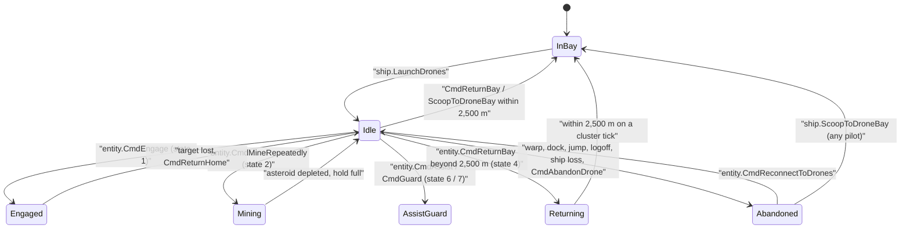

# Drones & Carrier Fighters

> **Navigation**: [EvoMu Technical Wiki](../README.md) • [Related Systems](#related-systems--cross-references)
>
> [← Back to Wiki Table of Contents](../README.md)

---

## Overview & Lore Context

Drones are small remote-controlled craft that a ship carries in its drone bay and launches into space to fight, repair, apply electronic warfare, mine or salvage. Carriers and some structures use **fighters** instead: squadrons loaded into launch tubes, each with up to three ability slots.

In EvoMu both systems live in [`eve-server`](../../../crates/eve-server). A launched drone is an inventory item moved from the drone bay to the solar system, a Destiny ball with its own combat state, and a `DroneSpaceState` entry in the combat runtime. A launched fighter squadron is one ball backed by one stacked inventory item and an `ActiveFighterSquadron` entry. The client drives drones through the `ship` and `entity` MachoNet services and fighters through `fighterMgr`.

---

## Canonical Mechanics & Formulas

The rules below are the ones the code enforces at the pinned commit. Attribute numbers are dogma attribute IDs read from the SDE or from the ship fitting.

### Launching

`ship.LaunchDrones` accepts a list of drone item IDs, a list of `(itemID, quantity)` pairs (quantity clamped to 1–50 and to the stack size), or a single ID. The handler rejects the call when the pilot is docked (`CantLaunchDronesWhileDocked`), is restricted by a tournament ruleset, or fails the shared cloak-and-warp guard for space actions.

| Limit | Source | Error |
|---|---|---|
| Drones in space | Level of skill `3436`, capped at 5; 0 if untrained (`pilot_drone_capacity`) | `NoDroneManagementAbilities` (limit is 0), `NoDroneManagementAbilitiesLeft` |
| Bandwidth | Ship attribute `1271` from the fitting, else the hull's SDE value, else 50. Forced to 0 while a module of type `27951` or `4294` is active. Each drone uses attribute `1272` (default 5) | `MaxBandwidthExceeded` |
| Item checks | Owned by the pilot, located in the active ship with the drone bay flag, category 18 | `DroneNotFound`, `DroneNotInBay`, `NotADrone` |
| Excavators | Group 101 drones with 25 bandwidth need a hull that has attribute `3223` or `3224` | `InvalidShipForExcavator` |

Launch is done in two phases. Placeholder entries with negative IDs are inserted into `active_drones_in_space` while count and bandwidth are re-checked under the runtime lock; then the world snapshot is mutated. One unit is split from a stack into a new singleton item (or the last unit is moved), its location becomes the solar system, and the ball ID equals the item ID. If the snapshot step fails (for example the ship docked in the meantime, `ShipNotInSpace`), the placeholders are removed.

Drone statistics are captured once at launch: damage per cycle is attributes `114`/`116`/`117`/`118` multiplied by `64`; optimal range is `54`; remote repair amounts are `68`, `84`, `83`; web factor `20`; neutralizer amount `97`; ECM strength the first of `238`–`241`; target painter bonus `554`. A drone whose velocity attribute `37` is below 1 is treated as a **sentry**: it never moves. Mutated drones use their item's dynamic attributes, scaled by the ratio the fitting applies to the base value.

The client is told through `OnItemChange` (stack decrement and the launched item) and `OnDroneStateChange`, sent both as a Destiny event and as a character notification.

### Control range

`compute_drone_control_range` returns the larger of two values:

$$R_{\text{fallback}} = R_{\text{hull}} + 5000 \cdot L_{3437} + 3000 \cdot L_{23566} + R_{\text{legacy}}$$

$$R = \max\left(R_{\text{char}} + (R_{\text{hull}} - 20000) + R_{\text{legacy}},\ R_{\text{fallback}}\right)$$

`R_hull` is the hull's attribute `458` (default 20,000 m), `R_char` is the character's evaluated attribute `458` from the fitting engine, and `R_legacy` is 3,000 m per level of skill `23618`, counted only when skill `23566` is at level 0.

### Commands

| RPC | Behaviour |
|---|---|
| `entity.CmdEngage` | Arguments are drone IDs and a target ID in either order. Fails when docked (`ShipDocked`), tethered (`CantActivateWhileTethered`), target missing (`TargetNotInSpace`), target beyond control range from the ship (`OutOfDroneControlRange`), target cloaked (`CannotTargetCloaked`) or tethered (`TargetInvulnerable`), or the ship has no completed lock on the target (`TargetNotLocked`). Drones that are themselves beyond control range are skipped. Offensive drones go through `evaluate_and_record_pvp_aggression`; group 640 (logistics) drones go through `evaluate_and_record_remote_assistance`. Non-sentry drones orbit the target at 1,500 m. The first cycle is applied inside the call if the drone is ready. |
| `entity.CmdReturnHome`, `entity.CmdReturnAndOrbit` | Same code path: clears the target, sets state 0, and orbits the ship at 1,000 m (sentries stop). Returns the number of drones changed. |
| `entity.CmdReturnBay` | `handle_cmd_return_bay`. A sentry farther than 2,500 m fails the whole call with `SentryDroneOutOfScoopRange` before anything changes. Mobile drones farther than 2,500 m are set to follow the ship and marked state 4 (`returning`); drones within 2,500 m are scooped at once. |
| `ship.ScoopToDroneBay`, `ship.ScoopDrone` | Scoops one drone within 2,500 m (`OutOfScoopRange`). An active drone controlled by another pilot is refused (`DroneOwnedByOther`); an abandoned drone can be scooped by anyone and the item's owner becomes the scooper. Bay volume is checked against attribute `283` (`InsufficientDroneBayCapacity`). |
| `entity.CmdAbandonDrone` | Marks the listed drones (or all of them) abandoned and sends `OnDroneControlLost`. |
| `entity.CmdReconnectToDrones` | Reconnects drones in the same system that are abandoned with the caller as original owner, or still owned with no parent ship. Each must be within 250,000 m and fit the count and bandwidth limits. The reply is a dict of failure reason (`OutOfRange`, `MaxDronesExceeded`, `InsufficientBandwidth`) to drone IDs. |
| `entity.CmdAssist`, `entity.CmdGuard` | Stores the assisted or guarded character on all of the caller's drones and sets state 6 or 7. |
| `entity.ChangeDroneSettings`, `entity.SetAggressive` | Stores `aggressive` and `focusFire` (both default `true`; booleans or 0/1 floats) and sends `OnDroneSettingChanged`. |
| `entity.CmdMineRepeatedly` | Mining drones; see below. Also reachable as `beyonce.CmdMineRepeatedly` and `dogmaIM.Mine`. |
| `entity.CmdSalvage` | Salvage drones; see below. |

Activity state values used in `OnDroneStateChange` and `OnDroneActivityChange`: 0 idle, 1 attacking, 2 mining, 4 returning, 6 assist, 7 guard.

### Combat cycles

A drone's cycle time is attribute `51`, else `73`, else 4,000 ms, rounded to whole seconds and clamped to 1–60 s. On the tick the interval is divided by the system's time-dilation factor (clamped to 0.1–1.0).

Damage is not a hit-or-miss roll. `compute_combat_hit_multiplier` scales the stored damage vector by

$$m = \operatorname{clamp}\left(0.5^{\left(\frac{\omega}{T}\cdot\frac{40}{S}\right)^2 + \left(\frac{\max(0,\ d - R_{opt})}{R_{fall}}\right)^2},\ 0.05,\ 1\right)$$

with `ω` = transversal speed / max(`d`, 250), `T` = tracking (attribute `160`), `S` = max(target signature radius, ball radius, 25), `R_opt` = attribute `54` and `R_fall` = attribute `158`. Beyond `R_opt + 3·R_fall` the multiplier is 0.

Other drone types, applied by `CmdEngage`:

- **Logistics** (group 640): adds the shield and armor repair amounts to the target, capped at its maximums.
- **EWAR** (groups 639, 641, 544, 545): web multiplies the target's speed fraction by `1 + factor/100` (clamped 0.1–1.0); neutralizers subtract capacitor; target painters set a signature multiplier of `1 + min(pct, 100)/100` (the largest one wins); ECM rolls a jam.
- **ECM** (`try_apply_drone_ecm_jam`): chance comes from `eve_dogma::compute_ecm_jam_chance` using the drone's strength times the target's ECM resistance (attributes `2253`, `2116`), the target's highest sensor strength (attributes `208`–`211`, fallback 10), distance, optimal and falloff. A successful jam lasts max(cycle, 20) seconds and clears the victim's locks except a lock on the jamming drone.
- **Immunity** (`is_target_immune_to_drone_ewar`): Upwell structures, groups 30, 365 and 659, hulls with attribute `1045` above 0, ships in a self-immune module cycle, ships with an active siege-type module (listed type IDs or group 515), and ships whose evaluated attribute `2045` is 0.

Each damaging or EWAR cycle records a killmail assist and renews timers: the weapons timer and PvP logoff timer when the victim is a player, otherwise the NPC aggression timer.

### Mining and salvage drones

Mining drones (group 101) are handled by `handle_mine` in [`space_entity_mining.rs`](../../../crates/eve-server/src/services/space_entity_mining.rs). If no drone ID is passed, all of the character's group 101 drones in space are used. Ice drones (attribute `182` equal to `43702`) may only target group 465 asteroids and ore drones may not (`InvalidTargetGroup`). Excavators additionally need an active group 515 module (`IndustrialCoreRequired`). Per-drone yield is attribute `77` (default 25 m³) multiplied by skill bonuses (`3438`, `3442`, `22541`), group 778 rigs with stacking penalty, and the capital industrial hull and core bonuses. Cycle time is attribute `73` plus a round trip of twice the asteroid distance at the drone's speed. Each drone gets a `DroneMiningState`; `step_repeating_drone_mining` then extracts ore every cycle and stops when the asteroid is depleted, the destination hold is full, the drone leaves control range, or the owner leaves space.

`entity.CmdSalvage` requires a controlled drone of group 1159 or type `32787` (`NoActiveSalvageDrones`) and runs one salvage cycle through `execute_wreck_salvage_auto_repeat`. The wreck must be within max(control range, 60,000 m) of the ship. The success chance in percent is

$$P = B_{902} + 5 \cdot L_{25863} + B_{\text{rigs}} + B_{901}$$

where `B_902` is the drone's access bonus (default 3), the skill term is skipped when the fitting already applies it as a modifier, and `B_901` is the wreck type's attribute `901` (default 20). The roll is uniform on [0, 100) from `ctx.mechanic_rng`. On success the wreck is removed, its contents move to a cargo container (type 23) at the same position, and salvage materials from `salvage_materials_for_wreck` go to the ship's cargo (`NotEnoughCargoSpace` if they do not fit). On `CycleRollFailed` a repeating `effectSalvaging` module cycle is queued on the system actor.

### Leaving grid, disconnect, dock and ship loss

| Event | What happens to drones |
|---|---|
| Warp start (`on_warp_initiated_hooks`) | `abandon_drones_on_warp_sync`: drones in that system are marked abandoned, lose controller and target, are stopped, and the pilot gets `OnDroneControlLost`. The inventory item keeps its owner. |
| Dock, stargate / wormhole / cyno / filament / Abyssal gate jump, safe logoff, logoff or disconnect, ship destruction, session transitions with `abandon_drones` | `abandon_drones_and_fighters_for_ship_sync`: the same as above, plus the pilot's scanner probes are set to state 0 and controlled fighter squadrons are abandoned (see below). |
| Server restart | `seed_persisted_abandoned_drones` recreates an abandoned `DroneSpaceState` for every category 18 item located in a solar system, with the item owner as original owner. Category 87 items become abandoned fighter squadrons. |
| Drone destroyed | The death pipeline removes the runtime entry, mining state and cycle timer, deletes the item, its position and space-object metadata, and removes the ball. |

Abandoned drones stay in space until someone reconnects or scoops them.

### Carrier fighters

Tubes and squadrons:

- The number of tubes is the hull's (or structure's) attribute `2216`. Tube inventory flags are `159 + tubeIndex`.
- `fighterMgr.LoadFightersToTube` takes a tube index (0–9) and a fighter item in either order. The item must be owned by the pilot, sit in the fighter bay, and be category 87. A stack larger than the maximum squadron size is split and the excess stays in the bay.
- Maximum squadron size is attribute `2215`; without it the fallback is 3 for groups 1537 and 4778, 6 for groups 1653 and 4779, and 9 otherwise.
- Class limits pair a fighter attribute with a hull slot attribute: `2212`→`2217`, `2213`→`2218`, `2214`→`2219`, `2740`→`2737`, `2741`→`2738`, `2742`→`2739`. Loaded and launched squadrons of a class may not exceed the hull's slot count (`CannotLoadFighterTubeNoTubesAvailableForClass`, `CannotLaunchFighterNotEnoughTubesAvailableForClass`).
- `fighterMgr.UnloadTubeToFighterBay` empties a tube that has no squadron in space.

`fighterMgr.LaunchFightersFromTubes` accepts tube indices or flag IDs 159–163, or launches every loaded tube. It fails while warping (`CannotOpenFighterTubesWhileWarping`), cloaked (`CannotOpenFighterTubesWhileCloaked`) or tethered (`DeniedTethered`), for an empty tube (`EmptyFighterTube`), and while the tube is rearming (`TubeRearming`). The squadron ball is spawned with fixed kinematics (2,500 m/s, mass 25,000, radius 20) orbiting the carrier at 1,000 m, and its shield, armor and structure are the type's values multiplied by squadron size. The client receives `OnFighterTubeTaskStatus` (`INSPACE`), `OnFighterTubeContentEmpty` and `OnFighterAddedToController`.

`fighterMgr.RecallFightersToTubes` is immediate: the ball is removed and the item returns to the fighter bay in the same call. Lost units are refilled from other stacks of the same type in the bay. The tube is then locked for

$$t = \operatorname{clamp}\left(\lceil t_{\text{refuel}} + t_{\text{charges}} + t_{\text{repair}} + 2.5 \cdot n_{\text{refilled}} \rceil,\ 3,\ 20\right)\ \text{s}$$

with `t_refuel` = attribute `2426` in seconds clamped to 2–10 (default 3), `t_charges` = Σ (used / max) × rearm time × 0.45 over charged slots, and `t_repair` = clamp(damage / unit HP, 0, 4) × 1.5. The client receives `OnFighterRemovedFromController`, `OnFighterTubeContentUpdate` and `OnFighterTubeTaskStatus` (`REFUELING`).

Movement: `fighterMgr.ExecuteMovementCommandOnFighters(fighterIDs, command, ...)` supports `ORBIT` (default 1,000 m), `FOLLOW` / `APPROACH` (default 500 m), `STOP`, `MWD`, `MJD` (needs ability 5 or attribute `2154`; default jump 100,000 m, default cooldown 60 s), and otherwise moves in a direction.

Abilities: `fighterMgr.CmdActivateAbilitySlots(fighterIDs, slotID, target)` with slot 0–2. Slot definitions, target modes, charges and cooldowns come from the SDE (`fighter_abilities_by_type`, `fighter_abilities`).

- The squadron and its carrier must not be warping, cloaked, tethered or inside a POS forcefield.
- Abilities flagged `disallow_in_high_sec` fail at security 0.45 or higher; `disallow_in_low_sec` fails between 0.0 and 0.45.
- Item-targeted abilities need a completed lock from the carrier or the squadron (`TargetNotLocked`) and a per-ability range read from the fighter's attributes (`TargetOutOfRange`).
- Damage abilities multiply the fighter's damage attributes by squadron size. Abilities 16 and 33 get a bonus against fighter targets. Support abilities apply web (2, 18), warp disruption (10, 36), energy neutralization (11), ECM (12), target painting (14) and sensor dampening (17); Upwell structures reject them (`StructureImmuneToEwar`).
- Self abilities: MJD (5) and MWD / evasive manoeuvres (4, 9, 13), which change the squadron's speed and, for 13, its signature.
- Point-targeted abilities (`fighterMgr.ActivateAbilitySlotsAtPoint`, or a coordinate passed to `CmdActivateAbilitySlots`) are bombs: refused at security 0.45 or higher (`BombForbiddenInHighSec`) and with green safety wherever security is above 0.0 (`CantDoInCurrentSafetyLevel`), limited to 100,000 m from the squadron, and applied as area damage around the point using the bomb type from attribute `2324`.
- After activation the slot is gated for max(SDE cooldown, cycle duration, 1 s) and one charge is consumed where the slot has charges (`OutOfCharges`). The client receives `OnFighterAbilitySlotActivated`; `fighterMgr.CmdDeactivateAbilitySlots` sends `OnFighterAbilitySlotDeactivated`.

Losses: `apply_damage_to_fighter_squadron` accumulates incoming damage per squadron. Each time the total reaches one unit's HP (attribute `263`, else `9`, minimum 250) a unit is lost, the item's quantity drops, and `OnInSpaceSquadronSizeChanged` is sent. At size 0 the ball is removed and `OnFighterRemovedFromController` is sent.

Abandon and scoop: `fighterMgr.CmdAbandonFighter` (and every event in the table above) marks squadrons abandoned and moves the item to the solar system. `fighterMgr.CmdScoopAbandonedFighterFromSpace` recovers an abandoned squadron within 2,500 m into a ship that has a fighter bay with room (`FighterOutOfRange`, `NoFighterBay`, `FighterBayFull`).

### Not implemented / known gaps

- `step_drone_auto_aggression_and_assist` is the only code that acts on the `aggressive` setting and on assist / guard assignments, and at this commit it is called only from tests. In a running server the settings are stored and reported to the client, but drones do not engage on their own.
- `focusFire` is stored and persisted; no code reads it.
- `step_engaged_drones` repeats damage and ECM cycles only. Logistics repair, web, neutralizer and target-painter effects are applied by the `CmdEngage` call itself and are not repeated by the tick. Hull repair amount is captured at launch but never applied.
- `CmdSalvage` does not move the drone. The salvage attempt is resolved from the ship's position, and the repeat after a failed roll is a module cycle on the ship, not a drone cycle.
- Engaged drones orbit at 1,500 m and drones told to return and orbit use 1,000 m. Both distances are constants in the handler.
- Fighter recall is instantaneous; squadrons do not fly back to the carrier.
- Fighter balls use fixed speed, mass and radius instead of SDE values.
- Damage abilities are applied once per activation call. Only the warp-disruption ability registers a repeating cycle on the system actor.
- `fighterMgr.GetFightersForShip` returns an empty ability-state dict.
- `DroneController`, `validate_drone_bandwidth` and `apply_damage_to_drone_in_space` exist but are referenced only by tests; the live path is `handle_npcs_drones`.
- Fighter state is saved as part of the `server_runtime_state` blob, which is written after successful `fighterMgr` calls but has no shutdown flush (open issue #875).

---

## EvoMu Implementation Architecture

### Crates involved

- [`eve-server`](../../../crates/eve-server): all handlers, runtime state and tick steps.
- [`eve-destiny`](../../../crates/eve-destiny): `Ball`, `MovementMode`, `DestinyEvent::OnDroneStateChange` / `OnDroneActivityChange`, combat state and target locks.
- [`eve-dogma`](../../../crates/eve-dogma): `ShipFittingEngine` drone states, `compute_ecm_jam_chance`, stacking penalty.
- [`eve-db`](../../../crates/eve-db): inventory items, `InventoryFlag::DroneBay` / `FighterBay`, `PersistedCombatCrimewatchState`.
- [`eve-sde`](../../../crates/eve-sde): type attributes, fighter ability tables, salvage material pools.

### Primary handlers and dispatch

| File | Contents |
|---|---|
| [`combat_npcs_drones.rs`](../../../crates/eve-server/src/services/combat_npcs_drones.rs) | `handle_npcs_drones` (all `ship` / `entity` drone RPCs), `pilot_drone_capacity`, `compute_drone_control_range`, `compute_combat_hit_multiplier`, salvager and tractor module activation |
| [`combat_npcs_drones_cycle_ops.rs`](../../../crates/eve-server/src/services/combat_npcs_drones_cycle_ops.rs) | `step_engaged_drones`, `step_drone_auto_aggression_and_assist`, `try_apply_drone_ecm_jam`, `is_target_immune_to_drone_ewar`, `renew_drone_aggression_timers` |
| [`drone_return.rs`](../../../crates/eve-server/src/sp6_lifecycle/drone_return.rs) | `handle_cmd_return_bay`, `try_atomic_scoop_drone`, `step_returning_drones`, `abandon_drones_on_warp_sync`, `abandon_drones_and_fighters_for_ship_sync`, `step_repeating_drone_mining` |
| [`sp6_lifecycle.rs`](../../../crates/eve-server/src/sp6_lifecycle.rs) | `handle_cmd_abandon_drone`, `handle_cmd_reconnect_to_drones`, `record_drone_ball_meta_in_snap` |
| [`drone_reconnect_finish.rs`](../../../crates/eve-server/src/sp6_lifecycle/drone_reconnect_finish.rs) | `finish_reconnect_drones` (restores item ownership, emits state) |
| [`drones_salvage_tractor.rs`](../../../crates/eve-server/src/combat/drones_salvage_tractor.rs) | `validate_wreck_salvage_target`, `execute_wreck_salvage_cycle`, `execute_wreck_salvage_cycle_scheduled`, `step_tractor_beam` |
| [`space_entity_mining.rs`](../../../crates/eve-server/src/services/space_entity_mining.rs) | `handle_mine` (drone and module mining) |
| [`combat_fighters.rs`](../../../crates/eve-server/src/services/combat_fighters.rs) | `handle_fighters` (tubes, launch, recall, movement, abandon, scoop), `apply_damage_to_fighter_squadron` |
| [`combat_fighters_abilities.rs`](../../../crates/eve-server/src/services/combat_fighters_abilities.rs) | Ability activation, point-targeted bombs, deactivation |

Both `handle_fighters` and `handle_npcs_drones` are tried from the combat dispatch chain in [`combat_crimewatch.rs`](../../../crates/eve-server/src/services/combat_crimewatch.rs). `entity.CmdEngage`, `CmdReturnHome`, `CmdReturnAndOrbit` and `CmdReturnBay` replies are rewritten to a dict by [`client_compat.rs`](../../../crates/eve-server/src/router/client_compat.rs) when the handler returned something else.

### State

| State | Location | Persistence |
|---|---|---|
| `active_drones_in_space: HashMap<i64, DroneSpaceState>` | `CombatRuntimeState` in [`combat_crimewatch.rs`](../../../crates/eve-server/src/services/combat_crimewatch.rs) | Extended runtime JSON inside `WorldStateSnapshot.combat_crimewatch_state` |
| `drone_next_ready_unix`, `active_drone_miners` (`DroneMiningState`) | same | same |
| `drone_settings: HashMap<i64, DroneBehaviorSettings>` | same | `combat_crimewatch_state.drone_settings` as `(aggressive, focus_fire)` |
| `fighter_unit_damage_accum`, `fighter_tube_rearm_until` | same | same (extended runtime JSON) |
| `active_fighters`, `fighter_tube_loads`, `fighter_cooldown_state`, `fighter_charge_state` | `ServerContext` ([`context.rs`](../../../crates/eve-server/src/router/context.rs)) | `server_runtime_state` blob ([`context_runtime_persistence.rs`](../../../crates/eve-server/src/router/context_runtime_persistence.rs)) |
| Drone and fighter items, `item_positions`, `sp6_lifecycle.space_object_meta[..].drone_ball_id` | `WorldStateSnapshot` | SQLite |

`DroneSpaceState` keeps `owner_char_id` (0 when abandoned), `original_owner_char_id` (used by reconnect), `parent_ship_id`, `activity_state`, `target_id`, `assist_char_id`, `guard_char_id`, `is_abandoned`, `is_sentry`, `bandwidth_used` and the stats captured at launch.

### Tick integration

`tick_background_cluster_with_step` in [`cluster_tick.rs`](../../../crates/eve-server/src/sp6_lifecycle/cluster_tick.rs) runs, in order, `step_repeating_drone_mining`, `step_returning_drones` and `step_engaged_drones`. The same file finalizes safe logoffs (abandoning drones and fighters) and contains `seed_persisted_abandoned_drones`, which [`context.rs`](../../../crates/eve-server/src/router/context.rs) calls when the server context is built. Fighters have no tick step of their own; warp-disruption cycles run on the system actor.

---

## Invariants, Security & Edge Cases

- **Ownership.** Launch requires the item to be owned by the caller and in the caller's active ship's drone bay. Mining rejects drone IDs the caller does not own (`InvalidDroneOwner`). Fighter movement and ability calls require `owner_char_id` to match and the squadron not to be abandoned (`FighterNotOwned`).
- **Races.** Launch re-validates the character's docked state, system and ship inside the snapshot write and rolls back reservations on failure. `try_atomic_scoop_drone` first removes the drone from the runtime map so two scoops cannot both succeed, and re-inserts it if the bay is full. Fighter launch claims tubes, reserves squadron slots and restores both if the snapshot step fails.
- **Cloak and tether.** A cloaked or tethered parent ship disengages its drones on the next cycle; cloaked or tethered targets are dropped. Fighters cannot be launched or use abilities while the carrier is cloaked or tethered.
- **Sentries.** They are never given a movement mode and can only return to the bay from within 2,500 m.
- **Stacks.** Launching from a stack never moves the whole stack: one unit is split into a new singleton item per drone.
- **Tournaments.** `check_tourney_drone_restricted` gates launch, engage, return-and-orbit, scoop and reconnect. `CmdReturnBay` does not call it.
- **Session boundaries.** The dock, jump, logoff and destruction paths listed above call `abandon_drones_and_fighters_for_ship_sync` with the system the ship is leaving, so a drone left behind has no controller.

---

## Verification, Tests & Parity References

Ledger rows (`ledger.json`): `feat:drones.launch-drones`, `feat:drones.recall-drones`, `feat:drones.return-orbit`, `feat:drones.engage-target`, `feat:drones.drone-bandwidth`, `feat:drones.drone-control-range`, `feat:drones.aggressive-passive`, `feat:drones.assist-guard`, `feat:drones.abandon-scoop`, `feat:drones.reconnect-drones`, `feat:drones.sentry-drones`, `feat:drones.ewar-drones`, `feat:drones.logistic-drones`, `feat:drones.mining-drones`, `feat:drones.salvage-drones`, `feat:drones.drone-hp-loss`, `feat:drones.fighter-load-tubes`, `feat:drones.fighter-launch-recall`, `feat:drones.fighter-movement`, `feat:drones.fighter-abilities`, `feat:drones.fighter-squadron-losses`, `feat:drones.fighter-abandon`; `rpc:ship.LaunchDrones`, `rpc:ship.ScoopDrone`, `rpc:entity.CmdEngage`, `rpc:entity.CmdReturnBay`, `rpc:entity.CmdReturnHome`, `rpc:entity.CmdAbandonDrone`, `rpc:entity.CmdReconnectToDrones`, `rpc:entity.CmdAssist`, `rpc:entity.CmdGuard`, `rpc:entity.CmdMineRepeatedly`, `rpc:entity.CmdSalvage`, `rpc:fighterMgr.LoadFightersToTube`, `rpc:fighterMgr.LaunchFightersFromTubes`, `rpc:fighterMgr.RecallFightersToTubes`, `rpc:fighterMgr.ExecuteMovementCommandOnFighters`, `rpc:fighterMgr.CmdActivateAbilitySlots`, `rpc:fighterMgr.CmdScoopAbandonedFighterFromSpace`; `notify:OnDroneStateChange`, `notify:OnDroneActivityChange`, `notify:OnDroneControlLost`, `notify:OnFighterTubeTaskStatus`, `notify:OnFighterAddedToController`, `notify:OnFighterAbilitySlotActivated`, `notify:OnInSpaceSquadronSizeChanged`.

Auditor rows (`auditor_rows.json`): `feat:lifecycle.drones-leave-grid-abandon`, `feat:lifecycle.drones-in-space-persist-restart`, `feat:lifecycle.drones-recall-same-grid`, `feat:lifecycle.fighters-left-in-space`, `feat:drones.bandwidth-and-bay-constraints`, `feat:drones.sentry-drone-scoop-distance`, `feat:drones.fighter-refuel-rearm-repair`, `feat:drones.fighter-heavy-long-range-bomb`, `feat:drones.support-fighter-abilities`, `feat:drones.light-fighter-space-superiority`.

Unit tests next to the code:

- [`combat_npcs_drones_tests.rs`](../../../crates/eve-server/src/services/combat_npcs_drones_tests.rs), [`combat_npcs_drones_control_tests.rs`](../../../crates/eve-server/src/services/combat_npcs_drones_control_tests.rs), [`combat_npcs_drones_cycle_ops_edges_tests.rs`](../../../crates/eve-server/src/services/combat_npcs_drones_cycle_ops_edges_tests.rs)
- [`drone_recovery_tests.rs`](../../../crates/eve-server/src/sp6_lifecycle/drone_recovery_tests.rs), [`drone_return_extra_tests.rs`](../../../crates/eve-server/src/sp6_lifecycle/drone_return_extra_tests.rs), [`drone_mining_extraction_tests.rs`](../../../crates/eve-server/src/sp6_lifecycle/drone_mining_extraction_tests.rs)
- [`drones_salvage_tractor_unit_tests.rs`](../../../crates/eve-server/src/combat/drones_salvage_tractor_unit_tests.rs)
- [`combat_fighters_tests.rs`](../../../crates/eve-server/src/services/combat_fighters_tests.rs), [`combat_fighters_tubes_and_scoop_unit_tests.rs`](../../../crates/eve-server/src/services/combat_fighters_tubes_and_scoop_unit_tests.rs), [`combat_fighters_abilities_tests.rs`](../../../crates/eve-server/src/services/combat_fighters_abilities_tests.rs), [`combat_fighters_bomb_tests.rs`](../../../crates/eve-server/src/services/combat_fighters_bomb_tests.rs)

Integration tests in [`crates/eve-server/tests/it/`](../../../crates/eve-server/tests/it/): `combat_drones_npcs.rs`, `drones_fighters_live.rs`, `drones_fighters_and_abilities.rs`, `drones_fighters_advanced.rs`, `carrier_fighters_live.rs`, `mining_ice_and_drones.rs`, `test_security_p0_drones_shipping_fixes.rs`.

---

## Related Systems & Cross-References

- [**Dogma Attribute Engine**](./dogma_attribute_engine.md): how drone and ship attributes are evaluated.
- [**Gunnery Tracking & Missile Kinematics**](../combat_and_crimewatch/gunnery_tracking_and_missile_kinematics.md): the turret model the drone hit multiplier resembles.
- [**Crimewatch & Engagement Timers**](../combat_and_crimewatch/crimewatch_and_engagement_timers.md): timers renewed by drone and fighter aggression.
- [**Mining Cycles & Residue**](../mining_and_harvesting/mining_cycles_and_residue.md): asteroid extraction used by mining drones.
- [**NPC Combat AI & Ecology**](../npcs_and_living_world/npc_combat_ai_and_ecology.md): NPC threat tables that drone damage feeds.
- [**Destiny Simulation Loop**](../ballpark_and_physics/destiny_simulation_loop.md): ball movement modes used for orbit, follow and stop.
- [**EvoMu Technical Wiki Table of Contents**](../README.md): master index and domain directory.

---

[← Back to Wiki Table of Contents](../README.md)
