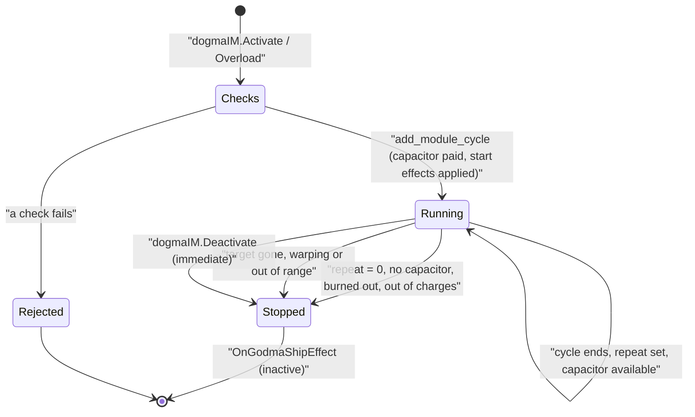

# Module Activation & Cycles

> **Navigation**: [EvoMu Technical Wiki](../README.md) • [Related Systems](#related-systems--cross-references)
>
> [← Back to Wiki Table of Contents](../README.md)

---

## Overview & Lore Context

When a pilot activates a fitted module, the server checks that the activation is allowed, works out what one **cycle** of the module does (how long it lasts, how much capacitor it costs, what it does to the ship or the target), and hands that cycle to the solar system's actor. The actor runs the cycle on its tick, applies its effects, and either starts the next cycle or ends it. The client is told about the start and the end with `OnGodmaShipEffect`.

This article covers that path: `dogmaIM.Activate`, `Overload`, `Deactivate`, charges and reloading, overheating, and the notifications. How attribute values are computed is in [Dogma Attribute Engine](dogma_attribute_engine.md); hit chance and damage application are in [Gunnery Tracking & Missile Kinematics](../combat_and_crimewatch/gunnery_tracking_and_missile_kinematics.md); mining modules use their own engine, described in [Mining Cycles & Residue](../mining_and_harvesting/mining_cycles_and_residue.md).

---

## Canonical Mechanics & Formulas

The rules below are what the code does at the pinned commit.

### Entry points

| RPC | Purpose |
|---|---|
| `dogmaIM.Activate(itemID, effectName, target, repeat)` | Start a cycle. `effectName = "online"` on a docked ship or an offline module instead puts the module online. |
| `dogmaIM.Overload(itemID, effectName, target, repeat)` | Start an overloaded cycle, or toggle overload on a module (see Overheating). |
| `dogmaIM.Deactivate(itemID, effectName)` | Stop a cycle. `effectName = "online"` takes the module offline. |
| `dogmaIM.StopOverload`, `OverloadRack`, `StopOverloadRack` | Overload control for one module or a whole rack. |
| `dogmaIM.LoadAmmo`, `UnloadAmmo` | Load or remove charges. |

### Two activation paths

`handle_module_cycles` is the general path and the subject of this article. It hands the call to other handlers in these cases:

- the "ship" is an Upwell structure, or the module sits in one (`handle_structure_module_activate`);
- a weapon is fired at a faction-warfare opponent, in an arena match, at a structure, at a convoy or container, or the module belongs to a short list of groups: these go to `combat_weapons::handle_weapons`;
- mining modules (`mining_cycle::activate`);
- modules with their own activation code: superweapons and lances, target spectrum breakers, cynosural generators, command bursts, analyzers and entosis links, scan probe launchers, interdiction sphere launchers and survey probe launchers.

### Checks before activation

Roughly in the order the general path applies them:

1. A character session with an active ship, in a solar system (`NoActiveShip`, `NoSolarSystem`). A pending safe log-off is aborted.
2. The module is fitted to the ship (`ModuleNotFound`).
3. Not reloading (`ModuleIsReloading`, see Charges).
4. Not being repaired with nanite paste (`ModuleBeingRepaired`).
5. Not burned out, and no burned-out module in its weapon bank (`ModuleBurnedOut`).
6. Online (`ModuleOffline`).
7. `enforce_space_module_cloak_and_warp_guard`: not in warp past the align phase (`CantActivateInWarp`; covert cloaks and group `4117` are exempt), the gate cloak is broken if present, and the ship is not cloaked (`CannotActivateCloaked`; cloaks, scan probe launchers and group `4117` are exempt).
8. Not tethered, for a list of offensive module groups (`CantActivateWhileTethered`).
9. Module-specific rules: cloaks (not in Abyssal space, not with a group `588` module fitted, covert cloak only on allowed hulls), Zarzakh hazard ban (attribute `5561`), microwarpdrives in deadspace, propulsion and micro jump drives while warp scrambled (`WarpScrambled`).
10. Not in its reactivation delay (`ModuleReactivationDelay`, or `ModuleAlreadyActive` for weapons).
11. Not already active, for a fixed list of module groups (`ModuleAlreadyActive`).
12. With a target: the target is locked (`TargetNotLocked`), is not the ship itself for remote and offensive groups (`CannotActivateOnSelf`), and is not an interdiction probe. Salvagers, tractor beams and passive targeters need a target (`TargetRequired`).
13. Smartbombs, burst jammers and burst projectors in a system with security above 0 need the safety set to red (`CantDoInCurrentSafetyLevel`).

After the cycle has been added (so capacitor is already taken), two more steps can still fail: `evaluate_module_cycle_aggression_or_assistance` (crimewatch rules for offensive and remote-assistance groups) and `commit_post_cycle_activation_effects` (charge consumption and other deferred effects). On failure the cycle is removed and `cap_need` is given back.

### What a cycle contains

The handler builds an `ActiveModuleCycle` from the evaluated module state (`build_effective_module_state`). All values are computed once, at activation.

| Field | Source |
|---|---|
| `duration_s` | Attribute `DURATION`; if zero, attribute `3115`; if zero, `SPEED`; 12 s for a micro jump drive with none of these; otherwise 1 s. |
| `cap_need_per_cycle` | Attribute `CAPACITOR_NEED`. Zero for a capacitor booster, and for an ancillary shield booster that has a charge to burn. |
| `repeat` | The client's `repeat` argument (default 1). Forced to 0 for micro jump drives, interdiction nullifiers, and the modules the code flags `is_adc` and `is_cehe` (emergency hull energizer); forced to at least 1 for cloaks. |
| Effect amounts | Shield boost (attribute `68`), armour repair (`84`), hull repair (`83`), capacitor drain (`97`) and transfer (`90`), remote amounts, damage vector, weapon range and tracking, speed boost, tackle strengths and others. |
| `is_overloaded`, `rack_idx`, `heat_damage_per_cycle` | Overload state, rack (high = 0, medium = 1, low = 2), attribute `1211` (3.4 if zero). |
| `reactivation_delay_s` | Attribute `669` in milliseconds. |
| `max_effective_range_m` | For targeted modules: optimal + 3 × falloff, or missile range, or the ship's targeting range. |

Weapon damage is the charge's damage attributes (or the module's, without a charge) times the damage multiplier times the number of weapons in the bank.

### Start of a cycle

`handle_add_module_cycle` runs inside the system actor:

- Refuses propulsion and micro jump modules while the ship's `is_mwd_mjd_disabled` flag is set.
- Removes any cycle already running for the same ship and module.
- Fails with "Insufficient capacitor" (reported as `NotEnoughCapacitor`) if the capacitor is below `cap_need_per_cycle`; otherwise subtracts it.
- Applies the start-of-cycle effects: capacitor booster injection, shield boost, and on the target capacitor drain, remote shield repair and remote capacitor transfer (with range falloff).
- Sets module-specific ship state (cloak speed, self-immobilization, reactive hardener starting resonances, interdiction nullification) and recomputes tackle and bubbles.

Back in the handler, the module is added to `module_active_states`, the cached fit marks it active, the reactivation delay is recorded for cycle-gated groups, and the start notification is sent.

### End of a cycle

`step_cycles_and_capacitor_with_epochs` advances every cycle by the tick length. A cycle is removed early when its ship has left the ballpark, a cloak was broken, or its target is gone, is warping, or is farther than `max_effective_range_m`.

When `elapsed_s` reaches `duration_s`:

1. End-of-cycle effects are applied: local armour and hull repair, reactive armour hardener shift, the micro jump, auto-targeting, and target effects (weapon damage, energy nosferatu, remote armour and hull repair).
2. If overloaded, heat damage is rolled (see Overheating).
3. Charges are consumed or crystals damaged.
4. The cycle stops if `repeat == 0`, the module burned out, or its crystal shattered with none left.
5. Otherwise the next cycle is prepared: ancillary modules and capacitor boosters consume their next charge (a capacitor booster with no charge stops), then `cap_need_per_cycle` is subtracted; if the capacitor is too low the cycle stops.
6. If the cycle continues, a pending overload change is applied and the start-of-cycle effects for the next cycle run.

`repeat` is not counted down: any non-zero value repeats until something stops the cycle.

### Deactivation

`dogmaIM.Deactivate` (`handle_mining_and_deactivate`) checks that the caller owns the ship and that the module is fitted to it, refuses while a micro jump drive is spooling (`CantDeactivateWhileSpooling`), and then removes the cycle from the actor immediately. It clears projected electronic warfare and remote assistance from the module, sends `OnModulesDeactivating` and the stop `OnGodmaShipEffect`, removes the module from `module_active_states`, and records a reactivation delay.

Cycles are also removed without a client request:

- entering warp removes all of a ship's cycles except those that grant interdiction nullification (`remove_non_warp_ship_module_cycles`);
- a ship leaving space loses its own cycles and every cycle that targets it (`remove_all_ship_module_cycles`);
- unlocking a target removes the cycles aimed at it (`on_target_unlocked_in_actor`);
- a module burned out by heat loses its cycle.

Each of these calls the module deactivation hook, which sends the stop notification.

### Reactivation delay

`record_module_reactivation_delay` stores a per-module cooldown in `ServerContext::module_reactivation_cooldowns`; `is_module_in_reactivation_delay` blocks activation until it has passed. On activation the delay is `duration + reactivation delay` for a fixed list of "cycle-gated" groups (weapons, smartbombs, shield boosters, capacitor boosters, salvagers and others; shield boosters use the larger of the two), and for any non-repeating module with attribute `669`. On deactivation it is the larger of the unfinished part of the cycle plus the module's delay, and attribute `669`.

### Charges and reloading

- **Loading.** `dogmaIM.LoadAmmo(shipID, moduleIDs, chargeIDs)` (`handle_load_ammo`) requires the caller to own the ship and the charge stack, the stack to be reachable (ship cargo or ammo hold, a container in it, or the current hangar), and the charge to be compatible with every target module (`IncompatibleAmmo`). Charges are split fairly between the modules, up to each module's capacity.
- **Reload timer.** In space, the modules are marked as reloading until `now + ceil(reload time)`. The reload time is attribute `1795` of the first module, 10 s if absent; command burst modules use 60 s reduced by 10% per level of skill `43728`. Scripts (group `908`) and scan probe launchers have no timer, and there is none while docked. Activating a reloading module, or any module in a bank with a reloading member, fails with `ModuleIsReloading`.
- **Consumption.** Ordinary ammunition is consumed one unit per weapon per cycle: the first round at activation, each later round when the next cycle is confirmed. Crystals with volatility take damage by chance each cycle and are destroyed when it reaches their hit points; crystals without volatility are never consumed.
- **Ancillary modules.** An ancillary shield booster burns one charge per cycle and costs no capacitor while charges last, then falls back to its capacitor cost. An ancillary armour repairer burns nanite paste (type `28668`, attribute `56` units per cycle) and repairs three times its base amount while fuelled.
- **Notifications.** `OnChargeBeingLoadedToModule(moduleIDs, chargeTypeID, timeMs)`, `OnChargeLoadedToModule`, `OnAmmoInBankChanged`, plus item and charge-sublocation changes.

### Overheating

- **Turning it on.** `Overload` on an inactive module with a target starts an overloaded cycle. `Overload` on a module that is already cycling, or on an inactive module of a listed group with no target, goes to `handle_active_overload_toggle`: a running cycle gets `pending_overloaded`, which takes effect at the next cycle boundary. `OnHeatAdded(moduleID)` is sent.
- **Turning it off.** `StopOverload` sets the pending change the same way and sends `OnHeatRemoved(moduleID)`. `OverloadRack` and `StopOverloadRack` do this for every online module in one rack.
- **Bonus.** Modules whose type has an effect of category 5 get their overload bonus from the attribute engine. For other modules `compute_overload_multiplier` multiplies local repair and boost amounts by 1.20.
- **Rack heat.** `step_rack_heat_per_tick` keeps one heat value in `0..=1` per rack and ship, updated every tick with `eve_dogma::thermodynamics::step_rack_heat`:

$$H' = 1 - (1 - H)\,e^{-g\,\Delta t} \quad \text{(heating)}, \qquad H' = H\,e^{-d\,\Delta t} \quad \text{(cooling)}$$

  Here `g` is the ship's attribute `1224` times the sum of attribute `1180` over the rack's overloaded running modules (0.01 for a module without it), and `d` is the rack's dissipation attribute (`1179`, `1196`, `1198`).
- **Heat damage.** At the end of each overloaded cycle `apply_overheat_rack_and_damage_on_cycle` rolls once for every online module in the same rack:

$$P = H \times \frac{\text{online modules}}{\text{total slots}} \times a^{\,\text{slot distance}}$$

  where `a` is the rack's attenuation attribute (`1259`, `1261`, `1262`). A hit adds `heat_damage_per_cycle × (1 − 0.05 × Thermodynamics level)` to the module's `DAMAGE` attribute.
- **Burnout.** A module whose damage reaches its hit points (attribute `HP_STRUCT`, 40 if absent) is set offline, removed from `module_active_states`, and loses its cycle. It cannot be activated until repaired.
- **Repair.** Tethering repairs 2 HP of module damage per second. A module under nanite paste repair cannot be activated, and nothing on the ship can be overloaded while a repair runs (`CannotOverheatWhileRepairing`).

### Reporting to the client: `OnGodmaShipEffect`

The start notification is built by `notify_module_effect_started_with_cycle` and sent to the pilot only.

| Position | Value at start | Value at stop (deactivation hook) |
|---|---|---|
| 0 | module item ID | module item ID |
| 1 | effect ID | effect ID |
| 2 | current time | current time |
| 3 | `1` | `0` |
| 4 | `1` | `0` |
| 5 | tuple `(moduleID, charID, shipID, targetID or None, None, [], effectID)` | same tuple |
| 6 | current time | current time |
| 7 | duration in milliseconds | `0.0` |
| 8 | repeat: `0` if the cycle does not repeat, otherwise `1000` | `0` |
| 9 | `None` | `None` |

- The effect ID comes from `effect_id_for_module_sde(type, effectName)` (with `fallback_superweapon_effect_id` in [`binding_effects.rs`](../../../crates/eve-server/src/router/binding_effects.rs) mapping Doomsday types and synthetic `superWeapon*` names); `0` is sent if nothing resolves.
- For a repeating cycle the step function does not send a new start notification each cycle; the client is given `repeat = 1000` once. Per-cycle handler work is queued only for smartbombs, burst jammers and tractor beams (`PendingCycleAction::RepeatCycleStart`).
- Both start and stop are followed by `OnSpecialFX` when the module type has a graphic effect.
- The stop sent by `dogmaIM.Deactivate` uses `notify_godma_ship_effect`, which has one extra element and fills the tuple with the module ID only.
- Capacitor changes are reported separately (`notify_ship_capacitor_change`), as are charge item changes.

### Not implemented / known gaps

- **First weapon volley waits a full cycle.** Damage is applied when a cycle ends, not when it starts. Open issue #890.
- **Deactivate does not finish the cycle.** The cycle is removed at once, so end-of-cycle effects that were already paid for (armour repair, the shot) do not happen. Open issue #890.
- **Re-activating replaces the cycle** for module groups not on the "already active" list. Open issue #890.
- **Cycle parameters are frozen at activation.** Damage, range, tracking, repair amounts, capacitor cost and duration do not follow later changes to the fit or to effects on the ship. Open issues #859 and #922.
- **Lock loss.** The cycle step checks the target's presence, warp state and range, but not the lock. Open issue #859 reports that locks dropped by jamming do not end cycles.
- **Fit and actor are separate stores.** Open issue #834 reports that effects of an activated module on the ship's own attributes do not always reach the actor's combat state; #922 is the planned redesign.
- **Propulsion ignores thrust and mass.** The speed boost is `speedFactor / 100`. Open issue #860.
- **Effect ID 0.** Non-superweapon synthetic effect names without an SDE effect fall back to effect ID 0 in `OnGodmaShipEffect`, which the client rejects.
- **Inconsistent stop payloads.** Three code paths build the stop notification with different shapes; `deactivate_repeating_cycle_after_action` sends only `(moduleID, effectName, false)`.
- **Cycles are not persisted.** Running cycles live in actor memory, and `module_active_states` is cleared when the server context is built.

---

## EvoMu Implementation Architecture

- **Crates involved:** [`eve-server`](../../../crates/eve-server) (handlers and system actor), [`eve-dogma`](../../../crates/eve-dogma) (`ShipFittingEngine`, module state evaluation, `thermodynamics`), [`eve-destiny`](../../../crates/eve-destiny) (ballpark and `CombatState`), [`eve-db`](../../../crates/eve-db) (snapshot).

### Primary handlers & dispatch

`inventory_fitting::handle` tries its sub-handlers in a fixed order; `handle_dogma_im` and `handle_dogma_ops` come before `handle_module_cycles`, which comes before `handle_mining_and_deactivate`.

| Entry point | Function | File |
|---|---|---|
| `dogmaIM.Activate`, `dogmaIM.Overload` | `handle_module_cycles` | [`fitting_module_cycles.rs`](../../../crates/eve-server/src/services/fitting_module_cycles.rs) |
| Cloak, warp and gate-cloak guard | `enforce_space_module_cloak_and_warp_guard` | [`fitting_module_cycles_guards.rs`](../../../crates/eve-server/src/services/fitting_module_cycles_guards.rs) |
| Reload check, crimewatch step, queued cycle actions, charge sublocation notices | `check_module_reloading`, `evaluate_module_cycle_aggression_or_assistance`, `execute_pending_cycle_actions_list` | [`fitting_module_cycles_helpers.rs`](../../../crates/eve-server/src/services/fitting_module_cycles_helpers.rs) |
| Overload multiplier, ancillary modules, overload toggle, nanite lockout | `compute_overload_multiplier`, `plan_ancillary_module`, `handle_active_overload_toggle`, `check_nanite_repair_overheat_lockout` | [`fitting_cycles_overheat.rs`](../../../crates/eve-server/src/services/fitting_cycles_overheat.rs) |
| `dogmaIM.Deactivate`, `StopOverload`, `OverloadRack`, `StopOverloadRack`, module repair | `handle_mining_and_deactivate` | [`fitting_mining_lasers.rs`](../../../crates/eve-server/src/services/fitting_mining_lasers.rs) |
| `dogmaIM.LoadAmmo`, `UnloadAmmo`, targeting, weapon banks, `SetModuleOnline` | `handle_dogma_im`; `handle_load_ammo` | [`fitting_dogma_im.rs`](../../../crates/eve-server/src/services/fitting_dogma_im.rs), [`notify_emitters_seasons_tactical.rs`](../../../crates/eve-server/src/services/notify_emitters_seasons_tactical.rs) |
| Cycle start in the actor, overload change, unlock | `handle_add_module_cycle`, `handle_update_module_overload`, `on_target_unlocked_in_actor` | [`cycles_tackle.rs`](../../../crates/eve-server/src/system_actor/cycles_tackle.rs) |
| Cycle step and removal | `step_cycles_and_capacitor_with_epochs`, `cleanup_removed_module_cycle`, `emit_cycle_deactivation` | [`cycles.rs`](../../../crates/eve-server/src/system_actor/cycles.rs) |
| Rack heat and heat damage | `step_rack_heat_per_tick`, `apply_overheat_rack_and_damage_on_cycle` | [`tactical_module_mechanics.rs`](../../../crates/eve-server/src/services/tactical_module_mechanics.rs) |
| Start notification | `notify_module_effect_started_with_cycle`, `notify_godma_ship_effect` | [`cache_notifications.rs`](../../../crates/eve-server/src/router/cache_notifications.rs) |
| Stop notification for actor-side removals | `wire_module_deactivation_hook` | [`binding.rs`](../../../crates/eve-server/src/router/binding.rs) |
| Direct weapon path | `handle_weapons` | [`combat_weapons.rs`](../../../crates/eve-server/src/services/combat_weapons.rs) |

### State store & snapshot schema

| Where | Field | Content |
|---|---|---|
| `WorldStateSnapshot` ([`snapshot_ext.rs`](../../../crates/eve-db/src/snapshot_ext.rs)) | `module_online_states: HashMap<i64, bool>` | Online flag per module; absent means online. |
| | `module_active_states: HashSet<i64>` | Modules with a running cycle. |
| | `module_active_charges: HashMap<i64, u32>` | Charge type in use by an active module. |
| | `cluster_and_runtime.module_reload_until_unix` | Reload end time per module. |
| | `transient_item_attributes` | Rack heat per ship, reactive hardener resonances. |
| | `items[..].dynamic_attributes` | Module heat damage (`DAMAGE`). |
| | `weapon_banks` | Grouped weapons per ship. |
| System actor (memory) | `Vec<ActiveModuleCycle>` | The running cycles. |
| | `ship_rack_heat`, `pending_cycle_actions` | Heat per rack; work queued for the handler side. |
| `ServerContext` (memory) | `ship_fittings` | Cached `ShipFittingEngine` per ship, including module states. |
| | `module_reactivation_cooldowns` | Reactivation delays, written to the runtime state after each change. |

### Tick & lifecycle integration

- The system actor calls `step_cycles_and_capacitor_with_epochs` on every step; `SystemHandle::try_step_full_tick` is the synchronous variant used by the cluster tick. See [Destiny Simulation Loop](../ballpark_and_physics/destiny_simulation_loop.md).
- Work that needs the full server context (salvage results, weapon damage follow-up, overload state sync, fit invalidation after burnout, charge item notices, capacitor notices) is queued as `PendingCycleAction` and executed by `execute_pending_cycle_actions`, called from the per-system step closure in [`router/context.rs`](../../../crates/eve-server/src/router/context.rs).
- Code paths that take a ship out of space (session transitions, docking, jumps, wormholes, the disconnect hold) call `deactivate_ship_modules_on_leave_space`.

---

## Invariants, Security & Edge Cases

- `Deactivate` validates ship ownership and that the module is fitted to the caller's active ship before it touches any cycle or projected effect, so one pilot cannot stop another's module.
- `LoadAmmo` validates ownership of the ship, the charge stack and every target module.
- Capacitor is checked and taken inside the actor, in the same step that adds the cycle. If a later activation step fails, the cycle is removed and the capacitor is given back.
- Charge consumption for the first cycle is deferred until the cycle has been added and the crimewatch step has passed.
- An overload change on a running module never applies mid-cycle.
- A weapon bank is disabled as a whole while any member is burned out.
- Activating any module clears the ship's undock invulnerability, and breaks a gate cloak.
- The actor's cycle list and the snapshot's `module_active_states` are kept in step by `cleanup_removed_module_cycle`; when they disagree at activation (module marked active but no cycle), the handler resets the cached module state to online.

---

## Verification, Tests & Parity References

**Ledger rows** (`ledger.json`): `feat:dogma.module-cycle`, `feat:dogma.reactivation-delay`, `rpc:dogmaIM.LoadAmmo`, `rpc:dogmaIM.UnloadAmmo`, `notify:OnGodmaShipEffect`, `notify:OnSpecialFX`, `notify:OnModulesDeactivating`, `notify:OnHeatAdded`, `notify:OnHeatRemoved`, `notify:OnChargeBeingLoadedToModule`, `notify:OnChargeLoadedToModule`, `notify:OnAmmoInBankChanged`.

**Auditor rows** (`auditor_rows.json`): `rpc:dogmaIM.Activate`, `rpc:dogmaIM.Deactivate`, `rpc:dogmaIM.Overload`, `rpc:dogmaIM.StopOverload`, `rpc:dogmaIM.OverloadRack`, `rpc:dogmaIM.StopOverloadRack`, `feat:combat.active-shield-boost-cycle-start`, `feat:combat.active-armor-repair-cycle-end`, `feat:combat.ancillary-shield-booster-charges`, `feat:combat.energy-neutralizer-cycle`, `feat:dogma.heat-rack-thermodynamics`, `feat:modules.overheat-rack-heat-generation`, `feat:modules.overheat-damage-propagation`, `feat:modules.overheat-burnout-state`, `feat:modules.command-burst-duration-reload`.

**Integration tests** ([`crates/eve-server/tests/it/`](../../../crates/eve-server/tests/it/)): `dogma_modules.rs`, `dogma_tank_logistics.rs`, `dogma_capital_heat_crystals.rs`, `dogma_heat_ewar_and_phenomena.rs`, `combat_repairs_smartbombs.rs`, `modules_lances_and_nanite_paste_live.rs`, `rpc_dogma_im_targeting_and_queries.rs`.

**Unit tests** (next to the sources): `fitting_module_cycles_tests.rs`, `fitting_module_cycles_guards_edges_tests.rs`, `fitting_module_cycles_helpers_tests.rs`, `fitting_cycles_overheat_tests.rs`, `fitting_dogma_im_tests.rs`, and in `system_actor/`: `cycles_tests.rs`, `cycles_tackle_tests.rs`, `cycles_thermodynamics_tests.rs`.

---

## Related Systems & Cross-References

- [**Dogma Attribute Engine**](dogma_attribute_engine.md): how module and ship attributes are evaluated.
- [**Gunnery Tracking & Missile Kinematics**](../combat_and_crimewatch/gunnery_tracking_and_missile_kinematics.md): hit chance and damage for weapon cycles.
- [**Crimewatch & Engagement Timers**](../combat_and_crimewatch/crimewatch_and_engagement_timers.md): aggression and assistance checks on activation.
- [**Mining Cycles & Residue**](../mining_and_harvesting/mining_cycles_and_residue.md): the separate cycle engine for mining modules.
- [**Destiny Simulation Loop**](../ballpark_and_physics/destiny_simulation_loop.md): the system actor tick that steps cycles.
- [**EvoMu Technical Wiki Table of Contents**](../README.md): Master index and domain directory.

---

[← Back to Wiki Table of Contents](../README.md)
