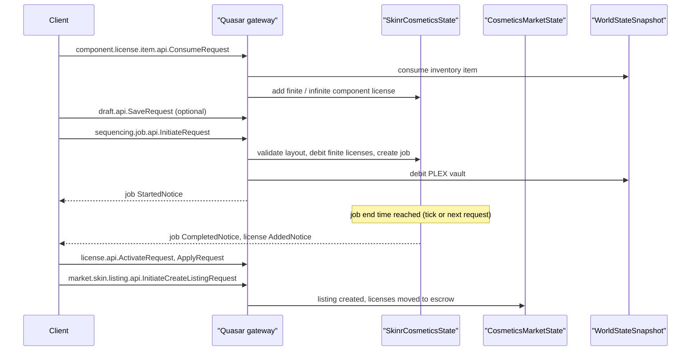

# Ship SKINs & SKINR

> **Navigation**: [EvoMu Technical Wiki](../README.md) • [Related Systems](#related-systems--cross-references)
>
> [← Back to Wiki Table of Contents](../README.md)

---

## Overview & Lore Context

A SKIN changes how a ship hull looks without changing what it does. The V24.01 client knows two kinds:

- **First-party SKINs** are defined in the static data. A character activates a license item and can then apply the SKIN to any owned ship of a compatible hull type.
- **Third-party SKINs** are made by players in the SKINR studio. A player collects design components, lays them out on a hull, pays PLEX to **sequence** the design into licenses, and can sell those licenses on the Paragon Hub.

EvoMu serves first-party SKINs over the MachoNet service `shipCosmeticsMgr` and everything SKINR-related over the Quasar public gateway (protobuf requests and notices). Both live in [`eve-server`](../../../crates/eve-server).

---

## Canonical Mechanics & Formulas

The rules below are what the code enforces at the pinned commit.

### First-party SKIN licenses

`shipCosmeticsMgr.ActivateSkinLicense(licenseTypeID[, shipTypeID])`:

- The type must be category 91 and be mapped in the SDE tables `skin_licenses` and `skins` (`InvalidSkinLicenseType`). Category 2118 types are ship emblem licenses and are handed to `activate_ship_emblem_license`.
- If a ship type is passed, the SKIN's type list must contain it (`InvalidShipTypeForSkin`).
- One license item of that type is consumed. It must be reachable by the character in the current station or structure or the active ship (`SkinLicenseItemNotFound`), and not locked (`ItemLocked`).
- Both the license type ID and the SKIN ID are added to the character's `licensed_skins` list.
- `record_skin_license_activation` records the expiry. A duration of 0 or less is permanent. A timed license activated on top of an unexpired timed license extends it; a permanent license is never downgraded by a timed one.
- The character receives `OnSkinLicenseActivated(skinID, characterID)`.

`shipCosmeticsMgr.ApplySkinToShip(shipID | shipTypeID, skinID | name | None)`:

- The first argument is either a ship type ID (the active ship is used) or an owned ship item (`OwnershipViolation`, `ShipTypeMismatch`).
- `None` or `0` as the second argument removes the applied SKIN.
- Otherwise the SKIN is resolved from a license type ID, a SKIN ID or a license type name. It must be compatible with the hull (`InvalidShipTypeForSkin`) and present in `licensed_skins` (`SkinNotLicensed`).
- The result is stored in `applied_ship_skins[shipID]`.
- The caller receives `OnCurrentShipSkinChange`. `broadcast_ship_skin_cosmetic_change` sends `OnSlimItemChange` and `OnShipCosmeticsChanged`, and `publish_ship_skin_set` publishes the Quasar notice `eve_public.cosmetic.ship.api.SetNotice` to the solar system when the ship is in space, otherwise to the owner only.

Expiry is evaluated lazily. `purge_expired_skins_for_char` runs at the start of `ApplySkinToShip`, `GetLicencedSkins` and `GetFirstPartySkinData`. It drops expired entries, removes them from `licensed_skins`, clears them from any of the character's ships, and the caller then sends `OnSkinLicenseRemoved(skinID, itemID, typeID)`.

Other `shipCosmeticsMgr` methods: `GetLicencedSkins`, `GetLicencedSkinsForShipType`, `GetFirstPartySkinData`, `GetEnabledCosmetics`, and the GM-only `GiveSkin`, `RemoveSkin` and `GMExpireSkinLicense`.

`WorldStateSnapshot::strip_ship_cosmetics` and `strip_ship_cosmetics_in_snap` remove first-party and third-party SKINs and ship logos from a ship; the doc comment names repackaging, destruction and ownership change as the callers.

### What other players see

`eve_public.cosmetic.ship.api.GetRequest` and `GetAllInBubbleRequest` return a `eve_public.cosmetic.ship.State` per ship, built by `build_ship_state`:

1. If `applied_ship_skins` has an entry and the ship's owner still holds the license, the first-party SKIN ID is reported.
2. Otherwise, if the SKINR state has an applied third-party SKIN for the ship and the owner's license for it is activated, the design's hex identifier is reported.
3. Otherwise `no_skin` is set.

When a pilot undocks, `publish_arrival_cosmetics` sends them `SetAllInBubbleNotice` with the states of the ships already in the system.

### SKINR static catalogue

`SkinrStaticCatalog::load` reads these client resources through the SDE registry and falls back to built-in tables when a resource is missing:

| Resource | Content |
|---|---|
| `ship_skin_design_components.fsdbinary` | Components: category (1 material, 2 pattern, 3 metallic), rarity, disallowed slots, associated item types with `license_uses_granted` (-1 means infinite), sequence binder |
| `ship_skin_design_component_point_values.fsdbinary` | Points per (category, rarity) |
| `ship_skin_design_tier_thresholds.fsdbinary` | Per hull class (`isis_group_id`): maximum points for tiers 1–19 |
| `ship_cosmetic_slots.fsdbinary` | Component categories allowed per slot |
| `ship_cosmetic_slot_configurations.fsdbinary` | Slots available by default and per ship type |

A design's **tier** is found by summing the points of its components and taking the first tier whose threshold is not exceeded for the hull's class (class 8 is the fallback). Above the last threshold the tier is the last tier plus one, capped at 20.

### Component licenses

A character needs a license for every component used in a design.

- `...thirdparty.component.license.item.api.ConsumeRequest(item, quantity)` consumes inventory items whose type is mapped to a component. The item must be owned by the caller, reachable in the hangar, cargo or active ship, not locked in a contract, and the stack must be large enough.
- If the item grants infinite uses, an `InfiniteComponentLicense` is stored. Otherwise the `FiniteComponentLicense` capacity grows by `quantity × license_uses_granted`. A granted notice is queued.
- `...component.license.api.GetOwnedRequest` lists both kinds. `finite.api` and `infinite.api` each have `GetRequest` and admin-only `GrantRequest` / `RevokeRequest`.
- Component items can be bought on the Paragon Hub component market: `eve_public.cosmetic.market.component.listing.api.GetAllRequest` and `InitiatePurchaseListingRequest`. Listings are seeded from the SDE by `seed_component_listings_if_empty`. A purchase is paid in ISK or PLEX and puts the item in the buyer's hangar.

### Drafts

`eve_public.cosmetic.ship.skin.thirdparty.draft.api` offers `GetAllSavedRequest`, `GetRequest`, `SaveRequest`, `UpdateRequest`, `DeleteRequest` and `GetSaveCapacityRequest`. Drafts are stored per character as `SkinrDraftRecord`. The capacity is 20 unless a per-character value is set in `custom_capacity`; saving beyond it is refused. A character cannot read, update or delete another character's draft.

Drafts are a client convenience. Sequencing takes the layout from the request and does not read a saved draft.

### Sequencing

`...thirdparty.sequencing.job.api.InitiateRequest` carries a name, a line name, a layout (slots, ship type, pattern blend mode) and a license quantity. `handle_job_initiate` checks, in order:

| Check | Rule |
|---|---|
| Active jobs | Fewer than `min(1 + P + M, 20)` active jobs, where `P` is `[0,1,3,5,7,9]` by level of skill `81366` and `M` is `[0,2,4,6,8,10]` by level of skill `81367` |
| Quantity | Between 1 and `min(1 + B + Ms + I, 5000)`, with `B` = `[0,4,9,19,29,49]` (skill `81375`), `Ms` = `[0,25,50,100,150,250]` (skill `81364`), `I` = `[0,200,450,700,1700,4700]` (skill `81365`) |
| Hull | Ship type exists and is category 6 |
| Slots | Each slot is allowed for the hull; the component exists, its kind (pattern or coating) matches the slot configuration, it is not disallowed in the slot, and its category is allowed there |
| Licenses | For every component, an infinite license, or a finite license with capacity of at least the quantity |
| PLEX | The account's PLEX vault covers the total price |

Price and duration come from the design's tier:

| Tier | 1 | 2 | 3 | 4 | 5 | 6 | 7 | 8 | 9 | 10 and up |
|---|---|---|---|---|---|---|---|---|---|---|
| PLEX per license (`tier_base_plex_cents`) | 25 | 30 | 35 | 40 | 50 | 60 | 75 | 90 | 110 | 110 + 20 per tier above 9 |

The total is the per-license price times the quantity. The job duration is the tier's base time (`tier_base_duration_secs`: 3 hours at tier 1, 7 at tier 2, 12 at tier 3, and rising) reduced by a skill discount and never below 600 seconds:

$$t = \max\left(600,\ \left\lfloor t_{\text{base}} \cdot \frac{100 - d}{100} \right\rfloor\right), \qquad d = \min\left(60,\ \sum_{s} D[L_s]\right)$$

with `D = [0, 1, 3, 6, 10, 15]` and `s` over skills `81377`, `81372`, `81373`, `81374`.

On success the finite license capacities are reduced by the quantity, a `SkinDesignRecord` is stored under the identifier `skin_{characterID:08x}_{sequence:04x}`, a `SequencingJobRecord` is created, the PLEX is debited (`adjust_unified_plex`, with a balance-changed notice labelled `SKINR Sequencing`), and a `StartedNotice` is queued. If the PLEX debit fails, the job, design and license debits are rolled back and a `FailedNotice` is queued.

`settle_completed_jobs` finishes every job whose end time has passed: it sets `completed_unix`, stamps the design's `first_sequenced_unix`, queues `CompletedNotice`, and grants the sequencer `quantity` unactivated licenses for the design. It runs at the start of most SKINR handlers and once per cluster tick through `settle_completed_skinr_jobs_for_db`.

`...sequencing.job.api.CompleteEarlyRequest` finishes a job at once for PLEX:

$$\text{cost} = \max\left(2,\ \left\lceil \frac{t_{\text{remaining}}}{900\ \text{s}} \right\rceil\right)\ \text{PLEX}$$

Read-only requests: `GetTierPricingRequest`, `GetTierDurationsRequest`, `GetEarlyCompletionPricingRequest`, `GetSkillBasedJobsCapacityRequest`, `job.api.GetAllActiveRequest`, `job.api.GetRequest`.

### Third-party SKIN licenses

A `ThirdPartySkinLicense` is keyed by character and design and holds three counters: `activated` (a flag), `unactivated`, and `escrowed`.

| Request (`...thirdparty.license.api`) | Behaviour |
|---|---|
| `GetOwnedRequest`, `GetRequest` | Read the caller's licenses. Reading another character's license is refused. |
| `ActivateRequest` | Moves one unactivated license to activated. Fails if the license is already activated or none is unactivated. |
| `ApplyRequest(license, ship)` | The ship must be owned by the caller and be category 6, the license must be activated, and the design's hull type must match the ship. Stores `applied_thirdparty_skins[ship]`. |
| `UnapplyRequest(ship)` | Removes the applied design from an owned ship. |
| `admin.GrantRequest`, `admin.RevokeRequest` | Admin role required. Revoking also clears the design from the target's ships and purges their market listings for it. |

`...thirdparty.api.GetRequest` returns a design's attributes by identifier.

### Trading on the Paragon Hub

`eve_public.cosmetic.market.skin.listing.api.InitiateCreateListingRequest` lists unactivated licenses for sale.

- A positive ISK or PLEX price, a positive duration, and a quantity of 1 to 10,000 (`MAX_LISTING_QUANTITY`) are required.
- The target is public, a corporation, an alliance or a single character (`ListingTargetRecord`). A PLEX price is converted to an ISK value for the fee calculation with a fixed factor in the code.
- Active listings per seller are limited to `5 + L(81368) + 5 × L(81369)`.
- The seller must hold at least `quantity` unactivated licenses. They move from `unactivated` to `escrowed`.
- The broker fee is debited from the seller's wallet with a `ParagonHubListingBrokerFee` journal entry. If the wallet cannot cover it, the listing is removed, the escrow is returned, and a failed transaction notice is sent.

Broker fee (`broker_fee_for_valuation`): the larger of a floor for the duration and a share of the listing value. Both are halved for **branded** listings, which are those whose target is not public (`ListingTargetRecord::is_branded`).

| Duration | 1 day | 3 days | 7 days | 14 days | 30 days | 90 days |
|---|---|---|---|---|---|---|
| Floor (ISK) | 100,000 | 200,000 | 350,000 | 600,000 | 1,000,000 | 2,500,000 |
| Share of value | 2% | 2.5% | 3% | 4% | 4% | 5% |

Sales tax (`paragon_hub_tax_pct`): 30% for a character-targeted listing, 10% for corporation or alliance targets, and for public listings 20% minus one point per level of skills `84217`, `84218` and `84220` (at most 15 points).

Buyer fee (`market_get_buyer_fee`): paid in loyalty points of the Paragon corporation (`1000419`), 1,000 per design tier for public listings and 2,500 per tier for branded ones, per license. A purchase request that carries a non-empty `buyer_fees_version` other than the current one (`v24.01.1`) is refused.

`InitiatePurchaseListingRequest` refuses the seller's own listing, expired listings and quantities above what is listed. It takes the licenses out of the seller's escrow, charges the buyer the price and the buyer fee, credits the seller the price minus tax (journal entries `ParagonHubSkinPurchase` and `ParagonHubSkinSale`, or PLEX vault movements), and adds unactivated licenses to the buyer. The outcome is reported with `TransactionSucceededNotice` or `TransactionFailedNotice`.

`CancelListingRequest` is seller-only and returns the escrowed licenses. `GetAllRequest` returns unexpired listings the caller is eligible for, `GetAllOwnedRequest` the caller's own, and `GetRequest` one listing (targeted listings are hidden from ineligible callers). `admin.SetExpirationRequest` changes a listing's expiry.

### Not implemented / known gaps

- First-party license expiry has no timer. An expired SKIN stays in `licensed_skins` and on ships until the owner calls one of the three methods that purge.
- `RemoveSkin` and `GMExpireSkinLicense` do the same thing: remove one ID from `licensed_skins`. Neither clears the SKIN from ships or sends `OnSkinLicenseRemoved`.
- `GetAllInBubbleRequest` and `SetAllInBubbleNotice` cover every piloted ship in space in the solar system, not the caller's grid.
- If a ship has both a first-party and a third-party SKIN applied, `build_ship_state` reports the first-party one. Applying a third-party SKIN does not clear `applied_ship_skins`.
- Sequencing has no PLEX discount: `skill_discounts_and_cap` always returns 0 for the price discount.
- The component catalogue loads a sequence binder item type and count per component, but `handle_job_initiate` does not consume binder items.
- No code was found that returns escrowed licenses when a listing expires. Expired listings are filtered from `GetAllRequest` and refused on purchase; the seller gets the licenses back by cancelling.
- `admin.GrantRequest` for a design that does not exist creates a placeholder design named `Custom SKIN {id}` on ship type `587` with no slots.
- [`quasar_cosmetics_services.rs`](../../../crates/eve-server/src/services/quasar_cosmetics_services.rs) first registers generic handlers for the cosmetic market request names that only store the request payload and return a generic response. The state-backed market module registers later under the same names and replaces them, because registration is a map insert.
- No open GitHub issue specific to SKINs or SKINR was found.

---

## EvoMu Implementation Architecture

### Crates involved

- [`eve-server`](../../../crates/eve-server): MachoNet handlers, Quasar handlers and state.
- [`eve-db`](../../../crates/eve-db): `WorldStateSnapshot` fields and `quasar_state_blobs`, item consumption (`consume_exact_item_quantity`, `is_item_consumable_by`), PLEX vault (`adjust_unified_plex`).
- [`eve-sde`](../../../crates/eve-sde): `skins`, `skin_licenses`, type categories, and the `.fsdbinary` loaders used by the SKINR catalogue.
- [`eve-proto`](../../../crates/eve-proto): Quasar wire encoding (`DynamicQuasarMessage`, `GoogleAny`, the `pb` builder).

### Primary handlers and dispatch

MachoNet (`shipCosmeticsMgr`), dispatched from [`dispatch.rs`](../../../crates/eve-server/src/router/dispatch.rs), which tries `cosmetics_ui_ops::handle` before `cosmetics_events::handle`:

| File | Contents |
|---|---|
| [`cosmetics_ui_ops.rs`](../../../crates/eve-server/src/services/cosmetics_ui_ops.rs) | `ActivateSkinLicense`, `ApplySkinToShip`, `GetLicencedSkins`, `GetLicencedSkinsForShipType`, `GetFirstPartySkinData`, `GetEnabledCosmetics`, `RemoveSkin`, `GMExpireSkinLicense`; `record_skin_license_activation`, `purge_expired_skins_for_char`, `notify_skins_removed` |
| [`cosmetics_events.rs`](../../../crates/eve-server/src/services/cosmetics_events.rs) | `GiveSkin` (GM role) and a second `ActivateSkinLicense` arm that is shadowed by the one above |

Quasar gateway. [`quasar_gateway.rs`](../../../crates/eve-server/src/quasar_gateway.rs) calls `quasar_cosmetics_services::register_handlers`, which loads the shared states and calls each module's `register`:

| File | Contents |
|---|---|
| [`quasar_cosmetics_services.rs`](../../../crates/eve-server/src/services/quasar_cosmetics_services.rs) | `register_handlers`, `QuasarCosmeticsState` (drafts, titles, palettes), generic fallbacks |
| [`quasar_cosmetics_skinr.rs`](../../../crates/eve-server/src/services/quasar_cosmetics_skinr.rs) | `SkinrStaticCatalog`, `SkinrCosmeticsState`, component license handlers, `handle_item_consume`, title definitions |
| [`quasar_cosmetics_skinr_seq.rs`](../../../crates/eve-server/src/services/quasar_cosmetics_skinr_seq.rs) | Design lookup, license activate / apply / unapply, pricing, `handle_job_initiate`, `settle_completed_jobs`, `handle_job_complete_early` |
| [`quasar_cosmetics_skinr_wire.rs`](../../../crates/eve-server/src/services/quasar_cosmetics_skinr_wire.rs) | Protobuf encoding helpers, notices, `tier_base_plex_cents`, `tier_base_duration_secs` |
| [`quasar_cosmetics_drafts.rs`](../../../crates/eve-server/src/services/quasar_cosmetics_drafts.rs) | Draft handlers and `SkinrDraftRecord` |
| [`quasar_cosmetics_market.rs`](../../../crates/eve-server/src/services/quasar_cosmetics_market.rs) | Paragon Hub fees, component listings, SKIN listings, transactions |
| [`quasar_cosmetics_market_types.rs`](../../../crates/eve-server/src/services/quasar_cosmetics_market_types.rs) | `SkinListingRecord`, `ListingTargetRecord`, limits and the duration fee table |
| [`quasar_cosmetics_live.rs`](../../../crates/eve-server/src/services/quasar_cosmetics_live.rs) | Ship SKIN state (`build_ship_state`, `publish_ship_skin_set`, `publish_arrival_cosmetics`), ship logos, corporation palettes, structure paintwork |

Several requests are registered under both an `eve_public.` and an `eve.` type name and answer with the matching response type.

### State

| State | Location |
|---|---|
| `licensed_skins: HashMap<i64, Vec<u32>>` (character → license type IDs and SKIN IDs) | `WorldStateSnapshot` ([`snapshot_ext.rs`](../../../crates/eve-db/src/snapshot_ext.rs)) |
| `applied_ship_skins: HashMap<i64, u32>` (ship item → SKIN ID) | `WorldStateSnapshot` |
| `skin_license_entries` (`SkinLicenseEntry` with `expires_at_unix`) | `CosmeticsUiExtendedState`, stored as JSON in `item_custom_names` under the key `-7700002` |
| `SkinrCosmeticsData`: `finite_licenses`, `infinite_licenses`, `skins`, `skin_licenses`, `applied_thirdparty_skins`, `sequencing_jobs`, `next_job_seq` | `quasar_state_blobs["quasar_cosmetics_skinr"]` |
| `CosmeticsMarketData`: component listings, SKIN listings, transactions | `quasar_state_blobs["quasar_cosmetics_market"]` |
| `QuasarCosmeticsStateData`: `saved_drafts`, `custom_capacity`, titles, palettes | `quasar_state_blobs["quasar_cosmetics"]` |
| Ship logos, palettes, paintwork licenses | `quasar_state_blobs["quasar_cosmetics_live"]` |

Each Quasar state object keeps an in-memory copy behind an `RwLock` and writes the whole blob back with `save` or `sync_to_db` after a mutation. `SkinrCosmeticsState::save` merges designs that exist only in the stored blob so a concurrent writer's designs are not lost, and `sync_redeemed_skins_if_needed` pulls in designs and licenses added to the blob by the entitlement ledger.

### Tick integration

`tick_background_cluster_with_step` in [`cluster_tick.rs`](../../../crates/eve-server/src/sp6_lifecycle/cluster_tick.rs) calls `settle_completed_skinr_jobs_for_db`, so jobs complete and notices go out even if the client sends no request. Nothing else in this system is tick-driven.

---

## Invariants, Security & Edge Cases

- **Ownership.** Applying a SKIN of either kind requires the ship item to be owned by the caller. Third-party license requests that name another character are refused. Job lookups are limited to the sequencer or an admin.
- **Admin requests.** Component and SKIN license grant and revoke, and listing expiry changes, call `require_admin_role`.
- **Item consumption.** License items are consumed inside one snapshot write that also checks reachability and contract locks, so an item cannot be consumed twice.
- **Double spending.** `handle_job_initiate` re-checks the active job count and license capacity under the write lock before debiting. Listing creation moves licenses to escrow before the broker fee is charged and restores them on failure. A purchase rolls the listing quantity back if a later step fails.
- **Arithmetic.** Listing prices are bounded by `MAX_LISTING_PRICE_UNITS` and totals use checked multiplication; overflow returns a bad-request status.
- **Hull match.** A third-party design can only be applied to the ship type it was sequenced for.
- **License loss.** `build_ship_state` re-checks the owner's license on every read, so a SKIN whose license was removed stops being shown even if the applied entry remains.

---

## Verification, Tests & Parity References

Ledger rows (`ledger.json`): `feat:cosmetics.skin-activate`, `feat:cosmetics.skin-apply`, `feat:cosmetics.skin-expiry`, `feat:cosmetics.skin-licenses`, `feat:cosmetics.first-party-skins`, `feat:cosmetics.cosmetics-broadcast`, `feat:cosmetics.skinr-designer`, `feat:cosmetics.skinr-market`, `feat:admin.gm-skin-tools`, `feat:quasar.cosmetic`; `rpc:shipCosmeticsMgr.ActivateSkinLicense`, `rpc:shipCosmeticsMgr.ApplySkinToShip`, `rpc:shipCosmeticsMgr.GetLicencedSkins`, `rpc:shipCosmeticsMgr.GetLicencedSkinsForShipType`, `rpc:shipCosmeticsMgr.GetFirstPartySkinData`, `rpc:shipCosmeticsMgr.GetEnabledCosmetics`, `rpc:shipCosmeticsMgr.GiveSkin`, `rpc:shipCosmeticsMgr.RemoveSkin`, `rpc:shipCosmeticsMgr.GMExpireSkinLicense`; `notify:OnSkinLicenseActivated`, `notify:OnSkinLicenseRemoved`, `notify:OnCurrentShipSkinChange`, `notify:OnShipCosmeticsChanged`; `journey:cosmetics_store`.

Auditor rows (`auditor_rows.json`): `feat:cosmetics.skinr-sequencing-studio`, `feat:cosmetics.skinr-paragon-hub-listing`.

Unit tests next to the code: [`cosmetics_ui_ops_tests.rs`](../../../crates/eve-server/src/services/cosmetics_ui_ops_tests.rs), [`cosmetics_events_tests.rs`](../../../crates/eve-server/src/services/cosmetics_events_tests.rs), [`quasar_cosmetics_skinr_tests.rs`](../../../crates/eve-server/src/services/quasar_cosmetics_skinr_tests.rs), [`quasar_cosmetics_skinr_seq_tests.rs`](../../../crates/eve-server/src/services/quasar_cosmetics_skinr_seq_tests.rs), [`quasar_cosmetics_drafts_tests.rs`](../../../crates/eve-server/src/services/quasar_cosmetics_drafts_tests.rs), [`quasar_cosmetics_market_skin_tests.rs`](../../../crates/eve-server/src/services/quasar_cosmetics_market_skin_tests.rs), [`quasar_cosmetics_market_component_tests.rs`](../../../crates/eve-server/src/services/quasar_cosmetics_market_component_tests.rs), [`quasar_cosmetics_live_tests.rs`](../../../crates/eve-server/src/services/quasar_cosmetics_live_tests.rs).

Integration tests in [`crates/eve-server/tests/it/`](../../../crates/eve-server/tests/it/): `cosmetics_skinr_studio_and_hub.rs`, `cosmetics_skinr_hub_live.rs`, `cosmetics_evermarks_skinr_e2e.rs`, `cosmetics_skinr_redemption_and_logo_persistence.rs`, `parity_skinr_den_invariants.rs`, `quasar_cosmetics_skinr_state.rs`, `quasar_cosmetics_market_state.rs`, `quasar_cosmetics_live_state.rs`, `rpc_store_cosmetics.rs`.

---

## Related Systems & Cross-References

- [**MachoNet, Quasar & Wire**](../protocol_and_infrastructure/machonet_wire_and_quasar_gateway.md): the Quasar gateway, request routing and notices.
- [**PLEX Vault, Fast Checkout & New Eden Store**](../economy_and_markets/plex_and_new_eden_store.md): the PLEX vault debited by sequencing and the store that sells SKIN licenses.
- [**Skill Training & Medical Clones**](../character_and_progression/skill_training_and_medical_clones.md): the skills that set job, batch and listing limits.
- [**Agent Dialogue, Missions & LP**](../missions_and_agents/agent_dialogue_and_missions.md): loyalty points, which the Paragon Hub buyer fee spends.
- [**Dogma Attribute Engine**](./dogma_attribute_engine.md): the other article in this section; SKINs do not touch dogma attributes.
- [**EvoMu Technical Wiki Table of Contents**](../README.md): master index and domain directory.

---

[← Back to Wiki Table of Contents](../README.md)
