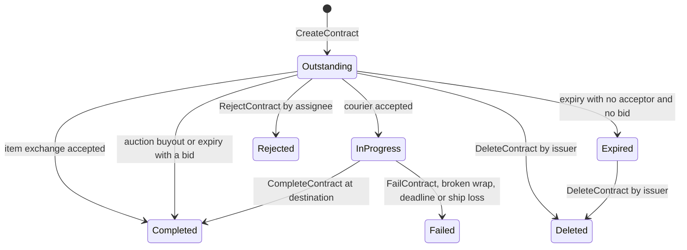

# Contracts

> **Navigation**: [EvoMu Technical Wiki](../README.md) • [Related Systems](#related-systems--cross-references)
>
> [← Back to Wiki Table of Contents](../README.md)

---

## Overview & Lore Context

Contracts are the player-to-player trade channel that the regional market cannot cover: a specific item for a specific price, a named buyer, an auction, or paid transport of a package between two stations. EvoMu implements three contract types on the MachoNet `contractProxy` service:

- **Item exchange** — items and/or ISK from the issuer in return for ISK and/or requested item types from the acceptor.
- **Auction** — items sold to the highest bidder, with an optional buyout price.
- **Courier** — a sealed package the acceptor must carry to a destination station, secured by collateral.

A contract is a `ContractRecord` in the world snapshot. Its `status` string moves through the states below.

The market article ([Regional Market Engine, Order Matching & Contracts](../economy_and_markets/regional_market_order_matching.md)) has a shorter contracts section. Where the two differ, this article follows the code at the pinned commit: an auction stays `Outstanding` while bids are placed, and the minimum bid increment is 5%.

---

## Canonical Mechanics & Formulas

The rules below are the rules as EvoMu implements them in [`contracts_service.rs`](../../../crates/eve-server/src/services/contracts_service.rs) and [`snapshot_ext.rs`](../../../crates/eve-db/src/snapshot_ext.rs).

### Creating a contract (`CreateContract`)

The handler accepts either a payload object (`contractType`, `availability`, `assigneeID`, `expireTime`, `numDays`, `startStationID`, `endStationID`, `price`, `reward`, `collateral`, `title`, `itemList`, `requestItemTypeList`, `forCorp`) or the same values as positional arguments.

| Rule | Value / behavior |
|---|---|
| Type codes | 1 = `ItemExchange`, 2 = `Auction`, 3 = `Courier`; anything else is `InvalidContractType` |
| Availability | `Public` by default; `Personal`, `Corporation`, `Alliance`. A public contract with an assignee becomes `Personal`. |
| Location | The issuer must be docked at the start station (`MustBeDockedAtStartStation`). Start and end must be an SDE station or an Upwell structure that is not `Destroyed` (`InvalidContractStation`). |
| Destination | Item exchange and auction must start and end at the same station. A courier needs an explicit destination (`InvalidContractDestination`). |
| Contents | Item exchange and auction need at least one item, except an item exchange that only lists requested items (a want-to-buy). A courier needs at least one item (`CourierContractRequiresItems`). |
| Lifetime | `expireTime` / `minutesExpire` in minutes, converted to seconds and clamped to 60 … 2,419,200 s; default 86,400 s |
| Courier days | `numDays` clamped to 1 … 28; default 1 |
| Title | Truncated to 128 characters |
| Auction prices | A non-zero buyout must not be lower than the starting bid |

**Slot limit.** The handler counts the issuer's `Outstanding` and `InProgress` contracts of the same kind (personal or corporation) and rejects the call with `ContractSlotLimitReached` at the limit:

| Kind | Limit |
|---|---|
| Personal | `1 + 4 × level` of skill type 25235 (Contracting); 5 if the skill is not trained |
| Corporation (`forCorp`) | `10 + 10 × level` of skill type 25233; the level is taken as 1 if the skill is not trained |

**Fees.** With `price`, `reward` and `collateral` in ISK:

$$
\text{brokerFee} =
\begin{cases}
\max(0.01 \times \text{price},\ 10{,}000) & \text{public, unassigned} \\
10{,}000 & \text{otherwise}
\end{cases}
\qquad
\text{deposit} =
\begin{cases}
\max(0.01 \times \max(\text{price}, \text{collateral}),\ 100{,}000) & \text{public, unassigned} \\
0 & \text{otherwise}
\end{cases}
$$

The issuer pays `reward + brokerFee + deposit` at creation. The deposit is remembered per contract in `fleet_and_social_ops.contract_deposits` and credited back to the issuer when the contract is accepted, completed, deleted, rejected, failed or expires. The broker fee is not returned.

How the two ISK arguments are interpreted depends on the type:

| Type | `price` | `reward` | `collateral` | `buyout` |
|---|---|---|---|---|
| Item exchange | paid by the acceptor to the issuer | paid by the issuer to the acceptor (escrowed at creation) | — | — |
| Auction | starting bid | — | — | from the `collateral` argument |
| Courier | — | paid to the hauler on delivery (escrowed at creation) | posted by the hauler on acceptance | — |

**Item escrow.** Each listed item is checked and then moved to `location_id = contract_id` with flag `Locked` (63). An item is refused if it:

- is the issuer's boarded ship (`CannotContractActiveShip`);
- contains other items (`CannotContractNonEmptyContainer`), or sits inside a container (`ItemInsideContainer`);
- is locked in an audit log container, already locked, impounded, a war HQ, or at a structure the issuer has no ACL access to (`ContractItemLocked`);
- is courier mission cargo, an asset safety wrap, or inside one (`ItemCannotBeContracted`);
- is not owned by the issuer at the start station (`ContractItemOwnershipOrLocationInvalid`);
- is not in the personal item hangar (`ContractItemFlagInvalid`).

While a contract is `Outstanding` or `InProgress`, `WorldStateSnapshot::is_item_locked_in_contract_or_job` reports its items as locked, which blocks other inventory operations on them. Ship insurance on an escrowed item is voided.

**Corporation contracts (`forCorp`).** The issuer needs Contract Manager or Director (or CEO). Up-front ISK comes from the wallet division selected by the session's `corp_account_key` and needs Director or that division's take role. Items must be owned by the corporation and sit in a corporation hangar division or `CorpDeliveries`, and the issuer needs the matching hangar take role at that location. The item's original flag is saved (`Ns::ContractOrigFlag`) so it can be restored if the contract ends without a sale.

### Visibility

`is_contract_visible_to_character` in [`market_acl.rs`](../../../crates/eve-server/src/domain/market_acl.rs) decides who may see, accept or bid:

- the issuer always;
- anyone, for a public contract with no assignee;
- for a contract with an assignee: that character, members of that corporation, or members of that alliance;
- for an unassigned `Corporation` contract: members of the issuer's corporation;
- nobody else for `Personal` / `Private`.

### Item exchange (`AcceptContract`)

The acceptor must be docked at the start station, must not be the issuer, and must pass the visibility check. Then, in one transaction:

1. The acceptor pays `price` (and receives `reward`, if any). An insufficient balance is `InsufficientFunds`.
2. The issuer is credited `price` and the deposit.
3. Requested item types are collected from the acceptor's item hangar at the start station, lowest item ID first, and transferred to the issuer with `transfer_inventory_item`. Blueprint copies, damaged items, mutated items, the active ship, locked items and non-empty containers are not eligible. A shortfall is `MissingRequestedContractItems`.
4. The escrowed items go to the acceptor's item hangar at the start station.
5. The contract becomes `Completed`.

Item records are moved, not recreated, so blueprint copy state, runs, dynamic attributes and mutaplasmid source survive the trade. `contract_to_pyrep` exposes them to the client (`copy`, `materialEfficiency`, `timeEfficiency`, `runs`, `damage`, `sourceMutaplasmidID`, `dynamicAttributes`).

With `forCorp = true` (or when the contract is assigned to the acceptor's corporation) the acceptor acts for the corporation: Contract Manager or Director is required, ISK comes from the session's corporation wallet division, and items arrive in `CorpDeliveries`.

### Auction (`PlaceBid` / `Bid`, `FinishAuction`)

| Rule | Value |
|---|---|
| Opening bid | At least the starting `price` (`BidTooLow`) |
| Later bids | At least `current_bid + max(current_bid / 20, 100 ISK)` |
| Buyout | If `buyout > 0` and the bid is at least `buyout`, the bidder is charged exactly `buyout` and wins immediately |
| Issuer | Cannot bid on their own auction (`CannotBidOnOwnContract`) |

The bid is debited from the bidder at once. The previous high bidder is refunded in the same transaction, to their wallet or to the corporation division they bid from (`Ns::ContractBidDiv`). The status stays `Outstanding` and the bid is appended to `bid_history`.

On buyout, or when the contract expires with a bid, the issuer is credited the winning bid and the deposit, the items go to the winner's item hangar at the start station (`CorpDeliveries` for a corporation), and the status becomes `Completed`. An auction that expires without a bid is treated like any other expired contract.

`FinishAuction` in [`market_contracts.rs`](../../../crates/eve-server/src/services/market_contracts.rs) lets the issuer or the high bidder settle an auction that is past its expiry and still `Outstanding`; it sets the status to `Finished`.

An auction that has a bid cannot be deleted (`CannotDeleteAuctionWithBids`).

### Courier (`AcceptContract`, `CompleteContract`, `FailContract`, `BreakPlasticWrap`)

**Acceptance.** The hauler must be docked at the start station with an active ship, and pays the `collateral`. The deposit is returned to the issuer. A Plastic Wrap item (type 3468, singleton) is created in the hauler's item hangar at the start station, the escrowed items are placed inside it with flag `Locked`, and the contract becomes `InProgress` with a delivery deadline of

$$\text{expiration} = \text{now} + \min(\max(\text{numDays}, 1),\ 28) \times 86{,}400\ \text{s}$$

**Delivery.** `CompleteContract` requires the hauler to be docked at the end station with the active ship there, and every wrapped item to be inside a Plastic Wrap owned by the hauler that is either in that ship or at the end station (`CourierPackageMissing` otherwise). The items become the issuer's, in the item hangar at the end station; the wrap is removed; the hauler receives

$$\text{payout} = \text{collateral} + \text{reward}$$

**Failure.** `WorldStateSnapshot::fail_courier_contract` credits the issuer `collateral + reward`, removes the wrap, gives the contents to the acceptor where they are (cargo if the wrap was inside a ship, hangar otherwise) and sets `Failed`. It is called when:

- the hauler calls `FailContract`;
- the hauler calls `BreakPlasticWrap` on the package (`contractProxy.BreakPlasticWrap` or `invbroker.BreakPlasticWrap`), which requires being docked where the wrap is or having it in the active ship;
- the delivery deadline passes while the contract is `InProgress`;
- a ship carrying the package is destroyed ([`death_pipeline.rs`](../../../crates/eve-server/src/combat/death_pipeline.rs)).

### Expiry, deletion and rejection

`WorldStateSnapshot::resolve_expired_contract` handles a contract whose `expiration_unix` has passed:

| State at expiry | Result |
|---|---|
| `Outstanding` auction with a bid | Settled to the high bidder → `Completed` |
| Any other `Outstanding` contract | `reward` and deposit back to the issuer; items back to the issuer at the start station with their original flag → `Expired` |
| `InProgress` (courier) | `fail_courier_contract` → `Failed` |

Expiry is applied in two ways: lazily, at the start of most `contractProxy` handlers, and by `sweep_expired_contracts_and_notify`, which runs on every server clock advance.

- **`DeleteContract`** — the issuer (or, for a corporation contract, a member with Contract Manager or Director) may delete an `Outstanding` or `Expired` contract. For an outstanding contract the reward, deposit and items are returned first. The status becomes `Deleted`.
- **`RejectContract`** — the assignee (a character, or a corporation member with Contract Manager or Director) may reject an `Outstanding` contract. Reward, deposit and items return to the issuer; the status becomes `Rejected`.
- **`GM_ExpireContract`** — an account with a non-zero role forces immediate expiry.

### Not implemented / known gaps

- **Almost no wallet journal entries.** Only auction bids, outbid refunds and auction sales are journaled (`ContractAuctionBid`, `ContractAuctionBidRefund`, `ContractAuctionSold`), and they use `append_journal` without metadata, so they do not appear in the in-game journal (see [Wallets & ISK Ledger](../economy_and_markets/wallets_and_isk_ledger.md)). Broker fee, deposit, item exchange price, courier reward and collateral change balances without a journal row. The `CONTRACT_*` ref type constants are unused.
- **Corporation proceeds always land in division 1.** `credit_contract_issuer` credits a corporation issuer on division 1, and a corporation hauler's courier payout also goes to division 1, regardless of the division that paid.
- **No volume rule for couriers.** `CreateContract` does not check package volume.
- **Status vocabulary is wider than what is produced.** The list filters and the client status mapping know `FinishedIssuer`, `FinishedContractor`, `Cancelled` and `Reversed`, and a `Loan` type filter exists, but no handler sets those statuses or creates a loan (`feat:removed.loan-contracts`). The statuses actually written are `Outstanding`, `InProgress`, `Completed`, `Failed`, `Expired`, `Deleted`, `Rejected` and, from `FinishAuction`, `Finished`.
- **`Finished` is not mapped for ESI.** `map_contract_status` in [`economy_routes.rs`](../../../crates/eve-server/src/esi/economy_routes.rs) has no arm for the `Finished` string, so a contract settled through `FinishAuction` falls through to `outstanding`.
- **`CollectMyPageInfo` uses fixed totals** (`numContractsTotal` 21, corporation pool 500) that do not match the skill-based limits enforced by `CreateContract`. The client-compat reply for `NumOutstandingContracts` always reports 0 for the corporation counts.
- **Notifications with ledger rows but no emitter:** `OnContractEscrowChanged` and `OnDeleteContracts`. An expired contract produces `OnContractCacheCleared`, not a dedicated expiry notification.
- **Expiry sweep notifications are partial for corporations.** `sweep_expired_contracts_and_notify` reports wallet changes for the issuer character, the issuing corporation's division 1 and character acceptors and bidders; a corporation bidder or acceptor gets no balance notification from the sweep.

---

## EvoMu Implementation Architecture

### Crates Involved

- [`eve-server`](../../../crates/eve-server): RPC handlers, visibility rules, notifications, ESI routes.
- [`eve-db`](../../../crates/eve-db): `ContractRecord` ([`types.rs`](../../../crates/eve-db/src/types.rs)); settlement helpers `credit_contract_issuer`, `resolve_expired_contract`, `fail_courier_contract` and the lock predicate ([`snapshot_ext.rs`](../../../crates/eve-db/src/snapshot_ext.rs)); `transfer_inventory_item` ([`inventory.rs`](../../../crates/eve-db/src/inventory.rs)).

### Primary Handlers & Dispatch

`contracts_service::handle` answers only the `contractProxy` service and is called from [`dispatch.rs`](../../../crates/eve-server/src/router/dispatch.rs). Methods it does not match fall through to `market_contracts::handle`.

| `contractProxy` method | Handler file |
|---|---|
| `CreateContract`, `AcceptContract`, `PlaceBid` / `Bid`, `CompleteContract`, `DeleteContract`, `FailContract`, `RejectContract`, `BreakPlasticWrap`, `GM_ExpireContract` | [`contracts_service.rs`](../../../crates/eve-server/src/services/contracts_service.rs) |
| `GetContract` / `GetContractInfo`, `SearchContracts` / `GetPublicContractList`, `GetMyCurrentContractList` / `GetContractList` / `GetContractListForOwner`, `GetMyExpiredContractList`, `GetMyBids`, `GetLoginInfo` | [`contracts_service.rs`](../../../crates/eve-server/src/services/contracts_service.rs) |
| `CollectMyPageInfo`, `NumOutstandingContracts`, `FinishAuction`, `GetCourierContractFromItemID`, `GetItemsInContainer`, `GetMyContractEscrow`, `GetNumItemsInContainers` | [`market_contracts.rs`](../../../crates/eve-server/src/services/market_contracts.rs) |
| `DeleteContractNotification` / `DeleteNotification`, `DeleteMultipleContracts`, `GetItemsInDockableLocation` | [`sov_services.rs`](../../../crates/eve-server/src/services/sov_services.rs) (called from `market_contracts.rs`) |
| `SplitStack` | [`inventory_stacking_ops.rs`](../../../crates/eve-server/src/services/inventory_stacking_ops.rs) |

`SearchContracts` filters `Outstanding`, visible contracts by `contractType`, `stationID`, `regionID`, `itemTypeID` / `typeID`, `minPrice` and `maxPrice`, sorted by contract ID. Reply shapes for `CreateContract`, `GetContract`, the list calls, `NumOutstandingContracts` and `SearchContracts` are adjusted for the V24 client in [`client_compat.rs`](../../../crates/eve-server/src/router/client_compat.rs).

Notifications:

| Notification | Sent to | When |
|---|---|---|
| `OnContractCreated` | issuer | creation |
| `OnContractAssigned` | assignee | creation with an assignee |
| `OnContractAccepted` | issuer | acceptance |
| `OnContractCompleted` | issuer (and acceptor or bidder from the sweep) | completion |
| `OnContractOutbid` | previous high bidder | a higher bid |
| `OnContractBuyout` | issuer | buyout |
| `OnContractFailed` | issuer (and acceptor from the sweep) | courier failure |
| `OnContractRejected` | issuer | rejection |
| `OnContractCacheCleared` | issuer | expiry found by the sweep |
| `OnShowContract` | caller | `GetContractInfo` |

Item and wallet changes are reported separately. Each mutating handler captures a `ContractNotifyDelta` (item records and wallet balances of the parties) before the change, diffs it afterwards, and emits `OnItemChange` through `notify_item_mutation` and `OnAccountChange` through `notify_wallet_balance`.

ESI routes in [`economy_routes.rs`](../../../crates/eve-server/src/esi/economy_routes.rs): `/characters/{character_id}/contracts` (with `/{contract_id}/items` and `/{contract_id}/bids`), `/corporations/{corporation_id}/contracts` (same sub-routes), `/contracts/public/{region_id}`, `/contracts/public/items/{contract_id}` and `/contracts/public/bids/{contract_id}`.

### State Store & Snapshot Schema

`WorldStateSnapshot::contracts` is a `HashMap<i64, ContractRecord>`. Contract IDs come from `next_entity_id`.

| `ContractRecord` field | Meaning |
|---|---|
| `contract_id`, `issuer_id`, `issuer_corp_id`, `for_corp` | Identity and whether the corporation is the issuing party |
| `acceptor_id`, `assignee_id`, `availability` | Counterparty and visibility. `acceptor_id` holds a corporation ID when accepted for a corporation. |
| `contract_type`, `status` | Strings, see the state diagram |
| `start_station_id`, `end_station_id` | Stations or structures |
| `price`, `reward`, `collateral`, `buyout` | `IskCents` |
| `current_bid`, `current_bidder_id`, `bid_history` | Auction state; history entries are `(bidder, amount, unix time)` |
| `item_ids` | Escrowed item IDs |
| `requested_items` | `(type_id, quantity)` pairs wanted from the acceptor |
| `date_issued_unix`, `expiration_unix`, `num_days` | Timing. `expiration_unix` is replaced by the delivery deadline when a courier is accepted. |
| `title` | Free text |

Related state: `fleet_and_social_ops.contract_deposits` (deposit per contract), the key-value namespaces `Ns::ContractOrigFlag` (original item flag for corporation contracts) and `Ns::ContractBidDiv` (wallet division of a corporation bid), and `quasar_state_blobs["contract_dismissed_notifs"]` (contract notifications dismissed by `DeleteNotification`).

### Tick & Lifecycle Integration

`sweep_expired_contracts_and_notify` is called from `run_clock_advanced_sync_pipeline` in [`context.rs`](../../../crates/eve-server/src/router/context.rs), the pipeline shared by the live one-second tick, accelerated ticks and synthetic time jumps, and from a maintenance job in [`serverops_cluster.rs`](../../../crates/eve-server/src/services/serverops_cluster.rs). It resolves every due contract in ascending ID order and then emits the contract, wallet and item notifications.

---

## Invariants, Security & Edge Cases

- **Atomic settlement.** Each handler does its checks and all ISK and item movements inside one `try_with_mut_snapshot` closure; any error leaves the snapshot unchanged.
- **Escrow integrity on acceptance.** `AcceptContract` verifies that every escrowed item is still at `location_id = contract_id` with flag `Locked` (`ContractEscrowItemMissing`).
- **No self-dealing.** The issuer cannot accept or bid on their own contract; a corporation cannot accept its own corporation contract on its own behalf.
- **Location binding.** Creation and acceptance require being docked at the start station; courier completion requires the hauler and the ship at the end station.
- **Stale expiry.** Accept, bid and complete first resolve expiry and return `ContractExpired` if the contract was due.
- **Ownership changes strip cosmetics.** When escrowed items change owner, `strip_ship_cosmetics_for_ships` is called for them.
- **Foreign owner queries.** `GetContractListForOwner` only serves the caller or the caller's corporation (`ContractAccessDenied`). `GetMyBids` for a corporation requires Contract Manager or Director.
- **Courier items delivered to a corporation issuer** are given the corporation as owner but the personal `Hangar` flag, not a corporation hangar flag.

---

## Verification, Tests & Parity References

Parity ledger rows:

| Row | Subject |
|---|---|
| `feat:contracts.item-exchange`, `feat:contracts.item-exchange-request` | Item exchange and want-to-buy |
| `feat:contracts.auction` | Auction |
| `feat:contracts.courier`, `feat:contracts.courier-failure`, `feat:contracts.courier-plastic-wrap-break` | Courier lifecycle |
| `feat:contracts.visibility`, `feat:contracts.search`, `feat:contracts.my-contracts` | Visibility and listing |
| `feat:contracts.fees-limits` | Broker fee, deposit, slot limits |
| `feat:contracts.expiry`, `feat:contracts.reject`, `feat:admin.gm-contract-expire` | Expiry, rejection, GM expiry |
| `feat:contracts.blueprint-singleton-preservation`, `feat:contracts.item-exchange-blueprints-metadata` | Item metadata preserved through a contract |
| `feat:lifecycle.corp-contract-wallet`, `feat:lifecycle.courier-package-destroyed` | Corporation wallet use; package loss |
| `feat:removed.loan-contracts` | Loan contracts (not present) |
| `feat:esi.contracts.char-list`, `feat:esi.contracts.char-items-bids`, `feat:esi.contracts.corp`, `feat:esi.contracts.public` | ESI routes |
| `rpc:contractProxy.CreateContract`, `rpc:contractProxy.AcceptContract`, `rpc:contractProxy.PlaceBid`, `rpc:contractProxy.CompleteContract`, `rpc:contractProxy.DeleteContract`, `rpc:contractProxy.FinishAuction`, `rpc:contractProxy.GetContract`, `rpc:contractProxy.SearchContracts`, `rpc:contractProxy.GetContractListForOwner`, `rpc:contractProxy.GetMyBids`, `rpc:contractProxy.GM_ExpireContract` | Main RPCs |
| `notify:OnContractCreated`, `notify:OnContractAssigned`, `notify:OnContractAccepted`, `notify:OnContractCompleted`, `notify:OnContractOutbid`, `notify:OnContractBuyout`, `notify:OnContractFailed`, `notify:OnContractRejected`, `notify:OnContractCacheCleared`, `notify:OnShowContract` | Notifications |

Tests:

- [`economy_contracts.rs`](../../../crates/eve-server/tests/it/economy_contracts.rs) — item exchange, auction and courier lifecycles over the RPC path.
- [`contracts_blueprints_and_plastic_wrap.rs`](../../../crates/eve-server/tests/it/contracts_blueprints_and_plastic_wrap.rs) — blueprint metadata and `BreakPlasticWrap`.
- [`corp_market_divisions_contracts_and_wars.rs`](../../../crates/eve-server/tests/it/corp_market_divisions_contracts_and_wars.rs) — corporation contracts and wallet divisions.
- [`esi_contracts_and_market_orders_live.rs`](../../../crates/eve-server/tests/it/esi_contracts_and_market_orders_live.rs) — ESI contract routes.
- Unit tests next to the service: [`contracts_service_tests.rs`](../../../crates/eve-server/src/services/contracts_service_tests.rs), [`contracts_service_edges_tests.rs`](../../../crates/eve-server/src/services/contracts_service_edges_tests.rs), [`contracts_courier_and_auction_unit_tests.rs`](../../../crates/eve-server/src/services/contracts_courier_and_auction_unit_tests.rs), [`contracts_wtb_and_auction_lifecycle_unit_tests.rs`](../../../crates/eve-server/src/services/contracts_wtb_and_auction_lifecycle_unit_tests.rs).

---

## Related Systems & Cross-References

- [**EvoMu Technical Wiki Table of Contents**](../README.md): Master index and domain directory.
- [Regional Market Engine, Order Matching & Contracts](../economy_and_markets/regional_market_order_matching.md): the order book, and an earlier summary of contracts.
- [Wallets & ISK Ledger](../economy_and_markets/wallets_and_isk_ledger.md): `IskCents`, corporation wallet divisions, the journal and `OnAccountChange`.
- [Inventory & Containers](../economy_and_markets/inventory_and_containers.md): item records, the `Locked` flag, `transfer_inventory_item` and `OnItemChange`.
- [Corporation Roles & Governance](../corporations_and_governance/corporation_roles_and_governance.md): Contract Manager, Director and the hangar and wallet take roles.
- [Upwell Structures Overview](../upwell_and_structures/upwell_structures_overview.md): structures as contract locations and their access lists.

---

[← Back to Wiki Table of Contents](../README.md)
