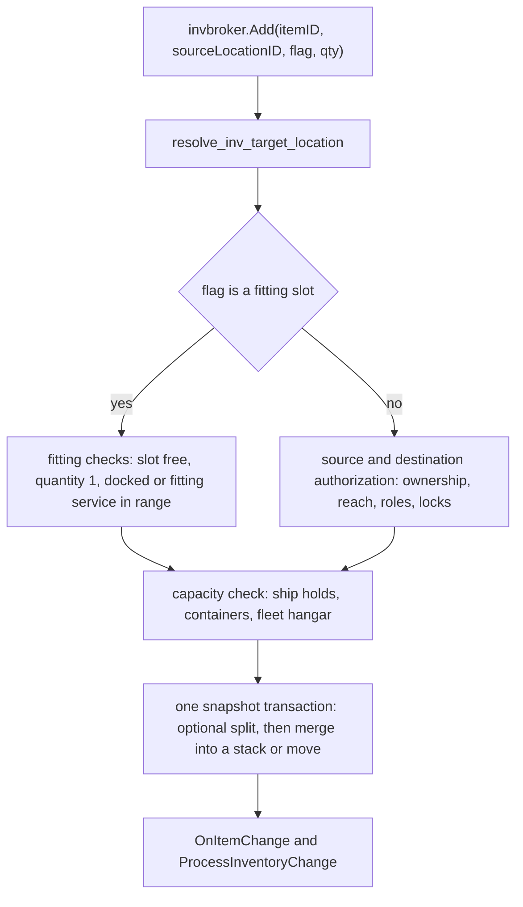

# Inventory & Containers

> **Navigation**: [EvoMu Technical Wiki](../README.md) • [Related Systems](#related-systems--cross-references)
>
> [← Back to Wiki Table of Contents](../README.md)

---

## Overview & Lore Context

Everything a pilot owns that is not ISK is an item: ships, modules, ammunition, ore, blueprints, containers, skill books. EvoMu keeps all of them in one map of item records, and the hierarchy the player sees (station hangar → ship → cargo hold → container → stack) is expressed by two fields on each record: where the item is (`location_id`) and which compartment of that place it occupies (`flag`).

This article covers the item record, listing inventories, moving items, stacking and splitting, containers, capacity checks, trashing, and the `OnItemChange` notification that keeps the client's inventory cache in step. Ship fitting uses the same `invbroker.Add` call with a slot flag; the fitting rules themselves belong to the [Dogma Attribute Engine](../dogma_and_fitting/dogma_attribute_engine.md) article.

---

## Canonical Mechanics & Formulas

The rules below are the rules as EvoMu implements them.

### The item record

`InventoryItemRecord` ([`types.rs`](../../../crates/eve-db/src/types.rs)):

| Field | Type | Meaning |
|---|---|---|
| `item_id` | `i64` | Unique ID, allocated from the snapshot's `next_entity_id` |
| `type_id` | `TypeId` | SDE type |
| `owner_id` | `i64` | Character or corporation that owns the item (0 for some unowned space objects) |
| `location_id` | `i64` | The station, structure, solar system, parent item (ship or container) or escrowing contract that holds the item |
| `flag` | `InventoryFlag` | Compartment within the location |
| `quantity` | `i32` | Stack size |
| `singleton` | `bool` | `true` for an assembled, unstackable item |
| `version` | `u64` | Incremented on every change; used for optimistic concurrency |
| `dynamic_attributes` | `HashMap<AttributeId, f64>` | Per-item attribute values (damage, blueprint efficiency, mutated attributes, …) |
| `source_mutaplasmid_id` | `Option<TypeId>` | Set on mutated items |
| `insured_payout_isk` | `f64` | Insurance value carried by a ship |
| `is_blueprint_copy`, `blueprint_runs_remaining` | `bool`, `Option<i32>` | Blueprint copy state |

An item is **stackable** only if it is not a singleton, not a blueprint copy, has no dynamic attributes and no mutaplasmid source. Items tagged as courier mission cargo (an `item_custom_names` entry starting with `courier_cargo:`) are also never merged.

### Flags

`InventoryFlag` is a `u16` enum that follows the client's `invFlags` numbering. `InventoryFlag::from_u16` maps any unknown number to `None` (0). The groups that matter for this article:

| Flag(s) | Number(s) | Use |
|---|---|---|
| `Hangar` | 4 | Personal item hangar at a station or structure (also the default flag of a new record) |
| `Cargo` | 5 | Ship cargo hold; contents of a container |
| `LoSlot0…HiSlot7` | 11–34 | Fitted module slots |
| `CorpDeliveries` | 62 | Corporation deliveries |
| `Locked` | 63 | Escrowed (contract) or locked item |
| `Impounded` | 72 | Impounded item |
| `DroneBay` | 87 | Drone bay |
| `ShipHangar` | 90 | Ship maintenance bay |
| `RigSlot0…2` | 92–94 | Rig slots |
| `CorpSAG1…7` | 116–122 | Corporation hangar divisions |
| `SubSystemSlot0…4` | 125–129 | Subsystem slots |
| `Specialized…Hold` | 133–151, 179, 181, 182, 185 | Fuel, ore, gas, mineral, ammo and other special bays |
| `FleetHangar` | 155 | Fleet hangar |
| `FighterBay` | 158 | Fighter bay |
| `ServiceSlot0…7`, `StructureFuel`, `StructureDeedBay` | 164–171, 172, 180 | Upwell structure slots, fuel bay and core bay |
| `Deliveries` | 173 | Personal deliveries |

Flag 36 (asset safety) is checked numerically in several places although the enum has no variant for it.

### Listing an inventory

The client does not ask for "my items". It binds the `invbroker` service to its current location and asks that bound object for inventories ([`inventory_bound.rs`](../../../crates/eve-server/src/services/inventory_bound.rs)):

| Call on the bound object | Result |
|---|---|
| `GetInventory(containerID)` | A bound object for the docked location. Supported container constants: 10004 (`containerHangar`), 10012 (`containerCorpMarket`), 10002 (`containerGlobal`). The caller must be docked there. |
| `GetInventoryFromId(itemID, passive)` | A bound object for one ship or container. The item must have an inventory (SDE capacity above zero, or a ship or deployable category) and be within reach: the caller's own ship, an item at the bound location, an item in a corporation office there, or an item in the caller's ship. |
| `GetSelfInvItem()` | The inventory row of the bound object itself (item, character, structure or NPC station). |
| `List(flag)` / `ListByFlags(flags)` | A `CRowset` of the items whose `location_id` is the bound object, optionally filtered by flag. |

`List` returns the caller's own items at that location. Corporation hangar flags (116–122) return the corporation's items and require the CEO or the division's hangar query role. Wrecks, cargo containers, deployables and similar objects return everything inside them; in space the caller must be in the same system and within 2,500 m (5,000 m for deployables) edge to edge. A password-protected container needs its password once per character (`ALSCPasswordRequired`).

Every row uses the header from `DBRowDescriptor::inv_item_header` ([`dbrow.rs`](../../../crates/eve-proto/src/dbrow.rs)): `itemID`, `typeID`, `ownerID`, `locationID`, `flagID`, `quantity`, `groupID`, `categoryID`, `customInfo`. `item_to_packed_cells` encodes the quantity column the way the client expects: `-1` for a singleton, `-2` for a blueprint copy, otherwise the stack size.

### Moving items (`invbroker.Add`, `invbroker.MultiAdd`)

`Add(itemID, sourceLocationID, flag, qty)` moves one item (or part of a stack) into the bound inventory; `MultiAdd` does the same for a list and refuses fitting-slot flags. The destination is chosen by `resolve_inv_target_location`: a bound ship, container or structure wins; a ship-only flag sent to a station-bound object is redirected to the caller's active ship.

Main rules of `handle_invbroker_add` in [`inventory_fitting.rs`](../../../crates/eve-server/src/services/inventory_fitting.rs):

- **Allowed flags.** Only a fixed set of destination flags is accepted (`InvalidInventoryFlag` otherwise). Flags 36, 63 and 72 are refused as `AssetSafetyLocked`, `ItemLocked` and `ImpoundedItem`. The fighter bay accepts only fighters.
- **Automatic slot.** Flag 0 on a ship destination picks the first free slot of the module's rack; with no free slot the call fails with `NoFreeSlot`. Non-modules go to cargo.
- **What cannot move.** The active ship into another item or a corporation hangar (`CannotMoveActiveShip`); an item into itself; anything locked, impounded, in asset safety or inside such a container; a quantum core out of a structure's core bay; courier mission cargo into corporation hangars or someone else's container.
- **Reach.** Source and destination must be co-located with the character: at the docked station or structure (following the parent chain a few levels up), or in space on the caller's ship or within 5,000 m of it. Other pilots' deployables and containers additionally need a shipping-storage authorization or their password; another pilot's ship is reachable only through its ship maintenance bay or fleet hangar and that ship's access settings.
- **Partial moves.** `qty` smaller than the stack splits it first; a singleton cannot be split (`SplitFailed`).
- **Merging.** A stackable item moved into a ship hold merges into an existing stack of the same type there.
- **Ownership.** Moving into a corporation hangar division makes the corporation the owner; moving into a personal hangar, cargo or a ship hold makes the character the owner. Moving into a fitting slot sets `singleton = true`.
- **Concurrency.** Optional `expected_version` and `idempotency_key` keyword arguments give optimistic concurrency and replay protection. The transaction also re-checks that the item and the character have not moved since the handler began (`InventoryMoveFailed`).

### Capacity checks

Volume is computed by `effective_item_unit_volume` in [`fitting_containers_ships.rs`](../../../crates/eve-server/src/services/fitting_containers_ships.rs):

| Item | Unit volume |
|---|---|
| Singleton (assembled) | SDE `volume` of the type |
| Packaged ship | A fixed value per ship group (for example 2,500 m³ for frigate groups, 10,000 m³ for cruiser groups, 50,000 m³ for battleship groups) |
| Packaged container | `min(volume × 0.1, 5,000)` m³ |
| Anything else | SDE `volume` |

A move is refused when

$$\text{used} + \text{moving} > \text{capacity} + 10^{-4}$$

where `used` sums the volume of everything already in the destination compartment.

| Destination | Capacity source | Error |
|---|---|---|
| Cargo (flag 5) | Evaluated ship attribute 38 from the fitting, falling back to the type's capacity | `NotEnoughCargoSpace` |
| Drone bay, fighter bay | Ship type attributes (`get_ship_hold_capacity`) | `NotEnoughDroneBaySpace`, `NotEnoughFighterBaySpace` |
| Special holds | Ship type attributes per flag | `NotEnoughSpecialBaySpace` |
| Container (`is_container_group`) | The container item's capacity attribute, else the type's capacity | `CapacityExceeded` |
| Fleet hangar (flag 155) | Ship type attribute 912 | `CapacityExceeded` |
| Ship maintenance bay (flag 90, `MultiAdd`) | Ship type attribute 908 | `CapacityExceeded` |

Ship holds also filter by content: `is_item_allowed_in_ship_hold` decides which categories and groups each special bay accepts (`InvalidItemTypeForHold`). The `NotEnough…Space` errors are client `UserError`s carrying `free` and `required` volumes. The `Add` handler applies no capacity check when the destination is a station or structure hangar.

### Stacking and splitting

| RPC | Behavior |
|---|---|
| `invbroker.SplitStack` (also `contractProxy.SplitStack`) | Calls `WorldRepository::split_stack`: the quantity must be positive and strictly less than the stack; singletons, blueprint copies, mutated items, fitted items and non-empty containers are refused. The new stack gets a new item ID at the same location and flag. |
| `invbroker.MultiMerge` | A list of `(sourceItemID, destItemID, qty)` operations executed in one transaction. A partial quantity leaves the source stack; a full merge deletes it. |
| `invbroker.StackAll` | Groups the caller's stackable items at one location and flag by type and merges each group into its lowest item ID using `WorldRepository::stack_items`. |

`stack_items` requires same owner, type, location and flag, and checks quantity overflow. Server-side grants use `WorldRepository::add_or_stack_item`, which adds to an existing stack at the location and flag or creates a new record.

### Containers

`is_container_group` treats type 23 (the jettison container) and a fixed list of SDE groups (cargo, secure, audit log and freight containers, mobile depots and similar) as containers. An item inside a container has the container's `item_id` as its `location_id`.

- **Assembly.** `invbroker.AssembleCargoContainer` turns one unit of a packaged container into a singleton (splitting one off a stack if needed) and writes an audit log entry.
- **Passwords and audit log containers.** `SetPassword`, the `ALSC*` calls and `RetrievePassword` manage container passwords, per-item locks and the audit log. This state lives in `ContainerShipRuntimeState`, stored as JSON in a reserved `owner_notes` row. Items locked this way are refused by move, split, merge, stack, trash and contract paths. A container with audit log entries younger than `21 × 86,400` s cannot be trashed or repackaged (`ContainerHasActiveAuditLog`).
- **Jettison.** `ship.Jettison` / `invbroker.Jettison` work only in space. They create a type 23 container 500 m from the ship, owned by the character, and move the listed cargo items into it. Fitted modules, stored ships, ships, containers and courier cargo are refused; the total volume must fit `max(SDE capacity, 55,000)` m³; a 180 s per-character cooldown applies. An emptied jettison container is despawned.
- **Wraps.** A courier Plastic Wrap (type 3468) and an asset safety wrap (type 60) are items that hold other items and count as locked for every inventory operation.

### Locks

`WorldStateSnapshot::is_item_or_ancestor_locked_or_impounded` ([`inventory.rs`](../../../crates/eve-db/src/inventory.rs)) is the shared lock predicate. It is true if the item, or any parent up to eight levels up, is:

- escrowed in an `Outstanding` or `InProgress` contract, the blueprint of an `Active` or `Paused` industry job, part of an open direct trade, or the prize of an unresolved HyperNet raffle;
- under an audit log container lock;
- in asset safety (flag 36, type 60, or an unpaid wrap);
- flagged `Locked` or `Impounded`;
- a Plastic Wrap or inside one.

`transfer_inventory_item`, used by contracts, trades, raffles and other services to hand an item to a new owner or location, applies this predicate to the item and to the destination, refuses a war HQ structure, fitted items and the boarded ship, checks corporation take roles when the actor is not the owner, and can split or merge at the destination according to its `TransferItemSpec`.

### Repackaging and trashing

- **`repackagingSvc.RepackageItems`** requires being docked. It refuses the active ship, damaged items, fitted items, items inside a container, items outside the personal hangar, non-empty ships and containers, blueprint copies and mutated items.
- **`invbroker.TrashItems`** destroys the listed items in one transaction. Each must be owned by the caller and reachable: at the docked location, in the active ship there, in the active ship in space, or a space object within 2,500 m. The active ship, in-space ships and structures, fitted items (`CannotTrashFittedItem`), locked or escrowed items, asset safety items and anything that still contains items are refused. A jettison container left empty by the trash is removed too.

### `OnItemChange`

The client's inventory cache is updated by `OnItemChange(itemRow, changeDict)`. `itemRow` is the item's new row in the `inv_item_header` layout. `changeDict` maps a column index to the **old** value of each changed column:

| Key | Column | Emitted when |
|---|---|---|
| 2 | `ownerID` | Owner changed |
| 3 | `locationID` | Location changed |
| 4 | `flagID` | Flag changed |
| 9 | `stacksize` | Quantity changed |
| 10 | `singleton` | Singleton state changed |

Key 5 (`quantity`) is never sent; the code comments note that the V24.01 client's inventory cache uses the `stacksize` key instead.

Helpers in [`cache_notifications.rs`](../../../crates/eve-server/src/router/cache_notifications.rs):

| Helper | Purpose |
|---|---|
| `compute_item_change_dict(old, new)` | Builds the change dictionary from two records |
| `notify_item_record_change` / `…_with_target` | Sends one `OnItemChange` |
| `build_item_tombstone(old)` | A removed item: the row is rewritten to location 6 (`locJunkyard`), flag 0, quantity 0, with the old location, flag and stack size in the dictionary |
| `resolve_item_notification_target` | Routing: an item in a corporation hangar flag owned by a corporation goes to the whole corporation; an item owned by another character goes to that character; otherwise to the acting character |
| `emit_item_change_routed`, `emit_item_deleted_routed` | The two calls most handlers use |
| `notify_item_mutation(pre, post)` | Diff-based: handles creation (empty dictionary), deletion (tombstone) and change, notifies both the old and the new audience when they differ, and adds `OnBlueprintsUpdated` for blueprint items |

A newly created stack (from a split) is announced with `{3: 0}`, a previous location of 0. `Add` and `MultiAdd` also send `ProcessInventoryChange(itemID, locationID, flagID)` to the acting character.

### Not implemented / known gaps

- **`invbroker.GetInventory`** supports only the three container constants above; any other value returns `UnimplementedRPC`. `GetSelfInvItem` returns `UnimplementedRPC` for a bound object that is not an item, the character, a structure, the docked NPC station or a just-destroyed ship.
- **Notifications are emitted by hand.** Each handler decides which `OnItemChange` to send; nothing derives them from the committed change. Open issue #931 proposes generating them from the commit change set. Two visible consequences at this commit: `TrashItems` sends a `KeyVal` row rather than the packed `inv_item_header` row, and `ship_jettison` sends no `OnItemChange` for the items it moves into the new container.
- **Packaged volumes are a table in code.** Packaged ship volumes come from a per-group match in `effective_item_unit_volume`, and packaged containers use a flat 10% rule, rather than per-type data.
- **Bay capacities ignore modifiers.** Except for cargo, hold capacities are read from the ship type's base attributes (`default_attributes`), not from the evaluated fitting.
- **Container capacity differs between the two move paths.** `Add` honours a per-item capacity attribute on the container; `MultiAdd` uses the type's capacity only and skips the check when that is zero.
- **`StackAll` covers character-owned items only.** It filters on `owner_id == char_id`, so stacks owned by the corporation are not merged by it.
- **Unused repository primitives.** `WorldRepository::move_item_transactional`, `repackage_item` and `delete_item` in `eve-db` are exercised by `eve-db` tests but are not called by the server handlers, which implement their own checks.
- **Nesting depth is bounded.** Lock and ownership walks stop after eight parent levels; the reach check in `Add` follows four.

---

## EvoMu Implementation Architecture

### Crates Involved

- [`eve-db`](../../../crates/eve-db): `InventoryItemRecord` and `InventoryFlag` ([`types.rs`](../../../crates/eve-db/src/types.rs)); repository primitives, lock predicates, `consume_owner_items`, `transfer_inventory_item`, `set_owner_recursive` and `remove_system_cleanup_item` ([`inventory.rs`](../../../crates/eve-db/src/inventory.rs)).
- [`eve-proto`](../../../crates/eve-proto): the inventory row descriptor ([`dbrow.rs`](../../../crates/eve-proto/src/dbrow.rs)).
- [`eve-server`](../../../crates/eve-server): the `invbroker`, `ship` and `repackagingSvc` handlers and the notification helpers.
- [`eve-sde`](../../../crates/eve-sde): type volume, capacity, group and category used by the checks.

### Primary Handlers & Dispatch

[`dispatch.rs`](../../../crates/eve-server/src/router/dispatch.rs) calls `inventory_bound::handle` first (it claims only the bound-object methods) and later `inventory_fitting::handle`, which routes the rest.

| RPC | Handler |
|---|---|
| `invbroker.GetInventory`, `GetInventoryFromId`, `GetSelfInvItem`, `GetAvailableTurretSlots` | [`inventory_bound.rs`](../../../crates/eve-server/src/services/inventory_bound.rs) |
| `invbroker.GetItemDescriptor`, `Add` | [`inventory_fitting.rs`](../../../crates/eve-server/src/services/inventory_fitting.rs) |
| `invbroker.List`, `ListByFlags`, `GetContainerContents`, `MultiAdd` | [`inventory_stacking.rs`](../../../crates/eve-server/src/services/inventory_stacking.rs) |
| `invbroker.SplitStack`, `MultiMerge`, `StackAll` | [`inventory_stacking_ops.rs`](../../../crates/eve-server/src/services/inventory_stacking_ops.rs) |
| `invbroker.AssembleCargoContainer`, `SetPassword`, `ALSC*`, `GetAllItems`, `BreakPlasticWrap` | [`fitting_containers_ships.rs`](../../../crates/eve-server/src/services/fitting_containers_ships.rs) |
| `invbroker.TrashItems` | [`fitting_ships_mastery.rs`](../../../crates/eve-server/src/services/fitting_ships_mastery.rs) |
| `ship.Jettison`, `invbroker.Jettison`, `ship.Drop` | [`fitting_ship_bays.rs`](../../../crates/eve-server/src/services/fitting_ship_bays.rs) |
| `repackagingSvc.RepackageItems` | [`fitting_saved_multifit.rs`](../../../crates/eve-server/src/services/fitting_saved_multifit.rs) |
| `i2.IsPrimed`, `i2.GetItem` (GM attribute inspector) | [`inventory_bound.rs`](../../../crates/eve-server/src/services/inventory_bound.rs) |

### State Store & Snapshot Schema

| `WorldStateSnapshot` field | Content |
|---|---|
| `items: CowMap<i64, InventoryItemRecord>` | Every item in the world |
| `item_custom_names` | Item labels and service tags such as `courier_cargo:` |
| `item_positions` | Coordinates of items that are objects in space |
| `module_online_states`, `module_active_states`, `module_active_charges`, `applied_ship_skins` | Per-item state cleared by `remove_system_cleanup_item` |
| `committed_idempotency_keys` | `(character, key)` pairs for replay protection; cleared when it reaches 4,096 entries |
| `owner_notes[CONTAINER_SHIP_NOTE_ID]` | `ContainerShipRuntimeState` JSON: container passwords, unlocks, audit log locks and logs, ship bay access settings |
| `corp_container_logs` | Corporation container log entries |

In the SQLite store, items are rows of the `items` table (`item_id`, `type_id`, `owner_id`, `location_id`, `flag`, `quantity`, `singleton`, `version`, `record_json`) defined in [`schema.rs`](../../../crates/eve-db/src/sqlite_store/schema.rs).

### Tick & Lifecycle Integration

Inventory has no tick of its own. Items change inside the snapshot transaction of the handler or tick job that moves them. Time-driven effects on items come from other systems: jettison container expiry, contract expiry returning escrowed items, industry job delivery and asset safety delivery.

---

## Invariants, Security & Edge Cases

- **One transaction per operation.** Checks and mutations run in a single `try_with_mut_snapshot` closure; `Add` repeats its authorization inside the transaction (`recheck_invbroker_add_auth_in_snap`) because the first pass ran on an earlier snapshot.
- **No self-containment.** An item cannot be moved into itself, and `transfer_inventory_item` rejects `new_location_id == item_id`.
- **Flags a client may not set.** `Locked`, `Impounded` and asset safety flags are never accepted as a destination.
- **Session-bound reach.** Listing a station or structure inventory requires being docked there (`BoundObjectOwnershipViolation`); space containers require proximity.
- **Corporation hangars.** Listing needs the division query role; taking is validated by `validate_corp_take_access`; items moved in become corporation property and ship insurance on them is voided.
- **Ownership follows the container.** A whole-item transfer calls `set_owner_recursive`, which updates nested items up to eight levels deep.
- **Removal cleans side tables.** `remove_system_cleanup_item` deletes the record and its custom name, position, module state and skin entries.
- **Looting.** Taking from another pilot's jettison container can set the suspect flag (`apply_space_loot_suspect_flag`).

---

## Verification, Tests & Parity References

Parity ledger rows:

| Row | Subject |
|---|---|
| `feat:inventory.hangar-list` | Hangar listing |
| `feat:inventory.move-items` | Moving items with capacity, ownership, role and lock checks |
| `feat:inventory.split-merge` | Splitting and merging stacks |
| `feat:inventory.trash-items` | Trashing |
| `feat:inventory.containers`, `feat:inventory.secure-containers`, `feat:inventory.station-containers` | Containers |
| `feat:inventory.audit-log-container-events`, `feat:inventory.container-contents-restrictions` | Audit log retention; restrictions on items inside containers |
| `feat:inventory.item-locking`, `feat:inventory.asset-safety-wraps` | Locks |
| `feat:inventory.jetcan-capacity-and-despawn`, `feat:lifecycle.jetcan-empty` | Jettison containers |
| `feat:ships.repackage`, `feat:ships.fleet-hangar` | Repackaging; fleet hangar |
| `feat:corporation.corp-hangars` | Corporation hangar divisions |
| `rpc:invbroker.GetItemDescriptor`, `rpc:invbroker.SplitStack`, `rpc:invbroker.TrashItems`, `rpc:invbroker.AssembleCargoContainer`, `rpc:invbroker.GetContainerContents`, `rpc:ship.Jettison`, `rpc:repackagingSvc.RepackageItems` | RPCs |
| `notify:OnItemChange`, `notify:ProcessInventoryChange` | Notifications |

Tests:

- [`inventory_unit_tests.rs`](../../../crates/eve-db/src/inventory_unit_tests.rs) — repository primitives and lock predicates in `eve-db`.
- [`station_entry_inventory.rs`](../../../crates/eve-server/tests/it/station_entry_inventory.rs) — bound inventories on station entry (`GetInventoryFromId`).
- [`inventory_ships_ledger_rows.rs`](../../../crates/eve-server/tests/it/inventory_ships_ledger_rows.rs) — `Add`, containers and trashing against ledger rows.
- [`inventory_containers_and_anchoring.rs`](../../../crates/eve-server/tests/it/inventory_containers_and_anchoring.rs) — containers.
- [`rpc_space_inventory_entity.rs`](../../../crates/eve-server/tests/it/rpc_space_inventory_entity.rs) — inventory RPCs in space.
- Unit tests next to the services: [`inventory_bound_tests.rs`](../../../crates/eve-server/src/services/inventory_bound_tests.rs), [`inventory_stacking_tests.rs`](../../../crates/eve-server/src/services/inventory_stacking_tests.rs), [`inventory_fitting_moves_and_stacks_unit_tests.rs`](../../../crates/eve-server/src/services/inventory_fitting_moves_and_stacks_unit_tests.rs).

---

## Related Systems & Cross-References

- [**EvoMu Technical Wiki Table of Contents**](../README.md): Master index and domain directory.
- [Dogma Attribute Engine](../dogma_and_fitting/dogma_attribute_engine.md): fitting slots, module state and the evaluated cargo capacity.
- [Contracts](../economy_and_markets/contracts.md): item escrow with the `Locked` flag and the Plastic Wrap.
- [Regional Market Engine, Order Matching & Contracts](../economy_and_markets/regional_market_order_matching.md): market deliveries into hangars.
- [Wallets & ISK Ledger](../economy_and_markets/wallets_and_isk_ledger.md): the ISK counterpart of `OnItemChange`.
- [Corporation Roles & Governance](../corporations_and_governance/corporation_roles_and_governance.md): hangar division query and take roles.
- [Upwell Structures Overview](../upwell_and_structures/upwell_structures_overview.md): structure hangars, fuel bay, core bay and asset safety.
- [Mining Cycles & Residue](../mining_and_harvesting/mining_cycles_and_residue.md): ore delivered into holds with `add_or_stack_item`.
- [MachoNet Wire & Quasar Gateway](../protocol_and_infrastructure/machonet_wire_and_quasar_gateway.md): bound objects and notification delivery.

---

[← Back to Wiki Table of Contents](../README.md)
