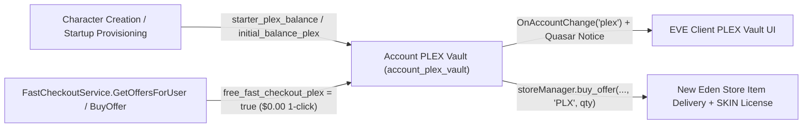

# PLEX Vault, Fast Checkout & New Eden Store

## Overview & Lore Context

Pilot's License Extension (PLEX, type ID `44992`) is EVE Online's account-wide virtual currency used to purchase Omega clone time, ship SKINs, apparel, skill extractors/injectors, and services in the **New Eden Store (NES)**. Rather than forcing capsuleers to carry PLEX stacks through space, EVE stores virtual PLEX balances in an account-scoped **PLEX Vault** shared across every character on the same user account while still permitting physical PLEX items (`44992`) in station hangars.

In **EvoMu**, private servers can run either strict paid-checkout simulation or a local sandbox economy where characters start with a PLEX endowment and claim `$0.00` 1-click PLEX packs from `FastCheckoutService` to test the full New Eden Store (`storeManager`) and Quasar `eve.plex.vault` / `eve_public.store` pipelines.



---

## Canonical Game Mechanics & Configuration

### PLEX Vault & Starter Grants

* **Type ID & Scope:** PLEX items use SDE type `44992` (`PLEX_TYPE_ID`). Vault balances are tracked per `user_id` in `WorldStateSnapshot.account_plex_vault` and resolved for any owned character via `WorldStateSnapshot::plex_vault_balance(char_id)` and `WorldStateSnapshot::adjust_plex_vault(char_id, delta)`.
* **Ledger Auditing:** Every credit or debit appends a `PlexTransactionRecord` (`"Starter PLEX Grant"`, `"FastCheckout Purchase"`, or NES store purchase) persisted in `service_state_blobs["plex_tx_logs"]`.
* **Starter Endowment Configuration ([`evomu.toml`](../../../evomu.toml)):**
  * `[feature_flags] starter_plex_balance` (`i64`, default `0`, must be `>= 0`): credited to every newly created character via `charUnboundMgr.CreateCharacterWithDoll`.
  * `[[player_accounts]] [player_accounts.starter_character] initial_balance_plex` (`Option<i64>`, default `None`, must be `>= 0`): overrides `starter_plex_balance` for that account's startup-provisioned character (including explicit `0`).

### Fast-Checkout PLEX Packs (`FastCheckoutService`)

* **`free_fast_checkout_plex` (`bool`, default `false`):**
  * When `false` (strict default), `FastCheckoutService.BuyOffer` requires the user's password and an active quick-pay token (`PaymentTokenRequired`), records a `PaymentReceiptRecord`, and returns `"status": "CONFIRMED"`.
  * When `true` (enabled in [`evomu.toml`](../../../evomu.toml)), `IsFastCheckoutEnabledForUser` defaults to `true` (still honoring an explicit `global_config_values["fastCheckoutEnabled"] = false`), ensures the 4 canonical PLEX packs (`100`, `250`, `500`, and `1100` PLEX at offer IDs `1`–`4`) are exposed with `price = 0.0`, accepts omitted/`None`/`""` password without requiring a payment token, credits the account PLEX Vault, pushes `OnAccountChange("plex", char_id, new_balance)` + Quasar `BalanceChangedNotice`, and returns `"status": "COMPLETED"`, `"newPlexBalance"`, and `"Message": "OK"`.

### New Eden Store (`storeManager` & Quasar `eve_public.store.*`)

* Even when `free_fast_checkout_plex = true` makes external PLEX pack top-ups free (`$0.00`), in-game New Eden Store catalog offers served by `storeManager.get_offers`, `storeManager.can_purchase_offer`, and `storeManager.buy_offer` retain their positive PLEX prices (`price_plex > 0`), deduct PLEX from the user's PLEX Vault, record a store debit transaction, and deliver items (such as permanent ship SKIN licenses) to the character's hangar.

---

## EvoMu Implementation Architecture

* **Configuration & Validation:** [`StarterCharacterConfig`](../../../crates/eve-server/src/config.rs), [`FeatureFlagsConfig`](../../../crates/eve-server/src/config.rs), and [`ServerConfig::from_toml_str`](../../../crates/eve-server/src/config.rs)
* **Startup Provisioning & Character Creation:** [`provision_starter_characters`](../../../crates/eve-server/src/starter_characters.rs) and [`handle_char_unbound`](../../../crates/eve-server/src/services/character_gm_tools.rs)
* **Fast Checkout RPC Service:** [`fast_checkout_and_activity.rs`](../../../crates/eve-server/src/services/fast_checkout_and_activity.rs) (`IsFastCheckoutEnabledForUser`, `GetOffersForUser`, `BuyOffer`)
* **New Eden Store & Quasar Vault:** [`wallet_services_ext.rs`](../../../crates/eve-server/src/services/wallet_services_ext.rs) (`storeManager`) and [`quasar_payment_store.rs`](../../../crates/eve-server/src/services/quasar_payment_store.rs) (`eve.plex.vault.*`, `eve_public.store.*`)

---

## Verification & Test Coverage

* **Unit & SQLite Persistence Tests:** [`fast_checkout_plex_tests.rs`](../../../crates/eve-server/src/fast_checkout_plex_tests.rs), [`starter_characters_tests.rs`](../../../crates/eve-server/src/starter_characters_tests.rs), and [`config_tests.rs`](../../../crates/eve-server/src/config_tests.rs)
  ```bash
  EVOMU_SDE_PATH=data/evomu_sde.sqlite cargo test -j 2 -p eve-server --lib fast_checkout_plex
  ```
* **End-to-End Bridge Journey (Journey 25):** [`tools/client-harness/run_journeys`](../../../tools/client-harness/run_journeys) (`cosmetics_store`)
  ```bash
  python3 tools/client-harness/run_journeys --out /tmp/evomu_harness_plex --bridge-harness-test
  ```
