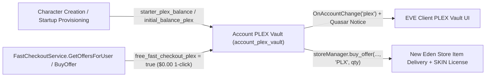

# PLEX Vault, Fast Checkout & New Eden Store

## Overview & Lore Context

Pilot's License Extension (PLEX, type ID `44992`) is EVE Online's account-wide virtual currency used to purchase Omega clone time, ship SKINs, apparel, skill extractors/injectors, and services in the **New Eden Store (NES)**. Rather than forcing capsuleers to carry PLEX stacks through space, EVE stores virtual PLEX balances in an account-scoped **PLEX Vault** shared across every character on the same user account while still permitting physical PLEX items (`44992`) in station hangars.

In **EvoMu**, private servers can run either strict paid-checkout simulation or a local sandbox economy where characters start with a PLEX endowment and claim `$0.00` 1-click PLEX packs from `FastCheckoutService` to test the full New Eden Store (`storeManager`) and Quasar `eve.plex.vault` / `eve_public.store` pipelines.



---

## Canonical Game Mechanics & Configuration

### PLEX Vault & Starter Grants

* **Type ID & Scope:** PLEX items use SDE type `44992` (`PLEX_TYPE_ID`). Vault balances are tracked per `user_id` in `WorldStateSnapshot.account_plex_vault` and resolved for any owned character via `WorldStateSnapshot::plex_vault_balance(char_id)` and `WorldStateSnapshot::adjust_plex_vault(char_id, delta)`.
* **Ledger Auditing:** Every credit or debit appends a `PlexTransactionRecord` (`"Starter PLEX Grant"`, `"FastCheckout Purchase"`, or NES store purchase) persisted in `service_state_blobs["plex_tx_logs"]`.
* **Starter Endowment Configuration ([`evomu.toml`](../../../evomu.toml)):**
  * `[feature_flags] starter_plex_balance` (`i64`, default `0`, must be `>= 0`): credited to every newly created character via `charUnboundMgr.CreateCharacterWithDoll`.
  * `[[player_accounts]] [player_accounts.starter_character] initial_balance_plex` (`Option<i64>`, default `None`, must be `>= 0`): overrides `starter_plex_balance` for that account's startup-provisioned character (including explicit `0`).

### Fast-Checkout (`FastCheckoutService`) — Strict Paid Mode vs `$0.00` Sandbox Mode

`[feature_flags] free_fast_checkout_plex` (`bool`, code default `false` in `FeatureFlagsConfig`; enabled as `true` in the sample [`evomu.toml`](../../../evomu.toml)) controls how MachoNet `FastCheckoutService` handles real-money USD checkout:

| Behavior | Strict Economy Mode (`free_fast_checkout_plex = false`, default) | Self-Hosted Sandbox Mode (`free_fast_checkout_plex = true`) |
|---|---|---|
| `IsFastCheckoutEnabledForUser` | `false` unless enabled per-user (`fast_checkout:<uid>`) or via `global_config_values["fastCheckoutEnabled"] = true` | `true` by default (still honors explicit `global_config_values["fastCheckoutEnabled"] = false`) |
| `GetOffersForUser` USD pricing | Displays catalog `price_usd` (e.g. `$4.99`–`$49.99` PLEX packs; `$19.99` `30 Days Omega` / `MPTC`, `$7.99` `Skill Extractor`) | Guarantees the 4 canonical PLEX packs (`100`, `250`, `500`, `1100` PLEX, IDs `1`–`4`) and sets display `price = 0.0` (`unit_cents = 0`) |
| Password verification in `BuyOffer` | Mandatory Argon2id account password check (`InvalidPassword` if omitted or wrong) | Omitted/`None`/`""` password accepted for 1-click checkout (non-empty passwords are still Argon2id-verified) |
| QuickPay token & USD receipt | Requires an active unconsumed token (`is_quick_pay && !consumed` in `payment_tokens`, else `PaymentTokenRequired`) and appends `PaymentReceiptRecord` | Skipped because `amount_in_cents == 0` |
| Fulfillment & response status | Credits `plex_amount * qty`, delivers `products` to station `Hangar`, sets `clone_grade = 2` when `category_id == 1`, returns `"status": "CONFIRMED"` | Same vault credit, item delivery, Omega `clone_grade = 2` upgrade, `OnAccountChange("plex")` + Quasar `BalanceChangedNotice`, returns `"status": "COMPLETED"` |

> [!NOTE]
> Dual-priced catalog offers (such as `1001` `30 Days Omega`, `1002` `MPTC`, and `1003` `Skill Extractor` hydrated from `nes_store_catalog`) carry both a USD `price_cents` and a `price_plex` cost. Enabling `free_fast_checkout_plex = true` zeroes out the USD `amount_in_cents` charge on `FastCheckoutService.BuyOffer`, while pure PLEX-pack offers (`price_plex == 0`, IDs `1`–`4`) grant PLEX at `$0.00` and any offer with `price_plex > 0` still checks and debits `price_plex * quantity` from `account_plex_vault`.

### New Eden Store (`storeManager`) & Quasar Payment / QuickPay Replay Protection

* **PLEX-Denominated NES (`storeManager` & `eve_public.store.*`):** Completely separate from `free_fast_checkout_plex`. Offers served by `storeManager.get_offers`, `storeManager.can_purchase_offer`, and `storeManager.buy_offer` (`"PLX"` currency) always retain their positive `price_plex > 0` cost, debit `account_plex_vault` (queried via `eve_public.plex.vault.api.BalanceRequest`), record a `"New Eden Store"` / `"FastCheckout Purchase"` `PlexTransactionRecord`, and deliver items or permanent Ship SKIN licenses to the character's hangar.
* **Quasar Real-Money Purchase & Single-Use QuickPay Tokens (`eve_public.payment.*`):**
  * `eve_public.payment.purchase.api.CostRequest` and `eve_public.payment.purchase.api.TokenRequest` price store offers directly from `StoreOffer.price_cents` (`STATUS_NOT_IMPLEMENTED` if an offer is PLEX-only with `price_cents = None`).
  * **Single-use token replay protection:** `TokenRequest` looks up the caller's `PaymentTokenRecord` in `service_state_blobs["payment_tokens"]`, enforces `tok.user_id == uid`, `tok.is_quick_pay == true`, and `!tok.consumed`, and atomically marks `tok.consumed = true` inside the purchase snapshot mutation before fulfilling Omega time (`clone_grade = 2`, `SubscriptionChangedNotice`) or hangar items. Any replay of a consumed token is rejected with `STATUS_BAD_REQUEST` (`"Payment token already consumed"`).
  * Players or GMs can revoke all active QuickPay tokens at any time via `eve_public.payment.token.api.DisableAllRequest`, which clears `is_quick_pay = false` and emits `QuickPayRemovedNotice`.

---

## EvoMu Implementation Architecture

* **Configuration & Validation:** [`StarterCharacterConfig`](../../../crates/eve-server/src/config.rs), [`FeatureFlagsConfig`](../../../crates/eve-server/src/config.rs), and [`ServerConfig::from_toml_str`](../../../crates/eve-server/src/config.rs)
* **Startup Provisioning & Character Creation:** [`provision_starter_characters`](../../../crates/eve-server/src/starter_characters.rs) and [`handle_char_unbound`](../../../crates/eve-server/src/services/character_gm_tools.rs)
* **Fast Checkout RPC Service:** [`fast_checkout_and_activity.rs`](../../../crates/eve-server/src/services/fast_checkout_and_activity.rs) (`IsFastCheckoutEnabledForUser`, `GetOffersForUser`, `BuyOffer`)
* **New Eden Store & Quasar Vault:** [`wallet_services_ext.rs`](../../../crates/eve-server/src/services/wallet_services_ext.rs) (`storeManager`) and [`quasar_payment_store.rs`](../../../crates/eve-server/src/services/quasar_payment_store.rs) (`eve.plex.vault.*`, `eve_public.store.*`)

---

## Verification & Test Coverage

* **Unit & SQLite Persistence Tests:** [`fast_checkout_plex_tests.rs`](../../../crates/eve-server/src/fast_checkout_plex_tests.rs), [`starter_characters_tests.rs`](../../../crates/eve-server/src/starter_characters_tests.rs), and [`config_tests.rs`](../../../crates/eve-server/src/config_tests.rs)
  ```bash
  EVOMU_SDE_PATH=data/evomu_sde.sqlite cargo test -j 2 -p eve-server --lib fast_checkout_plex
  ```
* **End-to-End Bridge Journey (Journey 25):** [`tools/client-harness/run_journeys`](../../../tools/client-harness/run_journeys) (`cosmetics_store`)
  ```bash
  python3 tools/client-harness/run_journeys --out /tmp/evomu_harness_plex --bridge-harness-test
  ```
