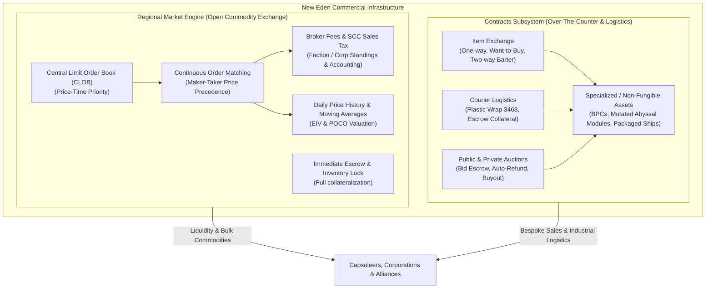
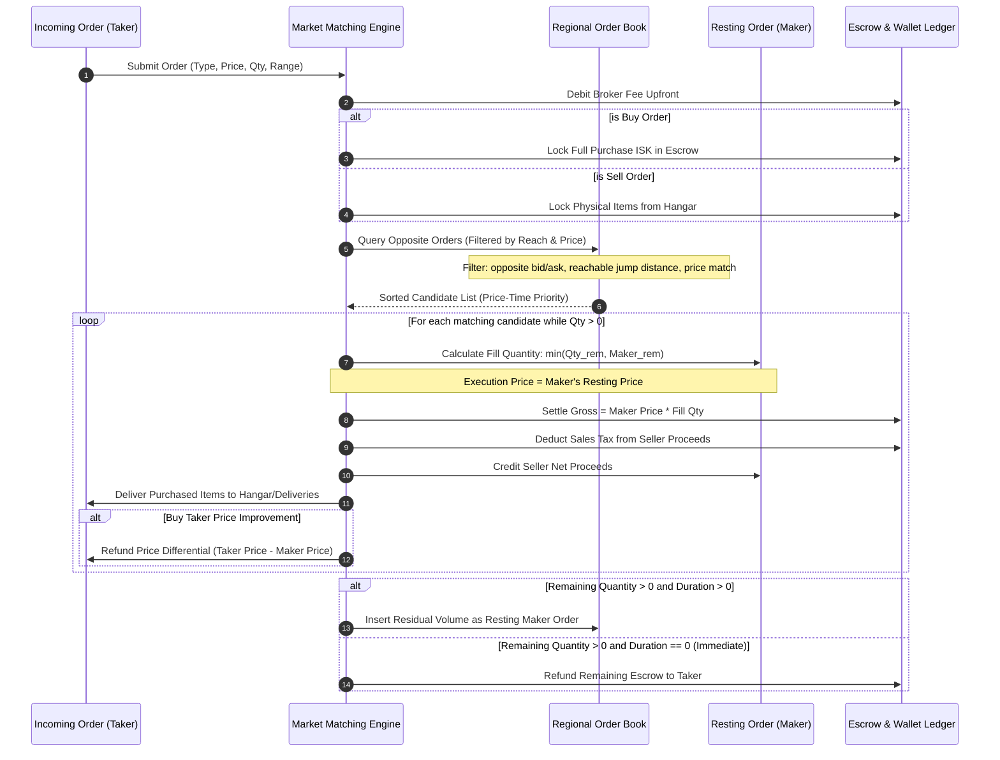
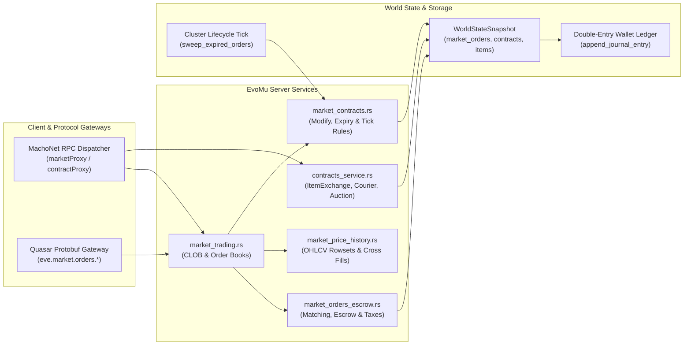

# Regional Market Engine, Order Matching & Contracts

> **Navigation**: [EvoMu Technical Wiki](../README.md) • [Related Systems](#related-systems--cross-references)
>
> [← Back to Wiki Table of Contents](../README.md)

---

## Overview & Lore Context

In the boundless expanse of New Eden, economic might is as decisive as fleet firepower. The lifeblood of capsuleer civilization flows not through interstellar warp gates alone, but through the continuous, decentralized movement of commodities, warships, and high-technology modules. This galactic trade is organized under two distinct yet complementary commercial frameworks: the **Regional Market Engine** and the **Contracts System**.



### The Economic Circulatory System: Regional Trade Hubs

The Regional Market functions as a network of localized Central Limit Order Books (CLOBs), partitioned strictly by astronomical **Regions** (e.g., *The Forge*, *Domain*, *Sinq Laison*, *Heimatar*, *Metropolis*). Unlike typical modern financial exchanges where all transactions are geographically agnostic, market orders in EVE Online are anchored to physical stations and star systems within a region. A buy order placed in *The Forge* cannot match a sell order resting in *Domain* without interstellar transport.

Over decades of capsuleer settlement, five major regional trade hubs emerged:
1. **Jita IV - Moon 4 - Caldari Navy Assembly Plant (*The Forge*):** The undisputed economic epicenter of New Eden, handling the vast majority of all market transactions, speculative investments, and PLEX trading.
2. **Amarr VIII (Oris) - Emperor Family Academy (*Domain*):** The sacred commercial capital of the Amarr Empire, catering to southern and eastern trade routes.
3. **Dodixie IX - Moon 20 - Federation Navy Assembly Plant (*Sinq Laison*):** The Gallente Federation's primary commercial exchange.
4. **Rens VI - Moon 8 - Brutor Tribe Treasury (*Heimatar*):** The historic Minmatar Republic hub.
5. **Hek VIII - Moon 12 - Boundless Creation Factory (*Metropolis*):** A secondary Minmatar hub serving low-security and faction warfare frontiers.

### Separation Between Regional Market and Contracts

The New Eden commercial architecture maintains a strict separation of concerns between standard market trading and specialized contracts:

| Dimension | Regional Market Engine | Contracts System |
| :--- | :--- | :--- |
| **Asset Fungibility** | Strictly fungible commodities (minerals, standard modules, ammo, skillbooks, packaged stock ships). | Non-fungible, packaged, and customized assets (BPCs with specific ME/TE runs, Abyssal mutated modules, unpackaged assembled ships with rigs/cargo). |
| **Matching Dynamics** | Automated continuous double auction; orders match instantly if bid crosses ask. | Bilateral agreement, asynchronous player acceptance, or competitive bidding up to an expiration deadline. |
| **Physical Proximity** | Restricted to the active region; buy orders may span jumps depending on pilot skills. | Can span across different regions (especially Courier contracts connecting high-sec hubs to null-sec outposts). |
| **Collateral & Custody** | Seller items locked in escrow; buyer ISK locked in full upfront. | Couriers require heavy collateral escrow to deter theft; items sealed in tamper-evident containers. |
| **Fee Structure** | Upfront Broker Fees + Execution Sales Tax (SCC sink). | Fixed creation fee + optional reward/collateral escrow + sales commission on public auctions/exchanges. |

---

## Canonical Mechanics & Precise Formulas

### 1. Regional Market Orders & Range Scopes

A market order is either a **Buy Order** (Bid) or a **Sell Order** (Ask).

#### Buy Order Range Scopes
Sell orders are always physically located at the station or structure where the items reside. Buy orders, however, support flexible fulfillment ranges specified by the `range` field:
- **Station (`-1`):** Matches only sellers delivering items to the exact same station/structure.
- **Solar System (`0`):** Matches sellers anywhere within the buyer's current solar system.
- **Jumps (`1 \dots 40`):** Matches sellers in any station reachable within $N$ interstellar stargate jumps.
- **Region (`32767`):** Matches sellers anywhere within the regional boundary.

Remote market interaction is governed by specialized Trade skills:
- **Procurement** (Type ID `16594`): Enables placing buy orders remotely from a station.
- **Marketing** (Type ID `16598`): Enables placing sell orders remotely.
- **Daytrading** (Type ID `16595`): Enables modifying existing orders remotely.
- **Visibility** (Type ID `3447`): Expands the maximum range for remote buy orders.

The maximum allowed jump distance based on skill level follows the canonical rule:
$$\text{MaxJumps}(\text{level}) = \begin{cases} -1 \text{ (Station)}, & \text{level} = 0 \\ 0 \text{ (Solar System)}, & \text{level} = 1 \\ 5 \text{ jumps}, & \text{level} = 2 \\ 10 \text{ jumps}, & \text{level} = 3 \\ 20 \text{ jumps}, & \text{level} = 4 \\ 32\,767 \text{ (Entire Region)}, & \text{level} = 5 \end{cases}$$

#### Durations & The 4-Significant-Figure Tick Size Rule
Standard player market orders support durations of **0 (Immediate / Fill-or-Kill)**, **1**, **3**, **7**, **14**, **30**, and **90 days**. NPC seeded orders run for **365 days**.

To prevent sub-cent order spoofing and 0.01 ISK outbidding wars, modern EVE mechanics enforce the **4-Significant-Figure Price Rule** (`feat:market.tick-size-four-significant-digits`). Any submitted price in ISK must have at most 4 significant decimal digits after stripping trailing zeros:
$$\text{SignificantDigits}(P) \le 4$$
*Examples:*
- $123\,400.00\text{ ISK} \rightarrow$ 4 significant digits (`1234`) $\rightarrow$ **Valid**.
- $123\,450.00\text{ ISK} \rightarrow$ 5 significant digits (`12345`) $\rightarrow$ **Invalid (Rejected)**.
- $1.234\text{ ISK} \rightarrow$ 4 significant digits (`1234`) $\rightarrow$ **Valid**.

---

### 2. The Order Matching Engine: Price-Time Priority & Execution

When an order is submitted via `marketProxy.PlaceBuyOrder` or `marketProxy.PlaceMultiSellOrder`, the matching engine processes it immediately against resting orders on the book.



#### Matching Precedence & Maker-Taker Execution
1. **Price-Time Priority:**
   - For Buy Orders sweeping asks: candidates are sorted ascending by ask price ($\text{lowest price first}$), then ascending by `order_id` ($\text{oldest order first}$).
   - For Sell Orders sweeping bids: candidates are sorted descending by bid price ($\text{highest price first}$), then ascending by `order_id` ($\text{oldest order first}$).
2. **Execution Price:**
   In EVE Online and EvoMu, **the resting order's (Maker's) price always takes precedence**:
   - If an incoming **Buy order** bids $100\text{ ISK}$ and crosses a resting **Sell order** asking $80\text{ ISK}$, the trade executes at $80\text{ ISK}$. The buyer experiences a **price improvement**, and the $20\text{ ISK}$ per unit difference is refunded from escrow to the buyer's wallet.
   - If an incoming **Sell order** asks $80\text{ ISK}$ and crosses a resting **Buy order** bidding $100\text{ ISK}$, the trade executes at $100\text{ ISK}$. The seller receives the full $100\text{ ISK}$ gross proceeds (minus sales tax).
3. **Partial Fills:**
   $$\Delta Q = \min\left(Q_{\text{taker-remaining}}, Q_{\text{maker-remaining}}\right)$$
   The maker's `vol_remaining` is decremented by $\Delta Q$. If `vol_remaining == 0`, the maker order transitions to `order_state = 2 (Closed)` and is removed from the active order book.

---

### 3. Broker Fees, Sales Tax & Escrow Mechanics

#### Broker Fee Calculation
A broker fee is charged upfront upon listing or modifying an order. In NPC stations, the fee rate depends on the pilot's **Broker Relations** skill and standings toward the station owner corporation and faction:

$$\text{Fee}_{\text{broker}} = \max\left(1.0\%, 3.0\% - 0.3\% \times L_{\text{Broker}} - 0.03\% \times S_{\text{faction}} - 0.02\% \times S_{\text{corp}}\right)$$

Where:
- $L_{\text{Broker}} \in [0, 5]$: Level in the *Broker Relations* skill (Type ID `3446`).
- $S_{\text{faction}} \in [0.0, 10.0]$: Unmodified standing with the station owner's faction.
- $S_{\text{corp}} \in [0.0, 10.0]$: Unmodified standing with the station owner's corporation.
- Minimum floor: $1.0\%$ (cannot be reduced below 100 basis points in NPC stations).

#### Player Upwell Structure Broker Fees & SCC Surcharge
In player-owned Upwell Citadels and Engineering Complexes (`feat:market.upwell-orders`), the broker fee is governed by the structure's market tax profile plus a mandatory Secure Commerce Commission (SCC) surcharge:
$$\text{Fee}_{\text{structure}} = \text{SCC-Surcharge} (0.5\%) + \text{ProfileTaxRate}$$
The collected broker fee is split $50\% / 50\%$ between the SCC sink and the structure owner corporation's master wallet.

#### Sales Tax Calculation
Sales tax is levied exclusively on the **seller** upon trade execution. The tax rate is discounted by the **Accounting** skill (Type ID `16622`):

$$\text{Tax}_{\text{sales}} = \text{BaseSalesTax} \times \left(1 - 0.11 \times L_{\text{Accounting}}\right)$$

With the base sales tax set to $7.5\%$ (canonical Crucible/modern baseline):
- At Accounting 0: $\text{Tax}_{\text{sales}} = 7.500\%$
- At Accounting I: $\text{Tax}_{\text{sales}} = 6.675\%$
- At Accounting III: $\text{Tax}_{\text{sales}} = 5.025\%$
- At Accounting V: $\text{Tax}_{\text{sales}} = 7.5\% \times (1 - 0.55) = 3.375\%$

The exact integer tax in ISK cents uses parts-per-million rounding with double-entry integrity:
$$\text{TaxCents} = \left\lfloor \frac{\text{GrossCents} \times \text{PPM} + 500\,000}{1\,000\,000} \right\rfloor$$
$$\text{NetProceeds}_{\text{seller}} = \text{GrossCents} - \text{TaxCents}$$

#### Escrow Locking & Margin Trading
1. **Buy Orders:** When placing a buy order, the pilot's wallet is debited immediately for the full purchase cost plus the broker fee:
   $$\text{RequiredUpfront} = \left(\text{Price} \times Q_{\text{entered}}\right) + \text{BrokerFee}$$
   The principal amount is credited into the order's `escrow` field.
2. **Margin Trading History vs Modern Full Collateral:**
   Historically, the *Margin Trading* skill permitted pilots to deposit partial escrow (down to $24\%$ at level V), leaving the remaining $76\%$ uncollateralized in their wallet. This gave rise to the notorious "Margin Trading Scam", where bad actors emptied their wallets to make buy orders fail when sellers attempted to fill them. Modern EvoMu mechanics enforce full upfront collateralization on order creation. When modifying an existing buy order upwards, any escrow shortfall is immediately verified and debited.
3. **Sell Orders:** Items listed for sale are deducted from personal hangars and placed into escrow flags (`InventoryFlag::Deliveries` or virtual order custody), preventing ships, modules, or commodities from being concurrently fitted, jettisoned, or consumed.

#### Order Modification & Relisting Fees
When a pilot modifies the price of an active order via `marketProxy.ModifyCharOrder`, an order modification relisting fee is levied (`feat:market.order-modify-relist-fee`):

$$\text{Fee}_{\text{relist}} = \max\left(100\text{ ISK}, (0.50 - 0.06 \times L_{\text{AdvBroker}}) \times \text{Rate}_{\text{broker}} \times \text{NewTotal} + \max(0, \text{NewTotal} - \text{OldTotal}) \times \text{Rate}_{\text{broker}}\right)$$

Where $L_{\text{AdvBroker}} \in [0, 5]$ is the pilot's level in the *Advanced Broker Relations* skill.

---

### 4. Market Price History & Daily OHLCV Aggregation

Every executed market transaction records regional pricing data. Daily price history aggregates this data into canonical rowsets (`historyDate`, `lowPrice`, `highPrice`, `avgPrice`, `volume`, `orders`):
- **Date Stamp:** Converted to Windows FileTime format ($100\text{-nanosecond}$ intervals since January 1, 1601 UTC):
  $$\text{FileTime} = \left(\text{UnixTimestamp} + 11\,644\,473\,600\right) \times 10\,000\,000$$
- **Volume-Weighted Average Price (VWAP):**
  $$\text{VWAP}_{\text{daily}} = \frac{\sum_{i=1}^N \left(P_i \times Q_i\right)}{\sum_{i=1}^N Q_i}$$
- **Moving Averages & Estimated Item Value ($EIV$):**
  Rolling 5-day and 20-day moving averages define the Adjusted Price and Estimated Item Value ($EIV$). These smoothed averages are consumed by the **Industry Job Installation Engine** (to compute base manufacturing taxes) and Planetary Customs Offices (POCOs) for planetary export tariffs.

---

### 5. The Contracts Subsystem

The Contracts system provides bilateral and multilateral asset exchanges, customized auctions, and industrial logistics.

```mermaid
stateDiagram-v2
    [*] --> Outstanding: Issuer creates contract & escrows items/ISK
    Outstanding --> InProgress: Acceptor accepts (Courier) or Bids (Auction)
    Outstanding --> Completed: Acceptor accepts (Item Exchange)
    Outstanding --> Expired: Contract timer elapses without acceptance
    Outstanding --> Deleted: Issuer cancels (if no bids exist)
    Outstanding --> Rejected: Target assignee rejects private contract

    InProgress --> Completed: Courier package delivered to destination
    InProgress --> Failed: Courier deadline expires or BreakPlasticWrap called

    Completed --> [*]: Assets & escrow released to parties
    Failed --> [*]: Collateral forfeited to issuer; package drops
    Expired --> [*]: Escrow returned to issuer
    Deleted --> [*]: Escrow returned to issuer
    Rejected --> [*]: Escrow returned to issuer
```



#### 1. Item Exchange Contracts
- **Modes:**
  - *Standard Sale:* Issuer offers items for a specified ISK price.
  - *Want-to-Buy:* Issuer offers ISK in exchange for specific `requested_items` (`(type_id, quantity)` pairs).
  - *Two-Way Barter:* Issuer exchanges items and/or ISK for specific items.
- **Non-Fungible Singleton Preservation:**
  Unlike market orders which collapse identical types into inventory stacks, Item Exchange contracts preserve individual item singleton records, including Blueprint Copies (`is_blueprint_copy = true`, `materialEfficiency`, `timeEfficiency`, `runsRemaining`), damaged modules, and Abyssal mutaplasmid rolls (`dynamic_attributes`, `source_mutaplasmid_id`).

#### 2. Public & Private Auctions
- Issuer sets a `start_price`, an optional `buyout_price`, and a duration.
- Bidders must place bids strictly higher than the current bid plus minimum bid increments:
  $$\text{MinNextBid} = \max\left(\text{CurrentBid} + 100\text{ ISK}, \text{CurrentBid} \times 1.01\right)$$
- **Instant Outbid Refunds:** When a pilot is outbid, their full bid escrow is immediately refunded to their wallet with an accompanying wallet journal notification (`ContractAuctionBidRefund`).
- If a bidder offers $\ge \text{buyout-price}$, the auction concludes instantly as `Completed`, delivering the items to the winner and the buyout funds to the issuer.

#### 3. Courier Logistics Contracts
Courier contracts enable the physical transport of heavy goods across dangerous star systems.
- **Escrow & Collateral:**
  The issuer deposits a `reward` (ISK paid upon successful delivery) and sets a required `collateral` (held in escrow to insure against loss or theft).
  $$\text{AcceptorUpfrontDebit} = \text{Collateral}$$
- **Plastic Wrap (Type ID `3468`):**
  Upon contract acceptance, all items in the contract are wrapped into a single, sealed, tamper-evident container of Type ID `3468` (`Plastic Wrap`). The plastic wrap container is placed in the acceptor's delivery ship or station hangar.
- **Cargo Volume Profiles:**
  - Standard Haulers / Industrials: Up to $\approx 62\,500\text{ m}^3$.
  - Deep Space Transports (DST) / Blockade Runners: $50\,000\text{ m}^3$ to $62\,500\text{ m}^3$ fleet hangar.
  - Freighters / Jump Freighters: $360\,000\text{ m}^3$ to $1\,200\,000\text{ m}^3$.
- **Completion vs. Breach:**
  - *Completion:* The acceptor docks at the destination station (`end_station_id`) with the unbroken Plastic Wrap container and calls `CompleteContract`. The acceptor receives their collateral back plus the reward:
    $$\text{Payout}_{\text{hauler}} = \text{Collateral} + \text{Reward}$$
    Items are unwrapped and placed into the issuer's station hangar.
  - *Failure & `BreakPlasticWrap`:* If the hauler calls `BreakPlasticWrap` (`feat:contracts.courier-plastic-wrap-break`) or the contract delivery timer expires, the contract transitions to `Failed`. The hauler's collateral and reward are permanently forfeited to the issuer:
    $$\text{Payout}_{\text{issuer}} = \text{Collateral} + \text{Reward}$$
    The plastic wrap container is destroyed, and the extracted items drop directly into the hauler's local inventory (`feat:lifecycle.courier-package-destroyed`).

---

## EvoMu Implementation Architecture

The market and contracts engine is implemented primarily across [`crates/eve-server`](../../../crates/eve-server), [`crates/eve-db`](../../../crates/eve-db), and [`crates/eve-sde`](../../../crates/eve-sde).



### 1. Primary Handlers & Source Mapping

#### Regional Market Services
- [`crates/eve-server/src/services/market_trading.rs`](../../../crates/eve-server/src/services/market_trading.rs):
  Handles incoming `marketProxy` calls:
  - `PlaceBuyOrder(stationID, typeID, price, quantity, orderRange, minVolume, duration, ...)`: Immediate sweep of matching asks followed by resting order placement.
  - `PlaceMultiSellOrder(itemList, useCorp, duration, expectedBrokersFee)`: Bulk sell order creation with multi-item inventory locking.
  - `CancelCharOrder(orderID)`: Cancels active order, refunds unspent escrow, or returns unsold items to hangar/deliveries.
  - `GetOrders(regionID, typeID)`: Retrieves active buy and sell orders for a specific commodity within a region.
  - `GetStationAsks(stationID)` & `GetRegionBest(regionID)`: High-efficiency order book views for UI clients.
- [`crates/eve-server/src/services/market_orders_escrow.rs`](../../../crates/eve-server/src/services/market_orders_escrow.rs):
  - `handle_orders_escrow`: Orchestrates multi-sell execution and upfront broker fee validation.
  - `BuyMultipleItems`: Atomic execution of multi-item shopping lists sweeping lowest asks across stations.
  - Upwell structure tax routing: splits broker fees $50\% / 50\%$ between SCC and structure owner (`structure_owner_broker_share`).
- [`crates/eve-server/src/services/market_price_history.rs`](../../../crates/eve-server/src/services/market_price_history.rs):
  - `execute_crossed_order_fills_on_modify`: Handles price improvement, margin shortfalls, and crossed order fills when modifying existing orders.
  - `build_price_history_rows`: Converts daily price history from `snap.market_history` into Windows FileTime rowsets for `GetOldPriceHistory` and `GetNewPriceHistory`.
- [`crates/eve-server/src/services/market_contracts.rs`](../../../crates/eve-server/src/services/market_contracts.rs):
  - `ModifyCharOrder(orderID, newPrice, ...)`: Re-validates 4-sig-fig price ticks, computes relist fees, and executes crossed order sweeps.
  - `sweep_expired_orders`: Sweeps expired non-NPC orders across cluster ticks (`feat:market.order-expiry`).
  - Sleeper Blue Loot NPC orders (`feat:market.npc-buy-orders-sleeper-loot`): Seeds permanent buy orders for Sleeper salvage at canonical values (e.g., *Neural Network Analyzer* at $200\,000\text{ ISK}$, *Sleeper Drone AI Nexus* at $5\,000\,000\text{ ISK}$).
  - PLEX Vault Integration: Settlements for PLEX (Type ID `44992`) route directly into the account-wide PLEX Vault rather than station hangars.
- [`crates/eve-server/src/services/quasar_market.rs`](../../../crates/eve-server/src/services/quasar_market.rs):
  Quasar Protobuf gateway implementing `eve.market.orders.*` endpoints and streaming `NewEntryNotice` broadcasts.

#### Contracts Services
- [`crates/eve-server/src/services/contracts_service.rs`](../../../crates/eve-server/src/services/contracts_service.rs):
  Handles `contractProxy` and `contractMgr` calls:
  - `CreateContract`: Validates item availability, packaging rules, requested items, and slot limits (*Contracting* skill).
  - `AcceptContract`: Debits collateral/reward escrow, wraps goods into Plastic Wrap (`3468`) for couriers, or executes atomic item swap for exchanges.
  - `CompleteContract`: Verifies active delivery ship docked at destination station, unpackages plastic wrap, credits hauler collateral + reward.
  - `FailContract` & `BreakPlasticWrap`: Forfeits collateral to issuer, unwraps items into acceptor's inventory.
  - `PlaceBid`: Validates minimum bid increments, refunds previous bidder's escrow, or triggers immediate buyout completion.
  - `RejectContract`: Rejects private contracts, returning items to issuer.
  - `GM_ExpireContract`: Administrative command for instant contract expiration testing.

---

### 2. State Models & Schema Definitions

The market and contracts state is persisted inside [`WorldStateSnapshot`](../../../crates/eve-db/src/snapshot_ext.rs):

#### MarketOrderRecord
Defined in [`crates/eve-db/src/types.rs`](../../../crates/eve-db/src/types.rs#L654-L668):
```rust
#[derive(Debug, Clone, PartialEq, Serialize, Deserialize)]
pub struct MarketOrderRecord {
    pub order_id: i64,
    pub owner_id: i64,
    pub station_id: i64,
    pub region_id: u32,
    pub type_id: TypeId,
    pub is_bid: bool,
    pub price: IskCents,
    pub vol_entered: i32,
    pub vol_remaining: i32,
    pub min_volume: i32,
    pub is_npc: bool,
    pub escrow: IskCents,
}
```

#### ContractRecord
Defined in [`crates/eve-db/src/types.rs`](../../../crates/eve-db/src/types.rs#L681-L719):
```rust
#[derive(Debug, Clone, PartialEq, Serialize, Deserialize)]
pub struct ContractRecord {
    pub contract_id: i64,
    pub issuer_id: i64,
    pub acceptor_id: Option<i64>,
    pub contract_type: String, // "ItemExchange", "Courier", "Auction"
    pub status: String,        // "Outstanding", "InProgress", "Completed", "Failed", "Expired", "Deleted", "Rejected"
    pub start_station_id: i64,
    pub end_station_id: i64,
    pub price: IskCents,
    pub reward: IskCents,
    pub collateral: IskCents,
    pub item_ids: Vec<i64>,
    pub expiration_unix: u64,
    pub issuer_corp_id: i64,
    pub assignee_id: i64,
    pub availability: String, // "Public", "Personal", "Corporation", "Alliance"
    pub buyout: IskCents,
    pub current_bid: IskCents,
    pub current_bidder_id: Option<i64>,
    pub requested_items: Vec<(TypeId, i32)>,
    pub bid_history: Vec<(i64, IskCents, u64)>,
    pub date_issued_unix: u64,
    pub title: String,
    pub for_corp: bool,
    pub num_days: u32,
}
```

#### Periodic Cluster Tick Integration
Order expiration is evaluated during cluster lifecycle ticks in [`crates/eve-server/src/sp6_lifecycle/cluster_tick.rs`](../../../crates/eve-server/src/sp6_lifecycle/cluster_tick.rs#L616-L621):
```rust
// Sweep expired market orders across cluster ticks (feat:market.order-expiry)
let swept = ctx.db.with_mut_snapshot(|s| crate::services::market_contracts::sweep_expired_orders(s, now_unix));
if !swept.is_empty() {
    crate::services::market_contracts::emit_expired_order_notifications(ctx, &swept);
}
```

---

## Invariants, Security & Edge Cases

### 1. Atomic Double-Entry Bookkeeping
Every transaction (market fill, broker fee, sales tax, contract payout, or escrow refund) strictly preserves double-entry accounting invariants. ISK cannot be created or destroyed except via explicit sinks:
- **Broker Fee Sink:** Credited to the NPC faction or split with player Upwell structure owners.
- **Sales Tax Sink:** Credited to the Secure Commerce Commission (`tax_collector_id`).
- **Proceeds:** Credited to the seller's wallet net of tax:
  $$\Delta \text{Balance}_{\text{buyer}} + \Delta \text{Balance}_{\text{seller}} + \text{SalesTax} + \Delta \text{Escrow} = 0$$

### 2. Fixed-Point Arithmetic & Checked Math (`IskCents`)
All currency fields utilize the [`IskCents`](../../../crates/eve-db/src/types.rs) newtype, representing currency as an exact 64-bit signed integer of cents ($1\text{ ISK} = 100\text{ cents}$).
- Every addition, subtraction, or quantity multiplication utilizes checked operations (`checked_add`, `checked_sub`, `checked_mul_qty`).
- If an operation would cause numeric overflow, the transaction immediately aborts with `MarketOrderOverflow` or `InsufficientFunds`, preventing infinite ISK exploits.

### 3. Self-Matching (Wash Trading) Mitigation
When the order matching engine evaluates opposite candidates, orders owned by the same entity (`order.owner_id == candidate.owner_id`) are skipped. A capsuleer cannot match their own sell orders with buy orders, eliminating wash trading exploits designed to artificially manipulate volume or daily OHLCV prices.

### 4. Courier Tamper Prevention & Plastic Wrap Invariant
Courier items are encapsulated in a single `Plastic Wrap` item (`type_id = 3468`).
- Haulers cannot open, cherry-pick, or repackage items from within the plastic wrap without calling `BreakPlasticWrap`.
- Calling `BreakPlasticWrap` immediately fails the contract, forfeits the full collateral and reward to the issuer, and logs an immutable ledger event (`feat:contracts.courier-plastic-wrap-break`).

### 5. Non-Fungible Item Attribute Preservation
When singletons (BPCs, mutated Abyssal modules) are escrowed in Item Exchange contracts:
- Dynamic attributes (`damage`, `materialEfficiency`, `timeEfficiency`, `runsRemaining`, `sourceMutaplasmidID`) are preserved verbatim in [`ContractRecord`](../../../crates/eve-db/src/types.rs#L681).
- Singletons cannot be merged into standard commodity stacks, preventing loss of research or Abyssal rolls.

---

## Verification, Tests & Parity References

The regional market engine and contracts system are rigorously validated by extensive integration tests:

### Concrete Integration Tests

| Test & Source Location | Validated Behaviors |
| :--- | :--- |
| [`test_e1_broker_fee_and_sales_tax_skill_discounts`](../../../crates/eve-server/tests/it/economy_market.rs#L65)<br/>📁 [`economy_market.rs`](../../../crates/eve-server/tests/it/economy_market.rs) | Validates broker fee discounts from *Broker Relations* and corp/faction standings, sales tax reductions from *Accounting*, and minimum fee floors. |
| [`test_e2_market_order_matching_queries_and_cancellation`](../../../crates/eve-server/tests/it/economy_market.rs#L249)<br/>📁 [`economy_market.rs`](../../../crates/eve-server/tests/it/economy_market.rs) | Tests full order lifecycle: placing limit orders, immediate order matching, partial fills, order cancellation, and escrow refunds. |
| [`test_market_instant_matching`](../../../crates/eve-server/tests/it/economy_market_part2.rs#L62)<br/>📁 [`economy_market_part2.rs`](../../../crates/eve-server/tests/it/economy_market_part2.rs) | Verifies maker-taker price execution, price improvement refunds for buyers, and sales tax deduction from seller gross proceeds. |
| [`test_market_modify_relist_tick_size_corp_remote_expiry_sleeper_and_plex`](../../../crates/eve-server/tests/it/economy_market_part3.rs#L66)<br/>📁 [`economy_market_part3.rs`](../../../crates/eve-server/tests/it/economy_market_part3.rs) | Validates 4-significant-figure tick rejection, relisting fees (*Advanced Broker Relations*), corporate division accounting, remote order range limits, Sleeper blue loot buy orders, and PLEX Vault settlement. |
| [`test_tick_size_relist_fee_broker_minimum_scc_surcharge_and_durations`](../../../crates/eve-server/tests/it/market_orders_complete.rs#L59)<br/>📁 [`market_orders_complete.rs`](../../../crates/eve-server/tests/it/market_orders_complete.rs) | Tests Upwell structure broker fee splits ($50\%$ SCC / $50\%$ owner), order durations, and relisting fee formulas. |
| [`test_ranged_buy_orders_corp_divisions_multisell_multibuy_expiry_and_history`](../../../crates/eve-server/tests/it/market_orders_complete.rs#L587)<br/>📁 [`market_orders_complete.rs`](../../../crates/eve-server/tests/it/market_orders_complete.rs) | Tests multi-sell orders (`PlaceMultiSellOrder`), multi-buy executions (`BuyMultipleItems`), and ranged buy order matching across stargate jumps. |
| [`test_e3_contracts_lifecycle_item_exchange_courier_auction`](../../../crates/eve-server/tests/it/economy_contracts.rs#L55)<br/>📁 [`economy_contracts.rs`](../../../crates/eve-server/tests/it/economy_contracts.rs) | Comprehensive end-to-end verification of Item Exchange, Courier, and Auction lifecycles. |
| [`test_contracts_item_exchange_and_request`](../../../crates/eve-server/tests/it/economy_contracts.rs#L364)<br/>📁 [`economy_contracts.rs`](../../../crates/eve-server/tests/it/economy_contracts.rs) | Tests one-way sales, want-to-buy requests, and two-way item barter. |
| [`test_contracts_auction_and_courier`](../../../crates/eve-server/tests/it/economy_contracts.rs#L538)<br/>📁 [`economy_contracts.rs`](../../../crates/eve-server/tests/it/economy_contracts.rs) | Tests auction bidding increments, outbid escrow refunds, buyout completion, and courier transport settlement. |
| [`test_contracts_visibility_search_fees_limits_reject_blueprints_and_gm_expire`](../../../crates/eve-server/tests/it/economy_contracts.rs#L968)<br/>📁 [`economy_contracts.rs`](../../../crates/eve-server/tests/it/economy_contracts.rs) | Validates contract slot caps (*Contracting*), private contract rejection, `BreakPlasticWrap` courier failure, BPC attribute preservation, and GM contract expiry. |
| [`test_market_price_history_authentic_aggregates_and_empty_untraded`](../../../crates/eve-server/tests/it/market_price_history_remediation.rs#L59)<br/>📁 [`market_price_history_remediation.rs`](../../../crates/eve-server/tests/it/market_price_history_remediation.rs) | Validates daily OHLCV aggregations, Windows FileTime formatting, and `GetOldPriceHistory` / `GetNewPriceHistory` responses. |

---

### Parity Audit Tag Matrix

| Parity / Feature Tag | Target System | Authoritative Implementation |
| :--- | :--- | :--- |
| `feat:market.broker-fee` | Broker Fee Formula & Standing Modifiers | [`formulas.rs`](../../../crates/eve-server/src/formulas.rs#L449-L459) |
| `feat:market.sales-tax` | Sales Tax Formula & Accounting Discount | [`formulas.rs`](../../../crates/eve-server/src/formulas.rs#L461-L463) |
| `feat:market.tick-size-four-significant-digits` | 4-Significant-Figure Price Rule | [`market_contracts.rs`](../../../crates/eve-server/src/services/market_contracts.rs#L58-L69) |
| `feat:market.order-modify-relist-fee` | Order Relist Fee & Advanced Broker Relations | [`market_contracts.rs`](../../../crates/eve-server/src/services/market_contracts.rs#L87-L105) |
| `feat:market.order-expiry` | Cluster Tick Expired Order Sweep | [`cluster_tick.rs`](../../../crates/eve-server/src/sp6_lifecycle/cluster_tick.rs#L616-L621) |
| `feat:market.upwell-orders` | Citadel Broker Fee & 50% SCC Surcharge Split | [`market_orders_escrow.rs`](../../../crates/eve-server/src/services/market_orders_escrow.rs#L230-L260) |
| `feat:market.npc-buy-orders-sleeper-loot` | Permanent NPC Blue Loot Buy Orders | [`market_contracts.rs`](../../../crates/eve-server/src/services/market_contracts.rs#L26-L32) |
| `feat:market.price-history` | Regional OHLCV Rowsets & FileTime Encoding | [`market_price_history.rs`](../../../crates/eve-server/src/services/market_price_history.rs#L394-L454) |
| `feat:contracts.item-exchange` | Item Exchange Lifecycle & Barter | [`contracts_service.rs`](../../../crates/eve-server/src/services/contracts_service.rs#L520-L600) |
| `feat:contracts.courier` | Courier Logistics & Plastic Wrap Delivery | [`contracts_service.rs`](../../../crates/eve-server/src/services/contracts_service.rs#L860-L930) |
| `feat:contracts.courier-plastic-wrap-break` | Tamper Penalty & Collateral Forfeiture | [`contracts_service.rs`](../../../crates/eve-server/src/services/contracts_service.rs#L935-L985) |
| `feat:contracts.auction` | Public Auctions, Bids & Outbid Refunds | [`contracts_service.rs`](../../../crates/eve-server/src/services/contracts_service.rs#L690-L800) |
| `feat:contracts.blueprint-singleton-preservation` | BPC Runs, ME/TE & Mutaplasmid Preservation | [`contracts_service.rs`](../../../crates/eve-server/src/services/contracts_service.rs#L65-L84) |
| `rpc:marketProxy.PlaceBuyOrder` | MachoNet Buy Order Placement | [`market_trading.rs`](../../../crates/eve-server/src/services/market_trading.rs#L670-L885) |
| `rpc:marketProxy.PlaceMultiSellOrder` | MachoNet Multi-Sell Order Placement | [`market_orders_escrow.rs`](../../../crates/eve-server/src/services/market_orders_escrow.rs#L30-L100) |
| `rpc:marketProxy.CancelCharOrder` | MachoNet Order Cancellation | [`market_trading.rs`](../../../crates/eve-server/src/services/market_trading.rs#L530-L590) |
| `rpc:contractProxy.CreateContract` | Contract Creation & Escrow Lock | [`contracts_service.rs`](../../../crates/eve-server/src/services/contracts_service.rs#L140-L450) |

---

## Related Systems & Cross-References

- [**Corporation Roles & Governance**](../corporations_and_governance/corporation_roles_and_governance.md): Corporate wallet divisions, accountant roles, and corporate order placement.
- [**Blueprints, Manufacturing & Reactions**](../industry_and_manufacturing/blueprints_manufacturing_and_reactions.md): Material purchasing, finished good listing, and dynamic System Cost Indexes.
- [**Agent Dialogue & Missions**](../missions_and_agents/agent_dialogue_and_missions.md): Loyalty Point (LP) store exchanges, buy orders, and market liquidity for faction gear.
- [**Character Progression & Skill Training**](../character_and_progression/skill_training_and_medical_clones.md): Trade skills (Accounting, Broker Relations, Margin Trading) reducing tax rates and fees.

---

[← Back to Wiki Table of Contents](../README.md)
