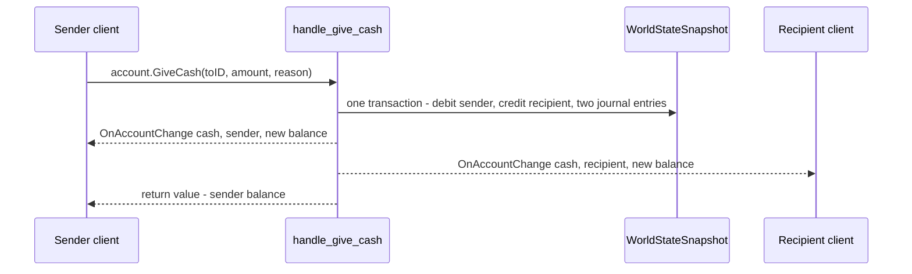

# Wallets & ISK Ledger

> **Navigation**: [EvoMu Technical Wiki](../README.md) • [Related Systems](#related-systems--cross-references)
>
> [← Back to Wiki Table of Contents](../README.md)

---

## Overview & Lore Context

ISK is the currency every other economic system in EvoMu settles in: market fills, contract escrow, insurance, bounties, mission rewards, industry job costs and corporation bills all end as a change to a wallet balance. This article covers the wallet itself:

- how a balance is stored (the fixed-point `IskCents` type),
- the personal wallet and the seven corporation wallet divisions,
- the wallet journal and the market transaction log,
- direct transfers (`account.GiveCash`, `account.GiveCashFromCorpAccount`),
- how the client learns that a balance changed (`OnAccountChange`).

PLEX is not ISK. It lives in an account-wide vault with its own log and is described in [PLEX Vault, Fast Checkout & New Eden Store](../economy_and_markets/plex_and_new_eden_store.md).

---

## Canonical Mechanics & Formulas

The rules below are the rules as EvoMu implements them.

### ISK storage: `IskCents`

Balances, prices, escrow and journal amounts are stored as **`IskCents`**, a newtype over `i64` defined in [`types.rs`](../../../crates/eve-db/src/types.rs). One ISK is 100 units. The type exists so that money is never accumulated in `f64`.

| Operation | Behavior |
|---|---|
| `from_isk(whole_isk)` | Multiplies by 100 with saturation. |
| `from_f64_isk(isk)` | Rounds `isk * 100` to the nearest unit. Non-finite input becomes 0. The result is clamped to `±i64::MAX / 2`. |
| `checked_add(rhs)` | Returns `None` if either side is negative or the sum overflows. |
| `checked_sub(rhs)` | Returns `None` if `rhs` is negative or larger than `self`. A balance therefore cannot go below zero through this call. |
| `checked_mul_qty(qty)` | Returns `None` for a negative price or quantity, or on overflow. |
| `to_wire_f64()` / `to_f64_isk()` | Divides by 100. This is the form sent to the client and to ESI. |

Conversion to and from `f64` happens at the RPC boundary: handlers read a float amount from the client, convert it once with `from_f64_isk`, and send balances back with `to_wire_f64`.

### Personal wallet

A character's balance is the `balance: IskCents` field of `CharacterRecord`. `account.GetCashBalance` returns it as a float. A startup-provisioned character can be given an opening balance with `initial_balance_isk` in its `starter_character` configuration block (`StarterCharacterConfig` in [`config.rs`](../../../crates/eve-server/src/config.rs), applied in [`starter_characters.rs`](../../../crates/eve-server/src/starter_characters.rs)).

### Corporation wallet divisions

A `CorporationRecord` holds `wallet_divisions: Vec<CorpWalletDivisionRecord>`, each with `division_id`, `name` and `balance`. `default_wallet_divisions` creates divisions 1 to 7; division 1 is named `Master Wallet`, the others `Division N`. A legacy `master_wallet` field mirrors division 1 and is kept in step by `ensure_wallet_divisions` and `set_division_balance`.

| Division | Client account key (`accountKey`) | `OnAccountChange` key |
|---|---|---|
| 1 (master) | 1000 (`ACCOUNTING_KEY_CASH`) | `cash` |
| 2 … 7 | 1001 … 1006 | `cash2` … `cash7` |

`CorporationRecord::debit_division` refuses a negative amount or an amount larger than the division balance. `credit_division` adds with `checked_add`.

Role checks on corporation wallets (all also pass for the CEO; roles come from `WorldStateSnapshot::effective_corp_roles_at`):

| Action | Required role |
|---|---|
| Read a division balance (`account.GetCashBalance` with a corporation key) | Director, Accountant, Junior Accountant, or `ROLE_ACCOUNT_CAN_TAKE` for that division |
| List divisions (`account.GetWalletDivisionsInfo`, `corpmgr.GetWalletDivisions`) | Accountant or Junior Accountant |
| Read the corporation journal (`account.GetTransactions` with `isCorp`) | Director, Accountant, Junior Accountant, or the division's take role |
| Read corporation market transactions (`marketProxy.CorpGetTransactions`) | The journal roles, or Trader |
| Withdraw or transfer (`account.GiveCashFromCorpAccount`) | Director, or `ROLE_ACCOUNT_CAN_TAKE` for the source division |

### Giving ISK

**`account.GiveCash(toID, amount, reason)`** — a player donation from the caller's personal wallet.

- The recipient may be a character or a corporation; a corporation is credited on division 1. An unknown recipient is `InvalidRecipient`; giving to yourself is `InvalidArgument`.
- The sender is debited with `checked_sub`; an insufficient balance is `NotEnoughMoney`.
- Two journal entries of type `PlayerDonation` are written, one per side, with ref type 10 (`PLAYER_DONATION`) and both parties recorded.
- The debit, the credit and both journal entries are one snapshot transaction.
- The call returns the sender's new balance.

**`account.GiveCashFromCorpAccount`** — two call shapes are accepted:

| Shape | Handler | Effect |
|---|---|---|
| `(toID, amount, fromAccountKey, toAccountKey=…, reason=…)` (the V24 transfer window) | `give_cash_from_corp` in [`wallet_ledger.rs`](../../../crates/eve-server/src/services/wallet_ledger.rs) | Debits the source division. If `toID` is the caller's own corporation, credits the division named by `toAccountKey`. Otherwise credits a character's wallet or another corporation's division 1. Writes two `CorporationAccountWithdrawal` journal entries (ref type 37) with the acting character as context, and notifies both sides. |
| `(fromDivision 1..7, toDivision 1..7, amountISK)` | the legacy arm in [`fleet_social_corps.rs`](../../../crates/eve-server/src/services/fleet_social_corps.rs) | Moves ISK between two different divisions of the caller's corporation and appends a row to each division's `corp_wallet_journals` list. |

`wallet_ledger::handle` passes a call to the legacy arm only when there are exactly three positional arguments, the first is an integer 1 to 7 and the third is a float.

### The wallet journal

A journal row is a `WalletJournalEntry` (`entry_id`, owner in `character_id`, `entry_type`, `amount`, `balance_after`, `reason`) in `WorldStateSnapshot::wallet_journal`. The owner may be a character ID or a corporation ID. There are two writers:

| Writer | Defined in | What it records |
|---|---|---|
| `append_journal_entry(JournalEntryInput)` | [`ledger.rs`](../../../crates/eve-db/src/ledger.rs) | The row, plus a `JournalMeta` in `wallet_journal_meta` (ref type, first party, second party, context kind and ID, account key, timestamp) and a timestamp in `wallet_journal_timestamps`. If the owner is a corporation it also appends a `CorpWalletJournalRecord` to `corp_wallet_journals[(corp_id, division)]`, where `division = clamp(account_key - 999, 1, 7)`. |
| `append_journal(owner, type, amount, balance_after, reason)` | [`snapshot_ext.rs`](../../../crates/eve-db/src/snapshot_ext.rs) | The row only. Some callers add a `wallet_journal_timestamps` entry themselves. |

`JournalMeta::ref_type_id` uses the client's `appConst.ref*` numbers. The constants defined in `ledger::ref_types`:

| Constant | Value |
|---|---|
| `MARKET_TRANSACTION` | 2 |
| `PLAYER_DONATION` | 10 |
| `INSURANCE` | 19 |
| `CORPORATION_ACCOUNT_WITHDRAWAL` | 37 |
| `MARKET_ESCROW` | 42 |
| `BROKER_FEE` | 46 |
| `TRANSACTION_TAX` | 54 |
| `CONTRACT_COLLATERAL` | 65 |
| `CONTRACT_REWARD` | 68 |
| `CONTRACT_PRICE` | 71 |
| `CONTRACT_BROKERS_FEE` | 72 |

`JournalContext` says what `context_id` refers to: `None`, `MarketOrder`, `MarketTransaction`, `Contract`, `Character`, `Corporation` or `Type`.

**Reading the journal.** `account.GetTransactions(accountKey, year, month, isCorp)` returns a `CRowset` with columns `transactionID`, `transactionDate`, `referenceID`, `entryTypeID`, `ownerID1`, `ownerID2`, `accountKey`, `amount`, `balance`, `description`. Rows are newest first and are filtered by owner, by `account_key`, and by year and month when given. Only rows that have a `JournalMeta` are returned. `referenceID` is the meta's `context_id`, except that an insurance entry whose context is not a type reports `670`. `account.GetEntryTypes` returns a fixed table of entry type IDs, names and descriptions.

### Market transactions

When a market order fills, the market code calls `WorldStateSnapshot::journal_market_fill(MarketFill)`. It:

1. records a `MarketTransactionRecord` in `market_transactions`;
2. writes a `MarketTransaction` debit for the buyer, a `MarketSell` credit for the seller and, if sales tax is positive, a `TransactionTax` entry for the seller, all with the transaction as context;
3. pushes a `WalletTransactionRecord` to `char_wallet_transactions[buyer]` / `[seller]`, or to `corp_wallet_transactions[(corp, 1)]` when the party is a corporation;
4. updates the regional daily price summary (`record_market_trade_daily_summary`).

`marketProxy.CharGetTransactions(fromDate)` and `marketProxy.CorpGetTransactions(fromDate, accountKey)` read `market_transactions`, filtered by date and by the buyer or seller account key. Order matching, broker fee and sales tax themselves are described in [Regional Market Engine, Order Matching & Contracts](../economy_and_markets/regional_market_order_matching.md).

### `OnAccountChange`

A balance change is reported with the `OnAccountChange` notification, whose arguments are `(accountKey: str, ownerID: int, balance: float)`.

| Helper in [`cache_notifications.rs`](../../../crates/eve-server/src/router/cache_notifications.rs) | Target | Key |
|---|---|---|
| `notify_account_change(char_id, account_key, owner_id, balance)` | The character (`charid`) | Caller-supplied; `cash` for ISK |
| `notify_wallet_balance(is_corp = false, …)` | The character | `cash` |
| `notify_wallet_balance(is_corp = true, owner, division, …)` | The corporation (`NotificationTarget::Corporation`, `corpid`) | `cash` for division 1, otherwise `cash<division>` |

The balance sent is always the new absolute balance, not a delta. The same notification with key `plex` is used for the PLEX vault.

### CSPA charge setting

`account.SetContactCost(cost)` stores a per-character charge in `character_cspa_charges`; a cost of zero or `None` removes it. `account.GetDefaultContactCost()` returns the stored value or `None`. The map is read by the mail code ([`mail.rs`](../../../crates/eve-server/src/domain/mail.rs)) and the chat code ([`fleet_social_chat.rs`](../../../crates/eve-server/src/services/fleet_social_chat.rs)).

### GM grant

The `/giveisk <positive_integer_amount>` slash command ([`auth_cache.rs`](../../../crates/eve-server/src/services/auth_cache.rs)) is gated by the slash-command role mask. It adds whole ISK to the caller's balance, fails with `BalanceOverflow` if the sum overflows, and emits `OnAccountChange`.

### Not implemented / known gaps

- **Journal entries without metadata are invisible in the client journal.** `account.GetTransactions` returns only rows that have a `JournalMeta`, and only `append_journal_entry` writes one. Many services still record ISK movements with the older `append_journal` (for example the bounty, LP store, repair, clone, contract auction and planetary industry code). Those entries are returned by the ESI journal route, but not by the in-game journal RPC. The parity row `feat:wallet.journal` asks for parties and context on every ISK movement.
- **Corporation market transactions are always recorded on account key 1000.** `record_market_transaction` sets both `buyer_account_key` and `seller_account_key` to `ACCOUNTING_KEY_CASH`, and `journal_market_fill` files corporation rows under division 1. `marketProxy.CorpGetTransactions` for another division returns no rows.
- **The legacy three-argument division transfer** writes only `corp_wallet_journals` rows (no `wallet_journal` row, no metadata) and sends no `OnAccountChange`.
- **`/giveisk` writes no journal entry.**
- **Contract ref types are declared but unused.** `CONTRACT_PRICE`, `CONTRACT_REWARD`, `CONTRACT_COLLATERAL` and `CONTRACT_BROKERS_FEE` appear in `ref_types` and in the `GetEntryTypes` table, but no journal entry is written with them (see [Contracts](../economy_and_markets/contracts.md)).
- **No central emitter.** Each handler that changes a balance calls a notification helper itself, and several services call `ctx.notify(…, "OnAccountChange", …)` directly. Nothing guarantees that every balance change produces a notification. Open issue #931 proposes deriving `OnAccountChange` from the committed change set and deleting the hand-written emit sites.
- **`CorpWalletJournalRecord` stores `amount` and `balance` as `f64`**, unlike the main journal, which stores `IskCents`.

---

## EvoMu Implementation Architecture

### Crates Involved

- [`eve-db`](../../../crates/eve-db): `IskCents`, `CharacterRecord`, `CorporationRecord` and the division helpers ([`types.rs`](../../../crates/eve-db/src/types.rs)); journal metadata, market transaction records and the journal writer ([`ledger.rs`](../../../crates/eve-db/src/ledger.rs)); snapshot fields and `append_journal` ([`snapshot_ext.rs`](../../../crates/eve-db/src/snapshot_ext.rs)).
- [`eve-server`](../../../crates/eve-server): the MachoNet `account` and `marketProxy` handlers, the ESI wallet routes and the notification helpers.

### Primary Handlers & Dispatch

[`dispatch.rs`](../../../crates/eve-server/src/router/dispatch.rs) tries service modules in order. For wallet calls the relevant order is `market_contracts::handle`, then `wallet_serverops::handle` (which first delegates to `wallet_ledger::handle` and `wallet_services_ext::handle`), and later the corporation handlers in `fleet_social_corps.rs`.

| RPC | Handler |
|---|---|
| `account.GetCashBalance` | [`market_contracts.rs`](../../../crates/eve-server/src/services/market_contracts.rs) |
| `account.GiveCash`, `account.SetContactCost`, `account.GetDefaultContactCost` | `handle_give_cash`, `handle_set_contact_cost`, `handle_get_default_contact_cost` in [`wallet_serverops.rs`](../../../crates/eve-server/src/services/wallet_serverops.rs) |
| `account.GiveCashFromCorpAccount` (client shape), `account.GetTransactions`, `account.GetEntryTypes`, `marketProxy.CharGetTransactions`, `marketProxy.CorpGetTransactions` | [`wallet_ledger.rs`](../../../crates/eve-server/src/services/wallet_ledger.rs) |
| `account.GiveCashFromCorpAccount` (legacy shape) | [`fleet_social_corps.rs`](../../../crates/eve-server/src/services/fleet_social_corps.rs) |
| `account.GetWalletDivisionsInfo`, `corpmgr.GetWalletDivisions` | `handle_get_wallet_divisions_info` in [`fleet_social_corp_gov.rs`](../../../crates/eve-server/src/services/fleet_social_corp_gov.rs) |
| `billMgr.*` (corporation bills, automatic payment) | [`wallet_serverops.rs`](../../../crates/eve-server/src/services/wallet_serverops.rs) with types in [`wallet_services_ext.rs`](../../../crates/eve-server/src/services/wallet_services_ext.rs) |
| `trademgr.*` (station direct trade, including `OfferMoney`) | [`wallet_services_ext.rs`](../../../crates/eve-server/src/services/wallet_services_ext.rs) |

ESI routes in [`character_mail_routes.rs`](../../../crates/eve-server/src/esi/character_mail_routes.rs):

| Route | Source |
|---|---|
| `GET /characters/{character_id}/wallet` | `CharacterRecord::balance` |
| `GET /characters/{character_id}/wallet/journal` | `wallet_journal` + `wallet_journal_timestamps`, newest first, pages of 1000 |
| `GET /characters/{character_id}/wallet/transactions` | `char_wallet_transactions` |
| `GET /corporations/{corporation_id}/wallets` | `division_balance(1..=7)` |
| `GET /corporations/{corporation_id}/wallets/{division}/journal` | `corp_wallet_journals[(corp, division)]` |
| `GET /corporations/{corporation_id}/wallets/{division}/transactions` | `corp_wallet_transactions[(corp, division)]` |

The corporation routes require CEO, Director, Accountant or Junior Accountant (`check_corp_wallet_access_in_snap`).

### State Store & Snapshot Schema

| `WorldStateSnapshot` field | Type | Content |
|---|---|---|
| `characters[id].balance` | `IskCents` | Personal wallet |
| `corporations[id].wallet_divisions` | `Vec<CorpWalletDivisionRecord>` | Seven division balances and names |
| `wallet_journal` | `Vec<WalletJournalEntry>` | All journal rows, characters and corporations |
| `wallet_journal_meta` | `CowMap<i64, JournalMeta>` | Parties, ref type, context, account key, timestamp per entry |
| `wallet_journal_timestamps` | `HashMap<i64, u64>` | Entry timestamps (used by ESI) |
| `char_wallet_transactions` | `HashMap<i64, Vec<WalletTransactionRecord>>` | Per-character market transactions (ESI shape) |
| `corp_wallet_journals` | `HashMap<(i64, i64), Vec<CorpWalletJournalRecord>>` | Per corporation and division |
| `corp_wallet_transactions` | `HashMap<(i64, i64), Vec<WalletTransactionRecord>>` | Per corporation and division |
| `market_transactions` | `CowMap<i64, MarketTransactionRecord>` | One record per market fill |
| `character_cspa_charges` | `HashMap<i64, IskCents>` | CSPA charge per character |

Journal entry IDs and market transaction IDs are allocated from `next_entity_id`. In the SQLite store, `wallet_journal_meta` and `market_transactions` are persisted as row-per-key domains named `ledger.wallet_journal_meta` and `ledger.market_transactions` ([`domain_rows.rs`](../../../crates/eve-db/src/sqlite_store/domain_rows.rs)).

### Tick & Lifecycle Integration

The wallet has no tick of its own. Balances change inside the snapshot transaction of whichever handler or tick job moves the ISK (market matching, contract expiry sweep, bill processing and so on), and that code is responsible for the journal entry and the notification.

---

## Invariants, Security & Edge Cases

- **No negative balances through the checked API.** `IskCents::checked_sub` and `CorporationRecord::debit_division` fail instead of going below zero; handlers map the failure to `NotEnoughMoney` (or a service-specific code).
- **Atomic transfers.** `GiveCash` and the client-shape `GiveCashFromCorpAccount` perform debit, credit and journal writes inside one `try_with_mut_snapshot` closure; an error aborts the whole transfer.
- **Credit overflow is silent.** Recipient credits use `checked_add(amount).unwrap_or(current)`. If the credit would overflow, or the stored balance is negative, the recipient's balance stays unchanged while the sender has already been debited.
- **Session identity.** Every handler takes the acting character from the session (`ServerContext::require_character`), never from arguments. The corporation is read from the character record inside the snapshot.
- **Role timing.** The corporation transfer and balance handlers call `promote_due_pending_corp_grants` before checking roles, so that role grants that have come due are applied first.
- **Notification target.** Corporation balance notifications are addressed to the whole corporation, not only to members who hold wallet roles.

---

## Verification, Tests & Parity References

Parity ledger rows (from `ledger.json` / `auditor_rows.json`):

| Row | Subject |
|---|---|
| `feat:wallet.balance` | Wallet balance |
| `feat:wallet.give-cash` | Give ISK |
| `feat:wallet.give-cash-corp` | Corporation wallet payments |
| `feat:wallet.journal` | Wallet journal |
| `feat:wallet.transactions` | Wallet transactions |
| `feat:wallet.corp-divisions` | Corporation wallet divisions |
| `feat:wallet.cspa-cost` | CSPA charge setting |
| `feat:admin.gm-giveisk` | `/giveisk` |
| `feat:lifecycle.market-wallet-history-durable` | Market and wallet history persistence |
| `feat:esi.wallet.char-balance`, `feat:esi.wallet.char-journal`, `feat:esi.wallet.char-transactions`, `feat:esi.wallet.corp` | ESI wallet routes |
| `rpc:account.GetCashBalance`, `rpc:account.GiveCash`, `rpc:account.GiveCashFromCorpAccount`, `rpc:account.GetTransactions`, `rpc:account.GetWalletDivisionsInfo`, `rpc:account.SetContactCost`, `rpc:account.GetDefaultContactCost` | `account` service |
| `rpc:marketProxy.CharGetTransactions`, `rpc:marketProxy.CorpGetTransactions` | Market transaction history |
| `notify:OnAccountChange` | Balance notification |

Tests:

- [`ledger_unit_tests.rs`](../../../crates/eve-db/src/ledger_unit_tests.rs) — journal writer and market fill journaling in `eve-db`.
- [`wallet_ledger_tests.rs`](../../../crates/eve-server/src/services/wallet_ledger_tests.rs), [`wallet_serverops_tests.rs`](../../../crates/eve-server/src/services/wallet_serverops_tests.rs) — handler unit tests.
- [`wallet_ledger_complete.rs`](../../../crates/eve-server/tests/it/wallet_ledger_complete.rs) — `GetTransactions` and `GiveCashFromCorpAccount` over the RPC path.
- [`wallet_serverops_complete.rs`](../../../crates/eve-server/tests/it/wallet_serverops_complete.rs) — `GiveCash` and `OnAccountChange`.
- [`character_esi_wallet_loyalty.rs`](../../../crates/eve-server/tests/it/character_esi_wallet_loyalty.rs) — ESI wallet routes.

---

## Related Systems & Cross-References

- [**EvoMu Technical Wiki Table of Contents**](../README.md): Master index and domain directory.
- [PLEX Vault, Fast Checkout & New Eden Store](../economy_and_markets/plex_and_new_eden_store.md): the account-wide PLEX balance and its own transaction log.
- [Regional Market Engine, Order Matching & Contracts](../economy_and_markets/regional_market_order_matching.md): the largest source of journal entries and market transactions.
- [Contracts](../economy_and_markets/contracts.md): escrow, collateral and auction bids drawn from personal and corporation wallets.
- [Inventory & Containers](../economy_and_markets/inventory_and_containers.md): the item side of trades and deliveries.
- [Corporation Roles & Governance](../corporations_and_governance/corporation_roles_and_governance.md): the role bits that gate corporation wallet access.
- [MachoNet Wire & Quasar Gateway](../protocol_and_infrastructure/machonet_wire_and_quasar_gateway.md): how RPCs and notifications reach the client.

---

[← Back to Wiki Table of Contents](../README.md)
