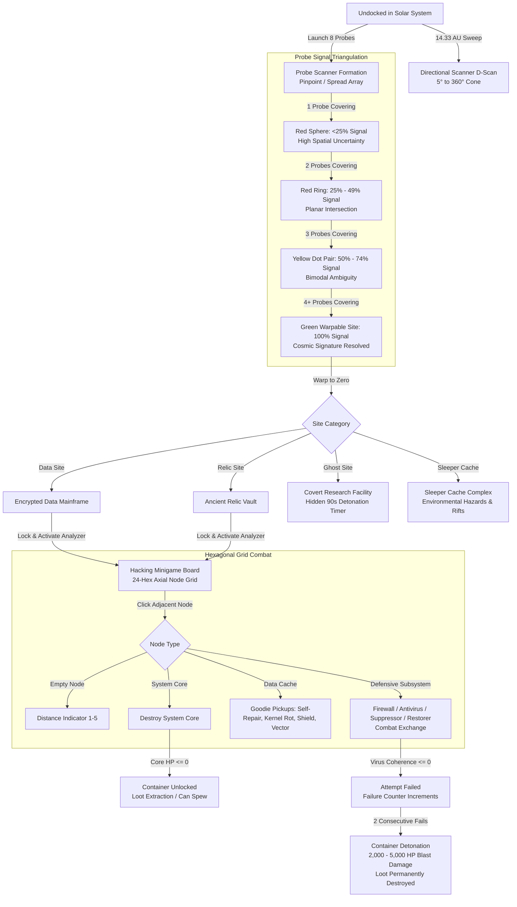
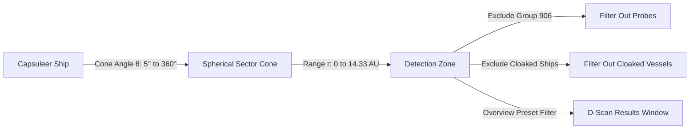
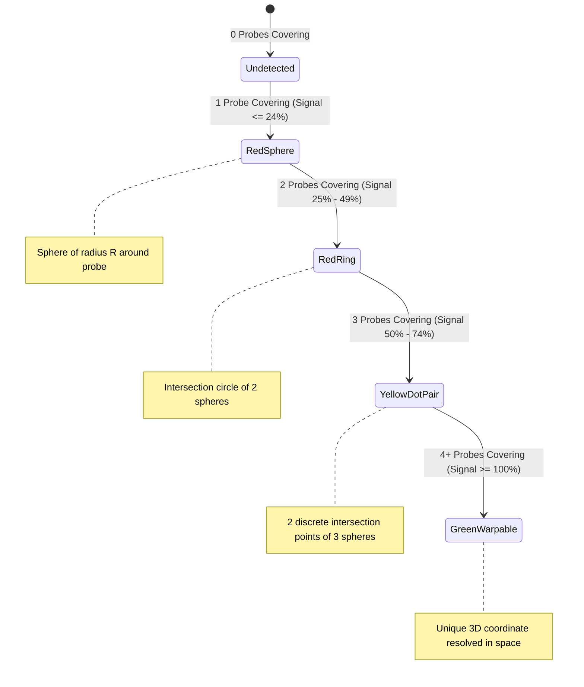
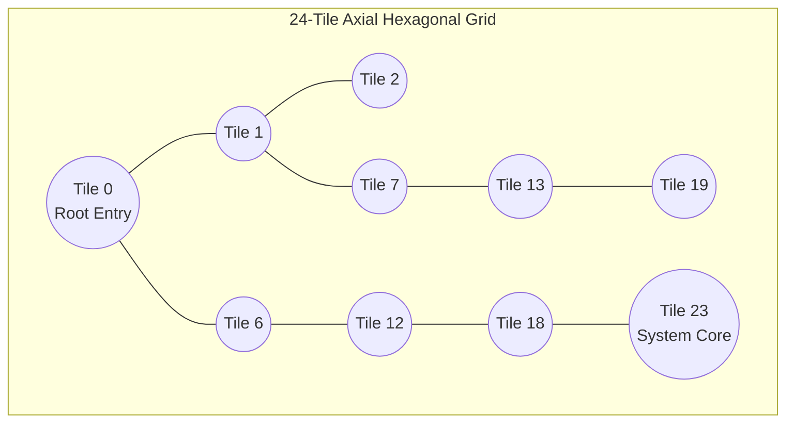
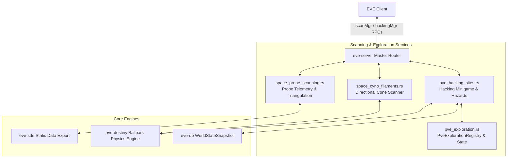

# Exploration Scanning, Directional Scanner (D-Scan) & Hacking Minigame

> **Navigation**: [EvoMu Technical Wiki](../README.md) • [Related Systems](#related-systems--cross-references)
>
> [← Back to Wiki Table of Contents](../README.md)

---

## Overview & Lore Context

In the vast expanse of New Eden, the star charts provided by CONCORD and the empires encompass only a fraction of the celestial phenomena drifting through space. Beyond established stations and orbital beacons lies an untamed frontier of uncharted cosmic anomalies and hidden cosmic signatures. These signatures are scattered across Known Space (K-space empires and lawless nullsec), Anoikis (J-space wormholes), and the disrupted domains of Pochven.

For capsuleers equipped with specialized sensor suites, exploration is among the most intellectually demanding and financially rewarding professions in the cluster. It requires navigating three distinct technological phases:
1. **Reconnaissance & Spatial Awareness:** Utilizing the **Directional Scanner (D-Scan)** to sweep local space for hostile vessels, celestial bodies, and uncloaked probes without revealing one's own position.
2. **Triangulation & Probe Astrometry:** Deploying scanner probe arrays into space to compute the exact coordinates of hidden cosmic signatures—resolving spatial uncertainties from diffuse spheres into precise warp-in vectors.
3. **Electronic Infiltration & Archaeology:** Engaging in the **Hacking Minigame** to crack encrypted data banks and ancient relic repositories using specialized **Data Analyzers** and **Relic Analyzers**.



### The Lore of New Eden Archaeology & Encryption
The structures encountered by capsuleers reflect millennia of human colonization, collapse, and technological resurgence:
- **Ancient Sleeper Technology:** Derelict Sleeper enclaves and caches hidden deep within wormholes and scattered across empire space contain incomprehensibly dense neuro-visual databases, cryogenic cooling coils, and polymorphic nanite matrices. Their automated defense subroutines and plasma firewalls operate with predatory autonomy.
- **Pirate Encryption Ciphers:** Outlaw syndicates—the **Guristas Pirates**, **Blood Raider Covenant**, **Sansha's Nation**, **Serpentis Corporation**, and **Angel Cartel**—maintain covert research outposts (often operating as volatile **Ghost Sites**). Their data vaults house stolen empire blueprints, faction encryption keys, and mutaplasmid prototypes protected by self-destruct failsafes designed to incinerate the facility if tampering is detected.

---

## Canonical Mechanics & Precise Formulas

### 1. Directional Scanner (D-Scan)

The Directional Scanner is a passive, ship-borne telemetry sensor that sweeps the surrounding solar system for active celestial objects, ships, structures, and deployables.



#### Geometry, Range & Angle Constraints
- **Maximum Range:** $14.33\text{ AU}$ ($14.3 \times \text{AU\_IN\_METERS} = 2,144,233,786,880\text{ meters}$).
- **Scan Cone Angle ($\theta$):** Adjustable continuously from a broad $360^\circ$ omnidirectional bubble down to a precision $5^\circ$ directional beam.
- **Directional Vector Math:**
  Let $\vec{p}_{\text{ship}}$ be the scanning ship's position and $\vec{d}_{\text{cam}}$ be the unit direction vector of the player's camera (or ship heading). For any target ball at position $\vec{p}_{\text{target}}$:
  $$\vec{v} = \frac{\vec{p}_{\text{target}} - \vec{p}_{\text{ship}}}{\|\vec{p}_{\text{target}} - \vec{p}_{\text{ship}}\|}$$
  The target falls within the scan cone if and only if:
  $$\|\vec{p}_{\text{target}} - \vec{p}_{\text{ship}}\| \le r_{\text{scan}} \quad \text{and} \quad \vec{v} \cdot \vec{d}_{\text{cam}} \ge \cos\left(\frac{\theta}{2}\right)$$

#### Invariants & Filters
- **Cloaked Vessels:** Any ship with an active cloaking device (`combat_state.is_cloaked == true`) is mathematically omitted from scan results.
- **Scanner Probes:** Scanner probes and celestial navigation markers (`group_id: 906`) are filtered out of standard D-Scan returns.
- **Docked State:** Directional scanning is strictly prohibited while docked inside stations or Upwell citadels (`CannotDirectionalScanWhileDocked`).
- **Electronic Warfare Suppression:** Specific anomalous systems (e.g., the ancient precursor hub *Zarzakh*, system ID `30100000`) completely disable D-scan sweeps, returning `CannotDscanInThisSystem`.

---

### 2. Probe Scanning & Cosmic Signatures

Probe scanning is the active exploration technique used to triangulate invisible cosmic signatures (Relic Sites, Data Sites, Combat Complexes, Gas Sites, and Wormhole connections).

#### Probe Types & Tactical Function
1. **Core Scanner Probes (`group_id: 474`):** Compact, high-precision probes specialized for detecting static cosmic signatures. Cannot lock onto ship hulls.
2. **Combat Scanner Probes (`group_id: 474`, attribute `1413 == 1`):** High-energy multi-spectral probes capable of triangulating not only cosmic signatures but also uncloaked player ships, drones, orbital structures, and mobile deployables anywhere in the solar system.

#### Standard 8-Probe Formations & Range Steps
A standard probe launcher fires an array of 8 probes configured in either a **Pinpoint Formation** (concentrated overlapping spheres) or a **Spread Formation** (wide systemic perimeter sweep). Probe scan ranges scale in discrete powers of two across 8 standardized range steps:

| Step | Scan Radius ($\text{AU}$) | Metric Radius ($\text{m}$) | Primary Tactical Use |
| :---: | :---: | :---: | :--- |
| **8** | $32.0\text{ AU}$ / $64.0\text{ AU}$ | $\approx 4.79 \times 10^{12}\text{ m}$ | System-wide preliminary reconnaissance |
| **7** | $16.0\text{ AU}$ / $32.0\text{ AU}$ | $\approx 2.39 \times 10^{12}\text{ m}$ | Constellation cluster sweep |
| **6** | $8.0\text{ AU}$ | $\approx 1.20 \times 10^{12}\text{ m}$ | Wide signature localization |
| **5** | $4.0\text{ AU}$ | $\approx 5.98 \times 10^{11}\text{ m}$ | Transition from Sphere to Ring |
| **4** | $2.0\text{ AU}$ | $\approx 2.99 \times 10^{11}\text{ m}$ | Tightening Ring to Yellow Dot pair |
| **3** | $1.0\text{ AU}$ | $\approx 1.50 \times 10^{11}\text{ m}$ | Preliminary 100% resolution attempt |
| **2** | $0.5\text{ AU}$ | $\approx 7.48 \times 10^{10}\text{ m}$ | High-difficulty signature cracking |
| **1** | $0.25\text{ AU}$ | $\approx 3.74 \times 10^{10}\text{ m}$ | Maximum sensor density for Level 5 signatures |

#### Probe Flight Time & Automatic Recovery
Scanner probes possess a finite operational flight time:
- **Standard Probes:** $4,000\text{ seconds}$ ($66\text{ minutes}, 40\text{ seconds}$).
- **RSS Core Scanner Probes (`type_id: 32246`):** $1,000\text{ seconds}$ ($16\text{ minutes}, 40\text{ seconds}$).

When flight time expires, the server executes [`expire_overdue_probes_for_char`](../../../crates/eve-server/src/services/space_probe_scanning.rs#L111):
- If the pilot's active ship has sufficient cargo volume, probes automatically recall into the ship's hold (`InventoryFlag::Cargo`).
- If cargo volume is insufficient, probes are permanently abandoned and destroyed in space.

#### Signal Strength Mathematics
Signal strength represents the ratio of delivered sensor power to the target signature's intrinsic difficulty threshold.

1. **Character Skill Multiplier:**
   Character training in *Astrometrics* (`type_id: 3412`, $+5\%$/lvl), *Astrometric Rangefinding* (`type_id: 25810`, $+5\%$/lvl), and fitted scanning arrays/rigs (attribute `1136`) scales the base probe strength:
   $$\text{SkillMult} = \left(1.0 + 0.05 \times \text{Astrometrics}\right) \times \left(1.0 + 0.05 \times \text{Rangefinding}\right) \times \left(1.0 + \frac{\text{ScanModuleBonus\%}}{100}\right)$$

2. **Probe Distance Falloff & Range Step Factor:**
   For probe $i$ with scan radius $R_i = \text{BaseRange} \times 2^{\text{RangeStep}_i - 1}$ and distance $D_i = \|\vec{p}_{\text{probe}, i} - \vec{p}_{\text{sig}}\|$:
   $$\text{StepFactor}_i = 0.5^{\text{RangeStep}_i - 1}$$
   $$\text{DistFactor}_i = \begin{cases} 1.0 & \text{if } D_i \le 0.5 \times R_i \\ \exp\left(-\left(\frac{D_i - 0.5 \times R_i}{0.5 \times R_i}\right)^2\right) & \text{if } 0.5 \times R_i < D_i \le R_i \\ 0.0 & \text{if } D_i > R_i \end{cases}$$
   $$\text{EffectiveSensor}_i = \text{BaseStrength} \times \text{SkillMult} \times \text{StepFactor}_i \times \text{DistFactor}_i$$

3. **Formation Triangulation & Overlap:**
   In an 8-probe formation, coverage power scales with the number of intersecting probes ($N_{\text{cov}}$). Total formation strength is normalized at $20\%$ per probe:
   $$\text{FormationStrength} = 0.20 \times \sum_{i \in \text{Covering}} \text{EffectiveSensor}_i$$

4. **Trilateration Capping & Visual Uncertainty States:**
   Raw signal strength is bounded strictly by the geometric degrees of freedom permitted by the covering probes:
   $$\text{TrilaterationCap}(N_{\text{cov}}) = \begin{cases} 0.00 & N_{\text{cov}} = 0 \quad (\text{Undetected}) \\ 0.24 & N_{\text{cov}} = 1 \quad (\text{Red Sphere Uncertainty}) \\ 0.49 & N_{\text{cov}} = 2 \quad (\text{Red Circle / Planar Intersection}) \\ 0.74 & N_{\text{cov}} = 3 \quad (\text{Yellow Dot Pair / Bimodal Ambiguity}) \\ 1.00 & N_{\text{cov}} \ge 4 \quad (\text{Trilateration Resolved / Green Dot}) \end{cases}$$
   $$\text{SignalStrength} = \min\left(\text{TrilaterationCap}(N_{\text{cov}}), \; \frac{\text{FormationStrength}}{\text{RequiredMinStrength}}\right)$$



#### Signature Difficulty Thresholds
Signatures are categorized into 5 difficulty tiers based on SDE dungeon classification:
- **Level 1–3 Difficulty:** Required Sensor Strength $= 42.0$
- **Level 4 Difficulty:** Required Sensor Strength $= 72.0$
- **Level 5 Difficulty:** Required Sensor Strength $= 104.0$

#### Spatial Deviation Math
Until a signature is fully resolved to $100\%$, its apparent location deviates from its true center based on scan range and character training in *Astrometric Pinpointing* (`type_id: 25811`, $-5\%$/lvl):
$$\text{MaxDeviationAU} = \text{BaseDeviationAU} \times \left(\frac{\text{RangeAU}}{\text{BaseRangeAU}}\right) \times \left(1.0 - 0.05 \times \text{Astrometrics}\right) \times \left(1.0 - 0.05 \times \text{Pinpointing}\right)$$

---

### 3. The Hacking Minigame Engine

Upon successfully scanning down and warping to a Relic or Data site, capsuleers lock target containers and activate an analyzer module, initializing the server-side hacking minigame.



#### Grid Topology & Axial Hex Distance
The hacking board consists of a 24-node planar hexagonal grid. Node indices ($0 \le i < 24$) map to 2D axial coordinates $(q, r)$:
$$q = i \pmod 6, \quad r = \left\lfloor \frac{i}{6} \right\rfloor$$
The hex distance between any two tiles $A(q_1, r_1)$ and $B(q_2, r_2)$ is given by:
$$D_{\text{hex}}(A, B) = \frac{|q_1 - q_2| + |r_1 - r_2| + |(q_1 + r_1) - (q_2 + r_2)|}{2}$$
Two tiles are adjacent if and only if $D_{\text{hex}}(A, B) = 1$. A player may only click an unrevealed tile if it is adjacent to an already revealed, non-blocking tile.

#### Virus Attributes & Skill Scaling
The player's virus represents an offensive probe governed by two core attributes:
1. **Virus Coherence (Hit Points):** SDE dogma attribute `1909` (typically $40$ base, scaling up to $100+$ on faction/T2 analyzers).
   - Training in *Hacking* (`type_id: 21718`) or *Archaeology* (`type_id: 13278`) grants **$+10$ Virus Coherence per skill level**:
     $$\text{VirusCoherence} = \text{BaseCoherence} + 10 \times \text{SkillLevel}$$
2. **Virus Strength (Attack Power):** SDE dogma attribute `1910` ($20$ for T1, $30$ for T2, $35–40$ for Zeugma / Faction analyzers).
3. **Utility Slots:** SDE dogma attribute `1911` ($1$ to $3$ slots).

#### Node Taxonomy & Subsystems

| Node Kind | Base Coherence (HP) | Base Strength (Attack) | Behavioral Mechanics |
| :--- | :---: | :---: | :--- |
| **Empty Node** | $0$ | $0$ | Displays distance indicator ($1$ to $5$) pointing toward the nearest hidden core or defensive subsystem. |
| **System Core** | $20 + 10 \times \text{Diff}$ | $10 + 2 \times (\text{Diff} - 1)$ | **Target Objective.** Destroying the System Core instantly wins the hack and unlocks the container. |
| **Firewall** | $40$ | $20$ | High-coherence defensive blocker. Blocks path traversal until defeated. |
| **Anti-Virus** | $35$ | $15$ | Fast offensive blocker. Inflicts heavy damage during combat exchanges. |
| **Restoration Node** | $20$ | $10$ | **Global Healer.** Pulses every turn, restoring **$+10\text{ HP}$** to all revealed defensive nodes and the System Core. |
| **Virus Suppressor** | $20$ | $10$ | **Global Debuffer.** While alive, reduces player virus attack strength by **$-15$** (floored at $10$). |
| **Data Cache** | $0$ | $0$ | Neutral node. Revealing it either yields a beneficial Utility Pickup or spawns a defensive subsystem. |

#### Utility Pickups (Goodies)
Utility elements stored in the player's active slots can be triggered without consuming a movement step:
- **Self-Repair (`HackingUtilityKind::SelfRepair`):** Immediately restores **$+30$ Virus Coherence** (capped at maximum coherence).
- **Kernel Rot (`HackingUtilityKind::KernelRot`):** Instantly reduces target defensive subsystem's current coherence by **$50\%$**.
- **Polymorphic Shield (`HackingUtilityKind::PolymorphicShield`):** Grants **$2$ damage absorption charges**, completely negating incoming damage from the next two combat strikes.
- **Secondary Vector (`HackingUtilityKind::SecondaryVector`):** Injects a recurring damage-over-time subroutine dealing **$20$ damage per turn for $3$ consecutive turns**.

#### Turn & Combat Exchange Resolution
When a player clicks an adjacent defensive node:
1. **Suppression Check:** Effective virus strength is evaluated:
   $$\text{EffStrength} = \begin{cases} \max(10, \; \text{BaseStrength} - 15) & \text{if Virus Suppressor is active} \\ \text{BaseStrength} & \text{otherwise} \end{cases}$$
2. **Restoration Pulse:** If a Restoration Node is alive, all revealed defenses and the core gain $+10\text{ HP}$.
3. **Player Strike:** The target node takes damage equal to $\text{EffStrength}$:
   $$\text{NodeCoherence}_{\text{new}} = \max(0, \; \text{NodeCoherence}_{\text{old}} - \text{EffStrength})$$
4. **Retaliation Strike:** If the node survives ($\text{NodeCoherence}_{\text{new}} > 0$):
   - If Polymorphic Shield charges $> 0$, consume 1 charge; player takes $0$ damage.
   - Otherwise, player takes retaliatory damage equal to the node's strength:
     $$\text{VirusCoherence}_{\text{new}} = \max(0, \; \text{VirusCoherence}_{\text{old}} - \text{NodeStrength})$$
5. **Win/Loss Check:**
   - If $\text{VirusCoherence} \le 0$: Minigame ends in **Defeat**.
   - If $\text{SystemCore.coherence} \le 0$: Minigame ends in **Victory**.

---

### 4. Failure Consequences & Environmental Hazards

Unlike conventional combat where retreat is always an option, failing a hack incurs severe environmental and material penalties:

#### 1. Two-Failure Container Detonation
Every container tracks failure attempts per solar system (`failure_counts: HashMap<(SolarSystemId, ItemId), u8>`).
- **First Failure:** Container remains intact; the player may initiate a second hack.
- **Second Failure (`failure_counts >= 2`):**
  - In high-security space, the container permanently locks and self-destructs quietly.
  - In **low-security, null-security, or wormhole space**, the container undergoes a catastrophic breach:
    - All internal loot items are permanently destroyed (`snap.items.retain(...)`).
    - The container detonates, dealing **$2,000\text{ to }5,000\text{ HP}$ AoE explosive damage** to all ships within $5,000\text{ meters}$.
    - The container ball is instantly purged from the Destiny physics ballpark.

#### 2. Ghost Sites (Covert Research Facilities)
Ghost Sites are high-stakes, timed data complexes operated by pirate syndicates:
- **Hidden Countdown Timer:** The moment a player initiates a hack on any container in the site, a hidden server countdown begins ($90\text{ seconds}$).
- **Catastrophic Failure / Timeout:**
  If the timer expires or a single hack attempt fails, the facility triggers emergency self-destruct:
  - Deals **$6,500\text{ HP}$ direct explosive damage** to the pilot's ship.
  - Instantly spawns a lethal ambush wave of elite pirate cruisers and battleships into the ballpark.
  - All remaining hackable containers in the site self-destruct, wiping their contents.

#### 3. Sleeper Caches (Limited, Standard, Superior)
Sleeper Caches are intricate, multi-room environmental puzzle complexes found across empire and wormhole space:
- **Environmental Hazards:** Hyper-dense toxic gas clouds inflicting continuous thermal/kinetic damage, sentry defense grids firing multi-spectral laser arrays, and unstable dimensional rift gateways.
- **Puzzle Mechanics:** Hacking specific defense coordinators or plasma relays stabilizes rifts (`sleeper_rift_stabilized = true`), shuts down sentry batteries (`sleeper_sentry_disabled = true`), or neutralizes hazardous gas vents (`sleeper_gas_cloud_active = false`). Failing a puzzle node detonates explosive gas canisters across the pocket.

---

## EvoMu Implementation Architecture

EvoMu implements the exploration, scanning, and hacking engines across dedicated, memory-safe crates without external script dependencies:



### 1. Crates Involved

* [`eve-server`](../../../crates/eve-server): Hosts scanning RPC routers, probe movement integration, D-scan geometry calculations, and the hacking minigame state machine.
* [`eve-sde`](../../../crates/eve-sde): Static Data Export providing probe attributes, module dogma statistics (`virusCoherence`, `virusStrength`), signature definitions, and dungeon difficulty ratings.
* [`eve-destiny`](../../../crates/eve-destiny): Real-time physics engine managing spatial ball positions, probe balls in flight, AoE damage application, and container loot can physics.
* [`eve-db`](../../../crates/eve-db): Transactional world state store tracking cosmic signature records ([`CosmicSignatureRecord`](../../../crates/eve-db/src/types.rs)), container inventories, and player item locations.

---

### 2. Primary Handlers & Services

* [`crates/eve-server/src/services/space_probe_scanning.rs`](../../../crates/eve-server/src/services/space_probe_scanning.rs):
  - `scanMgr::GetSystemScanMgr`: Binds the character to the system scanner manager.
  - `scanMgr::RequestScans`: Primary probe scan handler; updates probe coordinates, calculates sensor overlap, applies trilateration caps, and returns signature strengths.
  - `scanMgr::RecoverProbes`: Recalls active probes from space into ship cargo.
  - `scanMgr::ReconnectToLostProbes`: Re-establishes control of active probes after system reconnect.
  - [`expire_overdue_probes_for_char`](../../../crates/eve-server/src/services/space_probe_scanning.rs#L111): Cleans up expired probes, returning them to cargo or recording losses.
* [`crates/eve-server/src/services/space_cyno_filaments.rs`](../../../crates/eve-server/src/services/space_cyno_filaments.rs):
  - `scanMgr::ConeScan` / `DirectionalScan`: Computes directional scan cone intersections against all active balls in the solar system, filtering cloaked vessels and probes.
* [`crates/eve-server/src/services/pve_hacking_sites.rs`](../../../crates/eve-server/src/services/pve_hacking_sites.rs):
  - `hackingMgr::StartNewGameInstance`: Verifies distance, module requirements, and mutual exclusion locks; generates procedural board.
  - `hackingMgr::ClickedOnTile`: Executes hex path validation, applies combat exchanges, triggers healer/suppressor subroutines, and resolves win/loss states.
  - `hackingMgr::UsedUtilityElementOnVirus` / `UsedUtilityElement`: Executes utility card activations (Self-Repair, Kernel Rot, Shield, Secondary Vector).
  - `hackingMgr::values`: Serializes revealed board states to the client with strict server-side fog-of-war redaction.
  - [`handle_second_hack_failure_explosion`](../../../crates/eve-server/src/services/pve_hacking_sites.rs#L217): Handles container self-destruction, loot wiping, and AoE blast damage.
  - [`detonate_ghost_site`](../../../crates/eve-server/src/services/pve_hacking_sites.rs#L301): Handles Ghost Site emergency detonation and pirate ambush spawns.
  - [`spawn_loot_spew_for_container`](../../../crates/eve-server/src/services/pve_hacking_sites.rs#L354): Seeds physical spewed loot cans in space upon container unlock.
* [`crates/eve-server/src/services/pve_exploration.rs`](../../../crates/eve-server/src/services/pve_exploration.rs):
  - Maintains [`PveExplorationRegistry`](../../../crates/eve-server/src/services/pve_exploration.rs#L159), holding active hacking sessions, container failure counts, and spewed cans.

---

### 3. Core Data Structures

#### 1. [`HackingGameSession`](../../../crates/eve-server/src/services/pve_exploration.rs#L126)
```rust
pub struct HackingGameSession {
    pub game_id: i64,
    pub character_id: CharacterId,
    pub solar_system_id: SolarSystemId,
    pub container_id: ItemId,
    pub site_id: String,
    pub is_relic: bool,
    pub is_ghost_site: bool,
    pub is_sleeper_cache_puzzle: bool,
    pub virus_coherence: i32,
    pub max_virus_coherence: i32,
    pub base_virus_strength: i32,
    pub polymorphic_shield_charges: u8,
    pub secondary_vector_target: Option<(u32, u8)>,
    pub utilities: Vec<Option<HackingUtilityKind>>,
    pub tiles: Vec<HackingTileState>,
    pub status: String, // "InProgress", "Won", "Failed"
}
```

#### 2. [`HackingTileState`](../../../crates/eve-server/src/services/pve_exploration.rs#L115)
```rust
pub struct HackingTileState {
    pub tile_index: u32,
    pub revealed: bool,
    pub blocked_by_defensive: bool,
    pub kind: HackingNodeKind,
    pub coherence: i32,
    pub strength: i32,
    pub utility_drop: Option<HackingUtilityKind>,
}
```

#### 3. [`PveSiteInstance`](../../../crates/eve-server/src/services/pve_exploration.rs#L40)
```rust
pub struct PveSiteInstance {
    pub site_id: String,
    pub dungeon_id: u32,
    pub dungeon_name: String,
    pub solar_system_id: SolarSystemId,
    pub site_category: String, // "Relic", "Data", "Ghost", "SleeperCache", "Combat"
    pub position: [f64; 3],
    pub hackable_can_ids: Vec<ItemId>,
    pub ghost_timer_started_at: Option<u64>,
    pub ghost_detonate_after_sec: u64,
    pub sleeper_rift_stabilized: bool,
    pub sleeper_sentry_disabled: bool,
    pub sleeper_gas_cloud_active: bool,
}
```

---

## Invariants, Security & Edge Cases

The exploration and hacking sub-systems implement rigorous exploit mitigation to guarantee integrity across spatial boundaries and client interactions:

### 1. Server-Side Fog-of-War Board Generation
In competitive virtual economies, hacking minigames are prime targets for client-side memory inspection cheats. A naive server that sends the entire board state to the client allows players to trivially identify the System Core and bypass all defensive nodes.

EvoMu eliminates this vulnerability through **cryptographic server-side fog-of-war redaction**:
```rust
let tiles = with_pve_exploration_reg(ctx, |reg| {
    reg.hacking_games.get(&(char_id, container_id)).map(|g| {
        g.tiles.iter().map(|t| {
            let node_type = if t.revealed { format!("{:?}", t.kind) } else { "Unrevealed".into() };
            let mut kv = vec![
                ("tileIndex", PyRep::Integer(t.tile_index as i64)),
                ("revealed", PyRep::Bool(t.revealed)),
                ("nodeType", PyRep::String(node_type)),
                ("coherence", PyRep::Integer(if t.revealed { t.coherence as i64 } else { 0 })),
                ("strength", PyRep::Integer(if t.revealed { t.strength as i64 } else { 0 })),
            ];
            if t.revealed {
                kv.push(("distanceIndicator", PyRep::Integer(hacking_tile_distance_indicator(t.tile_index, &g.tiles) as i64)));
            }
            PyRep::keyval(kv)
        }).collect::<Vec<_>>()
    }).unwrap_or_default()
});
```
- Unrevealed tiles are serialized as `"Unrevealed"` with coherence `0` and strength `0`.
- The distance indicator is strictly omitted until the tile is legally clicked and revealed.
- It is mathematically impossible for client-side bots or packet sniffers to know what lies beneath unrevealed nodes.

### 2. Container Mutex Locks & Concurrency Control
To prevent race conditions where multiple pilots simultaneously hack the same container or loot it while a hack is active:
```rust
if reg.hacking_games.values().any(|g| g.container_id == container_id && g.status == "InProgress") {
    return Err(BridgeRpcError {
        code: "HackingGameAlreadyInProgress".into(),
        message: "Another pilot is already hacking this container".into(),
    });
}
```
Only one active hacking session can exist per container at any given time.

### 3. Spatial Proximity & Cloak Constraints
The hacking subsystem continuously validates environmental constraints on every interaction (`ClickedOnTile`, `UsedUtilityElement`):
- **Cloaking Prohibition:** Initiating or continuing a hack while cloaked is strictly rejected (`CannotHackWhileCloaked`).
- **Maximum Range Gating:** The ship must remain within the analyzer's maximum range (typically $5,000\text{ to }6,000\text{ meters}$, attribute `54`). If the ship drifts beyond this radius due to momentum or hostile bump vectors, the action is rejected with `OutOfRange`.
- **Docked Safety Invariant:** Hacking while docked inside a station or citadel is impossible (`ShipDocked`).

### 4. Corporate Structure Defense Gating
Capsuleers cannot activate Data Analyzers against Upwell structures owned by their own corporation:
```rust
if caller_corp != 0 && caller_corp == owner_corp_id {
    return Some(Err(BridgeRpcError {
        code: "CannotHackOwnStructure".into(),
        message: "Cannot run a Data Analyzer hack against a structure owned by your own corporation".into(),
    }));
}
```

---

## Verification, Tests & Parity References

EvoMu's exploration, scanning, and hacking systems are continuously verified using comprehensive integration tests and strict parity ledger rows:

### 1. Pinned Ledger Parity Rows
- `feat:scanning.dscan`: Directional cone scanning, $5^\circ$ to $360^\circ$ sweep, $14.33\text{ AU}$ maximum range, and cloaked ship invisibility.
- `feat:scanning.probe-range-deviation`: Probe step sizing ($0.25\text{ AU}$ to $64\text{ AU}$), spatial deviation tightening, and astrometric skill modifiers.
- `feat:scanning.signature-reveal-thresholds`: Multi-probe trilateration caps ($24\%$, $49\%$, $74\%$, $100\%$) and visual uncertainty states.
- `feat:scanning.signature-strength-levels`: Signature difficulty scaling (Levels 1–3: 42, Level 4: 72, Level 5: 104).
- `feat:pve.hacking-minigame`: Procedural hex board generation, distance indicators, defensive combat resolution, and win/loss states.
- `feat:pve.data-sites` & `feat:pve.relic-sites`: Module requirement validation and container loot resolution.
- `feat:pve.loot-spew`: Spawning physical spewed loot cans in space and scooping mechanics.
- `feat:pve.ghost-sites`: 90-second hidden countdown timer, direct $6,500\text{ HP}$ explosive detonation, and pirate ambush spawns.
- `feat:pve.sleeper-caches`: Multi-room hazard complexes, gas cloud mitigation, sentry deactivation, and dimensional rift stabilization.
- `feat:exploration.hack-failure-container-explosion`: Double-failure container breach, item wiping, and $2,000–5,000\text{ HP}$ AoE blast damage in lowsec/nullsec/wormholes.

---

### 2. Concrete Integration Test Suites

The implementation is verified across extensive integration test suites in [`crates/eve-server/tests/it/`](../../../crates/eve-server/tests/it/):

#### [`crates/eve-server/tests/it/scanning_exploration_wormholes_closure.rs`](../../../crates/eve-server/tests/it/scanning_exploration_wormholes_closure.rs)
- [`test_probe_scanning_ranges_deviation_expiry_classes_thresholds_and_levels`](../../../crates/eve-server/tests/it/scanning_exploration_wormholes_closure.rs#L78): Validates probe launching, 8 range steps ($0.25\text{ AU}$ to $32\text{ AU}$), deviation reduction via *Astrometric Pinpointing*, probe flight-time expiration into cargo, and signature reveal thresholds.
- [`test_exploration_hacking_grid_coherence_strength_and_second_fail_explosion`](../../../crates/eve-server/tests/it/scanning_exploration_wormholes_closure.rs#L329): Tests complete hacking minigame mechanics: analyzer module stats, axial hex distance navigation, firewall combat exchanges, failure tracking, and container AoE explosive self-destruction upon a second failure.

#### [`crates/eve-server/tests/it/pve_exploration_complete_part2.rs`](../../../crates/eve-server/tests/it/pve_exploration_complete_part2.rs)
- [`test_pve_data_relic_hacking_minigame_and_loot_spew`](../../../crates/eve-server/tests/it/pve_exploration_complete_part2.rs#L173): Validates procedural grid generation, utility card drops (Self-Repair, Kernel Rot, Shield, Secondary Vector), loot can spew physics, and can scooping.
- [`test_pve_ghost_sites_sleeper_caches_and_wormhole_sites`](../../../crates/eve-server/tests/it/pve_exploration_complete_part2.rs#L343): Exercises Ghost Site hidden timers, detonation mechanics, and Sleeper Cache puzzle progression.

#### [`crates/eve-server/tests/it/pve_exploration_remediation.rs`](../../../crates/eve-server/tests/it/pve_exploration_remediation.rs)
- [`test_pve_ghost_site_timer_and_detonation_mechanics`](../../../crates/eve-server/tests/it/pve_exploration_remediation.rs#L264): Verifies the $90\text{ s}$ Ghost Site detonation window, explosive hull damage application, and pirate ambush spawns.
- [`test_pve_sleeper_cache_tiers_hazards_and_rift_passage`](../../../crates/eve-server/tests/it/pve_exploration_remediation.rs#L378): Confirms Sleeper Cache hazard mitigation upon successful puzzle resolution.

#### [`crates/eve-server/tests/it/pve_data_relic_ded_wormhole_remediated.rs`](../../../crates/eve-server/tests/it/pve_data_relic_ded_wormhole_remediated.rs)
- [`test_pve_data_relic_loot_tables_container_inventory_and_combat_signatures`](../../../crates/eve-server/tests/it/pve_data_relic_ded_wormhole_remediated.rs#L176): Verifies SDE loot table seeding into hackable containers across data and relic sites.

---

## Related Systems & Cross-References

- [**Destiny Simulation Loop**](../ballpark_and_physics/destiny_simulation_loop.md): Scanner probe formation geometries, spherical sensor sweeps, and cosmic signature coordinates.
- [**Regional Market Order Matching**](../economy_and_markets/regional_market_order_matching.md): Trading relics, decryptors, datashards, and ancient technology commodities.
- [**Blueprints, Manufacturing & Reactions**](../industry_and_manufacturing/blueprints_manufacturing_and_reactions.md): Utilization of hacked decryptors and datacores in Tech II invention jobs.
- [**Pochven Navigation & Anchoring Restrictions**](../universe_and_navigation/pochven_navigation_and_anchoring.md): Probing wormhole entrance signatures and navigating Pochven anomaly sites.

---

[← Back to Wiki Table of Contents](../README.md)
