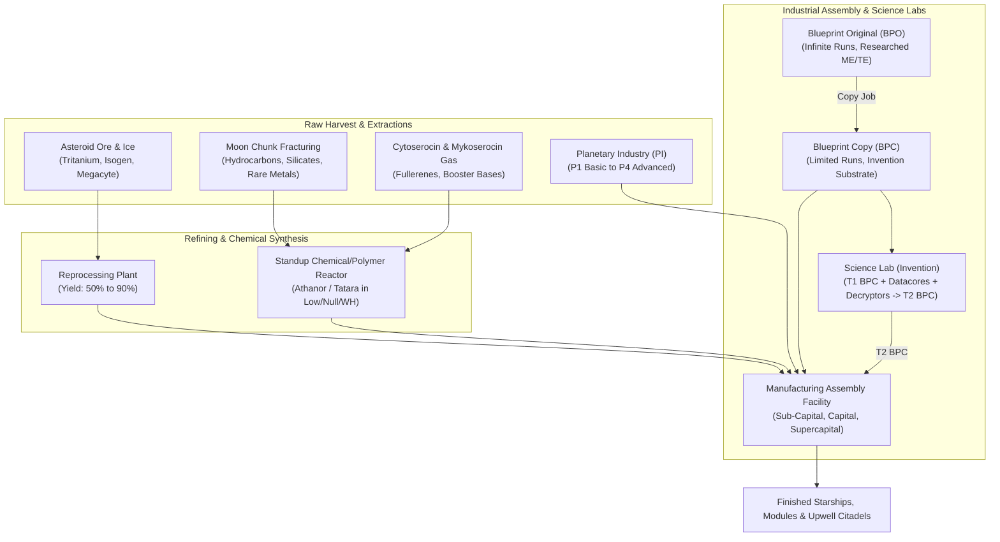
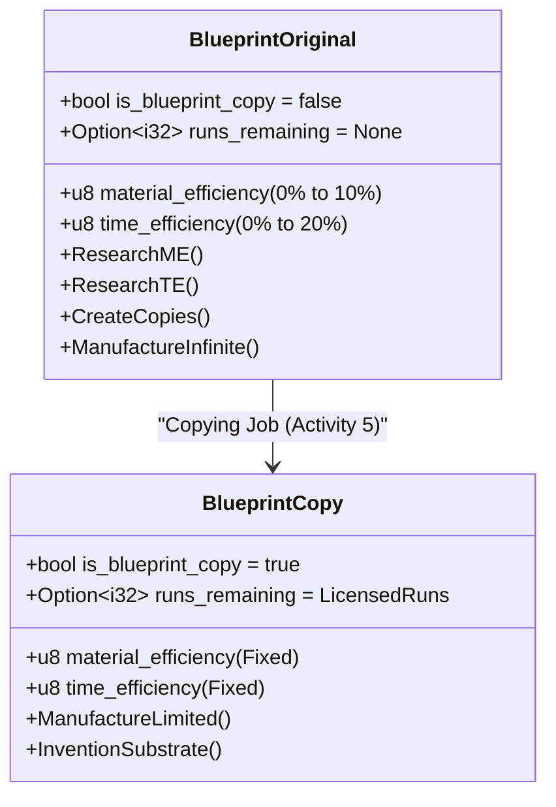
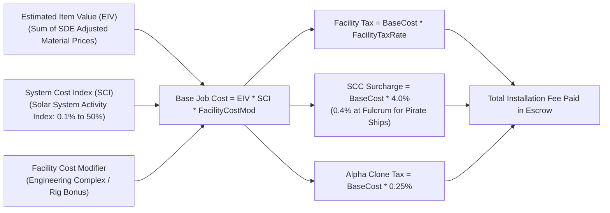
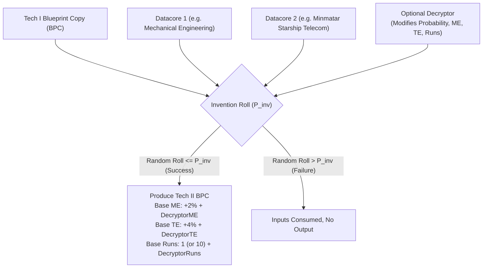
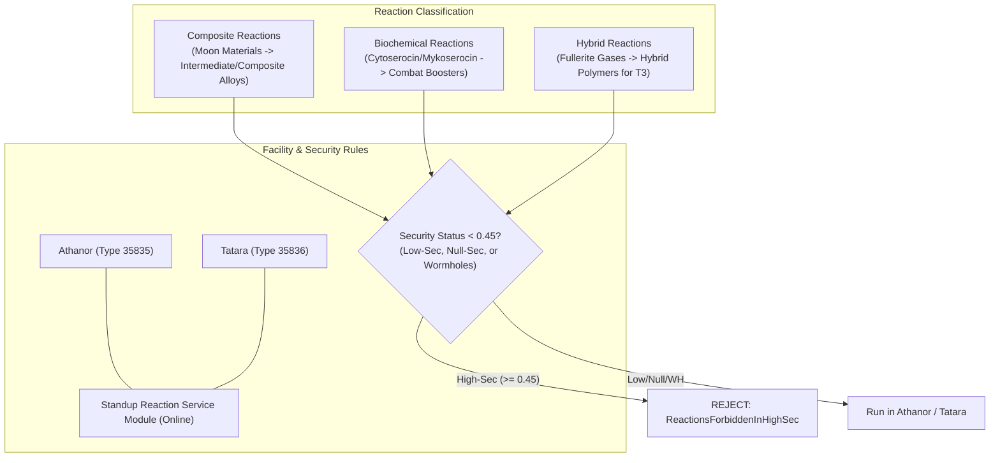
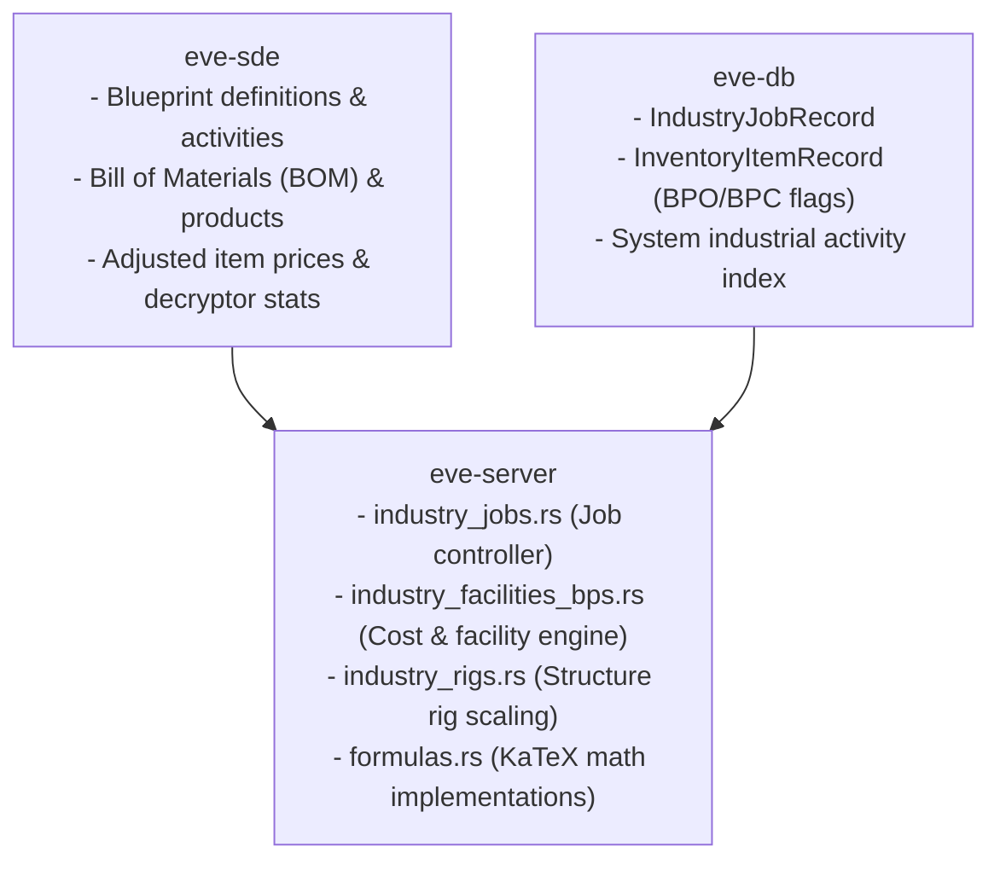

# Blueprints, Manufacturing, Science & Reactions

> **Navigation**: [EvoMu Technical Wiki](../README.md) • [Related Systems](#related-systems--cross-references)
>
> [← Back to Wiki Table of Contents](../README.md)

---

## Overview & Lore Context

In the player-driven ecosystem of New Eden, virtually every starship, weapon system, ammunition cartridge, planetary infrastructure component, and orbital citadel originates not from divine decree, but from the industrial machinery of capsuleer enterprise. Raw asteroid ores mined from gravitational rings, volatile gases extracted from cosmic clouds, exotic moon minerals harvested by orbital fracture drills, and refined planetary commodities are channeled through industrial arrays to form the backbone of interstellar warfare and commerce.



The industrial pipeline is structured around three core pillars:
1. **Blueprints (BPOs and BPCs):** The proprietary intellectual and technical schematics detailing required raw materials, component sub-assemblies, toolsets, and manufacturing durations.
2. **Science & Research Laboratories:** Research facilities where capsuleers invest time and ISK to optimize blueprints—reducing material waste (Material Efficiency), accelerating cycle times (Time Efficiency), producing licensed run-limited copies, or performing experimental reverse-engineering (Invention) to produce advanced Tech II and Tech III designs.
3. **Reaction Arrays:** High-energy chemical and molecular synthesis processes executed exclusively in Upwell Refineries (Athanor and Tatara) anchored in low-security, null-security, or wormhole space. Reactions transform unrefined moon materials and atmospheric gases into composite intermediate components, combat boosters, and Tech III hybrid polymers.

In **EvoMu V24.01**, the entire industrial pipeline is implemented with mathematical precision across [`eve-server`](../../../crates/eve-server), [`eve-sde`](../../../crates/eve-sde), and [`eve-db`](../../../crates/eve-db), supporting full Bill of Materials (BOM) validation, escrow locks, dynamic System Cost Indices (SCI), structure rig security scaling, and multi-job batch deliveries.

---

## Canonical Mechanics & Precise Formulas

### 1. Blueprints: Originals (BPO) vs. Copies (BPC)

Every blueprint exists in one of two physical forms within the inventory database:



- **Blueprint Original (BPO):** Sold seeded by NPC corporations or distributed via rare faction LP stores. BPOs feature infinite manufacturing runs (`blueprint_runs_remaining = None`, [`types.rs#L406`](../../../crates/eve-db/src/types.rs#L406)), can be researched for higher efficiency, and serve as the source master for copying jobs.
- **Blueprint Copy (BPC):** Possesses a finite, decremented number of licensed production runs (`is_blueprint_copy = true`). BPCs cannot be researched or copied further, but serve as the vital input substrate for Tech II invention and manufacturing in high-risk war zones.

#### Material Efficiency (ME) & Time Efficiency (TE)
- **Material Efficiency ($\text{ME}$):** Ranges from $0\%$ to $10\%$. Each level reduces the material waste of input components. Researched via Activity `4` (`research_material`).
- **Time Efficiency ($\text{TE}$):** Ranges from $0\%$ to $20\%$. Each level speeds up the job run duration by $2\%$. Researched via Activity `3` (`research_time`).

#### Blueprint Copying Jobs (Activity 5)
Copying consumes time and ISK to produce one or more BPCs with run counts up to the blueprint's SDE max runs per copy (`maxProductionLimit`). The copying duration scales linearly with total runs:
$$T_{\text{copy}} = \text{runs\_per\_copy} \times \text{copies} \times \text{BaseCopyTime} \times (1 - \text{FacilityTE})$$

---

### 2. Manufacturing Material & Time Formulas

#### Material Requirement Formula
For a manufacturing job consisting of $\text{runs} \ge 1$ using a blueprint with base required quantity $M_{\text{base}}$:
$$M_{\text{req}} = \begin{cases} \text{runs} & \text{if } M_{\text{base}} = 1 \\ \max\left(\text{runs}, \ \left\lceil \text{runs} \cdot M_{\text{base}} \cdot \left(1 - \frac{\text{ME}}{100}\right) \cdot \left(1 - \frac{\text{FacilityME}}{100}\right) \cdot \left(1 - \frac{\text{RigME}}{100}\right) \right\rceil\right) & \text{if } M_{\text{base}} > 1 \end{cases}$$
Implemented in [`compute_manufacturing_material_qty`](../../../crates/eve-server/src/formulas.rs#L501-L516).

> [!NOTE]
> Single-item inputs (e.g. ship hulls, datacores, or reaction substrates with base quantity $1$) **cannot be reduced** below 1 per run by ME or facility bonuses.

#### Production Job Duration Formula
The production duration is governed by blueprint base cycle time $T_{\text{base}}$, blueprint $\text{TE}$, pilot character skills, and facility speed multipliers:
$$T = \left\lceil \text{runs} \cdot T_{\text{base}} \cdot \left(1 - \frac{\text{TE}}{100}\right) \cdot (1 - 0.04 \cdot \text{Skill}_{\text{Industry}}) \cdot (1 - 0.03 \cdot \text{Skill}_{\text{AdvIndustry}}) \cdot \left(1 - \frac{\text{FacilityTimeBonus}}{100}\right) \right\rceil$$
Implemented in [`compute_manufacturing_time_seconds`](../../../crates/eve-server/src/formulas.rs#L518-L533).

---

### 3. System Cost Index (SCI) & Job Installation Fees

Installing an industry job requires paying a non-refundable gross installation fee to the SCC and facility owner ([`industry_facilities_bps.rs#L410-L477`](../../../crates/eve-server/src/services/industry_facilities_bps.rs#L410-L477)):



#### Estimated Item Value (EIV)
The Estimated Item Value ($\text{EIV}$) represents the economic baseline of the product, computed from the sum of SDE adjusted base prices of its standard manufacturing Bill of Materials:
$$\text{EIV}_{\text{per\_run}} = \sum_{m \in \text{BOM}} \text{Qty}_m \times \text{AdjustedPrice}_m$$
For non-manufacturing jobs (Research ME, Research TE, Copying, Invention), an activity weighting factor of $2\%$ ($0.02$) is applied:
$$\text{TotalEIV} = \text{EIV}_{\text{per\_run}} \times \text{runs} \times \begin{cases} 0.02 & \text{if Activity} \in \{3, 4, 5, 8\} \\ 1.0 & \text{if Activity} \in \{1, 9\} \end{cases}$$

#### System Cost Index (SCI)
The System Cost Index represents localized industrial congestion in solar system $S$:
$$\text{SCI} = \text{clamp}(0.01 + 0.01 \cdot \text{IndustrialIndex}_S, \ 0.001, \ 0.50)$$

#### Gross Fee Assembly
$$\text{BaseJobCost} = \text{TotalEIV} \times \text{SCI} \times \text{StructureCostModifier}$$
$$\text{FacilityTax} = \text{BaseJobCost} \times \text{FacilityTaxRate}$$
$$\text{SCCSurcharge} = \text{BaseJobCost} \times \begin{cases} 0.004 & \text{if Fulcrum pirate ship bonus applies} \\ 0.040 & \text{standard Viridian/Equinox SCC tax} \end{cases}$$
$$\text{AlphaCloneTax} = \begin{cases} \text{BaseJobCost} \times 0.0025 & \text{if character is Alpha Clone} \\ 0.0 & \text{if character is Omega Clone} \end{cases}$$
$$\text{GrossInstallationFee} = \text{BaseJobCost} + \text{FacilityTax} + \text{SCCSurcharge} + \text{AlphaCloneTax}$$

---

### 4. Science, Research & Invention

Capsuleers advance blueprints from Tech I to Tech II using Invention (Activity `8`), combining a Tech I BPC, encryption methods, datacores, and optional decryptors.



#### Invention Probability Formula
The probability of a successful invention job is:
$$P_{\text{inv}} = \min\left(1.0, \ P_{\text{base}} \cdot \left(1 + \frac{L_{\text{science1}} + L_{\text{science2}}}{30} + \frac{L_{\text{encryption}}}{40}\right) \cdot M_{\text{decryptor}}\right)$$
Implemented in [`compute_invention_probability`](../../../crates/eve-server/src/formulas.rs#L537-L548).
- $P_{\text{base}}$: Base item invention probability (e.g. $0.30$ for battlecruisers/battleships, $0.40$ for cruisers, $0.50$ for frigates).
- $L_{\text{science1}}, L_{\text{science2}}$: Relevant racial and engineering science skill levels ($0$ to $5$).
- $L_{\text{encryption}}$: Racial encryption method skill level ($0$ to $5$).
- $M_{\text{decryptor}}$: Probability modifier from installed decryptor ($0.6\times$ to $1.8\times$).

#### Decryptor Modifiers
Decryptors allow industrial capsuleers to fine-tune the resulting Tech II BPC:

| Decryptor Family | Probability Multiplier | Resulting ME Mod | Resulting TE Mod | Extra Runs Mod |
| :--- | :--- | :--- | :--- | :--- |
| **Accelerant Decryptor** | $+20\%$ ($1.2\times$) | $+2$ | $+10$ | $+1$ |
| **Attainment Decryptor** | $+80\%$ ($1.8\times$) | $-1$ | $-2$ | $+4$ |
| **Augmentation Decryptor** | $-40\%$ ($0.6\times$) | $-2$ | $+0$ | $+9$ |
| **Parity Decryptor** | $+50\%$ ($1.5\times$) | $+1$ | $-2$ | $+3$ |
| **Process Decryptor** | $+10\%$ ($1.1\times$) | $+3$ | $+6$ | $+0$ |
| **Symmetry Decryptor** | $+0\%$ ($1.0\times$) | $+1$ | $+8$ | $+2$ |

---

### 5. Reactions (Composite, Biochemical, Hybrid)

Reactions (Activity `9`) represent large-scale molecular synthesis. Unlike manufacturing, reactions have unique operational rules ([`industry_jobs.rs#L207-L230`](../../../crates/eve-server/src/services/industry_jobs.rs#L207-L230)):



1. **Refinery Hull Requirement:** Reactions **can only be installed** in an Upwell Refinery: the Medium **Athanor** (type `35835`) or Large **Tatara** (type `35836`). Non-refinery facilities return `FacilityDoesNotSupportReactions`.
2. **High-Sec Prohibition:** Reactions are strictly forbidden in High-Security space ($\text{sec} \ge 0.45$). Attempting to install a reaction job in High-Sec fails with `ReactionsForbiddenInHighSec`.
3. **Standup Service Module Online:** The refinery must have an active, powered, and fueled Standup Reaction Service module (`is_structure_industry_service_online`).
4. **Skill Requirement:** The installing pilot must possess the `Reactions` skill (type `45746`) at $\ge \text{Level 1}$ (`MissingReactionSkills`).

---

## EvoMu Implementation Architecture

EvoMu coordinates the industrial pipeline across three primary crates:



### 1. Primary Handlers & Source Dispatch

- [`industry_jobs::handle_industry_jobs`](../../../crates/eve-server/src/services/industry_jobs.rs#L31-L1300):
  - `industryManager.InstallJob`: Validates player docking state, resolves blueprint items, validates player/corporate wallet balances, locks input BOM materials, checks job slots, and enters job into database.
  - `industryManager.CompleteJob` & `CompleteManyJobs`: Validates completion timestamp (`now >= start_unix + duration_seconds`), rolls invention probabilities, updates BPO ME/TE attributes, spawns manufactured items or BPCs, and unlocks blueprints.
  - `industryManager.CancelJob`: Cancels an active job, refunding locked blueprint and restoring inventory flags.
- [`industry_facilities_bps::compute_industry_job_costs_for_char`](../../../crates/eve-server/src/services/industry_facilities_bps.rs#L410-L477): Computes the dynamic EIV, System Cost Index, structure cost multipliers, facility tax, SCC surcharge, and alpha clone fees.
- [`industry_rigs::resolve_structure_rig_bonuses_full`](../../../crates/eve-server/src/services/industry_rigs.rs#L12-L60): Applies Standup structure rig modifiers, scaling material and time reductions according to solar system security:
  - **High-Sec:** $1.0\times$ multiplier.
  - **Low-Sec:** $1.9\times$ multiplier ($1.0\times$ for reactions).
  - **Null-Sec / Wormhole:** $2.1\times$ multiplier ($1.1\times$ for reactions).

---

### 2. State Store Schemas

#### Core Database Record: [`IndustryJobRecord`](../../../crates/eve-db/src/types.rs#L756-L770)
```rust
#[derive(Debug, Clone, PartialEq, Serialize, Deserialize)]
pub struct IndustryJobRecord {
    pub job_id: i64,
    pub installer_id: i64,
    pub facility_id: i64,
    pub blueprint_item_id: i64,
    pub blueprint_type_id: TypeId,
    pub activity_id: u8, // 1=Manufacturing, 3=TE, 4=ME, 5=Copy, 8=Invention, 9=Reaction
    pub runs: u32,
    pub product_type_id: TypeId,
    pub status: String, // "Active", "Paused", "Delivered", "Cancelled"
    pub duration_seconds: u64,
    pub start_unix: u64,
}
```

#### Inventory Blueprint Item Attributes
Blueprints are tracked in [`InventoryItemRecord`](../../../crates/eve-db/src/types.rs):
- `is_blueprint_copy: bool`: Distinguishes BPO (`false`) from BPC (`true`).
- `blueprint_runs_remaining: Option<i32>`: Tracks remaining runs on BPCs.
- `dynamic_attributes.get(&ATTR_BLUEPRINT_ME)`: Current Material Efficiency level ($0$ to $10$).
- `dynamic_attributes.get(&ATTR_BLUEPRINT_TE)`: Current Time Efficiency level ($0$ to $20$).
- `flag`: While an active job is running, the blueprint is locked under `InventoryFlag::IndustryJob` to prevent concurrent duplication.

---

## Invariants, Security & Edge Cases

### 1. Input Item Escrow & Atomic Lockout
When an industry job is installed via `industryManager.InstallJob`:
- All required BOM input minerals, components, datacores, and decryptors are **immediately removed or decremented from inventory**.
- If any material is missing, the entire transaction rolls back atomically with `InsufficientMaterials`, `InsufficientDatacores`, or `InsufficientReactionMaterials` ([`industry_jobs.rs#L780-L812`](../../../crates/eve-server/src/services/industry_jobs.rs#L780-L812)).
- The blueprint itself has its flag shifted to an in-use state (`InventoryFlag::Locked`), preventing pilots from trading, contracting, or repackaging blueprints while an industrial job is in flight.

### 2. High-Sec Reaction Prohibition Invariant
Reactions are chemically hazardous processes restricted to lawless frontier space:
$$\text{Activity} = 9 \land \text{SecurityStatus}(\text{FacilitySystem}) \ge 0.45 \implies \text{ERR: } \texttt{ReactionsForbiddenInHighSec}$$
This server-side invariant cannot be circumvented via remote job installation or corporate standing.

### 3. Service Offline Job Pausing
If an Upwell Engineering Complex or Refinery runs out of fuel blocks or has its service module offlined:
- All running jobs transition dynamically from `"Active"` to `"Paused"`.
- Paused jobs do not progress in duration until the service module is refueled and restored online ([`industry_jobs.rs#L420-L425`](../../../crates/eve-server/src/services/industry_jobs.rs#L420-L425)).

### 4. Output Delivery Collision & Division Isolation
When delivering completed jobs:
- Personal jobs deposit outputs directly into the pilot's personal hangar (`InventoryFlag::Hangar`).
- Corporate jobs (`useCorp = true`) deliver products into the designated corporate division hangar (`InventoryFlag::CorpSAG1` through `CorpSAG7`) and write audit journal records to corporate wallet logs.

---

## Verification, Tests & Parity References

### 1. Parity Audit Ledger Keys
The industry engine complies with the official parity ledger:
- `feat:industry.install-job`: Atomic job installation, escrow locking, fee calculation.
- `feat:industry.manufacturing`: Material and cycle time calculation with ME/TE bonuses.
- `feat:industry.research-me`: Incremental ME research capping at $10\%$.
- `feat:industry.research-te`: Incremental TE research capping at $20\%$.
- `feat:industry.copying`: BPC generation with licensed run limits.
- `feat:industry.invention`: Probabilistic Tech II invention with decryptor stat tuning.
- `feat:industry.reactions`: Composite, biochemical, and hybrid reaction execution in refineries outside high-sec.
- `feat:industry.structure-rigs`: Security-scaled rig multipliers across High, Low, and Null space.

---

### 2. Integration Test Suites

| Test Suite | File Location | Key Validations |
| :--- | :--- | :--- |
| **Comprehensive Industry & PI Suite** | [`industry_pi_complete.rs`](../../../crates/eve-server/tests/it/industry_pi_complete.rs#L363-L574) | Tests invention with Accelerant Decryptors (`34201`), T3 Ancient Relic invention, early job completion rejection (`JobNotYetComplete`), remote range check failure (`FacilityOutOfRemoteRange`), high-sec reaction rejection (`ReactionsForbiddenInHighSec`), low-sec Tatara reaction installation, corporate ME research, multi-job batch delivery (`CompleteManyJobs`), and Alpha clone tax surcharges. |
| **Blueprint Data & Cost Indices** | [`industry_pi_complete.rs`](../../../crates/eve-server/tests/it/industry_pi_complete.rs#L115-L350) | Validates System Cost Index (SCI) scaling, facility tax rate application, and blueprint owner permission boundaries. |

---

### 3. Verification Commands

To execute and verify the industry test suite:

```bash
# Run comprehensive industry, research, invention, and reaction tests:
cargo test --test it -- test_industry_jobs_me_te_copy_invention_decryptors_t3_reactions_remote_and_corp --nocapture

# Run blueprint data, owner limits, facilities, taxes, and SCI tests:
cargo test --test it -- test_industry_blueprint_data_owner_limits_facilities_taxes_and_sci --nocapture
```

---

## Related Systems & Cross-References

- [**Mining Cycles & Extraction**](../mining_and_harvesting/mining_cycles_and_residue.md): Sourcing raw ore, ice, and moon minerals for manufacturing inputs.
- [**Planetary Industry (PI)**](../planetary_industry/colony_pin_networks_and_pi.md): Planetary commodities (P1–P4) required for advanced structures, fuel blocks, and Tech II production.
- [**Regional Market Order Matching**](../economy_and_markets/regional_market_order_matching.md): Blueprint market transactions, System Cost Index (SCI) economics, and escrow matching.
- [**Upwell Structures Overview & Lifecycle**](../upwell_and_structures/upwell_structures_overview.md): Engineering Complexes (Raitaru, Azbel, Sotiyo) and structure rig bonuses on manufacturing and reaction times.

---

[← Back to Wiki Table of Contents](../README.md)
