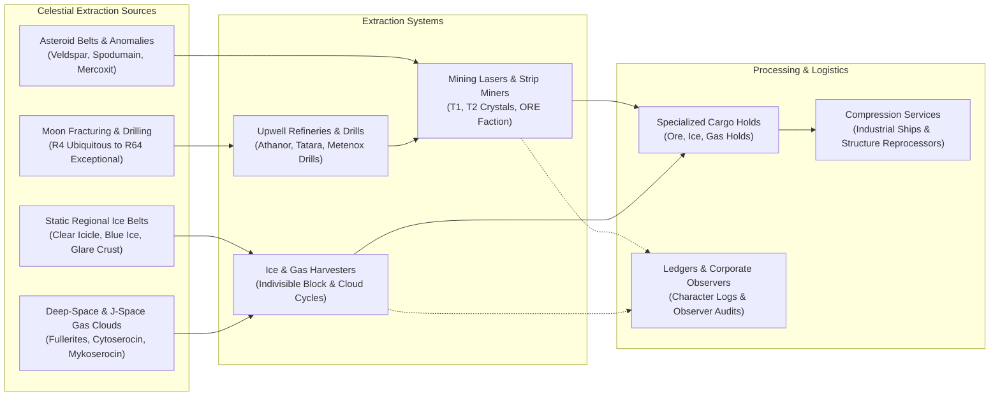
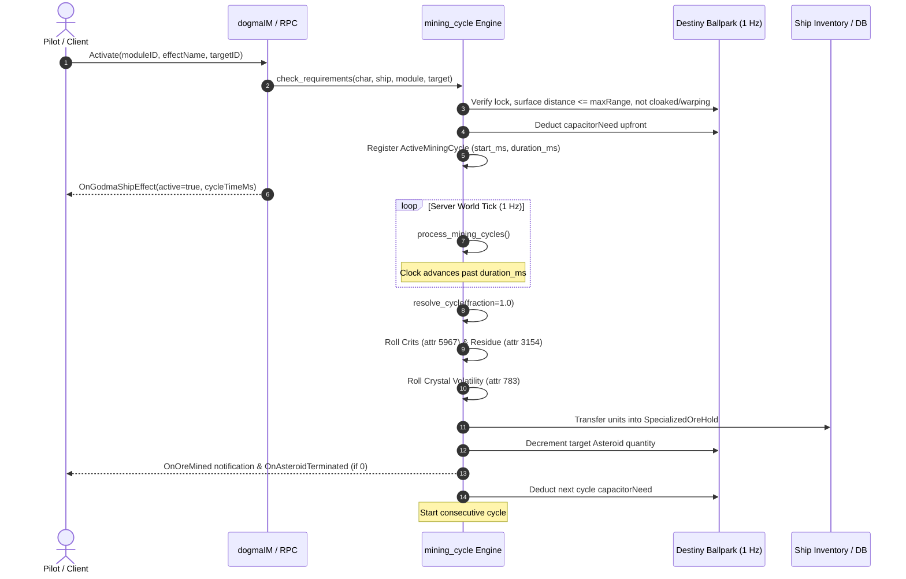
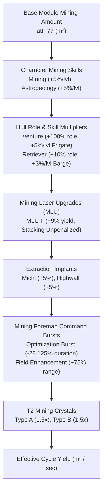
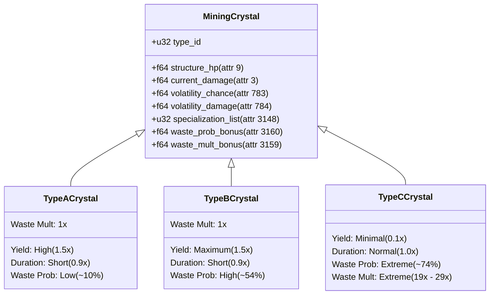
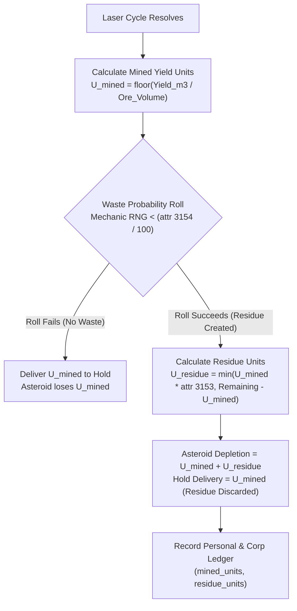
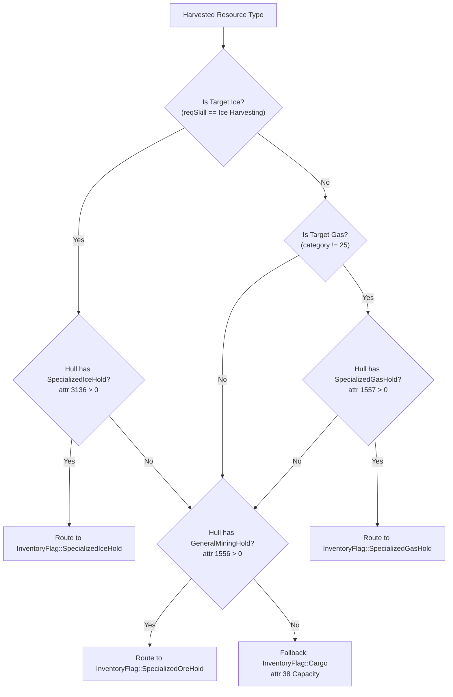
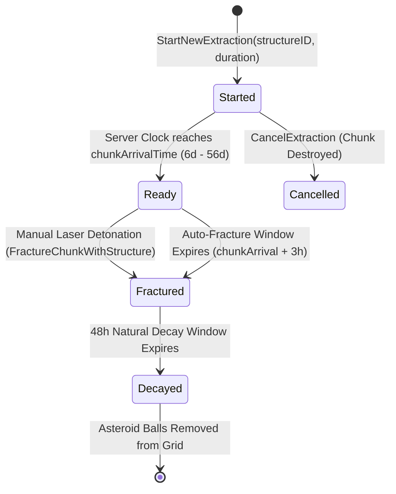
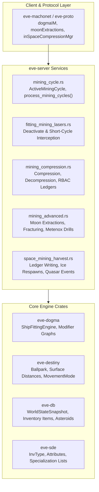
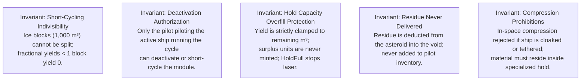

# Mining Cycles, Residue & Resource Extraction Systems

> **Navigation**: [EvoMu Technical Wiki](../README.md) • [Related Systems](#related-systems--cross-references)
>
> [← Back to Wiki Table of Contents](../README.md)

---

## Overview & Lore Context

In the cosmic economy of New Eden, industrial resource extraction forms the bedrock of all capsuleer civilization. From the smallest Tech I frigate assembled in an empire high-sec station to the colossal Keepstar citadels and Titan flagships that anchor null-sec sovereignty, every hull, module, ammunition cartridge, and jump fuel cell traces its provenance back to an extraction beam focused on a celestial deposit.



### The Industrial Lore of New Eden
Resource extraction spans several distinct technological echelons:
1. **Empire Baseline Mining:** From the early days of sub-warp industrial barges developed by the Caldari State and the Minmatar Republic, asteroid mining focused on common high-sec ores—such as Veldspar, Scordite, and Pyroxeres. These ores supply the staple base minerals (*Tritanium*, *Pyerite*, *Mexallon*, and *Isogen*) necessary for standard construction.
2. **Deep-Space Ice Harvesting:** Industrialization demands astronomical quantities of heavy water, liquid ozone, and elemental isotopes (*Helium*, *Hydrogen*, *Nitrogen*, and *Oxygen*). These fuels sustain starbase force fields, power Upwell structure service modules, and fuel the jump drives of capital ships, jump freighters, and black ops dreadnoughts. Ice fields exist as discrete regional anomalies that replenish on strict physical cycles.
3. **Abyssal & Deep Core Gas Harvesting:** Discovered in the hazardous nebulae of low-sec, null-sec, and Uncharted J-space (Wormhole space), harvestable gas clouds supply the raw molecular building blocks for combat boosters (*Cytoserocin* and *Mykoserocin*) and Tech III strategic cruiser subsystems (*Fullerenes*). Deep core mining lasers also extract *Mercoxit*, the singular source of *Morphite* needed for advanced Tech II composite armor and advanced electronics.
4. **Upwell Moon Mining & Chunk Fracturing:** Developed by the Upwell Consortium following the obsolescence of legacy starbase POS siphon drills, modern moon mining relies on Medium (*Athanor*) and Large (*Tatara*) refineries equipped with Standup Moon Drills. These structures deploy high-energy graviton beams to rip massive multimillion-ton chunks of planetary rock directly from a moon's crust over weeks-long drilling cycles. Upon arriving at the structure, the chunk is pulverized by high-yield laser batteries into an artificial asteroid belt containing valuable Moon Ores categorized from R4 (ubiquitous hydrocarbons) up to R64 (Promethium, Dysprosium, and Neodymium). For autonomous, low-intensity extraction, the *Metenox Moon Drill* provides automated harvesting at the cost of reduced efficiency and substantial fuel logistics.

### The EvoMu Extraction Philosophy
The **EvoMu Mining & Harvesting Subsystem** implements a complete, clean-room simulation of EVE Online's extraction mechanics. Every parameter—from laser cycle duration and capacitor draw down to residue probability distributions, crystal shatter rolls, and structural moon chunk trajectories—is evaluated dynamically through the Dogma modifier engine ([`eve-dogma`](../../../crates/eve-dogma)) and static data export ([`eve-sde`](../../../crates/eve-sde)). The system is driven deterministically by the 1 Hz server world clock, ensuring exact parity with canonical server behavior, audit ledgers, and economic flows.

---

## Canonical Mechanics & Mathematical Foundations

### 1. The Asteroid Mining Cycle Engine

Mining modules do not trickle ore continuously into a pilot's hold. Instead, resource extraction is governed by a **discrete cycle engine**. An active module projects an energy beam that accumulates material over time, delivering the harvested volume into the ship's inventory **only when the cycle completes** or when the module is deactivated.



#### Activation Prerequisites & Interruptions
Before a mining cycle can initialize, the engine validates several strict spatial and operational requirements:
1. **Ship Operational State:** The ship must be undocked in space (`station_id` and `structure_id` are `None`), active, not cloaked, and not in warp (`eve_destiny::MovementMode::Warp`).
2. **Module Online State:** The module must be fitted to an appropriate slot and online (`ModuleState::Active` / `Online`).
3. **Target Locking & Spatial Distance:** The target asteroid must be fully locked by the ship's targeting computer. The physical distance between the ship and the asteroid is measured as **surface-to-surface distance** ($d_{\text{surface}}$), accounting for the spherical collision radii of both entities:
   $$d_{\text{surface}} = \max\left(0, \|\vec{P}_{\text{ship}} - \vec{P}_{\text{asteroid}}\| - r_{\text{ship}} - r_{\text{asteroid}}\right)$$
   Activation succeeds only if surface distance does not exceed maximum range ($d \le R_{\max}$), where $R_{\text{max}}$ is the module's effective `maxRange` (Dogma attribute `54`).
4. **Target Minability:** The asteroid must contain a positive quantity of resources ($Q > 0$). Furthermore, the module must possess the appropriate harvesting effect (`miningLaser` or `miningClouds`), and the asteroid's `requiredSkill1` (e.g. *Mining*, *Deep Core Mining*, or *Ice Harvesting*) must match the module's required skills.
5. **Upfront Capacitor Cost:** The module's full effective `capacitorNeed` (attribute `6`) is deducted immediately upon activation. If the ship's current capacitor energy $C < C_{\text{need}}$, activation is rejected with `NotEnoughCapacitor`.

#### Short-Cycling Mechanics
If a pilot manually deactivates a mining module before its full cycle duration $T_{\text{cycle}}$ has elapsed, the module enters a **short-cycle resolution**:
- The elapsed time fraction $f_{\text{cycle}}$ is computed from the server clock:
  $$f_{\text{cycle}} = \text{clamp}\left(\frac{t_{\text{now}} - t_{\text{start}}}{T_{\text{cycle}}}, 0.0, 1.0\right)$$
- If the ship remains in range and requirements are satisfied, the engine delivers the fractional yield:
  $$U_{\text{delivered}} = \left\lfloor \frac{Y_{\text{cycle}} \times f_{\text{cycle}}}{V_{\text{unit}}} \right\rfloor$$
- **The Ice Exception:** Because ice blocks possess an indivisible portion volume of $1\,000\text{ m}^3$ per unit, any short cycle where the accumulated volume is less than $1\,000\text{ m}^3$ delivers exactly **0 units**.

---

### 2. Mathematical Mining Yield Formulas

A mining module's effective yield per cycle depends on an interconnected hierarchy of skill proficiencies, hull role bonuses, low-slot upgrades, head implants, and fleet warfare command bursts:



The comprehensive cycle volume yield equation in EvoMu is formulated as:

$$Y_{\text{cycle}} = Y_{\text{base}} \times \left(1 + \sum_{s \in \text{Skills}} B_{s} \times L_{s}\right) \times \left(1 + B_{\text{hull\_skill}} \times L_{\text{hull}}\right) \times M_{\text{role}} \times \prod_{u \in \text{MLU}} (1 + B_{u}) \times \prod_{i \in \text{Implants}} (1 + B_{i}) \times M_{\text{crystal}}$$

Where:
- $Y_{\text{base}}$: Base module yield attribute `miningAmount` (`77`) in cubic meters ($\text{m}^3$).
- $B_{s}$: Skill percentage bonus per level (e.g., *Mining* `attr 434` gives $+5\%$, *Astrogeology* `attr 434` gives $+5\%$).
- $L_{s}$: Pilot's trained skill level ($0 \dots 5$).
- $B_{\text{hull}}$: Ship skill bonus (e.g., *Mining Frigate* `attr 1842` gives $+5\%$ per level on the Venture; *Mining Barge* `attr 3181` gives $+3\%$ per level on the Retriever).
- $M_{\text{role}}$: Ship hull static role multiplier (e.g., Venture `attr 207` = $2.0$, representing a $+100\%$ bonus; Retriever `attr 3177` = $1.10$, representing a $+10\%$ bonus).
- $B_{u}$: Mining Laser Upgrade bonus (`attr 434`). *Crucially, Mining Laser Upgrades are strictly exempted from Dogma stacking penalties; their modifiers multiply directly.*
- $B_{i}$: Cybernetic implant yield bonus (e.g., *Highwall MX-1005* $= +5\%$, *Michi's Excavation Augmentor* $= +5\%$).
- $M_{\text{crystal}}$: Loaded crystal yield modifier effect (`miningCrystalsMiningAtributesAdjustments`).

#### Extraction Rate (m³/s)
The ultimate performance metric of any extraction vessel is its volume extraction rate per second ($R_{\text{yield}}$):

$$R_{\text{yield}} = \frac{Y_{\text{cycle}}}{T_{\text{cycle}}}$$

Where effective cycle duration $T_{\text{cycle}}$ is scaled by hull bonuses and fleet boosts:

$$T_{\text{cycle}} = T_{\text{base}} \times \prod (1 - B_{\text{duration\_reduction}})$$

For example, a pilot under a *Mining Foreman Burst II* with *Mining Laser Optimization* charges experiences a duration reduction of:
$$1 - (0.15 \times 1.25 \times 1.50) = 1 - 0.28125 = 0.71875 \quad (-28.125\% \text{ duration})$$

#### Critical Yield (Mining Crits)
In canonical V24 mechanics, mining modules possess an innate **Critical Yield** roll:
- **Crit Chance:** Dogma attribute `miningCritChance` (`5967`), typically $0.01$ ($1\%$).
- **Crit Bonus Multiplier:** Dogma attribute `miningCritBonusYield` (`5969`), typically $2.0$ ($+200\%$).
- When a critical success is rolled via the server RNG:
  $$U_{\text{bonus\_crit}} = \left\lfloor U_{\text{mined}} \times M_{\text{crit\_bonus}} \right\rfloor$$
- **Invariance Rule:** *Critical bonus ore is generated directly into the player's hold from thin air; it is never subtracted from the asteroid's remaining volume.*

---

### 3. Mining Crystals, Volatility & Degradation

Tech II mining lasers—such as the *Modulated Deep Core Miner II*, *Modulated Strip Miner II*, and *ORE Strip Miner*—require specialized **Mining Crystals** loaded into their charge slots to achieve peak yields.



#### Specialization Matching
Every mining crystal references an SDE type list via attribute `specializationAsteroidTypeList` (`3148`). 
- When mining an asteroid whose `typeID` is contained within that list, the crystal's Dogma modifiers apply fully.
- If the pilot activates the laser against an asteroid outside this specialization list, the module **mines as if unloaded** (delivering only unbonused base yield) while still rolling crystal volatility damage.

#### Crystal Types & Tactical Roles

| Crystal Family | Yield Multiplier | Cycle Duration | Waste Probability | Waste Multiplier | Tactical Role |
| :--- | :---: | :---: | :---: | :---: | :--- |
| **Type A (Standard)** | $1.50\times$ | $0.90\times$ | Low ($\sim 10\%$) | $1.0\times$ | High-value, conservation-focused mining (Mercoxit, high-tier Moon ores). |
| **Type B (Aggressive)**| $1.50\times$ | $0.90\times$ | High ($\sim 54\%$) | $1.0\times$ | High throughput where asteroid exhaustion speed outweighs conservation. |
| **Type C (Denial)** | $0.10\times$ | $1.00\times$ | Extreme ($\sim 74\%$) | $19.0\times$ (T1) / $29.0\times$ (T2) | Scorched-earth denial mining; designed to rapidly vaporize enemy belts. |
| **ORE Faction** | $1.65\times$ | $0.85\times$ | $0\%$ | $0.0\times$ | Perfect extraction; zero waste, minimal volatility, high acquisition cost. |

#### Volatility Damage & Shattering
Unlike laser lenses that fire ammunition charges indefinitely, mining crystals suffer mechanical degradation:
1. Every cycle (including fractional short cycles), the engine checks attribute `crystalsGetDamaged` (`786`). If true, it rolls against `crystalVolatilityChance` (`783`):
   $$\text{Roll} < P_{\text{volatility}}$$
2. On a positive roll, the crystal sustains structure damage equal to `crystalVolatilityDamage` (`784`), recorded under dynamic attribute `damage` (`3`):
   $$D_{\text{total}} = D_{\text{current}} + D_{\text{volatility}}$$
3. If $D_{\text{total}} \ge \text{HP}_{\text{crystal}}$ (attribute `9`), the crystal **shatters**:
   - If stacked ($Q > 1$), quantity is decremented by 1 and damage resets to 0.
   - If single ($Q = 1$), the item is permanently deleted from the ship's module slot.
   - The ship fitting cache is invalidated immediately via [`invalidate_ship_fitting`](../../../crates/eve-server/src/router/mod.rs).

---

### 4. Mining Waste & Residue Mechanics

Introduced in the modern extraction era, the **Mining Residue System** ensures that aggressive or unrefined mining techniques destroy a portion of the asteroid's physical volume alongside the ore harvested:



#### Residue Calculations
The residue mechanic evaluates two primary Dogma attributes on the harvesting module:
1. `miningWasteProbability` (`3154`): The percentage chance ($0 \dots 100$) that a cycle generates residue.
2. `miningWastedVolumeMultiplier` (`3153`): The ratio of residue units destroyed relative to the units mined.

When the mechanic RNG rolls a residue success:
$$U_{\text{residue}} = \min\left( \left\lfloor U_{\text{mined}} \times M_{\text{waste\_mult}} \right\rfloor, Q_{\text{asteroid}} - U_{\text{mined}} \right)$$

The asteroid's physical quantity is decremented by the combined sum:
$$\Delta Q_{\text{asteroid}} = U_{\text{mined}} + U_{\text{residue}}$$

**Key Residue Invariants:**
- *Residue is vaporized into deep space; it is NEVER placed into the pilot's cargo or ore hold.*
- *If the asteroid has fewer units remaining than the calculated residue, residue is clamped so the asteroid quantity does not drop below 0.*
- *Tech I lasers, Civilized Miner modules, and ORE Faction modules possess a base waste probability of $0\%$.*

---

### 5. Specialized Inventory Holds & Fallback Routing

Modern industrial hulls feature segregated atmospheric holds optimized for specific mineral compounds. When a mining cycle completes, EvoMu routes the mined units through an authoritative **Hold Priority Hierarchy**:



#### Capacity Clamping & Auto-Stop
The server computes available capacity in the destination hold by summing the volume of all existing items matching that location and inventory flag:
$$V_{\text{free}} = \max\left(0.0, V_{\text{capacity}} - \sum (Q_i \times V_i)\right)$$
$$U_{\text{free}} = \left\lfloor \frac{V_{\text{free}}}{V_{\text{unit}}} \right\rfloor$$

If the cycle's target yield exceeds available space ($U_{\text{target}} > U_{\text{cap}}$):
1. The delivered units are clamped to exactly $U_{\text{free}}$.
2. The module deactivates immediately with [`MiningStopReason::HoldFull`](../../../crates/eve-server/src/services/mining_cycle.rs#L66).
3. The client receives notification that the hold has reached capacity.

---

### 6. Ice & Gas Cloud Harvesting

#### Ice Harvesting
Unlike standard mineral asteroids, ice deposits consist of massive, monolithic blocks.
- **Harvester Mechanics:** Ice Harvesters (e.g. *Ice Harvester I* `16278`, *Ice Harvester II*) operate on long cycle times (e.g. $300\text{ s}$ base) and harvest an indivisible volume of $1\,000\text{ m}^3$ per cycle (1 ice block).
- **Respawn Timers:** Static regional ice belts spawn as cosmic anomalies. When every ice block in a designated system is completely mined out, the anomaly despawns, signature probes collapse, and a **4-hour (14,400-second)** server respawn countdown begins ([`ICE_BELT_RESPAWN_DELAY_SECS`](../../../crates/eve-server/src/services/space_mining_harvest.rs#L171)). Once 14,400 seconds elapse, the system automatically regenerates the ice field at its celestial coordinates.

#### Gas Cloud Harvesting
Gas clouds represent harvestable atmospheric nebulae (`categoryID != 25`, `groupID == 711` *Harvestable Cloud*).
- **Cloud Mechanics:** Harvested using *Gas Cloud Harvester I* (`25544`) or *Gas Cloud Scoop* modules. Gas clouds carry individual portion sizes and unit volumes (typically $1.0\text{ m}^3$ to $10.0\text{ m}^3$).
- **Environmental Hazards (J-Space Nebulae):** In Uncharted J-space (Wormhole systems), harvesting certain unstable gas clouds triggers environmental explosion cycles. At regular tick intervals, the cloud discharges massive omni-directional thermal and explosive damage waves that test the shield and armor tanks of industrial expedition frigates (Prospect, Venture).

---

### 7. Upwell Moon Mining & Fracturing Lifecycle

Moon mining represents the highest-yield industrial operation in EVE Online, converting solid satellite crust into high-value moon minerals.



#### Extraction Schedule Parameters
- **Refinery Requirements:** Moon extractions can only be initiated on an Upwell *Athanor* (`35835`) or *Tatara* (`35836`) refinery that is operational, online, equipped with a Quantum Core, fueled with fuel blocks, and fitted with an online *Standup Moon Drill I* (`35894`) service module.
- **Duration Limits:** Extractions must be scheduled between **6 days ($518\,400\text{ s}$)** and **56 days ($4\,838\,400\text{ s}$)**.
- **Chunk Volume Formula:** Moon chunks expand at an exact linear rate of $30\,000\text{ m}^3$ per hour:
  $$V_{\text{chunk}} = \left(\frac{t_{\text{duration\_secs}}}{3600}\right) \times 30\,000\text{ m}^3$$
  *(A 10-day extraction generates exactly $7\,200\,000\text{ m}^3$ of raw moon rock).*

#### Moon Ore Tiers & Security Distribution
Moons in New Eden are compositionally classified across five distinct rarity bands:
1. **R4 (Ubiquitous):** *Zeolites*, *Sylvite*, *Bitumens*, *Coals*. (Found in all security bands, including High-Sec $\ge 0.5$).
2. **R8 (Common):** *Cobaltite*, *Euxenite*, *Titanite*, *Scheelite*. (Low-Sec and Null-Sec).
3. **R16 (Uncommon):** *Otavite*, *Sperrylite*, *Vanadinite*, *Chromite*. (Low-Sec and Null-Sec).
4. **R32 (Rare):** *Carnotite*, *Zircon*, *Pollucite*, *Cinnabar*. (Low-Sec and Null-Sec).
5. **R64 (Exceptional):** *Xenotime*, *Monazite*, *Loparite*, *Ytterbite*. (Null-Sec and select low-sec pockets).

#### Laser Detonation & Jackpot Occurrences
When a moon chunk arrives at the refinery firing point:
- **Jackpot Roll:** Upon firing the laser via `FractureChunkWithStructure`, the server executes a seeded mechanic RNG roll. There is an innate **15% probability ($P = 0.15$)** of rolling a **Jackpot**:
  - Standard Fracture: Spawns a 50/50 mix of base moon ores and *Improved* variants (*Brimful*, *Bountiful*, *Copious*), yielding standard mineral ratios.
  - Jackpot Fracture: Spawns 100% *Jackpot* variants (*Shining*, *Glistening*, *Glowing*, *Twinkling*), conferring an authentic **$2.0\times$ ($+100\%$)** bonus to refined moon mineral yields.
- **Auto-Fracture Timer:** If structure operators do not manually trigger the fracturing laser, the chunk automatically fractures **3 hours ($10\,800\text{ s}$)** after arrival (extendable up to $\sim 4.5$ hours via Moon Rig stability attributes `2738`..`2740`).
- **Natural Field Decay:** Once fractured, the moon asteroid belt remains stable on grid for exactly **48 hours ($172\,800\text{ s}$)**. When the natural decay timestamp expires, all remaining unmined asteroids decay into dust and are purged from the Ballpark.

#### Automated Moon Mining: The Metenox Moon Drill
For remote low-sec and null-sec moons, the *Metenox Moon Drill* (`81826`, group `4744`) provides autonomous resource harvesting:
- **Efficiency:** Fixed at **40% extraction efficiency** (60% moon material loss relative to active manual mining).
- **Consumption:** Consumes 5 Fuel Blocks (`group 1136`) and 10 units of *Magmatic Gas* (`81143`) per 1-hour cycle.
- **Output:** Mined moon materials are deposited directly into the structure's *Specialized Material Bay* / *Specialized Mineral Hold* (`InventoryFlag::SpecializedMineralHold`).
- **Invariance:** *Automated Metenox drills operate without capsuleer intervention and do not record individual pilot entries in the observer mining ledger.*

---

### 8. Compression & Decompression Services

Uncompressed ore and gas occupy vast volumes of cargo space, rendering long-distance interstellar transport economically unfeasible. EvoMu implements two distinct compression pipelines:

#### In-Space Fleet Compression
- **Vessel Capabilities:** Conducted by industrial command ships—the *Porpoise*, *Orca*, and *Rorqual*.
- **Industrial Core Gating:** The command ship must have an active *Industrial Core* (`group 515`) and an active *Compressor Module* (`group 4174`).
- **Range & Fleet Projection:** Fleet members within range can instantly compress matching materials inside their mining holds:
  $$R_{\text{compression}} = R_{\text{base}} \times \left(1 + \frac{\text{SkillLevel} \times \text{BonusPct}}{100}\right)$$
  *(Base range is $44\,000\text{ m}$; Fleet Logistics skill `62453` adds $+10\%$ range per level).*
- **Compression Ratio:** 1:1 lossless compression for asteroid ore and ice.
- **Safety Invariants:** Compression is strictly prohibited if the ship is **cloaked** or **tethered** to an Upwell structure.

#### Structure Compression & Gas Decompression
- **Refinery Services:** Available at Upwell structures equipped with an online *Standup Reprocessing Plant* service module (`group 1322`).
- **Gas Decompression Efficiency Formula:** Compressed gas cannot be directly injected into manufacturing reactions; it must first be decompressed at an Upwell refinery. Decompression efficiency ($\text{Eff}_{\text{gas}}$) is calculated from SDE attributes:
  $$\text{Eff}_{\text{gas}} = \text{Eff}_{\text{base}} (0.80) + B_{\text{structure}} + L_{\text{skill}} \times \left(\frac{B_{\text{skill\_pct}}}{100}\right)$$
  Where:
  - $\text{Eff}_{\text{base}}$ = $0.80$ ($80\%$, Dogma attribute `3262`).
  - $B_{\text{structure}}$ = Structure bonus (`attr 3261`): $+0.04$ ($+4\%$) on an Athanor (`35835`), $+0.10$ ($+10\%$) on a Tatara (`35836`).
  - $L_{\text{skill}}$ = Pilot's level in *Gas Decompression Efficiency* (`62452`, $0 \dots 5$).
  - $B_{\text{skill}}$ = $+1\%$ per level (`attr 3260`).
  *(A max-skilled pilot at a Tatara achieves $0.80 + 0.10 + 0.05 = 0.95$ ($95\%$) decompression efficiency).*

---

### 9. Personal & Corporate Mining Ledgers

#### Personal Mining Ledger (`characterMiningLedger`)
Every unit of ore, ice, and gas extracted by a capsuleer is recorded permanently in their personal ledger:
- **Query Endpoint:** `characterMiningLedger.GetCharacterLogs`.
- **Fields Captured:** Extraction date string (`YYYY-MM-DD`), solar system ID, ore type ID, resource group ID, category ID, quantity mined, and quantity lost to residue waste.
- **Retention Horizon:** Maintains a rolling **90-day retention window** ($7\,776\,000\text{ s}$). Records older than 90 days are pruned automatically.

#### Corporate Observer Mining Ledger (`corpMiningLedger`)
Upwell refineries equipped with Standup Moon Drills act as celestial observers, recording all mining activities occurring within their grid:
- **Query Endpoints:** `corpMiningLedger.GetObserversWithMiningEvents` and `corpMiningLedger.GetObserverLedger`.
- **Role-Based Access Control (RBAC):** Viewing corporate ledger logs requires corporate executive authority: *Director*, *Accountant*, *Junior Accountant*, or *Station Manager*.
- **Observer Aggregation:** Tracks character ID, recording corporation ID, ore type, units harvested, and last update timestamp, enabling corporations to enforce moon mining tax codes and audit alliance production quotas.

---

## EvoMu Implementation Architecture

EvoMu organizes its mining infrastructure across dedicated, modular crates:
- [`eve-server`](../../../crates/eve-server): Dispatches MachoNet RPCs, runs the 1 Hz mining cycle clock, executes compression algorithms, and coordinates moon extraction life cycles.
- [`eve-dogma`](../../../crates/eve-dogma): Calculates ship and module effective attributes, evaluates modifiers, and maintains module activation state machines.
- [`eve-sde`](../../../crates/eve-sde): Supplies static data definitions for all types, portion sizes, default effects, and specialization lists.
- [`eve-db`](../../../crates/eve-db): Maintains ACID in-memory snapshot state ([`WorldStateSnapshot`](../../../crates/eve-db/src/lib.rs)) for asteroids, inventories, extractions, and ledgers.
- [`eve-destiny`](../../../crates/eve-destiny): Coordinates 3D spatial ballparks, asteroid collision meshes, and surface distance checks.



### Key Services & Source Code Mappings

1. [`mining_cycle.rs`](../../../crates/eve-server/src/services/mining_cycle.rs):
   - [`ActiveMiningCycle`](../../../crates/eve-server/src/services/mining_cycle.rs#L97-L109): In-memory tracking record representing an active harvesting laser cycle. Captures `char_id`, `ship_id`, `module_id`, `target_id`, `solar_system_id`, `cycle_start_ms`, and `duration_ms`.
   - [`MiningCycleOutcome`](../../../crates/eve-server/src/services/mining_cycle.rs#L113-L140): Detailed result structure for a completed or short-cycled extraction. Encapsulates `units_removed`, `residue_units`, `bonus_crit_units`, `units_delivered`, `crystal_damage`, and optional [`MiningStopReason`](../../../crates/eve-server/src/services/mining_cycle.rs#L65-L93).
   - [`process_mining_cycles`](../../../crates/eve-server/src/services/mining_cycle.rs#L751-L797): Executed every second by the server world tick. Iterates all active cycles, validates physical requirements, resolves elapsed cycles, and automatically initializes consecutive cycles while deducting capacitor.
   - [`activate`](../../../crates/eve-server/src/services/mining_cycle.rs#L646-L715): RPC entry point for `dogmaIM.Activate` on mining modules.
   - [`deactivate`](../../../crates/eve-server/src/services/mining_cycle.rs#L721-L746): RPC entry point for `dogmaIM.Deactivate`, computing fractional short-cycle delivery.

2. [`fitting_mining_lasers.rs`](../../../crates/eve-server/src/services/fitting_mining_lasers.rs):
   - [`handle_mining_and_deactivate`](../../../crates/eve-server/src/services/fitting_mining_lasers.rs#L7-L160): Intercepts `dogmaIM.Deactivate` requests, dispatches to `mining_cycle::deactivate`, updates module active states, and emits `OnGodmaShipEffect(active=false)`.

3. [`mining_compression.rs`](../../../crates/eve-server/src/services/mining_compression.rs):
   - [`handle_in_space_compression_mgr`](../../../crates/eve-server/src/services/mining_compression.rs#L242-L457): Validates fleet compressor proximity, industrial core activation, and performs 1:1 item type replacement.
   - [`handle_structure_compression_mgr`](../../../crates/eve-server/src/services/mining_compression.rs#L461-L892): Validates Upwell reprocessing service online states, handles docked ore compression, and calculates gas decompression efficiency.
   - [`compute_gas_decompression_efficiency`](../../../crates/eve-server/src/services/mining_compression.rs#L28-L60): Evaluates SDE base attributes, structure bonuses, and character decompression skills.
   - [`handle_compression`](../../../crates/eve-server/src/services/mining_compression.rs#L895-L1120): Dispatches corporate and character ledger requests (`corpMiningLedger.*`, `characterMiningLedger.*`).

4. [`mining_advanced.rs`](../../../crates/eve-server/src/services/mining_advanced.rs):
   - [`handle`](../../../crates/eve-server/src/services/mining_advanced.rs#L391-L1211): Handles `moonExtractions.StartNewExtraction`, `CancelExtraction`, and `FractureChunkWithStructure`.
   - [`tick_all_moon_extractions`](../../../crates/eve-server/src/services/mining_advanced.rs#L286-L384): Background cluster tick enforcing the 3-hour auto-fracture window and the 48-hour natural field decay timer.
   - [`tick_all_metenox_moon_drills`](../../../crates/eve-server/src/services/mining_advanced.rs#L1236-L1352): Hourly production tick for automated moon drills. Deducts fuel and magmatic gas, calculates 40% yield, and deposits into output holds.
   - [`build_moon_chunk_asteroids`](../../../crates/eve-server/src/services/mining_advanced.rs#L145-L201): Spawns physical moon asteroid balls into the Ballpark with 15% jackpot probability weighting.

5. [`space_mining_harvest.rs`](../../../crates/eve-server/src/services/space_mining_harvest.rs):
   - [`deposit_mined_ore_and_record_ledger_with_waste`](../../../crates/eve-server/src/services/space_mining_harvest.rs#L76-L123): Persists mined quantities and residue units into `snap.mining_ledger` and `snap.observer_mining_ledger`.
   - [`dispatch_mining_gameplay_events`](../../../crates/eve-server/src/services/space_mining_harvest.rs#L20-L53): Emits Quasar campaign progress events and AIR Career Program goals.
   - [`tick_ice_belt_respawn_sync`](../../../crates/eve-server/src/services/space_mining_harvest.rs#L127-L347): Monitors regional ice belts and respawns them exactly 14,400 seconds after total depletion.

---

### Core SDE Dogma Attributes Reference

| Attribute ID | Attribute Constant / Name | Data Type | Canonical Usage & Meaning |
| :---: | :--- | :---: | :--- |
| `6` | `attr::CAPACITOR_NEED` | `f64` | Energy (GJ) deducted from ship capacitor at cycle start. |
| `38` | `attr::CAPACITY` | `f64` | Ship standard cargo hold capacity ($\text{m}^3$). |
| `54` | `attr::MAX_RANGE` | `f64` | Module maximum engagement range (meters) evaluated against surface distance. |
| `73` | `attr::DURATION` | `f64` | Base cycle duration (milliseconds). |
| `77` | `attr::MINING_AMOUNT` | `f64` | Volume of ore extracted per complete cycle ($\text{m}^3$). |
| `182`..`184`| `attr::REQUIRED_SKILL_1..3` | `u32` | SDE skill IDs required to operate the module or harvest the asteroid. |
| `783` | `attr::CRYSTAL_VOLATILITY_CHANCE` | `f64` | Probability ($0.0 \dots 1.0$) of sustaining damage each cycle. |
| `784` | `attr::CRYSTAL_VOLATILITY_DAMAGE` | `f64` | Hit points of structure damage inflicted per volatility hit. |
| `786` | `attr::CRYSTALS_GET_DAMAGED` | `f64` | Boolean flag ($1.0$ or $0.0$) gating crystal degradation. |
| `1556` | `attr::GENERAL_MINING_HOLD` | `f64` | Dedicated Ore Hold capacity ($\text{m}^3$) on mining hulls (e.g. Venture, Retriever). |
| `1557` | `attr::SPECIAL_GAS_HOLD` | `f64` | Dedicated Gas Hold capacity ($\text{m}^3$) on gas harvesting hulls (e.g. Prospect). |
| `3136` | `attr::SPECIAL_ICE_HOLD` | `f64` | Dedicated Ice Hold capacity ($\text{m}^3$) on ice harvesting barges (e.g. Endurance, Mackinaw). |
| `3148` | `attr::SPECIALIZATION_TYPE_LIST` | `u32` | Type list ID defining valid target ores for a mining crystal. |
| `3153` | `attr::WASTED_VOLUME_MULT` | `f64` | Residue volume multiplier ratio ($1.0\times$ base; up to $29.0\times$ on Type C). |
| `3154` | `attr::WASTE_PROBABILITY` | `f64` | Percentage chance ($0 \dots 100$) that a cycle generates residue. |
| `5967` | `attr::CRIT_CHANCE` | `f64` | Innate probability ($0.01 = 1\%$) of triggering a Critical Yield. |
| `5969` | `attr::CRIT_BONUS_YIELD` | `f64` | Yield multiplier ($2.0 = +200\%$) awarded upon a critical success. |

---

## Invariants, Security & Edge Cases

The EvoMu mining architecture enforces strict server-authoritative invariants to protect game economy integrity:



### 1. Short-Cycling & Indivisible Item Quantisation
- When resolving a fractional short cycle, volume yield is converted to units using floor division:
  $$U = \left\lfloor \frac{Y_{\text{cycle}} \times f_{\text{cycle}}}{V_{\text{unit}}} \right\rfloor$$
- For mineral ores (e.g. Veldspar at $0.1\text{ m}^3$), short-cycling provides proportional yields.
- For ice harvesting (where 1 unit is $1\,000.0\text{ m}^3$), any fractional cycle resulting in $< 1\,000\text{ m}^3$ results in $U = 0$. The elapsed cycle time and capacitor are consumed without ore delivery.

### 2. Multi-Pilot Concurrency & Deactivation Ownership
- To prevent denial-of-service or griefing attacks where a third party sends spoofed `dogmaIM.Deactivate` RPC packets to interrupt another player's mining operations, [`deactivate`](../../../crates/eve-server/src/services/mining_cycle.rs#L721-L746) enforces a strict identity invariant:
  ```rust
  if cycle.char_id != char_id || Some(cycle.ship_id) != ship_id {
      return Some(Err(BridgeRpcError {
          code: "ModuleNotFound".into(),
          message: format!("Module {module_id} is not fitted to the caller's active ship"),
      }));
  }
  ```
- Unauthorized deactivation calls return `ModuleNotFound` and leave the victim's cycle running uninterrupted.

### 3. Surface Distance Kinematics
- EVE Online overview distances and module range limits are strictly evaluated between physical surfaces, not center-of-mass points.
- If a large asteroid has a radius of $100\text{ m}$ and an industrial barge has a radius of $150\text{ m}$, two objects whose centers are $10\,200\text{ m}$ apart have a surface distance of:
  $$10\,200 - 100 - 150 = 9\,950\text{ m}$$
- Because $9\,950\text{ m} \le 10\,000\text{ m}$, the laser remains validly in range. If the ship drifts to a surface distance of $10\,001\text{ m}$, the world tick immediately terminates the cycle with [`MiningStopReason::OutOfRange`](../../../crates/eve-server/src/services/mining_cycle.rs#L69).

### 4. Mid-Cycle Interruptions & Zero-Yield Drops
- If an interruption occurs mid-cycle—such as losing target lock (`TargetLost`), entering warp (`Warping`), activating a cloaking device (`Cloaked`), or the asteroid being depleted by another pilot (`AsteroidDepleted`)—the cycle terminates with **zero ore delivered**.
- Only manual pilot deactivation triggers fractional short-cycle delivery.

### 5. Mid-Sequence Capacitor Depletion
- At the moment of cycle completion, if the asteroid still has ore and the hold has free space, the engine attempts to initiate the next consecutive cycle.
- If the ship's capacitor has been drained below `capacitorNeed` by energy neutralizers or active propulsion modules:
  - The completed cycle delivers its harvested ore.
  - The consecutive cycle fails activation with [`MiningStopReason::CapacitorEmpty`](../../../crates/eve-server/src/services/mining_cycle.rs#L73).
  - The module deactivates and notifies the client.

### 6. Cosmic Anomaly Site Depletion & Signature Collapse
- When an asteroid inside a cosmic anomaly or cosmic signature reaches $0$ units, it is despawned from the Ballpark and purged from the database.
- The engine triggers [`clear_emptied_sites`](../../../crates/eve-server/src/services/mining_cycle.rs#L583-L624):
  - Searches all asteroids within a $50\,000\text{ m}$ radius of the depleted rock.
  - If no uncleared asteroids remain in the site, the cosmic anomaly is marked `cleared = true`.
  - The matching cosmic signature is set to `collapsed = true` with `signal_strength = 0.0`, preventing other exploration pilots from scanning the empty site.

---

## Verification, Tests & Parity References

The mining and harvesting subsystems are verified by an extensive automated test suite covering unit mechanics, integration workflows, and edge-case regression scenarios:

### Key Test Suites

1. [`mining_cycle_engine.rs`](../../../crates/eve-server/tests/it/mining_cycle_engine.rs):
   - `test_mn04_venture_miner_i_cycles_deliver_exact_sde_yield_until_hold_full_or_depleted`: Verifies exact Venture yield formulas ($10 \times 1.25 \times 1.25 \times 2 = 31.25\text{ m}^3$), 15-second cycle timing, critical yield bonuses ($+200\%$), short-cycling (6s delivering 125 units), hold-full clamping, and asteroid ball removal upon depletion.
   - `test_mn04_activation_requirements_and_cycle_interruptions`: Validates requirement rejections (`TargetNotLocked`, `TargetOutOfRange`, `TargetNotMinable`, `NotEnoughCapacitor`, `CannotActivateWhileCloaked`, `ModuleOffline`) and mid-cycle interruptions.
   - `test_mn04_retriever_strip_miner_yield_matches_wiki_with_barge_and_upgrade_bonuses`: Verifies Retriever Strip Miner I yield ($150 \times 1.25 \times 1.25 \times 1.15 \times 1.10 \times 1.09 \times 1.09 = 352.2531\text{ m}^3$) with unpenalized MLU II stacking.
   - `test_mn04_deactivate_requires_the_cycle_owner`: Confirms multi-pilot security invariant; foreign pilots cannot stop or steal short-cycle yields.

2. [`action_plan_mining.rs`](../../../crates/eve-server/tests/it/action_plan_mining.rs):
   - `test_action_plan_c5_mn01_to_mn07_mining_data_belts_lasers_holds_crystals_bonuses`: Comprehensive acceptance test for Phase 5M. Verifies SDE portion sizes, belt population, T2 Modulated Strip Miner II with Type B I crystals, residue generation, crystal volatility damage, and shattering at 0 HP.
   - `test_action_plan_c6_mn08_to_mn12_harvesting_drones_scan_compression_reprocessing`: Validates ice harvesting, gas harvesting, survey scanners, in-space compression, structure compression, and reprocessing taxes.

3. [`mining_moon_ledgers_part2.rs`](../../../crates/eve-server/tests/it/mining_moon_ledgers_part2.rs):
   - `test_mn13_moon_survey_probes_launch_alignment_and_resources`: Verifies moon survey probe launch alignment rules, flight times, and security-band ore generation.
   - `test_mn13_mn14_mn16_moon_mining_probes_jackpot_decay_and_ledger`: Verifies moon extraction initiation (6d to 56d), cancellation, early fracture rejection, 10-day chunk volume ($7\,200\,000\text{ m}^3$), 15% jackpot fracture roll, 48-hour natural field decay, Metenox automated drill, and corporate observer ledgers.

4. [`pve_mining_sites.rs`](../../../crates/eve-server/tests/it/pve_mining_sites.rs):
   - `test_mn17_npc_mining_ops_and_interaction`: Validates autonomous NPC mining fleets, defense response frigates, and mineral transport haulers.
   - `test_mn18_mining_missions_market_and_goals`: Verifies mining agent mission flows and AIR Career Program extraction goal progression.

### Parity Tag Matrix

| Parity / Feature Tag | Target System | Authoritative Implementation |
| :--- | :--- | :--- |
| `feat:mining.mining-laser-cycle` | Laser Cycle Engine | [`mining_cycle.rs`](../../../crates/eve-server/src/services/mining_cycle.rs#L751-L797) |
| `feat:mining.mining-crits` | Critical Yield Roll | [`mining_cycle.rs`](../../../crates/eve-server/src/services/mining_cycle.rs#L445-L447) |
| `feat:mining.strip-miner` | Strip Miner Mechanics | [`mining_cycle.rs`](../../../crates/eve-server/src/services/mining_cycle.rs#L646-L715) |
| `feat:mining.mining-crystals` | Crystal Volatility & Degradation | [`mining_cycle.rs`](../../../crates/eve-server/src/services/mining_cycle.rs#L375-L412) |
| `feat:mining.residue` | Waste Probability & Multipliers | [`mining_cycle.rs`](../../../crates/eve-server/src/services/mining_cycle.rs#L453-L459) |
| `feat:mining.moon-extraction` | Moon Extraction Lifecycle | [`mining_advanced.rs`](../../../crates/eve-server/src/services/mining_advanced.rs#L403-L643) |
| `feat:mining.moon-fracture` | Laser Chunk Detonation | [`mining_advanced.rs`](../../../crates/eve-server/src/services/mining_advanced.rs#L714-L843) |
| `feat:mining.moon-jackpot` | 15% Jackpot Probability Roll | [`mining_advanced.rs`](../../../crates/eve-server/src/services/mining_advanced.rs#L729-L837) |
| `feat:mining.metenox` | Metenox Auto Moon Drill | [`mining_advanced.rs`](../../../crates/eve-server/src/services/mining_advanced.rs#L1236-L1352) |
| `feat:mining.compression-space` | In-Space Fleet Compression | [`mining_compression.rs`](../../../crates/eve-server/src/services/mining_compression.rs#L242-L457) |
| `feat:mining.compression-structure`| Structure Compression & Gas Decomp | [`mining_compression.rs`](../../../crates/eve-server/src/services/mining_compression.rs#L461-L892) |
| `feat:mining.corp-ledger` | Observer Corporation Ledgers | [`mining_compression.rs`](../../../crates/eve-server/src/services/mining_compression.rs#L910-L1070) |
| `feat:mining.character-ledger` | Personal Character Mining Ledger | [`mining_compression.rs`](../../../crates/eve-server/src/services/mining_compression.rs#L1072-L1119) |
| `feat:mining.ice-belt-respawn` | 4-Hour Regional Ice Respawn | [`space_mining_harvest.rs`](../../../crates/eve-server/src/services/space_mining_harvest.rs#L127-L347) |

---

## Related Systems & Cross-References

- [**Upwell Structures Overview & Lifecycle**](../upwell_and_structures/upwell_structures_overview.md): Athanor/Tatara moon fracturing operations, automated Metenox drilling, and structure ore compression.
- [**Blueprints, Manufacturing & Reactions**](../industry_and_manufacturing/blueprints_manufacturing_and_reactions.md): Mineral and raw material feedstocks for blueprint manufacturing and composite reactions.
- [**Regional Market Order Matching**](../economy_and_markets/regional_market_order_matching.md): Raw ore and compressed mineral market orders, price indexes, and corporate mining ledgers.
- [**Dogma Attribute Engine**](../dogma_and_fitting/dogma_attribute_engine.md): Harvesting laser cycle equations, crystal volatility decay modifiers, and specialized mining ship bonuses.

---

[← Back to Wiki Table of Contents](../README.md)
