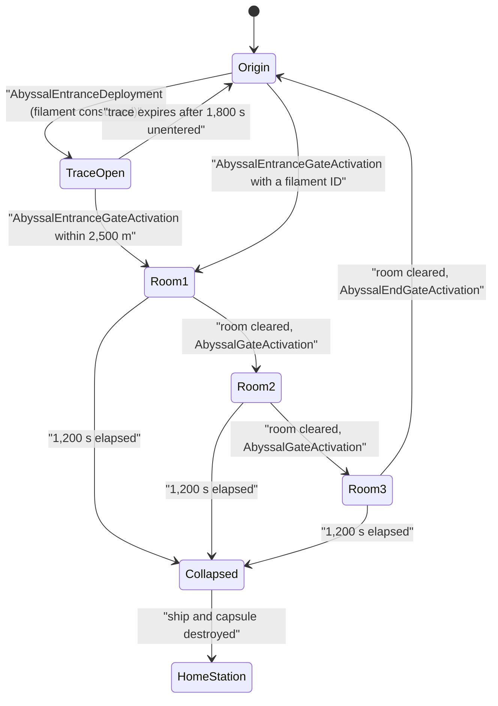

# Abyssal Deadspace

> **Navigation**: [EvoMu Technical Wiki](../README.md) • [Related Systems](#related-systems--cross-references)
>
> [← Back to Wiki Table of Contents](../README.md)

---

## Overview & Lore Context

Abyssal Deadspace is instanced PvE content. A pilot activates a **filament** from the cargo hold, is pulled into a private pocket of three rooms, and has twenty minutes to fight through them and leave by the last gate. Each filament has a tier (difficulty) and a weather type that changes ship attributes inside the pocket. A pilot who is still inside when the timer ends loses the ship and the capsule.

EvoMu implements this in [`eve-server`](../../../crates/eve-server) behind the MachoNet service `abyssalMgr`. All pockets live in one solar system, `32000001`; each pocket gets its own offset on the grid so pockets cannot see each other. The same code also carries Void Space (`voidSpaceMgr`, system `32000002`), which this article only touches where it shares state.

---

## Canonical Mechanics & Formulas

The rules below are the ones the code enforces at the pinned commit.

### Filaments, tiers and weather

`classify_abyssal_filament` maps a filament type to a tier (0–6) and one of five weather kinds (`Electrical`, `Dark`, `Exotic`, `Firestorm`, `Gamma`).

| Tier | Filament type IDs |
|---|---|
| 0 | `56131`–`56134`, `56136` |
| 1 | `47761`–`47765` |
| 2–5 | `47888`–`47907` (four consecutive IDs per weather, one per tier) |
| 6 | `56139`–`56143` |

### Entering

There are two entry paths:

- `abyssalMgr.AbyssalEntranceDeployment(filamentItemID)` consumes the filaments and spawns an **Abyssal Trace** (type `47458`) 500 m from the ship. Pilots then enter with `abyssalMgr.AbyssalEntranceGateActivation(traceID)`.
- `abyssalMgr.AbyssalEntranceGateActivation(filamentItemID or typeID)` consumes the filaments, leaves a trace, and moves the caller straight into room 1.

`validate_and_consume_abyssal_filaments` applies these checks before anything is consumed:

| Check | Rule | Error |
|---|---|---|
| Hull | The ship's group must be in the allow-list in `validate_abyssal_hull_and_capacity` | `DisallowedShipType` |
| Ships per pocket | 3 for groups 25, 324, 830, 831, 834, 893, 1283, 1527; 2 for groups 420, 541, 1305, 1534; 1 for the other allowed groups | |
| Filament count | As many filaments as the ship limit (3, 2 or 1), in the ship's cargo | `ItemNotFound`, `InsufficientFilamentQuantity`, `InvalidAbyssalFilament` |
| Fleet | A limit above 1 requires the pilot to be in a fleet | `NotInFleet` |
| Ship state | `require_ship_ready_for_filament_jump`, not cloaked, not tethered, the ESS bubble restriction check, still undocked in the same system | `ShipIsCloaked`, `ShipIsTethered`, `MustBeInSpace` |
| Deadspace | Not in an Abyssal system, not in a deadspace pocket, not within 250 km of a combat site gate or an acceleration gate (group 366) | `ShipInDungeon` |
| Proximity | At least 1,000 km from stations, stargates, structures, existing traces, mobile structures, and balls of categories 3, 22, 65 or groups 10, 1246, 1991 | `ProximityRestriction` |
| Security | See the table below | `FilamentDisallowedInHighSec` |

High-security policy (`evaluate_highsec_abyssal_tier_policy`), by the origin system's security status:

| Security | Allowed | Suspect flag on return |
|---|---|---|
| 0.85 and above | Tier 0 only | never |
| 0.75 – 0.85 | all tiers | tier 4 and above |
| 0.65 – 0.75 | all tiers | tier 5 and above |
| 0.55 – 0.65 | all tiers | tier 6 |
| below 0.55 | all tiers | never |

Entering through a trace (`activate_trace`) additionally requires:

- the trace to be in the caller's system (`WrongSolarSystem`) and not expired (`TraceExpired`);
- the ship to be within 2,500 m of it (`OutOfRange`) and of an allowed hull;
- room under the trace's ship limit (`TraceShipLimitReached`), and no earlier entry by the same pilot (`TraceAlreadyEntered`);
- for multi-ship traces, membership of the fleet that opened it (`NotInFleet`, `AccessDenied`).

A trace that nobody enters expires after 1,800 seconds (`UNENTERED_GATE_LIFETIME_SEC`). Once a pocket is bound to it, it expires when the pocket collapses.

On entry the pilot receives `OnAbyssalLocationEntered` (content ID, nebula graphic `22041 + tier`, tier) and `OnAddExpiryDurationForAbyssalContent` with the remaining seconds. A pilot who joins an existing fleet pocket gets the pocket's remaining time, not a fresh timer.

### The pocket

`enter_abyssal_pocket_with_trace` creates an `AbyssalPocketSession`:

| Property | Value |
|---|---|
| Pocket ID | `600000 +` a sequence number |
| Timer | `collapse_at_sec = now + 1200` |
| Grid offset | A free slot on the Y axis, 10,000,000 m per slot |
| Rooms | Always three, with fixed dungeon IDs `5810` ("Canyon"), `6047` ("Rise"), `6048` ("Forest Opening"), 50,000 m apart on the Z axis |
| NPCs per room | `clamp(2 + tier / 2, 2, 5)`, types taken in rotation from `ABYSSAL_ROOM_NPC_TYPES` |
| NPC hit points | Type values multiplied by `1 + 1.25 × tier` |
| Weather penalty | 30% or 50% for tiers 0–3, 50% or 70% for tiers 4–6, each with even odds (`roll_abyssal_weather_penalty_pct`) |
| Weather bonus | Always 50% |

Fleet members who enter the same trace get their own pocket record with the same `pocket_id`, rooms and timer.

Each room has a conduit gate (type `47685` for rooms 1 and 2, `47686` for room 3). The gate is not interactive while room NPCs are alive. When the last one is destroyed, the room is marked cleared, the gate is made interactive and a `GateActivate` controller event is sent.

`abyssalMgr.AbyssalGateActivation` moves the ship to the next room and spawns its contents. `abyssalMgr.AbyssalEndGateActivation` works only in room 3 and returns the ship to the origin system 1,000 m (per axis) from where it entered.

| Error | Cause |
|---|---|
| `NotInAbyssalSpace` | No active pocket, or the session is not in an Abyssal system |
| `PocketCollapsed` | The timer has ended |
| `AlreadyInFinalRoom` / `NotInFinalRoom` | Wrong gate call for the current room |
| `InvalidGate` | The gate ID is not the current room's gate |
| `GateLocked` | Hostile entities remain in the room |
| `GateOutOfRange` | More than 2,500 m from the gate (surface distance) |

Leaving by the end gate marks the pocket completed, removes the trace when no other pilot is still inside, applies the suspect flag if the security policy says so, and sends `OnAbyssalContentFinished` and `OnAbyssalLocationExited`.

While inside, `check_abyssal_in_pocket_rpc_restrictions` rejects every `map` service call, directional scans (`CannotDscanInThisSystem`) and Local chat (`LocalChannelDisabledInAbyssalSpace`).

### Weather effects

The penalty multiplies a damage **resonance** (the fraction of damage taken) on shield, armor and hull, so a higher value means lower resistance:

$$r' = \operatorname{clamp}\left(r \cdot (1 + p),\ 0,\ 1\right)$$

| Weather | Penalty | Bonus (50%) |
|---|---|---|
| Electrical | EM resonance (attributes `271`, `267`, `113`) | Capacitor recharge time (`55`) × 0.5 |
| Dark | Turret optimal range (`54`) and falloff (`158`) × `(1 − p)`, floor 0.1 | Maximum velocity (`37`) × 1.5 |
| Exotic | Kinetic resonance (`273`, `269`, `109`) | Scan resolution (`564`) × 1.5 |
| Firestorm | Thermal resonance (`274`, `270`, `110`) | Armor hit points (`265`) × 1.5 |
| Gamma | Explosive resonance (`272`, `268`, `111`) | Shield hit points (`263`) × 1.5 |

The same modifiers are applied to the room's NPCs when they spawn. For Dark weather, `dark_weather_midpocket_turret_mult` applies the range multiplier to gunnery turret modules only; missile launchers are excluded.

[`docs/BLOCKERS.md`](../../BLOCKERS.md) section 7 records a disagreement about these values. The static data (`dbuff` collections 90–100) defines Electrical and Exotic as a 30/50/70% resonance **penalty on all three layers** with no armor resistance bonus, Electrical's second effect as a 50% reduction of the capacitor recharge attribute, and Exotic's as +50% scan resolution. The checklist text for `feat:abyssal.weather-effects-and-penalties` instead describes a shield-only penalty plus a +50% armor resistance bonus. The entry is marked resolved: the code follows the static data, as in the table above.

### Clouds, pylons and the room boundary

Each room spawns one or two of three clouds and one or two of five pylons, chosen by `sample_abyssal_room_hazards`.

| Cloud (type) | Effect while inside its radius |
|---|---|
| Tachyon (`80876`) | Velocity × 4, signature radius × 4, inertia × 0.5 |
| Bioluminescent (`47440`) | Signature radius × 4 |
| Filament (`47472`) | Shield boost amount × 0.6 (the small and large variants use 0.5 and 0.7) |

Cloud radius is the type's attribute `54`, with fallbacks of 5, 15 and 40 km by size.

| Pylon (type) | Radius when the type has no attribute `54` | Effect |
|---|---|---|
| Deviant Automata Suppressor, short range (`47437`) | 15 km | Damages targets in range |
| Deviant Automata Suppressor, medium range (`47438`) | The ball radius set at spawn (40 km); 25 km if that is missing too | Damages targets in range |
| Automata pylon `48254` | 40 km | Damages targets in range |
| Multibody Tracking Pylon, short range (`47469`) | 15 km | Tracking speed × 1.8 |
| Multibody Tracking Pylon, medium range (`47470`) | 40 km | Tracking speed × 1.6 |

A pylon's radius is its type's attribute `54` when the static data has one (`suppressor_radius_m`, `tracking_pylon_radius_and_mult`).

- Suppressor damage is the type's attributes `114`, `116`, `117`, `118`; if they are all zero the pulse is 90 explosive (`suppressor_pulse_damage`).
- Suppressors hit categories 8, 18 and 87 and groups 1997, 4037 and 297, except sentry drones and types `48262`–`48265` (`is_suppressor_target_type`).
- Tracking pylons affect player ships, group 100 and combat NPCs; the largest multiplier in range wins. The multiplier is attribute `2469` when present.

[`docs/BLOCKERS.md`](../../BLOCKERS.md) section 8 records the second disagreement. In the static data the medium-range suppressor `47438` has a 40 km range and deals explosive and thermal damage, the short-range one `47437` has 15 km, and `48254` has no attributes; there is no 25 km suppressor. The checklist text for `feat:abyssal.automated-pylons` specifies 15, 25 and 40 km radii and explosive-only damage. The entry is marked resolved: the code uses the static data when it is present and keeps 25 km and explosive-only damage as fallbacks.

The room boundary is a sphere of 75,000 m (`ABYSSAL_ROOM_BOUNDARY_RADIUS_M`) around the room centre. Each step a ship or capsule spends outside it adds a tick and applies damage straight to hull:

$$D_n = 250 \cdot \left(1 + 0.5\,(n - 1)\right) \cdot \sum_{k=1}^{4} r^{\text{hull}}_k$$

where `n` is the consecutive tick count and the sum is over the four hull resonances. Scanner probes outside the boundary are removed. If the ship dies, the tick count carries over to the ejected capsule.

### Rewards

Every room contains a Triglavian Bioadaptive Cache (type `47951`). Its hull hit points are multiplied by 1 for tiers 0–2, 5 for tiers 3–4 and 25 for tiers 5–6; a code comment marks this as an approximation. From tier 1 the room also has an extraction subnode (type `49662`), which holds loot with probability 0.65.

| Container | Contents (`S` = the pocket's ship limit) |
|---|---|
| Cache | Triglavian Survey Database (`48121`) × `(1 + tier) × S`; the entry filament type × `S`; one mutaplasmid type by tier (`47699` for tiers 0–2, `47701` for 3–4, `47700` above) × `S`; Zero-Point Condensate (`48112`) × `(5 + 5 × tier) × S` |
| Subnode, when it has loot | Survey Database × `(1 + tier) × S`; Condensate × `max(1, (5 + 5 × tier) / 2) × S` |

Destroying a cache or subnode replaces it with a wreck (type `48120`) owned by the killer that holds the contents (`on_abyssal_cache_destroyed_core`).

### Failure

| Event | Outcome |
|---|---|
| Timer ends (1,200 s) | `collapse_abyssal_pocket_and_pod_pilot_at`, for every pilot sharing the pocket: the ship is destroyed with a killmail, its insurance contract is removed, the capsule is destroyed by `destroy_pod_and_respawn_faction_corvette_in_snap` (implants lost, corpse and killmail created), and the pilot is placed at the home station in a rookie corvette. Caches, NPCs, gates, clouds, pylons and the trace are removed. |
| Ship destroyed inside | The capsule is ejected into the pocket and `on_abyssal_boundary_death_hook` re-points the pocket record at it. The timer keeps running. |
| Capsule destroyed inside | The pocket is marked collapsed for that pilot; room contents and the trace are removed when no other pilot remains. |
| Disconnect or logoff | The timer is an absolute time stored in `abyssal_sessions`, so it keeps running. The collapse is executed by the cluster time step or, on reconnect, by `collapse_stranded_abyssal_if_needed_sync`. |
| Login into an Abyssal system | `reconcile_abyssal_login`: an active pocket is resumed, an expired one collapses, a completed or unknown one puts the pilot back at the origin (or the home system). |
| Daily downtime (11:00 UTC window) | `evacuate_abyssal_pockets_for_downtime`: pilots are returned with their ships to the origin system near the entry point, drones left in the pocket are destroyed, and the suspect flag is applied by the security policy. No ship is lost. |

### Not implemented / known gaps

- Pockets are not separate solar systems. Every pocket shares system `32000001` and is separated by a grid offset.
- Room layout is fixed: three rooms, the same three dungeon IDs and the same five NPC types for every tier and weather. Encounters are not generated from static data.
- Loot is a fixed list scaled by tier and ship limit. Only the subnode has a random roll.
- The cache hit-point multipliers are marked `DERIVED` in the code, not taken from static data.
- The weather bonus is always 50%; only the penalty varies.
- The collapse removes the ship's insurance contract and does not pay it out in this function.
- The string `abyssal_content_manager` does not appear in the server's non-test source, although the ledger has `abyssal_content_manager` RPC rows (for example `rpc:abyssal_content_manager.GenerateAbyssEncounterContent`).
- [`docs/BLOCKERS.md`](../../BLOCKERS.md) sections 7 and 8 cite an integration test file under `crates/eve-server/tests/it/` that no longer exists under that name.
- No open GitHub issue about Abyssal Deadspace was found.

---

## EvoMu Implementation Architecture

### Crates involved

- [`eve-server`](../../../crates/eve-server): handlers, pocket logic, hazards and lifecycle.
- [`eve-db`](../../../crates/eve-db): `AbyssalRuntimeStore`, `AbyssalPocketSession`, `AbyssalTraceRecord`, `AbyssalRoomRecord` and `AbyssalWeatherKind` in [`pve_sites.rs`](../../../crates/eve-db/src/service_domains/pve_sites.rs); `AbyssalPersistedSession` in [`lib.rs`](../../../crates/eve-db/src/lib.rs).
- [`eve-destiny`](../../../crates/eve-destiny): ballpark, combat state multipliers (`cloud_velocity_multiplier`, `tracking_speed_multiplier`, and others), `SetBallInteractive`.
- [`eve-sde`](../../../crates/eve-sde): type attributes for NPCs, clouds and pylons, security status.

### Primary handlers and dispatch

[`dispatch.rs`](../../../crates/eve-server/src/router/dispatch.rs) calls `abyssal_void_mgr::handle`.

| File | Contents |
|---|---|
| [`abyssal_void_mgr.rs`](../../../crates/eve-server/src/services/abyssal_void_mgr.rs) | `handle` for `abyssalMgr` and `voidSpaceMgr`, `activate_trace`, `activate_inventory_filament`, entry notifications, constants |
| [`abyssal_void_gates.rs`](../../../crates/eve-server/src/services/abyssal_void_gates.rs) | `handle_abyssal_gate_activation`, `handle_abyssal_end_gate_activation`, Void Space jump and exit |
| [`pve_special_sites_abyssal.rs`](../../../crates/eve-server/src/services/pve_special_sites_abyssal.rs) | `classify_abyssal_filament`, `handle_abyssal_entrance_deployment`, `enter_abyssal_pocket_with_trace`, `spawn_abyssal_room_contents`, gate unlock hooks, cache destruction |
| [`pve_abyssal_hazards.rs`](../../../crates/eve-server/src/services/pve_abyssal_hazards.rs) | Entry validation, security policy, proximity rules, in-pocket RPC restrictions, weather and cloud modifiers |
| [`pve_abyssal_pylons.rs`](../../../crates/eve-server/src/services/pve_abyssal_pylons.rs) | Suppressor and tracking pylon rules, hazard sampling, the per-step hazard and boundary function, capsule destruction, `on_abyssal_boundary_death_hook` |
| [`pve_abyssal_lifecycle.rs`](../../../crates/eve-server/src/services/pve_abyssal_lifecycle.rs) | Collapse, downtime evacuation, Void Space expiry, `reconcile_abyssal_login` |

| RPC | Purpose |
|---|---|
| `abyssalMgr.AbyssalEntranceDeployment` | Consume filaments, spawn a trace |
| `abyssalMgr.AbyssalEntranceGateActivation` | Enter through a trace, or consume a filament and enter |
| `abyssalMgr.AbyssalGateActivation` | Move to the next room |
| `abyssalMgr.AbyssalEndGateActivation` | Leave from room 3 |
| `abyssalMgr.ClientIsReady` | Respawn missing room balls, push ship state, evaluate clouds |
| `voidSpaceMgr.ClientIsReady`, `VoidSpacePlayerJump`, `VoidSpaceEndGateActivation` | Void Space |

The gate and deployment calls are refused while the caller is controlling a structure.

### State

| State | Location | Notes |
|---|---|---|
| `abyssal_state: AbyssalRuntimeStore` | `WorldStateSnapshot` ([`snapshot_ext.rs`](../../../crates/eve-db/src/snapshot_ext.rs)) | `pockets` (by character), `traces` (by trace ball), `void_space_sessions`, `void_space_content`, `active_clouds` (by ship), `boundary_ticks`, `deathzone_active_ships`, `next_seq` |
| `abyssal_sessions: HashMap<i64, AbyssalPersistedSession>` | Persisted lifecycle state (`sp6_lifecycle`) | `char_id`, `ship_id`, `pocket_system_id`, `origin_system_id`, `entered_unix`, `collapse_at_unix`; written by `register_abyssal_session`, cleared by `clear_abyssal_session` |

`AbyssalPocketSession` also stores `origin_solar_system_id`, `origin_position`, `grid_offset`, `filament_type_id`, `tier`, `weather`, `weather_penalty_pct`, `current_room`, `rooms`, `completed`, `collapsed_destroyed`, `trace_ball_id`, `fleet_ship_ids`, `ship_room` and `max_ships`.

Ball IDs are derived from the pocket ID `p` and room `r`:

| Object | ID |
|---|---|
| Room gate | `1895000000 + p·10 + r` |
| Cache | `1896000000 + p·10 + r` (subnode: cache + 500,000) |
| Trace | `1897000000 +` sequence |
| Cloud | `1898000000 + p·100 + r·10 + n` |
| Pylon | `1899000000 + p·100 + r·10 + n` |
| NPC | `p·100 + r·10 + n + 1` |

Accessors: `read_abyssal_state`, `with_abyssal_state`, `with_abyssal_state_db`.

### Tick integration

- The system actor calls `step_abyssal_hazards_and_pylons_in_ballpark_for_tick` ([`system_actor.rs`](../../../crates/eve-server/src/system_actor.rs), [`cycles.rs`](../../../crates/eve-server/src/system_actor/cycles.rs)) for clouds, pylons and the boundary, and `on_abyssal_room_npc_destroyed_in_ballpark` when a room NPC dies.
- `on_advance_secs_internal` in [`cluster_tick.rs`](../../../crates/eve-server/src/sp6_lifecycle/cluster_tick.rs) collapses due pockets from `abyssal_sessions`, sweeps expired Void Space sessions and removes expired traces.
- The ball-destroyed handling in [`context.rs`](../../../crates/eve-server/src/router/context.rs) calls `on_abyssal_room_npc_destroyed_core`, `on_abyssal_cache_destroyed_core` and `on_abyssal_boundary_death_hook`.
- [`serverops_cluster.rs`](../../../crates/eve-server/src/services/serverops_cluster.rs) calls `evacuate_abyssal_pockets_for_downtime` in the 11:00 UTC window.

---

## Invariants, Security & Edge Cases

- **Filament consumption is atomic with validation.** The cargo item, fleet membership and docked state are re-checked inside the snapshot write that removes the filaments.
- **One entry per pilot per trace.** The pilot is added to `entered_char_ids` before the transfer and removed again if the transfer fails.
- **Pocket isolation.** Clouds and pylons only affect ships whose pocket ID matches the one encoded in the hazard's ball ID.
- **Idempotent collapse.** `collapse_abyssal_pocket_and_pod_pilot_at` returns early when the pocket is already marked `collapsed_destroyed`.
- **Shared pockets.** Room contents and the trace are only removed when no pilot with the same `pocket_id` is still active.
- **No stranding.** Login reconciliation, the cluster time step and the downtime evacuation each move or destroy a pilot whose pocket no longer exists.
- **Self-destruct.** Entering aborts a running self-destruct on the ship.
- **Local chat.** Entry removes the pilot from the origin system's local channel and deletes the Abyssal system's channel.

---

## Verification, Tests & Parity References

Ledger rows (`ledger.json`): `feat:pve.abyssal-pocket`, `feat:pve.abyssal-gates`, `feat:pve.abyssal-tiers`, `feat:pve.abyssal-weather`, `feat:navigation.filament-abyssal`; `rpc:abyssalMgr.AbyssalEntranceDeployment`, `rpc:abyssalMgr.AbyssalEntranceGateActivation`, `rpc:abyssalMgr.AbyssalGateActivation`, `rpc:abyssalMgr.AbyssalEndGateActivation`, `rpc:abyssalMgr.ClientIsReady`; `notify:OnAbyssalLocationEntered`, `notify:OnAddExpiryDurationForAbyssalContent`, `notify:OnAbyssalContentFinished`, `notify:OnAbyssalLocationExited`.

Auditor rows (`auditor_rows.json`): `feat:abyssal.weather-effects-and-penalties`, `feat:abyssal.automated-pylons`, `feat:abyssal.spatial-hazard-clouds`, `feat:abyssal.gate-unlock-on-clear`, `feat:abyssal.bioadaptive-cache-rewards`, `feat:abyssal.timer-collapse-death`, `feat:pve.abyssal-activation-restrictions`, `feat:pve.abyssal-entry-ship-limits`, `feat:pve.abyssal-coop-frigate-destroyer`, `feat:pve.abyssal-highsec-tier-suspect`, `feat:pve.abyssal-boundary-damage`, `feat:pve.abyssal-in-pocket-restrictions`, `feat:pve.abyssal-trace`, `feat:navigation.abyssal-trace-collapse`, `feat:lifecycle.abyssal-disconnect`, `feat:lifecycle.abyssal-restart`.

Unit tests next to the code: [`pve_special_sites_abyssal_tests.rs`](../../../crates/eve-server/src/services/pve_special_sites_abyssal_tests.rs), [`pve_abyssal_hazards_tests.rs`](../../../crates/eve-server/src/services/pve_abyssal_hazards_tests.rs), [`pve_abyssal_pylons_tests.rs`](../../../crates/eve-server/src/services/pve_abyssal_pylons_tests.rs), [`pve_abyssal_lifecycle_tests.rs`](../../../crates/eve-server/src/services/pve_abyssal_lifecycle_tests.rs), [`abyssal_void_mgr_tests.rs`](../../../crates/eve-server/src/services/abyssal_void_mgr_tests.rs), [`abyssal_void_gates_tests.rs`](../../../crates/eve-server/src/services/abyssal_void_gates_tests.rs).

Integration tests in [`crates/eve-server/tests/it/`](../../../crates/eve-server/tests/it/): `abyssal_deadspace.rs`, `abyssal_room_combat.rs`, `abyssal_weather_clouds_suite.rs`, `abyssal_and_void_space_suite.rs`, `abyssal_real_client_sync.rs`, `abyssal_pochven_void.rs`, `rpc_abyssal_content.rs`.

---

## Related Systems & Cross-References

- [**Agent Dialogue, Missions & LP**](./agent_dialogue_and_missions.md): the other PvE content in this section.
- [**NPC Combat AI & Ecology**](../npcs_and_living_world/npc_combat_ai_and_ecology.md): the AI that drives room NPCs once they are registered.
- [**Crimewatch & Engagement Timers**](../combat_and_crimewatch/crimewatch_and_engagement_timers.md): the suspect flag applied on return to high security.
- [**Pochven Navigation & Anchoring**](../universe_and_navigation/pochven_navigation_and_anchoring.md): the other filament family.
- [**Destiny Simulation Loop**](../ballpark_and_physics/destiny_simulation_loop.md): the ballpark step that runs hazards and the boundary.
- [**Drones & Carrier Fighters**](../dogma_and_fitting/drones_and_fighters.md): drones are targets of suppressor pylons and are destroyed on downtime evacuation.
- [**EvoMu Technical Wiki Table of Contents**](../README.md): master index and domain directory.

---

[← Back to Wiki Table of Contents](../README.md)
