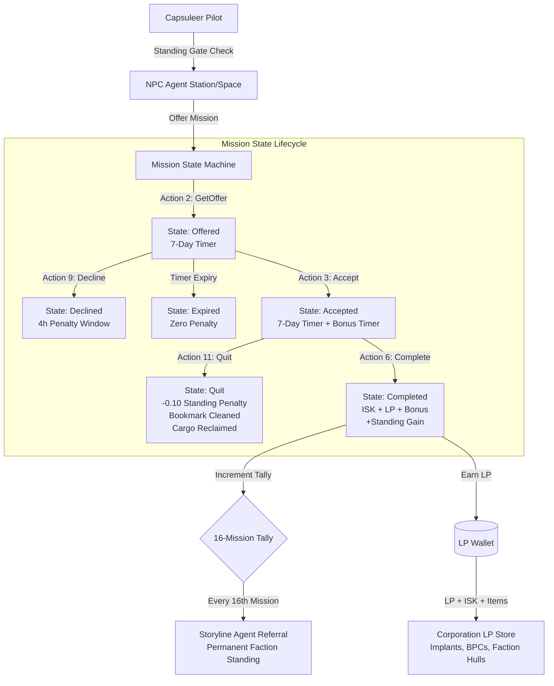
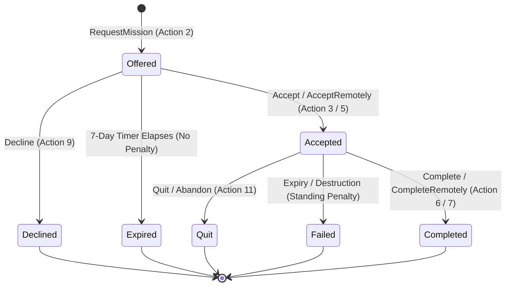
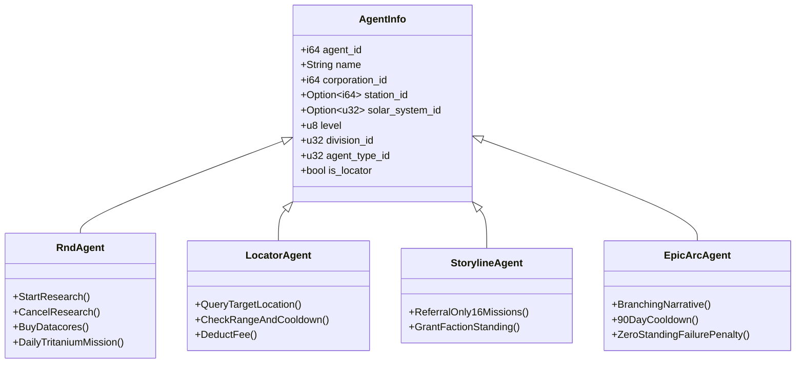
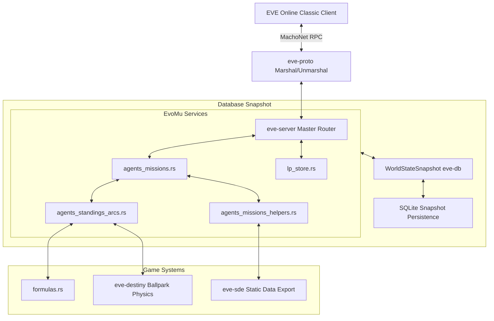

# Agent Dialogue, Missions, Standings & LP Stores

> **Navigation**: [EvoMu Technical Wiki](../README.md) • [Related Systems](#related-systems--cross-references)
>
> [← Back to Wiki Table of Contents](../README.md)

---

## Overview & Lore Context

In the sprawling geopolitics of New Eden, capsuleers rarely operate in a vacuum. Beyond the anarchy of nullsec and the isolation of wormhole space, the four core empire factions—the **Amarr Empire**, the **Caldari State**, the **Gallente Federation**, and the **Minmatar Republic**—alongside independent organizations like the **Sisters of EVE**, **CONCORD**, **ORE**, and pirate syndicates (**Guristas Pirates**, **Blood Raider Covenant**, **Angel Cartel**, **Serpentis Corporation**), orchestrate an enormous network of non-capsuleer agents. These NPC agents represent corporate departments, intelligence agencies, military commands, and logistics bureaus embedded across thousands of orbital stations and space complexes.

For an immortal capsuleer, establishing contact with these agents represents a primary pathway for corporate advancement, narrative engagement, wealth generation, and factional influence. Agents provide contracted assignments known as **Missions**:
- **Security Missions:** Tactical combat sorties dispatching capsuleers to suppress pirate incursions, dismantle rogue drone hives, or strike enemy naval detachments within gated deadspace pockets.
- **Mining Missions:** Resource extraction contracts demanding the harvesting and haulage of rare or hazardous ore veins located in hostile or secured pockets.
- **Distribution & Courier Missions:** High-volume logistics operations transporting vital blueprints, medical supplies, or sealed contraband containers across regional stargate routes.
- **Research & Development (R&D):** Long-term scientific partnerships generating passive Research Points (RP) convertible into specialized Invention Datacores.
- **Locator Agents:** Deep-cover intelligence operatives capable of pinging stargate transit beacons and orbital sensors to pinpoint the current solar system or station of any capsuleer in New Eden.
- **Storylines & Epic Arcs:** Branching, multi-chapter narrative campaigns such as *The Blood-Stained Stars*, culminating in permanent faction standing shifts and unique faction modules.



Historically in *EVE Online*, agents were divided by both discrete **Quality ratings** (ranging from $-20$ to $+20$) and **Agent Levels** (Level 1 to 5). High-quality agents demanded steeper standings but yielded superior rewards. In modern canonical EVE (V24.01) and EvoMu, agent quality has been consolidated into unified agent level brackets (Levels 1 through 5), providing streamlined standing thresholds while preserving division specializations, true-security reward scaling, and faction warfare mechanics.

---

## Canonical Mechanics & Formulas

### 1. Agent Taxonomy & Divisions

NPC agents belong to specific corporate divisions that dictate the mission archetypes they offer, the standing skills that influence them, and the rewards they yield:

| Division | Division ID | Primary Mission Content | Governing Connections Skill | Key LP Store Specialization |
| :--- | :---: | :--- | :--- | :--- |
| **Security** | `24` | Combat Encounters, Dread/Pirate Raids, Anomic Burners | Security Connections (`3895`) | Combat ships, faction ammo, gunnery/missile implants |
| **Mining** | `23` | Ore/Gas/Ice Extraction, Hazardous Harvesting | Mining Connections (`3893`) | Mining lasers, survey scanners, industrial sub-systems |
| **Distribution** | `27` | Cargo Hauling, Time-Sensitive Couriers | Distribution Connections (`3894`) | Hauler hulls, cargo expanders, navigation implants |
| **R&D** | `—` (Type `4`) | Passive Research Point generation, Daily Tritanium supply | Science & Field Skills (`group_id: 270`) | Tech II Invention Datacores |
| **Locator** | Multiple | Target tracking across constellations and regions | Diplomacy / Connections | Real-time target locator telemetry |
| **Storyline** | `—` (Type `2`) | High-priority faction assignments (Combat, Trade, Logistics) | Social (`3355`) | Permanent Empire Faction Standing gains |
| **Career** | `—` (Type `7` / `12`) | Educational tutorial storylines (Enforcer, Industrialist, etc.) | None (Available to all) | Free starter ships, skillbooks, seed capital |
| **Epic Arc** | `—` (Type `10`) | Multi-mission branching narrative chapters | Social (`3355`) | Substantial faction standing, unique faction ships |

#### Clone State & Space Security Restrictions
- **Alpha Clone Gating:** Alpha clone pilots are restricted to Agent Levels 1 through 3. Requesting or accepting a Level 4 or Level 5 mission requires an **Omega Clone** state.
- **Level 5 Space Security Gating:** Level 5 agents represent high-risk fleet operations. They are strictly prohibited from operating in high-security space (true security $\ge 0.45$). They reside exclusively in low-security space (0.1 to 0.4) and null-security space ($\le 0.0$).

---

### 2. Mission State Machine & Action Codes

Every agent interaction is driven by client-to-server RPCs dispatched to `agentMgr` via `DoAction` or `GetOffer`. The server tracks missions through discrete integer action codes and states:



#### Dialogue Action Identifiers:
- `1` = `ViewMission`: Review the active or offered assignment briefing.
- `2` = `RequestMission` / `GetOffer`: Generate an offer from the agent's eligible template pool.
- `3` = `Accept`: Accept the mission locally in the agent's station.
- `4` = `AcceptChoice`: Accept a branching mission choice.
- `5` = `AcceptRemotely`: Accept a mission without being co-located (e.g., Storyline referrals).
- `6` = `Complete`: Verify delivery/elimination objectives and finalize rewards at the agent station.
- `7` = `CompleteRemotely`: Finalize rewards remotely if permitted.
- `8` = `Continue`: Advance multi-stage dialogue prompts.
- `9` = `Decline`: Reject an offered mission.
- `10` = `Defer`: Postpone the offer in journal without declining.
- `11` = `Quit`: Terminate an already accepted mission prematurely.
- `12` = `StartResearch`: Begin passive R&D research point accumulation.
- `13` = `CancelResearch`: Terminate an active R&D research link.
- `14` = `BuyDatacores`: Redeem accumulated research points and ISK for Invention Datacores.
- `15` / `16` / `17` = `LocatorService`: Request, confirm, or reject a pilot locator query.

#### Timers & Decline Penalties
1. **Offer Expiration:** An offered mission remains valid for exactly **7 days** ($604,800\text{ seconds}$). If the capsuleer takes no action, the offer expires silently with **zero standing penalty**.
2. **Acceptance Expiration:** Once accepted, the capsuleer has **7 days** ($604,800\text{ seconds}$) to fulfill objectives. If this timer elapses without completion, the mission enters `Failed` state, triggering corporate, agent, and faction standing penalties.
3. **The 4-Hour Decline Rule:** A pilot is granted **one free decline every 4 hours** ($14,400\text{ seconds}$) per agent. If a pilot declines a second mission from the same agent within 4 hours:
   - Corporation standing decreases by $-0.05$ (clamped to $-10.0$).
   - Agent standing decreases by $-0.05$ (clamped to $-10.0$).
   - *Exception:* Research & Development (R&D) daily mission declines never inflict standing penalties and do not cancel ongoing research.
4. **Mission Abandonment / Quitting:** Quitting an accepted mission (`Action 11`) immediately incurs a **$-0.10$ standing loss** to both corporation and agent standings, cleans up spawned combat balls, deletes the scoped mission bookmark, and reclaims courier cargo.

---

### 3. Standing Mathematics & Asymptotic Laws

Standings in New Eden represent bilateral diplomatic relations constrained strictly to the continuous real interval:
$$\text{Standing} \in [-10.0, +10.0]$$

#### The Asymptotic Gain Formula
Standing gains diminish asymptotically as standing approaches $+10.0$. An agent granting a base increase of $\Delta\%$ (where $0 < \Delta\% \le 100$) increases standing according to:
$$S_{\text{new}} = S_{\text{old}} + (10.0 - S_{\text{old}}) \times \frac{\Delta\%}{100}$$

#### The Asymptotic Loss Formula
Penalties and failures push standings downward asymptotically toward $-10.0$:
$$S_{\text{new}} = S_{\text{old}} + (-10.0 - S_{\text{old}}) \times \frac{|\Delta\%|}{100}$$

#### Social Skill Modifiers
The character's trained social skills modify raw standings into **effective standings**:
- **Social (`TypeId: 3355`):** Increases the percentage gain of all positive standing increments by $5\%$ per skill level:
  $$\Delta\%_{\text{scaled}} = \Delta\%_{\text{base}} \times \left(1.0 + 0.05 \times \text{SocialLevel}\right)$$
- **Connections (`TypeId: 3359`):** Improves non-negative ($S_{\text{raw}} \ge 0.0$) standings with non-pirate entities by $4\%$ of the remaining margin to $+10.0$ per level:
  $$S_{\text{eff}} = S_{\text{raw}} + (10.0 - S_{\text{raw}}) \times 0.04 \times \text{ConnectionsLevel}$$
- **Diplomacy (`TypeId: 3357`):** Mitigates negative ($S_{\text{raw}} < 0.0$) standings by $4\%$ of the margin to $+10.0$ per level:
  $$S_{\text{eff}} = S_{\text{raw}} + (10.0 - S_{\text{raw}}) \times 0.04 \times \text{DiplomacyLevel}$$
- **Criminal Connections (`TypeId: 3361`):** Replaces Connections for outlaw and pirate factions (e.g., Guristas, Blood Raiders, Angel Cartel, Serpentis):
  $$S_{\text{eff}} = S_{\text{raw}} + (10.0 - S_{\text{raw}}) \times 0.04 \times \text{CriminalConnectionsLevel}$$

#### Agent Access Threshold Gates
To request missions from an agent of Level $L$, a pilot's effective standing must meet the required threshold:
$$S_{\text{req}}(L) = (L - 1) \times 2.0 - 1.0$$

Evaluating across agent levels:
- **Level 1:** $S_{\text{eff}} > -2.0$ (Career agents require no minimum standing)
- **Level 2:** $S_{\text{eff}} \ge +1.0$
- **Level 3:** $S_{\text{eff}} \ge +3.0$
- **Level 4:** $S_{\text{eff}} \ge +5.0$ (and Omega clone required)
- **Level 5:** $S_{\text{eff}} \ge +7.0$ (and Omega clone required, lowsec/nullsec only)

> [!IMPORTANT]
> **The Hard $-2.0$ Service Refusal Rule:**
> When querying an agent, the server evaluates three distinct effective standing relationships:
> 1. Character to **Agent** ($S_{\text{agent}}$)
> 2. Character to Agent's **Corporation** ($S_{\text{corp}}$)
> 3. Character to Agent's **Faction** ($S_{\text{faction}}$)
>
> If **ANY** of these three effective standings falls to $\le -2.0$, the agent will refuse all dialogue and missions, regardless of how high the other two standings may be. If all are $>-2.0$, access is unlocked using:

$$
\text{EffectiveStanding} = \max(S_{\text{agent}}, S_{\text{corp}}, S_{\text{faction}})
$$

#### Derived Faction Standing Inter-Relations
Regular mission completion awards corporation and agent standing. Major storylines, Epic Arcs, and COSMOS encounters also award direct **Faction Standing**. When a pilot gains standing with faction $A$, allied and rival factions adjust their standing with the pilot based on static geopolitical affinity constants:
- **Allied Faction ($R_{A \rightarrow B} > 0$):**
  $$S_{B,\text{new}} = S_{B,\text{old}} + (10.0 - S_{B,\text{old}}) \times \frac{\Delta\%_{\text{fac}} \times R_{A \rightarrow B} \times 0.5}{100}$$
- **Opposing Faction ($R_{A \rightarrow C} < 0$):**
  $$S_{C,\text{new}} = S_{C,\text{old}} - (S_{C,\text{old}} + 10.0) \times \frac{\min\left(10.0, \; \Delta\%_{\text{fac}} \times |R_{A \rightarrow C}| \times 0.4\right)}{100}$$

---

### 4. Mission Reward Formulas (LP, ISK, and Time Bonus)

Mission payouts scale formulaically with base template metrics, the agent solar system's true security status, and character skills:

#### Loyalty Point (LP) Reward
$$\text{LPReward} = \text{round}\left( \text{BaseLP} \times (1.6288 - \text{TrueSec}) \times \left(1.0 + 0.10 \times \text{DivisionConnLevel}\right) \right)$$
Where:
- $\text{TrueSec}$ is the unmodified security rating of the agent's solar system (clamped to ensure $1.6288 - \text{TrueSec} \ge 0.01$).
- $\text{DivisionConnLevel}$ is the skill level of Security Connections (`3895`), Mining Connections (`3893`), or Distribution Connections (`3894`), matching the agent's division.

#### ISK Reward & Time Bonus
The canonical base ISK economy links to base LP at a conversion baseline of $1\text{ LP} = 1,000\text{ ISK}$:
$$\text{BaseISK} = \text{BaseLP} \times 1,000$$
$$\text{ISKReward} = \text{round}\left( \text{BaseISK} \times \left(1.0 + 0.05 \times \text{NegotiationLevel}\right) \right)$$
$$\text{BonusReward} = \left\lfloor \frac{\text{ISKReward}}{2} \right\rfloor$$

#### Bonus Timer Windows
Completing all mission objectives before the bonus countdown timer expires awards the additional $\text{BonusReward}$ in full:

| Agent Level | Bonus Timer Duration | Seconds |
| :---: | :---: | :---: |
| **Level 1** | 30 minutes | $1,800\text{ s}$ |
| **Level 2** | 1 hour | $3,600\text{ s}$ |
| **Level 3** | 2 hours | $7,200\text{ s}$ |
| **Level 4** | 4 hours | $14,400\text{ s}$ |
| **Level 5** | 6 hours | $21,600\text{ s}$ |

---

### 5. Specialized Agent Archetypes



#### Research & Development (R&D) Agents
R&D agents (`agent_type_id: 4`) allow capsuleers to sponsor scientific inquiry in specific science disciplines.
- **Prerequisite:** Character must possess the relevant Science skill (e.g., *Minmatar Starship Engineering*, *Mechanical Engineering*) at level $\ge 1$.
- **Passive RP Accumulation:**
  $$\text{RP/day} = \left(10.0 + 12.0 \times \text{SkillLevel} + 2.5 \times \max\left(0.0, S_{\text{eff}}\right)\right) \times \text{AgentLevel}$$
- **Datacore Redemption (`Action 14`):** Accumulated RP can be redeemed for Datacores at the cost of **$50.0\text{ RP}$** and **$10,000\text{ ISK}$** per unit.
- **Daily Research Mission:** R&D agents offer a daily mission to deliver Tritanium to accelerate research:
  $$\text{TritaniumRequired} = 300 \times 3^{\text{AgentLevel} - 1}$$
  Completing this assignment immediately credits one full day of passive RP ($+ \text{RP/day}$).

#### Locator Agents
Locator agents provide reconnaissance on player targets. Telemetry resolution, pricing, and cooldowns scale directly by agent level:

| Level | ISK Fee | Cooldown | Target Precision Range |
| :---: | :---: | :---: | :--- |
| **Level 1** | $2,000\text{ ISK}$ | $900\text{ s}$ ($15\text{ min}$) | Current Constellation |
| **Level 2** | $8,000\text{ ISK}$ | $480\text{ s}$ ($8\text{ min}$) | Current Region |
| **Level 3** | $25,000\text{ ISK}$ | $240\text{ s}$ ($4\text{ min}$) | Known Space (Solar System) |
| **Level 4** | $75,000\text{ ISK}$ | $120\text{ s}$ ($2\text{ min}$) | All Known Space (Solar System & Station) |
| **Level 5** | $150,000\text{ ISK}$ | $60\text{ s}$ ($1\text{ min}$) | All Known Space Immediate |

*Security Invariant:* Targets located in J-space (wormholes, solar system ID $\ge 31,000,000$) or Abyssal Deadspace (region ID $\ge 11,000,000$) cannot be located. The server returns `LocatorTargetInUnknownSpace`.

#### 16-Mission Storyline Referrals
The server tracks a persistent mission counter (`mission_tally`) for each character. Every time a pilot completes a standard non-storyline mission that offers standing rewards:
1. The tally increments by $1$.
2. Upon reaching a multiple of $16$ ($T \pmod{16} == 0$), the server automatically selects the nearest **Storyline Agent** of matching faction and level, generating an urgent priority offer.
3. Completing the storyline assignment yields massive corporate and permanent faction standing gains ($50\%$ of scaled standing gain propagated to the faction).

#### Epic Arcs & The Blood-Stained Stars
Epic Arcs are multi-chapter epic questlines featuring branching dialogue, choice paths, and climactic boss encounters.
- **The Blood-Stained Stars:** Level 1 Sisters of EVE Epic Arc initiated via agent **Sister Alitura** in *Arnon IX - Moon 3 - Sisters of EVE Bureau*.
- **90-Day Cooldown:** Upon completion, the arc enters a **90-day repeat cooldown** ($7,776,000\text{ seconds}$).
- **Failure Forgiveness:** Unlike standard missions, quitting or abandoning an Epic Arc mission carries **no standing penalty**, allowing capsuleers to re-approach the contact without damaging relations.

#### AIR Career Program
For new recruits, the AIR Career Program introduces core gameplay pillars: **Enforcer**, **Industrialist**, **Explorer**, and **Soldier of Fortune**.
- Tracked via node graph `473` in [`NpeProgressRecord`](../../../crates/eve-db/src/types.rs#L799).
- Milestones award unallocated Free Skill Points (SP) upon completion.
- Industrial milestones hook directly into the character's mining ledger (`snap.mining_ledger`), verifying harvested ore volumes before unlocking rewards.

---

### 6. Loyalty Point (LP) Stores

Completing missions for an NPC corporation earns Loyalty Points credited directly to the pilot's corporate wallet. These points represent institutional favor redeemable at the station's LP Store.

#### Offer Anatomy & Requirements
Every LP Store offer requires:
1. **LP Cost:** Deducted from the character's or corporation's LP balance.
2. **ISK Cost:** Transferred to NPC sinks.
3. **Required Trade-in Items:** High-tier items often require input sacrifices:
   - **Pirate Dogtags:** (e.g., *Clone Soldier Tags*, *Serpentis Gold Tags*) for faction equipment and hull BPCs.
   - **Standard Base Hulls:** Trading in an Amarr Cruiser hull plus LP/ISK for an *Omen Navy Issue*.
   - **Minerals / Commodities:** Input materials for specialized ammunition or implants.

#### CONCORD LP Conversion
Capsuleers earning CONCORD LP (via Incursions, Pochven, or CONCORD services) can exchange it for empire corporation LP via `ExchangeConcordLP`:
- **Empire Corporations:** Converted at a ratio of **$1 : 0.8$** ($80\%$) into Amarr, Caldari, Gallente, Minmatar, Ammatar, or Khanid corporations.
- **Non-Pirate Independent Corporations:** Converted at a ratio of **$1 : 0.4$** ($40\%$) into ORE, Sisters of EVE, Syndicate, or Thukker.
- **Ineligible Factions:** Pirate syndicates and Faction Warfare militias strictly refuse CONCORD LP.
- **Prerequisite:** The character must already possess **$\ge 1\text{ LP}$** with the target corporation to execute an exchange, preventing blind reputation laundering.

---

## EvoMu Implementation Architecture

EvoMu structures the agent, mission, standings, and LP store systems across modular, memory-safe Rust crates:



### 1. Crates Involved

* [`eve-server`](../../../crates/eve-server): Master simulation server, hosting RPC routing, mission state transitions, and living world hooks.
* [`eve-db`](../../../crates/eve-db): Transactional world state snapshots (`WorldStateSnapshot`), entity IDs, and persistence models.
* [`eve-sde`](../../../crates/eve-sde): Static Data Export engine providing static agent records, station coordinates, and mission content templates.
* [`eve-proto`](../../../crates/eve-proto): MachoNet PyRep binary codec marshaling PyVal dialogues and keyval dictionaries.
* [`eve-destiny`](../../../crates/eve-destiny): Deterministic 1 Hz physics engine managing in-space combat balls, mission gates, and harvestable mission asteroids.

---

### 2. Primary Handlers & Dispatch

* [`crates/eve-server/src/services/agents_missions.rs`](../../../crates/eve-server/src/services/agents_missions.rs):
  - `agentMgr::GetAgents`: Dispatches filtered agent directories based on character standings.
  - `agentMgr::GetOffer`: Generates an offer for the co-located or selected agent.
  - `agentMgr::DoAction`: Master mission state machine handler (Actions `1` through `11`).
  - `agentMgr::RemoveOfferFromJournal`: Safely dismisses expired or unaccepted offers.
* [`crates/eve-server/src/services/agents_missions_helpers.rs`](../../../crates/eve-server/src/services/agents_missions_helpers.rs):
  - [`compute_character_mission_rewards`](../../../crates/eve-server/src/services/agents_missions_helpers.rs#L248): Calculates true-sec scaled LP, ISK, and time bonus rewards.
  - [`abandon_or_decline_mission`](../../../crates/eve-server/src/services/agents_missions_helpers.rs#L463): Executes state rollback, scoped bookmark pruning, ball despawns, and standing penalties.
  - [`reclaim_courier_cargo`](../../../crates/eve-server/src/services/agents_missions_helpers.rs#L442): Anti-minting routine scrubbing courier cargo on mission failure or abandonment.
  - [`resolve_security_mission_encounter`](../../../crates/eve-server/src/services/agents_missions_helpers.rs#L1040): Assembles NPC combat waves based on mission archetype and agent system.
  - [`resolve_mining_mission_details`](../../../crates/eve-server/src/services/agents_missions_helpers.rs#L985): Seeds asteroid quantities and ore delivery requirements.
* [`crates/eve-server/src/services/agents_standings_arcs.rs`](../../../crates/eve-server/src/services/agents_standings_arcs.rs):
  - `handle_extended`: Handles `standingMgr`, `missionTrackerMgr`, and `air_npe` RPC calls.
  - `handle_special_dialogue_action`: Dispatches R&D research actions (`12`–`14`) and Locator services (`15`–`17`).
  - [`compute_effective_standing_breakdown`](../../../crates/eve-server/src/services/agents_standings_arcs.rs#L232): Computes Connections, Diplomacy, and Criminal Connections bonuses.
  - [`compute_effective_agent_standing`](../../../crates/eve-server/src/services/agents_standings_arcs.rs#L273): Evaluates the $-2.0$ floor and max standing resolution.
  - [`apply_mission_completion_standings`](../../../crates/eve-server/src/services/agents_standings_arcs.rs#L374): Applies Social-modified standing gains and derived faction standing cascades.
* [`crates/eve-server/src/services/lp_store.rs`](../../../crates/eve-server/src/services/lp_store.rs):
  - `LPStoreMgr::GetAvailableOffersFromCorp`: Serializes corporation LP catalog offerings.
  - `LPStoreMgr::TakeOfferForCharacter` / `TakeOfferForCorporation`: Validates LP/ISK balances, parses required item sacrifices, and dispenses items.
  - `LPStoreMgr::ExchangeConcordLP` / `LPSvc::ExchangeConcordLP`: Handles CONCORD LP conversion ratios.
  - `LPSvc::GetAllMyCharacterWalletLPBalances`: Returns all player LP holdings.
  - `LPSvc::TransferLPFromMyWalletToOtherCorp`: Donates LP to corporation reserves.
* [`crates/eve-server/src/formulas.rs`](../../../crates/eve-server/src/formulas.rs):
  - [`apply_standing_increase`](../../../crates/eve-server/src/formulas.rs#L70): Evaluates asymptotic gain law.
  - [`apply_standing_decrease`](../../../crates/eve-server/src/formulas.rs#L76): Evaluates asymptotic penalty law.
  - [`compute_effective_standing`](../../../crates/eve-server/src/formulas.rs#L82): Pure skill modifier math.

---

### 3. Database Schema & State Store

The snapshot engine stores state in memory and flushes to SQLite via [`WorldStateSnapshot`](../../../crates/eve-db/src/snapshot_ext.rs#L560):

#### Key Database Structs:

1. **[`ActiveMissionRecord`](../../../crates/eve-db/src/types.rs#L785)** (Stored in `snap.active_missions: HashMap<(i64, u32), ActiveMissionRecord>`):
   ```rust
   pub struct ActiveMissionRecord {
       pub mission_id: u32,
       pub character_id: i64,
       pub agent_id: i64,
       pub solar_system_id: SolarSystemId,
       pub state: String, // "Offered", "Accepted", "Completed", "Expired", "Failed", "Quit", "Declined"
       pub current_room_id: u32,
       pub npcs_remaining: u32,
       pub spawned_npc_ball_ids: Vec<i64>,
   }
   ```

2. **[`MissionTimingAndCargoMeta`](../../../crates/eve-server/src/services/agents_standings_arcs.rs#L31)** (Persisted in `snap.owner_notes` under deterministic note keys):
   ```rust
   pub struct MissionTimingAndCargoMeta {
       pub mission_id: u32,
       pub agent_id: i64,
       pub offered_at_unix: u64,
       pub offer_expiry_unix: u64,
       pub accepted_at_unix: Option<u64>,
       pub accept_expiry_unix: Option<u64>,
       pub bonus_expiry_unix: Option<u64>,
       pub completed_at_unix: Option<u64>,
       pub required_delivery_type_id: Option<TypeId>,
       pub required_delivery_qty: i32,
       pub granted_courier_item_id: Option<i64>,
       pub granted_courier_qty: i32,
       pub is_anomic_burner: bool,
       pub chosen_branch: Option<String>,
       pub destination_station_id: Option<i64>,
       pub origin_station_id: Option<i64>,
   }
   ```

3. **[`StandingTransactionRecord`](../../../crates/eve-db/src/types.rs#L1315)** (Stored in `snap.standing_transactions: HashMap<i64, Vec<StandingTransactionRecord>>`):
   ```rust
   pub struct StandingTransactionRecord {
       pub event_id: i64,
       pub from_id: i64,
       pub to_id: i64,
       pub modification: f64,
       pub event_type_id: i64, // 83: Mission Decline/Quit, 84: Mission Failure
   }
   ```

4. **[`WalletJournalEntry`](../../../crates/eve-db/src/types.rs#L671)** (Stored in `snap.wallet_journal: Vec<WalletJournalEntry>`):
   ```rust
   pub struct WalletJournalEntry {
       pub entry_id: i64,
       pub character_id: i64,
       pub entry_type: String, // "agent_mission_reward", "agent_mission_time_bonus_reward"
       pub amount: IskCents,
       pub balance_after: IskCents,
       pub reason: String,
   }
   ```

5. **[`LPOffer`](../../../crates/eve-server/src/services/lp_store.rs#L36)** (Stored in `snap.service_state_blobs["lp_store_offers"]`):
   ```rust
   pub struct LPOffer {
       pub offer_id: i64,
       pub corp_id: i64,
       pub type_id: TypeId,
       pub quantity: i32,
       pub lp_cost: i64,
       pub isk_cost: IskCents,
       pub req_items: Vec<(TypeId, i32)>,
       pub ak_cost: i64,
   }
   ```

---

### 4. Ballpark Physics & Destiny Engine Integration

When an encounter or mining mission is accepted (`Action 3`), the mission coordinator interacts directly with the Destiny physics simulation of the target solar system (`SystemActorHandle`):
- **NPC Spawning:** Spawns tactical pirate or drone combat balls via `handle.spawn_ball_with_combat(Ball { ... }, CombatState)`. Balls are assigned mass, inertia, maximum velocity, and combat AI parameters seeded from the SDE.
- **Mission Asteroid Seeding:** Mining missions spawn temporary, non-respawning mission asteroids in space via `handle.spawn_asteroid(AsteroidState, Ball { ... })`, allowing capsuleers to warp in, extract the required mission ore, and deliver it back to the agent's station hangar.
- **Scoped Bookmarks:** The server generates a navigation bookmark (`snap.bookmarks.insert`) labeled `"Mission: <Title>"` positioned precisely at the deadspace encounter coordinates, broadcasting the warp-in coordinate to the pilot's client.

---

## Invariants, Security & Exploit Mitigation

Mission and LP systems represent critical economic faucets and item sinks. EvoMu enforces strict domain invariants to eliminate item duplication, reputation exploits, and arbitrary data tampering:

### 1. Scoped Bookmark Deletion Invariant
When a mission is abandoned, failed, or completed, all navigation bookmarks pointing to the mission encounter must be purged. In earlier naive architectures, blanket bookmark wipe scripts risked deleting a player's personal tactical bookmarks. EvoMu implements **strict scoped bookmark filtering**:
```rust
snap.bookmarks.retain(|_, b| {
    !(b.owner_id == char_id
        && b.solar_system_id == m_sys_id
        && b.memo.contains("Mission Pocket"))
});
```
Only bookmarks owned by the character, situated in the mission solar system, and containing the specific memo header `"Mission Pocket Destination"` are pruned. Personal safe-spots, corporate bookmarks, and stargate perches remain completely untouched.

### 2. Courier Cargo Anti-Minting & Tagging
A classic exploit in virtual MMO economies involves accepting courier missions that seed expensive trade goods, quitting the mission, and keeping the cargo to sell on regional markets. EvoMu mitigates this via strict **cargo tracking**:
- Upon mission acceptance, generated courier items are branded in `snap.item_custom_names` with the immutable key:
  `courier_cargo:<character_id>:<mission_id>`
- On decline, quit, or expiration, [`reclaim_courier_cargo`](../../../crates/eve-server/src/services/agents_missions_helpers.rs#L442) searches all station hangars, ship cargo holds, and containers owned by the pilot, instantly removing any item bearing this tag.
- In `invBroker`, tagged courier cargo cannot be merged into standard item stacks, preventing custom-name scrubbing.

### 3. Anti-Exploit Trade-In Verification (LP Store)
When redeeming LP store offers requiring input items (e.g., pirate tags, ship hulls), the engine executes an exhaustive checklist before consuming any item:
```rust
if owner_matches
    && it.location_id == delivery_loc_id
    && flag_matches
    && it.flag != InventoryFlag::Locked
    && !it.is_blueprint_copy
    && it.dynamic_attributes.get(&3).copied().unwrap_or(0.0) <= 0.0
    && it.source_mutaplasmid_id.is_none()
    && !is_active_ship
    && !has_contained_items
    && !is_courier_cargo
    && !snap.is_item_locked_in_contract_or_job(it.item_id)
{
    // Item is valid for trade-in sacrifice
}
```
- **No Blueprint Copies (BPCs):** Players cannot substitute cheap 1-run BPCs for required Blueprint Originals.
- **No Damaged Modules/Hulls:** Dynamic attribute `3` (damage) must be $\le 0.0$.
- **No Mutaplasmid Abyssal Rolls:** Mutated items cannot be sacrificed to fulfill generic type requirements.
- **No Nested Containers:** Containers holding loot cannot be consumed, preventing accidental or malicious item voids.
- **No Active Ships:** A pilot cannot sacrifice the ship they are currently piloting.
- **No Courier Cargo:** Mission delivery items cannot be sacrificed to fulfill LP store inputs.
- **No Lock Evasion:** Items locked in escrow, active contracts, or industry jobs are completely ineligible.

### 4. Corporate LP Store Privilege Verification
Purchasing LP store offers on behalf of a corporation (`TakeOfferForCorporation`) requires verified organizational roles. The buyer must possess `ROLE_DIRECTOR`, `ROLE_ACCOUNTANT`, or `corpRoleBrandManager` (`1u64 << 42`). Ceo and assigned corporate roles are verified dynamically against `snap.corporations` and `snap.corp_role_assignments`.

### 5. Replay Protection & Cooldown Enforcement
- **COSMOS / Career Agents:** One-time agent missions are permanently recorded upon completion (`state == "Completed"`). Attempting to re-request returns `OneTimeAgentMissionCompleted`. If an offered COSMOS mission expires, it is permanently locked (`CosmosMissionExpired`).
- **Epic Arc 90-Day Cooldown:** Cooldown timestamps are persisted in `snap.service_state_blobs`. If `now < cooldown_until_unix`, requests are rejected with `EpicArcOnCooldown`.
- **Locator Agent Cooldowns:** Active search timers are tracked per character-agent pair in `snap.owner_notes`, preventing search spam.

---

## Verification, Tests & Parity References

EvoMu verifies parity against canonical EVE Online mechanics using an extensive suite of integration tests and telemetry ledgers:

### 1. Pinned Ledger Parity Rows
The agent and mission implementation satisfies the following engineering parity ledger rows:
- `feat:pve.mission-accept`: Mission acceptance and dialogue validation.
- `feat:pve.mission-complete`: Objective completion, ISK/LP payouts, and journal accounting.
- `feat:pve.mission-decline`: 4-hour decline cooldown tracking and penalty application.
- `feat:pve.mission-quit`: Mission abandonment, $-0.10$ standing penalty, and ball cleanup.
- `feat:pve.mission-standing-gate`: Verification of the $-2.0$ standing refusal floor and level gates.
- `feat:pve.mission-lp-isk-reward-formula`: True-security and skill-scaled reward math.
- `feat:pve.mission-bonus-timer`: Accurate bonus countdown calculation and verification.
- `feat:pve.mission-offer-expiry-no-penalty`: 7-day silent offer expiration.
- `feat:pve.research-agents`: R&D research start, passive points accumulation, and datacore buy.
- `feat:pve.locator-agents`: Target location telemetry, range tiers, and J-space refusal.
- `feat:lp.concord-lp`: CONCORD LP exchange ratios ($0.8$ empire, $0.4$ non-pirate) and restrictions.
- `feat:lp.lp-store-buy`: Strict input item checks and LP/ISK balance deductions.

---

### 2. Concrete Integration Test Suites

The mission architecture is covered by automated integration test suites executed in [`crates/eve-server/tests/it/`](../../../crates/eve-server/tests/it/):

#### [`crates/eve-server/tests/it/agents_missions_complete_part2.rs`](../../../crates/eve-server/tests/it/agents_missions_complete_part2.rs)
- [`test_mission_lifecycle_offer_accept_complete_decline_abandon_and_expiration`](../../../crates/eve-server/tests/it/agents_missions_complete_part2.rs#L114): Exercises the complete state machine: requesting an offer, verifying 7-day expiration with zero penalty, accepting, validating the bonus countdown, completing for full payouts, testing the 4-hour free decline window, and verifying standing penalties on rapid successive declines.
- [`test_standings_formulas_derived_effective_corp_standing_data_and_transactions`](../../../crates/eve-server/tests/it/agents_missions_complete_part2.rs#L345): Rigorously validates Connections, Diplomacy, and Criminal Connections formulas against expected mathematical values, confirms standing transaction logging (`StandingTransactionRecord`), and asserts derived faction standing propagation.
- [`test_agent_dialogue_and_access_standings`](../../../crates/eve-server/tests/it/agents_missions_complete_part2.rs#L477): Validates agent dialogue retrieval, co-location requirements, and Level 1–5 standing threshold gates.

#### [`crates/eve-server/tests/it/pve_agent_missions_remediation.rs`](../../../crates/eve-server/tests/it/pve_agent_missions_remediation.rs)
- [`test_pve_courier_mission_distribution_lifecycle_and_destination_transport`](../../../crates/eve-server/tests/it/pve_agent_missions_remediation.rs#L123): Tests courier cargo creation, destination station arrival verification, and delivery completion.
- [`test_pve_trade_mission_commodity_delivery_and_consumption`](../../../crates/eve-server/tests/it/pve_agent_missions_remediation.rs#L263): Validates acquisition and delivery of trade goods to agent hangars.
- [`test_pve_security_mission_multi_npc_wave_and_elimination`](../../../crates/eve-server/tests/it/pve_agent_missions_remediation.rs#L372): Verifies NPC wave spawning in Destiny ballparks, destruction tracking, and objective completion triggers.
- [`test_pve_mining_mission_asteroid_spawn_and_ore_delivery`](../../../crates/eve-server/tests/it/pve_agent_missions_remediation.rs#L474): Tests dynamic in-space mission asteroid spawning, ore extraction, and hangar delivery.

#### [`crates/eve-server/tests/it/agents_missions_complete.rs`](../../../crates/eve-server/tests/it/agents_missions_complete.rs)
- [`test_courier_mission_accept_quit_reclaims_cargo_regression`](../../../crates/eve-server/tests/it/agents_missions_complete.rs#L273): Verifies that quitting an accepted courier mission immediately scrubs all granted courier cargo from player inventory.
- [`test_non_courier_offers_decline_and_expiry_preserve_player_inventory_regression`](../../../crates/eve-server/tests/it/agents_missions_complete.rs#L430): Confirms player inventory items are untouched when declining non-courier offers.
- [`test_courier_cargo_anti_stacking_in_invbroker_add_regression`](../../../crates/eve-server/tests/it/agents_missions_complete.rs#L509): Ensures custom-tagged courier cargo cannot be merged into generic cargo stacks.

#### [`crates/eve-server/tests/it/agents_missions_complete_part3.rs`](../../../crates/eve-server/tests/it/agents_missions_complete_part3.rs)
- [`test_special_agents_storyline_epic_arcs_cosmos_datacenter_career_rd_and_locator`](../../../crates/eve-server/tests/it/agents_missions_complete_part3.rs#L133): Exhaustive test of Storylines (16-mission trigger), Epic Arcs (90-day cooldown, no penalty quit), R&D (research start, RP gain, datacore buy), and Locator agents (cooldowns, fees, range checks, J-space blocking).
- [`test_lp_store_offers_exchange_rates_and_purchase_validation`](../../../crates/eve-server/tests/it/agents_missions_complete_part3.rs#L464): Validates LP store purchase flows, input item requirements, anti-exploit item rejections, and CONCORD LP conversion logic.

---

## Related Systems & Cross-References

- [**NPC Combat AI & Living World Ecology**](../npcs_and_living_world/npc_combat_ai_and_ecology.md): Encounter pocket AI archetypes, trigger spawning, and threat priority matrices.
- [**Regional Market Order Matching**](../economy_and_markets/regional_market_order_matching.md): Loyalty Point (LP) store exchanges, item requirements, and market liquidation of mission rewards.
- [**Corporation Roles & Governance**](../corporations_and_governance/corporation_roles_and_governance.md): Corporate standings requirements, division access, and mission reward tax shares.
- [**Character Progression & Skill Training**](../character_and_progression/skill_training_and_medical_clones.md): Social skill tree multipliers (Connections, Negotiation, Diplomacy) on reward and standing yields.

---

[← Back to Wiki Table of Contents](../README.md)
