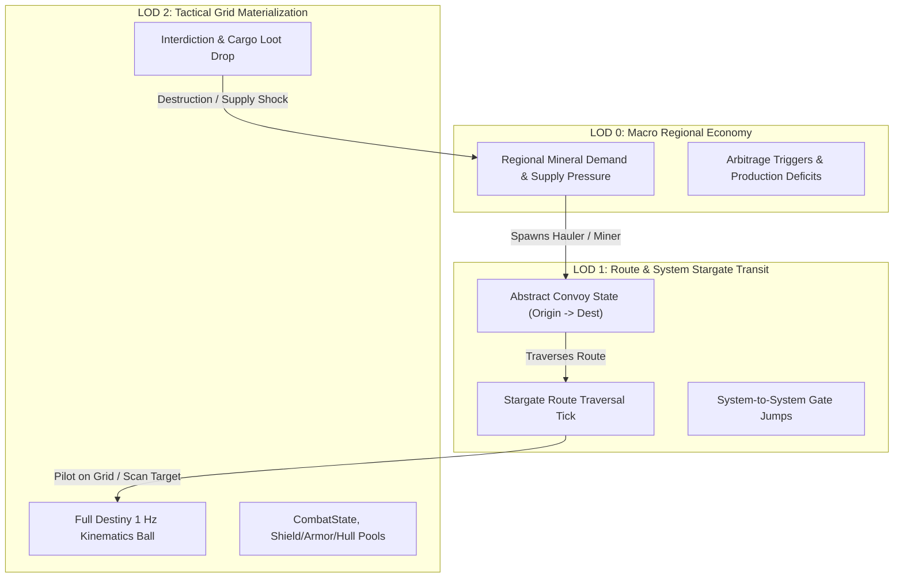
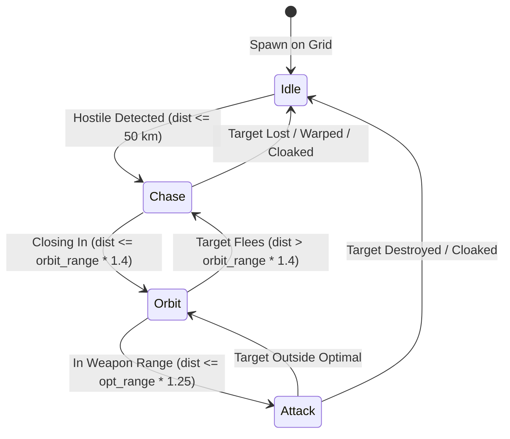
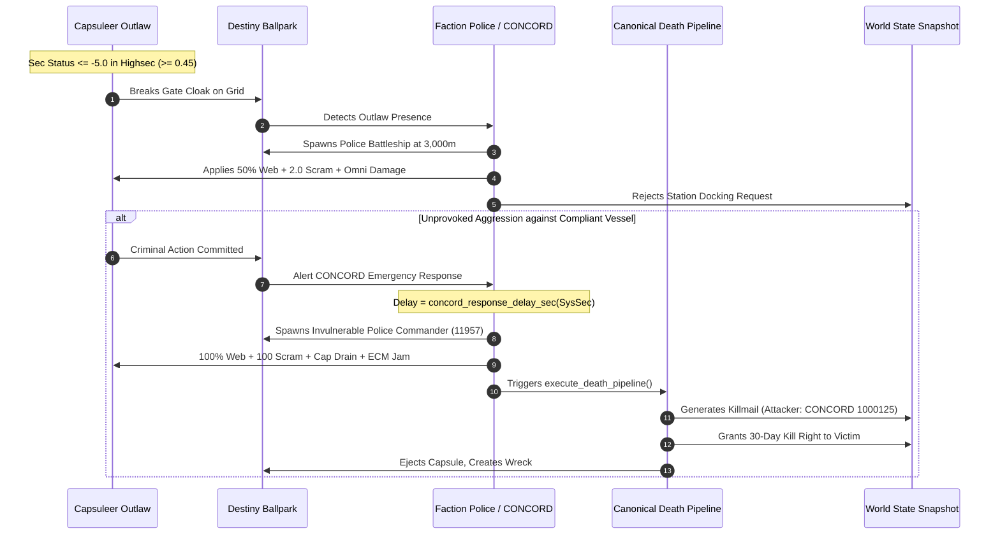
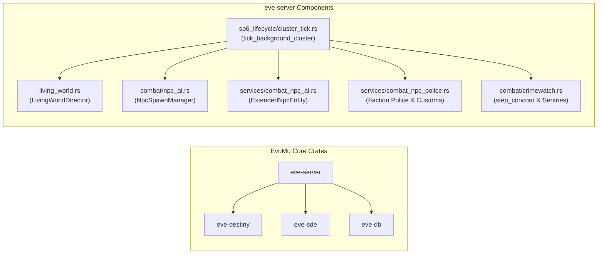

# NPC Combat AI, Ecology & Living World Simulation

> **Navigation**: [EvoMu Technical Wiki](../README.md) • [Related Systems](#related-systems--cross-references)
>
> [← Back to Wiki Table of Contents](../README.md)

---

## Overview & Lore Context

In the vast expanse of New Eden, space is never truly empty or static. Beyond the capsuleer pilots who claim sovereignty and build empires, the cluster is populated by a dense, interconnected tapestry of non-capsuleer life: regional pirate cartels guarding asteroid belts, wandering nomadic clans, disciplined empire navy patrols, vigilant customs inspectors, autonomous industrial haulers shuttling raw materials between trade hubs, ancient Sleeper sentinels defending shattered J-space complexes, and radical extra-cluster invaders such as the Triglavian Collective and the Drifter hives.

The **EvoMu Living World & NPC AI System** simulates this dynamic universe across all scales. Rather than treating non-player characters (NPCs) as isolated, scripted stat blocks that appear only when a player warps to an encounter site, EvoMu treats New Eden as a living, self-sustaining ecology. NPC haulers transport extracted minerals from perimeter mining operations to central trade hubs like Jita 4-4; if an enterprising pirate intercepts and destroys an industrial convoy, the loss of cargo sends immediate economic shockwaves through regional markets, raising commodity ask prices. In deep asteroid belts, pirate rats patrol their home space according to strict territorial doctrines, utilizing electronic warfare (EWAR), dynamic threat tables, and remote repair networks that mirror coordinated capsuleer fleet tactics.

In high-security space, civilization's fragile order is enforced by two distinct echelons of authority:
1. **Faction Police & Customs:** National law enforcement agencies (Caldari Navy, Gallente Federal Police, Amarr Imperial Navy, and Minmatar Republic Fleet) that shadow outlaws ($\le -5.0$ security status or negative standing), scan cargo holds for illegal contraband, and bar notorious criminals from docking at station facilities.
2. **CONCORD (Consolidated Cooperation and Relations Command):** The supra-national military peacekeeping force. CONCORD does not prevent criminal actions; it punishes them with mathematical certainty. In high-sec systems, unauthorized aggression triggers the deployment of invulnerable Police Commander battleships equipped with total warp scrambling, energy neutralization, sensor jamming, and weapon batteries tuned for canonical destruction.

This document details both the canonical gameplay mechanics and mathematical foundations of EVE Online's NPC simulation and their clean-room, memory-safe Rust implementation within the EvoMu server architecture.

---

## Canonical Mechanics & Formulas

### 1. The 3-Tier Level of Detail (LOD) Simulation

Simulating tens of thousands of solar systems and hundreds of thousands of autonomous vessels in real-time presents extreme computational challenges. EvoMu resolves this through a canonical **3-Tier Level of Detail (LOD)** hierarchical simulation:



1. **LOD 0 — Macro Regional Economy:**
   - Evaluates regional mineral supply and demand pressure across trade hubs (e.g. *The Forge*, *Domain*, *Sinq Laison*).
   - Generates background production deficits that schedule commercial shipping contracts and NPC mining operations.
   - Computes market arbitrage triggers that govern long-term commodity flow.
2. **LOD 1 — Route-Level Stargate Transit:**
   - Convoys and roaming gangs exist as lightweight route tracking records ([`LivingWorldConvoy`](../../../crates/eve-server/src/living_world.rs#L32-L44)).
   - Convoys step across system boundaries via stargate connections on cluster ticks without allocating full spatial physics objects or memory overhead in idle systems.
   - Tracks intermediate waypoints, cargo manifests, and destination station docking coordinates.
3. **LOD 2 — Tactical Grid Materialization:**
   - When a capsuleer enters a grid containing an LOD 1 entity (or explicitly scans/intercepts a convoy), the entity is promoted to LOD 2.
   - Real physical entities ([`Ball`](../../../crates/eve-destiny/src/lib.rs#L508)) are materialized into the solar system's [`Ballpark`](../../../crates/eve-destiny/src/lib.rs#L943) with authentic collision meshes, sub-warp kinematics, and [`CombatState`](../../../crates/eve-destiny/src/lib.rs#L183-L235).
   - Once materialized at LOD 2, the entity can be targeted, tackled, and destroyed. If destroyed, physical wrecks (`type_id: 26557`) drop actual cargo items, and a $+15\%$ supply shock price spike is applied to destination station ask orders.

---

### 2. Combat AI State Machine & Threat Evaluation

Combat AI operates on a deterministic $1\text{ Hz}$ tick loop. Every second, each active NPC evaluates its operational theater through a four-stage finite state machine (FSM):



#### FSM State Transitions:
- **`Idle`:** No hostile vessels detected within scanning range ($50\text{ km}$). The ship halts motion (`MovementMode::Stop`) or resumes routine patrol drift.
- **`Chase`:** A hostile target is identified within $50\text{ km}$. The NPC engages sub-warp propulsion and pursues the target using `MovementMode::Follow { target_id, range: orbit_range }`.
- **`Orbit`:** As distance closes within orbit envelope ($\le \text{orbit\_range} \times 1.4$), the NPC shifts kinematics to `MovementMode::Orbit { target_id, range: orbit_range }`, establishing an angular velocity vector designed to minimize incoming turret tracking.
- **`Attack`:** When the target is within optimal weapon projection ($\le \text{optimal\_range} \times 1.25$), weapon cycles discharge damage vectors according to faction damage profiles. If internal HP pools suffer damage, self-repair or remote-logistics modules activate.

#### Threat Calculation & Weighting Formulas:
Target selection is governed by a dynamic threat score calculated for every potential on-grid target. Baseline threat scales with the target's signature radius relative to a standard $40\text{ m}$ frigate baseline:

$$\text{SigWeight} = \left(\frac{r_{\text{sig}}}{40.0}\right) \times 10.0 \quad \text{clamped to } [5.0, 50.0]$$

Total threat $T$ incorporates tactical role multipliers for active electronic warfare and remote logistics:

$$T = (100.0 + \text{SigWeight}) \times M_{\text{role}}$$

Where the role multiplier $M_{\text{role}}$ is defined as:
$$
M_{\text{role}} = \begin{cases} 1.5 & \text{if target activates EWAR modules (webs, scrams, painters, damps, ECM)} \\ 1.3 & \text{if target activates remote logistics (shield/armor/hull reps)} \\ 1.0 & \text{standard combat vessel} \end{cases}
$$

For player combat drones, proximity and drone DPS are prioritized to simulate intelligent anti-drone rat aggression:

$$T_{\text{drone}} = \left( 120.0 + \text{clamp}\left(\frac{10\,000.0}{d_{\text{dist}}}, 0, 20\right) + \text{clamp}\left(\frac{r_{\text{sig}}}{25.0}, 0.5, 4.0\right) \times 5.0 + \text{clamp}\left(\frac{\text{DPS}_{\text{drone}}}{10.0}, 0, 25\right) \right) \times M_{\text{role}}$$

When taking incoming damage, threat accumulates dynamically:

$$\Delta T = \left( \max(\text{DamageDealt}, \text{RoleBase}) + \text{SigWeight} \right) \times M_{\text{role}}$$

Where $\text{RoleBase} = 120.0$ if the attacker is applying EWAR or logistics. Target switching occurs immediately if an alternate candidate's threat exceeds the current primary target.

#### Optimal Orbit Calculation:
NPCs determine orbit radius based on their weapon system optimal range $R_{\text{opt}}$:
$$R_{\text{orbit}} = \text{clamp}(R_{\text{opt}} \times 0.75, 2\,500\text{ m}, 15\,000\text{ m})$$

For long-range specialized archetypes (e.g. Sleeper Battleships or Incursion snipers):
$$R_{\text{orbit}} = \text{clamp}(R_{\text{opt}} \times 0.60, 2\,500\text{ m}, 20\,000\text{ m})$$

---

### 3. Regional Pirate Factions & Belt Rats

Asteroid belt and stargate pirate spawns ("belt rats") are strictly partitioned by sovereign territorial lore. Each faction projects a distinct damage profile that dictates pilot defensive tanking and offensive ammo selection:

| Faction Name | Primary Territorial Regions | Damage Profile ($\text{EM} / \text{Therm} / \text{Kin} / \text{Exp}$) | Primary EWAR |
| :--- | :--- | :--- | :--- |
| **Guristas Pirates** | Caldari space, *The Forge*, *Lonetrek*, *Venal* | $0\% / 30\% / 70\% / 0\%$ | ECM Jamming |
| **Blood Raider Covenant** | Amarr space, *Bleak Lands*, *Delve*, *Period Basis* | $60\% / 40\% / 0\% / 0\%$ | Energy Neutralizers & Nosferatu |
| **Serpentis Corporation** | Gallente space, *Essence*, *Fountain*, *Outer Ring* | $0\% / 60\% / 40\% / 0\%$ | Stasis Webifiers & Sensor Damps |
| **Angel Cartel** | Minmatar space, *Heimatar*, *Curse*, *Feythabolis* | $0\% / 10\% / 30\% / 60\%$ | Target Painters & High Velocity |
| **Sansha's Nation** | Amarr frontier, *Stain*, *Catch*, *Providence* | $60\% / 40\% / 0\% / 0\%$ | Tracking Disruptors & Heavy Scrams |

#### Ship Class Scaling by Security Status:
The maximum hull tier that can spawn at belts or gates scales directly with solar system security status $\text{SS}_{\text{sys}}$:
- **High-Security ($\text{SS}_{\text{sys}} \ge 0.45$):** Frigate and Destroyer hulls (Ship Class $\le 2$).
- **Low-Security ($0.05 \le \text{SS}_{\text{sys}} < 0.45$):** Cruisers, Heavy Assault Cruisers, and Battlecruisers (Ship Class $\le 4$).
- **Null-Security / J-Space ($\text{SS}_{\text{sys}} < 0.05$):** Full Battleship wings and Officer escorts (Ship Class $\le 6$).

#### Security Status Gain Formula:
Destroying pirate rats grants character security status increases up to a maximum cap of $+5.0$:

$$\Delta \text{SS} = \text{clamp}\left( (5.0 - \text{SS}_{\text{curr}}) \times 0.01 \times \text{clamp}\left(\frac{\text{Bounty}}{500\,000.0}, 0.01, 0.10\right), 0.001, 0.50 \right)$$

If $\text{SS}_{\text{curr}} \ge 5.0$ or $\text{Bounty} \le 0$, no gain is awarded.

---

### 4. Elite NPCs & Special Spawns

#### Clone Soldiers & Security Tags:
In low-security space ($0.05 \le \text{SS}_{\text{sys}} < 0.45$), asteroid belts can spawn formidable Clone Soldiers. These elite pirate battlecruisers drop Security Tags (SDE Group 1206) used at CONCORD Security Offices to repair damaged pilot security ratings:

| Low-Sec Security Band | Clone Soldier Tier | Type ID | Tag Drop | Tag Type ID | Elite Combat Capability |
| :---: | :---: | :---: | :---: | :---: | :--- |
| **$0.4$** ($0.35 \le \text{sec} < 0.45$) | **Trainer** | `33132` | Clone Soldier Trainer Tag | `33138` | Heavy DPS, active shield boost |
| **$0.3$** ($0.25 \le \text{sec} < 0.35$) | **Recruiter** | `33142` | Clone Soldier Recruiter Tag | `33139` | High angular speed, medium neut |
| **$0.2$** ($0.15 \le \text{sec} < 0.25$) | **Transporter** | `33163` | Clone Soldier Transporter Tag | `33140` | $60\%$ Stasis Webifier ($10\text{ km}$) |
| **$0.1$** ($0.05 \le \text{sec} < 0.15$) | **Negotiator** | `33175` | Clone Soldier Negotiator Tag | `33141` | Warp Scrambler strength 2 ($24\text{ km}$) |

Clone Soldiers adhere to an authentic $20\text{-minute}$ ($1\,200\text{s}$) system-level respawn cooldown.

#### Commander & Officer Spawns:
- **Faction Commanders:** (e.g. *Shadow Serpentis*, *Dread Guristas*, *Dark Blood*). Meta Level 11, enhanced shield/armor buffers, guaranteed faction ammunition/module loot drops.
- **Officers:** (e.g. *Cormack Vaaja*, *Tobias Krumen*, *Chelm Soran*, *Gotan Okun*). Rare Null-sec spawns carrying extreme bounties ($\ge 25\,000\,000\text{ ISK}$), deploying capital-grade neuts, webifiers, and dropping ultra-rare Officer modules (`meta_group_id: 4`, e.g. Cormack's Modified Damage Control `14254`).

#### Diamond Rats (♦):
NPC Mining Fleet operations and Forward Operating Base (FOB) defense wings marked with the diamond prefix (`♦`). They utilize authentic advanced AI: responsive remote-repair spider tanks, immediate warping to celestial extraction sites, and response fleet call-ins when targeted by players.

---

### 5. Law Enforcement & Police Response



#### Faction Police:
- **Threshold:** Engages any pilot whose security status falls below the regional system security threshold:
  $$\text{Threshold}(\text{SS}_{\text{sys}}) = 1.0 - 2.0 \times \text{SS}_{\text{sys}}$$
  (or whenever $\text{SS}_{\text{pilot}} \le -5.0$, or faction standing $\le -5.0$).
- **Vessel Hulls:** Deploys authentic empire navy battleships and cruisers:
  - Caldari State: *Caldari Police 3rd Lieutenant* (`type_id: 9970`)
  - Gallente Federation: *Gallente Police Captain* (`type_id: 9984`)
  - Amarr Empire: *Amarr Police Frigate / Cruiser* (`type_id: 3768`)
  - Minmatar Republic: *Minmatar Police / Navy Captain* (`type_id: 10046`)
- **Docking Sanction:** Outlaw ships are barred from docking at high-security stations.
- **Capsule Exemption:** Pods (Capsules, `type_id: 670`, group `29`) are strictly exempt from police engagement and are permitted to dock regardless of outlaw status.
- **Contraband & Customs Enforcement:** High-sec customs scan ship cargo holds. Blockade Runners (`group 1202`, $100\%$ cargo scan resistance against players) are not immune to NPC customs. Detected contraband yields item confiscation, wallet fines scaled by item base price, and negative standing transactions.

#### CONCORD Response & Execution Pipeline:
In high-security space, unprovoked hostile aggression against non-criminal pilots triggers CONCORD intervention. The arrival delay scales strictly with system security:

$$
T_{\text{delay}}(\text{SS}_{\text{sys}}) = \begin{cases} 
6.0\text{ s} & \text{for } \text{SS}_{\text{sys}} \in [0.9, 1.0] \\
7.0\text{ s} & \text{for } \text{SS}_{\text{sys}} = 0.8 \\
10.0\text{ s} & \text{for } \text{SS}_{\text{sys}} = 0.7 \\
14.0\text{ s} & \text{for } \text{SS}_{\text{sys}} = 0.6 \\
19.0\text{ s} & \text{for } \text{SS}_{\text{sys}} = 0.5 \\
\infty & \text{for } \text{SS}_{\text{sys}} < 0.45 \text{ (Low/Null/W-Space)}
\end{cases}
$$

Upon timer expiry, CONCORD executes a guaranteed destruction pipeline:
1. Spawns an invulnerable *CONCORD Police Commander* (`type_id: 11957`) with shield, armor, and structure resonances set to $0.0$ ($100\%$ omni damage resistance).
2. Sets criminal ship speed fraction to $0.0$ ($100\%$ stasis web).
3. Applies warp scramble strength of $100$ (negating all warp core stabilizers).
4. Instantly drains capacitor to $0.0\text{ GJ}$.
5. Applies $60\text{s}$ ECM jam and forces all target locks to clear.
6. Executes the canonical death pipeline (`execute_death_pipeline`), creating an authentic killmail attributed to CONCORD (`owner_id: 1000125`) and granting a $30\text{-day}$ Kill Right to the victim.

#### Station and Stargate Sentry Guns:
- Optimal range: $500\text{ km}$.
- Automatically lock and engage criminal pilots or unprovoked aggressors on gate/station grids.
- Drop aggression immediately when the offender warps off-grid ($> 500\text{ km}$).

---

### 6. Advanced Threats

#### Triglavian Collective Clades:
- **Entropic Disintegrator Spooling:** Triglavian ships (*Raznaborg Damavik*, *Vedmak*, *Drekavac*, *Leshak*) utilize single-beam thermal/explosive disintegrators ($50\% / 50\%$).
- **Spool Formula:** Damage increases by $+10\%$ per continuous attack cycle on the same target, capped at $+150\%$ (a $2.5\times$ damage multiplier):
  $$\text{Damage}_{\text{cycle}}(n) = \text{Damage}_{\text{base}} \times \left(1.0 + \min(n \times 0.10, 1.50)\right)$$
- **Target Switching Invariant:** If the target is destroyed, warps, cloaks, or threat forces a target switch, $n$ resets immediately to $0$.

#### Sleepers & Drifters (J-Space & Pochven):
- **Infinite Capacitor & Neut Immunity:** Sleeper sentinels (*Sleepless Patroller*, *Awakened Defender*) do not use standard capacitor reserve math. Player Energy Neutralizers cannot deplete them. Player Energy Nosferatus transfer capacitor energy to the player without reducing the Sleeper's performance.
- **Spawn Leash:** Pulling a Sleeper greater than $200\text{ km}$ from its designated celestial spawn origin triggers an immediate spatial snap back to its origin coordinates.
- **Wormhole Class Scaling:** Sleepers in Class 3 (C3) wormholes and higher actively deploy warp scramblers ($20\text{ km}$). When engaging capital ships (Dreadnoughts, Carriers), Sleepers receive an automatic $2.5\times$ anti-capital damage multiplier.
- **0 ISK Bounty & Blue Loot:** Sleepers award zero direct wallet bounty. Instead, their wrecks (`type_id: 30495`) drop valuable blue loot commodities (*Sleeper Data Library* `30744`, *Neural Network Analyzer*) and ancient salvage (*Melted Nanoribbons* `30259`).
- **Drifter Battleships:** Equipped with a $4\,000\text{ HP}$ overshield. Upon overshield collapse, the Drifter fires its *Lux Kontos* Doomsday superweapon, delivering an omni damage volley of $10\,000\text{ HP}$ ($2\,500\text{ EM} / 2\,500\text{ Therm} / 2\,500\text{ Kin} / 2\,500\text{ Exp}$).
- **Pochven Hypnosian Sleepers:** Aroused tiers feature dedicated shield layers ($\ge 2\,000\text{ HP}$) and drop *Interstellar Navigation Logs* (`56708`).

#### EDENCOM Forces:
- Armed with Vorton Projector arc weapons delivering EM and Kinetic damage.
- The energy beam arcs across up to $5$ valid secondary targets within $10\text{ km}$ of the primary target.
- **Strict Hostility Filtering:** The lightning arc will *never* damage friendly or neutral pilots; arcing requires verified negative standing ($< 0.0$), inclusion in the active threat table, or shared fleet hostility with the primary target.

---

### 7. Autonomous Convoys & Dynamic Supply Chains

Autonomous industrial haulers (*Badger*, *Tayra*, *Iteron*, *Bestower*) traverse trade corridors (e.g. *Tama $\leftrightarrow$ Perimeter $\leftrightarrow$ Jita*):
- **Route Traversal:** The hauler jumps intermediate stargates on cluster ticks and docks at destination stations.
- **Interdiction & Supply Shock:** When intercepted at LOD 2 and destroyed, the hauler generates a physical wreck containing mineral cargo (e.g. $50\,000$ Tritanium). The loss of supply causes all NPC sell orders at the destination station for that commodity to instantly spike by $+15\%$:
  $$\text{Price}_{\text{new}} = \lceil \text{Price}_{\text{current}} \times 1.15 \rceil$$
- **NPC Mining Fleets:** Autonomous mining operations mine ore using authentic mining laser cycles, accumulate ore in cargo holds, and haul to stations once holding $\ge 5\,000$ units, replenishing NPC market supply.

---

## EvoMu Implementation Architecture

The living world and combat AI architecture is decoupled across high-performance crates:



### 1. Crates Involved
- [`eve-server`](../../../crates/eve-server): Master simulation runtime, living world director, AI services, and Crimewatch directors.
- [`eve-destiny`](../../../crates/eve-destiny): Deterministic 1 Hz spatial physics engine, movement modes, and combat states.
- [`eve-sde`](../../../crates/eve-sde): Static Data Export registry, spawn groups, item attributes, and celestial positions.
- [`eve-db`](../../../crates/eve-db): Transactional `WorldStateSnapshot` store, inventory items, market orders, and killmails.

---

### 2. Primary Handlers & Services

#### Living World Director:
- [`crates/eve-server/src/living_world.rs`](../../../crates/eve-server/src/living_world.rs)
  - [`LivingWorldDirector::step_all_hauler_convoys`](../../../crates/eve-server/src/living_world.rs#L636-L669): Steps active hauler convoys across stargates on living world ticks.
  - [`LivingWorldDirector::step_hauler_convoy`](../../../crates/eve-server/src/living_world.rs#L494-L633): Advances an individual convoy along its multi-system stargate route, managing gate jumps and LOD 2 spatial promotion/demotion.
  - [`LivingWorldDirector::step_npc_mining_op`](../../../crates/eve-server/src/living_world.rs#L346-L458): Executes laser cycle asteroid depletion and market supply replenishment.
  - [`LivingWorldDirector::interdict_convoy`](../../../crates/eve-server/src/living_world.rs#L251-L340): Drops physical wreck item `26557`, deposits cargo, and spikes destination ask prices by $+15\%$.
  - [`LivingWorldDirector::materialize_system_lod2`](../../../crates/eve-server/src/living_world.rs#L157-L222): Promotes convoys in a system to full physical ballpark balls.

#### Core Belt Rat & Spawn AI:
- [`crates/eve-server/src/combat/npc_ai.rs`](../../../crates/eve-server/src/combat/npc_ai.rs)
  - [`NpcSpawnManager::spawn_belt_rats_for_system`](../../../crates/eve-server/src/combat/npc_ai.rs#L286-L429): Checks belt and gate positions in a solar system and spawns SDE pirate groups matching regional lore.
  - [`NpcSpawnManager::step_ai_sync`](../../../crates/eve-server/src/combat/npc_ai.rs#L436-L615): Evaluates `Idle` $\rightarrow$ `Chase` $\rightarrow$ `Orbit` $\rightarrow$ `Attack` FSM transitions and synchronizes movement and damage to the ballpark.
  - [`NpcSpawnManager::handle_npc_destroyed`](../../../crates/eve-server/src/combat/npc_ai.rs#L629-L786): Awards dynamic bounties, raises pilot security status, writes wallet journals, and generates killmails.
  - [`faction_damage_vector`](../../../crates/eve-server/src/combat/npc_ai.rs#L21-L44): Maps faction ID to canonical four-tier damage distribution.
  - [`regional_pirate_faction_id`](../../../crates/eve-server/src/combat/npc_ai.rs#L50-L84): Resolves territorial pirate faction from constellation/region SDE metadata.

#### Extended AI & Archetype Services:
- [`crates/eve-server/src/services/combat_npc_ai.rs`](../../../crates/eve-server/src/services/combat_npc_ai.rs)
  - [`derive_npc_archetype`](../../../crates/eve-server/src/services/combat_npc_ai.rs#L21-L143): Dynamically derives behavioral archetypes (`Triglavian`, `Sleeper`, `Drifter`, `EDENCOM`, `CloneSoldier`, `Officer`, `IncursionSansha`, `RogueDrone`, `Navy`, `Hauler`) from SDE type and group metadata.
  - [`spawn_specialized_npc_entity`](../../../crates/eve-server/src/services/combat_npc_ai.rs#L159-L350): Instantiates an extended NPC with custom combat states, overshields, web/scram profiles, and remote-repair amounts.
  - [`step_extended_npc_ai_sync`](../../../crates/eve-server/src/services/combat_npc_ai.rs#L439-L844): Stepping loop for remote repairs, standings aggression checks, drone threat tracking, Triglavian spooling, Drifter doomsdays, and EDENCOM lightning arcs.
  - [`destroy_specialized_npc_and_queue_bounty`](../../../crates/eve-server/src/services/combat_npc_ai.rs#L883-L1263): Manages specialized loot generation (Security Tags, Officer modules, blue loot, minerals) and batches bounties into 20-minute payout queues.
  - [`record_npc_threat_event`](../../../crates/eve-server/src/services/combat_npc_ai.rs#L849-L875): Adds damage, EWAR, and logistics delta to an NPC's threat table.

#### Law Enforcement & Police:
- [`crates/eve-server/src/services/combat_npc_police.rs`](../../../crates/eve-server/src/services/combat_npc_police.rs)
  - [`check_and_spawn_faction_police`](../../../crates/eve-server/src/services/combat_npc_police.rs#L61-L196): Spawns authentic faction police battleships targeting outlaws on high-sec grids.
  - [`is_outlaw_ship_docking_refused`](../../../crates/eve-server/src/services/combat_npc_police.rs#L31-L58): Evaluates docking permissions, barring outlaw ships while granting pod exemptions.
  - [`scan_and_enforce_highsec_contraband`](../../../crates/eve-server/src/services/combat_npc_police.rs#L205-L372): Performs customs contraband scans on cargo, confiscating illicit boosters/goods and deducting fines.

#### Crimewatch & CONCORD:
- [`crates/eve-server/src/combat/crimewatch.rs`](../../../crates/eve-server/src/combat/crimewatch.rs)
  - [`CrimeWatchDirector::step_concord`](../../../crates/eve-server/src/combat/crimewatch.rs#L328-L430): Advances CONCORD response arrivals, materializing invulnerable Police Commanders and executing criminal ships.

#### Background Cluster Lifecycle:
- [`crates/eve-server/src/sp6_lifecycle/cluster_tick.rs`](../../../crates/eve-server/src/sp6_lifecycle/cluster_tick.rs)
  - [`tick_background_cluster`](../../../crates/eve-server/src/sp6_lifecycle/cluster_tick.rs#L1102-L1213): Central 1 Hz tick loop driving hauler convoys, police checks, CONCORD timers, belt rat respawns, and unobserved system AI.

---

### 3. Core Data Structures & State Schema

#### Living World Convoy:
```rust
// Defined in crates/eve-server/src/living_world.rs
pub struct LivingWorldConvoy {
    pub convoy_id: i64,
    pub archetype: NpcArchetype,
    pub ship_type_id: TypeId,
    pub origin_system_id: SolarSystemId,
    pub current_system_id: SolarSystemId,
    pub destination_system_id: SolarSystemId,
    pub destination_station_id: i64,
    pub cargo_type_id: TypeId,
    pub cargo_quantity: i32,
    pub lod_level: u8, // 0 = Macro, 1 = Transit, 2 = Grid Ball
    pub destroyed: bool,
}
```

#### Extended NPC Entity:
```rust
// Defined in crates/eve-server/src/services/combat_crimewatch.rs
pub struct ExtendedNpcEntity {
    pub ball_id: i64,
    pub type_id: u32,
    pub faction_id: u32,
    pub archetype: String,
    pub solar_system_id: u32,
    pub spawn_group_id: u32,
    pub target_id: Option<i64>,
    pub aggression_threat: HashMap<i64, f64>,
    pub threat_table: HashMap<i64, f64>,
    pub bounty_isk: f64,
    pub optimal_range: f64,
    pub orbit_range: f64,
    pub damage_vector: DamageVector,
    pub entropic_cycles: u32,
    pub drifter_overshield_hp: f64,
    pub drifter_doomsday_fired: bool,
    pub web_speed_factor: f64,
    pub web_range: f64,
    pub scram_strength: f64,
    pub scram_range: f64,
    pub neut_amount: f64,
    pub ecm_jammed: bool,
    pub remote_shield_rep: f64,
    pub remote_armor_rep: f64,
    pub remote_rep_range: f64,
    pub tag_drop_type_id: Option<u32>,
    pub spawn_position: DVec3,
    pub sleeper_wh_class: u8,
    pub custom_cargo_loot: Option<(u32, i64)>,
}
```

#### Destiny Kinematics & Combat State:
- [`Ball`](../../../crates/eve-destiny/src/lib.rs#L508): Tracks `position`, `velocity`, `max_velocity`, `mass`, `radius`, `speed_fraction`, and `mode` (`MovementMode::Follow`, `MovementMode::Orbit`, `MovementMode::Stop`).
- [`CombatState`](../../../crates/eve-destiny/src/lib.rs#L183-L235): Stores `shield_hp`, `armor_hp`, `structure_hp`, resonances `[f64; 4]`, `warp_scramble_strength`, `is_mwd_mjd_disabled`, and `ecm_jammed_remaining_s`.
- [`DamageVector`](../../../crates/eve-destiny/src/lib.rs#L140-L179): Encapsulates `{ em, thermal, kinetic, explosive }` floating-point damage packages.

---

## Invariants, Security & Edge Cases

1. **CONCORD Invulnerability & Inevitability:**
   - CONCORD Police Commanders (`type_id: 11957`) spawn with absolute resonance values of `[0.0, 0.0, 0.0, 0.0]`. They cannot be damaged, jammed, or delayed by any module or fleet combination.
   - The criminal's capacitor is set to $0.0$, speed fraction to $0.0$, and warp scrambler strength to $100$, completely preventing escape via micro-jump drives or warp stabs.
2. **High-Sec Outlaw Docking vs. Capsule Safety:**
   - Outlaw pilots ($\text{sec} \le -5.0$) flying combat ships are strictly barred from docking at NPC stations.
   - **Pod Exemption:** Capsules (`type_id: 670`, group `29`) are never targeted by Faction Police or CONCORD and can always dock safely. This prevents permanent death-loops where a podded outlaw cannot dock to exit the game.
3. **Sleeper Capacitor Immunity & Anti-Leash Boundary:**
   - Sleepers cannot be neutralized into helplessness. Module activations of Energy Neutralizers do not reduce their ability to fire weapons, run remote-reps, or apply EWAR.
   - If an NPC Sleeper is lured $> 200\text{ km}$ from its spawn origin, it teleports back instantly. This prevents exploits where players drag complex bosses thousands of kilometers away from their support waves.
4. **Triglavian Spool Reset Invariant:**
   - Entropic disintegrator spool count is strictly tied to a continuous target ID lock. If the target changes, the spool count drops to $0$ on the exact tick of the switch.
5. **EDENCOM Friendly-Fire Safety:**
   - Vorton arc mechanics select secondary targets via strict authorization checks. A neutral pilot or fleet member will never be arced to unless they have explicitly committed an aggressive act or hold negative standings ($< 0.0$).
6. **Blockade Runner Customs Invariant:**
   - While player cargo scanners cannot penetrate Blockade Runner hulls due to their $100\%$ scan resistance attribute, NPC customs authorities utilize omniscient server-state inspections, ensuring smugglers cannot transport contraband through high-sec without consequence.
7. **Bounty Tick Batching & ESS Split:**
   - In Null-sec, NPC bounties are not paid instantly into pilot wallets. Bounties are batched into a $20\text{-minute}$ accumulator, adjusted by the system Dynamic Bounty System (DBS) multiplier, and split between the pilot's wallet ($70\%$), the local Encounter Surveillance System (ESS) Main Bank ($20\%$), and the Reserve Bank ($10\%$).

---

## Verification, Tests & Parity References

### Pinned Parity Ledger Rows
The living world and NPC AI systems validate the following parity tags from the audit ledger:
- `feat:npc.belt-rats`: Regional pirate rat spawns and security scaling.
- `feat:npc.npc-ai-targeting`: Threat evaluation, signature radius weighting, and FSM.
- `feat:npc.npc-damage-types`: Faction-authentic damage profile vectors.
- `feat:npc.npc-loot`: SDE-derived salvage, tags, and mineral drops.
- `feat:combat.bounty-payout-npc`: Dynamic bounties and 20-minute batched ticks.
- `feat:npc.sentry-guns`: Station and stargate sentry grid engagement.
- `feat:npc.sentry-gun-grid-aggression`: 500 km sentry tracking and off-grid de-aggression.
- `feat:npc.drifters`: Drifter overshield and Lux Kontos Doomsday superweapon.
- `feat:npc.triglavians`: Entropic Disintegrator spooling and reset mechanics.
- `feat:npc.sleepers`: Sleeper mechanics, 0 bounty, and blue loot drops.
- `feat:npc.edencom-npc`: Vorton lightning arc target filtering.
- `feat:npc.rogue-drones`: Rogue drone archetypes and drone alloy drops.
- `feat:npc.incursion-npc`: Sansha Incursion spider-tanking and EWAR.
- `feat:npc.navy-npc`: Empire navy patrols and Faction Police responses.
- `feat:npc.npc-hauler`: Multi-system stargate transit and destination docking.
- `feat:npc.npc-spawn-encounter`: Multi-wave encounter escalation sites.
- `feat:npc.npc-standings-aggression`: Standings-based auto-aggression checks.
- `feat:npc.officer-npc`: Rare officer spawns and officer module drops.
- `feat:npc.npc-ewar-application`: NPC web, scram, neut, and ECM application.
- `feat:npc.npc-remote-repair`: Group peer remote shield and armor logistics.
- `feat:npc.npc-target-switching`: Dynamic target switching based on threat.
- `feat:npc.clone-soldier-spawns`: Low-sec Clone Soldier tags and combat profiles.
- `feat:crimewatch.concord-response-scaling`: Security-scaled CONCORD response times.
- `feat:crimewatch.faction-police`: High-sec outlaw tracking and docking refusal.
- `feat:npc.sleeper-capacitor-immunity-and-leash`: Infinite cap and 200 km spawn leash.
- `feat:npc.sleeper-ewar-by-wormhole-class`: C3+ scrambler application.
- `feat:npc.zarzakh-gate-guns-patrols`: Zarzakh missile gate guns and ECM jams.

---

### Concrete Integration Tests

The mechanics documented in this article are verified by automated end-to-end integration tests in the EvoMu test suite:

1. **[`crates/eve-server/tests/it/combat_drones_npcs.rs`](../../../crates/eve-server/tests/it/combat_drones_npcs.rs):**
   - [`test_c4_npc_archetypes_triglavian_drifter_sleeper_edencom_clone_soldiers_and_ewar_rep`](../../../crates/eve-server/tests/it/combat_drones_npcs.rs#L954-L1220): Verifies Triglavian spooling across ticks and spool reset upon target change; verifies Drifter overshield collapse and Doomsday discharge; confirms Sleeper peer remote repair and 0 ISK bounty blue loot drops; tests Clone Soldier Negotiator 24 km warp scrambler and Tag `33141` drop; tests Officer Cormack Vaaja module drop `14254`.
   - [`test_c4_bounty_tick_dbs_ess_split_encounter_waves_and_sentry_guns`](../../../crates/eve-server/tests/it/combat_drones_npcs.rs#L1223-L1357): Validates multi-wave encounter triggering upon wave-boss destruction; tests 20-minute batched bounty flushing with DBS multiplier and ESS Main/Reserve bank allocation; verifies gate sentry gun engagement within $500\text{ km}$ and de-aggression when warping off-grid.
2. **[`crates/eve-server/tests/it/combat_sleepers_pochven_zarzakh.rs`](../../../crates/eve-server/tests/it/combat_sleepers_pochven_zarzakh.rs):**
   - [`test_sleeper_mechanics_infinite_capacitor_spawn_leash_and_ewar_by_class`](../../../crates/eve-server/tests/it/combat_sleepers_pochven_zarzakh.rs#L101-L266): Tests Sleeper neutralizer immunity and Nosferatu energy transfer; tests $200\text{ km}$ spawn leash teleportation; verifies C3 wormhole warp scramble enforcement; verifies anti-capital $2.5\times$ damage bonus against dreadnoughts.
   - [`test_zarzakh_gate_guns_and_deathless_patrols`](../../../crates/eve-server/tests/it/combat_sleepers_pochven_zarzakh.rs#L269-L328): Tests Zarzakh missile sentry guns applying ECM jam and lock breaking on pilots with retribution timers.
   - [`test_pochven_hypnosian_sleepers_and_60pct_loot_drop`](../../../crates/eve-server/tests/it/combat_sleepers_pochven_zarzakh.rs#L329-L405): Validates Pochven Hypnosian Sleeper dedicated shield layers and *Interstellar Navigation Logs* (`56708`) drops.
3. **[`crates/eve-server/tests/it/npc_archetypes_and_ess_cache.rs`](../../../crates/eve-server/tests/it/npc_archetypes_and_ess_cache.rs):**
   - [`test_npc_archetypes_dynamically_derived_from_sde`](../../../crates/eve-server/tests/it/npc_archetypes_and_ess_cache.rs#L132-L265): Verifies dynamic SDE archetype derivation for Rogue Drones, Sleepers, EDENCOM, and Officers; tests EDENCOM Vorton chain-lightning arc hostility filtering.
   - [`test_npc_standings_aggression_player_drones_and_navy_police`](../../../crates/eve-server/tests/it/npc_archetypes_and_ess_cache.rs#L444-L633): Validates standings aggression checks, confirming friendly pilots ($+8.0$) and their deployed combat drones are not aggroed, while hostile ($-6.0$) and outlaw pilots ($\le -3.5$) and their drones are engaged.

---

## Related Systems & Cross-References

- [**Gunnery Tracking & Missile Kinematics**](../combat_and_crimewatch/gunnery_tracking_and_missile_kinematics.md): Damage calculation algorithms, angular tracking, and missile kinematic curves used by NPC turrets and launchers.
- [**Crimewatch & Engagement Timers**](../combat_and_crimewatch/crimewatch_and_engagement_timers.md): CONCORD rapid-response death pipeline, faction police outlaw pursuit, and sentry gun aggression queues.
- [**Agent Dialogue & Missions**](../missions_and_agents/agent_dialogue_and_missions.md): Mission dungeon NPC waves, trigger conditions, and commander reward scaling.
- [**Destiny Simulation Loop**](../ballpark_and_physics/destiny_simulation_loop.md): 1 Hz LOD simulation ticks, dynamic orbit calculations, and velocity vector integration.
- [**Regional Market Order Matching**](../economy_and_markets/regional_market_order_matching.md): Autonomous hauler supply convoys and simulated economic trade route disruptions.

---

[← Back to Wiki Table of Contents](../README.md)
