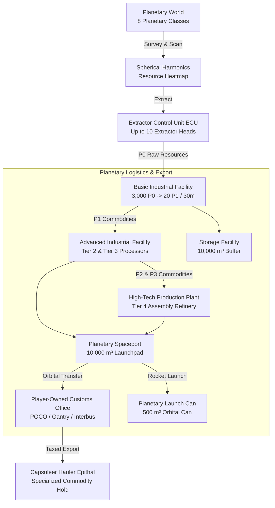
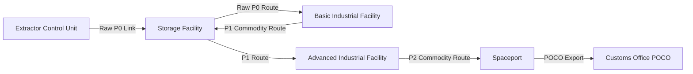
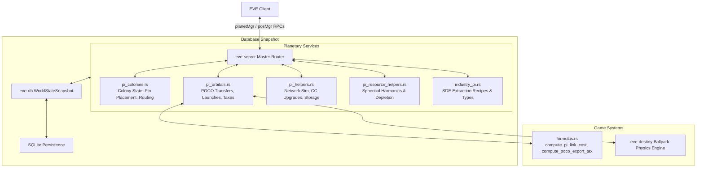

# Planetary Industry (PI), Colony Pin Networks & Customs Offices

## Overview & Lore Context

Beneath the endless void of New Eden drift trillions of cubic kilometers of untapped material wealth bound within the planetary bodies of the cluster. From the scorched basalt plains of **Lava** worlds and the violent tectonic rifts of **Plasma** spheres, to the methane hurricanes of **Gas** giants and the fertile biosystems of **Temperate** and **Oceanic** planets, every world presents a complex industrial supply chain. Through **Planetary Industry (PI)**, capsuleers deploy permanent surface installations, extraction drill heads, refining plants, and orbital launch complexes to extract raw resources and refine them into advanced technological commodities.

These planetary commodities form the foundational supply layer for New Eden's macro-economy:
- Fueling Starbases (POS) and Upwell Citadels with **Coolant** and **Enriched Uranium** (Tier 2).
- Assembling structural components, advanced starship hulls, and jump drive guidance arrays with **Robotics** and **Guidance Systems** (Tier 3).
- Manufacturing sovereignty structures, Upwell quantum cores, Jump Gates, and Cynosural Beacons with **Broadcast Nodes**, **Integrity Response Drones**, and **Nano-Factories** (Tier 4).



At the core of every colony sits an orbital **Command Center**. Capsuleers establish surface colonies by dropping a specialized Command Center from their ship's cargo hold onto the planet's surface. Once anchored, the Command Center establishes a local powergrid and central processing unit (CPU) telemetry network that powers all extraction heads, industrial processors, storage facilities, and high-bandwidth transit links across the planet's surface.

---

## Canonical Mechanics & Precise Formulas

### 1. Planet Types & Resource Heatmaps

New Eden features **8 distinct planetary classes**, each supporting a specific subset of raw ($P0$) materials:

| Planet Type | Available Raw Resources ($P0$) | SDE Type ID | Primary Economic Specialization |
| :--- | :--- | :---: | :--- |
| **Barren** | Aqueous Liquids, Base Metals, Carbon Compounds, Microorganisms, Noble Metals | `11` | Mechanical parts, consumer electronics, fertilizers |
| **Gas** | Aqueous Liquids, Base Metals, Noble Gas, Reactive Gas | `13` | Coolant, synthetic oil, oxidant, fuel blocks |
| **Ice** | Aqueous Liquids, Heavy Metals, Microorganisms, Noble Gas, Planktic Colonies | `12` | Water, coolant, cryogenic components |
| **Lava** | Base Metals, Felsic Magma, Heavy Metals, Non-CS Crystals, Suspended Plasma | `2016` | Toxic metals, silicon, consumer electronics |
| **Oceanic** | Aqueous Liquids, Autotrophs, Carbon Compounds, Microorganisms, Planktic Colonies | `2017` | Biomass, proteins, viral agents, genetic materials |
| **Plasma** | Base Metals, Heavy Metals, Noble Metals, Non-CS Crystals, Suspended Plasma | `2063` | Superconductors, transmitter arrays, microprocessors |
| **Storm** | Aqueous Liquids, Base Metals, Noble Gas, Reactive Gas, Suspended Plasma | `2015` | Synthetic oil, polyaramids, coolant |
| **Temperate** | Aqueous Liquids, Autotrophs, Base Metals, Carbon Compounds, Microorganisms | `2014` | High-purity food, livestock, industrial explosives |

#### Spherical Harmonics Heatmap Evaluation
Planetary surface resource distributions are continuous fields simulated on the surface of the planetary sphere. The concentration $C(\phi, \lambda)$ at latitude $\phi$ and longitude $\lambda$ is computed via real spherical harmonic basis polynomials up to band $l=2$:
$$\vec{x} = \begin{bmatrix} \cos(\phi)\cos(\lambda) \\ \cos(\phi)\sin(\lambda) \\ \sin(\phi) \end{bmatrix} = \begin{bmatrix} x \\ y \\ z \end{bmatrix}$$

The 9 real harmonic basis polynomials are evaluated as:
$$Y_{0,0} = 1.0, \quad Y_{1,0} = z, \quad Y_{1,1} = x, \quad Y_{1,-1} = y$$
$$Y_{2,0} = 3z^2 - 1.0, \quad Y_{2,1} = xz, \quad Y_{2,-1} = yz, \quad Y_{2,2} = x^2 - y^2, \quad Y_{2,-2} = 2xy$$

Resource abundance at any point on the globe is derived as:
$$C_{\text{raw}}(\phi, \lambda) = \max\left(0.0, \; \sum_{k=0}^{8} w_k Y_k(\phi, \lambda)\right)$$
Player scanning sensors (*Planetology* and *Advanced Planetology*) filter out high-frequency sensor noise, revealing the true concentration hotspots for extractor head placement.

---

### 2. Colony Pin Networks & Infrastructure

A planetary colony operates as a directed acyclic routing network composed of discrete infrastructure units called **Pins**, interconnected by high-capacity **Links**.



#### 1. Command Centers & Upgrades
Command Centers provide the finite **Powergrid (MW)** and **CPU (tf)** budgets required to anchor pins and sustain surface links. Capacity scales directly with the capsuleer's *Command Center Upgrades* skill level:

| Upgrade Level | CPU Budget ($\text{tf}$) | Powergrid Budget ($\text{MW}$) | Cumulative Upgrade Cost ($\text{ISK}$) |
| :---: | :---: | :---: | :---: |
| **Level 0** | $1,675.0\text{ tf}$ | $6,000.0\text{ MW}$ | $0\text{ ISK}$ |
| **Level 1** | $7,057.0\text{ tf}$ | $9,000.0\text{ MW}$ | $580,000\text{ ISK}$ |
| **Level 2** | $12,136.0\text{ tf}$ | $12,000.0\text{ MW}$ | $1,510,000\text{ ISK}$ |
| **Level 3** | $17,215.0\text{ tf}$ | $15,000.0\text{ MW}$ | $2,710,000\text{ ISK}$ |
| **Level 4** | $21,315.0\text{ tf}$ | $17,000.0\text{ MW}$ | $4,210,000\text{ ISK}$ |
| **Level 5** | $25,415.0\text{ tf}$ | $19,000.0\text{ MW}$ | $6,310,000\text{ ISK}$ |

Upgrading a Command Center incurs the differential ISK cost:
$$\text{Cost}_{\text{upgrade}} = \text{Cumulative}_{\text{desired}} - \text{Cumulative}_{\text{current}}$$

#### 2. Extractor Control Units (ECUs) & Extractor Heads
ECUs anchor onto the planet surface to extract $P0$ raw resources.
- **Extractor Heads:** An ECU can deploy up to **10 Extractor Heads** across the planet surface within its operational radius.
- **Survey Programs:** Cycle times can be programmed from **15 minutes** up to **14 days** ($1,209,600\text{ seconds}$).
- **Yield Decay Curve:** Shorter program cycles yield significantly higher hourly extraction rates, whereas long cycles experience gradual extraction fatigue.
- **Overlap Interference:** If two or more extractor heads overlap their survey circles, mutual interference degrades the extraction efficiency of all overlapping heads according to the overlapping surface area.

#### 3. Processing Refineries & Production Tiers


Production occurs in four distinct tiers:
1. **Tier 1 (Basic Commodities, P1):**
   - *Facility:* Basic Industrial Facility ($200\text{ tf}$ CPU, $800\text{ MW}$ PG).
   - *Cycle Time:* 30 minutes ($1,800\text{ s}$).
   - *Recipe:* $3,000\text{ units of P0} \longrightarrow 20\text{ units of P1}$.
   - *Examples:* Water, Electrolytes, Reactive Metals, Precious Metals, Chiral Structures.
2. **Tier 2 (Refined Commodities, P2):**
   - *Facility:* Advanced Industrial Facility ($500\text{ tf}$ CPU, $700\text{ MW}$ PG).
   - *Cycle Time:* 60 minutes ($3,600\text{ s}$).
   - *Recipe:* $40\text{ P1} + 40\text{ P1 (different type)} \longrightarrow 5\text{ units of P2}$.
   - *Examples:* Coolant, Enriched Uranium, Mechanical Parts, Consumer Electronics.
3. **Tier 3 (Specialized Commodities, P3):**
   - *Facility:* Advanced Industrial Facility ($500\text{ tf}$ CPU, $700\text{ MW}$ PG).
   - *Cycle Time:* 60 minutes ($3,600\text{ s}$).
   - *Recipe:* $10\text{ P2} + 10\text{ P2} \longrightarrow 3\text{ units of P3}$ (or variations requiring 1 P1 + 2 P2).
   - *Examples:* Robotics, Guidance Systems, Supercomputers, Biotech Research Reports.
4. **Tier 4 (Advanced Commodities, P4):**
   - *Facility:* High-Tech Production Plant ($1,100\text{ tf}$ CPU, $400\text{ MW}$ PG).
   - *Cycle Time:* 60 minutes ($3,600\text{ s}$).
   - *Recipe:* Complex combinations (typically $6\text{ P3} + 6\text{ P3} + 40\text{ P1}) \longrightarrow 1\text{ unit of P4}$.
   - *Examples:* Broadcast Nodes, Integrity Response Drones, Nano-Factory, Wetware Mainframes.

#### 4. Storage Facilities & Spaceports
- **Storage Facility:** $10,000\text{ m}^3$ capacity buffer. Dedicated purely to storing input and output commodities on the surface.
- **Spaceport:** $10,000\text{ m}^3$ capacity hybrid installation. Serves as both a local warehouse and an orbital launchpad capable of instantaneous transfers to and from orbiting Customs Offices.

#### 5. Planetary Links & Routing
Links connect pins on the planet's surface. Link power and CPU costs depend on the physical surface distance ($d_{\text{km}}$) between pins and the link upgrade level ($L_{\text{link}} \in [0, 10]$):
$$\text{Distance Term} = d_{\text{km}}^{1.2}$$
$$\text{Upgrade Mult} = 1.0 + 0.20 \times L_{\text{link}}$$
$$\text{Power}_{\text{link}} = \left(10.0 + 0.15 \times d_{\text{km}}^{1.2}\right) \times \left(1.0 + 0.20 \times L_{\text{link}}\right)$$
$$\text{CPU}_{\text{link}} = \left(15.0 + 0.20 \times d_{\text{km}}^{1.2}\right) \times \left(1.0 + 0.20 \times L_{\text{link}}\right)$$

Links possess finite hourly volumetric bandwidth ($\text{m}^3/\text{hour}$). If total routed commodity volume exceeds link capacity, the router rejects the route creation.

---

### 3. Orbital Transfer & Customs Offices (POCOs)

To extract commodities from the surface into space (or import materials for high-tier manufacturing), capsuleers utilize either a **Command Center Launch** or an **Orbital Customs Office**.

#### Spaceport Launch vs. Command Center Rocket Launch
- **Command Center Launch:**
  Capsuleers without a spaceport can fire a low-capacity rocket directly from the Command Center:
  - *Volume Limit:* $500\text{ m}^3$.
  - *Destination:* Spawns a physical **Planetary Launch Container** (`type_id: 27912`) drifting in orbit around the planet.
  - *Decay:* The orbital can decays and vanishes after 5 days if not collected in space.
  - *Tax Surcharge:* Command Center launches carry a $1.5\times$ tax multiplier.
- **Customs Office (POCO) Transfer:**
  Spaceports transfer commodities directly into the planet's orbital Customs Office:
  - *Volume Limit:* $10,000\text{ m}^3$ per transfer batch.
  - *Instantaneous:* Commodities appear inside the Customs Office hangar, accessible by any uncloaked hauler within $2,500\text{ m}$ in space.

#### Customs Office Taxation Formulas

Customs office taxation applies to both export (surface $\to$ space) and import (space $\to$ surface) operations. Export taxes are calculated from the canonical baseline commodity value:

| Commodity Tier | SDE Item Group | Base Value per Unit |
| :--- | :---: | :---: |
| **Raw Materials (P0)** | `1032`, `1033`, `1035`, `426` | $5.0\text{ ISK}$ |
| **Basic Commodities (P1)** | `1042` | $400.0\text{ ISK}$ |
| **Refined Commodities (P2)** | `1034` | $7,200.0\text{ ISK}$ |
| **Specialized Commodities (P3)** | `1040` | $60,000.0\text{ ISK}$ |
| **Advanced Commodities (P4)** | `1041` | $1,200,000.0\text{ ISK}$ |

The total tax is the sum of the **NPC Tax** (an ISK sink) and the **Player Corporation Tax** (paid directly into the POCO owner's corporate wallet):

$$\text{BaseValue}_{\text{batch}} = \sum_{i} \left(Q_i \times \text{BaseValue}_i\right)$$

$$\text{EffectiveNPCRate} = \text{NPCRate}_{\text{base}} \times \left(1.0 - 0.10 \times \text{CustomsCodeExpertise}\right)$$

$$\text{Tax}_{\text{export}} = \text{BaseValue}_{\text{batch}} \times \left(\text{EffectiveNPCRate} + \text{PlayerCorpRate}\right)$$

$$\text{Tax}_{\text{import}} = 0.50 \times \text{Tax}_{\text{export}}$$

Where:
- $\text{NPCRate}_{\text{base}} = 0.10$ ($10\%$) in high-security space, reducing to $0.05$ ($5\%$) with *Customs Code Expertise* Level 5. In lowsec and nullsec, the base NPC tax is $0.0\%$.
- $\text{PlayerCorpRate}$ is configured dynamically by the POCO-owning corporation based on the pilot's standing:
  - **Corporation Members:** Standard corp tax rate (often $0\%–2\%$).
  - **Alliance Members:** Alliance tax bracket (if alliance access is enabled).
  - **Standings Brackets:**
    - Excellent Standing ($> +5.0$)
    - Good Standing ($> 0.0$)
    - Neutral Standing ($\ge -0.01$)
    - Bad Standing ($\ge -5.0$)
    - Terrible Standing ($< -5.0$)
- **High-Sec Interbus Customs Offices (`type_id: 4318`):** Unclaimed NPC customs offices charge a fixed, non-negotiable **$17\%$ tax rate**.

#### Regional Restrictions
- **High-Security POCO Anchoring Ban:** Players cannot anchor Customs Office Gantries in systems with security $\ge 0.45$. All high-sec customs offices are operated by the NPC Interbus corporation.
- **Pochven Standing Gate:** Anchoring an orbital gantry or POCO in the Triglavian-conquered realm of Pochven strictly requires **$\ge +1.50$ standing with the Triglavian Collective (`faction_id: 500026`)**.
- **Thera & Shattered Wormhole Ban:** Anchoring customs offices or starbases is permanently forbidden in Thera and shattered wormhole systems (`AnchoringDisallowedInTheraOrShattered`).

---

## EvoMu Implementation Architecture

EvoMu coordinates planetary colonies, surface physics, and orbital customs infrastructure across its clean-room Rust crates:



### 1. Crates Involved

* [`eve-server`](file:///Users/sergeya/ai/EvoMu/crates/eve-server): Hosts the master `planetMgr` and `posMgr` RPC dispatchers, colony offline progression simulators, and tax accounting.
* [`eve-db`](file:///Users/sergeya/ai/EvoMu/crates/eve-db): Transactional world state store tracking colonies ([`PlanetaryColonyRecord`](file:///Users/sergeya/ai/EvoMu/crates/eve-db/src/types.rs#L773)), pin layouts, link topologies, and customs office records.
* [`eve-sde`](file:///Users/sergeya/ai/EvoMu/crates/eve-sde): Static Data Export engine providing celestial topologies, planet type IDs, P0-P4 commodity definitions, and dogma attributes.
* [`eve-destiny`](file:///Users/sergeya/ai/EvoMu/crates/eve-destiny): Physics engine managing in-space orbital POCO balls and physical planetary launch containers.

---

### 2. Primary Handlers & Services

* [`crates/eve-server/src/services/pi_colonies.rs`](file:///Users/sergeya/ai/EvoMu/crates/eve-server/src/services/pi_colonies.rs):
  - `planetMgr::GetColony`: Loads active colony state, evaluates elapsed offline time, runs colony catch-up simulation, and returns CPU/PG usage.
  - `planetMgr::GetFullNetworkForOwner`: Returns full pin, link, and route networks for client rendering.
  - `planetMgr::UserUpdateNetwork`: Commits atomic pin placement, deletions, link routing, and extractor head modifications.
  - `planetMgr::UserAbandonPlanet`: Decommissions a colony, recycling Command Center infrastructure.
* [`crates/eve-server/src/services/pi_orbitals.rs`](file:///Users/sergeya/ai/EvoMu/crates/eve-server/src/services/pi_orbitals.rs):
  - `planetMgr::UserLaunchCommodities`: Executes atomic orbital export and import transactions.
  - `planetMgr::UpgradeCommandCenter`: Upgrades Command Center tier, deducting ISK and validating new CPU/PG ceilings.
  - [`pi_commodity_tier_base_cost`](file:///Users/sergeya/ai/EvoMu/crates/eve-server/src/services/pi_orbitals.rs#L27): Evaluates the official taxable base price of any P0–P4 commodity.
* [`crates/eve-server/src/services/pi_helpers.rs`](file:///Users/sergeya/ai/EvoMu/crates/eve-server/src/services/pi_helpers.rs):
  - [`cc_level_info`](file:///Users/sergeya/ai/EvoMu/crates/eve-server/src/services/pi_helpers.rs#L80): Provides exact CPU, PG, and cumulative ISK upgrade thresholds.
  - [`resolve_character_orbital_access_and_tax`](file:///Users/sergeya/ai/EvoMu/crates/eve-server/src/services/pi_helpers.rs#L919): Evaluates standing brackets and calculates applicable POCO tax rates.
* [`crates/eve-server/src/services/pi_resource_helpers.rs`](file:///Users/sergeya/ai/EvoMu/crates/eve-server/src/services/pi_resource_helpers.rs):
  - [`evaluate_spherical_harmonic_basis`](file:///Users/sergeya/ai/EvoMu/crates/eve-server/src/services/pi_resource_helpers.rs#L87): Computes real spherical harmonic basis polynomials for planetary resource heatmaps.
  - `load_planet_depletion` & `save_planet_depletion`: Persists localized surface resource depletion spots.
* [`crates/eve-server/src/services/industry_pi.rs`](file:///Users/sergeya/ai/EvoMu/crates/eve-server/src/services/industry_pi.rs):
  - [`list_sde_planet_p0_resources`](file:///Users/sergeya/ai/EvoMu/crates/eve-server/src/services/industry_pi.rs#L270): Queries SDE to determine harvestable raw commodities for any given planet type.
* [`crates/eve-server/src/formulas.rs`](file:///Users/sergeya/ai/EvoMu/crates/eve-server/src/formulas.rs):
  - [`compute_pi_link_cost`](file:///Users/sergeya/ai/EvoMu/crates/eve-server/src/formulas.rs#L569): Pure link length CPU and PG cost formula.
  - [`compute_poco_export_tax`](file:///Users/sergeya/ai/EvoMu/crates/eve-server/src/formulas.rs#L577): Pure POCO export tax calculation.

---

### 3. Core Database Schemas

The planetary state is stored transactionally in [`WorldStateSnapshot`](file:///Users/sergeya/ai/EvoMu/crates/eve-db/src/snapshot_ext.rs#L560):

#### 1. [`PlanetaryColonyRecord`](file:///Users/sergeya/ai/EvoMu/crates/eve-db/src/types.rs#L773)
```rust
pub struct PlanetaryColonyRecord {
    pub planet_id: i64,
    pub owner_id: i64,
    pub solar_system_id: SolarSystemId,
    pub command_center_level: u8,
    pub pins_count: u32,
    pub extracted_commodities: HashMap<TypeId, u64>,
    pub last_extracted_unix: u64,
}
```

#### 2. [`PlanetaryPinRecord`](file:///Users/sergeya/ai/EvoMu/crates/eve-db/src/snapshot_ext.rs#L440)
```rust
pub struct PlanetaryPinRecord {
    pub pin_id: i64,
    pub type_id: TypeId,
    pub latitude: f64,
    pub longitude: f64,
    pub schematic_id: Option<i64>,
    pub install_time_unix: Option<u64>,
    pub expiry_time_unix: Option<u64>,
    pub last_cycle_start_unix: Option<u64>,
    pub contents: Vec<PlanetaryPinContentRecord>,
}
```

#### 3. [`PlanetaryLinkRecord`](file:///Users/sergeya/ai/EvoMu/crates/eve-db/src/snapshot_ext.rs#L458) & [`PlanetaryRouteRecord`](file:///Users/sergeya/ai/EvoMu/crates/eve-db/src/snapshot_ext.rs#L465)
```rust
pub struct PlanetaryLinkRecord {
    pub source_pin_id: i64,
    pub destination_pin_id: i64,
    pub link_level: i64,
}

pub struct PlanetaryRouteRecord {
    pub route_id: i64,
    pub source_pin_id: i64,
    pub destination_pin_id: i64,
    pub content_type_id: TypeId,
    pub quantity: i64,
    pub waypoints: Vec<i64>,
}
```

#### 4. [`CustomsOfficeRecord`](file:///Users/sergeya/ai/EvoMu/crates/eve-db/src/snapshot_ext.rs#L483)
```rust
pub struct CustomsOfficeRecord {
    pub office_id: i64,
    pub system_id: SolarSystemId,
    pub reinforce_exit_start: i64,
    pub reinforce_exit_end: i64,
    pub allow_alliance_access: bool,
    pub allow_access_with_standings: bool,
    pub standing_level: Option<String>,
    pub corporation_tax_rate: Option<f64>,
    pub alliance_tax_rate: Option<f64>,
    pub excellent_standing_tax_rate: Option<f64>,
    pub good_standing_tax_rate: Option<f64>,
    pub neutral_standing_tax_rate: Option<f64>,
    pub bad_standing_tax_rate: Option<f64>,
    pub terrible_standing_tax_rate: Option<f64>,
}
```

---

## Invariants, Security & Edge Cases

Planetary Industry involves persistent offline simulations, multi-hop routing, and significant ISK transactions. EvoMu enforces strict domain invariants:

### 1. Link Bandwidth & Network Topology Invariants
When a player defines a route between pins in `UserUpdateNetwork`:
- The server traverses all intermediate links along the path.
- The total commodity volume transferred per hour ($\text{Volume}_{\text{unit}} \times \text{Units}_{\text{cycle}} \times \frac{3600}{\text{CycleSec}}$) is added to the link's active load.
- If total load exceeds the upgraded link bandwidth, the transaction is aborted with `LinkBandwidthExceeded`, preventing link oversubscription exploits.

### 2. Atomicity of Orbital Transfers & Tax Escrow
During export or import transactions (`UserLaunchCommodities`):
1. **Capacity Validation:** Confirms destination pin, spaceport, or ship cargo has sufficient physical volume ($\text{m}^3$) for the incoming goods.
2. **Tax Deduction:** Computes the exact NPC and player corporate tax. The player's wallet balance must satisfy the total tax cost.
3. **Escrow Partitioning:** The tax is split atomically:
   - NPC tax is permanently sunk.
   - Player corporate tax is credited directly to the POCO owner corporation's master wallet (`corp.master_wallet`, division 0).
4. **Item Inventory Transfer:** Commodities are deducted from source storage and created in destination storage within the same snapshot lock, guaranteeing that crashes or network disconnects never duplicate or void commodities.

### 3. Command Center Upgrade & Power Ceilings
When upgrading Command Centers:
- The server asserts that the character has trained *Command Center Upgrades* to the target level.
- Players cannot downgrade a Command Center if the active pin and link network consumes more CPU or Powergrid than the reduced tier allows.

### 4. Anchoring Restrictions & Geopolitical Gates
- **High-Sec Protection:** Players attempting to anchor a Customs Office Gantry in high-sec are rejected with `CannotAnchorOrbitalInHighSec`.
- **Pochven Standing Gate:** Anchoring orbitals in the Pochven region checks Triglavian standing (`faction_id: 500026`). If standing is $< 1.50$, the anchor is rejected with `InsufficientTriglavianStanding`.
- **Thera / Shattered Wormholes:** Disallowed via `AnchoringDisallowedInTheraOrShattered`.

---

## Verification, Tests & Parity References

EvoMu's planetary simulation and customs infrastructure are verified through automated integration test suites and parity audit rows:

### 1. Pinned Ledger Parity Rows
- `feat:pi.command-center`: Command center deployment and tier upgrades.
- `feat:pi.colony-limit`: Enforcement of maximum planets managed by *Interplanetary Consolidation*.
- `feat:pi.place-pins`: Pin anchoring, CPU/PG resource accounting, and type validation.
- `feat:pi.links` & `feat:pi.routes`: Distance-scaled link costs and route bandwidth tracking.
- `feat:pi.extractor-program`: Survey program cycles and yield decay simulation.
- `feat:pi.factory-cycles`: P1, P2, P3, and P4 recipe execution and cycle timing.
- `feat:pi.customs-office`: Customs office deployment, gantry construction, and orbital state.
- `feat:pi.customs-office-tax`: Standing-based player tax brackets and NPC tax mitigation via *Customs Code Expertise*.
- `feat:pi.poco-settings`: Access control lists (ACLs) for corporation, alliance, and standings.

---

### 2. Concrete Integration Test Suites

The implementation is verified across integration tests in [`crates/eve-server/tests/it/`](file:///Users/sergeya/ai/EvoMu/crates/eve-server/tests/it/):

#### [`crates/eve-server/tests/it/planetary_interaction_complete.rs`](file:///Users/sergeya/ai/EvoMu/crates/eve-server/tests/it/planetary_interaction_complete.rs)
- Validates end-to-end colony lifecycle: deploying a command center, upgrading through levels 1–5, placing extractors, basic/advanced processors, storage facilities, configuring extractor survey programs, routing commodities, and verifying offline catch-up simulation.

#### [`crates/eve-server/tests/it/pi_planet_mgr_rpc.rs`](file:///Users/sergeya/ai/EvoMu/crates/eve-server/tests/it/pi_planet_mgr_rpc.rs)
- Tests `planetMgr` RPC endpoints: `GetColony`, `GetFullNetworkForOwner`, `GetCommandPinsForPlanet`, `GetExtractorsForPlanet`, and `UserUpdateNetwork`.

#### [`crates/eve-server/tests/it/rpc_planet_mgr_orbitals.rs`](file:///Users/sergeya/ai/EvoMu/crates/eve-server/tests/it/rpc_planet_mgr_orbitals.rs)
- Tests orbital operations: Command center launches into orbit, spaceport transfers to Customs Offices, POCO tax deductions, and corporate wallet tax deposits.

#### [`crates/eve-server/tests/it/economy_industry_pi.rs`](file:///Users/sergeya/ai/EvoMu/crates/eve-server/tests/it/economy_industry_pi.rs)
- Validates the complete P0 $\to$ P1 $\to$ P2 $\to$ P3 $\to$ P4 production chain, volumetric calculations, and specialized Epithal commodity cargo holds.
