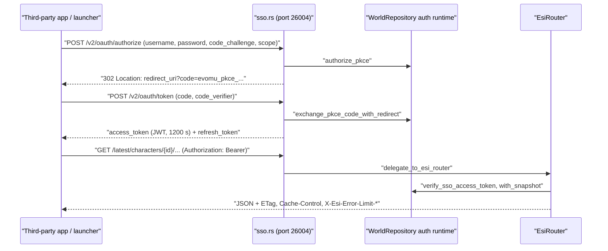

# ESI Web API & Single Sign-On

> **Navigation**: [EvoMu Technical Wiki](../README.md) • [Related Systems](#related-systems--cross-references)
>
> [← Back to Wiki Table of Contents](../README.md)

---

## Overview

EvoMu serves three HTTP services from one TCP port (`esi_port`, default `26004`):

1. **SSO** — an OAuth2 authorization-code server with PKCE (`S256`) that stands in for `login.eveonline.com`. It issues signed access tokens and rotating refresh tokens for EvoMu accounts.
2. **ESI** — a JSON web API whose routes, parameters, scopes and response headers are taken from a pinned copy of the ESI OpenAPI document. Handlers read and write the same in-memory world state that the MachoNet game services use.
3. **Bug reporter** — the HTTP backend for the client's `F12` "Report a Bug" window (`/bugs/api/*`).

The listener speaks plain HTTP/1.1, one request per connection. There is no TLS in the server; anything that needs HTTPS has to be put in front of it.

The MachoNet and Quasar transports are described in [MachoNet Protocol, Quasar Services & Wire Infrastructure](machonet_wire_and_quasar_gateway.md).

---

## Canonical Mechanics

All rules below are what the code does at the pinned commit.

### The HTTP listener

`main.rs` binds `bind_address:esi_port` when `[feature_flags] enable_esi_http` is true (the default) and hands every accepted socket to `sso::handle_http_connection`.

| Limit | Value | Where |
|---|---|---|
| Concurrent HTTP connections | 512 (`MAX_CONCURRENT_CONNECTIONS`; the semaphore is shared with the Quasar gRPC listener) | `main.rs` |
| Read timeout per socket read | 10 s (`HTTP_READ_TIMEOUT`) | `sso.rs` |
| Request size (headers, and body by `Content-Length`) | 256 KiB (`MAX_HTTP_REQUEST_BYTES`), else `413` | `sso.rs` |
| Body size for `POST /bugs/api/attachment/...` | 32 MiB at the listener; the handler then rejects more than 8 MiB | `sso.rs`, `bug_reporting.rs` |

`Expect: 100-continue` is answered with `100 Continue`. `handle_http_request_inner` then routes by path:

1. `/bugs/api` and `/bugs/api/*` go to `bug_reporting::handle_bugs_http_request`.
2. The OAuth2 paths in the next section are handled in `sso.rs`.
3. Everything else is passed to `EsiRouter::handle_request` by `delegate_to_esi_router`.

`esi/mod.rs` also contains `EsiServer::spawn`, a second listener that serves only the ESI router (15 s I/O timeout, 2 MiB body, 8 KiB header lines, 64 headers, chunked request bodies). `main.rs` does not start it; it is used by tests.

### SSO endpoints

| Method and path | Behaviour |
|---|---|
| `GET /.well-known/oauth-authorization-server`, `GET /.well-known/openid-configuration` | Metadata document. `issuer` is `https://login.eveonline.com`; endpoint URLs are built from the request's `Host` header. |
| `GET /oauth/jwks`, `GET /.well-known/jwks.json` | One key entry with `kty: oct`, `alg: HS256` and a `kid`. No key material is published (the key is symmetric). |
| `GET /v2/oauth/authorize` | Without credentials: returns an HTML login form that posts back to the same path. With credentials: same as `POST`. |
| `POST /v2/oauth/authorize` | Checks the account password and returns `302` with `Location: <redirect_uri>?code=...&state=...`. |
| `POST /v2/oauth/token`, `POST /oauth/token` | `grant_type=authorization_code` or `grant_type=refresh_token`. |
| `POST /v2/oauth/revoke`, `POST /oauth/revoke` | Revokes a refresh token or an access token; returns `{"revoked": bool}`. |
| `GET /v2/oauth/verify`, `GET /oauth/verify` | Returns `CharacterID`, `CharacterName`, `ExpiresOn`, `Scopes`, `TokenType`, `CharacterOwnerHash`, `UserID` for a valid bearer token. An optional `scope` / `required_scope` query parameter or `X-Required-Scope` header makes it return `403` when that scope is missing. |

**Authorize rules** (`handle_oauth_authorize`, `WorldRepository::authorize_pkce`):

- `response_type` must be `code`. `client_id`, `redirect_uri` and `code_challenge` are required. `code_challenge_method` must be `S256`.
- `redirect_uri` must start with `http://localhost`, `http://127.0.0.1`, `https://localhost`, `https://127.0.0.1` (followed by nothing, `:` or `/`), `eveauth-` or `eveauth://`, and must not contain control characters (`is_valid_redirect_uri`).
- Credentials come from form, query or JSON fields `username` / `password`, or from an `Authorization: Basic` header. They are checked with `authenticate_at`, the same account check the game login uses. Banned and suspended accounts get `403`.
- `character_id` is optional. If absent, the account's first character is used; an account with no characters gets an account-scoped code (`character_id = 0`).
- There is no client registry: any non-empty `client_id` is accepted and no client secret is checked.
- The code is `evomu_pkce_<random hex>`, valid for 300 seconds, held in memory.

**Token rules** (`exchange_pkce_code_inner`, `refresh_sso_token`, `try_mint_sso_tokens`):

- A code is removed from the store when it is presented, so it can be used once even if the exchange then fails.
- The exchange fails unless `client_id` matches, the stored `redirect_uri` matches the one sent, and `base64url(SHA-256(code_verifier))` equals the stored challenge (constant-time compare).
- A refresh must present the same `client_id`. It issues a new access token and a new refresh token and revokes the old refresh token.

| Token | Format | Lifetime |
|---|---|---|
| Authorization code | `evomu_pkce_<hex>` | 300 s, single use |
| Access token | JWT, header `{"alg":"HS256","typ":"JWT"}`, signed with the server's 32-byte secret | 1200 s (`expires_in`) |
| Refresh token | `evomu_rt_<hex>`; only a digest is stored | 30 days, rotated on use |

Access token claims (`SsoTokenClaims`): `sub` (`CHARACTER:EVE:<character_id>`, or `USER:EVE:<user_id>` for an account-scoped token), `name`, `owner`, `user_id`, `character_id`, `scp`, `iss` (`https://login.eveonline.com`), `aud` (`[client_id, "EVE Online"]`), `iat`, `exp`, `jti`.

**Verification** (`verify_sso_access_token_core`) rejects a token when any of these holds: the header algorithm is not `HS256`; the signature does not match; `iat` is in the future; `now >= exp`; `iss` or `aud` is wrong; `sub` does not match the id claims; the `jti` has been revoked; the user was kicked at or after `iat`; the payload carries a privilege claim key (`role`, `roles`, `admin`, `gm`, `scope`, `scopes`, ... in `FORBIDDEN_PRIVILEGE_CLAIM_KEYS`) or a privileged entry in `scp` (`admin`, `gm`, `root`, `gm:*`, ...); the account no longer exists, or is banned or suspended.

### Scopes

Scopes are free-form strings at issue time: whatever the `scope` parameter lists (split on spaces or commas) is stored with the code and copied into the token's `scp` claim. They are not checked against a list when the token is issued.

They are enforced per route. `OpenApiSpec` reads each operation's `security[].OAuth2` array from the pinned document into `required_scopes`. A route with at least one required scope is an authenticated route, and the router requires, in order:

1. a bearer token (`Authorization: Bearer ...`, or a `token` query parameter when there is no `Authorization` header) — otherwise `401`;
2. a token that verifies — otherwise `401`;
3. a character token (`character_id > 0`) — otherwise `403`;
4. every required scope present in `scp` — otherwise `403`;
5. if the path has `{character_id}`, it must equal the token's character — otherwise `403`;
6. if the path has `{corporation_id}`, the character must be in that corporation and hold a qualifying role (below) — otherwise `403`;
7. if the path has `{alliance_id}` and that alliance exists, the character must be a member — otherwise `403`.

**Corporation roles.** `required_corp_roles_for_route` gives a role mask per route; routes it does not name default to `ROLE_DIRECTOR`. The operation's `x-required-roles` from the document are added to the mask. The CEO and directors always pass. A mask of zero means membership and scope are enough (contracts, contacts, standings, medals, bookmarks, projects, faction-warfare stats).

### ESI request pipeline

`EsiRouter::handle_request` runs these steps and stops at the first failure:

1. **Error limit.** Each client key has a window of 100 errors per 60 seconds. When the budget is used up every request gets `420` until the window resets. Responses with status `400`–`499` count; `5xx` responses do not. At most 4096 client windows are tracked (`MAX_ERROR_LIMIT_CLIENTS`).
2. **Compatibility date.** `X-Compatibility-Date` header or `compatibility_date` query parameter, default `2020-01-01`; it must be one of the dates in the pinned document, else `400`.
3. **Datasource.** `datasource` query parameter or `X-Tenant` header, if present and non-empty, must be `tranquility`.
4. **Version prefix.** `/latest`, `/legacy`, `/dev`, `/v1` … `/v6` are stripped; all map to the same route table.
5. **Meta endpoints** (GET only): `/swagger.json`, `/openapi.json`, `/meta`, `/versions`, `/status.json`, `/verify`, `/images/characters/{id}/portrait`, and two client CDN paths (`/cdn/achievements/...`, `/cdn/cosmetics/character/title/definitions/...`).
6. **Route match** against the OpenAPI operations: `405` if the path exists with another method, `404` if not.
7. **`page`** must be an integer of at least 1.
8. **Authentication and authorization** as described under Scopes.
9. **Required query parameters** declared by the operation must be present.
10. **Language**: `language` query parameter or `Accept-Language`; one of `de`, `es`, `fr`, `ja`, `ko`, `ru`, `zh`, otherwise `en`.
11. **Dispatch** to a handler, which returns a `RouteExecutionResult` (status, JSON body, cache age, page count).
12. **Finalize**: add headers; answer `304` with an empty body when `If-None-Match` matches the computed `ETag`.

Response headers on successful ESI responses:

| Header | Source |
|---|---|
| `ETag` | 64-bit FNV-1a of the body (`compute_etag`) |
| `Cache-Control` | `private` for authenticated routes, `public` otherwise, with the handler's `max-age` |
| `Last-Modified`, `Expires` | current time, and current time plus `max-age` |
| `X-Esi-Error-Limit-Remain`, `X-Esi-Error-Limit-Reset` | the caller's error window |
| `X-Esi-Request-Id` | `evomu-esi-<sequence in hex>` |
| `X-Compatibility-Date` | the negotiated date |
| `X-Pages` | when the operation declares it or the handler paginates |
| `Content-Language` | when the operation declares it |

### Route catalogue and handlers

The pinned document is [`esi_openapi.json`](../../../.agents/skills/evomu-adversarial-review/references/parity/sources/esi_openapi.json), compiled into the binary with `include_str!`. It has 197 operations on 182 paths in 31 tags and names 63 scopes. `openapi::legacy_operations` defines operations for the retired bookmarks and opportunities routes, which are not in the document.

Every operation in the document has a match arm in a handler module. Dispatch tries the fleet module first, then `sample_routes::dispatch_operation`, which walks the other modules in a fixed order and ends in a catch-all `501`.

| Module | Routes |
|---|---|
| [`character_routes.rs`](../../../crates/eve-server/src/esi/character_routes.rs), [`character_mail_routes.rs`](../../../crates/eve-server/src/esi/character_mail_routes.rs) | Character, clones, skills, location, fittings, assets, wallet, loyalty points, mail headers / send / body / delete |
| [`char_social_routes.rs`](../../../crates/eve-server/src/esi/char_social_routes.rs), [`char_social_mail_routes.rs`](../../../crates/eve-server/src/esi/char_social_mail_routes.rs), [`char_calendar_routes.rs`](../../../crates/eve-server/src/esi/char_calendar_routes.rs) | Contacts and labels, mail labels and lists, calendar, legacy bookmarks and opportunities |
| [`corp_alliance_routes.rs`](../../../crates/eve-server/src/esi/corp_alliance_routes.rs), [`corp_governance_routes.rs`](../../../crates/eve-server/src/esi/corp_governance_routes.rs) | Alliance and corporation data, roles, titles, medals, shareholders, starbases, projects |
| [`economy_routes.rs`](../../../crates/eve-server/src/esi/economy_routes.rs), [`economy_industry_routes.rs`](../../../crates/eve-server/src/esi/economy_industry_routes.rs) | Market, contracts, industry, mining, planetary interaction |
| [`fleet_routes.rs`](../../../crates/eve-server/src/esi/fleet_routes.rs) | Fleet read and write routes, `POST /ui/openwindow/*` |
| [`sov_fw_routes.rs`](../../../crates/eve-server/src/esi/sov_fw_routes.rs), [`fw_universe_routes.rs`](../../../crates/eve-server/src/esi/fw_universe_routes.rs) | Sovereignty, incursions, faction warfare, killmails, system jumps and kills |
| [`universe_routes.rs`](../../../crates/eve-server/src/esi/universe_routes.rs) | Universe, routes, search, `POST /ui/autopilot/waypoint` |
| [`sample_routes.rs`](../../../crates/eve-server/src/esi/sample_routes.rs) | `/status`, dogma, insurance, wars and other routes; the dispatcher itself |

### Shared world state

ESI has no store of its own for game data. Handlers take the same `ServerContext` as the MachoNet services:

- **Reads** go through `ctx.db.with_snapshot(|snap| ...)` on the `WorldStateSnapshot`, and through `ctx.sde` for static data.
- **Writes** use `ctx.db.with_mut_snapshot` / `try_with_mut_snapshot`, or call functions in [`domain/`](../../../crates/eve-server/src/domain/mod.rs). That module holds logic that is independent of transport (`domain::mail::send_mail`, `domain::corp_governance`, `domain::market_acl`, `domain::fleets`) so that the MachoNet, Quasar and ESI paths apply the same rules. `domain_err_to_esi` maps a `DomainError` to an HTTP status.
- **Pushes to the game client.** Some routes notify an online client: mail sent through ESI calls `mail_notify::emit_mail_sent`; the UI routes send `OnShowContract`, `OnShowOwnerDetailsWindow`, `OnShowMarketDetails` and `OnAutopilotUpdated`. The `/ui/openwindow/*` routes return `400` when the token's character has no online client session (`ensure_online_ui_session`).
- **ESI-side metadata.** `EsiRuntimeState` (`ctx.esi_state`) holds data that is not in the snapshot tables: mail read flags, labels and tombstones, calendar events and responses, fleet MOTD and wing / squad names. It is in memory. The game's mail service also reads and writes these maps ([`fleet_social_mail.rs`](../../../crates/eve-server/src/services/fleet_social_mail.rs), [`fleet_social_persistence.rs`](../../../crates/eve-server/src/services/fleet_social_persistence.rs)).

### In-game bug reporter

During the handshake and in `machoNet.GetGlobalConfig`, `build_client_global_config` sends the client `bugReporting_ShowButton = "1"` and `bugReporting_BugReportServer = http://<host>:<esi_port>/bugs/api`, where `<host>` is the address the client connected to. The `EVOMU_BUG_SERVER_URL` environment variable replaces that URL.

| Method and path | Behaviour |
|---|---|
| `GET /bugs/api/status` | `{"isOnline": true}` |
| `GET /bugs/api/category`, `/categories` | The eight categories in `BUG_CATEGORIES` |
| `POST /bugs/api/issue` | Builds a `BugIncidentBundle` (report text, session snapshot, flight-recorder history, recent server log lines), writes it under `.evomu-bugs/queue/` and returns `201 {"id": key, "key": key}`. Server log lines from the following 1.5 seconds are appended afterwards. Body limit 2 MiB. |
| `POST /bugs/api/attachment/{key}` | Stores a multipart upload (screenshots, `logs.txt`, `igbr.zip`) next to the report and extracts `fitting.txt` and `logs.txt` from the zip into the bundle. 8 MiB per upload, 16 attachments per report. |

Authentication is optional: a request without an `Authorization` header is accepted, but a header that is present must carry a valid SSO bearer token. The queue is capped at 256 reports and 64 MiB, oldest removed first. The queued bundles are meant to be pushed to GitHub by `tools/sync_bugs_to_github.py`.

### Not implemented / known gaps

- **No TLS, and loopback-only redirects.** The listener is plain HTTP, and `redirect_uri` is limited to loopback hosts and `eveauth` schemes, so a hosted web application cannot complete the sign-on flow.
- **No OAuth client registry.** `client_id` is not validated and client secrets are ignored. Requested scopes are not checked against the catalogue when a token is issued.
- **Tokens cannot be verified offline.** Signing is HS256 with a server-side secret; the JWKS document lists a key id only. Third parties must call `/oauth/verify`.
- **Shared error-limit bucket on the main listener.** `delegate_to_esi_router` does not pass the peer address to the router, so every ESI caller on the production port is counted in the single `127.0.0.1` window.
- **Content type on the main listener.** `delegate_to_esi_router` replaces the router's `Content-Type` with `application/json; charset=utf-8`, including for the JPEG returned by `/images/characters/{id}/portrait`.
- **`/status.json` under-reports.** It marks an operation green only if it appears in the hand-maintained list in `sample_routes::is_operation_implemented`. At this commit 50 catalogue operations that have handler arms are missing from that list and show as red.
- **Routes that answer `501`:** `POST /ui/openwindow/information` returns `501` for targets that are not a character, corporation, alliance, NPC corporation or agent, because the client has no notification that opens those windows. Any operation that no module claims falls through to the catch-all `501` in `universe_routes.rs`. The `501` arms still present in `sample_routes.rs` for `/fw/wars`, `/incursions`, `/industry/facilities` and character contract items are not reached, because modules earlier in the dispatch order answer those routes.
- **`ui_routes.rs` is a stub** that returns `None`; the User Interface routes live in `fleet_routes.rs` and `universe_routes.rs`.
- **`EsiRuntimeState` is in memory.** This article did not trace which of its maps are rebuilt from the world database after a restart.
- No open GitHub issues were found for "ESI" or "SSO" when this article was written.

---

## EvoMu Implementation Architecture

### Crates involved

- [`eve-server`](../../../crates/eve-server) — HTTP listener, SSO endpoints, ESI router and handlers, bug reporter.
- [`eve-db`](../../../crates/eve-db) — accounts, PKCE codes, token minting and verification, token persistence.
- [`eve-sde`](../../../crates/eve-sde) — static data behind the universe, dogma and market reference routes.

### Primary handlers and dispatch

| File | Role |
|---|---|
| [`main.rs`](../../../crates/eve-server/src/main.rs) | Binds `esi_port`, limits connections, spawns `handle_http_connection` |
| [`sso.rs`](../../../crates/eve-server/src/sso.rs) | HTTP parsing, OAuth2 endpoints, `verify_esi_bearer_token`, `delegate_to_esi_router` |
| [`esi/mod.rs`](../../../crates/eve-server/src/esi/mod.rs) | `EsiHttpRequest` / `EsiHttpResponse`, `compute_etag`, `EsiServer` |
| [`esi/router.rs`](../../../crates/eve-server/src/esi/router.rs) | `EsiRouter::handle_request`, error-limit windows, scope / character / corporation / alliance guards |
| [`esi/openapi.rs`](../../../crates/eve-server/src/esi/openapi.rs) | `OpenApiSpec::pinned`, `match_operation`, `strip_version_prefix`, `validate_response` |
| [`esi/sample_routes.rs`](../../../crates/eve-server/src/esi/sample_routes.rs) | `dispatch_operation`, `RouteExecutionResult`, `paginate_slice` |
| [`esi/runtime_state.rs`](../../../crates/eve-server/src/esi/runtime_state.rs) | `EsiRuntimeState` |
| [`gateway_tokens.rs`](../../../crates/eve-db/src/gateway_tokens.rs) | `authorize_pkce`, `exchange_pkce_code_with_redirect`, `refresh_sso_token`, `verify_sso_access_token`, `try_revoke_sso_refresh_token` |
| [`bug_reporting.rs`](../../../crates/eve-server/src/bug_reporting.rs) | `/bugs/api/*`, `BugIncidentBundle`, `BugReportingRuntime` |

### State

| State | Location | Durable |
|---|---|---|
| JWT signing secret | `AuthRuntime::jwt_signing_secret`; SQLite table `auth_secrets` | Yes |
| PKCE authorization codes | `AuthRuntime::pkce_codes` | No (memory, 300 s) |
| Refresh tokens (digest, scopes, last access-token `jti`) | `AuthRuntime::refresh_tokens`; SQLite table `auth_refresh_tokens` | Yes |
| Revoked access-token ids | `AuthRuntime::revoked_jtis`; SQLite table `auth_revoked_jtis` | Yes |
| Kicked users | `AuthRuntime::kicked_users`; SQLite table `auth_kicked_users` | Yes |
| Error-limit windows | `EsiRouter::error_windows` | No |
| ESI mail / calendar / fleet metadata | `EsiRuntimeState` | In memory |
| Bug reports | `.evomu-bugs/queue/` on disk; index in `BugReportingRuntime` | Files |

Minting a token writes the refresh-token row to SQLite before it updates memory, and returns a server error if the write fails. Revocation does the same.

### Tick and lifecycle integration

None of the three services runs on the simulation tick. Requests are handled on Tokio tasks and take the world-state lock only for the duration of a handler's snapshot closure. `EsiRouter` is created on first use and cached per `ServerContext` database. `GET /status` reports the router's creation time as `start_time` and counts accounts with an online session as `players`.

---

## Invariants, Security & Edge Cases

- A token is bound to one character. A route with `{character_id}` cannot be read with another character's token, even one on the same account.
- Account-scoped tokens (`character_id = 0`) pass `/oauth/verify` but are refused by every scoped ESI route.
- Banning, suspending or kicking an account invalidates its existing access tokens at the next verification; no revocation call is needed.
- Refresh tokens are stored as digests; the raw value exists only in the response to the client.
- Bug-report keys and attachment file names are sanitised before they are used in paths (`is_safe_report_key`, `sanitize_attachment_filename`), and zip extraction is capped at 4 MiB per text entry.
- `state` is percent-encoded before it is appended to the redirect, and all values echoed into the HTML login form are attribute-escaped.

---

## Verification, Tests & Parity References

Ledger rows: `feat:esi.core.sso-tokens`, `feat:esi.core.rate-limits`, `feat:esi.core.meta`, `feat:account.sso-login`, `feat:esi.status.status`, `feat:esi.ui.open-windows`, `feat:esi.ui.autopilot`, `feat:esi.mail.send`, `feat:esi.fleets.fleet`. Each route also has a row with the `esi:` prefix (for example `esi:GET /fw/wars`), alongside per-tag feature rows under `feat:`.

| Test file | Covers |
|---|---|
| [`sso_tests.rs`](../../../crates/eve-server/src/sso_tests.rs), [`sso_http_framing_and_security_tests.rs`](../../../crates/eve-server/src/sso_http_framing_and_security_tests.rs) | OAuth2 endpoints, request framing and size limits |
| [`pkce_and_sso_edge_tests.rs`](../../../crates/eve-db/src/pkce_and_sso_edge_tests.rs) | PKCE code and token lifecycle in `eve-db` |
| [`http_transport_and_auth_tests.rs`](../../../crates/eve-server/src/esi/http_transport_and_auth_tests.rs), [`router_unit_tests.rs`](../../../crates/eve-server/src/esi/router_unit_tests.rs) | Router pipeline, scope and role guards, error limit |
| [`full_endpoint_catalog_tests.rs`](../../../crates/eve-server/src/esi/full_endpoint_catalog_tests.rs), [`openapi_unit_tests.rs`](../../../crates/eve-server/src/esi/openapi_unit_tests.rs) | Catalogue coverage and schema validation |
| [`esi.rs`](../../../crates/eve-server/tests/it/esi.rs), [`esi_full.rs`](../../../crates/eve-server/tests/it/esi_full.rs), [`esi_fleets.rs`](../../../crates/eve-server/tests/it/esi_fleets.rs), [`esi_ui_and_features.rs`](../../../crates/eve-server/tests/it/esi_ui_and_features.rs) | Integration tests over live server state |
| [`bug_reporting_tests.rs`](../../../crates/eve-server/src/bug_reporting_tests.rs), [`client_bug_reporting_suite.rs`](../../../crates/eve-server/tests/it/client_bug_reporting_suite.rs) | Bug-report endpoints and queue limits |

---

## Related Systems & Cross-References

- [**MachoNet Protocol, Quasar Services & Wire Infrastructure**](machonet_wire_and_quasar_gateway.md): the game client's own transports.
- [**Sessions, Login & Logoff**](sessions_login_and_logoff.md): how a launcher SSO token is used at game login.
- [**Game-Master Tools & Server Operations**](game_master_tools_and_server_operations.md): `esi_port`, `enable_esi_http` and account provisioning.
- [**Corporation Roles & Governance**](../corporations_and_governance/corporation_roles_and_governance.md): the role masks used by corporation routes.
- [**EvoMu Technical Wiki Table of Contents**](../README.md): master index.

---

[← Back to Wiki Table of Contents](../README.md)
