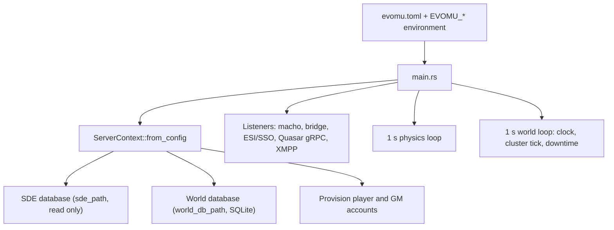

# Game-Master Tools & Server Operations

> **Navigation**: [EvoMu Technical Wiki](../README.md) • [Related Systems](#related-systems--cross-references)
>
> [← Back to Wiki Table of Contents](../README.md)

---

## Overview

This article covers what an operator needs to run an EvoMu server: the configuration file and its environment overrides, how accounts and game-master (GM) accounts are created, the slash commands a GM can type in the client, daily downtime, the server clock, and the world database.

An EvoMu server is one process. It opens a static-data database (read only) and a world database (read/write), binds its listeners, and runs two one-second loops: a physics loop for solar systems that have activity, and a world loop that advances the clock and runs timed jobs.

---

## Canonical Mechanics

All rules below are what the code does at the pinned commit.

### Configuration file

`ServerConfig::load_default_or_env` reads the file named by `EVOMU_CONFIG_PATH`, or `evomu.toml` in the working directory if it exists, or uses built-in defaults. The sample file is [`evomu.toml`](../../../evomu.toml).

| Key | Default | Meaning |
|---|---|---|
| `bind_address` | `127.0.0.1` | Address for all listeners |
| `macho_port` | `26000` | Game client (MachoNet) |
| `bridge_port` | `26002` | JSON bridge used by the test harness |
| `esi_port` | `26004` | ESI, SSO and bug-report HTTP |
| `quasar_grpc_port` | `26005` | Quasar gRPC (when `enable_quasar_gateway` is on and the port is not 0) |
| `xmpp_port` | `5222` | Chat |
| `sde_path` | `data/evomu_sde.sqlite` | Static data |
| `world_db_path` | `data/evomu_world.sqlite` | World state |
| `[storage] backend` | `sqlite` | `sqlite` or `memory` |
| `belt_respawn_interval_secs` | `86400` | Must be 1 to 604800 |
| `downtime_utc_secs_of_day` | `39600` (11:00 UTC) | Must be below 86400 |

`[feature_flags]`:

| Flag | Code default | Sample file |
|---|---|---|
| `enable_quasar_gateway` | `true` | `true` |
| `enable_esi_http` | `true` | `true` |
| `enable_living_world` | `true` | `true` |
| `seed_demo` | `false` | `false` |
| `enable_project_discovery` | `true` | not set |
| `enable_info_gathering` | `true` | not set |
| `info_gathering_interval_secs` | `300` (must be at least 1) | not set |
| `free_fast_checkout_plex` | `false` | `true` |
| `starter_plex_balance` | `0` (must not be negative) | `50000` |
| `allow_local_dev_gateway_jwt` | `false` | `true` |

The sample file therefore turns on three settings that are off in the code defaults. With `backend = "sqlite"` the world path must end in `.sqlite`, `.sqlite3` or `.db`. An invalid file stops startup with a message that names the key.

### Environment overrides

Applied after the file by `load_default_or_env`:

| Variable | Effect |
|---|---|
| `EVOMU_CONFIG_PATH` | Path of the configuration file |
| `EVOMU_SDE_PATH` | Replaces `sde_path` |
| `EVOMU_DB_PATH` | Replaces `world_db_path`; `EVOMU_SNAPSHOT_PATH` is used only if this is not set |
| `EVOMU_STORAGE_BACKEND` | Replaces `[storage] backend` |
| `EVOMU_ACCOUNTS` | `user:pass,user:pass` — adds player accounts |
| `EVOMU_GM_ACCOUNT` | `user:pass` — adds a GM account with the default GM character |
| `EVOMU_QUASAR_GRPC_PORT` | Replaces `quasar_grpc_port` |
| `EVOMU_XMPP_PORT` (or `EVEMU_XMPP_PORT`) | Replaces `xmpp_port`; the `--xmpp-port` command-line flag overrides both |
| `EVOMU_ALLOW_LOCAL_DEV_JWT` | `1/true/yes/on` or `0/false/no/off` for `allow_local_dev_gateway_jwt` |

Read elsewhere in the server:

| Variable | Effect |
|---|---|
| `EVOMU_ADMIN_TOKEN` | `main.rs` provisions a GM account named `admin` with this password |
| `EVOMU_SSO_JWT_SECRET` | At least 32 characters; used as the token signing secret when a new one is generated |
| `EVOMU_BUG_SERVER_URL`, `EVOMU_BUG_QUEUE_DIR` | Bug-report URL sent to clients, and the queue directory |

### Accounts and GM accounts

Accounts are created at startup from the configuration; there is no self-registration path in the files read for this article.

- **Player accounts** (`[[player_accounts]]`, `EVOMU_ACCOUNTS`) go through `provision_player_account`. A new account gets the role `ROLE_PLAYER | ROLE_LOGIN`. If the account exists with a different password, the password is replaced.
- **Starter characters.** An account entry may carry `[player_accounts.starter_character]` (name, bloodline, gender, ancestry, school, optional system, station, ISK and PLEX). `provision_starter_characters` creates it through the same path as `charUnboundMgr.CreateCharacterWithDoll` when the account has no character.
- **GM accounts** (`[[admin_accounts]]`, `EVOMU_GM_ACCOUNT`, `EVOMU_ADMIN_TOKEN`) go through `provision_gm_account`. The account's role gains `ROLE_GM_DEFAULT`, and a character is created if `character_id` does not exist yet (defaults: id `90000003`, name `ISD Polaris`). That character starts docked in station `60003760` with 1,000,000,000 ISK, 50,000,000 skill points and one ship.
- **Passwords** are stored as Argon2id hashes with a random salt (`hash_password_token`).
- **Demo data.** `seed_demo = true` loads demo fixtures (`seed_demo_world_fixtures`); it is off by default.

**Roles.** The account role is a 64-bit mask using the client's role constants (`service_roles` in `eve-machonet`):

| Mask | Bits |
|---|---|
| `ROLE_PLAYER_DEFAULT` | `ROLE_PLAYER`, `ROLE_LOGIN` |
| `ROLE_GM_MASK` | `ROLE_GML`, `ROLE_GMH`, `ROLE_GMS`, `ROLE_ADMIN`, `ROLE_WORLDMOD` |
| `ROLE_GM_DEFAULT` | both of the above |

`SessionState::has_gm_role` is true when any `ROLE_GM_MASK` bit is set. Other bits used for gating are `ROLE_QA`, `ROLE_SPAWN` and `ROLE_ROLEADMIN`.

### How slash commands are dispatched

To load the client's developer/GM menus (`insider`) and slash-command service (`svc_slash`), pass `/localdevtools` to `exefile` (`python3 tools/launch_client.py --gm` in [`tools/launch_client.py`](../../../tools/launch_client.py) adds this flag automatically).

The client sends a command line to `slash.SlashCmd(text)`. Three checks apply:

1. **Service gate** (`dispatch.rs`). The services `slash`, `devToolsProvider` and `sessionMgr`, methods that start with `GM_`, and a few dungeon-editor methods require a GM role. For `slash`, a session with `ROLE_QA`, `ROLE_SPAWN` or `ROLE_ROLEADMIN` also passes. Failure returns `InsufficientRole`.
2. **Command list.** `SlashCmd("/")` is allowed for every authenticated session. It answers with a `SlashError` whose text is `Commands: [...]`, listing only the commands the caller's role may use (`remote_slash_commands_for_role`). The client's developer tools read that list; a player gets an empty one.
3. **Per-command role** (`required_slash_role`):

| Commands | Role needed (any bit) |
|---|---|
| `/online`, `/location`, `/getattr`, `/survey`, `/moveme`, `/translocate`, `/whoami` | `ROLE_QA` or `ROLE_GM_MASK` |
| `/spawn`, `/unspawn`, `/despawn`, `/spawnnpc` | `ROLE_SPAWN` or `ROLE_GM_MASK` |
| `/role`, `/createccpevent` | `ROLE_GMH`, `ROLE_GMS`, `ROLE_ADMIN` or `ROLE_ROLEADMIN` |
| everything else | `ROLE_GM_MASK` |

The command text is then tried by three handlers in this order: `account_services::handle` (`/setomega`, `/setunderage`), `handle_gm_slash_ext` in `character_gm_tools.rs` (which ends by calling `handle_batch3_gm_slash_cmd`), and `auth_cache::handle`. A command none of them knows returns `UnknownSlashCommand`.

Each command, allowed or refused, is logged and appended to `gm_audit_log` in the world state by `record_gm_audit` (character, command text, time, success). The log keeps the last 256 entries.

`publicQaToolsServer.SlashCmd` takes the same text, applies the same per-command role, and runs only the `handle_gm_slash_ext` set.

### Slash commands

Arguments are shown as the handlers' usage strings give them. `me` means the caller or the caller's ship.

**Accounts and sessions**

| Command | Effect |
|---|---|
| `/ban <account_id> [duration_seconds] [reason]` | Bans the account, releases its bound objects and online lock, disconnects its session and logs its character off |
| `/unban <username\|user_id> [reason]` | Lifts a ban |
| `/suspend <username\|user_id> <duration_seconds> [reason]` | Suspends the account until the given time and disconnects it |
| `/unsuspend <username\|user_id> [reason]` | Lifts a suspension |
| `/kick <username> [reason]` | Records a kick, disconnects the session with `SessionKicked`, logs the character off |
| `/role <username\|user_id> <role_bitmask_or_name>` | Sets the account role mask; an online session is notified of the change |
| `/setomega <userID> <unixExpiry>` | Sets the account's subscription expiry |
| `/setunderage <userID> <value>` | Sets or clears the underage flag |
| `/online` | Lists online characters (user, character, name, solar system) |
| `/whoami` | Reports the caller's identity |
| `/location [char_id]` | Reports a character's system, constellation, region, station or structure, ship and position |
| `/chatban`, `/chatunban` | Mutes or unmutes a character in chat; the mute list is saved |

**Character**

| Command | Effect |
|---|---|
| `/giveisk <amount>` | Adds ISK to the caller's wallet and sends the balance update |
| `/giveitem <type_id> [quantity]`, `/createitem <type_id> <quantity>` | Creates an item for the caller and sends the item-change notification |
| `/setskill <skill_id> <level>`, `/giveskill <skill_id> <level>` | Sets a skill to a level, with the skill points for that level |
| `/completeskills`, `/trainskills`, `/finishskills` | Advances skill queues |
| `/secstatus [char_id] <value>` | Sets security status, clamped to −10…10, and sends `OnSecurityStatusUpdate` |
| `/energy [char_id] <amount>` | Sets the character's energy value |
| `/contact <targetID> <standing>`, `/standing <targetID> <standing>` | Sets a contact standing |
| `/achievements reset` | Resets a character's achievements |
| `/campaign enroll …`, `/campaign seasonal <campaign_id\|off> [duration_days] [HH:MM:SS]` | Enrols a character in a login campaign; starts or stops a seasonal campaign |
| `/fastcheckout` | Switches fast checkout on or off for an account |

**Ship and space**

| Command | Effect |
|---|---|
| `/heal [target_id]` | Restores shield, armor, hull and capacitor and clears module heat and damage, in space and in the database |
| `/fit [ship_id\|me] <type_id> [flag_id]` | Creates a module and fits it; slot limits and hardpoints are checked |
| `/load [target\|me] <type_id> [quantity]` | Creates items of a type for a ship (handler not traced further) |
| `/setattr <item_id\|me> <attribute_id> <value>` | Overrides a dogma attribute on an item |
| `/getattr <item_id\|me> <attribute_id>` | Reads a dogma attribute |
| `/kill <target_id>` | Destroys a ship, producing a wreck and a killmail |
| `/spawn <type_id> [quantity]` | Spawns entities of a type in the caller's system |
| `/unspawn <entity_id>`, `/despawn <entity_id>` | Removes an entity from space and from the database |
| `/spawnnpc <type_id>` | Spawns an NPC from static data in the caller's system |
| `/spawnanomaly [dungeon_id]` | Spawns a cosmic anomaly in the caller's system |
| `/teleport`, `/tr`, `/translocate`, `/moveme` `[me\|<char_id>] <location_id>` | Moves a character to a solar system, station, structure, stargate, celestial or object in space |

**World and timers**

| Command | Effect |
|---|---|
| `/advancetime [secs]`, `/fastforward`, `/ff` | Advances the server clock (default 3600 s) and clears the caller's session-change timer |
| `/cleartimers` | Clears the caller's session-change, combat and crimewatch timers |
| `/upwelltimer`, `/structuretimer`, `/finishstructure` | Completes pending Upwell structure timers and reports the new states |
| `/completeindustry`, `/finishjobs`, `/industrytimer` | Makes running industry jobs ready for delivery |
| `/fwcapture [system_id] [points]` | Adds faction-warfare victory points to a system (default 75,000) |
| `/createccpevent <dateTime> <duration> <importance> <title> [\| <description>]` | Creates a calendar event; also needs `ROLE_GMH` |
| `/season …`, `/operation …`, `/survey …`, `/pd …` | Passed to the seasons, operations, survey and Project Discovery services (not traced here) |

**Cluster**

| Command | Effect |
|---|---|
| `/downtime` | Runs the daily downtime sequence immediately (disconnect, jobs, restart) |
| `/shutdown <seconds> [reason]` | Marks the server as shutting down and broadcasts `OnClusterShutdownInitiated`; the delay is clamped to 60 s … 30 days |
| `/shutdown cancel` | Clears the shutting-down flag and broadcasts the cancellation |
| `/tidi <factor>` | Sets time dilation for the caller's system, clamped to 0.10 … 1.0 |
| `/autotidi <threshold\|off>` | Turns automatic time dilation on with a load threshold, or off |
| `/reinforce [node]` | Moves the caller's system to a dedicated or named worker node |

Besides slash commands, GM sessions can call `timeControl.AdvanceClock(seconds)` (default 12) and `timeControl.FastForwardSessionTimer` / `ClearSessionTimer`. `handle_admin_cluster_rpc` in `serverops_cluster.rs` serves administrative `machoNet` and `cluster` RPCs and requires a GM or `ROLE_ADMIN` session.

### Daily downtime

The world loop calls `tick_background_cluster_with_step` once a second. For downtime it does this:

1. **Warnings.** `step_downtime_countdown_warnings` broadcasts `OnClusterShutdownInitiated(label, when, 15)` when 60, 15 and 5 minutes remain (`DOWNTIME_WARNING_THRESHOLDS_SECS`). Each threshold fires once per day; the record is in the world database.
2. **Start.** The downtime window is the 900 seconds after `downtime_utc_secs_of_day`. On the first tick of a new downtime day inside that window, and if scheduled downtime is enabled, `start_daily_downtime_window` runs:
   - `initiate_cluster_downtime_shutdown` sets `shutdown_in_progress`, disconnects every non-GM session with `ClusterShutdown` / "Daily cluster downtime", and releases their online locks. GM sessions stay connected.
   - `execute_daily_maintenance_jobs` runs.
   - `downtime_until_unix` is set 15 minutes ahead (`DOWNTIME_DURATION_MINUTES`).
3. **During.** Non-GM logins are refused with `ClusterShuttingDown`, both in the handshake and in `authentication.Login`.
4. **End.** When `downtime_until_unix` is reached, `complete_cluster_downtime_restart` clears the flags and increments `cluster_restart_epoch`.

If a new downtime day begins while the clock is outside the window (for example the server was not running at 11:00), only the maintenance jobs run. On the very first tick of a new database nothing runs; the day index is just recorded.

"Restart" here is a state change. The process keeps running and the world state stays loaded.

**Daily jobs** (`execute_daily_maintenance_jobs`): sweep expired raffles; pay due automatic bills; prune offline fleets and channels; respawn depleted ore and ice belts; roll up 24-hour market history; recompute industry system cost indices; expire market orders and resolve expired contracts; decay sovereignty indices and roll over vulnerability; reset mission decline cooldowns and trim loyalty-point logs. [`cluster_tick_downtime.rs`](../../../crates/eve-server/src/sp6_lifecycle/cluster_tick_downtime.rs) adds two more: remove NPC wrecks, and reset accepted but unfinished missions.

### The virtual clock

Every time query in `eve-db` and `eve-server` goes through the `ServerClock` trait ([`clock.rs`](../../../crates/eve-db/src/clock.rs)). `VirtualServerClock` is the implementation:

$$t_{\text{server}} = t_{\text{base}} + \text{offset}$$

where the base is the host wall clock minus time spent paused (or a fixed timestamp for deterministic tests), and the offset is the sum of manual advances.

| Feature | Behaviour |
|---|---|
| `advance_secs(n)` | Adds `n` to the offset |
| Acceleration multiplier `m` (at least 1) | Each world-loop second adds `m − 1` extra seconds to the offset and passes `m` seconds to the cluster tick |
| Pause | Freezes the base; the world loop does nothing and the physics loop skips its step |
| Pause on tick | Pauses automatically after each tick |
| FILETIME | `now_blueos_filetime_ticks` gives the client's 100 ns ticks since 1601 |

`/advancetime` and `timeControl.AdvanceClock` use `advance_secs_without_sim_clock_rebase`: timers move forward but connected clients are not sent a clock rebase, so their own simulation time is not pushed ahead. The new time is also written to the world state under `__server_now_unix`.

Time dilation is separate from the clock. `/tidi` sets a per-system factor between 0.10 and 1.0 on the system's simulation and sends `DoSimClockRebase` to the sessions there. With `/autotidi`, `compute_tidi_from_node_load` derives the factor from load:

$$\text{factor} = \begin{cases} 1 & \text{load} \le \text{threshold} \\ \operatorname{clamp}\!\left(\dfrac{\text{threshold}}{\text{load}},\ 0.10,\ 1\right) & \text{otherwise} \end{cases}$$

rounded to two decimals. "Worker nodes" are bookkeeping inside the one process.

### The world database

- `world_db_path` is a SQLite file. `WorldRepository::open_sqlite` creates it if needed, applies schema migrations (table `schema_migrations`) and loads the whole world into memory as a `WorldStateSnapshot`.
- Services read with `with_snapshot` and write with `with_mut_snapshot` / `try_with_mut_snapshot`. A write runs in a copy-on-write transaction; the changed rows are committed to SQLite ([`tx_engine.rs`](../../../crates/eve-db/src/tx_engine.rs), [`sqlite_store/`](../../../crates/eve-db/src/sqlite_store/mod.rs)).
- The schema has relational tables for accounts, characters, skills, items, market orders, wallet journal, contracts, industry jobs, colonies, missions, mail, fleets, corporations, alliances, wars, killmails, structures and system states, among others, plus `service_domain_blobs` for per-service state.
- An unreadable row stops startup with an error that names the table and key. With the quarantine option (`open_sqlite_with_options`), such rows are moved to `quarantine_rows` instead.
- Authentication data (signing secret, refresh tokens, revoked tokens, kicks) uses a dedicated connection to the same file.
- `backend = "memory"` keeps the world only in memory; nothing survives a restart.

### Not implemented / known gaps

- **No account self-service.** Accounts come from the configuration file or environment. No slash command creates an account or changes a password in the handlers read here; changing the password in the configuration and restarting replaces it.
- **`/shutdown` does not stop the server.** The handler sets the shutting-down flag and notifies clients. It does not disconnect anyone or end the process; no later step that does so was found in that handler.
- **Downtime does not restart the process.** It is a 15-minute state window; see above.
- **Open issue #864:** the virtual clock's offset is kept in memory, so after a restart the clock is behind timestamps stored while it was advanced.
- **Open issue #863:** the tick delta is derived from wall time again and applied twice to skill training on restart, GM clock advance and tick overrun.
- **Open issue #875:** runtime state on `ServerContext` is saved only from certain call sites and at downtime; there is no flush at shutdown. Issue #920 tracks a clean shutdown sequence.
- **Handlers not traced for this article:** `/load`, `/season`, `/operation`, `/survey`, `/pd`, and the individual administrative `machoNet` / `cluster` RPCs.
- The ledger has rows for GM tools this article did not verify in code: `feat:admin.gm-petitions`, `feat:admin.gm-dungeon-editor`, `feat:admin.gm-tournament`, `feat:admin.gm-pi-tools`, `feat:admin.gm-skin-tools`.

---

## EvoMu Implementation Architecture

### Crates involved

- [`eve-server`](../../../crates/eve-server) — configuration, startup, dispatcher gates, slash handlers, cluster and downtime logic.
- [`eve-db`](../../../crates/eve-db) — accounts, bans and kicks, the clock, the world repository and SQLite store.
- [`eve-machonet`](../../../crates/eve-machonet) — role constants and `SessionState::has_gm_role`.

### Primary handlers and dispatch

| File | Role |
|---|---|
| [`config.rs`](../../../crates/eve-server/src/config.rs) | `ServerConfig`, `FeatureFlagsConfig`, `load_default_or_env`, validation |
| [`main.rs`](../../../crates/eve-server/src/main.rs) | Startup order, listeners, physics loop, world loop |
| [`router/context.rs`](../../../crates/eve-server/src/router/context.rs) | `ServerContext::from_config`, account provisioning, `advance_secs_without_sim_clock_rebase` |
| [`router/dispatch.rs`](../../../crates/eve-server/src/router/dispatch.rs) | GM and QA service gates, `timeControl` RPCs |
| [`services/auth_cache.rs`](../../../crates/eve-server/src/services/auth_cache.rs) | `required_slash_role`, `record_gm_audit`, command list, account and item commands, `handle_slash_teleport` |
| [`services/character_gm_tools.rs`](../../../crates/eve-server/src/services/character_gm_tools.rs) | `handle_gm_slash_ext`, `execute_gm_heal`, `handle_gm_qa_rpcs`, `parse_slash_tokens` |
| [`services/notify_emitters_character_services.rs`](../../../crates/eve-server/src/services/notify_emitters_character_services.rs) | `handle_batch3_gm_slash_cmd` (timers, campaigns, chat bans, shutdown) |
| [`services/account_services.rs`](../../../crates/eve-server/src/services/account_services.rs) | `/setomega`, `/setunderage` |
| [`services/serverops_cluster.rs`](../../../crates/eve-server/src/services/serverops_cluster.rs) | Time dilation, worker nodes, downtime warnings, shutdown, restart, daily jobs |
| [`sp6_lifecycle/cluster_tick.rs`](../../../crates/eve-server/src/sp6_lifecycle/cluster_tick.rs) | `tick_background_cluster_with_step` |
| [`accounts.rs`](../../../crates/eve-db/src/accounts.rs) | `provision_player_account`, `provision_gm_account`, `ban_account`, `suspend_account`, `set_account_role`, `try_kick_user` |
| [`clock.rs`](../../../crates/eve-db/src/clock.rs) | `ServerClock`, `VirtualServerClock` |
| [`persistence.rs`](../../../crates/eve-db/src/persistence.rs) | `WorldRepository::open_sqlite`, `with_snapshot`, `with_mut_snapshot` |

### State

| State | Location |
|---|---|
| Accounts (`AccountRecord`: user id, name, password hash, role, ban expiry and reason) | `WorldStateSnapshot.accounts`, table `accounts` |
| GM audit log | `WorldStateSnapshot.cluster_and_runtime.gm_audit_log` |
| Feature flags | `ServerContext::feature_flags` |
| Downtime state (`emitted_warnings_by_day`, `downtime_until_unix`, `cluster_restart_epoch`, `last_maintenance_unix`) | `PersistedDowntimeState` in the world state |
| Last downtime day | `Sp6PersistedState.last_downtime_day_idx` |
| Shutdown flags | `ServerContext::cluster_state` (memory) |
| Time-dilation overrides, load threshold, scheduled-downtime switch | `ctx.systems.cluster_nodes` (memory) |
| Clock offset, multiplier, pause | `VirtualServerClock` (memory) |

### Tick and lifecycle integration

- **Physics loop** (1 s): `step_active_systems_physics_tick`, skipped while the clock is paused.
- **World loop** (1 s): `tick_wall_second`, then `tick_background_cluster_with_step` with the number of seconds advanced. That function issues downtime warnings, rebalances nodes and recomputes automatic time dilation, starts or ends downtime, and runs the rest of the cluster tick.
- Both loops catch panics, log them and continue.

---

## Invariants, Security & Edge Cases

- A player session cannot learn GM command names: the command-list query returns an empty list for it, and any other command fails the service gate.
- Refused commands are audited as well as accepted ones.
- `/ban`, `/suspend` and `/kick` act on the live session at once: bindings are released, the online lock is dropped and the character is logged off through the normal logoff path, so a ship in space follows the disconnect rules.
- A banned or suspended account is refused at the handshake, at `authentication.Login`, at SSO authorization and at token verification.
- GM accounts stay connected through downtime and may log in during it.
- Configuration is validated before any listener is bound; an invalid file does not start a half-configured server.
- `/tidi` and `/secstatus` clamp their inputs; `/giveisk` rejects non-positive amounts and checks for balance overflow.

---

## Verification, Tests & Parity References

Ledger rows: `feat:serverops.config-file`, `feat:serverops.downtime`, `feat:serverops.daily-jobs`, `feat:serverops.time-dilation`, `feat:serverops.node-balancing`, `feat:serverops.persistence`, `feat:serverops.server-tick`, `feat:account.account-roles`, `feat:account.account-bans`, `feat:admin.slash-dispatcher`, `feat:admin.gm-role-gating`, `feat:admin.gm-ban`, `feat:admin.gm-giveisk`, `feat:admin.gm-createitem`, `feat:admin.gm-giveskill`, `feat:admin.gm-heal`, `feat:admin.gm-spawn`, `feat:admin.gm-attr`, `feat:admin.gm-fit`, `feat:admin.gm-kill`, `feat:admin.gm-tr`, `feat:admin.gm-location-online`; `rpc:slash.SlashCmd`, `rpc:machoNet.GracefulShutdown`, `rpc:machoNet.TerminateAllClients`.

| Test file | Covers |
|---|---|
| [`config_tests.rs`](../../../crates/eve-server/src/config_tests.rs), [`config_edges_tests.rs`](../../../crates/eve-server/src/config_edges_tests.rs) | Parsing, defaults, validation, environment overrides |
| [`character_gm_tools_unit_tests.rs`](../../../crates/eve-server/src/services/character_gm_tools_unit_tests.rs), [`account_admin_complete.rs`](../../../crates/eve-server/tests/it/account_admin_complete.rs) | Slash commands, bans, roles |
| [`gm_admin_and_attribute_notices.rs`](../../../crates/eve-server/tests/it/notify_events/gm_admin_and_attribute_notices.rs) | Notifications sent by GM commands |
| [`serverops_cluster_tests.rs`](../../../crates/eve-server/src/services/serverops_cluster_tests.rs), [`serverops_cluster_complete.rs`](../../../crates/eve-server/tests/it/serverops_cluster_complete.rs) | Downtime, shutdown, node balancing |
| [`serverops_tidi_nodes_and_industry_pause_live.rs`](../../../crates/eve-server/tests/it/serverops_tidi_nodes_and_industry_pause_live.rs) | Time dilation |
| [`downtime_cleanup_tests.rs`](../../../crates/eve-server/src/sp6_lifecycle/downtime_cleanup_tests.rs) | Wreck and mission cleanup at downtime |
| [`clock_unit_tests.rs`](../../../crates/eve-db/src/clock_unit_tests.rs) | Clock offset, multiplier, pause |

---

## Related Systems & Cross-References

- [**Sessions, Login & Logoff**](sessions_login_and_logoff.md): what happens to a session that is kicked, banned or disconnected at downtime.
- [**ESI Web API & Single Sign-On**](esi_api_and_sso.md): the HTTP port, `enable_esi_http`, token secret and bug-report queue.
- [**MachoNet Protocol, Quasar Services & Wire Infrastructure**](machonet_wire_and_quasar_gateway.md): the listeners configured here.
- [**PLEX Vault, Fast Checkout & New Eden Store**](../economy_and_markets/plex_and_new_eden_store.md): `free_fast_checkout_plex` and `starter_plex_balance`.
- [**Destiny Simulation Loop**](../ballpark_and_physics/destiny_simulation_loop.md): the physics loop and time dilation in the simulation.
- [**Skill Training & Medical Clones**](../character_and_progression/skill_training_and_medical_clones.md): skill queues advanced by the clock.
- [**EvoMu Technical Wiki Table of Contents**](../README.md): master index.

---

[← Back to Wiki Table of Contents](../README.md)
