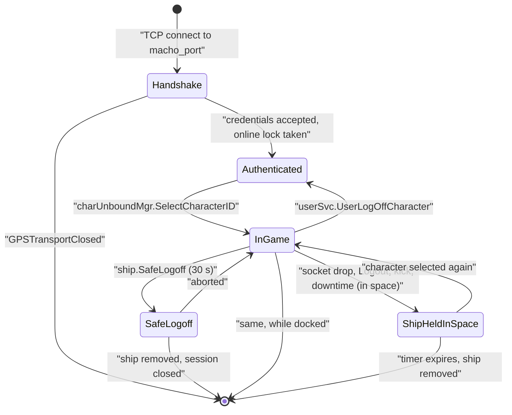

# Sessions, Login & Logoff

> **Navigation**: [EvoMu Technical Wiki](../README.md) • [Related Systems](#related-systems--cross-references)
>
> [← Back to Wiki Table of Contents](../README.md)

---

## Overview

A **session** is the server's record of one connected game client: which account it belongs to, which character is selected, and where that character is (station, structure or solar system, and in which ship). The client keeps its own copy of these attributes and the server must tell it about every change, in the right order relative to RPC replies and space updates.

This article follows a session from the TCP connection to the moment the character's ship is finally removed from space:

The wire format of the handshake packets is covered in [MachoNet Protocol, Quasar Services & Wire Infrastructure](machonet_wire_and_quasar_gateway.md). The combat timers that block or extend logoff are covered in [Crimewatch & Engagement Timers](../combat_and_crimewatch/crimewatch_and_engagement_timers.md).

---

## Canonical Mechanics

All rules below are what the code does at the pinned commit.

### Connection limits

| Limit | Value | Constant |
|---|---|---|
| Unauthenticated connections per peer IP | 32 | `MAX_PREAUTH_CONNECTIONS_PER_IP` |
| Time to finish the handshake | 15 s | `PREAUTH_HANDSHAKE_DEADLINE_SECS` |
| Frame size before authentication | 64 KiB, 4096 decoded nodes | `MAX_PREAUTH_MACHO_FRAME_LEN`, `MAX_PREAUTH_DECODED_NODES` |
| Idle time between frames after authentication | 300 s | `IDLE_READ_TIMEOUT_SECS` |
| Time to read a frame body / write a frame | 30 s each | `FRAME_BODY_TIMEOUT_SECS`, `WRITE_FRAME_TIMEOUT_SECS` |
| Concurrent MachoNet connections | 512 | `MAX_CONCURRENT_CONNECTIONS` in `main.rs` |

### Handshake and login

`handle_macho_client` drives `MachoHandshakeStateMachine` from `eve-machonet`. The phases are `AwaitingVersionExchange`, `AwaitingCommandOrCrypto`, `AwaitingCryptoChallenge`, `AwaitingHandshakeResult`, `Authenticated`.

1. **Server hello.** On accept the server sends the version tuple. Its user count is the number of online sessions (at least 1).
2. **Version check.** The client's region, codename, version number, MachoNet version and build are compared with the server's. A mismatch closes the connection with `HANDSHAKE_INCOMPATIBLEREGION`, `…RELEASE`, `…VERSION`, `…PROTOCOL` or `…BUILD`. The build check only rejects clients older than the server's build.
3. **Command.**
   - `(None, "QC")` (queue check): the server answers `1` and sends the hello again. The client uses this for its server-status probe and then continues on the same socket.
   - `(None, "VK", key)` (VIP key): the key is stored and nothing else happens.
   - Crypto request: the key version must be `placebo`; the server answers `"OK CC"`.
4. **Challenge.** The client sends its login dictionary. For a password login whose first attempt carries no password, the server answers `1` (password version 1) so that the client resends with the password filled in. The server then checks the credentials and answers with `2` and the server handshake, which also carries the client configuration values (bug-report URL, chat address).
5. **Result.** The client returns a hash of the server challenge, which must equal `placebo_crypto_hash`. The server then sends three frames: the handshake acknowledgement, a `SessionInitialStateNotification`, and a `SessionChangeNotification` with the account-level attributes.

**Credentials.** `WorldRepository::authenticate_at` accepts either:

- a password, verified against the stored Argon2id hash (a legacy `sha256$v1$` format is also accepted); or
- a launcher SSO access token. A token with two dots is tried as a JWT; it must verify (see [ESI Web API & Single Sign-On](esi_api_and_sso.md)) and its audience must include `evomu-launcher` or `eveLauncherTQ`. The user name may be empty, `__sso__` or `EVE-SSO-CONNECTION`; if a name is given it must belong to the token's account.

Failures close the connection with `GPSTransportClosed` and one of `LoginAuthFailed`, `UserBanned`, `AccountSuspended` (both with reason and expiry) or `ClusterShuttingDown` (a non-GM account while the server is shutting down).

**After the handshake** the listener re-checks the ban state, clears any old revocation for this session, and takes the account's **online lock** with `acquire_online_lock_with_computer_hash(..., allow_displace = true)`. An account has one online session. If another session held the lock, that session's character is logged off, its socket is closed with reason `ACL_DISPLACED`, and its bound objects are released.

From then on every packet is checked with `check_session_revoked`: a ban, suspension, kick or displacement closes the connection (`UserBanned`, `AccountSuspended`, `SessionKicked`).

### Login encryption and the `Placebo` setting

This summarises section 3 of [`docs/BLOCKERS.md`](../../BLOCKERS.md).

- The client is pointed at EvoMu with command-line arguments only: `/server:127.0.0.1 /port:<macho_port> /login:<user>:<password>`. No client file needs to change for that.
- The stock client's `start.ini` sets `cryptoPack = CryptoAPI`. With that pack the client encrypts the handshake session key with CCP's RSA public key, and every frame after `"OK CC"` is AES-encrypted with a key that only CCP's private key can recover. No third-party server can read that login request.
- EvoMu implements the `Placebo` pack, in which the handshake is not encrypted. `MachoHandshakeStateMachine::step` refuses a crypto request that carries `crypting_sessionkey` (the mark of the CryptoAPI pack) with `HANDSHAKE_INCOMPATIBLEPUBLICKEY` and a message that says to set `cryptoPack = Placebo`.
- Working procedure: copy the client's `build/` directory to a plain directory, add a `common.ini` containing `[main]` and `cryptoPack = Placebo` (the client merges `common.ini` over `start.ini`), and run that copy's `bin64/exefile` with the arguments above; [`tools/launch_client.py`](../../../tools/launch_client.py) automates this into `~/.evomu/client`. Adding the file inside a copy of the `.app` bundle breaks its code signature, and symlinked copies fail the client's own path checks.
- Status recorded there: the bridge-harness journeys pass, while the real-client journey run (`plan:T-6`) is marked partial, with no real-client journey attested yet.

### Between login and character selection

[`client_login.rs`](../../../crates/eve-server/src/services/client_login.rs) answers the calls the client makes before a character is chosen: error telemetry (`alert.BeanCount`, `alert.SendClientStackTraceAlert`, `alert.BeanDelivery`), `config.GetBlackListedPlanets`, `air_npe.is_air_npe_enabled`, character-selection data and settings.

- `multiLoginBlocker.Login(computerhash)` returns `True` or `False`. It applies the computer-hash rule in `has_alpha_computer_hash_conflict`: two accounts on the same computer hash conflict when either of them is an Alpha account (all characters with `clone_grade <= 1`).
- `authentication.Login(username, password)` re-authenticates inside an existing connection. It logs off the current character first and refuses non-GM accounts with `ClusterShuttingDown` during shutdown or downtime.

### Character selection

`charUnboundMgr.SelectCharacterID(charID)` (in [`character_gm_tools.rs`](../../../crates/eve-server/src/services/character_gm_tools.rs)):

1. Checks that the character belongs to the account (`CharacterSelectionDenied` otherwise) and is not online in another session (`CharacterAlreadyOnline`).
2. Releases the session's bound objects and records the character on the online lock.
3. Reconciles a character that logged off inside an Abyssal pocket (`reconcile_abyssal_login`).
4. Fills the session: character, corporation, alliance, militia faction, race, location and ship from the `CharacterRecord`, and `corp_role` from the character's effective corporation roles (all bits for a CEO).
5. If the character is in space, calls `reconnect_character_in_space_sync` (see below).
6. Joins local chat, restores fleet state, issues a chat token, catches up the skill queue, tells watchers the character is online, and clears any stale safe-logoff entry.
7. Starts a session-change timer with reason `login`.

### Session attributes

`SessionState` (in [`eve-machonet`](../../../crates/eve-machonet/src/lib.rs)) holds the attributes. `compute_diff` compares two states and produces `(old, new)` pairs under the client's attribute names:

| Client attribute | Meaning |
|---|---|
| `userid`, `role`, `languageID`, `address`, `userType` | Account level; set at login |
| `charid`, `corpid`, `allianceid`, `warfactionid`, `raceID` | Character identity |
| `corprole`, `rolesAtAll`, `corpAccountKey` | Corporation roles and wallet division |
| `stationid`, `structureid` | Set while docked |
| `solarsystemid2` | The solar system, docked or not |
| `solarsystemid` | The solar system only while in space |
| `locationid` | Station, structure or solar system, whichever applies |
| `constellationid`, `regionid` | Derived from the solar system |
| `shipid` | Active ship |
| `fleetid` | Current fleet |

### Session-change notifications

There are two channels, and both are used:

1. **MachoNet `SessionChangeNotification` packets.** `execute_call_req_wire` clones the session before each RPC, and afterwards builds a packet from the diff (`to_session_change_pyrep`), adds scoped corporation roles, and hands it to the outbound sequencer. A session that changed outside an RPC (for example a death that moves the character to a clone station) is picked up from the notification channel in the listener loop and produces the same packet.
2. **`OnSessionChanged` notifications** with the arguments `(False, session keyval, change dict)`. They are sent by `emit_on_session_changed` in the transition pipeline and by `record_session_change_timer`, whose session keyval also carries `nextSessionChange`.

**Session-change timer.** `record_session_change_timer` stores a 10-second timer per character with a reason string (`login`, `undock`, `dock`, `jump_drive`, `board_or_eject`, …). `check_session_change_timer_active` reports it as active until 10 seconds have passed, or until 10 simulation ticks have passed in the same system when the caller supplies the current tick. Handlers that move the character (docking, warp and jump handlers, cynosural and conduit jumps, clone jump, fleet moves, corporation changes, filament activation) consult it, and reject with an error such as `SessionChangeInProgress` while it is active. The `jump_drive` reason also grants 60 seconds of location-change invulnerability.

### Entering and leaving space on the wire

Location changes go through one pipeline, `execute_session_transition` in [`session_transition.rs`](../../../crates/eve-server/src/router/session_transition.rs). A `TransitionKind` names the event: `Dock`, `Undock`, `JumpSystem`, `BoardShip`, `EjectToPod`, `CloneJump`, `DeathRespawn`, `Teleport`, `CharacterLogin`, `Logout`. The pipeline updates the character record, item locations, the ballpark, bound objects, local chat membership, the Quasar gateway and the `SessionState`, and emits `OnSessionChanged`.

On the socket, [`outbound_sequencer.rs`](../../../crates/eve-server/src/outbound_sequencer.rs) decides the order of frames. Each connection has a `DestinyStream` with three states:

| State | Meaning |
|---|---|
| `Detached` | Not in space; no space updates are sent |
| `AwaitingSetState { epoch }` | Entered space or changed system; updates are dropped until a full `SetState` for this epoch arrives |
| `Live { epoch, set_state_stamp, last_stamp }` | Incremental updates flow; an update older than the last `SetState` is dropped |

The ordering rules it enforces:

- A `SessionChangeNotification` is sent before the `CallRsp` of the RPC that caused it.
- When leaving space (docking), buffered space updates are flushed before the `SessionChangeNotification`.
- Entering space or changing system starts a new epoch and waits for `SetState`.
- A ship switch in the same system while `Live` (ejecting to a pod when the ship dies) sends `AddBalls2` before the `SessionChangeNotification` and defers `RemoveBall` of the old hull by two ticks so the client's ballpark keeps the old ball across the handshake.
- If the connection falls behind the system's broadcast channel, the stream returns to `AwaitingSetState` and is resynchronised with a new `SetState`.

### Leaving: logout, disconnect, kick

| Trigger | Entry point | Result for the connection |
|---|---|---|
| `authentication.Logout` | `account_services::handle` | Online lock released, session cleared; reply `{loggedOut, removedFromSpace, savedSolarSystemID}` |
| `userSvc.UserLogOffCharacter` | `account_services::handle` | Character cleared, account stays logged in (back to character selection) |
| Socket closed or timed out | `cleanup_disconnected_client_session` | Lock released, bindings and Quasar subscriptions dropped |
| Kick, ban, displacement, daily downtime, cluster shutdown, completed safe logoff | `disconnect_session` | `GPSTransportClosed` with a reason code (`SessionKicked`, `ACL_DISPLACED`, `ClusterShutdown`, `SafeLogoff`), then the same cleanup |

All of them end in the same character teardown. `logoff_character_sync` cancels open trades, releases structure control, saves the ship's position, calls `handle_character_logoff_or_disconnect_sync`, tells watchers and the fleet that the character is offline, revokes the chat token and clears queued notifications. The two RPCs do the equivalent through `save_location_and_leave_space`.

A character that is docked simply goes offline. A character in space leaves its ship behind.

### The ship left in space

`handle_character_logoff_or_disconnect_sync` and `build_disconnected_ship_entry_sync` apply these rules when a character in space goes offline without a completed safe logoff:

**How long the ship stays.** The removal time is the latest of:

| Term | Value |
|---|---|
| Base | 60 s (`UNAGGRESSED_LOGOFF_REMOVE_SECS`); 300 s if the ship has active modules or a cloak, holds target locks, or has an active link, cyno, bridge or immobilising module |
| Weapons timer | its expiry (the timer is 60 s, `WEAPONS_TIMER_SECS`) |
| NPC timer | its expiry (300 s, `NPC_TIMER_SECS`) |
| PvP timer, criminal timer | their expiry (900 s each, `PVP_TIMER_SECS`, `CRIMINAL_TIMER_SECS`) |
| Hold | the end of the longest active module cycle, cyno or navigation lock; 300 s from now for an immobilised ship |

- Player aggression against the ship after its pilot has gone renews the removal time to 15 minutes from that moment (`record_pvp_aggression_and_renew_logoff_timer`). NPC aggression does not (`record_npc_aggression_timer` returns early for a disconnected ship).
- Each cluster tick, `collect_expired_disconnected_ships_filtered` also extends the time while a module cycle, cyno or navigation lock is still running.

**Emergency warp.** If the ship was already in warp, that warp continues. Otherwise the ship warps 1,000,000 km (`EMERGENCY_WARP_DISTANCE_M`) in a direction derived from the character and ship ids, unless any of these holds: it is warp scrambled; it is in an Abyssal system; the pilot has a criminal timer in a system with security 0.45 or higher; the pilot has a weapons timer; a navigation lock or immobilising module blocks warping. A ship that was only aligning is stopped.

**What is kept.** A `DisconnectedShipEntry` is stored in the world state: character, ship and type, solar system, disconnect time, `remove_at_unix`, emergency-warp destination, last position, position before the emergency warp, and a `removed_from_space` flag. The ship's hit points are written to the database, its drones and fighters are abandoned, and the ball stays in the ballpark, where it can be shot.

**Removal.** When the time is up, `finalize_expired_disconnected_ship` deactivates modules, clears any cyno, removes the ball, records the final position and hit points (`leave_space_in_snap`) and sets `removed_from_space`. The ship item and its position stay in the database.

**Coming back.** `reconnect_character_in_space_sync` runs at character selection. It removes the entry and puts the character back in space at the entry's last position, or the saved item position, or a fallback if neither is a valid position. If the ball is still in space it keeps its live position, capacitor and combat state. If the ship had emergency-warped away and can warp, it warps back to where it was; if it cannot, the outbound warp is stopped.

### Safe logoff

`ship.SafeLogoff` (`handle_safe_logoff`) returns a list of failed conditions and sends `OnSafeLogoffFailed` with the same list when any applies:

| Code | Condition |
|---|---|
| `SAFE_LOGOFF_DOCKED` | Not in space |
| `SAFE_LOGOFF_WARP_SCRAMBLED` | Ship is warp scrambled |
| `SAFE_LOGOFF_ACTIVE_MODULES` | A module is active or overloaded, a cloak or navigation lock is on, or a mining cycle is running |
| `SAFE_LOGOFF_IN_WARP` | Ship is in warp |
| `SAFE_LOGOFF_DRONES_IN_SPACE` | Drones or fighters are out and not abandoned |
| `SAFE_LOGOFF_PROBES_IN_SPACE` | Scanner or moon probes are out |
| `SAFE_LOGOFF_WEAPONS_TIMER`, `SAFE_LOGOFF_NPC_TIMER`, `SAFE_LOGOFF_PVP_TIMER`, `SAFE_LOGOFF_CRIMINAL_TIMER` | The matching timer is running |
| `SAFE_LOGOFF_SELF_DESTRUCT_ACTIVE` | A self-destruct countdown is running |

If none applies, the ship is stopped, a `SafeLogoffEntry` is stored with a completion time 30 seconds ahead (`SAFE_LOGOFF_COUNTDOWN_SECS`), `OnSafeLogoffTimerStarted` is sent with that time, and the call returns an empty list.

- **Abort.** `ship.AbortSafeLogoff` removes the entry and sends `OnSafeLogoffAborted`. `maybe_abort_safe_logoff_on_action` does the same when the pilot gives or takes aggression (`SAFE_LOGOFF_ABORT_AGGRESSION`), and the cluster tick aborts with `SAFE_LOGOFF_ABORT_MODULE` when a blocking space condition appears during the countdown.
- **Completion.** On the first cluster tick after the completion time, drones are abandoned, the position is saved, modules and cyno are cleaned up, the ball is removed from space, `OnSafeLogoffActivated` is sent and the character's session is disconnected. No `DisconnectedShipEntry` is created.
- While a countdown is running, filament activation is refused with `LogoffTimerActive`.

### Not implemented / known gaps

- **The unmodified client requires `cryptoPack = Placebo`.** Only the `Placebo` crypto pack is implemented; see above and [`tools/launch_client.py`](../../../tools/launch_client.py). `docs/BLOCKERS.md` records the real-client journey run as partial.
- **No logon queue.** The queue check always answers position `1`.
- **The VIP key is not evaluated.** It is stored on the handshake machine; no code in the handshake reads it.
- **Logging out in space is not instant.** `authentication.Logout` and `userSvc.UserLogOffCharacter` in space follow the same rules as a dropped connection: the ship stays for at least 60 seconds unless a safe logoff completed first.
- **Open issue #875:** runtime state on `ServerContext`, which includes the session-change timers, is written to the database only from certain call sites and at downtime; there is no flush at shutdown.
- This article did not trace the Quasar gRPC session path or the JSON bridge listener (`bridge_port`), which share the same `SessionState` and cleanup functions.

---

## EvoMu Implementation Architecture

### Crates involved

- [`eve-machonet`](../../../crates/eve-machonet) — `MachoHandshakeStateMachine`, `SessionState`, packet types, `GPSTransportClosed`.
- [`eve-server`](../../../crates/eve-server) — listener, dispatcher, session transitions, logoff lifecycle.
- [`eve-db`](../../../crates/eve-db) — accounts, online lock, kick and displacement records, persisted lifecycle state.
- [`eve-destiny`](../../../crates/eve-destiny) — the ballpark that holds the ship ball.

### Primary handlers and dispatch

| File | Role |
|---|---|
| [`macho_listener.rs`](../../../crates/eve-server/src/macho_listener.rs) | `handle_macho_client`, `execute_call_req_wire`, pre-auth limits |
| [`handshake.rs`](../../../crates/eve-machonet/src/handshake.rs) | `MachoHandshakeStateMachine::step`, `complete_challenge`, `placebo_crypto_hash` |
| [`outbound_sequencer.rs`](../../../crates/eve-server/src/outbound_sequencer.rs) | `DestinyStream`, `SessionWireState`, `sequence`, `sequence_tick` |
| [`router/session_transition.rs`](../../../crates/eve-server/src/router/session_transition.rs) | `TransitionKind`, `execute_session_transition`, `emit_on_session_changed` |
| [`router/binding.rs`](../../../crates/eve-server/src/router/binding.rs) | `disconnect_session`, `logoff_character_sync`, `cleanup_disconnected_client_session` |
| [`router/dispatch.rs`](../../../crates/eve-server/src/router/dispatch.rs) | Per-call revocation check; post-selection hooks |
| [`services/auth_cache.rs`](../../../crates/eve-server/src/services/auth_cache.rs), [`services/account_services.rs`](../../../crates/eve-server/src/services/account_services.rs) | `authentication.Login`, `authentication.Logout`, `userSvc.UserLogOffCharacter`, `multiLoginBlocker.Login` |
| [`services/character_gm_tools.rs`](../../../crates/eve-server/src/services/character_gm_tools.rs) | `charUnboundMgr.SelectCharacterID` |
| [`services/space_destiny.rs`](../../../crates/eve-server/src/services/space_destiny.rs) | `record_session_change_timer`, `check_session_change_timer_active` |
| [`sp6_lifecycle.rs`](../../../crates/eve-server/src/sp6_lifecycle.rs) | `handle_safe_logoff`, `handle_character_logoff_or_disconnect_sync`, `reconnect_character_in_space_sync` |
| [`sp6_lifecycle/disconnect_hold.rs`](../../../crates/eve-server/src/sp6_lifecycle/disconnect_hold.rs) | Removal time, emergency warp, final removal |
| [`accounts.rs`](../../../crates/eve-db/src/accounts.rs) | `authenticate_at`, `acquire_online_lock_with_computer_hash`, `check_session_revoked` |

### State

| State | Location | Durable |
|---|---|---|
| `SessionState` | Per connection, in the listener task | No |
| Online lock (`OnlineSessionRecord`: user, session, character, connect time, computer hash) | `AuthRuntime::online_sessions`, mirrored to `WorldStateSnapshot.sessions` | Mirrored |
| Displaced sessions, kicked users | `AuthRuntime::displaced_sessions`, `kicked_users` | Kicks are persisted |
| Login statistics (`last_login_unix`, `last_logout_unix`, `logins_count`) | `WorldStateSnapshot.character_login_stats` | Yes |
| Session-change timers | `ServerContext::session_change_timers`, saved with the server runtime state | Yes, when saved |
| Safe logoffs, disconnected ships | `Sp6PersistedState.safe_logoffs`, `.disconnected_ships` in `WorldStateSnapshot.sp6_lifecycle` | Yes |
| Combat timers used for logoff | Crimewatch state, combat runtime and `Sp6PersistedState` (`weapon_timers_until`, `npc_timers_until`, `pvp_timers_until`, `criminal_timers_until`); `active_timers_for_char` takes the latest of each | Yes |
| Ship position | `WorldStateSnapshot.item_positions` | Yes |

### Tick and lifecycle integration

- Each connection's task selects over three sources: frames from the socket, simulation tick batches for the subscribed solar system, and character notifications.
- The cluster tick in [`cluster_tick.rs`](../../../crates/eve-server/src/sp6_lifecycle/cluster_tick.rs) completes or aborts safe logoffs and removes disconnected ships whose time is up.
- Because disconnected ships and safe logoffs are in the world database, a ship left in space survives a server restart.

---

## Invariants, Security & Edge Cases

- One online session per account. A second login displaces the first; the displaced session cannot take the lock back.
- A token or password is checked again after the challenge round trip, so a ban applied during the handshake still blocks the login.
- Before authentication the listener accepts only handshake frames; an `AuthenticationReq` after the handshake gets an `AlreadyAuthenticated` error packet.
- Only unbound `authentication.Login`, `Logout` and `Ping`, `multiLoginBlocker.Login` and `petitioner.MayPetition` are exempt from the per-call revocation check.
- A character cannot be selected while it is online in another session.
- `cleanup_disconnected_client_session` does not run the character teardown twice: it skips it when another session now holds the lock or a `DisconnectedShipEntry` already exists.
- Updates for a system the session has left are discarded rather than sent after the `SessionChangeNotification`.

---

## Verification, Tests & Parity References

Ledger rows: `feat:account.native-handshake`, `feat:account.sso-login`, `feat:account.logout`, `feat:account.multi-login-block`, `feat:character.select-character`, `feat:character.safe-logoff`, `feat:character.emergency-warp-logoff`, `feat:crimewatch.pvp-logoff-timer-renewal`, `feat:navigation.session-change-timer`, `feat:serverops.session-changes`; `rpc:authentication.Login`, `rpc:authentication.Logout`, `rpc:multiLoginBlocker.Login`, `rpc:charUnboundMgr.SelectCharacterID`, `rpc:userSvc.UserLogOffCharacter`, `rpc:ship.SafeLogoff`, `rpc:ship.AbortSafeLogoff`; `notify:OnSessionChanged`, `notify:OnSafeLogoffTimerStarted`, `notify:OnSafeLogoffFailed`, `notify:OnSafeLogoffAborted`, `notify:OnSafeLogoffActivated`.

| Test file | Covers |
|---|---|
| [`handshake_machine.rs`](../../../crates/eve-machonet/tests/handshake_machine.rs), [`handshake_unit_tests.rs`](../../../crates/eve-machonet/src/handshake_unit_tests.rs) | Handshake phases and failure codes |
| [`client_handshake_v24.rs`](../../../crates/eve-server/tests/it/client_handshake_v24.rs), [`client_login_rpcs.rs`](../../../crates/eve-server/tests/it/client_login_rpcs.rs) | Listener handshake and the login-time RPCs |
| [`outbound_sequencer.rs`](../../../crates/eve-server/src/outbound_sequencer.rs) (tests in the same file) | Frame ordering rules |
| [`session_transition.rs`](../../../crates/eve-server/src/router/session_transition.rs) (tests in the same file), [`session_tests.rs`](../../../crates/eve-server/src/router/session_tests.rs) | Transitions and session sync |
| [`sp6_logoff_and_server_tick.rs`](../../../crates/eve-server/tests/it/sp6_logoff_and_server_tick.rs), [`sp6_lifecycle_unit_tests.rs`](../../../crates/eve-server/src/sp6_lifecycle_unit_tests.rs) | Safe logoff, disconnect timers, reconnect |
| [`disconnect_emergency_warp_and_cyno.rs`](../../../crates/eve-server/tests/it/disconnect_emergency_warp_and_cyno.rs), [`disconnect_hold_edges_tests.rs`](../../../crates/eve-server/src/sp6_lifecycle/disconnect_hold_edges_tests.rs) | Emergency warp and hold timers |

---

## Related Systems & Cross-References

- [**MachoNet Protocol, Quasar Services & Wire Infrastructure**](machonet_wire_and_quasar_gateway.md): framing, marshal format and handshake packets.
- [**ESI Web API & Single Sign-On**](esi_api_and_sso.md): how launcher tokens are issued and verified.
- [**Crimewatch & Engagement Timers**](../combat_and_crimewatch/crimewatch_and_engagement_timers.md): the weapons, PvP, NPC and criminal timers.
- [**Destiny Simulation Loop**](../ballpark_and_physics/destiny_simulation_loop.md): the ballpark and the `SetState` / update stream.
- [**Stargate Jumping & Cynosural Navigation**](../universe_and_navigation/stargate_jumping_and_cynosural_navigation.md): system changes that use the transition pipeline.
- [**Game-Master Tools & Server Operations**](game_master_tools_and_server_operations.md): kicks, bans and daily downtime.
- [**EvoMu Technical Wiki Table of Contents**](../README.md): master index.

---

[← Back to Wiki Table of Contents](../README.md)
