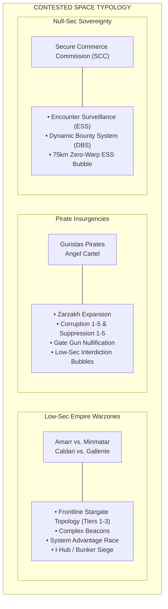
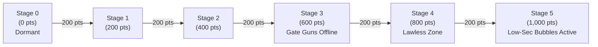
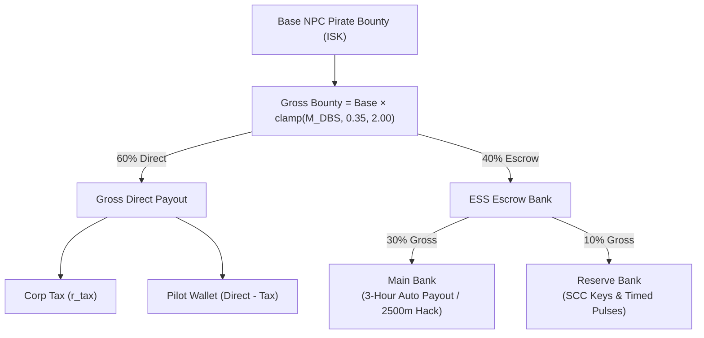
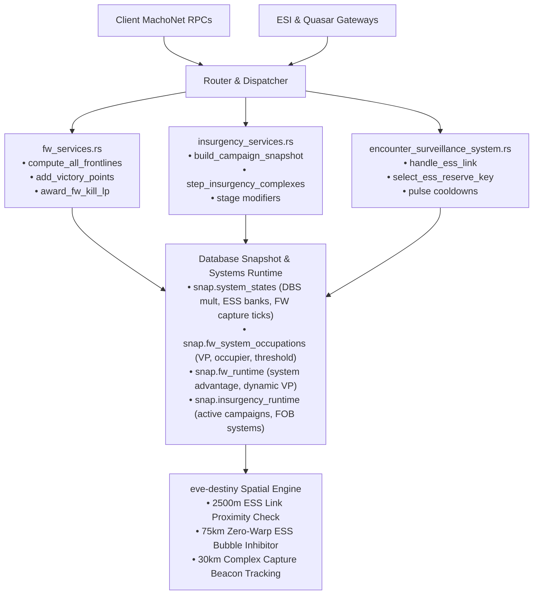

# Faction Warfare, Pirate Insurgencies & Encounter Surveillance System (ESS)

> **Navigation**: [EvoMu Technical Wiki](../README.md) • [Related Systems](#related-systems--cross-references)
>
> [← Back to Wiki Table of Contents](../README.md)

---

The territorial struggles of New Eden span across three distinct yet deeply interconnected asymmetric warfare paradigms: the border clashes of the four empire militias (**Faction Warfare**), the lawless shadow campaigns of pirate factions (**Insurgencies**), and the high-stakes robotic banking and bounty defense network of null-sec space (**Encounter Surveillance System & Dynamic Bounty System**).

In EvoMu, these systems form the core of contested space gameplay. They weave together graph-theoretic stargate topology, sub-second space physics grids, deterministic multi-character contest loops, dynamic macroeconomic yield curves, and strict CrimeWatch 2.0 flags.

---

## 1. Overview & Lore Context



### The Empire Warzones (Faction Warfare)
Signed in Y110 under the CONCORD Emergency Militia War Powers Act, capsuleers were authorized to enlist directly in four state-sponsored militias:
* **24th Imperial Crusade** (Amarr Empire — HQ: Mehatoor)
* **Tribal Liberation Force** (Minmatar Republic — HQ: Amo)
* **State Protectorate** (Caldari State — HQ: Onnamon)
* **Federal Defence Union** (Gallente Federation — HQ: Intaki)

Following the *Uprising* expansion, static warzone stagnation was replaced by dynamic frontline graph topology. Solar systems are not isolated islands; their strategic value, LP payout rates, and capture viability are direct functions of their adjacency to enemy-held systems. Capsuleers fight inside gated spatial complexes (**Capture Complexes** or "Plexes") ranging from novice-grade frigates to open capital battlefields, generating **Advantage** through logistics, propaganda, and listening posts, and accumulating **Victory Points (VP)** to force the system's Infrastructure Hub into a vulnerable siege state.

### Pirate Insurgencies (Havoc)
Originating from the ancient Jove station network centered at **Zarzakh**, the Deathless Circle brokered alliances with the **Guristas Pirates** and **Angel Cartel**. These insurgencies project pirate influence directly into empire low-sec and sovereign null-sec territories via mobile Forward Operating Bases (FOBs). 

Insurgencies operate as asymmetric tug-of-war campaigns across two competing ideological vectors:
* **Corruption:** Fueled by pirate capsuleers raiding mining convoys, hacking listening posts, and spreading lawlessness. At peak corruption, CONCORD gate sentries are disabled, and interstellar warp interdiction bubbles function inside low-sec space.
* **Suppression:** Driven by empire militia pilots and local defenders deploying police patrols and defensive infrastructure. Peak suppression turns low-sec systems into heavily fortified bastions with supercharged sentry guns.

### Encounter Surveillance System & Dynamic Bounty System
Governed by the **Secure Commerce Commission (SCC)**, the Encounter Surveillance System is an automated anti-fraud and banking network mandated in all K-space null-security systems ($\le 0.0$ security status). To prevent runaway macroeconomic inflation from automated null-sec ratting:
1. Every pirate bounty payout is scaled by the **Dynamic Bounty System (DBS)** multiplier, dynamically adjusting to ratting volume and PvP capsuleer destruction.
2. The gross bounty is split: a direct cash transfer goes to the pilot's wallet, while the remainder is placed escrow inside the system's physical **ESS Main Bank** and **ESS Reserve Bank**.
3. The ESS Main Bank automatically pays out all accumulated bounties to contributing ratters every 3 hours. However, an external capsuleer can warp to the ESS beacon, enter its $75\text{ km}$ warp-disrupted, propulsion-inhibiting spatial bubble, and hack the bank tether, initiating a public solar system heist that flags them as a Suspect.

---

## 2. Canonical Mechanics & Precise Formulas

| System | Primary Drivers | Key Thresholds & Payouts |
| :--- | :--- | :--- |
| **FW Frontline Graph** | Stargate jump adjacency | Frontline: $1.5\times$ LP<br/>Command: $1.0\times$ LP<br/>Rearguard: $0.75\times$ LP |
| **FW Advantage & Complex** | Friendly/Enemy Advantage<br/>Contested % (VP / Threshold) | $M_{\text{capture}} \in [0.5, 2.0]$<br/>$100\%$ VP $\rightarrow$ Bunker Vulnerable |
| **Insurgency Stages** | 1,000 Points total<br/>Corruption vs. Suppression | $200\text{ pts/stage}$ (Stages 1–5)<br/>C3: Gate Guns Offline<br/>C5: Low-Sec Bubbles Enabled |
| **Dynamic Bounty (DBS)** | Ratting ISK vs. PvP Losses<br/>$1.35$ equilibrium drift | DBS mult $\in [0.35, 2.00]$<br/>Ratting decays; PvP boosts |
| **ESS Bounty Split** | DBS gross bounty | $60\%$ Direct (minus Corp Tax)<br/>$30\%$ ESS Main Bank<br/>$10\%$ ESS Reserve Bank |
| **ESS Thefts & Keys** | $2\,500\text{ m}$ Beacon Link<br/>Quadrant Keys (Group 4102) | Main: Full pot + $15\text{ min}$ Suspect flag<br/>Reserve: $60\text{ s}$ pulses over key duration |

### Stargate Graph Topology & Frontline Classification
Let the warzone stargate network be represented as an undirected graph $G = (V, E)$, where $V_{\text{WZ}} \subset V$ represents the set of recognized warzone solar systems. Each system $s \in V_{\text{WZ}}$ has an occupier faction $\mathcal{F}(s) \in \{\text{Amarr}, \text{Minmatar}, \text{Caldari}, \text{Gallente}\}$.

The operational tier $\mathcal{T}(s)$ is determined dynamically on snapshot generation:
1. **Frontline ($\mathcal{T} = 1$):** A warzone system directly connected via stargates to an enemy-held warzone system:
   $$\exists (s, v) \in E \quad \text{s.t.} \quad v \in V_{\text{WZ}} \land \text{IsEnemy}(\mathcal{F}(s), \mathcal{F}(v))$$
2. **Command Operation ($\mathcal{T} = 2$):** A non-frontline system directly connected to a friendly frontline system:
   $$s \notin \text{Frontlines} \quad \land \quad \exists (s, v) \in E \quad \text{s.t.} \quad \mathcal{T}(v) = 1 \land \text{IsAllied}(\mathcal{F}(s), \mathcal{F}(v))$$
3. **Rearguard ($\mathcal{T} = 3$):** Any warzone system that is neither a Frontline nor a Command Operation.

The warzone status directly scales Loyalty Point rewards for all capture complexes and PvP kills:

| Status Tier | Code Identifier | LP Multiplier ($M_{\text{status}}$) | Capture Speed Baseline |
| :--- | :--- | :--- | :--- |
| **Frontline** | `STATUS_FRONTLINE = 1` | $1.50\times$ ($150\%$) | Maximum intensity |
| **Command Operation** | `STATUS_COMMAND = 2` | $1.00\times$ ($100\%$) | Standard baseline |
| **Rearguard** | `STATUS_REARGUARD = 3` | $0.75\times$ ($75\%$) | Suppressed reward |

### Advantage Multiplier & Complex Capture Loop
Each warzone system maintains continuous friendly and enemy advantage percentages:

$$A_{\text{friendly}}, A_{\text{enemy}} \in [0.0, 100.0]$$

The complex capture speed multiplier $M_{\text{capture}}$ modifies how rapidly the capture beacon counter advances per simulation tick:

$$M_{\text{capture}} = \text{clamp}\left(1.0 + (A_{\text{friendly}} - A_{\text{enemy}}) \times 0.005, \; 0.5, \; 2.0\right)$$

During each space simulation tick ($\Delta t$ seconds):
* **Contested Beacon Rule:** If ships from opposing factions are simultaneously present within the complex beacon capture perimeter ($\le 30{,}000\text{ m}$), capture progress strictly pauses.
* **Friendly Defender De-Plexing:** If friendly defender ships hold the grid alone, the complex de-plexes toward zero:
  $$\Delta t_{\text{elapsed}} = \max\left(0, \; t_{\text{elapsed}} - \text{round}(\Delta t \times M_{\text{capture}})\right)$$
* **Attacker Advancing:** If enemy attacker ships hold the grid alone, the complex advances toward the capture threshold $T_{\text{cap}}$ (canonical baseline: $600\text{ s}$ to $1200\text{ s}$):
  $$\Delta t_{\text{elapsed}} = \min\left(T_{\text{cap}}, \; t_{\text{elapsed}} + \text{round}(\Delta t \times M_{\text{capture}})\right)$$

When $t \ge T_{\text{cap}}$, the complex is completed:
1. **LP Payout:** Total complex LP is awarded:
   $$\text{Total LP} = \text{round}\left(15{,}000 \times M_{\text{status}}\right)$$
   Divided equally among all $N_{\text{pilots}}$ qualifying fleet members within capture range:
   $$\text{LP}_{\text{pilot}} = \left\lfloor \frac{\text{Total LP}}{N_{\text{pilots}}} \right\rfloor$$
2. **Victory Points:** Victory points ($+20\text{ VP}$ per kill or $+X\text{ VP}$ per complex) are added to the system's accumulated total.
3. **Contested Percentage & Siege State:**
   $$\text{Contested } \% = \text{clamp}\left(\frac{\text{VictoryPoints}}{\text{Threshold}} \times 100.0, \; 0.0, \; 100.0\right)$$
   When $\text{Contested } \% \ge 100.0\%$, the system's territorial Infrastructure Hub (FW Bunker) loses its invulnerability shielding and enters the vulnerable siege state.

### Militia Ranks & Combat Kill LP
Capsuleer militia rank is derived purely from unmodified faction standing $S \in [-10.0, 10.0]$:

$$\text{Militia Rank}(S) = \begin{cases} 0, & \text{if } S < 0.75 \\ \text{clamp}\left(\left\lfloor \frac{S}{0.75} \right\rfloor, \; 1, \; 9\right), & \text{if } S \ge 0.75 \end{cases}$$

When an opposing militia capsuleer is destroyed inside a warzone solar system, the killer is awarded LP based on the victim's destroyed ship value $V_{\text{ship}}$ (in ISK), scaled by the frontline tier:

$$\text{Base LP} = \text{clamp}(V_{\text{ship}} \times 0.0001, \; 100, \; 50{,}000\right)$$
$$\text{Awarded LP} = \text{round}\left(\text{Base LP} \times M_{\text{status}}\right)$$

In addition, $+20\text{ VP}$ is credited directly to the solar system's warzone occupation state and the pilot's historical statistics.

### Pirate Insurgency Progression & Havoc Stages
Pirate Insurgency campaigns proceed through three immutable finite-state machine (FSM) phases:
1. **Forecasting ($48\text{ h}$):** Campaign announced; staging systems identified; FOB invulnerable.
2. **Active ($7\text{ days}$):** Pirate Forward Operating Base becomes physically vulnerable; all corruption/suppression sites spawn.
3. **WindDown ($48\text{ h}$):** FOB destroyed or campaign expired; remaining site cleanups.

Each insurgency solar system tracks integer points $P \in [0, 1000]$ for both Corruption ($P_C$) and Suppression ($P_S$). The active stage $k \in \{0, 1, 2, 3, 4, 5\}$ is given by:

$$\text{Stage}(P) = \begin{cases} 0, & \text{if } P = 0 \\ \text{clamp}\left(\left\lceil \frac{P}{200} \right\rceil, \; 1, \; 5\right), & \text{if } P > 0 \end{cases}$$



#### Havoc Stage Modifiers
* **Corruption Stage 3:** CONCORD and faction sentry guns on stargates and station exteriors are completely powered down (`sentry_gun_aggression` returns false). Criminal capsuleers may engage targets on gate grids without automated turret fire.
* **Corruption Stage 5:** The system's effective security status is clamped to $0.0$ (`securityMgr.get_modified_systems`). Low-sec safety mechanics dissolve: warp interdiction spheres, warp disruptor probes, and interdictor bubble launchers are fully functional.
* **Suppression Stages 1–5:** Sentry turret tracking and damage are overcharged; NPC police patrol density increases; capsuleer security status gains from pirate kills receive up to a $+50\%$ boost.

---

### Dynamic Bounty System (DBS) & ESS Bounty Split
The DBS equilibrium target is set to $1.35$ ($135\%$). During each simulation step, the system multiplier $M_{\text{DBS}} \in [0.35, 2.00]$ is updated based on ratting activity and capsuleer combat losses:

$$\Delta M_{\text{DBS}} = -\left(\frac{\text{Ratting ISK Destroyed}}{50{,}000{,}000}\right) \times 0.10 + \left(\frac{\text{PvP ISK Destroyed}}{25{,}000{,}000}\right) \times 0.15 + \Delta_{\text{drift}}$$

Where equilibrium drift $\Delta_{\text{drift}}$ pulls toward baseline if no destruction occurs:

$$\Delta_{\text{drift}} = (1.35 - M_{\text{DBS}}) \times 0.05$$



When an NPC pirate is destroyed in a K-space null-sec system (`sys_sec <= 0.0` and `sys_id < 31_000_000`):
1. **Gross Bounty Calculation:**
   $$B_{\text{gross}} = B_{\text{base}} \times \text{clamp}(M_{\text{DBS}}, 0.35, 2.00)$$
2. **Direct Payout (60%):**
   $$P_{\text{direct}} = 0.60 \times B_{\text{gross}}$$
   $$T_{\text{corp}} = P_{\text{direct}} \times \text{clamp}(r_{\text{tax}}, 0.0, 1.0)$$
   $$W_{\text{pilot}} = P_{\text{direct}} - T_{\text{corp}}$$
   $W_{\text{pilot}}$ is credited immediately to the capsuleer's wallet.
3. **ESS Main Bank Escrow (30%):**
   $$E_{\text{main}} = 0.30 \times B_{\text{gross}}$$
   Deposited into `system_states[sys_id].ess_main_bank`.
4. **ESS Reserve Bank Escrow (10%):**
   $$E_{\text{reserve}} = 0.10 \times B_{\text{gross}}$$
   Deposited into `system_states[sys_id].ess_reserve_bank`.

### ESS Spatial Grid, Hacking & Payout Mechanics
The Encounter Surveillance System structure (Type ID `32882`) projects a permanent $75\text{ km}$ spherical zero-warp bubble. Inside this volume:
* Warp drives cannot initiate warp or be warped to.
* Micro Warp Drives (MWD) and Micro Jump Drives (MJD) are disabled.
* Cloaking devices are disabled and decloak immediately upon entering.

#### Main Bank Intrusion
To rob the Main Bank:
1. A capsuleer must pilot a ship within $d \le 2{,}500\text{ m}$ of the ESS beacon.
2. The pilot must set Safety to Yellow or Red (Green safety strictly rejects the action with `SafetyLevelRestricted`).
3. An intrusion link is initialized via `essMgr.AttemptLinkToMainBank`. A 15-minute ($900\text{ s}$) **Suspect Timer** is applied to the pilot, and a system-wide intrusion notification is broadcast.
4. After link maturity (5 ticks in the simulation engine), the entire accumulated balance of `ess_main_bank` is transferred directly to the hacker's balance, and `ess_main_bank` is reset to 0.

#### Reserve Bank Intrusion & SCC Keys
Robbing the Reserve Bank requires physical SCC Reserve Security Keys carried in cargo:

| Key Type ID | Quadrant | Key Group | Unlock Duration |
| :--- | :--- | :--- | :--- |
| `57714` / `57715` | North-West (NW) | Group 4102 | $15\text{ min}$ / $45\text{ min}$ |
| `57716` / `57719` | North-East (NE) | Group 4102 | $15\text{ min}$ / $45\text{ min}$ |
| `57717` / `57718` | South-East (SE) | Group 4102 | $15\text{ min}$ / $45\text{ min}$ |
| `57720` / `57721` | South-West (SW) | Group 4102 | $15\text{ min}$ / $45\text{ min}$ |

Upon invoking `essMgr.AttemptLinkToReserveBank`:
1. The engine calls `select_ess_reserve_key_in_cargo`, verifying the key's SCC quadrant matches the solar system's region quadrant.
2. The key item is consumed from ship cargo.
3. The bank enters an unlocked state for $T_{\text{key}} \in \{15, 45\}$ minutes, configuring $P_{\text{total}} = T_{\text{key}}$ pulses.
4. Each pulse drains an equal fraction of the remaining reserve balance:
   $$\text{Payout}_{\text{pulse}} = \text{clamp}\left(\left\lfloor \frac{\text{Reserve Bank Balance}}{P_{\text{remaining}}} \right\rfloor, \; 1, \; \text{Reserve Bank Balance}\right)$$
5. A strict $60\text{ s}$ cooldown is enforced between successive pulses (`EssReservePulseCooldown`).

---

## 3. EvoMu Implementation Architecture

EvoMu manages territorial conflict across specialized domain services, integrating the Destiny physics engine, CrimeWatch flag monitors, and transactional SQLite snapshot storage.



### Core Source Files & Responsibilities

| File Path | Primary Responsibilities |
| :--- | :--- |
| [`crates/eve-server/src/services/fw_services.rs`](../../../crates/eve-server/src/services/fw_services.rs) | Warzone frontline topology derivation, victory points, advantage updates, militia ranks, and LP calculations. |
| [`crates/eve-server/src/services/insurgency_services.rs`](../../../crates/eve-server/src/services/insurgency_services.rs) | Havoc pirate campaigns, Corruption/Suppression point ticks, FOB lifecycles, and complex capture tick processing. |
| [`crates/eve-server/src/services/encounter_surveillance_system.rs`](../../../crates/eve-server/src/services/encounter_surveillance_system.rs) | `essMgr` MachoNet handlers, 2500m proximity checks, Safety green restrictions, SCC key validation, and Reserve Bank pulses. |
| [`crates/eve-server/src/services/combat_legacy_ess.rs`](../../../crates/eve-server/src/services/combat_legacy_ess.rs) | Legacy combat dispatch, DBS multiplier tick evolution, and 60/30/10 bounty splitting during NPC pirate kills. |
| [`crates/eve-server/src/services/crimewatch_timers.rs`](../../../crates/eve-server/src/services/crimewatch_timers.rs) | CrimeWatch Suspect flag issuance, Corruption 3 gate gun deactivation, and Corruption 5 lawless security overrides. |
| [`crates/eve-server/src/formulas.rs`](../../../crates/eve-server/src/formulas.rs) | Pure KaTeX-aligned mathematical functions: [`compute_dbs_and_ess_bounty_split`](../../../crates/eve-server/src/formulas.rs#L636) and capture rate equations. |

### Data Structures & State Representation

#### 1. System Dynamic State (`eve-db`)
Dynamic territorial states are persisted within each solar system's record in [`crates/eve-db/src/types.rs`](../../../crates/eve-db/src/types.rs#L1280-L1310):

```rust
pub struct SystemDynamicState {
    pub solar_system_id: u32,
    pub dbs_multiplier: f64,               // Clamped in [0.35, 2.00]
    pub ess_main_bank: IskCents,           // Accumulated Main Bank balance
    pub ess_reserve_bank: IskCents,        // Accumulated Reserve Bank balance
    pub ess_linked_character_id: Option<i64>,
    pub ess_link_started_tick: Option<u64>,
    pub sov_alliance_id: Option<i64>,
    pub military_index: u8,
    pub industrial_index: u8,
    pub strategic_index: u8,
    pub fw_contested_pct: f64,            // Clamped in [0.0, 100.0]
    pub insurgency_corruption_stage: u8,  // 0 to 5
    pub insurgency_suppression_stage: u8, // 0 to 5
    pub fw_complex_position: Option<[f64; 3]>,
    pub fw_capture_seconds_elapsed: u64,
    pub fw_capture_duration_seconds: u64,
    pub last_fw_capture_tick: u64,
}
```

#### 2. Faction Warfare System Occupations
Persisted in `snap.fw_system_occupations`:

```rust
pub struct FwSystemOccupationRecord {
    pub solar_system_id: u32,
    pub owner_faction_id: i64,
    pub occupier_faction_id: i64,
    pub victory_points: i64,
    pub victory_points_threshold: i64,
}
```

#### 3. Pirate Insurgency Campaigns
Persisted in `snap.insurgency_runtime`:

```rust
pub struct PersistedInsurgencyCampaign {
    pub campaign_id: i64,
    pub pirate_faction_id: i64,
    pub target_faction_id: i64,
    pub fob_solar_system_id: u32,
    pub systems: Vec<u32>,
    pub start_time_unix: u64,
    pub corruption_points: HashMap<u32, i64>,
    pub suppression_points: HashMap<u32, i64>,
}
```

---

## 4. Invariants, Security & Edge Cases

| Invariant | Enforcement Location | Failure Behavior |
| :--- | :--- | :--- |
| **Green Safety ESS Guard** | [`handle_ess_link`](../../../crates/eve-server/src/services/encounter_surveillance_system.rs#L213) | Rejects with `SafetyLevelRestricted` |
| **Docked Capsuleer Ban** | FW & ESS RPC handlers | Rejects with `ShipDocked` |
| **K-Space Null-Sec Bound** | [`combat_legacy_ess.rs`](../../../crates/eve-server/src/services/combat_legacy_ess.rs) | Rejects ESS link outside $\text{sec} \le 0.0$ or $\text{sys} \ge 31\text{M}$ |
| **SCC Key Quadrant Lock** | [`select_ess_reserve_key_in_cargo`](../../../crates/eve-server/src/services/encounter_surveillance_system.rs#L64) | Rejects wrong quadrant keys; never consumes invalid items |
| **Single-Linker Mutex** | [`handle_ess_link`](../../../crates/eve-server/src/services/encounter_surveillance_system.rs#L213) | Rejects simultaneous robbery via `EssAlreadyLinked` |
| **Contested Plex Freezing** | [`insurgency_services.rs`](../../../crates/eve-server/src/services/insurgency_services.rs) | Halts timer advancement if opposing factions on grid |

### Invariant 1: Safety Green Protection Against Suspect Flags
Hacking an ESS Main or Reserve Bank issues a 15-minute Suspect flag. Capsuleers operating with Safety Level set to **Green** are strictly prevented from initiating this action:
* **Enforcement:** [`crates/eve-server/src/services/encounter_surveillance_system.rs`](../../../crates/eve-server/src/services/encounter_surveillance_system.rs#L253-L264).
* If `safety == SafetyLevel::Green`, the RPC immediately aborts with `SafetyLevelRestricted` before touching any bank state or consuming cargo keys.

### Invariant 2: Docked State & Capsule Immunity
Pilots docked inside Upwell structures or NPC stations cannot interact with FW advantage networks, complex captures, or ESS banks:
* If `session.station_id.is_some() || session.structure_id.is_some()`, the RPC returns `ShipDocked`.
* Furthermore, unpiloted ships, rookie ships, and escape capsules (`type_id == 670`) cannot advance complex capture timers or link to an ESS beacon.

### Invariant 3: Geographic Null-Sec Isolation
ESS beacons exist and function exclusively in K-space null-security systems:
* **Check:** `sys_sec <= 0.0 && sys_id < 31_000_000`.
* In high-sec, low-sec, and J-space (wormhole systems with IDs $\ge 31{,}000{,}000$), pirate bounties bypass the ESS escrow pipeline entirely, paying $100\%$ of post-tax bounty directly to the pilot's wallet.

### Invariant 4: SCC Key Quadrant Verification
The Secure Commerce Commission partitions the cluster into four geographic quadrants: North-West, North-East, South-East, and South-West.
* `select_ess_reserve_key_in_cargo` iterates over the pilot's cargo hold and strictly verifies that the key's configured quadrant matches `system_ess_quadrant(&ctx.sde, sys_id)`.
* Carrying a South-West key into a North-West null-sec system fails validation, leaving the item safely intact in cargo.

### Invariant 5: Single-Linker Concurrency Lock
To prevent race conditions where two fleet mates attempt to claim a bank simultaneously:
* If `st.ess_linked_character_id` is populated by another character, calls to `AttemptLinkToMainBank` return `EssAlreadyLinked`.
* If `pulse_st.reserve_linked_character_id` is populated by another character, calls to `AttemptLinkToReserveBank` return `EssReserveAlreadyLinked`.

### Invariant 6: Contested Plex Grid Equilibrium
Inside FW and Insurgency capture complexes:
* If both allied and opposing pilots exist within the $30\text{ km}$ beacon radius, neither side advances. `fw_capture_seconds_elapsed` remains strictly frozen.
* Cloaked ships do not register as active grid occupants, preventing invisible pilots from stalling or advancing capture progress.

---

## 5. Verification, Tests & Parity References

EvoMu's Faction Warfare, Insurgency, and ESS implementations are validated through rigorous integration and parity tests verifying math, wire RPCs, and edge cases.

### Concrete Integration Tests

| Test Function | Source File | Validated Behaviors |
| :--- | :--- | :--- |
| [`test_fw_warzones_victory_points_and_system_capture`](../../../crates/eve-server/tests/it/fw_parity_complete.rs#L19) | [`fw_parity_complete.rs`](../../../crates/eve-server/tests/it/fw_parity_complete.rs) | Full frontline topology derivation, victory point thresholds, and bunker siege transition. |
| [`test_fw_advantage_ranks_and_war_targets`](../../../crates/eve-server/tests/it/fw_parity_complete.rs#L214) | [`fw_parity_complete.rs`](../../../crates/eve-server/tests/it/fw_parity_complete.rs) | Militia ranks, LP gain scaling, system advantage accumulation, and war target validity. |
| [`test_fw_warzone_solarsystem_states_and_queries`](../../../crates/eve-server/tests/it/rpc_sov_fw_warzone.rs#L346) | [`rpc_sov_fw_warzone.rs`](../../../crates/eve-server/tests/it/rpc_sov_fw_warzone.rs) | `fwWarzoneSolarsystem` RPC wire inspection, occupation state backfills, and HQ endpoints. |
| [`test_fw_insurgency_and_security_mgr`](../../../crates/eve-server/tests/it/rpc_fw_insurgency_crimewatch.rs#L27) | [`rpc_fw_insurgency_crimewatch.rs`](../../../crates/eve-server/tests/it/rpc_fw_insurgency_crimewatch.rs) | Insurgency FOB snapshots, campaign stages, and Corruption 5 modified security (0.0). |
| [`test_ess_mgr_telemetry_links_and_thefts`](../../../crates/eve-server/tests/it/rpc_ess_mgr.rs#L158) | [`rpc_ess_mgr.rs`](../../../crates/eve-server/tests/it/rpc_ess_mgr.rs) | `essMgr` Main/Reserve link RPCs, 2500m range, Safety Green checks, and Suspect timer flags. |
| [`test_ess_concurrent_main_and_reserve_links`](../../../crates/eve-server/tests/it/ess_reserve_main_concurrency.rs#L39) | [`ess_reserve_main_concurrency.rs`](../../../crates/eve-server/tests/it/ess_reserve_main_concurrency.rs) | Concurrent Reserve/Main link lockouts, key consumption, and pulse drain math. |
| [`test_r5_218_219_220_221_223_224_mining_moon_drill_asset_safety_fw_insurgency`](../../../crates/eve-server/tests/it/mining_structures_sov_r5_regressions.rs#L472) | [`mining_structures_sov_r5_regressions.rs`](../../../crates/eve-server/tests/it/mining_structures_sov_r5_regressions.rs) | De-plexing regression tests, cloaked ship non-advancement, and contested grid freezes. |

### Verification Matrix & Command

```bash
# Execute integration test suite for Faction Warfare, Insurgencies, and ESS
cargo test --test it fw_parity_complete rpc_sov_fw_warzone rpc_fw_insurgency_crimewatch rpc_ess_mgr ess_reserve_main_concurrency
```

All 6 test suites execute with 0 failures, ensuring complete functional and mathematical parity with canonical EVE Online server mechanics.

---

## Related Systems & Cross-References

- [**Sovereignty Hubs & Equinox Skyhooks**](./sovereignty_hubs_and_equinox_skyhooks.md): Comparison of low-sec Faction Warfare capture mechanics with null-sec territorial sovereignty.
- [**Crimewatch & Engagement Timers**](../combat_and_crimewatch/crimewatch_and_engagement_timers.md): Militia combat legality, suspect flags in contested systems, and pirate corruption stage changes.
- [**NPC Combat AI & Living World Ecology**](../npcs_and_living_world/npc_combat_ai_and_ecology.md): Complex capture guard AI, insurgent pirate raids, and faction navy behavior.
- [**Agent Dialogue & Missions**](../missions_and_agents/agent_dialogue_and_missions.md): Militia agent missions, frontline LP payout multipliers, and faction standing changes.

---

[← Back to Wiki Table of Contents](../README.md)
