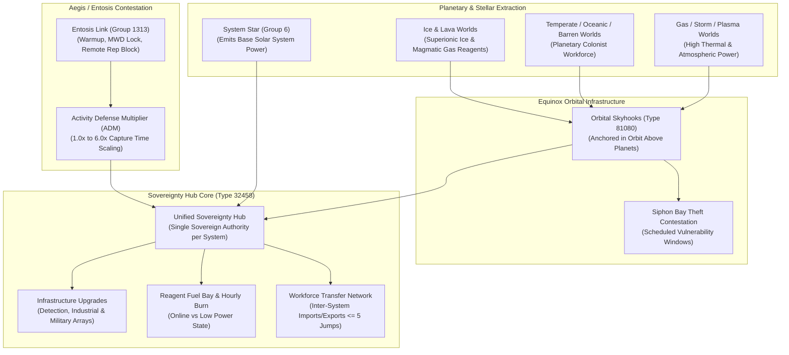
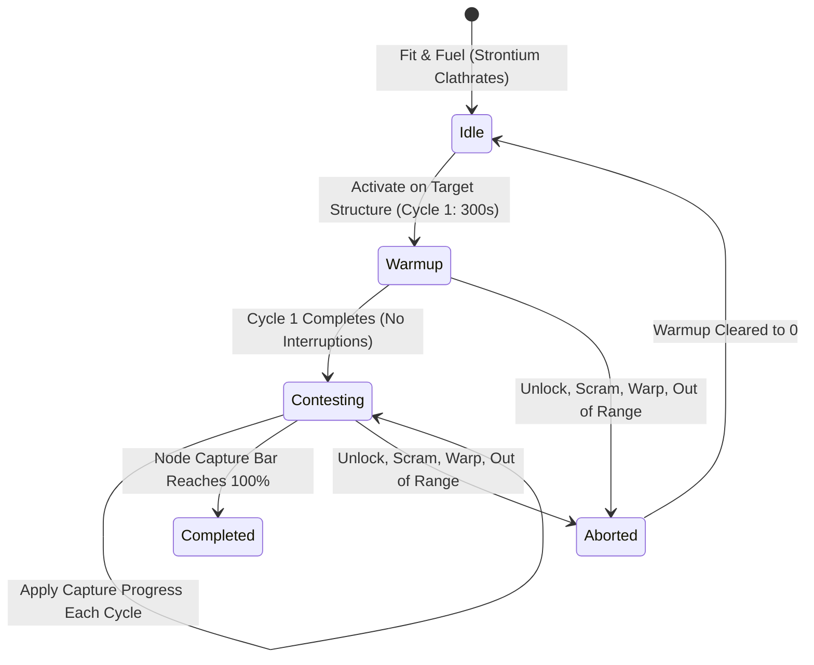
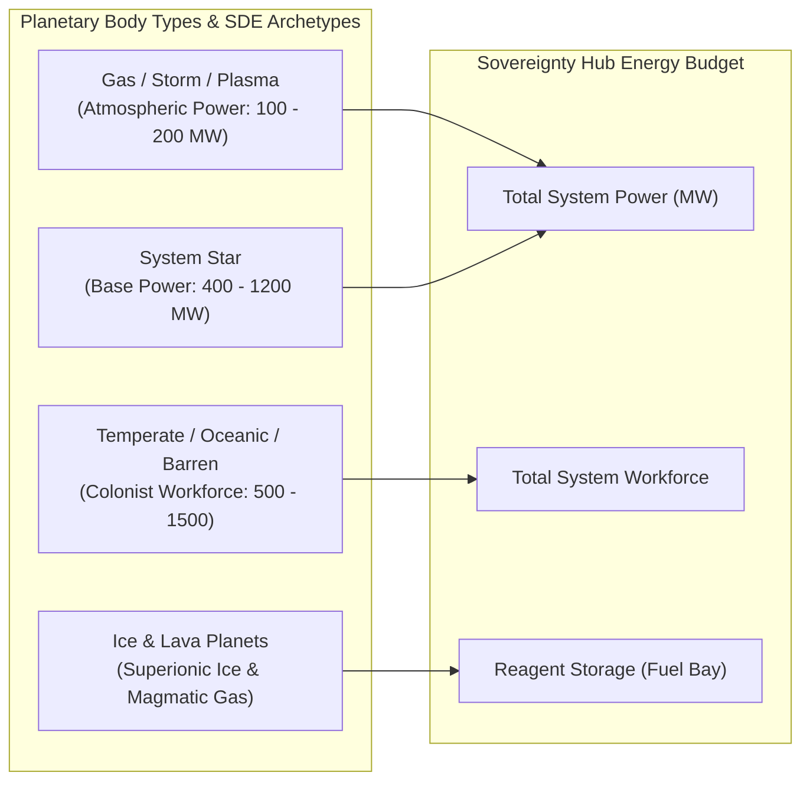
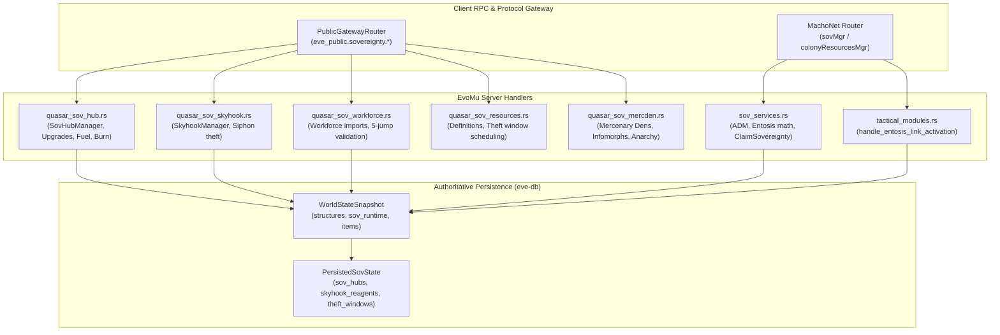

# Sovereignty Hubs, Equinox Orbital Skyhooks & Entosis Mechanics

> **Navigation**: [EvoMu Technical Wiki](../README.md) • [Related Systems](#related-systems--cross-references)
>
> [← Back to Wiki Table of Contents](../README.md)

---

## Overview & Lore Context

In the geopolitical sandbox of New Eden, the claim to territory in Null-Security space represents the pinnacle of capsuleer collective achievement. Over two decades of interstellar warfare, the mechanisms governing territorial control have undergone three distinct evolutionary epochs: the **Dominion POS Era**, the **Aegis FozzieSov Era**, and the modern **Equinox Era (YC126)**.



### The Three Epochs of Null-Sec Sovereignty

1. **The Dominion Era (YC111 – YC117):**
   Territorial control was governed by stationary structures: Territorial Claim Units (TCUs) to claim the system billboard, Infrastructure Hubs (I-Hubs) to install military/industrial ratting and mining upgrades, and Outposts/Stations for docking. Sovereignty warfare was characterized by raw hitpoint grinds against reinforced structures with massive capital and supercapital fleet blobs ("Doomsday drive-bys" and "Wrecking Ball" supercarrier deployments). Alliances that could field the most Titans and Supercarriers inevitably dominated the map.

2. **The Aegis "FozzieSov" Era (YC117 – YC126):**
   To dismantle capital blobbing and promote active space occupancy, CONCORD and the empires introduced the **Entosis Link**. Rather than grinding through millions of hitpoints, structures were contested via electronic command links. When an I-Hub, TCU, or Station reached vulnerability, localized **Command Nodes** spawned throughout the constellation, triggering distributed, highly mobile skirmishes. To reward resident alliances who mined and cleared pirate threats in their home systems, the **Activity Defense Multiplier (ADM)** was established, scaling node capture times up to $6.0\times$ against invaders.

3. **The Equinox Era (YC126+):**
   Recognizing that passive billboards (TCUs) and static I-Hubs treated all star systems as identical blank slates, Upwell Consortium and CONCORD ratified the **Equinox Sovereignty Framework**. The TCU and legacy I-Hub were unified into a single mega-structure: the **Sovereignty Hub** (Type ID `32458`). Furthermore, sovereignty was tethered directly to planetary physics: star systems no longer generated infinite anomalies out of thin air, but required continuous harvesting of planetary **Power**, **Workforce**, and **Reagents** via **Orbital Skyhooks** (Type ID `81080`).

---

## Canonical Mechanics & Precise Formulas

### 1. Legacy vs. Equinox Sovereignty Architecture

| Dimension | Legacy Sovereignty (Aegis / Dominion) | Modern Equinox Framework |
| :--- | :--- | :--- |
| **Primary Structures** | Separate Territorial Claim Unit (TCU) and Infrastructure Hub (I-Hub). | Single unified **Sovereignty Hub** (Type ID `32458`). |
| **System Identity** | Arbitrary naming and billboard flag on TCU. | Sovereignty Hub asserts sovereign claim and system naming. |
| **Upgrade Prerequisites** | Static Military / Industrial / Strategic Development Indices ($0 \dots 5$). | Real-time balance of **Power**, **Workforce**, and fuel **Reagents**. |
| **Planetary Tethering** | Completely detached from planets; PI occurred independently. | Physical **Orbital Skyhooks** anchored directly above planetary bodies. |
| **Logistics Vulnerability** | Upgrades ran infinitely once paid with ISK. | Hourly reagent burn; Skyhook siphon bays can be raided by hostile fleets. |

The Sovereignty Hub houses four major groups of upgrades (Category 39 "Infrastructure Upgrades"):
1. **Site Detection Upgrades (`4768`):** Unlocks combat exploration anomalies, escalation complexes, and ore anomalies.
2. **Service Infrastructure Upgrades (`4772`):** Enables Cynosural Beacons, Cynosural Jammers, and Supercapital construction arrays.
3. **Colony Resources Management (`4838`):** Enhances planetary extraction rates and workforce efficiency.
4. **System Effect Generator (`4839`):** Projects localized spatial modifiers across the solar system.

---

### 2. Entosis Link & Capture Contestation

The **Entosis Link** (Group `1313`, e.g., Entosis Link I `34593` and Entosis Link II `34595`) is a high-slot module that projects an electronic override signal into sovereignty structures and command nodes.



#### Module Activation Constraints
- **Fuel Consumption:** Consumes $1\text{ unit}$ of **Strontium Clathrates** (Type ID `16275`) per cycle.
- **Warmup Cycle ($T_{\text{warmup}} = 300\text{ s}$):** The first 5-minute cycle applies **zero** capture progress. Capture progress begins accumulating strictly on the second cycle.
- **Interceptors Prohibited:** Fast fleet-tackler Interceptors (Group `831`) are strictly prohibited from activating Entosis Links (`feat:fitting.interceptor-entosis-prohibition`).
- **Propulsion & Mobility Clamp:** Activating an Entosis Link disables MicroWarpDrives (MWDs) and locks maximum sub-warp velocity to sub-light cruising limits.
- **Remote Assistance Impedance:** While an Entosis Link is active, the ship is subjected to a $100\%$ remote assistance debuff—no friendly remote shield boosters, armor repairers, or capacitor transmitters can lock or cycle onto the ship.
- **Lock Severance:** If the ship unlocks the target node, drifts out of maximum range, or is destroyed, the warmup counter is completely wiped to zero (`clear_entosis_warmup_on_unlock`).

#### The Activity Defense Multiplier (ADM)
The Activity Defense Multiplier (ADM) protects resident defenders by multiplying the time invaders require to capture nodes:

$$\text{ADM} = \min\left(6.0, 1.0 + \text{Bonus}_{\text{military}} + \text{Bonus}_{\text{industrial}} + \text{Bonus}_{\text{strategic}}\right)$$

The canonical index progression follows a non-linear tier table:

| Development Index Level | Military Index Bonus | Industrial Index Bonus | Strategic Index Bonus |
| :---: | :---: | :---: | :---: |
| **Level 0** | $+0.0$ | $+0.0$ | $+0.0$ |
| **Level 1** | $+0.6$ | $+0.6$ | $+0.4$ |
| **Level 2** | $+1.2$ | $+1.2$ | $+0.6$ |
| **Level 3** | $+1.7$ | $+1.7$ | $+0.8$ |
| **Level 4** | $+2.1$ | $+2.1$ | $+0.9$ |
| **Level 5** | $+2.5$ | $+2.5$ | $+1.0$ |

$$\text{ADM}_{\max} = 1.0 + 2.5 (\text{Mil V}) + 2.5 (\text{Ind V}) + 1.0 (\text{Strat V}) = 7.0 \xrightarrow{\text{clamped}} 6.0\times$$

#### Capture Time Scaling
The base entosis cycle time ($T_{\text{base}}$, typically $10\text{ minutes} = 600\text{ s}$) scales directly with the system's ADM:

$$T_{\text{capture}} = T_{\text{base}} \times \text{ADM}$$

- At $\text{ADM} = 1.0\times$: $T_{\text{capture}} = 10.0\text{ minutes}$ ($600\text{ s}$).
- At $\text{ADM} = 3.5\times$: $T_{\text{capture}} = 35.0\text{ minutes}$ ($2\,100\text{ s}$).
- At $\text{ADM} = 6.0\times$: $T_{\text{capture}} = 60.0\text{ minutes}$ ($3\,600\text{ s}$).

During a constellation-wide contestation event, command nodes spawn across connected systems. Capturing a node increments the controlling team's score by $5\%$ until either the attackers or defenders reach $100\%$.

---

### 3. Equinox Planetary Resources & Orbital Skyhooks

Equinox sovereignty redefines systems based on astronomical geography. Upgrades demand three primary currencies:



#### Planetary Resource Production Matrix
In EvoMu and canonical Equinox mechanics, system yields derive from the SDE planet and star catalog:

| Celestial Body Type | SDE Group | SDE Type ID | Power Output (MW) | Workforce Output | Reagent Yield (per 3,600s) |
| :--- | :---: | :---: | :---: | :---: | :---: |
| **System Sun (O, B, A, F, G, K, M)** | Sun (`6`) | Various | $400 \dots 1\,200$ | $0$ | None |
| **Temperate Planet** | Planet (`7`) | `11` | $0$ | **$1\,500$** | None |
| **Oceanic Planet** | Planet (`7`) | `2014` | $0$ | **$1\,000$** | None |
| **Barren Planet** | Planet (`7`) | `2016` | $0$ | **$500$** | None |
| **Gas Planet** | Planet (`7`) | `13` | **$150$** | $0$ | None |
| **Storm Planet** | Planet (`7`) | `2017` | **$100$** | $0$ | None |
| **Plasma Planet** | Planet (`7`) | `2063` | **$200$** | $0$ | None |
| **Ice Planet** | Planet (`7`) | `12` | $0$ | $0$ | **50x Superionic Ice** (`81144`) |
| **Lava Planet** | Planet (`7`) | `2015` | $0$ | $0$ | **50x Magmatic Gas** (`81143`) |

#### Orbital Skyhooks (Type ID `81080`)
An **Orbital Skyhook** is an Upwell space elevator anchored in geosynchronous orbit above a planet.
- **Exclusivity:** Exactly **one** Skyhook may be anchored per planet.
- **Functionality:** Extracts the planet's native resources and feeds them directly into the system's Sovereignty Hub pool.
- **Siphon Bay Raid Mechanics:**
  - Skyhooks store extracted reagents in a specialized **Siphon Bay**.
  - During scheduled vulnerability windows (`skyhook_theft_windows`), hostile capsuleers can approach within $10\text{ km}$ of the Skyhook siphon collar and begin a siphon intrusion.
  - The siphon process initiates a 10-minute timer and broadcasts a regional defense alert (`OnSkyhookCanBeHacked`).
  - If the intruder maintains proximity without being destroyed, warped, or scrammed, the siphon bay cracks, granting physical cargo crates of Magmatic Gas or Superionic Ice.

#### Workforce Transfer Networks (Inter-System Logistics)
When a system lacks native workforce (e.g., an industrial dead-end with only Gas and Lava planets), workforce can be imported from neighboring systems:
- Modeled by [`PersistedWorkforceMode`](../../../crates/eve-db/src/d6_types.rs#L282-L289): `Inactive`, `Import { sources }`, `Export { destination, amount }`, or `Transit`.
- **Maximum Stargate Range:** Workforce links are physically constrained to **5 stargate jumps** or fewer:
  $$\text{JumpDistance}(\text{Hub}_A, \text{Hub}_B) \le 5$$
- **Alliance Tethering:** Both endpoints must belong to the same owning corporation or alliance (`linked_owners`).

#### Hourly Fuel Burn & Offline Degradation
Installed upgrades require startup reagents and continuous hourly fuel burn:
- Example: *Minor Threat Detection Array 1* (`82499`) consumes $200\text{ MW}$ Power, $1\,000$ Workforce, $50\text{ units}$ startup Magmatic Gas, and $5\text{ units/hour}$ ongoing fuel.
- If the fuel bay exhausts its supply, the upgrade enters `POWER_STATE_LOW` (`low_power = true`), instantly shutting down associated anomalies until fuel is replenished.

#### Mercenary Dens & Pirate Operations
In low-security and null-sec insurgencies, pirate capsuleers deploy **Mercenary Dens** (Type ID `85233` *Mercenary Den Management* skill):
- Dens progress through **5 Evolution Stages** across 100 levels ($1\text{ level/hour}$ while active).
- Each stage increases the Infomorph population generation rate ($3 \times \text{stage}$ infomorphs/hour up to a $2\,000$ capacity cap) and unlocks Tactical Operations.

---

## EvoMu Implementation Architecture

The Sovereignty and Equinox systems are distributed across [`crates/eve-server`](../../../crates/eve-server), [`crates/eve-db`](../../../crates/eve-db), and [`crates/eve-sde`](../../../crates/eve-sde).



### 1. Primary Handlers & Source Mapping

#### Quasar Equinox Services
- [`crates/eve-server/src/services/quasar_sov_hub.rs`](../../../crates/eve-server/src/services/quasar_sov_hub.rs):
  - `GetResourcesRequest`: Computes system power and workforce from stars and planets via `system_yield`.
  - `ProcessConfigurationRequest`: Installs and onlines upgrades, allocating power and workforce budgets.
  - `AddRequest` (`eve_public.sovereignty.hub.fuel.api`): Deposits Magmatic Gas or Superionic Ice into the hub fuel bay.
  - `simulate_hub`: Advances the hourly fuel-burn clock, transitioning starved upgrades to `POWER_STATE_LOW`.
- [`crates/eve-server/src/services/quasar_sov_skyhook.rs`](../../../crates/eve-server/src/services/quasar_sov_skyhook.rs):
  - `GetRequest`: Returns real-time skyhook state, reagent stocks, and active theft vulnerability status.
  - `GetAllLocalRequest` & `GetAllByCorporationRequest`: Queries all skyhooks in a solar system or corporation.
  - `GetSolarSystemsWithTheftVulnerableSkyhooksRequest`: Surfaces systems currently raid-vulnerable.
- [`crates/eve-server/src/services/quasar_sov_workforce.rs`](../../../crates/eve-server/src/services/quasar_sov_workforce.rs):
  - `ConfigureRequest`: Configures import/export modes.
  - Stargate Jump Constraint: Validates $\le 5$ jumps via `WORKFORCE_TRANSFER_MAX_JUMPS = 5`.
  - Emits `ConfiguredNotice`, `StateChangedNotice`, and `ResourcesSimulatedNotice`.
- [`crates/eve-server/src/services/quasar_sov_resources.rs`](../../../crates/eve-server/src/services/quasar_sov_resources.rs):
  - `GetAllDefinitionsRequest`: Exports client planet resource yield definitions from `PLANET_RESOURCE_TABLE`.
  - `SetTheftVulnerabilityWindowRequest`: Permits directors to schedule theft windows (up to $86\,400\text{ s}$).
- [`crates/eve-server/src/services/quasar_sov_mercden.rs`](../../../crates/eve-server/src/services/quasar_sov_mercden.rs):
  - Manages Pirate Mercenary Dens, infomorph generation, evolution stages (1..5), and tactical operations.
- [`crates/eve-server/src/services/quasar_sov_services.rs`](../../../crates/eve-server/src/services/quasar_sov_services.rs):
  - `ActivateRequest` & `DeactivateRequest`: Toggles orbital skyhook operational states with director role validation (`authorize_skyhook`).

#### MachoNet Sovereignty & Tactical Handlers
- [`crates/eve-server/src/services/sov_services.rs`](../../../crates/eve-server/src/services/sov_services.rs):
  - `calculate_adm(mil, ind, strat)`: Computes exact ADM multipliers ($1.0 \dots 6.0$).
  - `scale_entosis_capture_seconds(base, adm)`: Calculates scaled capture durations.
  - `emit_sovereignty_changed`: Dispatches notifications and broadcasts `OnSovereigntyChanged` destiny events.
  - `set_skyhook_hackable` & `record_hub_hack`: Manages skyhook and hub contestation states.
- [`crates/eve-server/src/services/tactical_modules.rs`](../../../crates/eve-server/src/services/tactical_modules.rs):
  - `handle_entosis_link_activation`: Evaluates target locks, fuel consumption (Strontium Clathrates), warmup cycle tracking, and interceptor bans.
  - `clear_entosis_warmup_on_unlock`: Resets warmup state immediately upon target unlock or range breach.

---

### 2. State Schemas & Data Structures

Equinox sovereignty state is persisted in [`WorldStateSnapshot.sov_runtime`](../../../crates/eve-db/src/d6_types.rs#L341-L366):

#### PersistedSovHubData
Defined in [`crates/eve-db/src/d6_types.rs`](../../../crates/eve-db/src/d6_types.rs#L291-L305):
```rust
#[derive(Debug, Clone, Default, PartialEq, Eq, Serialize, Deserialize)]
pub struct PersistedSovHubData {
    pub hub_id: i64,
    pub upgrades: Vec<PersistedHubUpgrade>,
    /// Fuel bay: reagent type_id -> quantity.
    pub fuel: BTreeMap<u32, u32>,
    pub workforce: PersistedWorkforceMode,
    pub last_updated_unix: u64,
}
```

#### PersistedHubUpgrade & Workforce Mode
Defined in [`crates/eve-db/src/d6_types.rs`](../../../crates/eve-db/src/d6_types.rs#L270-L289):
```rust
#[derive(Debug, Clone, Default, PartialEq, Eq, Serialize, Deserialize)]
pub struct PersistedHubUpgrade {
    pub type_id: u32,
    pub online: bool,
    pub low_power: bool,
}

#[derive(Debug, Clone, Default, PartialEq, Eq, Serialize, Deserialize)]
pub enum PersistedWorkforceMode {
    #[default]
    Inactive,
    Import { sources: Vec<u32> },
    Export { destination: Option<u32>, amount: u64 },
    Transit,
}
```

#### PersistedSovState Runtime
Defined in [`crates/eve-db/src/d6_types.rs`](../../../crates/eve-db/src/d6_types.rs#L341-L366):
```rust
#[derive(Debug, Clone, Default, PartialEq, Eq, Serialize, Deserialize)]
pub struct PersistedSovState {
    pub fuel_access_groups: HashMap<i64, i64>,
    pub hacked_hubs: HashMap<i64, u64>,
    pub skyhook_reagents: HashMap<i64, (u32, u64)>,
    pub skyhook_hackable: HashMap<i64, bool>,
    pub skyhook_active: BTreeMap<i64, bool>,
    pub skyhook_theft_windows: HashMap<i64, (u64, u64)>,
    pub sov_hubs: HashMap<i64, PersistedSovHubData>,
    pub mercenary_dens: HashMap<i64, PersistedMercenaryDen>,
    pub mercenary_activities: BTreeMap<String, PersistedMercenaryActivity>,
    pub next_mercenary_activity_seq: u64,
}
```

---

## Invariants, Security & Edge Cases

### 1. Single Sovereignty Hub per Solar System Invariant
A solar system can contain at most one active Sovereignty Hub. Any attempt to anchor a second hub or claim sovereignty in a system where an active hub already exists fails with `SovereigntyHubAlreadyExists`.

### 2. Single Orbital Skyhook per Planet Invariant
Each planetary body in a solar system can host at most one Orbital Skyhook. Anchoring attempts check planetary orbital occupancy; duplicate deployments fail with `PlanetAlreadyHasSkyhook`.

### 3. Entosis Module & Warmup Integrity
- **Interceptor Prohibition:** Interceptors (group `831`) cannot activate Entosis Links under any circumstances (`feat:fitting.interceptor-entosis-prohibition`).
- **Warmup Non-Interruption:** If an entosis-activating ship breaks lock, cloaks, warps, or drifts beyond lock range, the warmup state is instantly wiped (`clear_entosis_warmup_on_unlock`). An attacker cannot "bank" warmup time across targets.
- **Single Active Entosis Module:** A ship can have at most one active Entosis Link cycle running simultaneously (`MaxGroupActiveExceeded`).

### 4. Siphon Bay Theft Boundary & Abort Conditions
- Siphon intrusion requires continuous proximity within $10\text{ km}$ of the Skyhook siphon collar.
- If the raiding ship activates a warp drive, cloaks, receives warp disruption, or exceeds the $10\text{ km}$ threshold, the siphon link collapses and the timer resets to zero.
- Reagents looted from the siphon bay are deducted atomically from `skyhook_reagents`, ensuring no duplication of assets between the siphon container and the system pool.

### 5. Role Authorization & Corporation Scoping
- All hub and skyhook management requests require explicit director roles (`ROLE_DIRECTOR` or `ROLE_STATION_MANAGER`).
- Standard line members attempting to alter upgrade configurations, transfer workforce, or schedule theft windows are rejected with `STATUS_FORBIDDEN` or `CorpRoleDenied`.

---

## Verification, Tests & Parity References

The Sovereignty Hub, Skyhook, and Entosis frameworks are verified through comprehensive test suites:

### Primary Test Suites

1. [`crates/eve-server/tests/it/quasar_sov_equinox_hub.rs`](../../../crates/eve-server/tests/it/quasar_sov_equinox_hub.rs):
   - `test_equinox_hub_resources_fuel_and_upgrades_state_backed`: Validates system power and workforce computations against SDE planetary tables, fuel delivery, upgrade installation and budget allocation, hourly fuel burn ($5\text{ units/h}$), transition to `POWER_STATE_LOW` on fuel exhaustion, and workforce transfers across stargate jumps.

2. [`crates/eve-server/tests/it/sov_fw_complete.rs`](../../../crates/eve-server/tests/it/sov_fw_complete.rs):
   - `test_skyhook_reagents_and_theft`: Tests Skyhook reagent generation (Magmatic Gas), theft status broadcasting (`OnSkyhookCanBeHacked`), role-based destruction authorization, and structure removal.
   - `test_sovereignty_claim_and_notifications`: Validates `claim_system_sovereignty`, `OnSovereigntyChanged` broadcasts, and destiny event emissions.

3. [`crates/eve-server/tests/it/quasar_sov_pirate_remediation.rs`](../../../crates/eve-server/tests/it/quasar_sov_pirate_remediation.rs):
   - Tests Mercenary Den activation, infomorph production schedules, anarchy level progression, and mercenary tactical operations.

4. [`crates/eve-server/tests/it/mining_structures_sov_r5_regressions.rs`](../../../crates/eve-server/tests/it/mining_structures_sov_r5_regressions.rs):
   - Tests structure proximity rules, anchoring validations, and system defense index modifications.

---

### Parity Audit Tag Matrix

| Parity / Feature Tag | Target System | Authoritative Implementation |
| :--- | :--- | :--- |
| `feat:sov.hub` | Equinox Sovereignty Hub Management | [`quasar_sov_hub.rs`](../../../crates/eve-server/src/services/quasar_sov_hub.rs#L85-L270) |
| `feat:sov.skyhook` | Orbital Skyhook Infrastructure & Reagents | [`quasar_sov_skyhook.rs`](../../../crates/eve-server/src/services/quasar_sov_skyhook.rs#L30-L100) |
| `feat:sov.skyhook-theft` | Siphon Bay Intrusion & Vulnerability | [`sov_services.rs`](../../../crates/eve-server/src/services/sov_services.rs#L100-L125) |
| `feat:sov.workforce-transfer` | 5-Jump Workforce Transfer Network | [`quasar_sov_workforce.rs`](../../../crates/eve-server/src/services/quasar_sov_workforce.rs#L25-L85) |
| `feat:sov.adm` | Activity Defense Multiplier Scaling | [`sov_services.rs`](../../../crates/eve-server/src/services/sov_services.rs#L32-L47) |
| `feat:sov.entosis` | Entosis Link Warmup & Node Contestation | [`tactical_modules.rs`](../../../crates/eve-server/src/services/tactical_modules.rs#L879-L975) |
| `feat:fitting.interceptor-entosis-prohibition` | Interceptor Entosis Ban | [`tactical_modules.rs`](../../../crates/eve-server/src/services/tactical_modules.rs#L906-L910) |
| `feat:sov.mercden` | Mercenary Dens & Infomorph Evolution | [`quasar_sov_mercden.rs`](../../../crates/eve-server/src/services/quasar_sov_mercden.rs#L30-L100) |
| `rpc:sovMgr.AcquireSkyhooks` | Corporation Skyhook Query | [`sov_services.rs`](../../../crates/eve-server/src/services/sov_services.rs#L200-L240) |
| `rpc:colonyResourcesMgr.GetMyCorporationSkyhooks` | Colony Skyhooks List | [`sov_services.rs`](../../../crates/eve-server/src/services/sov_services.rs#L250-L290) |
| `quasar:eve_public.sovereignty.hub.api` | Quasar Hub APIs & Simulated Notices | [`quasar_sov_hub.rs`](../../../crates/eve-server/src/services/quasar_sov_hub.rs#L1-L45) |
| `quasar:eve_public.sovereignty.skyhook.api` | Quasar Skyhook APIs & Vulnerability | [`quasar_sov_skyhook.rs`](../../../crates/eve-server/src/services/quasar_sov_skyhook.rs#L1-L35) |

---

## Related Systems & Cross-References

- [**Faction Warfare & Pirate Insurgencies**](./faction_warfare_and_insurgencies.md): Territorial conquest, occupancy metrics, and strategic system upgrades.
- [**Upwell Structures Overview & Lifecycle**](../upwell_and_structures/upwell_structures_overview.md): Upwell infrastructure hubs, Quantum Cores, and null-sec asset safety rules.
- [**Corporation Roles & Governance**](../corporations_and_governance/corporation_roles_and_governance.md): Alliance executor corporations, starbase manager roles, and Sov Hub administrative control.
- [**Planetary Industry (PI)**](../planetary_industry/colony_pin_networks_and_pi.md): Orbital Skyhook harvesting of planetary Power, Workforce, and Reagents.

---

[← Back to Wiki Table of Contents](../README.md)
