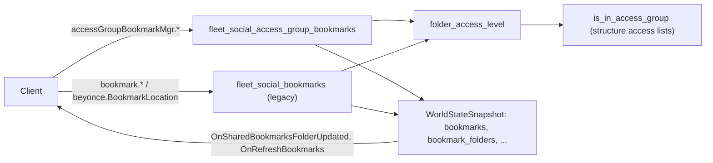

# Bookmarks & Shared Folders

> **Navigation**: [EvoMu Technical Wiki](../README.md) • [Related Systems](#related-systems--cross-references)
>
> [← Back to Wiki Table of Contents](../README.md)

---

## Overview & Lore Context

A **bookmark** is a saved location: a solar system, a point in it (`x`, `y`, `z`), a label, a note, and optionally the item it was made on. Bookmarks live in **folders**. A folder is either personal (visible only to its owner) or shared, in which case **access groups** decide who can view, use, manage or administer it. A folder can have one level of **subfolders**.

EvoMu serves two RPC surfaces over the same state:

- `accessGroupBookmarkMgr`, the service the V24 client's bookmark code calls (the source file names `bookmarkSvc.pyj` as its reference for reply shapes).
- `bookmark` and a few `beyonce` methods, marked "Legacy bookmarks" in the source. They have their own handlers with slightly different rules.

---

## Canonical Mechanics & Formulas

The rules below are what the code does at the pinned commit. Unless a row says otherwise they describe the `accessGroupBookmarkMgr` handlers.

### Limits

| Limit | Value | Error code |
|---|---|---|
| Label length (trimmed) | 1–100 characters | `InvalidBookmarkLabel` |
| Personal bookmarks per character | 500 | `MaxBookmarksReached` |
| Bookmarks per shared folder | 500 | `MaxSharedFolderBookmarksReached` |
| Personal root folders per character | 5 | `MaxPersonalFoldersReached` |
| Shared folders per corporation | 30 | `MaxSharedFoldersReached` |
| Subfolders per personal folder | 5 | `MaxSubfoldersReached` |
| Subfolders per shared folder | 30 | `MaxSubfoldersReached` |
| Active (online) known folders per character | 3 others besides the one being activated | `MaxActiveSharedFoldersReached` |
| Bookmarks per copy or move call | 20 | `BookmarkCopyBatchLimitExceeded` |
| Expiry | clamped to 0–87,600 hours | — |

### Creating a bookmark

`BookmarkStaticLocation` (`handle_bookmark_static_location`):

1. The session must have a solar system. Zarzakh (`30_100_000`) is refused with the `CantbookmarkEveSystem` user error.
2. The target folder is checked. Folder `0` or the character's own ID means the personal root; any other folder must exist and give the caller at least **Use** access.
3. The position and type are derived on the server, not taken from the client:
   - with an item ID: the solar system itself, a station, a stargate (type `29624`), a celestial, an Upwell structure in the system, or the caller's own ship ball;
   - any other item goes through `validate_dynamic_entity_bookmark_coords`: the caller must be in space, the entity must have a ball in the system, must not be cloaked, and must be within 8,000 km of the caller's ship;
   - with no item ID: the station or structure the caller is docked in, otherwise the position of the caller's ship.
4. Inside the snapshot transaction the 500-bookmark cap is applied, a subfolder (if given) must belong to the folder, and the record is inserted. A positive expiry writes `bookmark_expiries[id] = now + hours × 3600`.
5. For a shared folder, `OnSharedBookmarksFolderUpdated` is sent to the caller's corporation.

The reply is the 8-tuple `(bookmarkID, itemID or solarSystemID, typeID, x, y, z, solarSystemID, folderID)`.

`BookmarkScanResult` (`scanMgr`, `bookmark` or `beyonce`) bookmarks a cosmic signature. The caller must be in space, the signature must be in the caller's system and unexpired, and the caller's effective signal strength for it must be 1.0. The note is set to `Scanned <signature id>`.

### Folders and subfolders

- **Personal folder:** `AddFolder` with `isPersonal = true`. The owner has Admin access; nobody else has any.
- **Shared folder (current form):** `AddFolder` with seven arguments `(isPersonal, name, description, adminGroupID, manageGroupID, useGroupID, viewGroupID)`. `adminGroupID` is required and the caller must be a member of that group.
- **Shared folder (short form):** fewer arguments and no group IDs. The caller must be CEO, Director or Personnel Manager of their corporation (`has_corp_bookmark_admin_role`).
- A new folder is entered in `bookmark_folder_known_by` as active for its creator.
- `UpdateFolder` and `DeleteFolder` need **Admin**. Deleting a folder deletes its subfolders and every bookmark in them, then sends `OnSharedBookmarksFolderDeleted` to the folder's corporation.
- `CreateSubfolder`, `UpdateSubfolder` and `DeleteSubfolder` need **Manage** on the parent. A subfolder cannot contain a subfolder. It is stored as a `BookmarkFolderRecord` named `<parent name>/<subfolder name>` with its parent in `bookmark_subfolder_parents`. Deleting a subfolder deletes the bookmarks in it.

### Access levels

`folder_access_level` returns one of five ordered levels.

| Level | Value | What the code allows at this level and above |
|---|---|---|
| `None` | 0 | Nothing. |
| `View` | 1 | See the folder and its bookmarks, subscribe to it, copy bookmarks out of it. |
| `Use` | 2 | Add bookmarks, move or copy bookmarks in, edit, delete or move bookmarks the character created, warp to its bookmarks. |
| `Manage` | 3 | Edit, delete or move other characters' bookmarks; create, rename and delete subfolders. |
| `Admin` | 4 | Rename the folder, change its description and groups, delete it. |

Resolution order:

1. A subfolder takes the level of its parent folder.
2. A personal folder gives its owner Admin and everyone else None.
3. A shared folder with at least one of `admin_group_id`, `manage_group_id`, `use_group_id`, `view_group_id` set gives the highest level whose group the character is in. Corporation membership alone gives nothing.
4. A shared folder with no groups set (short form) gives members of the folder's corporation Admin if they hold the CEO, Director or Personnel Manager role, otherwise Use. A character ID listed in `bookmark_folder_acls` for the folder also gets Use.

`is_in_access_group` tests membership against the access lists kept in the structure extended state (`owner_groups`, loaded by `load_ext_state`). It checks the character's own entry first, then the list creator, then the character's corporation, then its alliance; an excluded role at any step ends the check with no access. If the group is not found there, it falls back to the plain member list in `WorldStateSnapshot.access_groups`.

### Known folders (subscriptions)

A shared folder's bookmarks are only returned to a character who has subscribed to it and set it active.

- `AddToKnownFolders(folderID, active)` and `UpdateKnownFolderState(folderID, active)` need View access, refuse subfolders, and write `bookmark_folder_known_by[(folder, character)] = active`. Activation fails if three other entries are already active. The reply is `(folder, bookmarks, subfolders)`; the lists are empty when the folder is set inactive.
- `RemoveFromKnownFolders` deletes the entry and sends `OnSharedBookmarksFoldersAccessLost`.
- `GetMyActiveBookmarks` returns `(folders, bookmarks, subfolders)`: the character's own personal bookmarks, plus bookmarks in shared folders where the character has View and the folder is known and active. Folders are listed whenever the character has View, with `isActive` and `accessLevel` on each.
- `GetFolderInfo` returns one folder to a caller with View. `SearchFoldersWithAdminAccess(text)` lists shared root folders where the caller has Admin and the name contains the text.

### Updating, deleting, copying and moving

| Operation | Rights on the bookmark | Other rules |
|---|---|---|
| `UpdateBookmark` | Own personal bookmark; or Use on its folder for a bookmark the caller created; or Manage for someone else's | Moving to another folder needs Use there and re-checks the 500 caps. A subfolder must belong to the bookmark's folder. Expiry hours `0` clears the expiry. Sends `OnRefreshBookmarks` to the caller. |
| `DeleteBookmarks` | Same as update | An optional folder argument must match each bookmark's folder. Returns the deleted IDs. |
| `CopyBookmarksToFolderAndSubfolder` | Own personal bookmark, or View on the source folder | Needs Use on the target. Creates new records owned by the caller. The copy has no expiry entry. Returns `({newID: bookmark}, None)`. |
| `MoveBookmarksToFolderAndSubfolder` | Same as update | Needs Use on the target. A bookmark moved into a personal folder becomes owned by the caller. Returns `([moved], None)`. |

For copy and move, the target subfolder must belong to the target folder, and the target's capacity is checked for the whole batch before anything is written.

### Expiry

`bookmark_expiries` maps a bookmark ID to a Unix time. `is_bookmark_expired_in_snap` treats a bookmark as expired when the entry is positive and `now ≥ expiry`. Expired bookmarks are filtered out of every listing immediately, and removed by `sweep_expired_bookmarks_and_notify`, which:

- removes them from `bookmarks` and `bookmark_subfolders` (the `bookmark_expiries` entry is kept);
- sends `OnRefreshBookmarks` to each owner and `OnSharedBookmarksFolderUpdated` to the corporation of each affected shared folder.

The sweep runs when a character lists bookmarks or changes a known folder, and from the clock-advance pipeline (`run_clock_advanced_sync_pipeline`).

### Using a bookmark

- `beyonce.CmdGotoBookmark(bookmarkID)`: the caller must be in space, not in Abyssal space and not in Zarzakh. The bookmark must exist, be unexpired (`BookmarkExpired`), be in the caller's system, and be accessible (owner, Use on its folder, or a shared bookmark with no folder). At 150 km or more the ship warps; closer than that it flies to the point (`goto_point`).
- `CmdWarpToStuff("bookmark", id)`: refused for an expired bookmark; needs the caller to be the owner or have Use on the bookmark's folder.

### Notifications

| Notification | Target | Sent when |
|---|---|---|
| `OnSharedBookmarksFolderUpdated` | Corporation, and the acting character for folder and subscription changes | Bookmarks added, updated, removed or expired in a shared folder; folder or subfolder changed; subscription changed |
| `OnSharedBookmarksFolderDeleted` | Folder's corporation | Shared folder deleted |
| `OnSharedBookmarksFoldersAccessChanged` | Character | Known-folder state set |
| `OnSharedBookmarksFoldersAccessLost` | Character | Folder removed from known folders |
| `OnRefreshBookmarks` | Character | Bookmark updated, or the character's bookmark expired |

### ESI

Read-only routes in [`char_social_routes.rs`](../../../crates/eve-server/src/esi/char_social_routes.rs): `/characters/{character_id}/bookmarks`, `/characters/{character_id}/bookmarks/folders`, `/corporations/{corporation_id}/bookmarks`, `/corporations/{corporation_id}/bookmarks/folders`. Expired bookmarks are left out.

### Not implemented / known gaps

- **`OnBookmarkCreated` is never sent.** The ledger has `notify:OnBookmarkCreated`; no code emits it.
- **Update notifications carry no type.** `acl_folder_updates_rep` ignores its update-type argument (`BOOKMARKS_ADDED`, `BOOKMARKS_REMOVED`, `SUBFOLDER_ADDED`, …) and labels every entry `"FolderChanged"`.
- **Shared-folder notifications are corporation-scoped.** They go to the acting character's or the folder's corporation. A character who has access through an access group but is in another corporation is not notified.
- **No creation time or creator is stored.** `BookmarkRecord` has only `owner_id`; replies report `creatorID = ownerID` and `created` as the time of the request.
- **`BookmarkScanResult` skips the caps.** It does not apply the 500-bookmark limit and takes no expiry.
- **The active-folder limit counts personal folders.** The count runs over every active `bookmark_folder_known_by` entry of the character, and `AddFolder` enters personal folders there too.
- **`WorldStateSnapshot.access_groups` has no writer in the server handlers.** It is only read, as the fallback in `is_in_access_group`; real groups come from the structure access lists.
- **Legacy `bookmark` service differences.** Its `UpdateFolder` and `DeleteFolder` only accept the folder owner; its `DeleteSubfolder` clears `folder_id` on the bookmarks instead of deleting them; it does not clamp expiry hours; its create path does not check that a subfolder belongs to the folder.
- No open GitHub issue mentioned bookmarks or folders when this article was written.

---

## EvoMu Implementation Architecture

- **Crates involved:** [`eve-server`](../../../crates/eve-server) (handlers), [`eve-db`](../../../crates/eve-db) (records, snapshot fields, SQLite persistence).

### Primary handlers & dispatch

The social service dispatcher in [`fleet_social.rs`](../../../crates/eve-server/src/services/fleet_social.rs) sends every `accessGroupBookmarkMgr` call to `fleet_social_access_group_bookmarks::handle` and then offers the call to `fleet_social_bookmarks::handle_bookmarks`.

| Service / methods | Function | File |
|---|---|---|
| `accessGroupBookmarkMgr`: `AddFolder`, `UpdateFolder`, `DeleteFolder`, `CreateSubfolder`, `UpdateSubfolder`, `DeleteSubfolder`, `AddToKnownFolders`, `UpdateKnownFolderState`, `RemoveFromKnownFolders`, `GetFolderInfo`, `SearchFoldersWithAdminAccess` | `handle` and the `handle_*` functions; `folder_access_level`, `is_in_access_group` | [`fleet_social_access_group_bookmarks.rs`](../../../crates/eve-server/src/services/fleet_social_access_group_bookmarks.rs) |
| `accessGroupBookmarkMgr`: `BookmarkStaticLocation`, `GetMyActiveBookmarks`, `UpdateBookmark`, `DeleteBookmarks`, `CopyBookmarksToFolderAndSubfolder`, `MoveBookmarksToFolderAndSubfolder` | `handle_bookmark_static_location`, `handle_get_my_active_bookmarks`, `handle_update_bookmark`, `handle_delete_bookmarks`, `handle_copy_move_bookmarks` | [`fleet_social_access_group_bookmarks_ops.rs`](../../../crates/eve-server/src/services/fleet_social_access_group_bookmarks_ops.rs) |
| `bookmark`: `BookmarkLocation`, `GetBookmarks`, `GetMyActiveBookmarks`, `UpdateBookmark`, `DeleteBookmarks`, `AddFolder`, `UpdateFolder`, `GetFolders`, `DeleteFolder`, `CreateSubfolder`, `DeleteSubfolder`, `AddToKnownFolders`, `RemoveFromKnownFolders`; `beyonce.BookmarkLocation`; `BookmarkScanResult` | `handle_bookmarks` | [`fleet_social_bookmarks.rs`](../../../crates/eve-server/src/services/fleet_social_bookmarks.rs) |
| `bookmark`: `CopyBookmarksToFolderAndSubfolder`, `MoveBookmarksToFolderAndSubfolder` | `transfer_bookmarks_to_folder_and_subfolder` | [`fleet_social_bookmarks_transfer.rs`](../../../crates/eve-server/src/services/fleet_social_bookmarks_transfer.rs) |
| Expiry | `is_bookmark_expired_in_snap`, `sweep_expired_bookmarks`, `sweep_expired_bookmarks_and_notify` | [`fleet_social.rs`](../../../crates/eve-server/src/services/fleet_social.rs) |
| `beyonce.CmdGotoBookmark` | match arm | [`space_entity_ops.rs`](../../../crates/eve-server/src/services/space_entity_ops.rs) |
| `CmdWarpToStuff` bookmark target | `handle_cmd_warp_to_stuff` | [`space_warp_jump.rs`](../../../crates/eve-server/src/services/space_warp_jump.rs) |

Before a notification leaves the server, the `OnSharedBookmarksFolderUpdated` branch in [`client_compat.rs`](../../../crates/eve-server/src/router/client_compat.rs) rewrites the third element of each update entry into the pair `([{bookmarkID: …}, …], [])`.

### State store & snapshot schema

| Field (`WorldStateSnapshot`, [`snapshot_ext.rs`](../../../crates/eve-db/src/snapshot_ext.rs)) | Content |
|---|---|
| `bookmarks: HashMap<i64, BookmarkRecord>` | `bookmark_id`, `owner_id`, `label`, `solar_system_id`, `x`, `y`, `z`, `item_id`, `memo`, `folder_id`, `is_shared` |
| `bookmark_folders: HashMap<i64, BookmarkFolderRecord>` | Root folders and subfolders: `folder_id`, `owner_id`, `folder_name`, `is_shared`, `corporation_id`, `description`, `admin_group_id`, `manage_group_id`, `use_group_id`, `view_group_id` |
| `bookmark_subfolders: HashMap<i64, i64>` | Bookmark ID → subfolder ID |
| `bookmark_subfolder_parents: HashMap<i64, i64>` | Subfolder ID → parent folder ID |
| `bookmark_expiries: HashMap<i64, u64>` | Bookmark ID → expiry (Unix seconds) |
| `bookmark_folder_acls: HashMap<i64, Vec<i64>>` | Folder ID → the folder's group IDs (current form) or character IDs granted Use (short form) |
| `bookmark_folder_known_by: HashMap<(i64, i64), bool>` | `(folder ID, character ID)` → active flag |
| `access_groups: HashMap<i64, Vec<i64>>` | Group ID → member IDs; fallback only |

Record types are in [`types.rs`](../../../crates/eve-db/src/types.rs). Subfolder links, expiries, ACLs and known-by flags are persisted through the `bookmark_meta` and `bookmark_folders` tables in [`social_store.rs`](../../../crates/eve-db/src/sqlite_store/social_store.rs). Bookmark and folder IDs come from `next_entity_id`.

### Tick & lifecycle integration

There is no per-tick bookmark work in the system actors. The only time-driven step is the expiry sweep described above.

---

## Invariants, Security & Edge Cases

- Position and type ID are never taken from the client. A bookmark on a moving entity requires the caller to be on grid with it, and cloaked entities are refused.
- Cap checks and the insert they guard run inside the same `try_with_mut_snapshot` call, so two requests cannot both pass a cap.
- Copy and move validate rights on every source bookmark; one failure aborts the whole batch.
- The character's corporation is resolved from the snapshot first (`effective_char_corp_and_alliance`); the session value is only a fallback.
- A list creator who has left the owning corporation does not get access through their own entry in the list.
- A bookmark in another solar system cannot be warped to; `CmdGotoBookmark` answers `InvalidTarget`.
- Moving a bookmark out of a shared folder into a personal one transfers ownership to the mover, and counts against the mover's 500 personal bookmarks.

---

## Verification, Tests & Parity References

**Ledger rows** (`ledger.json`): `feat:bookmarks.create`, `feat:bookmarks.update-delete`, `feat:bookmarks.folders`, `feat:bookmarks.shared-folders`, `feat:bookmarks.copy-move`, `feat:bookmarks.warp-to-bm`, `feat:bookmarks.bm-expiry`, `feat:bookmarks.corp-bookmarks`, `feat:scanning.scan-bookmark`, `feat:esi.bookmarks.char`, `feat:esi.bookmarks.corp`; the `accessGroupBookmarkMgr` RPC rows (for example `rpc:accessGroupBookmarkMgr.BookmarkStaticLocation`, `rpc:accessGroupBookmarkMgr.GetMyActiveBookmarks`, `rpc:accessGroupBookmarkMgr.UpdateKnownFolderState`); `notify:OnSharedBookmarksFolderUpdated`, `notify:OnSharedBookmarksFolderDeleted`, `notify:OnSharedBookmarksFoldersAccessChanged`, `notify:OnSharedBookmarksFoldersAccessLost`, `notify:OnRefreshBookmarks`, `notify:OnBookmarkCreated`.

**Auditor rows** (`auditor_rows.json`): `rpc:beyonce.BookmarkLocation`, `rpc:beyonce.BookmarkScanResult`, `rpc:beyonce.CmdGotoBookmark`, `feat:lifecycle.bookmarks-persist`, `feat:navigation.zarzakh-bookmark-dscan-disabled`.

**Integration tests** ([`crates/eve-server/tests/it/`](../../../crates/eve-server/tests/it/)): `access_group_bookmarks_suite.rs`, `social_corp_bookmarks_scanning.rs`.

**Unit tests** (next to the sources): `fleet_social_access_group_bookmarks_tests.rs`, `fleet_social_access_group_bookmarks_ops_tests.rs`, `fleet_social_bookmarks_tests.rs`, `fleet_social_bookmarks_folders_tests.rs`, `fleet_social_bookmarks_transfer_edges_tests.rs`, `space_entity_fleet_and_bookmarks_tests.rs`.

---

## Related Systems & Cross-References

- [**Upwell Structures Overview**](../upwell_and_structures/upwell_structures_overview.md): the access lists that shared folders use for their groups.
- [**Corporation Roles & Governance**](../corporations_and_governance/corporation_roles_and_governance.md): the CEO, Director and Personnel Manager roles used by short-form shared folders.
- [**Stargate Jumping & Cynosural Navigation**](stargate_jumping_and_cynosural_navigation.md): warp and movement commands.
- [**Wormholes & Wormhole Space**](wormholes_and_wormhole_space.md): cosmic signatures that `BookmarkScanResult` bookmarks.
- [**EvoMu Technical Wiki Table of Contents**](../README.md): Master index and domain directory.

---

[← Back to Wiki Table of Contents](../README.md)
