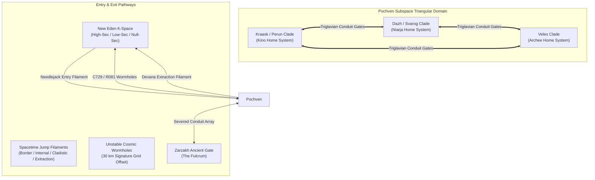
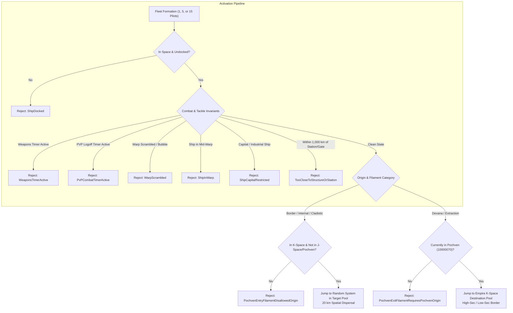
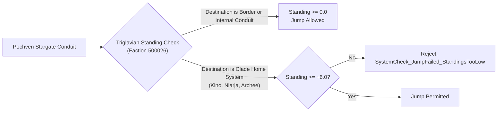
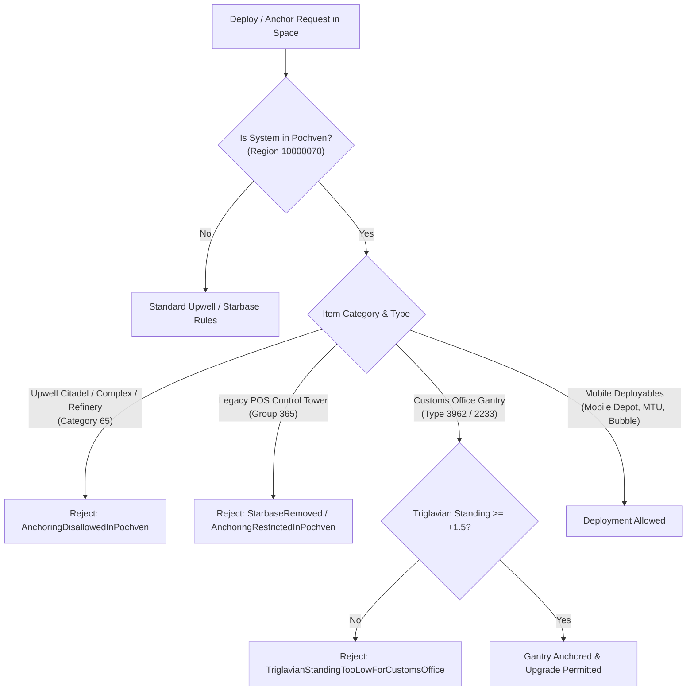
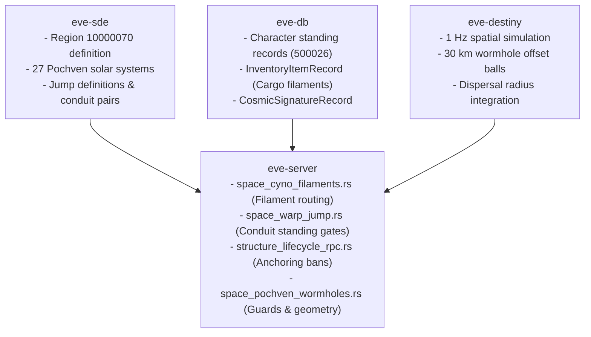

# Pochven Navigation, Filaments & Anchoring Restrictions

> **Navigation**: [EvoMu Technical Wiki](../README.md) • [Related Systems](#related-systems--cross-references)
>
> [← Back to Wiki Table of Contents](../README.md)

---

## Overview & Lore Context

Following the culmination of the Third Invasion of YC122, the **Triglavian Collective** extracted 27 high-security and low-security star systems from the four major empires (Amarr Empire, Caldari State, Gallente Federation, and Minmatar Republic). By deploying stellar harvesters called Liminal Transmuters around each system's sun, the Triglavians altered the star's nuclear cycle, initiating stellar collapse into a Trinary Star configuration. These systems were severed from the standard New Eden stargate network and woven together into a unique triangular pocket of sovereign subspace known as **Pochven** (Triglavian: *The Domain of the Clades*).



### Inverted Security Dynamics
Pochven is neither standard K-space nor conventional J-space (Wormhole space). It introduces an unprecedented set of environmental, political, and operational rules:
1. **Effective -1.0 TrueSec:** While retaining legacy imperial station infrastructures, every Pochven system operates with an effective security status of $-1.0$. Non-consensual combat encounters carry no CONCORD response, no security status penalties, and no automated sentry gun aggression.
2. **Delayed Local Chat (Blackout / Wormhole Rules):** Similar to J-space, the system communication channel operates in delayed mode. A pilot's name appears on the local chat roster only after transmitting a message in the channel.
3. **Tri-Polar Ecosystem Fleets:** Three major hostile factions wage persistent, automated warfare across the grid:
   - **Triglavian Collective:** Roaming scouting and hunting parties (Damavik, Vedmak, Drekavac, Leshak) using Entropic Disintegrators with spooling damage multipliers.
   - **EDENCOM Expeditionary Forces:** Empire defense patrols utilizing Arcing Vorton Projectors.
   - **Drifter & Sleeper Strike Fleets:** Mysterious ancient aggressors attacking both capsuleers and Triglavian installations.
4. **Enhanced Loot Economics:** Due to regional space-time shear and Triglavian salvage parameters, ship destruction within Pochven features an elevated loot drop probability of **60%** (compared to standard 50% in empire space) ([`combat_weapons_spool.rs#L410`](../../../crates/eve-server/src/services/combat_weapons_spool.rs#L410)).

In **EvoMu V24.01**, Pochven is defined as Region `10000070` ([`structure_lifecycle.rs#L35`](../../../crates/eve-server/src/services/structure_lifecycle.rs#L35)), completely integrating filament entry/exit routines, conduit gate standing locks, wormhole guards, and strict orbital anchoring bans.

---

## Canonical Mechanics & Precise Formulas

### 1. System Topology & Constellation Architecture

Pochven consists of **27 star systems** partitioned equally into three distinct clades across three sovereign constellations:

| Clade | Sovereign Constellation | Constellation ID | Home System | Home System ID | Focus & Doctrine |
| :--- | :--- | :--- | :--- | :--- | :--- |
| **Perun Clade** | Kraask | 20000010 | **Kino** | 30001372 | Strategic defense, logistical orchestration, command conduits. |
| **Svarog Clade** | Dazh | 20000011 | **Niarja** | 30002702 | Heavy assault, kinetic disruption, aggressive siege doctrines. |
| **Veles Clade** | Veles | 20000012 | **Archee** | 30003504 | Precursor bio-engineering, mutaplasmid research, subverted drone networks. |

Each constellation contains 9 systems categorized hierarchically into three concentric tactical rings:
- **Home Systems (3 systems):** One per clade (Kino, Niarja, Archee). These host Triglavian subcapital and capital shipyards, Jovian observatory ruins, and the primary clade command centers.
- **Internal Systems (9 systems):** High-traffic central corridors bridging the clade core to outer boundaries (e.g., Nalvula, Otela, Skarkon).
- **Border Systems (15 systems):** Peripheral fringe systems that form the outer perimeter of Pochven (e.g., Senda, Raravoss, Vale).

#### Stargate Severing & Triglavian Conduit Network
Standard stargates connecting Pochven systems to surrounding empire space were permanently severed during Liminality. In their place, the Triglavians constructed **Triglavian Stargate Conduits**. These conduits link the 27 systems in an internal looped topology. Conduits do not accept capital ships or standard freighters ([`space_warp_jump.rs#L680-L688`](../../../crates/eve-server/src/services/space_warp_jump.rs#L680-L688)), and gate activation is governed strictly by capsuleer standing.

---

### 2. Filament Navigation Mechanics

Because traditional stargates to empire space do not exist, capsuleers enter and exit Pochven primarily using **Spacetime Jump Filaments** (SDE Group `4087`: Pochven Filaments, and Group `4041`: Jump Filaments).



#### Filament Categories & Type IDs
Filaments fall into distinct tactical tiers based on destination pool and fleet sizing:

| Filament Category | Type IDs (1 / 5 / 15 Pilots) | Origin Constraint | Destination Pool | Standing Gate |
| :--- | :--- | :--- | :--- | :--- |
| **Pochven Border** | 56070 (5-man), 56071 (15-man) | Empire K-Space | Random Border System (15 systems) | None ($0.0$) |
| **Pochven Internal** | 56072 (5-man), 56073 (15-man) | Empire K-Space | Random Internal System (9 systems) | None ($0.0$) |
| **Pochven Cladistic** | 56074 (5-man), 56075 (15-man) | Empire K-Space | Random System in Specific Clade | None ($0.0$) |
| **Pochven Home** | 56080 (5-man), 56081 (15-man) | Empire K-Space | Kino, Niarja, or Archee | $\ge +6.0$ Triglavian |
| **Devana Extraction** | 56065 (1-man), 56066 (5), 56067 (15) | Pochven Space | High-Sec Empire System (e.g. Jita, Amarr) | None ($0.0$) |
| **Proving Grounds** | 56068 (5-man), 56069 (15-man) | Pochven Space | Low-Sec Empire Systems | None ($0.0$) |

#### Universal Filament Activation Invariants
Activating a filament (`randomJumpMgr.ActivateRandomJumpFilament`) validates strict physical and tactical constraints ([`space_cyno_filaments.rs#L354-L418`](../../../crates/eve-server/src/services/space_cyno_filaments.rs#L354-L418)):
1. **Fleet Capacity Enforcement:** A filament activates for a maximum fleet size $N_{\text{cap}} \in \{1, 5, 15\}$. Fleet members must be within **$6{,}000\text{ meters}$** of the activating ship to be included.
2. **The 1,000 km Separation Rule:**
   $$\forall P \in \{\text{Stations}, \text{Stargates}, \text{Active Upwell Structures}\}, \quad \|\vec{r}_{\text{ship}} - \vec{r}_P\| \ge 1{,}000{,}000 \text{ meters}$$
   If any station, gate, or structure ball is within 1,000 km, activation fails with `TooCloseToStructureOrStation`.
3. **No Combat or Weapons Timers:** The ship must have zero active Weapons Timers (`WeaponsTimerActive`) and zero active PvP Combat Logoff Timers ([`sp6_lifecycle.rs#L318-L325`](../../../crates/eve-server/src/sp6_lifecycle.rs#L318-L325)).
4. **No Warp Scramble:** Ships under active warp scramble or disruption cannot activate jump filaments (`WarpScrambled`).
5. **No Capital Ships:** Titans, Supercarriers, Dreadnoughts, Carriers, and Freighters cannot activate filaments (`ShipCapitalRestricted`).
6. **20 km Spatial Dispersal:** Upon landing at the destination system, the fleet does not spawn on a single coordinate; ships are dispersed across a sphere of radius $R = 20{,}000\text{ meters}$ with randomized alignment vectors.

---

### 3. Stargate Navigation & Standing Locks

Conduit stargates within Pochven enforce hard standing requirements with the **Triglavian Collective** (Faction ID `500026`).



#### Standing Matrix
Standing with the Triglavian Collective determines gate access across the region ([`space_warp_jump.rs#L690-L704`](../../../crates/eve-server/src/services/space_warp_jump.rs#L690-L704)):

| Conduit Connection Type | Example Jump Path | Standing Required | Result if Below Requirement |
| :--- | :--- | :--- | :--- |
| **Border Conduit** | Otela (30000157) $\leftrightarrow$ Ignebaener (30005005) | $\ge 0.0$ | Permitted (Unrestricted) |
| **Internal Conduit** | Otela (30000157) $\leftrightarrow$ Nalvula (30001445) | $\ge 0.0$ | Permitted (Unrestricted) |
| **Home System Conduit** | Otela (30000157) $\longrightarrow$ Kino (30001372) | $\ge +6.0$ | `SystemCheck_JumpFailed_StandingsTooLow` |
| **Home System Conduit** | Vale (30001445) $\longrightarrow$ Archee (30003504) | $\ge +6.0$ | `SystemCheck_JumpFailed_StandingsTooLow` |
| **Home System Conduit** | Raravoss (30002737) $\longrightarrow$ Niarja (30002702) | $\ge +6.0$ | `SystemCheck_JumpFailed_StandingsTooLow` |

#### Standing Calculation Formula
Triglavian standing is calculated from direct transactions, storyline accomplishments, and derived standing penalties from killing opposing entities (EDENCOM, Rogue Drones, Drifters):
$$S_{\text{eff}} = S_{\text{base}} + (10 - S_{\text{base}}) \cdot \left(0.04 \times \text{ConnectionsLevel}\right) \quad \text{for } S_{\text{base}} > 0$$
Pilots with negative standings ($\le -0.01$) are immediately designated hostile by Triglavian Werpost defense batteries, Sentry Conduits, and roaming subcapital fleets.

---

### 4. Anchoring Bans & Orbital Gating

Because Pochven is a conquered sovereign enclave under martial law, the Triglavian Collective enforces strict structural prohibitions ([`structure_lifecycle_rpc.rs#L77-L88`](../../../crates/eve-server/src/services/structure_lifecycle_rpc.rs#L77-L88)):



#### Detailed Prohibitions:
1. **Total Upwell Citadel Prohibition:** Citadels (Astrahus, Fortizar, Keepstar), Engineering Complexes (Raitaru, Azbel, Sotiyo), and Refineries (Athanor, Tatara) **cannot be anchored** anywhere in Pochven:
   $$\forall T \in \text{Category 65}, \quad \text{Region} = 10000070 \implies \text{ERR: } \texttt{AnchoringDisallowedInPochven}$$
2. **Legacy POS Elimination:** Anchoring starbases or control towers in Pochven is unconditionally rejected with `StarbaseRemoved`.
3. **Player Customs Office (POCO) Standing Gate:** Planetary Industry (PI) export/import structures are the **only permanent player orbital structures permitted** in Pochven. Anchoring an Orbital Gantry (type `3962`) or Customs Office (type `2233`) requires at least **$+1.50$ Triglavian Standing**:
   $$\text{AnchorOrbital Allowed} \iff \text{Standing}(\text{Pilot}, \ 500026) \ge 1.50$$
   Pilots with standing $< 1.50$ receive `TriglavianStandingTooLowForCustomsOffice` ([`structure_lifecycle_rpc.rs#L85-L87`](../../../crates/eve-server/src/services/structure_lifecycle_rpc.rs#L85-L87)).
4. **Mobile Deployables:** Tactical field deployables—Mobile Depots (type `33474`), Mobile Tractor Units (MTUs, type `33475`), and Mobile Warp Disruptors (bubbles)—are permitted in Pochven space to support roaming fleets.
5. **Capital Ship Construction Ban:** Building capital ships (Dreadnoughts, Carriers, Force Auxiliaries, Freighters) in Pochven manufacturing facilities is hard-blocked with `CapitalConstructionForbiddenInPochven` ([`industry_jobs.rs#L367`](../../../crates/eve-server/src/services/industry_jobs.rs#L367)).

---

### 5. Environmental Radiation & Solar Weather

Pochven systems are bathed in stellar radiation emitted by collapsed Trinary Stars:

#### System-Wide Cynosural Jamming
Every solar system in Pochven is enveloped by a pervasive Triglavian harmonic resonance field that acts as a permanent, unbreakable **Cynosural Jammer** ([`fitting_cyno_portal.rs#L370-L373`](../../../crates/eve-server/src/services/fitting_cyno_portal.rs#L370-L373)):
- Standard, Covert, and Industrial Cynosural fields cannot be lit (`CynoJammedInPochven`).
- Jump drives (Black Ops, Jump Freighters, Capitals) cannot initiate jumps into Pochven (`CannotJumpToPochven`).
- Titan and Black Ops bridge portals cannot connect to Pochven coordinates.

#### Medical Clone Prohibitions
Because the Triglavian Collective monitors clone transceiver arrays, capsuleers **cannot install or set medical clones** in any station within Pochven (`CannotSetMedicalCloneInPochven`) ([`character_contacts.rs#L1225`](../../../crates/eve-server/src/services/character_contacts.rs#L1225)). Capsuleers podded within Pochven are forcibly respawned at their empire medical base.

---

### 6. Wormhole Signatures & Non-Deadspace Grids

Pochven maintains a dynamic network of cosmic wormhole connections to K-space (Empire) and J-space (Wormhole space) ([`space_pochven_wormholes.rs`](../../../crates/eve-server/src/services/space_pochven_wormholes.rs)):

| Wormhole Type | Destination Space | Mass Capacity | Lifetime | Typical Origin |
| :--- | :--- | :--- | :--- | :--- |
| **C729** | Null-Sec Empire K-Space | $1{,}000{,}000{,}000 \text{ kg}$ | 12 hours | Pochven Border / Internal |
| **R081** | J-Space (Wormhole Class 4/5) | $1{,}000{,}000{,}000 \text{ kg}$ | 12 hours | Pochven Internal Systems |
| **X283** | High-Sec Empire K-Space | $1{,}000{,}000{,}000 \text{ kg}$ | 16 hours | Empire High-Sec to Pochven |
| **K162** | Bidirectional Wormhole Exit | Matches Source | Matches Source | Spawned upon scan/warp |

#### The 30 km Signature Grid Offset
Unlike standard wormholes whose cosmic signature coordinates match the physical wormhole space ball, Pochven wormholes utilize **non-deadspace grid offsets**:
$$\vec{r}_{\text{ball}} = \vec{r}_{\text{sig}} + \begin{pmatrix} 30{,}000 \text{ m} \\ 0 \\ 0 \end{pmatrix}$$
Pilots who warp directly to the scanned cosmic signature land 30 km off the physical wormhole ball, preventing instant jump-outs and creating tactical interdiction zones ([`space_pochven_wormholes.rs#L32-L42`](../../../crates/eve-server/src/services/space_pochven_wormholes.rs#L32-L42)).

#### Dynamic Wormhole Guards
When a Pochven wormhole is scanned and resolved, combat NPC guards are automatically spawned on grid ([`space_pochven_wormholes.rs#L78-L94`](../../../crates/eve-server/src/services/space_pochven_wormholes.rs#L78-L94)):
- **Outside Pochven (K-Space side):** Spawns pure Triglavian strike craft (types `48087` Damavik, `48092` Vedmak).
- **Inside Pochven:** Spawns a multi-faction skirmish grid featuring Triglavians (`48087`), Drifters (`47958`), Sleepers (`48245`), and Rogue Drones (`47876`).

---

## EvoMu Implementation Architecture

EvoMu coordinates Pochven mechanics cleanly across server crates:



### 1. Primary Handlers & Source Mapping

1. **Filament Activation Engine:**
   - Handled in [`space_cyno_filaments::handle_random_jump_filament`](../../../crates/eve-server/src/services/space_cyno_filaments.rs#L350-L520).
   - Validates pre-jump combat conditions via [`sp6_lifecycle::require_ship_ready_for_filament_jump`](../../../crates/eve-server/src/sp6_lifecycle.rs#L311-L366).
   - Filters candidate destination pools for Border (types 56070, 56071), Internal (56072, 56073), Cladistic (56074, 56075), and Home (56080, 56081) systems.
   - Evaluates standing threshold $\ge 6.0$ before admitting candidates into Kino (`30001372`), Niarja (`30002702`), or Archee (`30003504`).
2. **Conduit Stargate Jump Dispatcher:**
   - Dispatched in [`space_warp_jump::handle_cmd_stargate_jump`](../../../crates/eve-server/src/services/space_warp_jump.rs#L675-L705).
   - Enforces capital ship and freighter jump block on Pochven gates (`CapitalShipCannotJumpStargate`).
   - Evaluates character standing with Faction `500026`. Rejects home system entries with `SystemCheck_JumpFailed_StandingsTooLow` if standing is $< 6.0$.
3. **Structure & POCO Anchoring Validator:**
   - Evaluated in [`structure_lifecycle_rpc::handle_anchor`](../../../crates/eve-server/src/services/structure_lifecycle_rpc.rs#L77-L87) and [`structure_lifecycle::check_anchor_position`](../../../crates/eve-server/src/services/structure_lifecycle.rs#L1256-L1259).
   - Checks `region_id == POCHVEN_REGION_ID` (`10000070`). Rejects Citadels with `AnchoringDisallowedInPochven` / `CannotAnchorInPochven`.
   - Permits Customs Offices (types 2233, 28351, 28352) only when pilot standing with Triglavian Collective (`500026`) is $\ge 1.5$.
4. **Cynosural & Jump Drive Suppressor:**
   - Handled in [`fitting_cyno_portal::active_cyno_jammer`](../../../crates/eve-server/src/services/fitting_cyno_portal.rs#L189-L195).
   - Intercepts jump drive executions in [`space_nav_travel::plan_jump_drive`](../../../crates/eve-server/src/services/space_nav_travel.rs#L342) and cyno activation in [`fitting_cyno_portal::handle_activate_cyno_module`](../../../crates/eve-server/src/services/fitting_cyno_portal.rs#L370-L373).

---

## Invariants, Security & Edge Cases

### 1. Zero-Exploit Filament Evaporation
A critical vulnerability in spatial combat engines involves capsuleers activating filaments to evade PvP combat:
- **Tackle Invariant:** If the ship has positive warp scramble strength (`warp_scramble_strength > 0`), or the ballpark physics engine registers an active warp disruptor bubble or scrambler, activation is immediately refused with `WarpScrambled` ([`sp6_lifecycle.rs#L341-L364`](../../../crates/eve-server/src/sp6_lifecycle.rs#L341-L364)).
- **Weapons Timer Lockout:** If the ship has fired offensive weapons or activated electronic warfare in the last 60 seconds, activation fails with `WeaponsTimerActive`.
- **Session-Change Timer Lockout:** A 10-second session change timer lock prevents rapid filament cycling or jump stacking (`SessionChangeInProgress`).

### 2. Conduit Standing Spoofing Protection
Stargate conduit checks cannot be bypassed by fleet leaping:
- Each individual jumping ship evaluates standing at the exact moment of gate activation in [`space_warp_jump.rs#L695-L704`](../../../crates/eve-server/src/services/space_warp_jump.rs#L695-L704).
- Fleet commanders with $+6.0$ standing cannot pull squad members with low standing into Home systems; pilots lacking standing fail the jump check independently.

### 3. Strict Extraction Orientation
Capsuleers cannot use extraction filaments to enter Pochven from empire space:
- Extraction filaments (Devana types `56065..=56067` and Proving types `56068..=56069`) require the activating pilot's current solar system to have `region_id == 10000070`. Activation in K-space fails with `PochvenExitFilamentRequiresPochvenOrigin` ([`space_cyno_filaments.rs#L463-L465`](../../../crates/eve-server/src/services/space_cyno_filaments.rs#L463-L465)).
- Conversely, entry filaments cannot be activated inside Pochven or wormhole space (`PochvenEntryFilamentDisallowedOrigin`).

---

## Verification, Tests & Parity References

EvoMu validates all Pochven mechanics through comprehensive integration test suites:

### 1. Parity Audit Ledger Keys
The Pochven implementation complies with the official parity ledger:
- `feat:navigation.pochven-filaments`: Entry/exit filament pool selection, fleet capacity, and origin validations.
- `feat:navigation.pochven-home-standing-gate`: Enforcement of $\ge +6.0$ standing on Home filaments and Home conduit gates.
- `feat:structures.pochven-anchoring-restrictions`: Full ban on Upwell Citadels and $+1.5$ standing requirement for POCOs.
- `feat:navigation.pochven-wormholes`: Non-deadspace 30 km coordinate offset and dynamic multi-faction guard spawns.
- `feat:navigation.cyno-jam-pochven`: Universal cyno jamming and jump drive prohibition in region `10000070`.

---

### 2. Concrete Integration Tests

| Test & Source Location | Validated Behaviors |
| :--- | :--- |
| [`test_filaments_and_pochven_navigation_mechanics`](../../../crates/eve-server/tests/it/pochven_zarzakh_filaments_suite.rs#L15)<br/>📁 [`pochven_zarzakh_filaments_suite.rs`](../../../crates/eve-server/tests/it/pochven_zarzakh_filaments_suite.rs) | Verifies low standing rejection on Home filaments (`SystemCheck_JumpFailed_StandingsTooLow`), Krai filament home-system exclusion, successful Home jump with $+7.0$ standing, Border conduit jump permissions, 30 km wormhole ball offset, cyno jammer verification, and capital ship gate bans. |
| [`test_upwell_anchoring_quantum_core_pochven_and_palatine`](../../../crates/eve-server/tests/it/plan_upwell_structures_closure_part3.rs#L137)<br/>📁 [`plan_upwell_structures_closure_part3.rs`](../../../crates/eve-server/tests/it/plan_upwell_structures_closure_part3.rs) | Verifies Upwell Citadel anchoring rejection in Pochven (`AnchoringDisallowedInPochven`), legacy POS tower rejection, Mobile Depot allowance, and Orbital Gantry POCO gating behind $\ge +1.5$ Triglavian standing. |
| [`test_cyno_jammer_blocks_non_covert_cynos_and_reports_state`](../../../crates/eve-server/tests/it/modules_cyno_portal.rs#L503)<br/>📁 [`modules_cyno_portal.rs`](../../../crates/eve-server/tests/it/modules_cyno_portal.rs) | Confirms region-wide cynosural jamming across all 27 Pochven solar systems and jump drive pathing exclusions. |

---

### 3. Verification Commands

To run the automated test harness for Pochven navigation and anchoring rules:

```bash
# Execute Pochven & Zarzakh filaments navigation suite:
cargo test --test it -- test_filaments_and_pochven_navigation_mechanics --nocapture

# Execute Pochven anchoring and standing gate validation:
cargo test --test it -- test_upwell_anchoring_quantum_core_pochven_and_palatine --nocapture

# Execute full wormhole geometry and offset tests:
cargo test --test it -- pochven_static_wormholes --nocapture
```

---

## Related Systems & Cross-References

- [**Stargate Jumps & Cynosural Navigation**](./stargate_jumping_and_cynosural_navigation.md): Standard K-space stargates, cynosural beacons, and jump drive mechanics contrasted with Pochven conduits.
- [**Upwell Structures Overview & Lifecycle**](../upwell_and_structures/upwell_structures_overview.md): Complete Upwell citadel anchoring ban in Pochven and Triglavian standing gate on Customs Offices.
- [**Faction Warfare & Pirate Insurgencies**](../sovereignty_and_faction_warfare/faction_warfare_and_insurgencies.md): Triglavian world state dynamics, Corruption and Suppression stages, and space weather.
- [**Destiny Simulation Loop**](../ballpark_and_physics/destiny_simulation_loop.md): Deterministic 30 km wormhole grid offset, spatial bubbles, and sub-warp kinematics.

---

[← Back to Wiki Table of Contents](../README.md)
