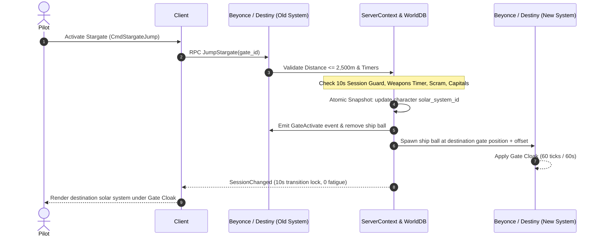

# Stargate Jumps, Cynosural Navigation & Jump Fatigue

> **Navigation**: [EvoMu Technical Wiki](../README.md) • [Related Systems](#related-systems--cross-references)
>
> [← Back to Wiki Table of Contents](../README.md)

---

The interstellar transit network of New Eden represents the backbone of empire civilization, alliance logistics, and fleet power projection. Interstellar travel operates across two primary paradigms: **permanent macroscopic stargates** connecting adjacent solar systems through stabilized artificial Einstein-Rosen bridges, and **point-to-point capital jump drives** that tunnel across light-years by locking onto artificial quantum gravitational beacons known as **cynosural fields**.

In EvoMu, interstellar navigation is simulated across [`eve-server`](../../../crates/eve-server), [`eve-destiny`](../../../crates/eve-destiny), [`eve-sde`](../../../crates/eve-sde), and [`eve-db`](../../../crates/eve-db). The simulation models real-time session migration across solar systems, 10-second session change transition guards, 60-second gate cloaks, cynosural beacon lifecycles, fuel consumption matrices, Titan and Black Ops bridge portals, and the post-Phoebe jump fatigue and cooldown relaxation equations.

---

## 1. Overview & Lore Context

```
                                  ┌────────────────────────────────────────────────────────┐
                                  │             Interstellar Transit Modalities            │
                                  └──────────────────────────┬─────────────────────────────┘
                                                             │
                      ┌──────────────────────────────────────┴──────────────────────────────────────┐
                      ▼                                                                             ▼
        ┌───────────────────────────┐                                                 ┌───────────────────────────┐
        │   Stargate Network (Sub)  │                                                 │  Cynosural Jump Drives    │
        │   Macroscopic Gate Pairs  │                                                 │  Point-to-Point Tunnels   │
        └─────────────┬─────────────┘                                                 └─────────────┬─────────────┘
                      │                                                                             │
     ┌────────────────┼────────────────┐                                             ┌──────────────┼──────────────┐
     ▼                ▼                ▼                                             ▼              ▼              ▼
┌──────────────┐ ┌──────────────┐ ┌──────────────┐                           ┌──────────────┐ ┌──────────────┐ ┌──────────────┐
│  Empire Gate │ │ Pirate / FW  │ │ Zarzakh Gate │                           │Standard Cyno │ │ Covert Cyno  │ │Industrial Cyn│
│  (Border/Reg)│ │ (Smuggler)   │ │ (Ancient Jov)│                           │(Recon / HIC) │ │(Bomber / BLOP│ │(Transport/Ind│
└──────────────┘ └──────────────┘ └──────────────┘                           └──────────────┘ └──────────────┘ └──────────────┘
     │                │                │                                             │              │              │
     └────────────────┼────────────────┘                                             └──────────────┼──────────────┘
                      ▼                                                                             ▼
        ┌───────────────────────────┐                                                 ┌───────────────────────────┐
        │  Session Change (10s lock)│                                                 │  Jump Range Calibration   │
        │  Gate Cloak (60s invuln)  │                                                 │  Isotope Fuel Consumption │
        │  Destiny Spatial Transfer │                                                 │  Jump Fatigue & Cooldown  │
        └───────────────────────────┘                                                 └───────────────────────────┘
```

### The Stargate Network
Constructed initially by the ancient Terran colonists and later reverse-engineered by the Amarr, Caldari, Gallente, and Minmatar empires, stargates link paired gravity wells across star systems. Stargates utilize massive rings of superconductive electromagnets to compress local space-time into a stabilized macroscopic wormhole conduit. Stargate jumps are instantaneous: a ship passing within the activation threshold ($2\,500\text{ m}$) is accelerated into the event horizon, undergoes cross-system session migration, and materializes at the counterpart destination gate.

### Cynosural Physics & Capital Jump Drives
Capital ships (Carriers, Dreadnoughts, Supercarriers, Titans, and FAXes), Jump Freighters, Rorquals, and Black Ops battleships are equipped with internal **Jump Drives**. These miniaturized hyperdrives generate transient microscopic artificial wormholes directly through space-time without relying on static gate infrastructure. 

However, because the destination lacks a macroscopic receiving ring, the jump drive requires a target homing vector to prevent gravitational disintegration: a **Cynosural Field**. A cynosural field is an artificial quantum singularity ignited in space by burning large quantities of **Liquid Ozone**. The intense gravitational and tachyon radiation emitted by the cyno acts as an interstellar beacon, allowing jump drives to lock coordinates and tear open a jump portal directly to the beacon's spatial position.

To prevent hyper-mobile capital fleets from teleporting across the cluster unchecked, CONCORD instituted the **Phoebe Jump Fatigue mechanics**. Every jump drive activation or bridge transit accumulates **Jump Fatigue**, enforcing progressive **Jump Activation Cooldowns** that require tactical staging, mid-point logistics, and patience.

---

## 2. Canonical Mechanics & Precise Formulas

### 2.1 Stargate Transitions & Session Lifecycle

A stargate jump is governed by strict proximity, state validation, and cross-system database session migrations.



#### 1. Activation Radius & Distance Check
To activate a stargate, the ship's physical ball must be within the canonical activation envelope:

$$d_{\text{gate}} = \max\left(0, \; \|\vec{x}_{\text{ship}} - \vec{x}_{\text{gate}}\| - R_{\text{gate}}\right) \le 2\,500\text{ m}$$

Where $R_{\text{gate}}$ is the collision radius of the stargate model (attribute `radius`, default $14\,051\text{ m}$ for standard empire stargates). If $d_{\text{gate}} > 2\,500\text{ m}$, the server rejects the activation with `OutsideStargateJumpRange`.

#### 2. Session Change Guard (10-Second Transition Lock)
Session changes in EVE (jumping gates, docking, undocking, switching ships) place an immutable 10-second lock on the character session:

$$t_{\text{remaining}} = \max\left(0, \; 10 - (t_{\text{now}} - t_{\text{last\_session\_change}})\right)$$

Any attempt to jump a stargate or activate a jump drive while $t_{\text{remaining}} > 0$ fails with `SessionChangeInProgress`. This invariant prevents race conditions, ghost duplication, and database snapshot synchronization deadlocks.

#### 3. Spatial Displacement & Gate Cloak
Upon arrival in the destination solar system, the ship ball is instantiated with specific kinematic properties:
* **Position Offset:** Placed at the destination stargate coordinates with a displacement offset:
  $$\vec{x}_{\text{arrival}} = \vec{x}_{\text{dest\_gate}} + (R_{\text{gate}} + 1\,500\text{ m}) \cdot \hat{u}$$
* **Velocity Reset:** Velocity is set to zero ($\vec{v} = \vec{0}$), speed fraction to $0.0$, and mode to `MovementMode::Stop`.
* **Gate Cloak Invulnerability:** The ship receives an automatic **Gate Cloak** lasting $60\text{ seconds}$ ($60\text{ physics ticks}$):
  $$\text{GateCloakTicks} = 60$$
  While under gate cloak, the ship is 100% invulnerable to damage, untargetable, completely invisible on overview and grid, and immune to directional scanning.
* **Cloak Break Conditions:** The gate cloak breaks immediately upon:
  1. Any pilot-initiated movement command (`Approach`, `Align`, `Orbit`, `Warp`).
  2. Any module activation (offensive, defensive, propulsion, or utility).
  3. Natural expiration of the 60-second timer.

---

### 2.2 Cynosural Navigation & Beacon Classification

Cynosural fields fall into three canonical operational classes, each with distinct module requirements, fuel costs, cycle times, and eligible ship hulls:

| Cyno Classification | Module Name | Ozone Consumption | Duration | Allowed Ship Hulls | Overview Visibility | Eligible Jumpers |
| :--- | :--- | :--- | :--- | :--- | :--- | :--- |
| **Standard Cyno** | Cynosural Field Generator I | 500 units (base) | $300\text{ s}$ ($5\text{ min}$) | Force Recon (833), Heavy Interdictors (898) | System-wide beacon broadcast | All Jump Drives, Titans, Supercarriers, Dreads, JFs |
| **Covert Cyno** | Covert Cynosural Field Generator I | 100 units (base) | $60\text{ s}$ ($1\text{ min}$) | Stealth Bombers, Blockade Runners, Force Recon, Black Ops | Invisible on system overview | Black Ops Jump Drives & Covert Jump Portals |
| **Industrial Cyno** | Industrial Cynosural Field Generator I | 800 units (base) | $300\text{ s}$ ($5\text{ min}$) | Deep Space Transports, Blockade Runners, Industrials | System-wide beacon broadcast | Jump Freighters & Rorquals ONLY |

#### Operational Constraints & Suppression
1. **High-Security Prohibition:** Standard and industrial cynosural fields cannot be lit in systems with security status $\ge 0.45$. Any activation attempt returns `CannotLightCynoInSystem`.
2. **System-Wide Cyno Jammers:** An active Upwell Tenebrex Cynosural Jammer or regional Triglavian jammer (Pochven `10000070` or Zarzakh `30100000`) completely suppresses all standard and industrial cynosural fields. Covert cynosural fields bypass system jammers completely.
3. **Mobile Cynosural Inhibitors:** Deployable mobile inhibitors establish a localized suppression sphere of $R_{\text{inhibitor}} = 100\,000\text{ m}$ ($100\text{ km}$). Non-covert cyno modules cannot be activated within this sphere (`CynoInhibited`).
4. **Self-Immobilization:** When a cynosural generator activates, the deploying ship becomes completely immobilized: maximum velocity drops to $0.0\text{ m/s}$, warp drive is disabled, and the ship cannot dock or tether until the cycle finishes.

---

### 2.3 Capital Jump Drives & Fuel Logistics

A capital ship or Black Ops battleship with an operational jump drive can execute a point-to-point spatial jump directly to any active, eligible fleet cynosural beacon within its operational range.

#### 1. Maximum Jump Range
Operational jump range is governed by the ship's base jump range and the pilot's **Jump Drive Calibration (JDC)** skill:

$$d_{\max} = d_{\text{base}} \times \left(1 + 0.20 \times \text{JDC\_Level}\right) \quad [\text{Light-Years}]$$

* At JDC Level 5, the ship's operational jump envelope is doubled ($+100\%$).
* Standard capital hulls (Dreadnoughts, Carriers, Titans) typically have $d_{\text{base}} = 5.0\text{ LY}$, giving maximum range $d_{\max} = 10.0\text{ LY}$.
* Black Ops battleships feature extended base ranges: $d_{\text{base}} = 6.0\text{ LY}$, giving maximum range $d_{\max} = 12.0\text{ LY}$ (with conduit ranges up to $8.0\text{ LY}$).
* Jump Freighters have $d_{\text{base}} = 5.0\text{ LY}$, giving maximum range $d_{\max} = 10.0\text{ LY}$.

#### 2. Jump Distance in 3D Space
Distance between origin solar system $A$ and destination solar system $B$ is measured in light-years ($1\text{ LY} = 9.46073 \times 10^{15}\text{ m}$):

$$d_{\text{LY}} = \frac{\sqrt{(x_B - x_A)^2 + (y_B - y_A)^2 + (z_B - z_A)^2}}{9.46073 \times 10^{15}}$$

If jump distance exceeds maximum range ($d > d_{\max}$), the jump drive fails to spool with `JumpDistanceOutOfRange`.

#### 3. Isotope Fuel Consumption
Jump drives burn empire-specific racial isotopes (attribute `jumpDriveConsumptionType` `866`):

| Empire / Faction | Primary Capital Ships | Racial Isotope Fuel (Type ID) |
| :--- | :--- | :--- |
| **Amarr Empire** | Revelation, Archon, Aeon, Avatar, Anshar, Redeemer | Helium Isotopes (`16274`) |
| **Caldari State** | Phoenix, Chimera, Wyvern, Leviathan, Rhea, Widow | Nitrogen Isotopes (`17887`) |
| **Gallente Federation**| Moros, Thanatos, Nyx, Erebus, Anshar/Obelisk, Sin | Oxygen Isotopes (`17888`) |
| **Minmatar Republic** | Naglfar, Nidhoggur, Hel, Ragnarok, Nomad, Panther | Hydrogen Isotopes (`17889`) |

Fuel consumption scales linearly with jump distance and is mitigated by the **Jump Fuel Conservation (JFC)** skill and hull bonuses:

$$\text{Fuel}_{\text{isotopes}} = \left\lceil \text{baseNeed} \times d_{\text{LY}} \times (1 - 0.10 \times \text{JFC\_Level}) \times (1 - 0.05 \times \text{JF\_Level}) \right\rceil$$

Where:
* $\text{baseNeed}$ is the hull's `jumpDriveConsumptionAmount` (attribute `868`).
* $\text{JFC\_Level} \in [0, 5]$ provides a $-10\%$ reduction per level (up to $-50\%$).
* $\text{JF\_Level} \in [0, 5]$ provides an additional $-5\%$ reduction per level for Jump Freighters.

---

### 2.4 Jump Portal Generators: Bridging vs. Conduit Jumps

Titans and Black Ops battleships can fit **Jump Portal Generators** to transport subcapital fleet members across space.

```
                  ┌────────────────────────────────────────────────────────┐
                  │                 Fleet Transit Portals                  │
                  └──────────────────────────┬─────────────────────────────┘
                                             │
             ┌───────────────────────────────┴───────────────────────────────┐
             ▼                                                               ▼
┌─────────────────────────┐                                     ┌─────────────────────────┐
│     Titan Bridge        │                                     │     Conduit Jump        │
│  (Jump Portal Gen I)    │                                     │  (Black Ops Battleship) │
└────────────┬────────────┘                                     └────────────┬────────────┘
             │                                                               │
             ├─ Opens temporary spatial bridge                               ├─ Black Ops jumps itself
             ├─ Titan remains in origin system                               ├─ Drags fleet passengers with it
             ├─ Stront consumed on activation                                ├─ Fleet members within 10 km
             ├─ Isotopes paid per passenger mass                             └─ Subcaps only (Non-capitals)
             └─ Subcaps jump individually through bridge
```

#### 1. Titan Jump Portal Bridging (`Jump Portal Generator I`)
* **Activation:** Consumes **Strontium Clathrates** (`attribute 713`, type `16275`) to open a portal to a distant fleet cyno for $\sim 60\text{ seconds}$.
* **Passenger Fuel Cost:** Each bridged subcapital ship consumes fuel from the Titan's fuel bay proportional to the passenger's physical mass and jump distance:
  $$\text{Fuel}_{\text{bridge}} = \left\lceil \text{TitanConsumption} \times \text{MassFactor} \times M_{\text{ship}} \times d_{\text{LY}} \times (1 - 0.10 \times \text{JFC\_Level}) \right\rceil$$
  Where $\text{MassFactor}$ is the portal's `jumpPortalConsumptionMassFactor` (attribute `1001`).
* **Hull Restriction:** Capitals cannot jump through Titan portals (`JumpBridgeRestrictedShip`).

#### 2. Black Ops Conduit Jumps (`CmdConduitJumpToFleetBeacon`)
* Black Ops battleships can execute group **Conduit Jumps**, bringing up to 30 fleet members directly along on their jump.
* **Qualification Criteria:**
  1. Fleet member must have `accepts_conduit_jumps = true`.
  2. Must be within $10\,000\text{ m}$ of the Black Ops battleship.
  3. Must be in a subcapital combat ship (no capitals or freighters).
  4. Must not be in warp, warp scrambled, or under an immobilizing module.
* All qualified passengers materialize in a cluster around the destination cyno beacon and receive standard jump fatigue.

---

### 2.5 Jump Fatigue & Cooldown Mechanics (Phoebe System)

Introduced in the Phoebe release and refined in subsequent updates, Jump Fatigue prevents the instantaneous consolidation of supercapital projection across New Eden. Every jump drive activation or portal transit updates two interrelated counters: **Jump Activation Cooldown** and **Jump Fatigue Accumulation**.

```
Jump Executed
     │
     ├─► 1. Calculate Effective Distance:
     │      d_eff = d_LY * (1 - HullFatigueReduction)
     │
     ├─► 2. Update Jump Activation Cooldown (T_cooldown):
     │      T_cooldown = max(1.0 + d_eff, T_fatigue_curr / 10.0) [minutes]
     │      (Minimum wait before next jump drive activation)
     │
     └─► 3. Accumulate Jump Fatigue (T_fatigue):
            T_fatigue_new = min(300.0, max(T_fatigue_curr, 10.0) * (1.0 + d_eff)) [minutes]
            (Decays linearly in real-time until reaching 0)
```

#### The Precise Mathematical Formulation

1. **Effective Jump Distance:**
   $$d_{\text{eff}} = d_{\text{LY}} \times \left(1 - \beta_{\text{reduction}}\right)$$
   Where $\beta_{\text{reduction}}$ is the ship hull's jump fatigue reduction bonus:
   * **Jump Freighters:** $90\%$ reduction ($\beta = 0.90$).
   * **Black Ops Battleships:** $75\%$ or $90\%$ reduction ($\beta = 0.90$).
   * **Standard Capitals / Supercapitals:** $0\%$ reduction ($\beta = 0.00$).

2. **Jump Activation Cooldown ($T_{\text{cooldown}}$):**
   The minimum wait time (in minutes) before the pilot may activate a jump drive or bridge again:
   $$T_{\text{cooldown}} = \max\left(1.0 + d_{\text{eff}}, \; \frac{T_{\text{fatigue\_current}}}{10.0}\right) \quad [\text{minutes}]$$

3. **Jump Fatigue Accumulation ($T_{\text{fatigue}}$):**
   The total fatigue timer (in minutes) stored on the character record:
   $$T_{\text{fatigue\_new}} = \min\left(300.0, \; \max(T_{\text{fatigue\_current}}, \; 10.0) \times (1.0 + d_{\text{eff}})\right) \quad [\text{minutes}]$$
   * **The 10-Minute Minimum Floor:** If the character currently has 0 fatigue, the calculation treats current fatigue as $10.0\text{ minutes}$. Thus, even a first jump of $5\text{ LY}$ produces:
     $$T_{\text{fatigue}} = 10.0 \times (1.0 + 5.0) = 60.0\text{ minutes (1 hour)}$$
     $$T_{\text{cooldown}} = \max\left(1.0 + 5.0, \; \frac{60.0}{10.0}\right) = 6.0\text{ minutes}$$
   * **The 5-Hour Maximum Ceiling:** Fatigue accumulation is hard-capped at **$300\text{ minutes}$ ($5\text{ hours}$)**. No amount of rapid jumping can push fatigue beyond this threshold.

4. **Real-Time Fatigue Relaxation:**
   Fatigue decays linearly with real wall-clock time:
   $$T_{\text{fatigue}}(t) = \max\left(0, \; \frac{t_{\text{expiry\_unix}} - t_{\text{now\_unix}}}{60.0}\right)$$

---

## 3. EvoMu Implementation Architecture

EvoMu organizes stargate and cynosural transit across clean-room Rust modules:

```
┌────────────────────────────────────────────────────────────────────────┐
│                              eve-server                                │
│                                                                        │
│   ┌───────────────────────────┐      ┌───────────────────────────────┐ │
│   │   space_warp_jump.rs      │      │   fitting_cyno_portal.rs      │ │
│   │   Stargate Jump & Cloak   │      │   Cyno Beacons, Jump & Bridge │ │
│   └─────────────┬─────────────┘      └───────────────┬───────────────┘ │
│                 │                                    │                 │
│                 ▼                                    ▼                 │
│   ┌───────────────────────────┐      ┌───────────────────────────────┐ │
│   │       formulas.rs         │      │      space_destiny.rs         │ │
│   │   Fuel & Fatigue Math     │      │   Session Timers & Invuln     │ │
│   └─────────────┬─────────────┘      └───────────────┬───────────────┘ │
└─────────────────┼────────────────────────────────────┼─────────────────┘
                  │                                    │
                  ▼                                    ▼
┌───────────────────────────────────┐  ┌─────────────────────────────────┐
│            eve-destiny            │  │             eve-db              │
│                                   │  │                                 │
│   SystemHandle / Ballpark         │  │   WorldStateSnapshot            │
│   remove_ball / spawn_ball        │  │   characters (fatigue_minutes)  │
│   gate_cloak_remaining_ticks = 60 │  │   items & cargos (isotopes)     │
│   is_ball_scrambled               │  │   zarzakh_gate_locks            │
└───────────────────────────────────┘  └─────────────────────────────────┘
```

### 3.1 Crate & Source Module Breakdown

| Crate & File | Architectural Role | Key Functions & Types |
| :--- | :--- | :--- |
| [`crates/eve-server/src/services/space_warp_jump.rs`](../../../crates/eve-server/src/services/space_warp_jump.rs) | Handles stargate jump RPCs, distance checks, session migration, gate cloak application, and Zarzakh gate locks. | [`handle_jump_stargate`](../../../crates/eve-server/src/services/space_warp_jump.rs#L600-L878), `check_session_change_timer_active`, `record_session_change_timer`. |
| [`crates/eve-server/src/services/fitting_cyno_portal.rs`](../../../crates/eve-server/src/services/fitting_cyno_portal.rs) | Coordinates cyno activation, beacon registry, jump drive relocations, Titan bridging, Black Ops conduits, and cyno jammers. | [`light_cyno`](../../../crates/eve-server/src/services/fitting_cyno_portal.rs#L353-L460), [`jump_to_fleet_beacon`](../../../crates/eve-server/src/services/fitting_cyno_portal.rs#L754-L837), [`bridge_to_fleet_beacon`](../../../crates/eve-server/src/services/fitting_cyno_portal.rs#L841-L938), [`conduit_jump_to_fleet_beacon`](../../../crates/eve-server/src/services/fitting_cyno_portal.rs#L979-L1130), [`active_cyno_jammer`](../../../crates/eve-server/src/services/fitting_cyno_portal.rs#L190-L198). |
| [`crates/eve-server/src/formulas.rs`](../../../crates/eve-server/src/formulas.rs) | Pure mathematical calculation engine for jump fuel consumption, fatigue accumulation, and activation cooldowns. | [`compute_jump_fatigue_and_cooldown_minutes`](../../../crates/eve-server/src/formulas.rs#L188-L198), [`compute_jump_fuel_isotopes`](../../../crates/eve-server/src/formulas.rs#L175-L184). |
| [`crates/eve-server/src/services/space_destiny.rs`](../../../crates/eve-server/src/services/space_destiny.rs) | Session change tracking and location change invulnerability lifecycle. | `check_session_change_timer_active`, `clear_session_change_timer`, `is_location_change_invulnerable`. |

---

### 3.2 Core State Schemas

#### Fleet Module Beacon Record (`FleetModuleBeacon`)
Defined in [`fitting_cyno_portal.rs`](../../../crates/eve-server/src/services/fitting_cyno_portal.rs):
```rust
#[derive(Debug, Clone)]
pub(crate) struct FleetModuleBeacon {
    pub(crate) beacon_id: i64,
    pub(crate) char_id: i64,
    pub(crate) ship_id: i64,
    pub(crate) beacon_type_id: u32,
    pub(crate) solar_system_id: u32,
    pub(crate) position: DVec3,
    pub(crate) expires_at_unix: u64,
}
```

#### Jump Outcome (`JumpOutcome`)
Returned upon completing a jump drive execution:
```rust
#[derive(Debug)]
pub(crate) struct JumpOutcome {
    pub(crate) dist_ly: f64,
    pub(crate) fuel_type: u32,
    pub(crate) fuel_qty: i64,
    pub(crate) cooldown_min: f64,
    pub(crate) fatigue_min: f64,
    pub(crate) beyonce_bound_id: i64,
}
```

---

## 4. Invariants, Security & Edge Cases

1. **10-Second Session Change Guard Invariant:** Whenever a pilot undergoes a session change (stargate jump, cyno jump, bridge, dock, undock), `record_session_change_timer` stores an immutable timestamp. If an RPC arrives before 10 seconds elapse, `check_session_change_timer_active` returns `SessionChangeInProgress`, preventing client-side desync, rapid spamming, and duplicate ball creation.
2. **Weapons & Criminal Timer Gating:** An active Weapons Timer (60s) or High-Sec Criminal Flag strictly prevents stargate jumps, cyno jumps, bridge jumping, and station docking. The check is performed at the boundary of `handle_jump_stargate` and `jump_to_fleet_beacon`.
3. **Mid-Warp Activation Guard:** A ship in warp (`MovementMode::Warp`) cannot activate a stargate or spool its jump drive (`ShipInWarp`).
4. **Wormhole and Pocket Dimension Isolation:** Jump drives and cynosural generators are physically prohibited in J-space wormhole systems (`31000000..32000000`), Pochven (`10000070`), and Zarzakh (`30100000`), raising `JumpDriveForbiddenInWormholeSpace`, `CannotJumpToPochven`, or `JumpDriveForbiddenInZarzakh`.
5. **Cyno Jammer Pre-Check:** Before a standard cynosural generator burns Liquid Ozone, `active_cyno_jammer` inspects both regional jammer rules and active in-space Upwell Tenebrex structures. If jammed, ozone is preserved and `CynoJammed` is returned.
6. **Conduit Passenger Safety:** Fleet members cannot be hijacked or non-consensually dragged on conduit jumps. The passenger must have `accepts_conduit_jumps` enabled, must be within $10\text{ km}$, must not be in warp or warp scrambled, and must be in a subcapital ship.
7. **Zarzakh 6-Hour Gate Lock:** Ships entering Zarzakh record their ingress stargate. For 6 hours ($21\,600\text{ s}$), the pilot cannot exit Zarzakh through any other stargate, enforcing the canonical choke-point mechanics of the ancient Jovian station.

---

## 5. Verification, Tests & Parity References

EvoMu's stargate transitions, cynosural mechanics, and jump fatigue systems are attested and verified in the automated integration test suite:

### 5.1 Parity Audit Ledger Tags
* `feat:navigation.stargates`: Canonical stargate distance validation, session change timers, and gate cloaks.
* `feat:modules.cyno-field`: Standard cynosural generator mechanics, Liquid Ozone burn, and ship self-immobilization.
* `feat:modules.cyno-covert`: Covert cynosural generator stealth properties and jammer bypass.
* `feat:modules.cyno-industrial`: Industrial cynosural restriction to Jump Freighters and Rorquals.
* `feat:modules.cyno-jammer`: Upwell Tenebrex Cynosural Jammer activation and standard cyno suppression.
* `feat:modules.jump-portal`: Titan jump portal generation, mass-scaled fuel billing, and bridge lifetime.
* `feat:ships.jump-drive-fatigue-accumulation`: Post-Phoebe jump fatigue and activation cooldown accumulation and decay.
* `feat:ships.titan-jump-portal-bridge`: Titan fleet bridging and passenger ship group legality.

### 5.2 Test Implementations

| Test Name | File Path | Focus & Assertions |
| :--- | :--- | :--- |
| `test_cyno_field_beacon_duration_ozone_and_immobilization` | [`crates/eve-server/tests/it/modules_cyno_portal.rs`](../../../crates/eve-server/tests/it/modules_cyno_portal.rs#L245-L315) | Verifies high-sec cyno block, 5-minute Force Recon beacon duration, Liquid Ozone consumption, and ship immobilization. |
| `test_industrial_cyno_only_jump_freighters_and_rorquals` | [`crates/eve-server/tests/it/modules_cyno_portal.rs`](../../../crates/eve-server/tests/it/modules_cyno_portal.rs#L316-L370) | Verifies that Dreadnoughts, Titans, and Supercarriers are rejected by industrial cynos, while JFs and Rorquals jump successfully. |
| `test_covert_cyno_black_ops_jump_and_covert_portal` | [`crates/eve-server/tests/it/modules_cyno_portal.rs`](../../../crates/eve-server/tests/it/modules_cyno_portal.rs#L372-L428) | Tests Covert Cyno deployment, Black Ops jump portal bridging, Stealth Bomber passenger transit, and capital exclusion. |
| `test_titan_jump_portal_fleet_bridge_fuel_and_range` | [`crates/eve-server/tests/it/modules_cyno_portal.rs`](../../../crates/eve-server/tests/it/modules_cyno_portal.rs#L430-L501) | Asserts range limits (> 15 LY rejected), Strontium activation burn, mass-scaled isotope billing for bridged battleships, and capital passenger rejection. |
| `test_cyno_jammer_blocks_non_covert_cynos_and_reports_state` | [`crates/eve-server/tests/it/modules_cyno_portal.rs`](../../../crates/eve-server/tests/it/modules_cyno_portal.rs#L503-L555) | Asserts that online Tenebrex jammers reject standard cynos without consuming ozone, while covert cynos light successfully. |
| `test_plan_c7_crimewatch_closure_part2` | [`crates/eve-server/tests/it/plan_c7_crimewatch_closure_part2.rs`](../../../crates/eve-server/tests/it/plan_c7_crimewatch_closure_part2.rs#L254-L320) | Confirms that active Weapons Timers and High-Sec Criminal status block stargate jumps, cyno jumps, and portal transits. |

---

## 6. Summary & Navigation Synergy

Stargates and cynosural jump drives form the dual circulatory system of New Eden:

```
┌─────────────────────────────────┐
│     Spatial Proximity Check     │  ◄── Stargate <= 2500m / Cyno In-Range
│  (Distance, Timers, Scrambles)  │
└────────────────┬────────────────┘
                 │
                 ▼
┌─────────────────────────────────┐
│      Session Migration Lock     │  ◄── 10-Second Transition Guard
│  (DB Snapshot System Update)    │
└────────────────┬────────────────┘
                 │
                 ▼
┌─────────────────────────────────┐
│      Ballpark Materialization   │  ◄── Destiny 1 Hz Kinematics
│  - Stargates: 60s Gate Cloak    │  ◄── Untargetable Invulnerability
│  - Cynos: 2500m Offset Arrival  │  ◄── Spatial Scatter
└────────────────┬────────────────┘
                 │
                 ▼
┌─────────────────────────────────┐
│    Fatigue & Cooldown Ledger    │  ◄── Phoebe Equation: Max 5h Ceiling
│  (Linear Wall-Clock Relaxation) │  ◄── Activation Cooldown Enforcement
└─────────────────────────────────┘
```

By enforcing strict session change idempotency, mathematical fuel consumption, and post-Phoebe fatigue decay, EvoMu maintains full parity with canonical EVE Online navigation dynamics within a modern, memory-safe Rust architecture.

---

## Related Systems & Cross-References

- [**Pochven Navigation, Filaments & Anchoring**](./pochven_navigation_and_anchoring.md): Pochven conduit networks, Home system standing requirements, and filament jump mechanics.
- [**Destiny Simulation Loop**](../ballpark_and_physics/destiny_simulation_loop.md): 5-phase warp engine, sub-warp align physics, bubble drag geometry, and session change state transitions.
- [**Dogma Attribute Engine**](../dogma_and_fitting/dogma_attribute_engine.md): Jump drive capacitor usage, fuel consumption per light-year, and ship agility modifiers.
- [**Crimewatch & Engagement Timers**](../combat_and_crimewatch/crimewatch_and_engagement_timers.md): 60-second gate cloak immunity, weapons timer jump blocks, and PvP combat logout locks.

---

[← Back to Wiki Table of Contents](../README.md)
