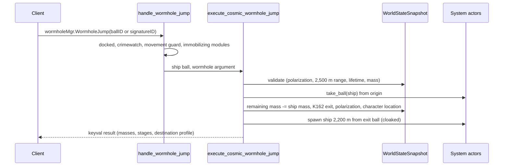

# Wormholes & Wormhole Space

> **Navigation**: [EvoMu Technical Wiki](../README.md) • [Related Systems](#related-systems--cross-references)
>
> [← Back to Wiki Table of Contents](../README.md)

---

## Overview & Lore Context

A **wormhole** in EvoMu is a cosmic signature of group `"Wormhole"` that links two solar systems. It is stored as a `CosmicSignatureRecord` in the system where it was created, appears in space as a rigid ball, and can be jumped through with `wormholeMgr.WormholeJump`. The far end is a second signature named `K162-<signature id>` that only appears in the destination system once the connection has been used or has aged.

**Wormhole space** is the set of solar systems with IDs in `31_000_000..32_000_000`. Each has a wormhole class taken from the SDE (`wormhole_class_id` on the system, constellation or region). The class decides which connections the system gets, which Sleeper sites are seeded, and whether capital escalations can happen.

Everything here is derived from the SDE wormhole type table (`sde.wormhole_types`: lifetime, total mass, per-jump mass, target class) plus deterministic hashes of the system ID. There is no random roll and no per-system static table; see [Not implemented / known gaps](#not-implemented--known-gaps).

Pochven connections (`C729`, `R081`, signature offset, guard NPCs, scan-to-open) are described in [Pochven Navigation & Anchoring](pochven_navigation_and_anchoring.md) and are not repeated here.

---

## Canonical Mechanics & Formulas

The rules below are what the code does at the pinned commit.

### System profiles

`system_wormhole_profile_sde` returns `(class, is_thera, is_shattered, environmental_effect)` for a system.

| Class value | Meaning in the code |
|---|---|
| `0` | Not a wormhole system (known space). |
| `1`–`6` | Regular wormhole systems. A system of these classes with celestials but no moons is flagged shattered. |
| `12` | Thera (`31_000_005`). Flagged shattered. |
| `13` | Small-ship shattered systems. |
| `14`–`18` | Drifter systems (`31_000_001`–`31_000_004`, `31_000_006`). |
| `25` | Pochven (target class used by wormhole types). |

The environmental effect name comes from `eve_dogma::resolve_system_wormhole_phenomenon`. The profile map is built once and cached when the full SDE is loaded.

### How connections are created

Connections are created lazily. `ensure_system_signatures_and_anomalies` runs when a pilot opens the scanner for a system, asks for polarization, or jumps into or out of it. If the system has no signatures (or only `K162-` and `DNG-` ones), it seeds the output of `static_wormhole_template(ctx, sys, now, 0)`, and for non-Drifter systems five placeholder site signatures (`REL-`, `DAT-`, `CBT-`, `GAS-`, `ORE-`). Each uncollapsed wormhole signature then gets a rigid ball of radius 1,500 m whose item ID is `wormhole_item_id_for_signature(sys, sig_id)`.

Lifetime, total mass and per-jump mass are read from the SDE wormhole type (`max_stable_time_min × 60`, `max_stable_mass`, `max_jump_mass`). The numbers in the template are only fallbacks for a type missing from the SDE. Wandering connections are gated by `system_spawn_hash(sys_id, salt) % 100`, so a given system always seeds the same set.

| System | Signature prefix | Connection | Condition |
|---|---|---|---|
| C1, C3 | `WST` | One static to high-, low- or null-sec, chosen by `constellation_id % 3` | Always |
| C2 | `WST`, `WST2` | One wormhole-space static and one known-space static, chosen by `constellation_id % 6` | Always |
| C4 | `WST`, `WST2` | Two wormhole-space statics of different classes, chosen by `constellation_id % 12` | Always |
| C5, C6 | `WST` | One wormhole-space static (C1–C6), chosen by `constellation_id % 6` | Always |
| Shattered C1–C6 | `WSK` | Extra known-space static (`shattered_kspace_static_type`) | Always |
| C1–C6 | `WND` | Wandering connection to class 1–9 | 35% of systems |
| C2–C4 | `WPC` | `R081` (type `56541`) to Pochven | 12% of systems |
| C1–C6 | `WTH` | `F135` (type `34372`) to Thera | 8% of systems |
| Thera | `THS`, `TLS`, `TNS`, `TWS` | High-sec, low-sec, null-sec and wormhole-space connections; per-jump mass capped at 375,000,000 kg | Always |
| Drifter (14–18) | `WST1`–`WST6` | Statics to C1–C6 (types `30671`–`30676`) | Always |
| Drifter (14–18) | `DRK-100`… | 56 known-space connections of the class's type (`drifter_kspace_wh_type_for_class`), named "Unidentified Wormhole" | Initial seed only |
| Class 13 | `WST` | One small-ship static to C1–C3 (`sys_id % 3 + 1`), per-jump mass forced to 5,000,000 kg | Always |
| Class 13 | `WND` | Second small-ship connection | 40% of systems |
| Known space | `JMM` | Type `26272` connection to Thera | 8% of systems |
| Known space | `PKW` | `C729` (type `56026`) to a Pochven system within 5 light-years | 35% of eligible systems |
| Known space | `WND` | Wandering connection to C1–C6 | 25% of systems |
| Pochven | (see Pochven article) | `pochven_static_wormholes` | — |

The wormhole type for a static is picked by `lookup_wormhole_type_for_origin_and_target` from the SDE types whose `target_system_class` matches, restricted to a type-ID range per origin class. The destination system is picked by `pick_destination_system_for_target_class` from all systems of the target class (high-sec is security ≥ 0.45, low-sec is between 0 and 0.45, null-sec is ≤ 0 and excludes a fixed list of regions).

For Drifter systems, `seed_drifter_kspace_beacons_in_snap` also writes the known-space side of every `DRK-` connection immediately, with `signal_strength = 1.0` (no scanning needed), and `ensure_drifter_kspace_guards` places two Drifter battleships (types `34495` and `34561`) next to that ball.

### The K162 exit

The destination side does not exist when a connection is created. `materialize_k162_exit_in_snap` adds a signature `K162-<sig id>` (type `26272`, "Unstable Wormhole (K162)") to the destination system and a matching ball, copying the parent's creation time, lifetime and masses. It runs when:

- a ship first jumps through the parent from the origin side, or
- the parent's remaining lifetime drops below `K162_MATERIALIZE_REMAINING_SECS` (15 hours), checked by the periodic sweep (not for Pochven wormholes), or
- a Pochven wormhole is scanned to full strength from Pochven, or a Drifter beacon is seeded (see above).

`sync_k162_mirror_in_snap` copies `remaining_mass_kg` and `collapsed` from the parent to the K162 record after every jump and collapse. A jump from the K162 side is resolved back to the parent record, so both directions draw on one mass pool.

### Lifetime

A wormhole expires when `now ≥ created_unix + lifetime_seconds`. On expiry the record is flagged `collapsed`, both balls are removed, and scanner clients in both systems receive a signature delta. The age stage is written to the ball's slim item (`wormholeAge`) and returned by the scan and jump RPCs.

| Remaining lifetime | `lifetimeStage` | `wormholeAge` |
|---|---|---|
| More than 24 h | `Healthy` | 0 |
| 4 h to 24 h | `BeginningToDecay` | 1 |
| Less than 4 h | `ReachingEndOfLifetime` | 2 |
| Expired or collapsed | `Collapsed_Expired` | 3 |

### Mass

Each jump subtracts the ship's effective jump mass from `remaining_mass_kg`. The ship that takes the remaining mass to zero or below still completes its jump; the wormhole is flagged collapsed in the same transaction. A jump attempted when the remaining mass is already ≤ 0 fails with `WormholeMassCollapsed`.

| Remaining / total mass | `massStage` | `wormholeSize` |
|---|---|---|
| ≥ 50% | `Stable` | 1.0 |
| < 50% | `Destabilized` | 0.5 |
| < 10% | `Critical` | 0.1 |
| ≤ 0 | `Collapsed_Exhausted` | 0.0 |

`compute_effective_ship_jump_mass` builds the mass used for both the per-jump limit and the subtraction:

- hull mass from the SDE type, plus attribute `796` (mass addition) of every online module in fitting flags `11..=34`;
- plus attribute `796` of every active propulsion module (group `46`), unless the ship ball's mass already includes it;
- if a Zero-Point Mass Entangler (group `2008` or type `49099`) is active, hull plus plates are multiplied by `1 + attr 1131 / 100`, clamped to `0.05..=1.0` (default −80%), and the propulsion addition is ignored.

Per-jump admission in `validate_cosmic_wormhole_jump_in_snap`:

- **Small-ship wormholes** (`is_small_ship_wormhole`: either end is class 13, the type is `34134`–`34140` or `34439`, or the per-jump mass is ≤ 5,000,000 kg) admit only ships whose effective mass is ≤ 5,000,000 kg and whose group is a frigate, destroyer, Porpoise, Heavy Interdictor (group `894`) or Odysseus group, per the lists in `check_small_ship_wormhole_eligibility`.
- Otherwise the jump is rejected with `ShipTooHeavyForWormhole` when the effective mass exceeds `max_jump_mass_kg`, or exceeds 375,000,000 kg and the destination is Thera, shattered, or class 1–4.
- Supercarriers and Titans (groups `659`, `30`) are rejected earlier by the movement guard with `ShipRestrictedFromWormhole`.

### Statics respawn

When a wormhole collapses (expiry or mass), `build_static_replacement_wormhole` creates a successor in the same transaction unless the signature prefix is `WND`, `K162`, `WTH`, `WPC` or `PKW`. The successor keeps the collapsed wormhole's type, takes fresh lifetime and mass from the SDE, sits at a celestial chosen by `pick_system_celestial_position`, and gets a new destination of the same target class that differs from the previous one. Wandering connections get no successor.

### Jumping

`handle_wormhole_jump` checks, in order: the session has a character, is not docked, has a solar system and an active ship; the pilot is not controlling a structure; the ship ball exists; `check_crimewatch_action_restriction` (a non-capsule pilot with a pending CONCORD response, or a criminal timer in a system of security ≥ 0.45, gets `CantEnterWormholeGlobalCriminalFlag`); the movement guard; and `prepare_ship_for_wormhole_jump`, which rejects a ship with an active immobilizing module with `CannotJumpWormholeWhileImmobilized`.

`execute_cosmic_wormhole_jump` then:

1. Rejects the jump while a session-change timer is active (`SessionChangeInProgress`).
2. Resolves the argument, which may be the entrance ball ID, the exit ball ID, a signature ID or a `K162-…` signature ID.
3. Validates inside the snapshot: character still in the origin system and undocked; no unexpired polarization for this wormhole ball (`WormholePolarized`); ship within 2,500 m of the wormhole ball (`OutsideWormholeJumpRange`); lifetime; mass rules above.
4. Removes the ship ball from the origin system, then in one snapshot transaction re-validates, subtracts mass, collapses and replaces the wormhole if needed, materializes the K162, writes polarization, and moves the character and ship to the destination.
5. Abandons drones and fighters, aborts self-destruct, deactivates modules, moves the pilot's Local channel, and runs the session transition.
6. Spawns the ship 2,200 m from the exit ball, stopped, cloaked, with `gate_cloak_remaining_ticks = 60` and a matching invulnerability timer. Shield, armour, hull and capacitor fractions carry over. The destination system's phenomenon is applied to the ship's velocity and inertia.
7. Records a session-change timer and returns a keyval with, among others, `shipJumpMassKg`, `remainingMassKg`, `maxJumpMassKg`, `massStage`, `lifetimeStage`, `collapsed`, `replacementSignatureID`, `wormholeClass`, `isThera`, `isShattered`, `delayedLocal` and `environmentalEffect`.

Every failure before the ship moves sends `OnWormholeJumpCancel` to the character; if the ball had already been taken it is restored.

### Polarization

A successful jump writes two entries into `wh_polarizations`, both expiring at `now + 300` seconds: `(character, wormhole ball jumped from)` and `(character, destination system)`. A later jump is rejected while the entry for the ball the pilot is jumping from is unexpired. The return trip uses the ball on the other side, which has its own key, so a pilot can go through and come back but cannot go through from the same side again until the 300 seconds are over.

`wormholeMgr.GetWormholePolarization` returns `None`, or the tuple `(end time as FILETIME, 300 s in 100 ns ticks)`. It accepts a signature ID, a wormhole ball ID or a solar system ID; a dispatcher pre-check (`resolve_cross_system_wormhole_polarization`) answers for ball IDs whose signature lives in another system.

### What the scanner shows

`scanMgr.GetSystemScanMgr` returns the system's `wormholeClass`, `isThera`, `isShattered`, `delayedLocal` (class > 0), `allowsCapitalShips` and `environmentalEffect`. For a resolved wormhole signature it adds the stages above and the show-info buckets from `derive_wormhole_buckets`: destination class (`C1-3`, `C4-5`, `C6`, `High-Sec`, `Low-Sec`, `Null-Sec`, `Thera`, `Drifter`, `Triglavian`), maximum ship size (`Small` ≤ 20,000,000 kg, `Medium` ≤ 62,000,000 kg, `Large` ≤ 500,000,000 kg, otherwise `Extra Large`), lifetime text and mass-stability text.

### PvE in wormhole systems

Site seeding happens once per system in `ensure_system_pve_sites_seeded` ([`pve_exploration_seeding.rs`](../../../crates/eve-server/src/services/pve_exploration_seeding.rs)).

| System | Sites seeded |
|---|---|
| C1–C6 (regular) | Two Sleeper combat anomalies of category `WormholeCombat` per class band (`anomaly_dungeons_for_system`), 3 waves for C1–C4 and 4 for C5–C6. The rest of the function's general site seeding also runs and is not covered here. |
| Shattered C1–C6 | Combat sites of the classes one below to one above the system class, one data and one relic site, one Shattered Debris Field (15 ore types) and one Shattered Ice Field (8 ice types) |
| Class 13 | Five C1–C3 combat sites and four data/relic sites with a 4-hour lifetime instead of 24 hours |
| Drifter (14–18) | None; the system is marked seeded with an empty site list |

- **Sleeper waves.** `sleeper_npc_types_for_class_and_wave` gives a trigger NPC and two others per class and wave. The next wave spawns as soon as the trigger (the first NPC of the wave) dies. The roster is hand-mapped; the code comment notes the SDE has no dungeon spawn tables.
- **Loot.** Each Sleeper kill in a `WormholeCombat` site drops a wreck with a Sleeper Component from SDE group 880, chosen by `sleeper_blue_loot_for_class`. Sleepers pay no bounty.
- **Sentry towers.** `sleeper_sentry_type_for_class` picks type `30460` (C1–C2), `30461` (C3–C4) or `30462` (C5–C6); stats come from the SDE type and firing is rate-limited by `can_sentry_fire_and_record`.
- **Shattered resource fields.** The first ship on grid, or the first asteroid mined in the system (`on_asteroid_mined_in_system`), triggers a single delayed Sleeper wave.
- **Capital escalations (C5/C6).** When a Dreadnought (groups `485`, `4594`) or a Carrier / Force Auxiliary (groups `547`, `1538`) is within 100 km of a combat, data or relic site, `spawn_upgraded_avengers_core` spawns Upgraded Avengers (type `37472`): 3 in C5, 4 in C6. A site accepts two triggers per capital class. The Avengers despawn when the triggering capital leaves, warps, or moves more than 100 km from where it arrived.
- **Drifter response (C5/C6).** When such a site is cleared, a Decloaked Transmission Relay (type `41589`) spawns. Damaging it spawns Arithmos Tyrannos (type `37473`) if a capital was on grid when the relay appeared, otherwise Hyleus Tyrannos (type `86498`). The boss warps to another celestial every 240 seconds unless warp-scrambled, and is configured to drop an Antikythera Element (`34575`) and 60 Sleeper Drone AI Nexus (`30747`).
- **Downtime.** `process_wormhole_sites_on_downtime` resets the capital-trigger counters, and removes a site that a ship has visited at the third downtime after the visit if it was cleared, or the fourth if it was not.

### Not implemented / known gaps

- **Statics are derived, not real.** A code comment on `wspace_static_specs_for_system` and `static_wormhole_template` states that per-system static tables are not in the client SDE; the server assigns statics from a hash of the constellation ID. They will not match the live game's static for a given system.
- **No random spawning.** Wandering connections exist or not per system by a fixed hash, are created only in the initial seed, and are not replaced after they collapse.
- **Lazy creation.** A system has no wormholes until a pilot scans it or jumps into it. The periodic sweeps only expire, replace and materialize exits for signatures that already exist.
- **`statics_for_system_sde`** (described in its comment as feeding `wormholeMgr.GetWormholePolarization`) is only called from tests; no RPC returns the static list.
- **Mass is fixed.** The total mass is the SDE value with no variance, and there is no mass regeneration.
- **Sleeper site content is hand-mapped** (rosters, wave counts), and the five placeholder site signatures seeded with wormholes carry fixed names such as "Ruined Sansha Relic Site" even in wormhole space.
- **Legacy path.** `handle_wormhole_jump` keeps an older branch for a single K162 ball driven by `system_states[..].wormhole_destination_system_id`; it has its own mass counter and polarizes by solar system rather than by ball.
- No open GitHub issue mentioned wormholes when this article was written.

---

## EvoMu Implementation Architecture

- **Crates involved:** [`eve-server`](../../../crates/eve-server) (all logic), [`eve-db`](../../../crates/eve-db) (snapshot records), [`eve-sde`](../../../crates/eve-sde) (wormhole types, system classes), [`eve-dogma`](../../../crates/eve-dogma) (system phenomena), [`eve-destiny`](../../../crates/eve-destiny) (wormhole balls and their slim-item stages).

### Primary handlers & dispatch

| Entry point | Function | File |
|---|---|---|
| `wormholeMgr.WormholeJump` | `handle_wormhole_jump` → `execute_cosmic_wormhole_jump` | [`space_cyno_filaments.rs`](../../../crates/eve-server/src/services/space_cyno_filaments.rs), [`space_docking_cloaking.rs`](../../../crates/eve-server/src/services/space_docking_cloaking.rs) |
| `wormholeMgr.GetWormholePolarization` | match arm in the scanning service; `resolve_cross_system_wormhole_polarization` pre-check in the dispatcher | [`fleet_social_scanning.rs`](../../../crates/eve-server/src/services/fleet_social_scanning.rs), [`wormhole_lifecycle_ops.rs`](../../../crates/eve-server/src/services/wormhole_lifecycle_ops.rs) |
| `scanMgr.GetSystemScanMgr` | `handle_get_system_scan_mgr` | [`space_probe_scanning.rs`](../../../crates/eve-server/src/services/space_probe_scanning.rs) |
| Seeding, expiry, K162, stages | `ensure_system_signatures_and_anomalies`, `sweep_expired_wormholes`, `compute_wormhole_stages_with_sde`, `derive_wormhole_buckets` | [`space_docking_cloaking.rs`](../../../crates/eve-server/src/services/space_docking_cloaking.rs) |
| Profiles, templates, statics, mass | `system_wormhole_profile_sde`, `static_wormhole_template`, `build_static_replacement_wormhole`, `compute_effective_ship_jump_mass` | [`wormhole_lifecycle_ops.rs`](../../../crates/eve-server/src/services/wormhole_lifecycle_ops.rs) |
| Pochven connections | `pochven_static_wormholes`, guards | [`space_pochven_wormholes.rs`](../../../crates/eve-server/src/services/space_pochven_wormholes.rs) |
| Special-system site seeding, sentries | `seed_special_wormhole_pve_sites`, `build_sleeper_sentry_entity` | [`wormhole_pve_seeding.rs`](../../../crates/eve-server/src/services/wormhole_pve_seeding.rs) |
| Escalations, relay, downtime | `step_wormhole_pve_system`, `on_decloaked_relay_attacked_sync`, `process_wormhole_sites_on_downtime` | [`wormhole_pve_escalations.rs`](../../../crates/eve-server/src/services/wormhole_pve_escalations.rs), [`wormhole_pve_escalations_ops.rs`](../../../crates/eve-server/src/services/wormhole_pve_escalations_ops.rs) |
| Movement guard for wormhole jumps | `MovementIntent::WormholeJump` | [`space_nav_movement_guard.rs`](../../../crates/eve-server/src/services/space_nav_movement_guard.rs) |

### State store & snapshot schema

| Field (`WorldStateSnapshot`, [`snapshot_ext.rs`](../../../crates/eve-db/src/snapshot_ext.rs)) | Content |
|---|---|
| `cosmic_signatures: HashMap<SolarSystemId, Vec<CosmicSignatureRecord>>` | Wormholes and other signatures per system. Wormhole fields: `wormhole_type_id`, `destination_system_id`, `created_unix`, `lifetime_seconds`, `max_mass_kg`, `remaining_mass_kg`, `max_jump_mass_kg`, `collapsed`. |
| `wh_polarizations: HashMap<(i64, i64), u64>` | `(character ID, wormhole ball ID or destination system ID)` → expiry in Unix seconds. |
| `cosmic_anomalies` | Sleeper combat anomalies and resource fields. |

Wormhole balls are not persisted; they are recreated from the signature list. Their IDs are deterministic: `wormhole_item_id_for_signature` hashes the signature ID into the `760_000_000` range, and the exit uses the same function on `K162-<sig id>` (`wormhole_exit_item_id_for_signature`). PvE site state (waves, escalation counters, relays, `downtime_counter`) lives in the PvE exploration registry reached through `with_pve_exploration_reg`.

### Tick & lifecycle integration

- **Per-system step:** `step_wormhole_pve_system` is called from the system step closure in [`router/context.rs`](../../../crates/eve-server/src/router/context.rs). It first calls `collapse_expired_wormholes_in_system` (expiry, replacement, 15-hour K162 materialization, stage push to balls) for every system, then runs the PvE logic only for wormhole-space systems.
- **Cluster tick:** `expire_and_respawn_wormholes_in_cluster` in [`cluster_tick.rs`](../../../crates/eve-server/src/sp6_lifecycle/cluster_tick.rs) runs the same sweep across all systems.
- **Downtime:** `process_wormhole_sites_on_downtime` is called from [`serverops_cluster.rs`](../../../crates/eve-server/src/services/serverops_cluster.rs).

---

## Invariants, Security & Edge Cases

- The jump validates twice: once read-only before the ship ball is taken, and again inside the mutating transaction. If the second validation fails, the ball is restored to the origin system.
- Mass subtraction, collapse, replacement, K162 creation, polarization and the character's new location are written in a single snapshot transaction.
- The character must still be in the origin system and undocked inside the transaction; a concurrent move fails with `SystemTransitionFailed`.
- Range is measured to the actual ball (the exit ball position when jumping from the K162 side), not to the signature position; the two differ for Pochven wormholes.
- A wormhole that is found expired or out of mass during a jump attempt is collapsed and replaced on the spot, and the attempt returns `WormholeCollapsed` or `WormholeMassCollapsed`.
- `scanMgr.GetSystemScanMgr` refuses a solar system other than the caller's unless the session has a GM role.
- Wormhole-space systems and system `30_100_000` use delayed Local (`is_delayed_local_system` in [`quasar_social_chat.rs`](../../../crates/eve-server/src/services/quasar_social_chat.rs)).
- Bounty credit is skipped for kills in systems with ID ≥ `31_000_000` and for the `Sleeper` archetype.

---

## Verification, Tests & Parity References

**Ledger rows** (`ledger.json`): `rpc:wormholeMgr.WormholeJump`, `rpc:wormholeMgr.GetWormholePolarization`, `notify:OnWormholeJumpCancel`, `feat:navigation.wormhole-jump`, `feat:navigation.wormhole-polarization`, `feat:navigation.wormhole-lifetime`, `feat:navigation.wormhole-statics`, `feat:navigation.wormhole-thera`, `feat:pve.wormhole-sites`.

**Auditor rows** (`auditor_rows.json`): `feat:wormholes.mass-reduction-and-destabilization`, `feat:wormholes.lifetime-decay-stages`, `feat:wormholes.static-wormhole-respawn`, `feat:navigation.wormhole-k162-exit-materialization`, `feat:navigation.wormhole-info-buckets`, `feat:navigation.small-ship-shattered-wormholes`, `feat:navigation.standard-shattered-wormholes`, `feat:navigation.drifter-wormhole-systems`, `feat:pve.wormhole-capital-escalations`, `feat:pve.wormhole-site-capital-escalation-cap`, `feat:pve.wormhole-drifter-response-escalation`, `feat:pve.wormhole-site-downtime-despawn`, `feat:pve.sleeper-sentry-towers`, `feat:social.wormhole-local-chat-delayed`.

**Integration tests** ([`crates/eve-server/tests/it/`](../../../crates/eve-server/tests/it/)): `wormhole_statics_lifecycle.rs`, `wormhole_phenomena_and_lifecycle.rs`, `wormhole_restrictions_and_buckets.rs`, `wormhole_special_systems.rs`, `wormhole_pve_escalations.rs`, `probes_waypoints_wormhole_statics_e2e.rs`, `shipcasters_shattered_wormholes_e2e.rs`, `npc_sleepers_wormhole_class_live.rs`, `pochven_wormholes_travel.rs`.

**Unit tests** (next to the sources): `wormhole_lifecycle_ops_tests.rs`, `wormhole_lifecycle_edges_tests.rs`, `wormhole_pve_escalations_tests.rs`, `wormhole_pve_seeding_tests.rs`, `space_pochven_wormholes_tests.rs`.

---

## Related Systems & Cross-References

- [**Pochven Navigation & Anchoring**](pochven_navigation_and_anchoring.md): Pochven wormholes, filaments and guards.
- [**Stargate Jumping & Cynosural Navigation**](stargate_jumping_and_cynosural_navigation.md): the other system-transition paths and the session-change timer.
- [**Hacking Minigame & Sites**](../exploration_and_hacking/hacking_minigame_and_sites.md): data and relic containers used by Sleeper sites.
- [**NPC Combat AI & Ecology**](../npcs_and_living_world/npc_combat_ai_and_ecology.md): the NPC runtime that drives Sleepers and Drifters.
- [**Dogma Attribute Engine**](../dogma_and_fitting/dogma_attribute_engine.md): how system phenomena modify ship attributes.
- [**Crimewatch & Engagement Timers**](../combat_and_crimewatch/crimewatch_and_engagement_timers.md): the criminal-flag check on wormhole jumps.
- [**EvoMu Technical Wiki Table of Contents**](../README.md): Master index and domain directory.

---

[← Back to Wiki Table of Contents](../README.md)
