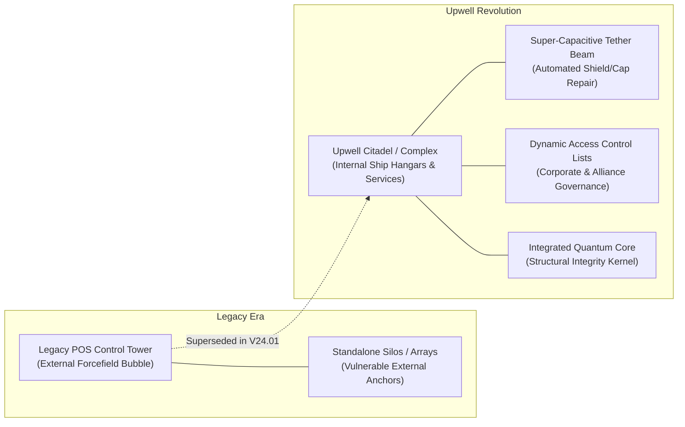
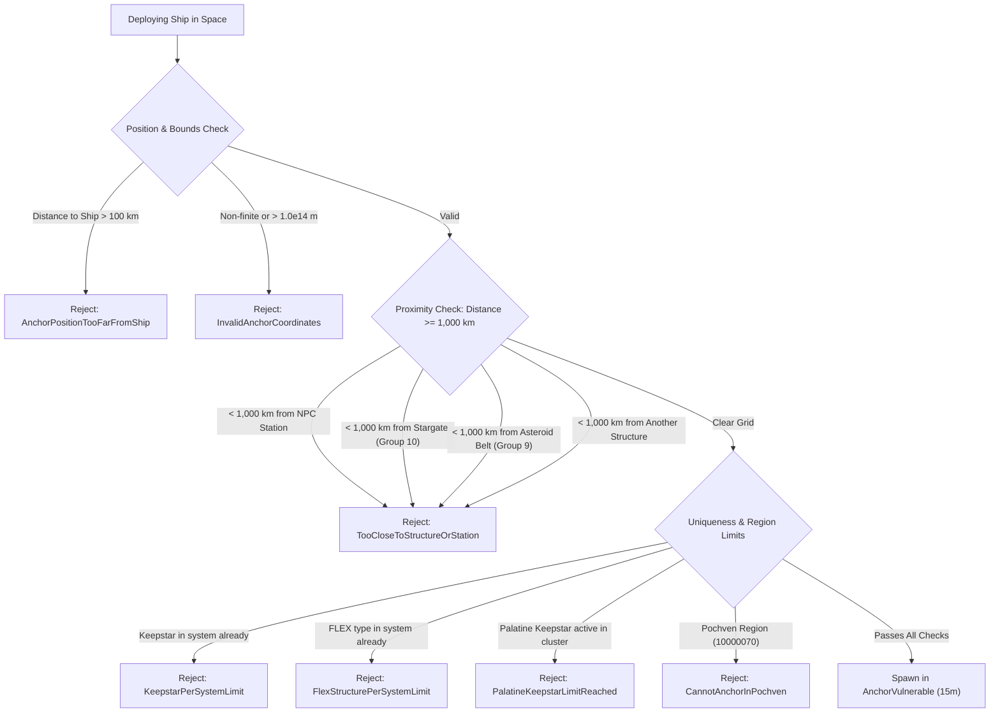
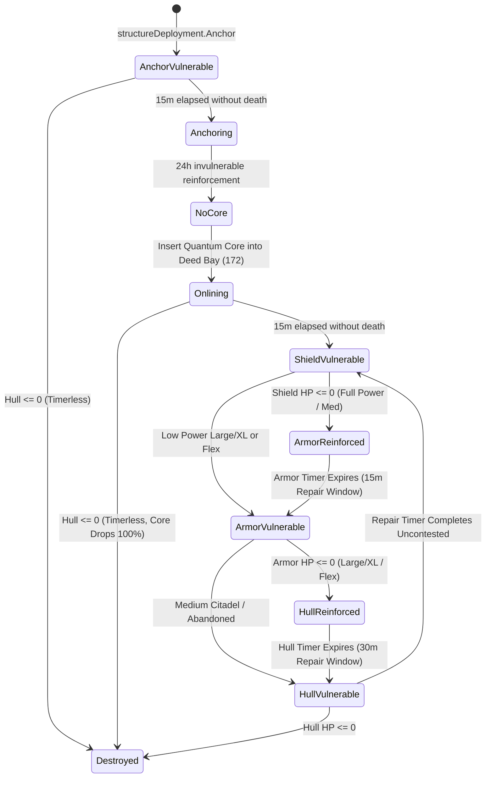
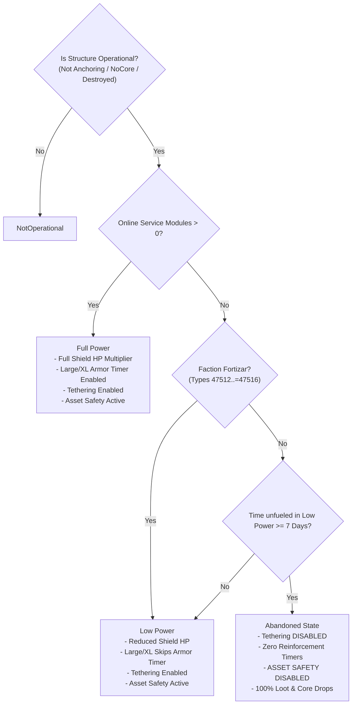
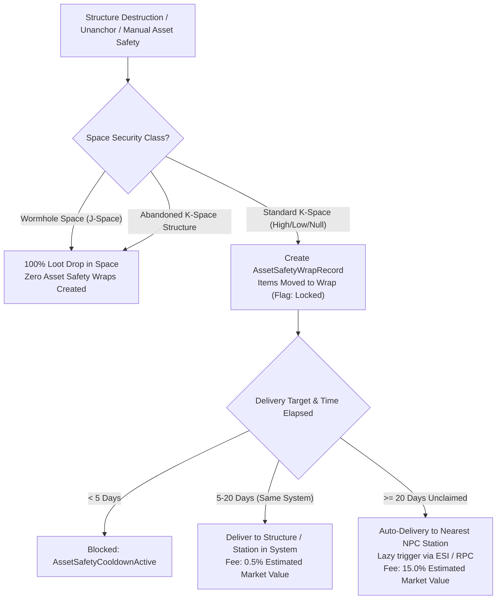
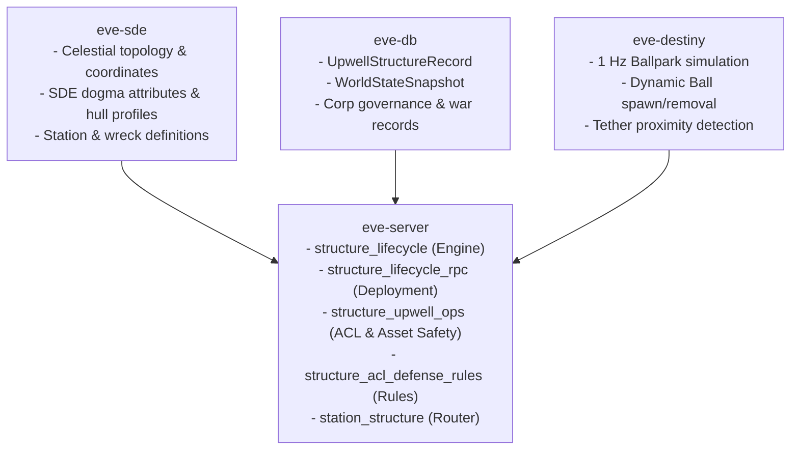
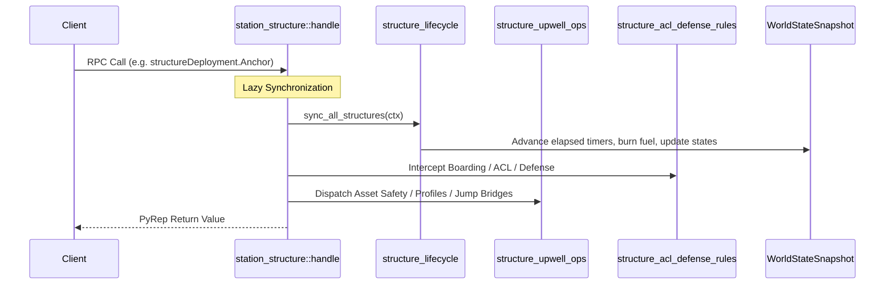

# Upwell Structures Overview & Lifecycle

> **Navigation**: [EvoMu Technical Wiki](../README.md) • [Related Systems](#related-systems--cross-references)
>
> [← Back to Wiki Table of Contents](../README.md)

---

## Overview & Lore Context

In the YC118 era, the New Eden geopolitical landscape underwent a tectonic shift orchestrated by the **Upwell Consortium**—a collective of industrial megacorporations including Upwell Mining Consortium, Chemal Tech, Intaki Bank, Ducia Foundry, and Ytiri. For more than a decade of capsuleer space exploration, orbital territory had been staked using legacy **Player Owned Starbases (POS)**: anchored Control Towers projecting delicate elliptical forcefields, ringed by disparate weapon batteries, corporate hangars, and silo arrays. These legacy towers were plagued by administrative fragility, lack of native capsuleer docking facilities, unyielding grid collision bugs, and rigid moon-anchor limitations.



The Upwell Consortium's breakthrough introduced modular, free-floating orbital megastructures known colloquially as **Citadels**, **Engineering Complexes**, and **Refineries**. Unlike legacy starbases, Upwell structures:
1. **Provide True Internal Docking:** Capsuleers dock inside climate-controlled hangars rather than floating within POS forcefield bubbles. Sub-capital and capital ships (up to Supercarriers and Titans in Extra-Large Keepstars) can safely store hulls, swap fittings, and manage corporate divisions.
2. **Feature Automated Tethering:** Powered structures project high-energy tractor/induction beams to friendly ships within range, granting total invulnerability, capacitor recharging, and hull/shield repairs while pilots remain outside the structure.
3. **Unify Service Modules & Manufacturing:** Industrial jobs, research laboratories, moon drills, cloning vats, and regional market hubs are fitted directly into the structure's service slots, replacing floating silos and arrays.
4. **Standardize Reinforced Vulnerability Cycles:** Instead of stront-fueled POS timers, Upwell hulls utilize deterministic damage caps, repair windows, and defense vulnerability schedules governed by the owning corporation.

In **EvoMu V24.01**, legacy POS control towers and starbases are completely superseded ([`station_structure.rs#L876-L892`](../../../crates/eve-server/src/services/station_structure.rs#L876-L892)), rejecting legacy anchoring attempts with `StarbaseRemoved`. The entire structure lifecycle is powered by a high-performance, deterministic simulation engine across [`eve-db`](../../../crates/eve-db), [`eve-sde`](../../../crates/eve-sde), and [`eve-server`](../../../crates/eve-server).

---

## Canonical Mechanics & Formulas

### 1. Structure Taxonomy & Classification

Upwell structures fall into distinct operational families defined by their SDE group IDs, rig socket sizes, and role bonus profiles in [`structure_lifecycle.rs#L70-L76`](../../../crates/eve-server/src/services/structure_lifecycle.rs#L70-L76):

| Family | Class | SDE Type | SDE Group | Rig Size | Primary Tactical & Industrial Role |
| :--- | :--- | :--- | :--- | :--- | :--- |
| **Citadel** | Medium | **Astrahus** (35832) | 1657 | 2 (Medium) | Corporate staging, sub-capital defense, forward operating base. |
| **Citadel** | Large | **Fortizar** (35833) | 1657 | 3 (Large) | Fleet staging, capital ship docking, market hub, clone vats. |
| **Citadel** | Extra-Large | **Keepstar** (35834) | 1657 | 4 (XL) | Supercapital (Titan/Supercarrier) docking, doomsday weapon mounting. |
| **Citadel** | Extra-Large | **Palatine Keepstar** (40340) | 1657 | 4 (XL) | Cluster-wide unique monument citadel; colossal construction bill. |
| **Engineering** | Medium | **Raitaru** (35825) | 1404 | 2 (Medium) | Small-batch manufacturing, blueprint copying, ME/TE research. |
| **Engineering** | Large | **Azbel** (35826) | 1404 | 3 (Large) | Heavy industrial production, sub-capital ship manufacturing. |
| **Engineering** | Extra-Large | **Sotiyo** (35827) | 1404 | 4 (XL) | Supercapital ship assembly array, massive industrial cost index reduction. |
| **Refinery** | Medium | **Athanor** (35835) | 1406 | 2 (Medium) | Moon fracture extraction, ore/ice reprocessing, reaction labs. |
| **Refinery** | Large | **Tatara** (35836) | 1406 | 3 (Large) | Heavy moon harvesting, capital reprocessing, hyper-efficient reactions. |
| **FLEX** | Tactical | **Ansiblex Jump Gate** (35841) | 1408 | None | Sovereign alliance stargate network; consumes Liquid Ozone. |
| **FLEX** | Tactical | **Pharolux Cyno Beacon** (35840) | 1408 | None | Unattended jump drive homing target; banned in High-Security space. |
| **FLEX** | Tactical | **Tenebrex Cyno Jammer** (35842) | 1408 | None | System-wide standard cynosural field suppressor. |

---

### 2. Corporate Ownership & The 7-Day Unanchoring Lifecycle

Upwell structures can **only** be legally owned by player corporations (`owner_corp_id >= 98_000_000`). Attempts to anchor from an NPC corporation fail with `NpcCorpCannotAnchorStructure` ([`structure_lifecycle_rpc.rs#L133-L135`](../../../crates/eve-server/src/services/structure_lifecycle_rpc.rs#L133-L135)).

#### Corporate Roles
Initiating anchoring, unanchoring, renaming, profile changes, and defense settings requires explicit corporate management authority:
$$\text{Authorized} \iff \text{Caller} \in \{\text{CEO}\} \lor \left((\text{corp-role} \land (\text{ROLE-DIRECTOR} \lor \text{ROLE-STATION-MANAGER})) \neq 0\right)$$
This check is codified in [`has_structure_manager_role`](../../../crates/eve-server/src/services/structure_lifecycle_rpc.rs#L17-L34) and [`require_corp_profile_manager`](../../../crates/eve-server/src/services/structure_upwell_ops.rs#L822-L830).

#### Unanchoring Lifecycle
When a Station Manager or Director commands `structureDeployment.Unanchor`:
1. **7-Day Clock:** A continuous countdown timer is initialized:
   $$T_{\text{unanchor}} = t_{\text{start}} + 7 \times 86{,}400 \text{ seconds}$$
2. **Cancellation & Abort Invariants:** The unanchoring order can be cancelled voluntarily via `structureDeployment.CancelUnanchor`. However, if the structure takes qualifying combat damage that pushes it into `ArmorReinforced`, `ArmorVulnerable`, `HullReinforced`, or `HullVulnerable`, the unanchoring process is **automatically terminated** by the lifecycle engine ([`structure_lifecycle.rs#L1184-L1190`](../../../crates/eve-server/src/services/structure_lifecycle.rs#L1184-L1190)).
3. **Packaging (`package_structure`):** Upon reaching $T_{\text{unanchor}}$ without active reinforcement:
   - The structure entity and space ball are removed from the Destiny ballpark.
   - The structure hull packages into a secure cargo container anchored in space at the same coordinates.
   - The installed **Quantum Core** drops inside the container.
   - Remaining fuel blocks and reagents in the `SpecializedFuelBay` (flag 133) are automatically wrapped and transferred into corporate Asset Safety ([`structure_lifecycle.rs#L493`](../../../crates/eve-server/src/services/structure_lifecycle.rs#L493)).
   - MachoNet notifications `OnStructureRemoved` and `OnStructureRemovedFromSpace` are broadcast cluster-wide to all pilots in system and corporate members ([`structure_lifecycle.rs#L640-L650`](../../../crates/eve-server/src/services/structure_lifecycle.rs#L640-L650)).

---

### 3. Spatial Separation & Deployment Constraints

To prevent tactical grid crowding, bubble stacking, and citadel overlapping, strict spatial invariants are enforced during `structureDeployment.Anchor` ([`structure_lifecycle.rs#L1252-L1287`](../../../crates/eve-server/src/services/structure_lifecycle.rs#L1252-L1287)):



1. **The 1,000 km Separation Rule:**
   $$\forall P \in \{\text{NPC Stations}, \text{Stargates}, \text{Asteroid Belts}, \text{Structures}\}, \quad \|\vec{r}_{\text{anchor}} - \vec{r}_P\| \ge 1{,}000{,}000 \text{ meters}$$
   If any celestial or active structure is within 1,000 km, the operation fails with `TooCloseToStructureOrStation`.
2. **Anchor Deployment Envelope:** The anchor coordinate must be within 100 km of the deploying ship:
   $$\|\vec{r}_{\text{anchor}} - \vec{r}_{\text{ship}}\| \le 100{,}000 \text{ meters}$$
3. **1 Keepstar per Solar System:** No more than one Extra-Large Citadel (group 1657, rig size 4) may exist simultaneously within any single solar system (`KeepstarPerSystemLimit`).
4. **1 FLEX Structure per Type per Solar System:** A solar system may only host at most one Ansiblex Jump Gate, one Pharolux Cyno Beacon, and one Tenebrex Cyno Jammer (`FlexStructurePerSystemLimit`).
5. **Universe-Wide Palatine Keepstar Uniqueness:** The Upwell Palatine Keepstar (type `40340`) has a cluster-wide ceiling of **exactly 1 active hull** (`PalatineKeepstarLimitReached`). A new Palatine Keepstar can only be deployed if the existing one is completely destroyed.

---

### 4. Vulnerability Cycle & Reinforcement Mechanics

Upwell structures cycle through a 3-layer defensive system (Shield $\rightarrow$ Armor $\rightarrow$ Hull).



#### Layer Damage Caps
Every Upwell hull has an SDE-governed damage cap per second for shields, armor, and structure hull (`ATTR_SHIELD_DAMAGE_LIMIT = 2034`, `ATTR_ARMOR_DAMAGE_LIMIT = 2035`, `ATTR_STRUCTURE_DAMAGE_LIMIT = 2036`). Incoming weapon damage over a tick $\Delta t$ is strictly clamped:
$$D_{\text{applied}} = \min\left(D_{\text{raw}}, \ D_{\text{cap}} \cdot \max(\Delta t, 0.1)\right)$$
Implemented in [`clamp_upwell_structure_damage`](../../../crates/eve-server/src/formulas.rs#L655-L660).

#### Repair Windows: 15-Minute Armor / 30-Minute Hull
When an Upwell structure exits reinforcement into an attackable layer (`ArmorVulnerable` or `HullVulnerable`), a **repair countdown timer** starts:
- **Shield & Armor Repair Window:** 15 minutes ($900\text{ s}$) — [`REPAIR_SHIELD_ARMOR_SECS`](../../../crates/eve-server/src/services/structure_lifecycle.rs#L45).
- **Hull Repair Window:** 30 minutes ($1{,}800\text{ s}$) — [`REPAIR_HULL_SECS`](../../../crates/eve-server/src/services/structure_lifecycle.rs#L47).

#### Repair Pause Threshold (10% Damage Cap)
To pause the countdown and prevent the structure from passively regenerating to 100% health, attackers must sustain a minimum post-resist damage-per-second threshold equal to 10% of the layer's damage cap (`ATTR_PAUSE_*_REPAIR_DPS`):
$$\text{Qualifying DPS} \iff \frac{D_{\text{applied}}}{\Delta t} \ge \text{DPS}_{\text{pause}}$$
When incoming DPS meets or exceeds this threshold, the repair countdown is paused by advancing `repair_until_unix`:
$$T_{\text{repair}} \leftarrow \text{now} + \lceil\Delta t\rceil + (T_{\text{repair}} - \text{now})$$
If the attacking fleet ceases fire or drops below the 10% DPS threshold for the duration of the repair window, the structure enters **Full Repair** ([`full_repair`](../../../crates/eve-server/src/services/structure_lifecycle.rs#L830-L835)), restoring 100% Shield, 100% Armor, and 100% Hull, returning immediately to `ShieldVulnerable`.

---

### 5. Multi-Timer Scheduling, UTC Hour & Jitter Mathematics

When an Upwell structure enters `ArmorReinforced` or `HullReinforced`, its exit time is determined by corporate configuration, space security classification, and deterministic random jitter ([`structure_lifecycle.rs#L304-L338`](../../../crates/eve-server/src/services/structure_lifecycle.rs#L304-L338)).

#### Minimum Reinforcement Durations
Governed by [`armor_reinforcement_secs`](../../../crates/eve-server/src/services/structure_lifecycle.rs#L342-L357) and [`hull_reinforcement_secs`](../../../crates/eve-server/src/services/structure_lifecycle.rs#L361-L375):

| Hull Class | Space Class | Power State | Armor Reinforce ($T_{\text{armor}}$) | Hull Reinforce ($T_{\text{hull}}$) |
| :--- | :--- | :--- | :--- | :--- |
| **Medium** | High-Sec | Full Power | 4.5 days ($108\text{ h}$) | None (Direct to Hull Vulnerable) |
| **Medium** | Low / Null-Sec | Full Power | 3.5 days ($84\text{ h}$) | None (Direct to Hull Vulnerable) |
| **Medium** | Wormhole (J-Space) | Full Power | 2.5 days ($60\text{ h}$) | None (Direct to Hull Vulnerable) |
| **Medium** | War HQ | Full Power | 1.0 day ($24\text{ h}$) | None (Direct to Hull Vulnerable) |
| **Large / XL** | High-Sec | Full Power | 1.0 day ($24\text{ h}$) | 4.5 days ($108\text{ h}$) |
| **Large / XL** | Low / Null-Sec | Full Power | 1.0 day ($24\text{ h}$) | 2.5 days ($60\text{ h}$) |
| **Large / XL** | Wormhole (J-Space) | Full Power | 1.0 day ($24\text{ h}$) | 1.5 days ($36\text{ h}$) |
| **Large / XL** | War HQ | Full Power | 1.0 day ($24\text{ h}$) | 1.0 day ($24\text{ h}$) |
| **Large / XL** | Any | Low Power | None (Skips to Hull Vulnerable) | Same as Full Power |
| **FLEX** | Any | Any | None | 30 minutes ($1{,}800\text{ s}$) |
| **Any** | Any | **Abandoned** | **None** | **None** |

#### Multi-Timer Anchor Invariant
For multi-timer structures (Large and Extra-Large hulls in Full Power), the hull reinforcement timer does **not** anchor to the conclusion of the armor timer; it anchors back to the initial start of the siege:
$$T_{\text{earliest-hull}} = \max\left(t_{\text{shield-fight-start}} + T_{\text{armor}} + T_{\text{hull}}, \ \text{now}\right)$$
This ensures that the final hull timer falls strictly on the planned defensive day rather than drifting forward arbitrarily due to siege durations.

#### UTC Hour Target Calculation
Structures calculate the next occurrence of the corporation's designated vulnerability hour $H \in [0, 23]$:
$$t_{\text{day-start}} = t_{\text{earliest}} - (t_{\text{earliest}} \pmod{86{,}400})$$
$$t_{\text{candidate}} = t_{\text{day-start}} + (H \pmod{24}) \times 3{,}600$$
$$t_{\text{base-exit}} = \begin{cases} t_{\text{candidate}} & \text{if } t_{\text{candidate}} \ge t_{\text{earliest}} \\ t_{\text{candidate}} + 86{,}400 & \text{otherwise} \end{cases}$$

#### Deterministic Jitter Mathematics & Same-Day Clamping
To prevent exact fleet coordination across entire coalitions, an exit jitter window $J_{\max}$ is applied:
- **Medium Hull (Armor):** $\pm 1.5\text{ hours}$ ($5{,}400\text{ s}$)
- **Large / XL Hull (Armor & Hull):** $\pm 3.0\text{ hours}$ ($10{,}800\text{ s}$)
- **FLEX Hull:** $\pm 30\text{ minutes}$ ($1{,}800\text{ s}$)

Given a uniform random roll $U \in [0, 1)$, the jitter offset is:
$$\Delta t_{\text{jitter}} = \text{round}\left((2U - 1) \cdot J_{\max}\right)$$
To ensure that jitter **never rolls the timer across midnight into another UTC day**, EvoMu clamps the exit time to the target UTC day boundary:
$$t_{\text{shifted}} = \max(0, \ t_{\text{base-exit}} + \text{clamp}(\Delta t_{\text{jitter}}, -J_{\max}, J_{\max}))$$
$$t_{\text{final-exit}} = \text{clamp}(t_{\text{shifted}}, \ t_{\text{day-start}}, \ t_{\text{day-start}} + 86{,}399)$$
Implemented in [`apply_reinforce_jitter`](../../../crates/eve-server/src/services/structure_lifecycle.rs#L328-L338).

---

### 6. Power States & Fuel Logistics

Every Upwell structure evaluates its operational power state lazily based on installed and fueled service modules ([`power_state`](../../../crates/eve-server/src/services/structure_lifecycle.rs#L274-L290)):



#### Hourly Fuel Consumption Formula
Online service modules consume Fuel Blocks (group 1136: Nitrogen, Hydrogen, Helium, Oxygen) from the structure's `SpecializedFuelBay` (flag 133). The hourly consumption $F_{\text{burn}}$ incorporates structure role bonuses:
$$F_{\text{burn}} = \sum_{m \in \text{OnlineModules}} \max\left(1, \ \text{round}\left(\text{HourlyBase}_m \cdot (1.0 - \text{Bonus}_{\text{structure}})\right)\right)$$
If the structure runs out of fuel blocks, all online service modules are forcibly offlined, and the structure transitions from **Full Power** to **Low Power**.

#### The 7-Day Abandoned State
If a structure remains in Low Power continuously for 7 days ($7 \times 86{,}400\text{ s}$ = 604,800 s), it enters the **Abandoned** power state:
1. **Tethering Deactivated:** Automated repair and docking tether beams are extinguished.
2. **Reinforcement Stripped:** All reinforcement timers are disabled. An attacking fleet can destroy the structure in a single continuous engagement:
   $$\text{Shield Vulnerable} \longrightarrow \text{Armor Vulnerable} \longrightarrow \text{Hull Vulnerable} \longrightarrow \text{Destroyed}$$
3. **Asset Safety Voided:** All personal items, corporate items, and fitted modules stored inside the structure **drop as space loot** at the structure's exact coordinates upon destruction.
4. **Faction Fortizar Immunity:** Faction Fortizars (Moreau, Draccous, Horizon, Marginis, Prometheus; types `47512..=47516`) are canonically immune to the Abandoned state and remain permanently in Low Power ([`structure_lifecycle.rs#L281-L283`](../../../crates/eve-server/src/services/structure_lifecycle.rs#L281-L283)).

---

### 7. Quantum Cores

Introduced in the Quantum Core update, every Upwell structure requires an integrated **Quantum Core** tailored to its hull class before it can transition to an operational state ([`structure_lifecycle.rs#L167`](../../../crates/eve-server/src/services/structure_lifecycle.rs#L167)).

| Structure Hull | SDE Type ID | Required Quantum Core Type | SDE Core Type ID |
| :--- | :--- | :--- | :--- |
| **Astrahus** | 35832 | Astrahus Quantum Core | 56201 |
| **Fortizar** | 35833 | Fortizar Quantum Core | 56204 |
| **Keepstar** | 35834 | Keepstar Quantum Core | 56207 |
| **Raitaru** | 35825 | Raitaru Quantum Core | 56203 |
| **Azbel** | 35826 | Azbel Quantum Core | 56206 |
| **Sotiyo** | 35827 | Sotiyo Quantum Core | 56208 |
| **Athanor** | 35835 | Athanor Quantum Core | 56202 |
| **Tatara** | 35836 | Tatara Quantum Core | 56205 |

#### Onlining Gate & Invariants
- **Anchoring Progression:** After initial deployment (15m `AnchorVulnerable`) and 24h invulnerable `Anchoring`, the structure enters `NoCore`.
- **Fitting Lock:** While in `NoCore`, pilots can dock, but service modules **cannot** be brought online, and docked ship refitting, module swaps, and strip-fitting are strictly blocked with `QuantumCoreRequired` ([`plan_upwell_structures_closure_part3.rs#L223-L228`](../../../crates/eve-server/tests/it/plan_upwell_structures_closure_part3.rs#L223-L228)).
- **Installation Gate:** The Quantum Core must be placed into the structure's `StructureDeedBay` (InventoryFlag 172). Moving a core to the general corporate hangar leaves the structure in `NoCore`. Depositing an invalid core type fails with `InvalidItemType`.
- **100% Destruction Drop:** When an Upwell structure is destroyed, the Quantum Core has a **100% guaranteed drop rate** inside the structure wreck container, acting as an economic asset sink.

---

### 8. Access Control Lists (ACLs) & Defense Systems

Access Control Lists govern every interaction with an Upwell structure, managed via `ownerGroupManager` and `structureSettings` ([`structure_acl_defense_rules.rs`](../../../crates/eve-server/src/services/structure_acl_defense_rules.rs)).

#### ACL Role Hierarchies
Each `AccessGroupRecord` assigns roles to characters, corporations, or alliances:
- **Blocked (`-1`):** Explicitly denied access regardless of corporate or alliance standing.
- **Member (`0`):** Standard access tier.
- **Manager (`2`):** Can add/remove members and assign roles up to Member.
- **Admin (`1`):** Full control over group membership and manager promotions; group creators cannot be demoted or blocked.

#### Access Resolution Engine
When a pilot attempts to dock (`verify_structure_docking_acl`), access is resolved via [`evaluate_character_structure_access_in_snap`](../../../crates/eve-server/src/services/structure_upwell_ops.rs#L799-L820):
$$\text{Access Granted} \iff \neg \text{Blocked} \land (\text{IsOwnerCorp} \lor \text{ExplicitAllowed} \lor \text{InActiveGroup})$$
1. If character, corporation, or alliance is explicitly in `blocked_*`, return `false`.
2. If `corp_only` is toggled and pilot is outside the owning corporation, return `false`.
3. If pilot or pilot's entities match allowed sets or an access group with role $\ge 0$, access is permitted.

#### Gunner Control & Auto-Defense Targeting
Pilots with appropriate ACL defense permissions can take the gunner seat via `structureControl.TakeControl` or `structureControl.BoardStructure` ([`structure_acl_defense_rules.rs#L276-L330`](../../../crates/eve-server/src/services/structure_acl_defense_rules.rs#L276-L330)). When uncrewed, structures execute automated defense targeting against:
- Pilots with negative security status ($\le -5.0$, outlaw status).
- Active corporate or alliance war enemies (`are_corps_at_war_in_snap`).
- Suspect or criminal pilots flagged by Crimewatch.

---

### 9. The Asset Safety System

The Asset Safety system ensures capsuleer items are protected when an Upwell structure leaves space or is destroyed (in non-abandoned K-space).



#### Asset Safety Formulas & Rules
1. **Creation:** Items in personal hangars and corporate divisions are grouped per owner into an `AssetSafetyWrapRecord`.
2. **5-Day Same-System Window:** Wraps become deliverable 5 days ($5 \times 86{,}400\text{ s}$) after creation (`ASSET_SAFETY_DELIVERY_DELAY_SECS`). If delivered to an accessible structure or station within the same solar system, a nominal recovery fee of **0.5%** of the estimated market value is assessed:
   $$\text{Fee}_{\text{same-system}} = 0.005 \times \text{Value}_{\text{estimated}}$$
3. **20-Day Auto-Delivery:** If unclaimed after 20 days ($20 \times 86{,}400\text{ s}$), the wrap is automatically delivered to the **nearest NPC station** by Euclidean galactic distance within the same security band:
   - High-Sec origin ($\ge 0.45$) $\longrightarrow$ Nearest High-Sec station ($\ge 0.45$).
   - Low/Null-Sec origin ($< 0.45$) $\longrightarrow$ Nearest Low-Sec station ($0.0 < \text{sec} < 0.45$).
   - Retrieving the wrap from an NPC station requires a **15.0%** recovery fee:
     $$\text{Fee}_{\text{npc-recovery}} = 0.15 \times \text{Value}_{\text{estimated}}$$
4. **Wormhole Space Invariant:** J-space systems (solar system IDs $\ge 31{,}000{,}000$) **do not possess Asset Safety**. Manual triggers fail with `AssetSafetyUnavailableInWormhole`. Upon destruction, 100% of all personal and corporate hangar items drop into space as floating containers ([`plan_upwell_structures_closure.rs#L197-L205`](../../../crates/eve-server/tests/it/plan_upwell_structures_closure.rs#L197-L205)).

---

### 10. Regional & Environmental Restrictions

To preserve canonical balance across specialized regions of New Eden, the deployment pipeline enforces strict geographical gates ([`structure_lifecycle_rpc.rs#L70-L95`](../../../crates/eve-server/src/services/structure_lifecycle_rpc.rs#L70-L95)):

1. **Pochven Citadel Ban (`POCHVEN_REGION_ID = 10000070`):** Upwell Citadels, Engineering Complexes, and Refineries **cannot be anchored** in Pochven (`CannotAnchorInPochven`).
2. **Triglavian Customs Office Gate:** Player-owned Customs Offices (POCOs / Gantries) can be anchored in Pochven **only** if the deploying pilot has $\ge +1.5$ standing with the Triglavian Collective (`500026`):
   $$\text{TriglavianStanding}(\text{Pilot}) \ge 1.5 \implies \text{Allowed}, \quad \text{else } \text{InsufficientTriglavianStanding}$$
3. **Zarzakh Prohibitions:** All capsuleer structure anchoring is prohibited in the ancient Jovian gateway system of Zarzakh (`sys_id == 30100000`, `AnchoringDisallowedInZarzakh`).
4. **Thera & Shattered Wormholes:** Unstable wormhole topologies forbid any structure anchoring (`AnchoringDisallowedInTheraOrShattered`).
5. **High-Sec Cyno Restrictions:** Pharolux Cyno Beacons cannot be anchored in high-security systems ($\text{sec} \ge 0.45$, `CannotAnchorCynoBeaconInHighSec`).
6. **Sovereign Null-Sec Ansiblex Gate:** Ansiblex Jump Gates can only be deployed in sovereign null-security space held by the deploying pilot's alliance (`CannotAnchorAnsiblexOutsideSovNull`).

---

## EvoMu Implementation Architecture

EvoMu implements the Upwell structure simulation cleanly across five specialized crates:



### 1. Crates Involved

- [`eve-db`](../../../crates/eve-db): Transactional world state snapshots (`WorldStateSnapshot`), database persistence, and structure database records.
- [`eve-sde`](../../../crates/eve-sde): Static Data Export registry, loading dogma attributes (`ATTR_SHIELD_DAMAGE_LIMIT`, `ATTR_ARMOR_DAMAGE_LIMIT`, `ATTR_REQUIRES_DEED_TYPE`), celestial groups, and system security statuses.
- [`eve-destiny`](../../../crates/eve-destiny): 1 Hz deterministic physics simulation, tracking structure space balls, wreck containers, and pilot tether states.
- [`eve-server`](../../../crates/eve-server): High-level domain services, MachoNet RPC routing, and ESI OpenAPI endpoints.

---

### 2. Primary Handlers & Dispatch

All client RPC calls targeting structures are routed through [`station_structure.rs`](../../../crates/eve-server/src/services/station_structure.rs):



#### Handlers Breakdown
1. **[`structure_lifecycle_rpc::handle_anchor`](../../../crates/eve-server/src/services/structure_lifecycle_rpc.rs#L39-L160):** Handles `structureDeployment.Anchor`. Validates player corporation status, Director/Station Manager roles, 1,000 km celestial spacing, 100 km deployment proximity, per-system Keepstar/FLEX limits, and Pochven/Zarzakh exclusions.
2. **[`structure_lifecycle::apply_structure_damage`](../../../crates/eve-server/src/services/structure_lifecycle.rs#L1075-L1196):** Evaluates live weapon damage, applies DPS caps, advances repair pause counters, transitions defensive layers (`ShieldVulnerable` $\rightarrow$ `ArmorReinforced` $\rightarrow$ `HullReinforced`), and executes destruction logic.
3. **[`structure_upwell_ops::handle`](../../../crates/eve-server/src/services/structure_upwell_ops.rs#L130-L205):** Dispatches:
   - `structureDeployment.Unanchor` / `CancelUnanchor`
   - `structureDeployment.RenameStructure`
   - `structureVulnerability.UpdateReinforceTimesFromClient`
   - `structureAssetSafety.MovePersonalAssetsToSafety` / `MoveCorpAssetsToSafety`
   - `structureAssetSafety.MoveSafetyWrapToStructure`
   - `structureSettings.CreateProfile` / `SaveProfileSettings` / `ChangeProfiles`
   - `structureDirectory.GetStructures` / `GetStructureInfo` / `SetStructureDescription`
   - `structureJumpBridgeMgr.CmdJumpThroughStructureStargate`
4. **[`structure_acl_defense_rules::handle`](../../../crates/eve-server/src/services/structure_acl_defense_rules.rs#L1269-L1298):** Dispatches:
   - `ownerGroupManager.UpdateMembershipTypes`
   - `structureControl.BoardStructure` / `EjectFromStructure` / `TakeControl` / `ReleaseControl`
   - `structureDefense.GetSettings` / `SetSettings`

---

### 3. State Store & Database Schemas

#### Core Database Struct: [`UpwellStructureRecord`](../../../crates/eve-db/src/types.rs#L1252-L1277)
```rust
#[derive(Debug, Clone, PartialEq, Serialize, Deserialize)]
pub struct UpwellStructureRecord {
    pub structure_id: i64,
    pub type_id: TypeId,
    pub owner_corp_id: i64,
    pub solar_system_id: SolarSystemId,
    pub name: String,
    pub position: [f64; 3],
    pub state: String, // "AnchorVulnerable", "Anchoring", "NoCore", "Onlining", "ShieldVulnerable", etc.
    pub quantum_core_installed: bool,
    pub fuel_blocks: u32,
    pub shield_hp: f64,
    pub armor_hp: f64,
    pub hull_hp: f64,
    pub reinforced_until_unix: u64,
    pub last_damage_tick: u64,
    pub last_damage_unix: u64,
    pub self_destruct_at_unix: Option<u64>,
}
```

#### Extended State Structs: [`structure_upwell_ops.rs`](../../../crates/eve-server/src/services/structure_upwell_ops.rs#L28-L91)
- **`AssetSafetyWrapRecord`:** Tracks wrap ownership (`owner_id`, `is_corp`), source structure, delivery timestamps (`created_unix`, `deliverable_after_unix`), item IDs, estimated market value in ISK, and nearest NPC station destination.
- **`AccessGroupRecord`:** Represents an ACL group containing `group_id`, `creator_id`, `owner_corp_id`, and entity role mappings (`members: HashMap<i64, i64>`).
- **`StructureAccessProfile`:** Configures structure access rules, linking `access_group_ids`, explicit allowed/blocked character/corp/alliance sets, and service fee settings.
- **`StructureLifecycleState`:** Runtime state tracking repair windows (`repair_until_unix`), fight start times (`fight_started_unix`, `shield_fight_started_unix`), applied jitter (`reinforce_jitter_secs`), fuel timestamps (`last_fuel_tick_unix`), and low power duration (`low_power_since_unix`).

---

### 4. Tick & Lifecycle Integration: Lazy Evaluation Architecture

EvoMu utilizes a **lazy deterministic progression model**. Rather than maintaining heavy background timers for thousands of structures, every structure's lifecycle timers are advanced on-demand whenever a structure RPC is dispatched or system states are queried ([`sync_structure`](../../../crates/eve-server/src/services/structure_lifecycle.rs#L897-L1018)):

1. **Timer Advancement Loop:** Up to 16 state steps are processed sequentially:
   - `AnchorVulnerable` $\longrightarrow$ `Anchoring` (after $15\text{m}$).
   - `Anchoring` $\longrightarrow$ `NoCore` (after $24\text{h}$).
   - `NoCore` $\longrightarrow$ `Onlining` (upon core installation).
   - `Onlining` $\longrightarrow$ `ShieldVulnerable` (after $15\text{m}$).
   - `ArmorReinforced` $\longrightarrow$ `ArmorVulnerable` (upon timer expiry, starting 15m repair window).
   - `HullReinforced` $\longrightarrow$ `HullVulnerable` (upon timer expiry, starting 30m repair window).
2. **Hourly Fuel Burn & Power States:** Processes elapsed hours since `last_fuel_tick_unix`, consumes fuel blocks from the fuel bay, offlines modules if fuel is exhausted, and updates `low_power_since_unix`.
3. **Repair Expiry:** If `repair_until_unix` has passed without qualifying attacker damage, calls [`full_repair`](../../../crates/eve-server/src/services/structure_lifecycle.rs#L830-L835) to reset all hitpoint pools to 100%.

---

## Invariants, Security & Edge Cases

### 1. Corporation Security & Invariants
- **NPC & Outlaw Anchoring Block:** Characters in starter or NPC corporations (`corp_id < 98_000_000`) cannot anchor structures (`NpcCorpCannotAnchorStructure`).
- **24-Hour Role Delay Invariant:** Malicious recruits cannot be granted instant Director or Station Manager roles to compromise, unanchor, or transfer citadels; role grants are subject to a mandatory 24-hour server-side delay.

### 2. High-Sec War Warmup Check
In High-Security space ($\text{sec} \ge 0.45$), attacking a player citadel requires an active, fully warmed-up corporation or alliance war. Attacking during the 24-hour war declaration warmup period is rejected with `IllegalHighSecStructureAttack` ([`plan_upwell_structures_closure_part3.rs#L330`](../../../crates/eve-server/tests/it/plan_upwell_structures_closure_part3.rs#L330)).

### 3. Tenant Personal Hangar Asset Protection on `DestroyFitting`
A critical security invariant protects pilots docked in public citadels:
- When calling `dogmaIM.DestroyFitting`, the server strictly validates:
  $$\text{item.owner-id} == \text{char-id}$$
  If a structure gunner or Station Manager attempts to pass an item ID belonging to a tenant pilot, the call is completely discarded ([`fitting_dogma_im.rs#L373-L375`](../../../crates/eve-server/src/services/fitting_dogma_im.rs#L373-L375)), preventing malicious citadel owners from stripping or destroying visitor modules.

### 4. Reinforcement Hour Negative-Jitter Clamping
If an attacker triggers reinforcement shortly before the chosen `reinforce_hour`, applying a negative jitter offset could mathematically result in an exit timestamp in the past ($t_{\text{exit}} \le \text{now}$). EvoMu enforces a safety clamp:
$$t_{\text{final-exit}} = \max\left(\text{apply-reinforce-jitter}(t_{\text{base-exit}}, \Delta t_{\text{jitter}}, J_{\max}), \ \text{now} + 60\right)$$
ensuring defenders always receive at least a minimum defensive response window.

---

## Verification, Tests & Parity References

EvoMu maintains strict regression test coverage across all Upwell mechanics:

### 1. Parity Ledger Coverage
The implementation certifies compliance with the following official parity ledger keys:
- `feat:structures.anchoring-onlining-phases`: 15m AnchorVulnerable $\rightarrow$ 24h Anchoring $\rightarrow$ NoCore $\rightarrow$ 15m Onlining.
- `feat:structures.quantum-core-gate`: Blocking service modules and docked refitting until matching core is installed in deed bay.
- `feat:structures.pochven-anchoring-restrictions`: Complete citadel ban in Pochven; +1.5 Triglavian standing gate for POCOs.
- `feat:structures.upwell-palatine-keepstar-limit`: Cluster-wide limit of exactly 1 active Palatine Keepstar.
- `feat:structures.anchor-restrictions`: 1,000 km grid clearance from stations, stargates, and structures.
- `feat:structures.fitting-state-locks`: Prohibiting structure refitting when damaged or anchoring.
- `feat:structures.vulnerability-repair-window`: Exact 15m shield/armor and 30m hull repair timers.
- `feat:structures.repair-timer-pause-threshold`: Pausing repair countdown on $\ge 10\%$ damage cap DPS.
- `feat:structures.reinforce-exit-time-rules`: UTC reinforce hour alignment and same-day jitter clamping.
- `feat:structures.armor-reinforce-durations`: Duration matrix across HighSec, LowSec, NullSec, Wormholes, and War HQs.
- `feat:structures.hull-reinforce-durations`: Duration matrix and multi-timer anchoring logic.
- `feat:lifecycle.structure-abandoned_destroyed`: Full Power vs Low Power vs Abandoned; 100% space drop upon abandoned destruction.
- `feat:lifecycle.asset_safety-auto_delivery`: 5-day same-system recovery (0.5% fee) and 20-day auto-delivery to nearest NPC station (15% fee).

---

### 2. Concrete Integration Tests

| Test & Source Location | Validated Behaviors |
| :--- | :--- |
| [`test_upwell_anchoring_quantum_core_pochven_and_palatine`](../../../crates/eve-server/tests/it/plan_upwell_structures_closure_part3.rs#L137)<br/>📁 [`plan_upwell_structures_closure_part3.rs`](../../../crates/eve-server/tests/it/plan_upwell_structures_closure_part3.rs) | Verifies 1,000 km separation rule, 4-phase deployment, live weapon damage pauses during anchoring, Quantum Core Deed Bay insertion, docked ship refitting locks, Pochven citadel rejection, Triglavian +1.5 standing POCO gate, and Palatine Keepstar cluster uniqueness. |
| [`test_upwell_tethering_eligibility_restrictions_and_docking_lock`](../../../crates/eve-server/tests/it/plan_upwell_structures_closure_part3.rs#L388)<br/>📁 [`plan_upwell_structures_closure_part3.rs`](../../../crates/eve-server/tests/it/plan_upwell_structures_closure_part3.rs) | Validates structure tethering eligibility, weapons timer docking locks, and emergency tether breaks on aggression. |
| [`test_upwell_lifecycle_asset_safety_abandoned_and_leave_space`](../../../crates/eve-server/tests/it/plan_upwell_structures_closure.rs#L118)<br/>📁 [`plan_upwell_structures_closure.rs`](../../../crates/eve-server/tests/it/plan_upwell_structures_closure.rs) | Tests Asset Safety wrap creation, 5-day delivery delay, 0.5% same-system fee, 20-day lazy auto-delivery to nearest NPC station, 15% recovery fee, wormhole 100% space loot drops, and 7-day low power Abandoned transition. |
| [`test_upwell_reinforcement_durations_exit_hack_and_repair`](../../../crates/eve-server/tests/it/plan_upwell_structures_closure.rs#L338)<br/>📁 [`plan_upwell_structures_closure.rs`](../../../crates/eve-server/tests/it/plan_upwell_structures_closure.rs) | Evaluates multi-timer Fortizar 30m hull repair window, reinforcement exit calculations, and damage caps. |
| [`test_structure_access_lists_and_docking_acl`](../../../crates/eve-server/tests/it/structure_acl_and_features_complete.rs#L112)<br/>📁 [`structure_acl_and_features_complete.rs`](../../../crates/eve-server/tests/it/structure_acl_and_features_complete.rs) | Tests Access Control Lists (Blocked, Member, Admin, Manager), docking ACL evaluation, and profile inheritance. |
| [`test_structure_guests_hangar_view_and_directory_parity`](../../../crates/eve-server/tests/it/rpc_structures_pos_dogma_part2.rs#L132)<br/>📁 [`rpc_structures_pos_dogma_part2.rs`](../../../crates/eve-server/tests/it/rpc_structures_pos_dogma_part2.rs) | Verifies `structureGuests` guest queries, `structureHangarViewMgr` view states, Station Manager role enforcement, and Ansiblex jump bridge access. |

---

### 3. Verification Commands

To execute and verify the Upwell structure integration test suite:

```bash
# Run comprehensive closure part 3 (Anchoring, Quantum Cores, Pochven, Palatine):
cargo test --test it -- plan_upwell_structures_closure_part3 --nocapture

# Run lifecycle closure (Asset Safety, Abandoned State, Reinforcement Tables, 30m Hull Timer):
cargo test --test it -- plan_upwell_structures_closure --nocapture

# Run RPC parity and POS manager replacement tests:
cargo test --test it -- rpc_structures_pos_dogma_part2 --nocapture

# Run ACL and structure defense feature tests:
cargo test --test it -- structure_acl_and_features_complete --nocapture
```

---

## Related Systems & Cross-References

- [**Pochven Navigation & Anchoring Restrictions**](../universe_and_navigation/pochven_navigation_and_anchoring.md): Citadel anchoring prohibitions in Pochven, standing gates for Customs Offices, and wormhole asset safety exceptions.
- [**Corporation Roles & Governance**](../corporations_and_governance/corporation_roles_and_governance.md): Station Manager and Director access roles for structure control, Quantum Core deed bay deposits, and defensive modules.
- [**Mining Cycles & Extraction**](../mining_and_harvesting/mining_cycles_and_residue.md): Metenox Moon Drill fuel logistics, hourly yield ticks, and structure reprocessing/compression facilities.
- [**Destiny Simulation Loop**](../ballpark_and_physics/destiny_simulation_loop.md): 1,000 km spatial grid separation constraints, docking sphere kinematics, and tethering checks.
- [**Dogma Attribute Engine**](../dogma_and_fitting/dogma_attribute_engine.md): Structure fitting rules, service module fuel consumption, and capacitor recharging dynamics.

---

[← Back to Wiki Table of Contents](../README.md)
